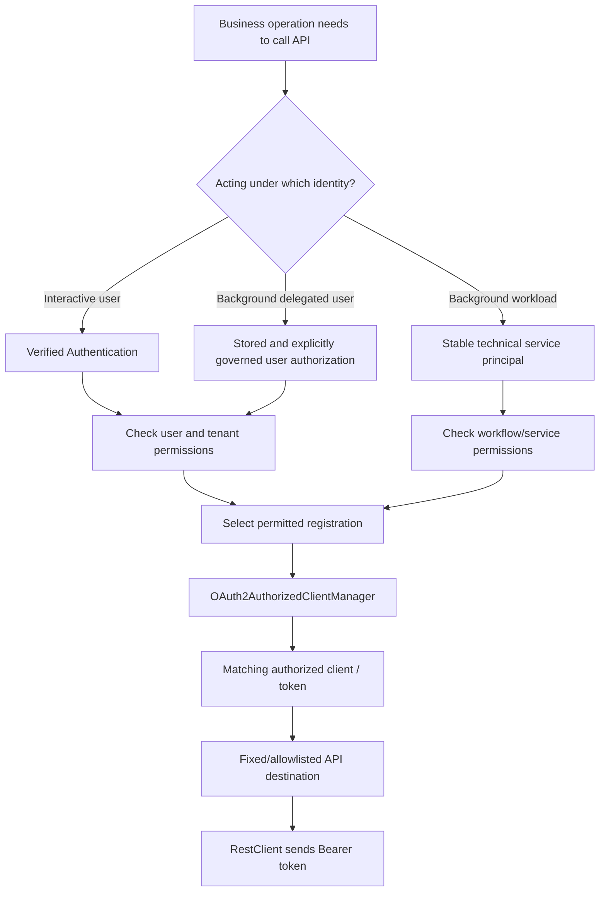
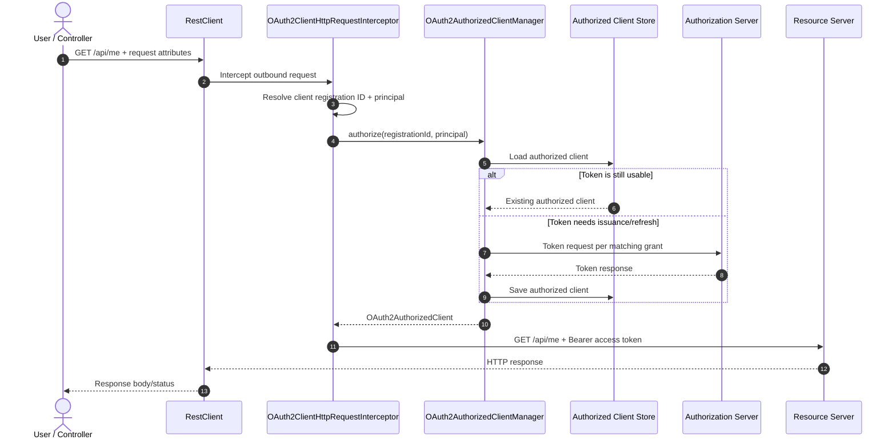
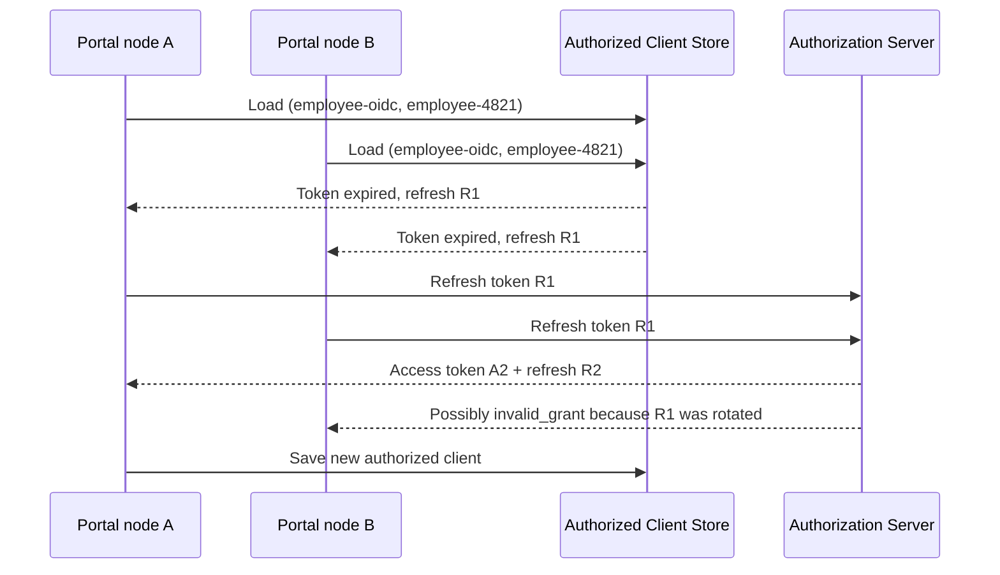

# 18.4. Selecting Principal and Authorized Client by Calling Context

## 1. Context: Same `RestClient`, Yet Which Token Is Right?

In a **Spring Security OAuth 2.0/OIDC Client** application running on **Servlet/MVC**, the backend often uses `RestClient` to call another HTTP API. When that API requires an OAuth 2.0 Bearer token, the application must obtain **the right access token** for the operation being performed.

Suppose **Employee Portal** integrates three services:

1. **Employee API** returns the profile/permissions of the **currently logged-in user**; the token must be bound to a user who completed the OIDC Authorization Code Flow.
2. **Reports API** serves scheduled jobs running periodically; the token belongs to the **application** under the Client Credentials Grant, not to any user login session.
3. **Partner API** serves specific designated tenants; the backend must select the right client registration, principal, and token source for the permitted tenant.

All three APIs can be called via `RestClient`, yet **selecting the wrong OAuth2 authorized client** can lead to `401/403` errors, broken token refreshes, or worse—sending another user's or tenant's token to an inappropriate Resource Server.

In REST client integration, the key point is not merely "attaching the `Authorization: Bearer ...` header," but **determining the permitted identity and registration before attaching the token**.

> **Key point:** `registrationId` determines which **OAuth2 Client configuration** is used; `principal` determines **which identity context the authorized client belongs to**; and the **API destination and business permissions** determine whether that token is allowed to make the HTTP call.

This lesson will help you:

- Distinguish `ClientRegistration`, `OAuth2AuthorizedClient`, `Authentication`, and `OAuth2AuthorizedClientManager` when `RestClient` calls an API.
- Select an authorized client for a **logged-in user**, a **service/workload**, or **multiple registrations/tenants**.
- Use `OAuth2ClientHttpRequestInterceptor` with `RestClient` in **Spring Security Servlet**.
- Use request attributes `clientRegistrationId(...)` and `principal(...)` when appropriate.
- Know when to use `DefaultOAuth2AuthorizedClientManager` and when to use `AuthorizedClientServiceOAuth2AuthorizedClientManager`.
- Prevent token leakage via outbound URLs, redirects, token stores, or untrusted principal selection.
- Handle missing authorized clients, expired tokens, failed refreshes, and `401/403` API responses.

The Java examples below target **Spring Boot 3.2+ / Spring Security 6.4+**, where `RestClient` and `OAuth2ClientHttpRequestInterceptor` exist. If using an older version, verify the APIs/libraries of that version; do not assume all RestClient OAuth2 APIs existed in Spring Security 5 or 6.0. Examples use Java 17+ and the Servlet stack; do not mix `ReactiveOAuth2AuthorizedClientManager` into MVC code.

## 2. Related Objects and Responsibility Boundaries

| Component | Role | What It Is Not |
| --- | --- | --- |
| **`ClientRegistration`** | Configures client ID, grant, provider, token endpoint, scopes | Not a user's access token |
| **`ClientRegistrationRepository`** | Looks up registrations by ID such as `employee-oidc`, `reports-api` | Does not decide what permissions the current user has |
| **`Authentication`** | Authenticated principal/authorities within the application | Does not by itself guarantee the target API accepts the access token |
| **`SecurityContext`** | Holds `Authentication` for the request/user session | Not a shared token store for all OAuth2 Clients |
| **`OAuth2AuthorizedClient`** | Authorized registration, principal name, access token, and optional refresh token | Does not make HTTP requests to APIs itself |
| **`OAuth2AuthorizedClientRepository`** | Saves/loads authorized clients in the Servlet HTTP request context | Does not replace user authentication |
| **`OAuth2AuthorizedClientService`** | Saves/loads authorized clients by registration/principal, request-independent | Does not automatically refresh tokens when `loadAuthorizedClient` is called |
| **`OAuth2AuthorizedClientManager`** | Coordinates loading, authorizing, refreshing, and saving across supported grants | Must not be assumed to be a business authorization mechanism |
| **`OAuth2ClientHttpRequestInterceptor`** | Integrates OAuth2 Client Manager with outbound `RestClient`, adds Bearer token | Does not prove the caller is allowed to use every token |
| **`RestClient`** | Sends HTTP requests to the Resource Server | Not an OIDC login filter |

An **`OAuth2AuthorizedClient`** contains the information the application needs to use a token properly:

```text
OAuth2AuthorizedClient
  ├─ ClientRegistration
  │    └─ registrationId = "employee-oidc"
  ├─ principalName = "employee-4821"
  ├─ OAuth2AccessToken
  │    ├─ tokenValue  [SENSITIVE]
  │    ├─ issuedAt
  │    ├─ expiresAt
  │    └─ scopes
  └─ OAuth2RefreshToken (may be null)
```

An authorized client is typically stored/looked up by the pair:

```text
(clientRegistrationId, principalName)
```

For example:

| Registration ID | Principal Name | Purpose |
| --- | --- | --- |
| `employee-oidc` | `employee-4821` | User 4821's token after OIDC Login |
| `employee-oidc` | `employee-9274` | User 9274's token |
| `partner-api` | `partner-user-14` | Token for the corresponding user/partner flow |
| `reports-api` | `reports-batch` | Client Credentials token of the backend job |

If code requests `(employee-oidc, employee-9274)` while the HTTP request was sent by `employee-4821`, that is the **wrong context**, even if the token in the database is still valid.

## 3. Three Mandatory Questions Before an Outbound OAuth2 HTTP Call

Before choosing a token, answer:

1. **On whose behalf is the action running?** The logged-in user, an authorized tenant, or the backend/service itself?
2. **Which API will receive the token?** The token must match the Resource Server's issuer, audience, scope, and trust boundary.
3. **Under which key should the token be retrieved?** The registration ID and principal name must align with the flow that granted authorization and the active token store.

Decision flowchart:



Do not invert the order into "grab any available token first, then check whom it belongs to." A valid token **does not by itself prove the calling user/tenant is permitted to use that token**.

## 4. Configuring Two `ClientRegistration`s for Two Contexts

### 4.1. Spring Boot Dependencies

Maven example:

```xml
<dependencies>
    <dependency>
        <groupId>org.springframework.boot</groupId>
        <artifactId>spring-boot-starter-web</artifactId>
    </dependency>
    <dependency>
        <groupId>org.springframework.boot</groupId>
        <artifactId>spring-boot-starter-security</artifactId>
    </dependency>
    <dependency>
        <groupId>org.springframework.boot</groupId>
        <artifactId>spring-boot-starter-oauth2-client</artifactId>
    </dependency>
</dependencies>
```

`RestClient` belongs to Spring Framework 6.1+. `OAuth2ClientHttpRequestInterceptor` belongs to Spring Security 6.4+ RestClient integration. Spring Boot 3.4+ typically provides both when using starters and a compatible BOM. If using Spring Boot 3.2/3.3 with Spring Security 6.2/6.3, `RestClient` exists, but **this OAuth2 interceptor may not exist yet**; using the token manager manually remains an alternative integration approach.

Gradle Kotlin DSL:

```kotlin
dependencies {
    implementation("org.springframework.boot:spring-boot-starter-web")
    implementation("org.springframework.boot:spring-boot-starter-security")
    implementation("org.springframework.boot:spring-boot-starter-oauth2-client")
}
```

### 4.2. `application.yml`

```yaml
spring:
  security:
    oauth2:
      client:
        registration:
          employee-oidc:
            provider: company-oidc
            client-id: ${EMPLOYEE_WEB_CLIENT_ID}
            client-secret: ${EMPLOYEE_WEB_CLIENT_SECRET}
            client-authentication-method: client_secret_basic
            authorization-grant-type: authorization_code
            redirect-uri: "{baseUrl}/login/oauth2/code/{registrationId}"
            scope:
              - openid
              - profile
              - employee.read

          reports-api:
            provider: reports-as
            client-id: ${REPORTS_SERVICE_CLIENT_ID}
            client-secret: ${REPORTS_SERVICE_CLIENT_SECRET}
            client-authentication-method: client_secret_basic
            authorization-grant-type: client_credentials
            scope:
              - reports.read

        provider:
          company-oidc:
            issuer-uri: https://identity.example.com/realms/employees
          reports-as:
            token-uri: https://auth.example.com/oauth2/token
```

These URIs and credentials are illustrative; use your project's actual Authorization Server/issuer and policies. Never commit client secrets into the repository. Comparison of the registrations:

| Property | `employee-oidc` | `reports-api` |
| --- | --- | --- |
| `registrationId` | `employee-oidc` | `reports-api` |
| `grant_type` | `authorization_code` | `client_credentials` |
| Token subject | Logged-in and consenting user | Backend client/service |
| Requires browser callback? | Yes | No |
| Principal used in authorized client store | User's `Authentication` | `reports-batch` |
| New token upon expiry | Refresh or user re-authorization | New Client Credentials Grant |
| Has ID Token? | Yes on OIDC Login | Not part of standard Client Credentials |
| Callable outside HTTP request? | Requires stored authorization design and suitable manager | Yes, service-tier manager |
| Example scope | `employee.read` | `reports.read` |

**Do not use `employee-oidc` for Reports API merely because the browser has a token**, nor use `reports-api` to authenticate employee identity. A Client Credentials access token represents application permissions, not a user session.

## 5. Using the Right OAuth2 Client Manager for the Context

### 5.1. Servlet Manager for User Tokens

`DefaultOAuth2AuthorizedClientManager` works with `OAuth2AuthorizedClientRepository` and the HTTP Servlet context.

```java
package com.example.portal.security;

import org.springframework.context.annotation.Bean;
import org.springframework.context.annotation.Configuration;
import org.springframework.security.oauth2.client.DefaultOAuth2AuthorizedClientManager;
import org.springframework.security.oauth2.client.OAuth2AuthorizedClientManager;
import org.springframework.security.oauth2.client.OAuth2AuthorizedClientProvider;
import org.springframework.security.oauth2.client.OAuth2AuthorizedClientProviderBuilder;
import org.springframework.security.oauth2.client.registration.ClientRegistrationRepository;
import org.springframework.security.oauth2.client.web.OAuth2AuthorizedClientRepository;

@Configuration
public class UserAuthorizedClientManagerConfig {

    @Bean("userAuthorizedClientManager")
    OAuth2AuthorizedClientManager userAuthorizedClientManager(
            ClientRegistrationRepository registrations,
            OAuth2AuthorizedClientRepository repository) {

        OAuth2AuthorizedClientProvider provider =
                OAuth2AuthorizedClientProviderBuilder.builder()
                    .authorizationCode()
                    .refreshToken()
                    .build();

        var manager = new DefaultOAuth2AuthorizedClientManager(
                registrations, repository);

        manager.setAuthorizedClientProvider(provider);
        return manager;
    }
}
```

When a user logs in via `oauth2Login`, the authorized client can be stored by the repository under the authenticated principal. In subsequent requests, the manager uses that user context to load/refresh tokens. If no token has ever been issued for the needed registration, the `authorization_code` flow may require browser authorization/consent; backend code cannot turn an arbitrary request into a user's token on its own.

### 5.2. Service-Tier Manager for Application Tokens

`AuthorizedClientServiceOAuth2AuthorizedClientManager` operates with `OAuth2AuthorizedClientService` without needing an `HttpServletRequest`.

```java
package com.example.portal.security;

import org.springframework.context.annotation.Bean;
import org.springframework.context.annotation.Configuration;
import org.springframework.security.oauth2.client.AuthorizedClientServiceOAuth2AuthorizedClientManager;
import org.springframework.security.oauth2.client.OAuth2AuthorizedClientManager;
import org.springframework.security.oauth2.client.OAuth2AuthorizedClientProvider;
import org.springframework.security.oauth2.client.OAuth2AuthorizedClientProviderBuilder;
import org.springframework.security.oauth2.client.OAuth2AuthorizedClientService;
import org.springframework.security.oauth2.client.registration.ClientRegistrationRepository;

@Configuration
public class ServiceAuthorizedClientManagerConfig {

    @Bean("serviceAuthorizedClientManager")
    OAuth2AuthorizedClientManager serviceAuthorizedClientManager(
            ClientRegistrationRepository registrations,
            OAuth2AuthorizedClientService authorizedClients) {

        OAuth2AuthorizedClientProvider provider =
                OAuth2AuthorizedClientProviderBuilder.builder()
                    .clientCredentials()
                    .build();

        var manager = new AuthorizedClientServiceOAuth2AuthorizedClientManager(
                registrations, authorizedClients);

        manager.setAuthorizedClientProvider(provider);
        return manager;
    }
}
```

This configuration is for workers/schedulers needing `client_credentials` tokens. If the application also supports interactive login, ensure the service/repository beans of both integration paths are managed consistently or separated by design; `@Qualifier` at call sites prevents injecting the wrong manager.

### 5.3. Why Does the Manager Need to Know the Principal?

Managers/services typically look up authorized clients by:

```text
(client_registration_id, principal_name)
```

For user tokens:

```text
(employee-oidc, employee-4821)
```

For service tokens:

```text
(reports-api, reports-batch)
```

**A principal string is not an authentication mechanism.** If you pass `principal("employee-9274")` from an HTTP request sent by `employee-4821`, the code can still ask to look up `employee-9274`'s token if the store holds matching data. Enforcing authorization before selecting a principal is a mandatory application responsibility.

## 6. Integrating `RestClient` with `OAuth2ClientHttpRequestInterceptor`

### 6.1. How Does the Interceptor Work?

`OAuth2ClientHttpRequestInterceptor` integrates `RestClient` with an `OAuth2AuthorizedClientManager`:

1. Resolves the **registration ID** from request attributes or a configured resolver.
2. Resolves the **principal** from `SecurityContext` or the selected resolver.
3. Builds an authorize request and invokes the manager.
4. Upon receiving a valid authorized client, adds `Authorization: Bearer <access-token>` to the outbound HTTP request.
5. The Resource Server evaluates the access token and its own authorization policy.



Actual steps may vary depending on the manager/provider and token lifetime. The interceptor **does not check user business permissions** before using a token, does not turn `client_credentials` into a delegated user token, and does not prove that a browser-supplied outbound URL is trustworthy.

### 6.2. Request Attributes to Know

In Spring Security RestClient integration:

- **`RequestAttributeClientRegistrationIdResolver.clientRegistrationId(String)`** creates a request attribute selecting a `ClientRegistration`.
- **`RequestAttributePrincipalResolver.principal(String)`** can pass a principal name per request context when the interceptor is configured with `RequestAttributePrincipalResolver`.
- When using the current user's principal inside an HTTP Servlet request, it is usually best to let the interceptor use the **SecurityContext principal resolver** and never let the client pick a different principal.

Static imports used in the examples:

```java
import static org.springframework.security.oauth2.client.web.client
        .RequestAttributeClientRegistrationIdResolver.clientRegistrationId;

import static org.springframework.security.oauth2.client.web.client
        .RequestAttributePrincipalResolver.principal;
```

Remember that **`RestClient` request attributes are not HTTP request query parameters**. They are metadata set by the application when building the outbound request, and must never be treated as authorized merely because the browser sent a parameter with the same name.

### 6.3. Default Selection vs. Explicit Selection

A client used across multiple contexts should not automatically attach "whichever user happens to be logged in"'s token to every request. It is safer to:

- Define a fixed/allowlisted API destination.
- Choose `clientRegistrationId(...)` at the call site.
- Use a principal from the right source (the user's `SecurityContext` or a fixed service principal).
- Never enable an overly broad default/auto-token mechanism on a shared `RestClient` used for arbitrary URLs.
- In multi-tenant systems, verify the tenant before selecting the registration/token store key.

## 7. Example A — `RestClient` Calling Employee API for the Logged-In User

### 7.1. Creating `RestClient` with the Servlet Manager

```java
package com.example.portal.api;

import org.springframework.beans.factory.annotation.Qualifier;
import org.springframework.context.annotation.Bean;
import org.springframework.context.annotation.Configuration;
import org.springframework.security.oauth2.client.OAuth2AuthorizedClientManager;
import org.springframework.security.oauth2.client.web.client.OAuth2ClientHttpRequestInterceptor;
import org.springframework.web.client.RestClient;

@Configuration
public class EmployeeApiHttpConfig {

    @Bean("employeeApiRestClient")
    RestClient employeeApiRestClient(
            RestClient.Builder builder,
            @Qualifier("userAuthorizedClientManager")
            OAuth2AuthorizedClientManager manager) {

        var oauth2Interceptor =
                new OAuth2ClientHttpRequestInterceptor(manager);

        // Uses the principal in the Servlet request's SecurityContext
        // via the default resolver; never lets the browser pick a principal.
        return builder.clone()
                .baseUrl("https://employee-api.example.com")
                .requestInterceptor(oauth2Interceptor)
                .build();
    }
}
```

Here, the interceptor constructor receives the **Servlet manager**; the example uses the default principal mechanism bound to `SecurityContext`. `RestClient.Builder.clone()` prevents accidentally mutating a shared builder when creating multiple distinct RestClients. With a dedicated builder, `clone()` can be omitted.

The `employee-oidc` configuration receives tokens via the user login flow; do not configure a technical principal like `"reports-batch"` on this client.

### 7.2. Service Selecting Registration on the Outbound Request

```java
package com.example.portal.api;

import static org.springframework.security.oauth2.client.web.client
        .RequestAttributeClientRegistrationIdResolver.clientRegistrationId;

import org.springframework.beans.factory.annotation.Qualifier;
import org.springframework.stereotype.Service;
import org.springframework.web.client.RestClient;

@Service
public class EmployeeDirectoryClient {

    private final RestClient employeeApi;

    public EmployeeDirectoryClient(
            @Qualifier("employeeApiRestClient")
            RestClient employeeApi) {
        this.employeeApi = employeeApi;
    }

    public String currentEmployeeProfile() {
        return employeeApi.get()
                .uri("/v1/employees/me")
                .attributes(clientRegistrationId("employee-oidc"))
                .retrieve()
                .body(String.class);
    }
}
```

When running **inside an authenticated Servlet HTTP request**, the RestClient interceptor uses the matching registration and the principal from `SecurityContext`, and the manager loads the authorized client issued for that user.

**Notable point:** the call site does not pass raw access tokens. The interceptor takes responsibility for attaching the Bearer token after manager authorization. The backend must still know whether the `employee-oidc` access token's scope/audience fits `employee-api.example.com`; a successful OIDC Login does not guarantee every API accepts that token.

### 7.3. Protecting the Endpoint Before Calling the API

```java
package com.example.portal.web;

import com.example.portal.api.EmployeeDirectoryClient;
import org.springframework.security.core.Authentication;
import org.springframework.web.bind.annotation.GetMapping;
import org.springframework.web.bind.annotation.RestController;

@RestController
public class EmployeeProfileController {

    private final EmployeeDirectoryClient directory;

    public EmployeeProfileController(EmployeeDirectoryClient directory) {
        this.directory = directory;
    }

    @GetMapping("/employee/profile")
    public String profile(Authentication authentication) {
        // Authentication is provided by Spring MVC/Security.
        // HTTP security rules must ensure this endpoint requires login.
        return directory.currentEmployeeProfile();
    }
}
```

And an illustrative `SecurityFilterChain`:

```java
package com.example.portal.security;

import org.springframework.context.annotation.Bean;
import org.springframework.context.annotation.Configuration;
import org.springframework.security.config.Customizer;
import org.springframework.security.config.annotation.web.builders.HttpSecurity;
import org.springframework.security.web.SecurityFilterChain;

@Configuration
public class WebSecurityConfig {

    @Bean
    SecurityFilterChain securityFilterChain(HttpSecurity http) throws Exception {
        http.authorizeHttpRequests(authorize -> authorize
                .requestMatchers("/", "/error", "/css/**").permitAll()
                .requestMatchers("/employee/**").authenticated()
                .anyRequest().authenticated()
            )
            .oauth2Login(Customizer.withDefaults());

        return http.build();
    }
}
```

This is an **alternative/standalone** web chain alongside the manager configuration beans above; do not create a second global chain with overlapping matchers unless you have a specific multi-chain design.

**Do not query `SecurityContextHolder` outside a request** expecting to receive the same user after hopping to a background thread. This example is designed for synchronous execution inside a Servlet request.

### 7.4. Two Different Users, Same `RestClient` Instance

`RestClient` is commonly declared as a **singleton bean**, yet the **principal is resolved per request**:

```text
Request 1:
    Authentication = employee-4821
    RestClient + employee-oidc
    Authorized client = (employee-oidc, employee-4821)

Request 2:
    Authentication = employee-9274
    RestClient + employee-oidc
    Authorized client = (employee-oidc, employee-9274)
```

Never save an `OAuth2AuthorizedClient`, access token, or `Authentication` from request 1 into a **mutable singleton field** and reuse it in request 2. A shared RestClient bean is not the problem; **an ad-hoc token cache in a shared field** can cause cross-user privilege leaks.

## 8. Example B — `RestClient` for Background Client Credentials

### 8.1. Using the Service-Tier Manager

A job running via `@Scheduled` or a queue consumer has no browser session. Therefore, you must use **`AuthorizedClientServiceOAuth2AuthorizedClientManager`** (configured in Section 5.2) instead of the HTTP Servlet manager.

Create a dedicated RestClient for the Reports API:

```java
package com.example.portal.reports;

import org.springframework.beans.factory.annotation.Qualifier;
import org.springframework.context.annotation.Bean;
import org.springframework.context.annotation.Configuration;
import org.springframework.security.oauth2.client.OAuth2AuthorizedClientManager;
import org.springframework.security.oauth2.client.web.client.OAuth2ClientHttpRequestInterceptor;
import org.springframework.security.oauth2.client.web.client.RequestAttributePrincipalResolver;
import org.springframework.web.client.RestClient;

@Configuration
public class ReportsApiHttpConfig {

    @Bean("reportsApiRestClient")
    RestClient reportsApiRestClient(
            RestClient.Builder builder,
            @Qualifier("serviceAuthorizedClientManager")
            OAuth2AuthorizedClientManager manager) {

        var oauth2Interceptor =
                new OAuth2ClientHttpRequestInterceptor(manager);

        // Enables resolving principal name from RestClient request attributes.
        oauth2Interceptor.setPrincipalResolver(
                new RequestAttributePrincipalResolver());

        return builder.clone()
                .baseUrl("https://reports-api.example.com")
                .requestInterceptor(oauth2Interceptor)
                .build();
    }
}
```

This configuration fits **explicitly passing a technical principal** in request attributes. Do not attach this same principal resolver to a user-bound RestClient while allowing call sites to pass usernames from untrusted strings.

### 8.2. Selecting Both Registration ID and Technical Principal

```java
package com.example.portal.reports;

import static org.springframework.security.oauth2.client.web.client
        .RequestAttributeClientRegistrationIdResolver.clientRegistrationId;
import static org.springframework.security.oauth2.client.web.client
        .RequestAttributePrincipalResolver.principal;

import org.springframework.beans.factory.annotation.Qualifier;
import org.springframework.stereotype.Service;
import org.springframework.web.client.RestClient;

@Service
public class ReportsClient {

    private static final String SERVICE_PRINCIPAL = "reports-batch";

    private final RestClient reportsApi;

    public ReportsClient(
            @Qualifier("reportsApiRestClient") RestClient reportsApi) {
        this.reportsApi = reportsApi;
    }

    public String dailySummary() {
        return reportsApi.get()
                .uri("/v1/reports/daily-summary")
                .attributes(clientRegistrationId("reports-api"))
                .attributes(principal(SERVICE_PRINCIPAL))
                .retrieve()
                .body(String.class);
    }
}
```

Here:

- `clientRegistrationId("reports-api")` picks the client ID/secret, token endpoint, scope, and `client_credentials` grant.
- `principal("reports-batch")` creates a stable technical principal key in the authorized client store.
- The service-tier manager operates without needing `HttpServletRequest` or browser `Authentication`.
- The interceptor obtains/attaches the Bearer token for that context.
- The scheduled job can call `dailySummary()` even when all employees are logged out.

### 8.3. Scheduled Job Independent of User Logins

```java
package com.example.portal.reports;

import org.springframework.scheduling.annotation.Scheduled;
import org.springframework.stereotype.Component;

@Component
public class ReportsSyncJob {

    private final ReportsClient reportsClient;

    public ReportsSyncJob(ReportsClient reportsClient) {
        this.reportsClient = reportsClient;
    }

    @Scheduled(fixedDelayString = "${jobs.reports.delay-ms:900000}")
    public void synchronize() {
        String summary = reportsClient.dailySummary();

        // Sync data with business idempotency and error-handling
        // policies; do not log tokens or sensitive data.
        process(summary);
    }

    private void process(String summary) {
        // Simplified example: process authorized data fetched from the API.
    }
}
```

The application must enable `@EnableScheduling` on a `@Configuration`/`@SpringBootApplication` class, and can configure `jobs.reports.delay-ms` in `application.yml`.

**Do not use `SecurityContextHolder.getContext().getAuthentication()` to determine the principal for a scheduled job.** With no HTTP request, `SecurityContext` may be empty or represent no user. Service principals must be governed by the backend.

### 8.4. What Does a Stable Principal Name Mean?

If job runs use:

```text
(reports-api, reports-batch)
```

the authorized client service can reuse a still-valid access token according to policy. If each run uses `reports-batch-{timestamp}`, the manager usually treats it as a new principal, potentially requesting new tokens unnecessarily and bloating the store with entries.

**A technical principal does not change token scopes or audience**. If two workloads need separate permissions, consider separate client registrations or authorization mechanisms that actually yield differently scoped tokens, not just changing the principal name.

## 9. When `OAuth2AuthorizedClient` Already Exists: Using the Resolved Object Safely

### 9.1. You Do Not Always Need to Look Up the Registration Again

In some controllers, Spring MVC can inject the `OAuth2AuthorizedClient` for an authorized registration. For example, when OAuth2 Client integration is enabled:

```java
package com.example.portal.web;

import org.springframework.security.oauth2.client.OAuth2AuthorizedClient;
import org.springframework.security.oauth2.client.annotation.RegisteredOAuth2AuthorizedClient;
import org.springframework.web.bind.annotation.GetMapping;
import org.springframework.web.bind.annotation.RestController;

@RestController
public class AuthorizedClientStatusController {

    @GetMapping("/employee/authorized-client")
    public String status(
            @RegisteredOAuth2AuthorizedClient("employee-oidc")
            OAuth2AuthorizedClient authorizedClient) {

        return "registration="
                + authorizedClient.getClientRegistration().getRegistrationId();
    }
}
```

This snippet intentionally **returns only metadata**; never return `getAccessToken().getTokenValue()` or `getRefreshToken()` to the browser. Depending on resolver/manager configuration and whether the registration is already authorized, argument resolution may use a stored authorized client or need to trigger the appropriate authorization flow.

Once code holds an authorized client from a trustworthy source (such as the argument resolver or a service/repository verifying the right `Authentication`), its token can be used when sending a request:

```java
public String fetchProfile(
        RestClient api,
        OAuth2AuthorizedClient authorizedClient) {

    String accessToken = authorizedClient.getAccessToken().getTokenValue();

    return api.get()
            .uri("/v1/employees/me")
            .headers(headers -> headers.setBearerAuth(accessToken))
            .retrieve()
            .body(String.class);
}
```

This is an **explicit token-attachment option with `RestClient`**, without using the interceptor. Its strength is that readers clearly see which authorized client is used. Its limitation is that if you hold onto the object too long, the token may expire and **will not be refreshed automatically by `setBearerAuth(...)`**. When token lifecycles are complex, call the authorized client manager or use the OAuth2 interceptor on each outbound call.

### 9.2. `OAuth2AuthorizeRequest.withAuthorizedClient(...)`

Another option is passing an existing authorized client back to the manager so the manager can handle expiry and the corresponding provider:

```java
OAuth2AuthorizeRequest request = OAuth2AuthorizeRequest
        .withAuthorizedClient(existingAuthorizedClient)
        .principal(authentication)
        .build();

OAuth2AuthorizedClient current = manager.authorize(request);

if (current == null) {
    throw new IllegalStateException(
            "Cannot authorize current user for the requested API");
}
```

Mandatory conditions:

- `existingAuthorizedClient` must be retrieved from a trusted source for **the exact user/tenant and registration**.
- `authentication` must represent the authenticated principal permitted to use that client.
- The manager/provider must support the corresponding grant/lifecycle; not every case refreshes automatically.
- If the result is used to call an API, destination/audience/scope must still be checked, and tokens must never be sent to the browser.

**`withAuthorizedClient(...)` is not a way to "accept a token from a caller and trust it blindly."** Just because the object is managed by the application does not mean it suits any principal. Never deserialize an authorized client from an arbitrary JSON request and pass it straight into the manager.

### 9.3. Comparing Three Ways to Supply a Token to `RestClient`

| Approach | When Appropriate? | Client/Principal Selection | Token Lifecycle |
| --- | --- | --- | --- |
| **OAuth2 interceptor + request attributes** | Many HTTP calls where automatic manager coordination is desired | `clientRegistrationId(...)` and principal resolver | Manager can load/issue/refresh depending on provider |
| **Direct manager + `setBearerAuth`** | Need explicit control over authorize logic and API calls, service code independent of interceptor | Full `OAuth2AuthorizeRequest` | Lifecycle handled only when manager is called at the right time |
| **Already-resolved `OAuth2AuthorizedClient` + `setBearerAuth`** | Token already safely supplied within the same request | Existing authorized client object | Uses current snapshot; may expire later |

You do not have to enforce a single approach across the entire project. What matters is **never mixing mechanisms with conflicting principal policies** on one HTTP client in a way that attaches the wrong token.

## 10. Example C — Explicitly Selecting a Token via Manager Without an Interceptor

When a system has special control requirements, developers can call `OAuth2AuthorizedClientManager` first, then attach the Bearer header manually on a dedicated `RestClient`.

### 10.1. Service-Tier Method Independent of `SecurityContext`

```java
package com.example.portal.reports;

import org.springframework.beans.factory.annotation.Qualifier;
import org.springframework.security.oauth2.client.OAuth2AuthorizeRequest;
import org.springframework.security.oauth2.client.OAuth2AuthorizedClient;
import org.springframework.security.oauth2.client.OAuth2AuthorizedClientManager;
import org.springframework.stereotype.Service;
import org.springframework.web.client.RestClient;

@Service
public class ReportsClientWithoutInterceptor {

    private final OAuth2AuthorizedClientManager manager;
    private final RestClient http;

    public ReportsClientWithoutInterceptor(
            @Qualifier("serviceAuthorizedClientManager")
            OAuth2AuthorizedClientManager manager,
            RestClient.Builder builder) {

        this.manager = manager;
        this.http = builder.clone()
                .baseUrl("https://reports-api.example.com")
                .build();
    }

    public String dailySummary() {
        OAuth2AuthorizeRequest request = OAuth2AuthorizeRequest
                .withClientRegistrationId("reports-api")
                .principal("reports-batch")
                .build();

        OAuth2AuthorizedClient authorized = manager.authorize(request);

        if (authorized == null) {
            throw new IllegalStateException(
                    "The reports client cannot be authorized");
        }

        String token = authorized.getAccessToken().getTokenValue();

        return http.get()
                .uri("/v1/reports/daily-summary")
                .headers(headers -> headers.setBearerAuth(token))
                .retrieve()
                .body(String.class);
    }
}
```

In this approach:

- The manager is called **before each HTTP call** as needed.
- Registration/principal is chosen in one explicit place.
- `RestClient` itself has no OAuth2 logic; the method takes responsibility for attaching the token.
- The token is never stored in a singleton service field and never logged.
- If the API returns `401` because the token was revoked, a separate invalidation/reacquisition policy is required; `setBearerAuth(...)` does not remove the authorized client.
- If the API returns `403` due to missing scopes, re-requesting a token with the same configuration usually will not increase permissions.

This is also a useful option when your Spring Security version does not yet include `OAuth2ClientHttpRequestInterceptor`, while already having `OAuth2AuthorizedClientManager` and Spring Framework `RestClient`.

### 10.2. Do Not Arbitrarily Mix Manual Headers with an Interceptor

If a `RestClient` has an OAuth2 interceptor while call sites also set `Authorization: Bearer ...` manually, two sources are deciding the token. The interceptor and manual header may overwrite each other or produce unpredictable behavior depending on execution order.

Pick **one clear owner** for the Bearer header per client/request. If an API requires explicit tokens, design a controlled wrapper instead of mixing user and service tokens.

## 11. Multi-Tenancy: Choosing the Right Principal Is Still Not Enough

### 11.1. A User Can Belong to Multiple Tenants

Suppose Employee Portal supports two tenants:

```text
north -> Registration "north-oidc"
south -> Registration "south-oidc"
```

User A has access to `north` but not `south`. If the browser requests:

```http
GET /tenant/south/profile
```

the application must not automatically select `south-oidc` and use an existing authorized client just because the caller knows the tenant name.

Safe sequence:

1. Obtain the verified `Authentication` from Spring Security.
2. Check whether the user has permission to access the requested tenant.
3. Map the tenant to a registration via a trusted allowlist/config.
4. Verify the authorized client belongs to the exact user/tenant/registration.
5. Attach the access token only to the API endpoint of the permitted tenant.

### 11.2. Mapping Tenant → Registration Is Not Authorization

Example mapping service:

```java
package com.example.portal.tenants;

import org.springframework.stereotype.Component;

@Component
public class TenantRegistrationResolver {

    public String resolveAuthorizedRegistration(String tenantId) {
        return switch (tenantId) {
            case "north" -> "north-oidc";
            case "south" -> "south-oidc";
            default -> throw new IllegalArgumentException(
                    "Unsupported tenant");
        };
    }
}
```

This function **only maps IDs**. Another layer must verify the user is allowed to access the tenant; only after that check passes should the resolver and RestClient be invoked.

Never allow callers to directly supply:

```text
?token_uri=https://untrusted.example/token
?client_registration_id=any
?principal_name=other-user
```

and feed them into OAuth2 Client configuration. Doing so can cause **SSRF, wrong-user token selection, or client credential exposure**.

### 11.3. Authorized Client Keys Can Collide Across Issuers

In some configurations, `principalName` comes from OIDC's `sub`, and `sub` is only unique per issuer. If a shared registration/authorized client store receives the same `sub` from two different issuers, key collisions can occur:

```text
(oidc-dynamic, subject-123)
(oidc-dynamic, subject-123)
```

Multi-issuer systems must namespace identifiers properly—for example, separating registrations per issuer or creating a stable principal key governed by `(issuer, subject)`. Ensure **login, load, refresh, and remove** all apply the exact same rule, rather than adding a prefix in one controller while the repository stores another format.

**Do not rely solely on changing a principal string to believe two tenants are isolated.** Audience, scopes, issuers, and token policies at the Authorization Server must also be properly partitioned.

### 11.4. When a Background Job Calls an API on Behalf of a User

A job running after the user closes the browser may still need the user's delegated access token. This is not simple Client Credentials:

- The token was issued after user authorization/consent.
- A securely stored refresh token may be needed.
- A service-tier manager must be configured for grants compatible with the stored authorized client.
- The job must hold business authorization to act on the user's behalf.
- The user may revoke consent; tokens may expire or refreshes may be rejected.
- Retention, logout policies, and privacy must be addressed.

**`principal("employee-4821")` does not by itself prove the backend is authorized to act for `employee-4821`**. It is only a lookup key in the token store; permission to run the background job must be stored and verified by the system's workflow.

## 12. Where to Resolve Principal From: `Authentication`, String, or Existing Object?

### 12.1. User-Bound HTTP Requests

The right source is the **`Authentication` verified by Spring Security**, typically loaded from `SecurityContext`. A `RestClient` running synchronously inside a Servlet request can use the principal resolver reading the current `SecurityContext`.

**Never take a username from an HTTP query/body** as a substitute principal:

```java
// Anti-pattern: browser picks the authorized client's principal name.
String principalName = request.getParameter("principal");

OAuth2AuthorizeRequest authorizeRequest = OAuth2AuthorizeRequest
        .withClientRegistrationId("employee-oidc")
        .principal(principalName)
        .build();
```

In a system storing tokens by principal, an attacker could attempt to retrieve or use another user's token. The builder's `principal(String)` API **supplies an identity context**, not user authentication.

### 12.2. Service-Bound Workloads

The right source is a technical name from internal configuration/constants:

```java
private static final String SERVICE_PRINCIPAL = "reports-batch";
```

The same principal can be shared within the same workload if token sharing is an intentional policy. If workflows differ in scopes, audience, or client identity, use corresponding registrations/namespaces rather than arbitrary principal names.

### 12.3. Requests That Already Have an Authorized Client

If an authorized client was resolved from the repository within the **matching authenticated request**, it already holds:

```java
authorizedClient.getPrincipalName();
authorizedClient.getClientRegistration().getRegistrationId();
```

Still, before using it with another request, re-verify:

- Is the principal still permitted to call the API?
- Does the token belong to the right issuer/registration?
- Is the token unexpired with matching scopes?
- Does it need refreshing via the manager?
- Has the API destination been restricted?

**Never use an authorized client stored in user A's session to serve user B** simply because the registration ID matches.

### 12.4. Losing `SecurityContext` Due to Async Execution

With `@Async`, `CompletableFuture`, custom executors, or message consumers, `SecurityContextHolder` typically no longer retains the HTTP request's `Authentication` as you might expect.

Valid options:

- If work truly must run **on behalf of a user**, pass a controlled authorization context across the executor/queue and use an appropriate authorized client store; verify permissions and retention.
- If it is **application-owned** work, use a service-tier manager and a technical principal.
- Only use `DelegatingSecurityContext*` when intentionally preserving `SecurityContext` within the corresponding processing pipeline, never to "fake" a user login for arbitrary background jobs.
- Never place a user's `Authentication` in a static/global variable for convenient reuse.

## 13. One `RestClient` Bean or Multiple `RestClient` Beans?

### 13.1. Reusability vs. Security Boundaries

`RestClient` is an HTTP client reusable across many requests, yet a **dedicated `RestClient` per API** is usually much easier to control:

```text
employeeApiRestClient
  -> baseUrl https://employee-api.example.com
  -> userAuthorizedClientManager
  -> principal from SecurityContext
  -> registration employee-oidc

reportsApiRestClient
  -> baseUrl https://reports-api.example.com
  -> serviceAuthorizedClientManager
  -> principal from request attribute (reports-batch)
  -> registration reports-api
```

Benefits:

- Easy to restrict destinations receiving the Bearer token.
- Prevents an M2M client from accidentally reading a user's `SecurityContext` token.
- Easy to apply separate timeouts/proxies/error handlers per Resource Server.
- Easy to track metrics per registration/destination.
- Easy to configure authorized-client failure handling against the matching store.

### 13.2. Can You Build One Multi-Registration Client?

Technically, the OAuth2 interceptor can select registrations from request attributes. Safety, however, depends on:

- The business-permitted set of registrations.
- Binding principal/registration relationships to the user or service.
- The set of API destinations permitted to receive each token.
- Controlling HTTP redirects to avoid sending credentials to other hosts.
- Consistency between the authorized client manager and token store.

If the application provides a general-purpose `RestClient` to call arbitrary URLs, **do not attach the OAuth2 interceptor by default to every request** without destination and scope constraints.

### 13.3. Never Store Access Tokens in a Singleton Service Field

Anti-pattern:

```java
@Service
class BadTokenCache {
    private String lastAccessToken; // Could belong to any user.

    void updateForUser(String token) {
        this.lastAccessToken = token;
    }

    String current() {
        return this.lastAccessToken;
    }
}
```

If user A updates the token and user B calls the API through this singleton, the wrong token can be used. Instead, let `OAuth2AuthorizedClientManager`/repository handle each request using the exact registration and principal.

## 14. `401/403` Responses: Who Is Responsible for Recovering the Authorized Client?

### 14.1. Two Different Failure Categories

In RestClient integration, failures can occur at two points:

1. **Acquiring the token**: the manager/Token Endpoint fails to authorize.
2. **Using the token**: the Resource Server received the Bearer token yet returned `401/403`.

| Stage | Example | Interpretation |
| --- | --- | --- |
| Token Endpoint | `invalid_client` | Wrong client credentials or client authentication |
| Token Endpoint | `invalid_grant` | Code/refresh token invalid, expired, or reused |
| Token Endpoint | `unauthorized_client` | Client is not permitted to use that grant |
| Token Endpoint | `invalid_scope` | Scope not granted by provider |
| Resource Server | `401 invalid_token` | Access token rejected; possibly expired, revoked, or wrong audience/issuer |
| Resource Server | `403 insufficient_scope` | Token may be valid, yet lacks required scope/permissions |
| Website Servlet | `403` before calling API | User lacks business permissions in Employee Portal |

**Do not log out the browser user just because the backend's Client Credentials token failed**. Conversely, if the Token Endpoint reports `invalid_grant` for a user's refresh token, handle re-authorization through the user flow—do not substitute an M2M token.

### 14.2. The RestClient Interceptor's Authorization Failure Handler

Spring Security's `OAuth2ClientHttpRequestInterceptor` provides **`setAuthorizationFailureHandler(...)`**. For certain Bearer token error responses from the Resource Server, the failure handler can remove the invalid authorized client from the store so subsequent authorizations do not keep reusing a rejected access token.

Example with a **service-tier manager + `OAuth2AuthorizedClientService`**:

```java
import org.springframework.security.oauth2.client.OAuth2AuthorizedClientService;
import org.springframework.security.oauth2.client.web.client.OAuth2ClientHttpRequestInterceptor;

// Inside a bean factory that already has manager and service:
var oauth2 = new OAuth2ClientHttpRequestInterceptor(manager);

oauth2.setAuthorizationFailureHandler(
        OAuth2ClientHttpRequestInterceptor
                .authorizationFailureHandler(authorizedClientService));
```

This is a **configuration fragment**, not a standalone class. Use the exact `OAuth2AuthorizedClientService` used by the manager. With a Servlet repository, the corresponding helper can be created from `OAuth2AuthorizedClientRepository` depending on your Spring Security version.

Understand the limits accurately:

- The failure handler only acts on errors/conditions recognized by its implementation; **do not claim every 401/403 deletes the token**.
- Removing a local authorized client does not automatically revoke the token at the Authorization Server.
- Deleting the token can help **subsequent** calls obtain a fresh token, yet does not guarantee automatic immediate retry of the same HTTP request.
- If a 403 is due to missing scope, re-issuing a token with the old scope usually **does not change permissions**.
- If a token was rejected due to **wrong registration/tenant**, fix token selection rather than repeatedly deleting and re-acquiring.

### 14.3. Retries Must Account for Idempotency

For read-only HTTP GETs, bounded retries after handling a bad token may be acceptable. For POST/PUT/PATCH/DELETE, assess whether the Resource Server already executed the request before retrying.

Example:

```text
POST /payments
   -> network timeout after the API already succeeded
   -> client retries automatically
   -> may create a duplicate payment if the API is not idempotent
```

Never implement "retry infinitely on 401/timeout" inside a shared interceptor. Define retry policies by error type, HTTP method, idempotency keys, and API standards.

### 14.4. The OAuth2 Interceptor Does Not Replace HTTP Error Handling

Under default configuration, `RestClient.retrieve()` may throw exceptions on HTTP 4xx/5xx. A business layer should distinguish:

- Authorization errors from the manager/Token Endpoint.
- Bearer token errors from the Resource Server.
- HTTP 404 due to non-existent resources.
- HTTP 429/503 due to upstream overload.
- Outbound connection DNS/TLS/timeout errors.

Never return raw exception messages containing URLs, tokens, or sensitive response bodies to the browser. Business error messages must be normalized without exposing credential details.

## 15. When the Authorized Client May Not Exist Yet: How Does the Manager Handle It?

### 15.1. Authorization Code for Logged-In Users

Suppose a user is logged in via OIDC using `employee-oidc`, and that authorized client was saved on callback success. Yet if a controller asks for another registration (`partner-api`) that the user has not authorized, the manager **cannot fabricate a delegated user token from the existing `Authentication` alone**.

An appropriate user authorization/consent flow is required, such as initiating the browser flow via `/oauth2/authorization/{registrationId}` as configured. Never grab a `client_credentials` token to mask missing user consent.

### 15.2. Client Credentials Without a Token Yet

If `reports-api` uses Client Credentials, the service-tier manager can call the Token Endpoint with client credentials to acquire a new token without a browser.

The difference:

```text
User OAuth2 token (authorization_code):
    User has never granted permission for registration X
       -> requires valid authorization flow / consent

App OAuth2 token (client_credentials):
    No token yet for registration Y
       -> backend can request a new token using client credentials
```

### 15.3. `authorize(...)` Returns Null or Throws an Exception

When calling the manager directly:

```java
OAuth2AuthorizedClient client = manager.authorize(request);

if (client == null) {
    // Cannot authorize under current provider/context.
    // Never fall back to another user's token.
    throw new IllegalStateException("Authorization is unavailable");
}
```

`null` does not always mean the Authorization Server is down: the provider chain may not support the grant or context may be missing. HTTP/token errors normally raise corresponding exceptions.

When using the interceptor, such errors may propagate up through the HTTP client pipeline. Observe **which stage** failed before deciding to retry or redirect.

## 16. Token Expiration and Consistency Across Multiple Requests

### 16.1. Never Hold Long-Lived User Token Snapshots

Suppose you save an `OAuth2AuthorizedClient` in a singleton service field after a user logs in. One hour later:

- The access token may have expired.
- The refresh token may have rotated.
- The user may have logged out or revoked consent.
- Another thread may have refreshed the token and saved a new authorized client.

Therefore, **using the manager/repository at the time of the API call** minimizes stale-token usage. If using manual `setBearerAuth(...)`, call the manager prior to the outbound request instead of caching raw token Strings indefinitely.

### 16.2. Refresh Tokens and Principal Keys Must Stay Consistent

Suppose a user's token was initially saved under:

```text
(employee-oidc, employee-4821)
```

If a later request calls the manager with principal `employee-4821@example.com`, the manager may fail to find the same authorized client. Even though it is the same user in business terms, **the storage key changed**.

Similarly, changing the registration ID from `employee-oidc` to `employee-web` means old rows will not be found under the new key. Handle migrations or reauthorization per policy.

### 16.3. Clusters and Concurrent Refreshes

Two Servlet requests for the same user on two nodes may both see the access token nearing expiry. If both use a rotating refresh token:



A shared JDBC service does not automatically guarantee **single-flight refresh** across nodes. Consider locking, re-reads, optimistic concurrency, and retry policies aligned with the OP. **Never unconditionally retry an already-rotated refresh token**.

### 16.4. Client Credentials Across Multiple Nodes

For `reports-api`, two nodes may concurrently request two new access tokens when the cache is empty. This differs from a refresh-token race because standard Client Credentials has no refresh token, yet it can cause **token storms**, rate limiting, or token-count quotas.

Mitigations depending on load: stable principals, shared persistence when warranted, jitter, rate limiting, bounded retries, and metrics. You do not need the exact same locking strategy as user refreshes when the two problems have different characteristics.

## 17. Multi-Context `RestClient`: Safe Design by Use Case

### 17.1. Website Displaying User Info from Employee API

```text
Inbound:
  GET /employee/profile
  Authenticated principal: employee-4821

Outbound:
  GET https://employee-api.example.com/v1/employees/me
  registrationId: employee-oidc
  principal: SecurityContext user
  token: user-bound access token
```

The application must verify user `Authentication` and endpoint access; the target API must validate the token's audience/scope.

### 17.2. Scheduled Job Fetching Global Reports

```text
Trigger:
  @Scheduled, no HTTP request

Outbound:
  GET https://reports-api.example.com/v1/reports/daily-summary
  registrationId: reports-api
  principal: reports-batch
  token: client_credentials token
```

Does not use a user's `SecurityContext` and needs no browser login.

### 17.3. Controller Using a Service Token After Checking User Permissions

```text
Inbound:
  GET /admin/reports
  Authenticated user: employee-4821
  Required authority: ROLE_REPORT_ADMIN

Authorization:
  Check ROLE_REPORT_ADMIN in Employee Portal.

Outbound:
  GET Reports API
  registrationId: reports-api
  principal: reports-batch
  token: M2M service token
```

In this flow, the backend **intentionally uses a service token** to call Reports API, yet still enforces **user permissions first**. Never let the service token's privileges allow a user to bypass policy.

### 17.4. Async Job Acting on Behalf of a Delegated User

```text
Trigger:
  User-approved request placed onto a queue

Job context:
  Stored and still-valid user authorization record

Outbound:
  API requiring delegated user token
  registrationId: user-approved client registration
  principal: verified and properly partitioned user identity
  manager: matching service-tier and token store

Security:
  Verify user consent, policy, expiry/revocation, tenant, and audit
```

**Do not treat a principal from an unverified queue message** as proof of permission to access that user's token. A background job should only run a delegated flow when an authentication/authorization mechanism is specifically designed for that use case.

## 18. Failure Scenarios in Principal Selection

| Symptom | Possible Cause | Resolution |
| --- | --- | --- |
| Employee API receives another user's token | Singleton cache holding previous user's token, wrong principal selected | Use request `SecurityContext` + manager; never cache tokens globally |
| API receives service token instead of user token | Picked `reports-api` when `employee-oidc` was needed | Split RestClients/registrations by use case |
| Background job complains of missing `HttpServletRequest` | Using `DefaultOAuth2AuthorizedClientManager` outside Servlet requests | Use service-tier manager |
| Manager cannot find user's authorized client | Registration/principal differs from key saved during login | Align repository, principal name, and registration ID |
| Every job run requests a new token | Principal changes or cache resets, excessive clock skew | Use a stable technical principal and check expiry |
| User logs out yet API calls still use user's token | Token held in singleton or session-independent authorized client store | Check permissions per request and align logout/revocation policy |
| Browser can pick another user's `principalName` | Taking principal from unverified query/body | Reject input and use trusted `Authentication` |
| Token used for wrong tenant | Tenant mapping lacks membership checks, key collisions | Authorize before selecting registration/principal |
| 401 from Employee API | Token expired/revoked, wrong issuer/audience | Check token policy, manager/refresh, destination |
| 403 from Reports API | Service token lacks required scopes | Check registration scopes and Resource Server policy |
| OAuth2 interceptor cannot find principal | Missing `SecurityContext` or unconfigured request-attribute principal resolver | Choose right resolver; avoid Servlet manager in schedulers |
| `principal(...)` request attribute has no effect | Interceptor still uses `SecurityContext` resolver | Configure `RequestAttributePrincipalResolver` for M2M clients when needed |
| `clientRegistrationId(...)` not found | Misspelled registration ID, confused with client ID | Cross-check `spring.security.oauth2.client.registration` |
| RestClient sends token to unknown host | Dynamic URLs or unguarded redirects allowed | Dedicated RestClient + destination allowlist |
| AuthorizedClient not saved | Mismatched manager/repository/store | Align wiring across OAuth2 Login, manager, and token store |
| Token expired despite row in store | Loaded snapshot; provider cannot refresh or lacks refresh token | Call manager as needed, configure valid providers |
| Repeated 401 after deleting local token | Wrong audience/issuer/registration or provider re-issues token with same scope | Fix configuration and API contract |
| Concurrent refresh fails with `invalid_grant` | Multiple requests using the same rotating refresh token | Key-scoped coordination/locking/re-reads |

## 19. Protecting the Outbound Bearer Token

### 19.1. API Destinations Must Be Governed

The OAuth2 interceptor attaches access tokens to requests sent by `RestClient`. If `RestClient` allows callers to specify arbitrary URIs, Bearer tokens can accidentally go to untrusted hosts.

Anti-pattern:

```java
// Do not use when URL is supplied by the browser without controls.
String url = request.getParameter("targetUrl");

restClient.get()
        .uri(url)
        .attributes(clientRegistrationId("employee-oidc"))
        .retrieve()
        .body(String.class);
```

Proper approach:

- Fixed base URL per Resource Server.
- Validate browser-supplied paths/queries without allowing scheme/host changes.
- Control redirect policies and `Authorization` header forwarding.
- Enable standard TLS certificate/hostname validation.
- Never pass tokens in URL query parameters.
- Never log tokens or client secrets in HTTP headers or bodies.

### 19.2. Token Scope and Audience Matter More Than Simply Holding a Token

An access token with `scope=employee.read` is not automatically accepted at Reports API. The Resource Server must validate:

- Issuer/signature or introspection per token format.
- Expected audience if required by policy.
- Expiry/not-before timestamps.
- Scope/authorities matching the endpoint.
- Revocation/tenant constraints if applicable.

The client application should **choose the right registration** upfront. Never handle a 401 by "grabbing another token with admin privileges" to bypass policy.

### 19.3. User Authorization and OAuth Authorization Are Two Separate Layers

For example, Employee Portal calls Reports API via M2M. The server may hold `reports.read`, yet only users with `ROLE_REPORT_VIEWER` should be allowed to view reports.

Diagram:

```text
Inbound user request
   |
   v
Spring Security verifies Authentication + user authority
   |
   +-- Unauthorized -> 403, DO NOT call Reports API
   |
   v
Business service checks permitted tenant/data
   |
   v
RestClient + OAuth2 M2M token calls Reports API
   |
   v
Return only data the user is permitted to see
```

Never let a broad M2M token become an excuse to skip user permission checks. This is the difference between **permissions the backend holds with an API** and **permissions the browser user holds in the application**.

## 20. Observability by Registration, Principal Type, and Destination

### 20.1. Useful Metrics

| Suggested Metric | Purpose |
| --- | --- |
| `oauth2.authorize.calls` | Manager invocation count by registration |
| `oauth2.authorize.existing` | Authorized client reuse count |
| `oauth2.token.exchange` | Access token issuance/refresh count |
| `oauth2.authorized_client.load.duration` | Token store latency |
| `outbound.http.duration` | RestClient latency by API destination |
| `outbound.http.401` | Invalid token errors at Resource Server |
| `outbound.http.403` | Scope/permission errors at Resource Server |
| `oauth2.authorized_client.failures` | Token acquisition/refresh failures |
| `oauth2.principal_context.mismatch` | Anomalous principal/key selection detected by application |
| `oauth2.token.invalidation` | Local authorized client removals per policy |

These are **illustrative metric names**, not a claim that Spring Security emits all of them out of the box. Use Micrometer/OpenTelemetry or an appropriate APM, and never put raw tokens into metric labels.

### 20.2. What Logs Are Safer?

Example:

```text
INFO  outbound.oauth2.call
      registration_id=employee-oidc
      principal_type=interactive_user
      destination=employee-api
      result=success

WARN  outbound.oauth2.call
      registration_id=reports-api
      principal_type=service
      destination=reports-api
      result=failure
      http_status=401

WARN  oauth2.authorized_client.failed
      registration_id=employee-oidc
      stage=refresh
      oauth_error=invalid_grant
```

Avoid:

- `Authorization: Bearer <token>` or `Authorization: Basic <credentials>`.
- `getAccessToken().getTokenValue()` / raw refresh tokens / raw ID Tokens.
- Client secrets, client assertions, PKCE code verifiers, or authorization codes.
- Full `OAuth2AuthorizedClient` serializations or HTTP request/response logs containing tokens.
- Individual principal names/emails/`sub` in high-cardinality labels or where restricted by privacy policies.
- Full callback URLs containing `code`/`state` or outbound URLs containing secrets.

`principal_type` and `registration_id` are generally less sensitive tags, though they must still follow organizational logging policies. For tracing, use a dedicated correlation ID instead of token values.

## 21. Practical Scenarios

The following scenarios describe **expected behavior** in a project with properly configured Spring Security and Authorization Server. They are not reports of executed tests.

### 21.1. Case A — Two Users Calling Employee API Concurrently

```text
User A:
  Authentication.getName() = employee-4821
  registrationId = employee-oidc
  token store key = (employee-oidc, employee-4821)

User B:
  Authentication.getName() = employee-9274
  registrationId = employee-oidc
  token store key = (employee-oidc, employee-9274)

Expected:
  Both can share the same RestClient bean.
  Manager/interceptor retrieves tokens matching each request's Authentication.
  Token A is never shared with B.
```

### 21.2. Case B — Scheduled Job Without a `SecurityContext`

```text
Context:
  @Scheduled thread, no HTTP Servlet request.

Client:
  reportsApiRestClient uses service-tier manager.
  principal resolver = RequestAttributePrincipalResolver.

Outbound:
  clientRegistrationId("reports-api")
  principal("reports-batch")

Expected:
  Obtains/reuses Client Credentials token without user login.
```

### 21.3. Case C — User Logs Out Then Reports Job Runs

```text
User A:
  Logs out; SecurityContext/session cleared per policy.

Job:
  Continues calling Reports API.

Expected:
  Does not need A's Authentication.
  Uses key (reports-api, reports-batch).
  Service token is not deleted just because a user logged out.
```

### 21.4. Case D — Switching `principal` from User Subject to Email

```text
Before:
  Authorized client stored under employee-4821.

After:
  App reads principalName employee@example.com.

Expected:
  Lookup may fail to find the old token.
  Migration or reauthorization policy is needed.
```

### 21.5. Case E — User Requests an Unauthorized Tenant

```text
Current user:
  Permitted for tenant north, not permitted for tenant south.

Request:
  GET /tenant/south/profile

Expected:
  Spring/business authorization denies access.
  Does not select south-oidc or load tenant south's token.
```

### 21.6. Case F — API Returns 401 After Token Revocation

```text
Manager:
  Store still holds access token per expiresAt.

Resource Server:
  Token revoked, returns 401 invalid_token.

Expected:
  Failure policy can delete local authorized client.
  Next authorization fetches a new token / re-auths per grant.
  Never retries infinitely or grabs another principal's token.
```

### 21.7. Case G — API Returns 403 Even Though Token Is Valid

```text
Access token:
  scope = reports.read

Endpoint:
  requires reports.admin

Expected:
  Never self-elevate scope by changing principal.
  Check registration and Authorization Server consent/policy.
```

### 21.8. Case H — Valid Authorized Client, Yet Code Holds Token Too Long

```text
Time T1:
  Token expiresAt = 12:00, object loaded at 11:00.

Time T2:
  13:00, singleton service still uses the old raw token.

Expected:
  Resource Server may reject it.
  Call manager/interceptor before each request; never cache raw token Strings indefinitely.
```

### 21.9. Case I — Background Job Uses a User Registration

```text
Job:
  Uses employee-oidc registration (authorization_code).
  principal("reports-batch").

Expected:
  Cannot obtain a Client Credentials token.
  If the grant requires user consent/callback, no matching flow exists.
  Needs a client_credentials-style reports-api registration.
```

### 21.10. Case J — Bearer Token Sent to an Off-Allowlist URL

```text
User input:
  ?target=https://attacker.example/collect

Code:
  RestClient with OAuth2 interceptor calls target directly.

Expected:
  Design must reject this URL before any outbound request.
  Never attach Bearer tokens to caller-selected hosts.
```

## 22. Summary of Errors and Troubleshooting Approaches

| Symptom | Stage | What to Check |
| --- | --- | --- |
| Missing `ClientRegistration` | Before token acquisition | Actual registration ID in configuration |
| `principal(...)` ignored | Request attribute resolution | Whether `RequestAttributePrincipalResolver` is configured |
| User RestClient fetches wrong user's token | Principal resolution | `SecurityContext`/current user; avoid shared mutable `Authentication` |
| Job complains of missing HTTP request | Manager context | Service-tier vs. Servlet manager |
| Authorized client not found | Token store | Registration ID + principal name + repository |
| `invalid_client` at Token Endpoint | Token acquisition | Client ID/secret/auth method/rotation |
| `invalid_grant` on refresh | Token acquisition | Refresh token expiry/reuse/concurrency |
| `invalid_scope` | Token acquisition | Registration scopes/allowed grants |
| Resource Server 401 | API authentication | Issuer/audience/expiry/revocation/registration |
| Resource Server 403 | API authorization | Scope/role/tenant/policy |
| Token appears in logs | HTTP observability | Masking `Authorization` headers and HTTP bodies |
| Repeated 401 after token invalidation | Client/provider configuration | Wrong audience/issuer/scope or API contract |
| API timeout | HTTP transport | Connection/read timeouts, DNS/TLS/network |
| User logout stops background job | Mixed lifecycles | Separate M2M principal/manager/token store |
| Valid token yet user lacks permission | Application authorization | Check user permissions before using M2M credentials |
| Wrong tenant token | Routing/persistence | Mapping of issuer, registration, principal, destination |
| Multi-node refresh race | Authorized client lifecycle | Key-scoped re-read/locking/optimistic concurrency |

### 22.1. Ordered Inspection Path

```text
Application prepares outbound HTTP call
       |
       v
Determine business context: user-bound or service-bound?
       |
       +-- user -> valid Authentication, verify permissions/tenant
       |
       +-- service -> stable technical service principal
       |
       v
Select registration ID from trusted configuration
       |
       +-- Not found? -> fix ClientRegistration
       |
       v
Select manager by context
       |
       +-- Servlet HTTP -> DefaultOAuth2AuthorizedClientManager
       |
       +-- Background -> AuthorizedClientServiceOAuth2AuthorizedClientManager
       |
       v
Interceptor/direct manager authorize(registration, principal)
       |
       +-- No authorized client? -> grant/consent/token request
       +-- Token expired? -> refresh/new grant per provider
       +-- Token Endpoint error? -> handle OAuth2 authorization exception
       |
       v
RestClient attaches Bearer token to permitted API host
       |
       +-- 401 -> issuer/audience/expiry/revocation/failure handler
       +-- 403 -> scopes/authorization policy
       +-- 429/5xx -> upstream/load/backoff
       |
       v
Return authorized business data to caller
```

## 23. Frequently Asked Questions

### 23.1. Does `RestClient` Automatically Know Which User Is Logged In?

**Not by itself.** When integrated with `OAuth2ClientHttpRequestInterceptor` and a matching principal resolver inside a Servlet request, it can read `SecurityContext` to choose the principal. When called from a background thread without `SecurityContext`, you must supply appropriate context or use a service-tier manager.

### 23.2. Is `clientRegistrationId(...)` the Client ID Issued by the Authorization Server?

**No.** It is Spring Security's `registration.*` key. The Client ID issued by the Authorization Server is stored in `ClientRegistration.clientId`.

### 23.3. Does `principal("reports-batch")` Create a Logged-In User?

No. It is a technical principal name for the authorized client manager/token store; it creates no HTTP session, authenticates no user, and grants no controller access permissions.

### 23.4. When Should `RequestAttributePrincipalResolver` Be Used?

When the application wants to **explicitly pass the principal name via `RestClient` request attributes**, typically for service-tier Client Credentials. The interceptor must be configured with this resolver. Never use it to let browsers pick arbitrary usernames.

### 23.5. When Should the Principal Come from `SecurityContext`?

In user-bound Servlet requests when the token belongs to a logged-in user. Use the current request's `Authentication`, avoid taking principals from input, and avoid storing any user's token in a singleton field.

### 23.6. If No Stored Token Exists, Can the Interceptor Log the User In Automatically?

Not automatically in the sense of authenticating an arbitrary user. With Authorization Code, browser authorization/callback may be required. With Client Credentials, a service-tier manager can fetch a backend-to-backend token using client credentials.

### 23.7. Can a Client Credentials Token Be Used to Call APIs on Behalf of a User?

Only when the **business contract** permits the backend to act under its service identity and the backend checks user permissions independently. An M2M token carries no specific user's consent or authentication under standard OAuth2 Client Credentials.

### 23.8. If the API Returns 401, Does the Interceptor Fix Everything Automatically?

No. Depending on configuration, the authorization failure handler can remove the rejected authorized client. However, there is no guarantee every 401 will automatically retry, refresh, and succeed. Classify issuer, audience, expiry, revocation, and grant issues.

### 23.9. Why Do Two Users Have Different Tokens for the Same Registration?

Because the token store typically keys by **`registrationId + principalName`**. The client registration is identical, while OAuth authorizations are issued per user, keeping authorized clients separate.

### 23.10. Should One `RestClient` Be Used for All Application APIs?

Technically possible, yet it easily leads to sending Bearer tokens to the wrong destination when registrations/principals are chosen implicitly. For APIs with different trust boundaries, create separate RestClients or a routing layer with explicit allowlists and controls.

### 23.11. While on Servlet, Can `WebClient` Be Used Instead of `RestClient`?

Yes, though OAuth2 integration uses a different adapter, such as `ServletOAuth2AuthorizedClientExchangeFilterFunction`. Do not mix WebClient request attributes/resolvers with `OAuth2ClientHttpRequestInterceptor` meant for RestClient.

### 23.12. Can an `OAuth2AuthorizedClient` Be Used After Logout?

Local tokens may still remain in the repository/service depending on logout and revocation policies. **Do not assume new requests are still allowed to use them**. User-bound APIs require valid `Authentication`/authorization; service-tier M2M follows its own lifecycle policy.

## 24. Summary

When `RestClient` in Spring Security Servlet calls an API requiring an OAuth2 Bearer token, you must select the right **registration, principal, and authorized client for the calling context**:

1. **User-bound calls:** use `employee-oidc` and the principal from the **verified `Authentication`** in the Servlet request; use a manager/repository consistent with `oauth2Login`.
2. **Service-bound calls:** use `reports-api` with the `client_credentials` grant, a service-tier manager, and a stable technical principal such as `reports-batch`; do not depend on browser HTTP sessions.
3. **Existing authorized clients:** use objects from a trusted source matching the principal/registration, or pass them through `OAuth2AuthorizeRequest.withAuthorizedClient(...)` when the manager must handle lifecycle.
4. **RestClient integration:** `OAuth2ClientHttpRequestInterceptor` can select registrations from `clientRegistrationId(...)` and principals from `SecurityContext` or `RequestAttributePrincipalResolver`.
5. **Selecting a token is not checking permissions:** the backend must still authenticate callers, verify tenants/roles, and restrict Resource Server destinations.
6. **Token lifecycle:** handle expiry/refresh, 401/403, authorized client invalidation, and concurrent refreshes per grant. Never share a raw token cache across users.
7. **Operational security:** never log tokens/secrets, never send Bearer tokens to arbitrary URLs, and never treat a browser-supplied principal string as permission to access someone else's token.

The core pattern for a **user-bound Servlet `RestClient`**:

```java
restClient.get()
        .uri("/v1/employees/me")
        .attributes(clientRegistrationId("employee-oidc"))
        .retrieve()
        .body(String.class);
```

Inside an authenticated Servlet request, the principal comes from `SecurityContext` and the properly configured manager.

The pattern for a **service-bound background `RestClient`**:

```java
restClient.get()
        .uri("/v1/reports/daily-summary")
        .attributes(clientRegistrationId("reports-api"))
        .attributes(principal("reports-batch"))
        .retrieve()
        .body(String.class);
```

In this pattern, the interceptor must be configured with `RequestAttributePrincipalResolver` and use a **service-tier manager**. The two snippets look nearly identical yet carry **two completely different subjects, token stores/contexts, and privilege boundaries**.

### References

- [Spring Security — OAuth2 Client Authorized Clients (Servlet)](https://docs.spring.io/spring-security/reference/servlet/oauth2/client/authorized-clients.html)
- [Spring Security — OAuth2 Client Core Interfaces (Servlet)](https://docs.spring.io/spring-security/reference/servlet/oauth2/client/core.html)
- [Spring Security — OAuth2 Client Authorization Grants (Servlet)](https://docs.spring.io/spring-security/reference/servlet/oauth2/client/authorization-grants.html)
- [Spring Security — OAuth2 Client with RestClient](https://docs.spring.io/spring-security/reference/servlet/oauth2/client/authorized-clients.html#oauth2-client-rest-client)
- [Spring Security API — OAuth2ClientHttpRequestInterceptor](https://docs.spring.io/spring-security/reference/api/java/org/springframework/security/oauth2/client/web/client/OAuth2ClientHttpRequestInterceptor.html)
- [Spring Security API — RequestAttributeClientRegistrationIdResolver](https://docs.spring.io/spring-security/reference/api/java/org/springframework/security/oauth2/client/web/client/RequestAttributeClientRegistrationIdResolver.html)
- [Spring Security API — RequestAttributePrincipalResolver](https://docs.spring.io/spring-security/reference/api/java/org/springframework/security/oauth2/client/web/client/RequestAttributePrincipalResolver.html)
- [Spring Security API — OAuth2AuthorizeRequest](https://docs.spring.io/spring-security/reference/api/java/org/springframework/security/oauth2/client/OAuth2AuthorizeRequest.html)
- [Spring Framework — RestClient](https://docs.spring.io/spring-framework/reference/integration/rest-clients.html#rest-restclient)
- [OAuth 2.0 — RFC 6749](https://www.rfc-editor.org/rfc/rfc6749)
- [OAuth 2.0 Bearer Token Usage — RFC 6750](https://www.rfc-editor.org/rfc/rfc6750)
- [OAuth 2.0 Security Best Current Practice — RFC 9700](https://www.rfc-editor.org/rfc/rfc9700)
