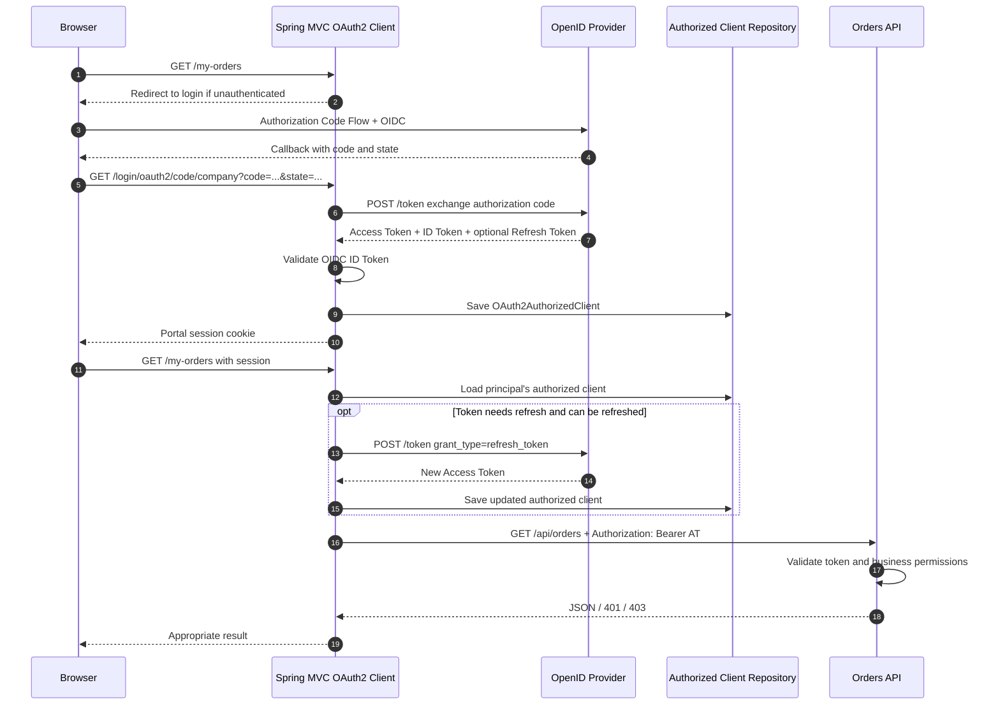
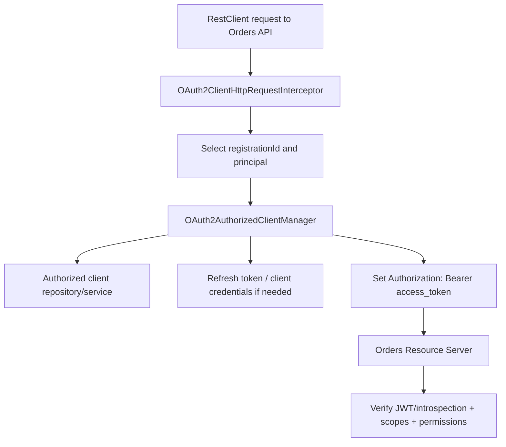
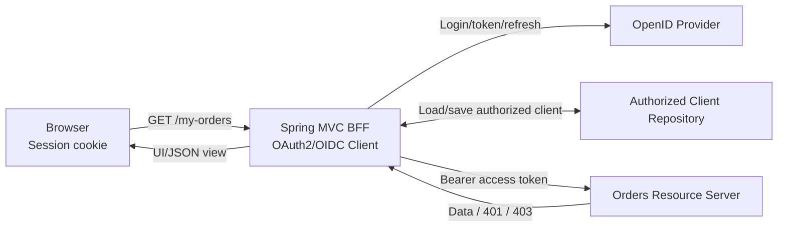

# 18.5. Attaching a Bearer Access Token to Requests

In a **Spring Security OAuth 2.0/OIDC Client** application running on the **Servlet stack**, a successful login is usually only the starting point. A Spring MVC portal or Backend for Frontend (BFF) may need to call a downstream **Resource Server API**, such as an Orders API, Billing API, or Profile API, to retrieve data and execute business logic.

To access an API protected by an **OAuth 2.0 Bearer Token**, the client sends the access token in the HTTP request:

```http
GET /api/orders HTTP/1.1
Host: orders-api.example.org
Accept: application/json
Authorization: Bearer <access-token>
```

This single header line is simple, yet must satisfy several conditions at once:

- **Right token type:** use the **access token**, never an ID token or refresh token.
- **Right client registration:** obtain the token of the OAuth client permitted to call that API.
- **Right principal:** for delegated access, the token must belong to the user actually performing the action.
- **Right destination:** never send a Bearer token to a hostname/URL controlled by an untrusted source.
- **Right timing:** the token must still be valid; when needed, use `OAuth2AuthorizedClientManager` to obtain a fresh token.
- **Right permission boundaries:** the Resource Server still checks issuer, audience, scope, tenant, and specific resources.
- **No leakage:** tokens must never appear in URLs, logs, frontend JavaScript, or HTTP redirects to external hosts.

This lesson progresses from attaching headers **manually with `RestClient`**, to `@RegisteredOAuth2AuthorizedClient`, `OAuth2AuthorizedClientManager`, and **`OAuth2ClientHttpRequestInterceptor`**, then covers multi-provider scenarios, Client Credentials, 401/403 errors, and security requirements.

## 1. Where Is the Bearer Token Used in the OAuth 2.0/OIDC Flow?

### 1.1. Four Main Roles

| Role | Example | Responsibility |
|---|---|---|
| End-User | User opening the Portal | Logs in and requests business operations |
| OAuth Client / Relying Party | `https://portal.example.org` | Performs OIDC Login, holds authorized clients, and calls APIs |
| Authorization Server / OpenID Provider | `https://login.example.org` | Authenticates/issues tokens |
| Resource Server | `https://orders-api.example.org` | Receives and validates access tokens, enforces permissions |

In Authorization Code/OIDC Login:



**The Bearer token is attached on requests from the Spring backend to the API**, not on the redirect the browser sends to the OP.

### 1.2. Three Token Types Must Never Be Used Interchangeably

| Token | Who Receives/Uses It? | Purpose |
|---|---|---|
| **ID Token** | Relying Party in OIDC | Verifies End-User authentication result, issuer/audience/nonce... |
| **Access Token** | Resource Server | Grants ability to request resources within scopes authorized by the AS |
| **Refresh Token** | OAuth Client sending to Token Endpoint | Requests a new access token per grant and AS policy |

Do not write:

```http
Authorization: Bearer <id-token>
```

to call the Orders API simply because an ID token is also a signed JWT. An ID token normally has the **Portal's client ID** as its audience, whereas an access token must match the Orders API's audience.

## 2. HTTP `Authorization: Bearer` Syntax

### 2.1. Bearer Authentication Scheme

Per RFC 6750, the standard way to send an access token is:

```http
Authorization: Bearer <token-value>
```

In the example, `<token-value>` is only a placeholder. The actual request must contain the raw token string without the example's angle brackets.

A token can be:

- **Opaque token:** a non-JWT string that the Resource Server may need to introspect.
- **JWT access token:** a JWT-structured token whose signature and claims the Resource Server validates per profile.

**The OAuth client does not need to decode the access token to put it in the header.** It simply calls `getTokenValue()` on the token received from the Authorization Server. The Resource Server is the party that decides whether the token is valid.

### 2.2. Why Prefer Headers Over URLs?

Do not use:

```text
https://orders-api.example.org/api/orders?access_token=<token>
```

because URLs can be recorded in logs, browser history, proxy metrics, APMs, or observability tools. HTTP headers are still sensitive and require redaction, yet `Authorization` is the standard Bearer authentication mechanism.

### 2.3. Distinguishing Basic from Bearer

In a **token request**, a confidential client can send:

```http
POST /oauth2/token HTTP/1.1
Authorization: Basic <base64-client-id-and-client-secret>
Content-Type: application/x-www-form-urlencoded

grant_type=authorization_code&code=...
```

In an **API request**:

```http
GET /api/orders HTTP/1.1
Authorization: Bearer <access-token>
```

`Basic` can be used to authenticate the OAuth client at the Token Endpoint. `Bearer` is used to present the access token at the Resource Server. Do not send the client secret to an API via Basic unless that API has a different explicitly designed and agreed mechanism.

## 3. `OAuth2AuthorizedClient`: Source of the Access Token in Spring Security

After issuing a token, Spring Security represents the result with `OAuth2AuthorizedClient`:

```text
OAuth2AuthorizedClient
├── ClientRegistration
│   ├── registrationId: company
│   ├── clientId: portal-web-prod
│   └── providerDetails
├── principalName: user-725
├── OAuth2AccessToken
│   ├── tokenValue
│   ├── issuedAt
│   ├── expiresAt
│   └── scopes
└── OAuth2RefreshToken (may be null)
```

Retrieving the token:

```java
import org.springframework.security.oauth2.client.OAuth2AuthorizedClient;
import org.springframework.security.oauth2.core.OAuth2AccessToken;

OAuth2AuthorizedClient authorizedClient = /* from Spring Security */;

OAuth2AccessToken accessToken = authorizedClient.getAccessToken();

String tokenValue = accessToken.getTokenValue();
```

Do not hold onto `String tokenValue` by itself in a long-lived global/static field, as it can expire or belong to the wrong principal.

### 3.1. `ClientRegistration` Differs from `OAuth2AuthorizedClient`

`ClientRegistration` holds **client configuration** (client ID, secret, grant, requested scopes, Token Endpoint...).

`OAuth2AuthorizedClient` holds the **result of authorizing that client for a specific principal** (access token, optional refresh token, actually granted scopes...).

Therefore, merely having `ClientRegistrationRepository` does **not** mean an access token is ready to call APIs.

### 3.2. Principal Binding Cannot Be Ignored

For example:

```text
(company, user-725) -> access-token-for-user-725
(company, user-813) -> access-token-for-user-813
```

If you cache tokens solely by registration `company`, user 813's request could send user 725's token and access the wrong data.

For user-delegated access, use the exact authenticated principal, repository, and corresponding authorized client manager. For the Client Credentials Grant, the principal can be a stable workload identifier rather than an End-User.

## 4. Preparing a Spring Boot Servlet Application

Suppose the Portal performs OIDC login via provider `company`, then calls the Orders API.

### 4.1. Dependencies

Gradle Groovy DSL:

```groovy
dependencies {
    implementation 'org.springframework.boot:spring-boot-starter-web'
    implementation 'org.springframework.boot:spring-boot-starter-security'
    implementation 'org.springframework.boot:spring-boot-starter-oauth2-client'
}
```

`RestClient` appeared in Spring Framework 6.1+, typically corresponding to Spring Boot 3.2+ in Boot 3.x projects.

**`OAuth2ClientHttpRequestInterceptor`** is an integration API of newer Spring Security lines (6.4+). On older versions lacking this interceptor, use manual header attachment or another supported HTTP client API.

### 4.2. `ClientRegistration` in `application.yml`

```yaml
spring:
  security:
    oauth2:
      client:
        registration:
          company:
            provider: company
            client-id: ${OIDC_CLIENT_ID}
            client-secret: ${OIDC_CLIENT_SECRET}
            client-authentication-method: client_secret_basic
            authorization-grant-type: authorization_code
            redirect-uri: "{baseUrl}/login/oauth2/code/{registrationId}"
            scope:
              - openid
              - profile
              - orders.read
        provider:
          company:
            issuer-uri: ${OIDC_ISSUER_URI}
```

In YAML:

- `company` is the `registrationId` used in code.
- `client-id` is the RP identifier at the OP, distinct from the registration name.
- `scope` is the **requested scopes**; granted scopes may differ.
- `issuer-uri` enables OIDC discovery if supported by the OP.
- `client-secret` must stay strictly on the backend.

### 4.3. `SecurityFilterChain` for Browser Login

```java
import org.springframework.context.annotation.Bean;
import org.springframework.context.annotation.Configuration;
import org.springframework.security.config.Customizer;
import org.springframework.security.config.annotation.web.builders.HttpSecurity;
import org.springframework.security.web.SecurityFilterChain;

@Configuration
public class WebSecurityConfig {

    @Bean
    SecurityFilterChain webSecurity(HttpSecurity http) throws Exception {
        http
            .authorizeHttpRequests(auth -> auth
                .requestMatchers("/", "/error").permitAll()
                .anyRequest().authenticated())
            .oauth2Login(Customizer.withDefaults());

        return http.build();
    }
}
```

`oauth2Login()` handles the authorization code callback and creates the principal/session. It does not automatically attach access tokens to **every request** you make via `RestClient`. That belongs to the caller or an explicitly configured HTTP interceptor.

## 5. Approach 1 — Attaching the Bearer Header Manually with `RestClient`

This is a simple, explicit option when you want to see exactly where the token is placed.

### 5.1. Minimal Example

```java
import org.springframework.security.oauth2.client.OAuth2AuthorizedClient;
import org.springframework.web.client.RestClient;

public final class OrdersApiClient {

    private final RestClient restClient = RestClient.builder()
        .baseUrl("https://orders-api.example.org")
        .build();

    public String listOrders(OAuth2AuthorizedClient client) {

        String tokenValue = client.getAccessToken().getTokenValue();

        return restClient.get()
            .uri("/api/orders")
            .headers(headers -> headers.setBearerAuth(tokenValue))
            .retrieve()
            .body(String.class);
    }
}
```

The `setBearerAuth(tokenValue)` method produces:

```http
Authorization: Bearer <tokenValue>
```

**Pass only the token value.** Do not include a `Bearer ` prefix when calling `setBearerAuth`.

### 5.2. Common Mistake: Doubled `Bearer`

Wrong example:

```java
headers.setBearerAuth("Bearer " + tokenValue);
```

The header becomes:

```http
Authorization: Bearer Bearer <tokenValue>
```

and the API may return 401.

Correct:

```java
headers.setBearerAuth(tokenValue);
```

If you need to build the header manually:

```java
headers.set("Authorization", "Bearer " + tokenValue);
```

though `setBearerAuth` should be preferred because it states intent clearly and avoids duplicating the prefix.

### 5.3. Never Put a User Token into a Singleton's `defaultHeader`

Pattern to avoid:

```java
// Anti-pattern for multi-user applications.
RestClient client = RestClient.builder()
    .defaultHeader("Authorization", "Bearer " + firstUserToken)
    .build();
```

A `RestClient` may be a singleton shared across many HTTP requests. If a token is baked in at bean creation, subsequent requests risk sending **another user's token**, or an expired token.

Instead, set the header **per request** or use an OAuth interceptor that resolves the right authorized client for the current context.

## 6. Obtaining the Authorized Client with `@RegisteredOAuth2AuthorizedClient`

Spring MVC provides an argument resolver to inject an authorized client in controllers.

### 6.1. Controller Attaching the Token Directly

```java
import org.springframework.security.oauth2.client.OAuth2AuthorizedClient;
import org.springframework.security.oauth2.client.annotation.RegisteredOAuth2AuthorizedClient;
import org.springframework.web.bind.annotation.GetMapping;
import org.springframework.web.bind.annotation.RestController;
import org.springframework.web.client.RestClient;

@RestController
public class MyOrdersController {

    private final RestClient ordersApi = RestClient.builder()
        .baseUrl("https://orders-api.example.org")
        .build();

    @GetMapping("/my-orders")
    public String list(
            @RegisteredOAuth2AuthorizedClient("company")
            OAuth2AuthorizedClient authorizedClient) {

        String tokenValue =
            authorizedClient.getAccessToken().getTokenValue();

        return ordersApi.get()
            .uri("/api/orders")
            .headers(h -> h.setBearerAuth(tokenValue))
            .retrieve()
            .body(String.class);
    }
}
```

Once the user is logged in and registration `company` has an authorized client, Spring can resolve the authorized client for the controller to use.

Depending on configuration/version, resolution may go through `OAuth2AuthorizedClientManager`. Do not assume the annotation always returns non-null in every context; when the user has not authorized yet or the token cannot be renewed, proper error handling is required.

### 6.2. Evaluating This Approach

**Advantages:**

- Concise and easy to read.
- Registration is explicitly named.
- No need to manually extract tokens from HTTP sessions or token response JSON.

**Limitations:**

- The controller knows OAuth details and API URLs unless separated into a service.
- Hard to reuse outside MVC.
- If multiple registrations or complex refresh policies are needed, a dedicated manager/service is usually clearer.
- The API still checks audience/scope/tenant independently.

Never return the `OAuth2AuthorizedClient` object itself in a controller response, as it holds sensitive tokens.

## 7. Separating the REST Gateway from the Controller

In real projects, keep the HTTP client inside a service/gateway.

### 7.1. Configuring a `RestClient` Bean Per API

```java
import org.springframework.context.annotation.Bean;
import org.springframework.context.annotation.Configuration;
import org.springframework.web.client.RestClient;

@Configuration
public class DownstreamClientConfig {

    @Bean
    RestClient ordersRestClient(RestClient.Builder builder) {
        return builder
            .baseUrl("https://orders-api.example.org")
            .build();
    }
}
```

If the application has multiple `RestClient` beans, inject by bean name or `@Qualifier("ordersRestClient")`.

### 7.2. Gateway Attaching the Bearer Token

```java
import org.springframework.beans.factory.annotation.Qualifier;
import org.springframework.security.oauth2.client.OAuth2AuthorizedClient;
import org.springframework.stereotype.Service;
import org.springframework.web.client.RestClient;

@Service
public class OrdersGateway {

    private final RestClient restClient;

    public OrdersGateway(
            @Qualifier("ordersRestClient") RestClient restClient) {
        this.restClient = restClient;
    }

    public String listOrders(OAuth2AuthorizedClient client) {
        return restClient.get()
            .uri("/api/orders")
            .headers(h -> h.setBearerAuth(
                client.getAccessToken().getTokenValue()))
            .retrieve()
            .body(String.class);
    }
}
```

### 7.3. Controller Only Coordinates

```java
import org.springframework.security.oauth2.client.OAuth2AuthorizedClient;
import org.springframework.security.oauth2.client.annotation.RegisteredOAuth2AuthorizedClient;
import org.springframework.web.bind.annotation.GetMapping;
import org.springframework.web.bind.annotation.RestController;

@RestController
public class OrdersController {

    private final OrdersGateway orders;

    public OrdersController(OrdersGateway orders) {
        this.orders = orders;
    }

    @GetMapping("/my-orders")
    public String myOrders(
            @RegisteredOAuth2AuthorizedClient("company")
            OAuth2AuthorizedClient authorizedClient) {
        return orders.listOrders(authorizedClient);
    }
}
```

Benefits of this structure:

- **Controller:** receives the user's request.
- **Authorized client:** supplies the token for the right registration/principal.
- **Gateway:** controls API host, method, path, body, and error mapping.
- **Resource Server:** validates the token and business logic.

## 8. Approach 2 — `OAuth2AuthorizedClientManager` Manages Tokens Before Calling the API

`OAuth2AuthorizedClientManager` is the abstraction Spring Security provides to **retrieve an existing authorized client and issue/re-issue one when needed**.

### 8.1. Two Implementations to Distinguish

| Manager | When to Use? | Store |
|---|---|---|
| `DefaultOAuth2AuthorizedClientManager` | Processing a Servlet HTTP request, typically with a logged-in user | `OAuth2AuthorizedClientRepository` |
| `AuthorizedClientServiceOAuth2AuthorizedClientManager` | Scheduled worker, backend job without an HTTP request | `OAuth2AuthorizedClientService` |

For Spring MVC/BFF, **`DefaultOAuth2AuthorizedClientManager`** is typically used.

### 8.2. Declaring the Manager for Servlet

```java
import org.springframework.context.annotation.Bean;
import org.springframework.context.annotation.Configuration;
import org.springframework.security.oauth2.client.OAuth2AuthorizedClientManager;
import org.springframework.security.oauth2.client.OAuth2AuthorizedClientProvider;
import org.springframework.security.oauth2.client.OAuth2AuthorizedClientProviderBuilder;
import org.springframework.security.oauth2.client.registration.ClientRegistrationRepository;
import org.springframework.security.oauth2.client.web.DefaultOAuth2AuthorizedClientManager;
import org.springframework.security.oauth2.client.web.OAuth2AuthorizedClientRepository;

@Configuration
public class AuthorizedClientManagerConfig {

    @Bean
    OAuth2AuthorizedClientManager authorizedClientManager(
            ClientRegistrationRepository registrations,
            OAuth2AuthorizedClientRepository authorizedClients) {

        OAuth2AuthorizedClientProvider provider =
            OAuth2AuthorizedClientProviderBuilder.builder()
                .authorizationCode()
                .refreshToken()
                .build();

        var manager = new DefaultOAuth2AuthorizedClientManager(
            registrations, authorizedClients);

        manager.setAuthorizedClientProvider(provider);
        return manager;
    }
}
```

`refreshToken()` only works when a refresh token exists and grant conditions are met. Not every `authorize(...)` call sends an HTTP request to the Token Endpoint; the manager can return an authorized client that is still valid.

Some Spring Boot versions/configurations already supply an appropriate manager bean, so there is no need to define one manually if no customization is required.

### 8.3. Building `OAuth2AuthorizeRequest`

Inside a Servlet controller/service:

```java
import jakarta.servlet.http.HttpServletRequest;
import jakarta.servlet.http.HttpServletResponse;
import org.springframework.security.core.Authentication;
import org.springframework.security.oauth2.client.OAuth2AuthorizeRequest;

OAuth2AuthorizeRequest request = OAuth2AuthorizeRequest
    .withClientRegistrationId("company")
    .principal(authentication)
    .attribute(HttpServletRequest.class.getName(), servletRequest)
    .attribute(HttpServletResponse.class.getName(), servletResponse)
    .build();
```

`authentication`, `servletRequest`, and `servletResponse` come from an authenticated MVC request. Never pick a principal from a query parameter like `?userId=...`.

### 8.4. Calling `manager.authorize()`

```java
import org.springframework.security.oauth2.client.OAuth2AuthorizedClient;

OAuth2AuthorizedClient client = manager.authorize(request);

if (client == null) {
    throw new IllegalStateException(
        "No authorized client for company registration");
}

String tokenValue = client.getAccessToken().getTokenValue();

String response = ordersRestClient.get()
    .uri("/api/orders")
    .headers(h -> h.setBearerAuth(tokenValue))
    .retrieve()
    .body(String.class);
```

`manager` and `ordersRestClient` are injected dependencies. In real applications, handle these cases individually:

- Authorized client has not been granted yet.
- Token cannot be refreshed or Token Endpoint fails.
- Access token lacks the scope required by the API.
- Downstream API returns 401/403 or encounters a network timeout.

Never catch all errors and fabricate an empty token to keep going.

## 9. Approach 3 — `OAuth2ClientHttpRequestInterceptor` for `RestClient`

On Spring Security lines supporting **`OAuth2ClientHttpRequestInterceptor`** (6.4+), you can use the interceptor to **attach tokens automatically** via `OAuth2AuthorizedClientManager`.

### 9.1. Diagram



The interceptor is not an Authorization Server: it uses the manager to retrieve an authorized client and places the credential on the outgoing HTTP request.

### 9.2. Creating a `RestClient` with the Interceptor

```java
import org.springframework.context.annotation.Bean;
import org.springframework.context.annotation.Configuration;
import org.springframework.security.oauth2.client.OAuth2AuthorizedClientManager;
import org.springframework.security.oauth2.client.web.client.OAuth2ClientHttpRequestInterceptor;
import org.springframework.web.client.RestClient;

@Configuration
public class OAuthRestClientConfig {

    @Bean
    RestClient oauthOrdersRestClient(
            OAuth2AuthorizedClientManager manager) {

        var interceptor =
            new OAuth2ClientHttpRequestInterceptor(manager);

        return RestClient.builder()
            .baseUrl("https://orders-api.example.org")
            .requestInterceptor(interceptor)
            .build();
    }
}
```

**Simply adding the interceptor is not enough** if the system does not know which registration/principal to use. The caller or a resolver must supply the proper authorization context.

### 9.3. Specifying Registration ID on Each Request

Example with the corresponding request attributes API:

```java
import static org.springframework.security.oauth2.client.web.client.RequestAttributeClientRegistrationIdResolver.clientRegistrationId;

String orders = oauthOrdersRestClient.get()
    .uri("/api/orders")
    .attributes(clientRegistrationId("company"))
    .retrieve()
    .body(String.class);
```

`clientRegistrationId("company")` lets the resolver identify which OAuth client registration to use. The interceptor can coordinate with the manager to load/refresh the authorized client before sending the request.

In applications with multiple registrations, **never let the browser pick a higher-privilege registration**. Registration selection must be bound to trusted operation/service policies.

### 9.4. The Principal Resolver Also Matters

In a logged-in Servlet request, the principal normally comes from the `Authentication` in the active context. In some integrations, you can configure a principal resolver for an explicit principal source.

Do not use `SecurityContextHolder` from another thread or a cached `Authentication` from a previous user to alter an outgoing request's principal.

For background workloads, use a service-based manager and a stable technical principal instead of assuming a browser user.

### 9.5. When to Choose the Interceptor?

**Appropriate when:**

- Multiple methods call the same API under the same OAuth policy.
- You want to reduce boilerplate when attaching Bearer headers.
- You want the manager to handle token selection/refresh centrally.
- Registration, principal, and permitted origin can be determined accurately.

**Be cautious when:**

- One shared RestClient is used for multiple hosts.
- Callers accept absolute URIs or dynamic redirects.
- A request might go to an API that does not need authentication.
- Multiple providers have different scopes/audiences.
- Multiple interceptors simultaneously modify the `Authorization` header.

If only a few requests exist, using `setBearerAuth(...)` inside a dedicated API gateway remains completely reasonable.

## 10. Never Send Bearer Tokens to Arbitrary Hosts

A Bearer token is a credential: **anyone possessing the token can present it to any Resource Server that accepts it**. If the application sends the token to an attacker-controlled host, the credential can be stolen.

### 10.1. Anti-Pattern: Generic Proxy Accepting URLs from the Browser

```java
// DO NOT USE: browser picks the URL, server attaches the token.
@GetMapping("/proxy")
public String proxy(
        @RequestParam String url,
        @RegisteredOAuth2AuthorizedClient("company")
        OAuth2AuthorizedClient client) {

    return RestClient.create().get()
        .uri(url)
        .headers(h -> h.setBearerAuth(
            client.getAccessToken().getTokenValue()))
        .retrieve()
        .body(String.class);
}
```

A URL such as `https://attacker.example/collect` causes the backend to send the access token externally. Beyond credential exfiltration, the endpoint also creates **SSRF** risks against internal networks.

### 10.2. Alternative Design: Server-Managed Routes

Do not accept arbitrary URLs; accept an allowlisted operation ID:

```text
operation=listOrders   -> GET /api/orders at orders-api.example.org
operation=myProfile    -> GET /api/me at profile-api.example.org
```

The server chooses the predefined RestClient and registration. Never rely only on checks like `url.startsWith("https://orders-api.example.org")`, because prefix strings can be spoofed with hostnames like `orders-api.example.org.attacker.test`.

### 10.3. Base URL Is Not an Absolute Allowlist Mechanism

`RestClient.builder().baseUrl(...)` sets a default host for relative paths, yet HTTP client APIs can allow callers to pass an **absolute URI** overriding the base URL.

Therefore, even with a configured base URL, ensure the gateway never accepts arbitrary absolute URIs from untrusted input. Create separate REST clients per Resource Server and permit only specific business paths.

## 11. HTTP Redirects and the Risk of Leaking the `Authorization` Header

Suppose Orders API responds with:

```http
HTTP/1.1 302 Found
Location: https://other.example.net/collect
```

Some HTTP clients may follow redirects automatically. Do not assume every library/version will always strip the `Authorization` header when changing hosts, or avoid forwarding credentials to the new request.

**Defenses:**

1. Avoid redirects on API calls carrying Bearer tokens unless necessary.
2. Configure the HTTP client according to permitted-origin policies.
3. Never automatically forward the `Authorization` header to a new host.
4. Use HTTPS only and verify certificates/hostnames.
5. Never let redirect destinations be controlled by browser query parameters.
6. When redirects must be followed, explicitly verify **host, scheme, port**, and the actual behavior of the request factory.

The same OAuth client token should not be sent to multiple resource servers simply because they belong to the same organization.

## 12. Token Expiration and Refresh Before Calling an API

### 12.1. Access Tokens Have Limited Lifetimes

`OAuth2AccessToken` exposes metadata:

```java
client.getAccessToken().getIssuedAt();
client.getAccessToken().getExpiresAt();
client.getAccessToken().getScopes();
```

If an application keeps reusing a token value stored in a field, the token will expire. Spring's manager/provider has mechanisms to check expiration and renew when conditions allow.

### 12.2. Refresh Token Grant

With OIDC Authorization Code Flow, the initial token response may include a refresh token:

```json
{
  "access_token": "<AT-1>",
  "token_type": "Bearer",
  "expires_in": 3600,
  "refresh_token": "<RT-1>",
  "id_token": "<ID-Token>"
}
```

When a refresh is needed, the OAuth client sends the refresh token to the Token Endpoint:

```http
POST /oauth2/token HTTP/1.1
Host: login.example.org
Content-Type: application/x-www-form-urlencoded
Authorization: Basic <client-credentials>

grant_type=refresh_token&refresh_token=<RT-1>
```

The AS may return `AT-2` and a new `RT-2`. With refresh token rotation, authorized client storage must consistently persist both the new token and the new refresh token.

**Refresh tokens must never be sent to the Orders API**. The API receives only the access token.

### 12.3. When There Is No Refresh Token

An AS is not required to issue a refresh token for every OAuth2 Login. If the access token expires and no refresh token exists, the user may need to re-authorize/re-login. Never use the client secret to simulate a user refresh token.

### 12.4. Concurrent Requests and Refresh Token Rotation

If two requests refresh concurrently using an old RT, the AS may reject the second request. The manager does not provide a distributed lock across multiple nodes out of the box. Under high concurrency, account for token storage consistency and retry policies.

Never configure infinite retries on `invalid_grant`, as this can trigger or worsen token reuse detection.

## 13. Requested Scopes, Granted Scopes, and API Authorization

### 13.1. Scopes in YAML Do Not Prove the Token Was Granted Them

A registration might request:

```yaml
scope:
  - openid
  - profile
  - orders.read
```

Yet the token response may grant only a subset per AS policy. To check on the client side:

```java
boolean canAskForOrders =
    client.getAccessToken().getScopes().contains("orders.read");
```

This is a **caller-side precondition**, not a replacement for API authorization.

### 13.2. Scope Is Not a User Role

`orders.read` on an access token indicates the token was granted scope for operations related to the Orders API. It does not assert that the user is allowed to read **every order across every tenant**.

An API might require:

```text
access token valid for orders-api
AND scope contains orders.read
AND user canRead(order=742)
AND order belongs to allowed tenant
```

All of these must be enforced by the Resource Server or corresponding domain authorization service.

### 13.3. Audience Must Match the API

An access token for `reports-api` is not automatically valid for `orders-api` even if both use the same AS and share some scope names.

The Resource Server must verify audience or resource binding. The client side should use the matching registration/token for each API; never remove audience validation just to accept off-target tokens.

## 14. Resource Server Processing the Bearer Token on the Receiving Side

A Spring Security Resource Server can be configured with:

```yaml
spring:
  security:
    oauth2:
      resourceserver:
        jwt:
          issuer-uri: https://login.example.org
```

Illustrative `SecurityFilterChain`:

```java
import org.springframework.context.annotation.Bean;
import org.springframework.context.annotation.Configuration;
import org.springframework.http.HttpMethod;
import org.springframework.security.config.Customizer;
import org.springframework.security.config.annotation.web.builders.HttpSecurity;
import org.springframework.security.web.SecurityFilterChain;

@Configuration
public class ApiSecurityConfig {

    @Bean
    SecurityFilterChain apiSecurity(HttpSecurity http) throws Exception {
        http
            .authorizeHttpRequests(auth -> auth
                .requestMatchers(HttpMethod.GET, "/api/orders/**")
                    .hasAuthority("SCOPE_orders.read")
                .requestMatchers(HttpMethod.POST, "/api/orders/**")
                    .hasAuthority("SCOPE_orders.write")
                .anyRequest().authenticated())
            .oauth2ResourceServer(oauth2 -> oauth2
                .jwt(Customizer.withDefaults()));

        return http.build();
    }
}
```

The default `JwtGrantedAuthoritiesConverter` normally converts `scope`/`scp` into authorities like `SCOPE_orders.read`. If the AS uses a different claim format, the Resource Server needs a corresponding converter.

**Configuring issuer alone may not be enough to restrict audience to the exact API.** The API must configure audience validation per your Spring Security version and AS contract. The example above only illustrates route/scope checks.

Never send the web RP's ID token to a Resource Server as an Access Token simply because it has a valid `sub` claim.

## 15. `401` and `403` Error Codes

### 15.1. `401 Unauthorized`

Example:

```http
HTTP/1.1 401 Unauthorized
WWW-Authenticate: Bearer error="invalid_token"
```

Common causes:

- Missing Bearer header.
- Malformed or truncated token.
- Expired/revoked token.
- Wrong audience/issuer.
- API unable to verify signature or perform introspection.
- Client sent ID token instead of access token.
- A proxy stripped the `Authorization` header.

### 15.2. `403 Forbidden`

Example:

```http
HTTP/1.1 403 Forbidden
WWW-Authenticate: Bearer error="insufficient_scope"
```

Common causes:

- Valid token yet missing `orders.write`.
- User lacks the role or object-level permission.
- Tenant policy denied access.
- Client/workload is not permitted to perform the operation.

Do not assume every 403 is due to missing scope; authorization can involve multiple business layers.

### 15.3. Diagnostic Table

| Symptom | Possibility | Layer to Inspect |
|---|---|---|
| API does not receive Bearer header | RestClient did not set header / interceptor not attached | HTTP client wiring |
| `Bearer Bearer ...` | Scheme already prepended before `setBearerAuth` | Request header generation |
| API receives another user's token | Shared token/static field/wrong cache key | Principal/authorized client storage |
| 401 due to expired token | Not refreshed / did not acquire fresh authorized client | Manager, refresh provider |
| `invalid_grant` from Token Endpoint | Refresh token expired/rotated/revoked | Authorization Server/token lifecycle |
| `invalid_client` from Token Endpoint | Wrong client secret/auth method | `ClientRegistration` and AS |
| 401 even though token was just issued | Audience/issuer/API contract mismatch | Resource Server validation |
| 403, token lacks scope | AS did not grant requested scope | Granted vs. requested scopes |
| 403, token has scope | Resource/tenant/user permissions | Domain authorization |
| Only one registration fails | Token selected from wrong provider | `registrationId` resolver |
| Fails only on one instance | Session/store/manager config mismatch | Cluster and persistence |
| BFF login works yet API returns 401 | ID token/access token mix-up or wrong audience | Token type and API contract |

## 16. Handling HTTP Errors with `RestClient`

### 16.1. `4xx`/`5xx` Statuses

With:

```java
String body = restClient.get()
    .uri("/api/orders")
    .headers(h -> h.setBearerAuth(tokenValue))
    .retrieve()
    .body(String.class);
```

`retrieve()` has default `4xx`/`5xx` error handling and normally throws an exception on error responses.

You can customize mapping 403 into a business exception:

```java
String body = restClient.get()
    .uri("/api/orders")
    .headers(h -> h.setBearerAuth(tokenValue))
    .retrieve()
    .onStatus(
        status -> status.value() == 403,
        (request, response) -> {
            throw new IllegalStateException(
                "Orders API denied access");
        }
    )
    .body(String.class);
```

This is a simple handling example. Production code should use specific exceptions and safe error codes; never return stack traces or raw downstream responses containing sensitive data to the browser.

### 16.2. Bounded `401` Retries

Never automatically retry every 401 infinitely. A 401 may mean an expired token, or a completely wrong issuer or audience.

Recommended process:

1. Identify the cause from `WWW-Authenticate` and non-sensitive context.
2. If the authorized client is stale, let the manager/failure handler handle it per contract.
3. If recoverable, obtain a new token and **bound retries**.
4. Avoid automatically retrying non-idempotent POST/PATCH calls when it is unknown whether the API already processed the request.
5. If the issue persists, return a clear error or prompt for re-authorization.

Some OAuth2 HTTP interceptors expose an extension point for an **authorization failure handler** to manage tokens rejected by an API. Configure it only when you understand the exact repository/service and version; never delete other users' tokens or wipe all registrations when one API returns 401.

### 16.3. Refresh Cannot Fix a `403`

If an API returns `insufficient_scope`, refreshing a token does not escalate permissions beyond the authorization grant. The user/client may need a new consent/authorization flow, or domain permissions must be granted through business workflows.

## 17. Servlet REST Client in the BFF Architecture

A `Backend for Frontend` keeps tokens server-side while the browser only uses a session cookie to talk to the portal.



**Two distinct trust boundaries:**

| Hop | Credential | Role |
|---|---|---|
| Browser → BFF | `JSESSIONID` or protected session cookie | Identifies browser session |
| BFF → API | `Authorization: Bearer access_token` | Resource Server access |

Never copy `Cookie: JSESSIONID=...` into an API's `Authorization` header. Nor send access tokens back to frontend JavaScript when using a server-side BFF architecture.

### 17.1. CSRF Still Matters with Session Cookies

A cookie-based BFF is exposed to CSRF because browsers send cookies automatically. The backend calling APIs with Bearer tokens does not eliminate CSRF on BFF endpoints that accept state-changing actions.

Never disable CSRF application-wide simply because OAuth2 Client is used.

### 17.2. Hiding UI Buttons Is Not Authorization

The UI may hide an "Edit order" button when a user lacks a role. Yet the API must still independently verify scopes and object-level permissions. A Bearer token is only one piece of authorization.

## 18. Multiple `ClientRegistration`s and Multiple Resource Servers

An application can define two registrations:

```yaml
spring:
  security:
    oauth2:
      client:
        registration:
          company:
            provider: company
            client-id: ${COMPANY_CLIENT_ID}
            client-secret: ${COMPANY_CLIENT_SECRET}
            authorization-grant-type: authorization_code
            redirect-uri: "{baseUrl}/login/oauth2/code/{registrationId}"
            scope:
              - openid
              - profile
              - orders.read

          partner:
            provider: partner
            client-id: ${PARTNER_CLIENT_ID}
            client-secret: ${PARTNER_CLIENT_SECRET}
            authorization-grant-type: authorization_code
            redirect-uri: "{baseUrl}/login/oauth2/code/{registrationId}"
            scope:
              - openid
              - profile
              - partner.read

        provider:
          company:
            issuer-uri: ${COMPANY_ISSUER}
          partner:
            issuer-uri: ${PARTNER_ISSUER}
```

When calling an API via the interceptor:

```java
.attributes(clientRegistrationId("company"))
```

is completely different from:

```java
.attributes(clientRegistrationId("partner"))
```

The registration ID is **Spring's internal name**, not a hostname. The backend must explicitly enforce the mapping:

```text
operation=listOrders
  -> Orders API REST client
  -> registration company
  -> bearer token with matching audience/scopes
```

If request input includes `registrationId=admin`, never let the browser use it to pick a higher-privilege token. Restrict registrations to server-permitted operations.

### 18.1. Never Use a Reports API Token for the Orders API

Even with the same issuer, an access token with `aud=reports-api` can be rejected by the Orders API. If a product calls multiple APIs, obtain tokens tailored to each resource via registrations, resource indicators, or AS-specific audience policies.

Do not drop audience validation merely because scope strings look similar.

## 19. Client Credentials: Bearer Token for Backends Without an End-User

A scheduled worker should not borrow the access token of the last person who logged into the Portal. It normally needs the **Client Credentials Grant**.

### 19.1. Registration for a Workload

```yaml
spring:
  security:
    oauth2:
      client:
        registration:
          inventory-worker:
            provider: internal-as
            client-id: ${WORKER_CLIENT_ID}
            client-secret: ${WORKER_CLIENT_SECRET}
            client-authentication-method: client_secret_basic
            authorization-grant-type: client_credentials
            scope:
              - inventory.read
        provider:
          internal-as:
            token-uri: https://auth.example.org/oauth2/token
```

### 19.2. Service-Based Manager

```java
import org.springframework.context.annotation.Bean;
import org.springframework.context.annotation.Configuration;
import org.springframework.security.oauth2.client.AuthorizedClientServiceOAuth2AuthorizedClientManager;
import org.springframework.security.oauth2.client.OAuth2AuthorizedClientManager;
import org.springframework.security.oauth2.client.OAuth2AuthorizedClientProviderBuilder;
import org.springframework.security.oauth2.client.OAuth2AuthorizedClientService;
import org.springframework.security.oauth2.client.registration.ClientRegistrationRepository;

@Configuration
public class WorkloadOAuthConfig {

    @Bean
    OAuth2AuthorizedClientManager workloadManager(
            ClientRegistrationRepository registrations,
            OAuth2AuthorizedClientService authorizedClients) {

        var manager = new AuthorizedClientServiceOAuth2AuthorizedClientManager(
            registrations, authorizedClients);

        manager.setAuthorizedClientProvider(
            OAuth2AuthorizedClientProviderBuilder.builder()
                .clientCredentials()
                .build()
        );

        return manager;
    }
}
```

### 19.3. Obtaining the Token and Calling the API

```java
import org.springframework.security.oauth2.client.OAuth2AuthorizeRequest;
import org.springframework.security.oauth2.client.OAuth2AuthorizedClient;

OAuth2AuthorizeRequest authorizeRequest = OAuth2AuthorizeRequest
    .withClientRegistrationId("inventory-worker")
    .principal("inventory-sync-service")
    .build();

OAuth2AuthorizedClient client = workloadManager.authorize(authorizeRequest);

if (client == null) {
    throw new IllegalStateException("Workload authorization failed");
}

String products = inventoryRestClient.get()
    .uri("/api/products")
    .headers(h -> h.setBearerAuth(
        client.getAccessToken().getTokenValue()))
    .retrieve()
    .body(String.class);
```

`principal("inventory-sync-service")` is a **technical key for authorized client storage**, not an OIDC-logged-in user. With Client Credentials, the AS issues a token to the client/workload; the Resource Server enforces workload authorization.

Scheduled jobs have no Servlet HTTP request; use `AuthorizedClientServiceOAuth2AuthorizedClientManager`, and never try to construct fake requests for `DefaultOAuth2AuthorizedClientManager`.

## 20. `RestTemplate` and `WebClient` on the Servlet Stack

Beyond `RestClient`, legacy or specialized codebases may use `RestTemplate` or `WebClient`.

### 20.1. `RestTemplate`

```java
import org.springframework.http.HttpEntity;
import org.springframework.http.HttpHeaders;
import org.springframework.http.HttpMethod;
import org.springframework.http.ResponseEntity;
import org.springframework.web.client.RestTemplate;

HttpHeaders headers = new HttpHeaders();
headers.setBearerAuth(accessToken);

HttpEntity<Void> entity = new HttpEntity<>(headers);

ResponseEntity<String> response = new RestTemplate().exchange(
    "https://orders-api.example.org/api/orders",
    HttpMethod.GET,
    entity,
    String.class
);
```

Here `accessToken` is a token value retrieved properly from an authorized client. This code does not refresh the token itself; a separate manager/resolver is needed if refreshing is required.

### 20.2. `WebClient` on Servlet

```java
import org.springframework.web.reactive.function.client.WebClient;

WebClient ordersApi = WebClient.builder()
    .baseUrl("https://orders-api.example.org")
    .build();

String body = ordersApi.get()
    .uri("/api/orders")
    .headers(h -> h.setBearerAuth(accessToken))
    .retrieve()
    .bodyToMono(String.class)
    .block();
```

`WebClient` belongs to `spring-webflux`. The `block()` call only illustrates a synchronous caller on the Servlet stack; never block inside a reactive event-loop. Spring Security provides `ServletOAuth2AuthorizedClientExchangeFilterFunction` for `WebClient` in a Servlet context, distinct from `ServerOAuth2AuthorizedClientExchangeFilterFunction` used on the Reactive/WebFlux stack.

### 20.3. When to Switch HTTP Clients?

- **`RestClient`:** fluent synchronous HTTP API in modern Spring.
- **`RestTemplate`:** legacy systems requiring compatibility.
- **`WebClient`:** reactive HTTP client usable alongside Servlet apps, requiring careful understanding of its thread/resource model.

Regardless of which client is used, the principle remains unchanged: **obtain the access token for the right principal/registration, attach the Bearer header, and prevent the token from leaking**.

## 21. `GET` and `POST` Requests with a Bearer Token

Bearer tokens do not depend on the HTTP method. However, the HTTP method affects retries and business permissions.

### 21.1. `GET`ting a Resource

```java
String orderJson = restClient.get()
    .uri("/api/orders/{id}", "742")
    .headers(h -> h.setBearerAuth(tokenValue))
    .retrieve()
    .body(String.class);
```

The API needs a read scope and must verify the user/tenant has access to order `742`.

### 21.2. `POST`ing to Create Data

```java
String result = restClient.post()
    .uri("/api/orders")
    .headers(h -> h.setBearerAuth(tokenValue))
    .body(new CreateOrderRequest("sku-12", 3))
    .retrieve()
    .body(String.class);
```

`CreateOrderRequest` is an illustrative business DTO.

Never infinitely retry POST/PATCH requests on timeout because the API may already have executed side effects. If safe retries are needed, design idempotency keys and explicit client/API contracts.

### 21.3. `Content-Type` Differs from `Authorization`

`Content-Type: application/json` describes the request body; `Authorization: Bearer ...` describes the credential. Setting this header does not turn the HTTP body into JSON or grant scopes for a POST operation. Configure serialization/content types separately per the API contract.

## 22. Safe Logging and Observability

When diagnosing a failed REST call, **there is no need to log the token value**.

You can log metadata:

```text
event=outbound_api_call
registrationId=company
resource=orders-api
method=GET
route=/api/orders
tokenAttached=true
requiredScope=orders.read
httpStatus=403
durationMs=<duration>
correlationId=<non-secret-id>
```

Never log:

```text
Authorization: Bearer <access-token>
Authorization: Basic <client-secret>
refresh_token=<refresh-token>
access_token=<access-token>
id_token=<id-token>
Cookie: JSESSIONID=<session-id>
```

Even if Java code does not log them, HTTP logging from proxies/service meshes/APMs can capture headers. Enforce redaction at **every layer**.

A correlation ID should be its own separate identifier; never use a token value or slice of a token as a tracing ID.

## 23. Common Scenarios and How to Handle Them

### Scenario A — Login Succeeds, Yet the API Returns 401

The client may have sent an ID token instead of an access token, the token expired, or the audience does not match the API. Check:

- Is `OAuth2AuthorizedClient.getAccessToken()` being used?
- Does the manager obtain a fresh token after expiry?
- Does the API trust the issuer/token profile?
- Does the access token's audience match the Orders API?
- Was the header stripped at a gateway?

### Scenario B — `RestClient` Sends Another User's Token

Commonly caused by storing tokens in a singleton bean, keying a cache only by `registrationId`, or reading the wrong principal context. Fix **identity binding and request-scoped token selection**, rather than merely renaming headers.

### Scenario C — API Returns 403 Even Though YAML Has `orders.write`

YAML only expresses **requested** scopes. The AS might not grant the scope, or the user may lack permission to modify that object. Inspect `authorizedClient.getAccessToken().getScopes()` and API policies.

### Scenario D — Interceptor Does Not Add the `Authorization` Header

Verify the RestClient bean actually has `OAuth2ClientHttpRequestInterceptor`, the registration ID was passed per the resolver, the principal exists in context, and the manager has a matching authorized client and grant provider.

### Scenario E — After Refresh, Subsequent Calls Still Use the Old Token

The application might be holding `tokenValue` in a field, a custom success handler might fail to save the updated authorized client, or login and the manager might use different token stores. Use the standard authorized client lifecycle and establish a single source of truth.

### Scenario F — Scheduled Job Has No Servlet Request

Use a service-based manager, client credentials, and a stable technical principal. Never try to borrow a random user's session to authorize a workload.

### Scenario G — API Redirects to an External Host

Control redirects and allowed origins. Never let the HTTP client automatically copy Bearer headers to untrusted hosts.

### Scenario H — Token Lacks Target Audience

Never skip audience validation at the Resource Server. Issue tokens targeted at the exact API via registrations, resource indicators, or AS policies.

## 24. Technical Selection Matrix

| Need | Suitable Solution |
|---|---|
| Single MVC controller calling an API after login | `@RegisteredOAuth2AuthorizedClient` + `RestClient.setBearerAuth` |
| Multiple gateway methods sharing an OAuth policy | `OAuth2ClientHttpRequestInterceptor` + manager |
| Proactive token lifecycle handling inside a Servlet request | `DefaultOAuth2AuthorizedClientManager.authorize(...)` |
| Background job without an HTTP request | `AuthorizedClientServiceOAuth2AuthorizedClientManager` |
| User-delegated token | Registration and principal of the authenticated user |
| M2M workload token | `client_credentials`, stable service principal |
| Multiple APIs/audiences | API-specific RestClient/registration policies |
| Older Spring project | `RestTemplate` or manual headers matching the version |
| API returns 401 | Check credential validity, expiry, issuer/audience, and bounded retry |
| API returns 403 | Check granted scopes and domain permissions |
| Preventing token leakage | Fix trusted origins; never log tokens or put them in URL queries |

## 25. Pre-Production Checklist

1. **Have access tokens, ID tokens, and refresh tokens been clearly separated?** APIs receive access tokens.
2. **Does the authorized client belong to the right registration?** Never send tokens from another IdP/registration.
3. **Does the principal match the current request?** Never share another user's token via static/global caches.
4. **Does `RestClient` use a trusted API origin?** Never accept arbitrary URLs from browsers/messages.
5. **Is the header set properly?** `headers(h -> h.setBearerAuth(tokenValue))`, without doubling `Bearer `.
6. **When using the interceptor, do resolvers have complete context?** Both registration ID and principal must be accurate.
7. **Does the manager handle refresh/token expiry per grant?** Avoid stale tokens.
8. **Does the token hold the right granted scopes?** Distinguish YAML-requested scopes from actually granted scopes.
9. **Does the Resource Server verify issuer, audience, expiry, and scopes?** Client-side checks do not replace API validation.
10. **Does the API enforce object/tenant authorization?** Never assume a scope grants access to all data.
11. **Is there an HTTP redirect policy?** Never forward credentials to another origin.
12. **Are retries bounded for 401s, timeouts, and POSTs?** Avoid repeating side effects.
13. **Are user-delegated and client-credentials flows kept distinct?** Never impersonate users with workload tokens.
14. **Do logs, proxies, and APMs redact sensitive headers?** Never expose Bearer tokens.
15. **Does the BFF preserve CSRF/session security?** Downstream Bearer auth does not replace cookie/CSRF boundaries.

**Key takeaway:** In Spring Security OAuth2/OIDC Client on Servlet, "attaching a Bearer access token" should be understood as **using an `OAuth2AuthorizedClient` resolved and managed in the proper context**, then sending `Authorization: Bearer <access-token>` over HTTPS to the right Resource Server. `RestClient` supports `setBearerAuth` directly, while `OAuth2ClientHttpRequestInterceptor` automates it with `OAuth2AuthorizedClientManager`. Yet a syntactically valid HTTP header is only the beginning: the token must still belong to the right client, right principal, right audience/scope, and never leak during the request lifecycle.

## 26. References

- [RFC 6750 — OAuth 2.0 Bearer Token Usage](https://www.rfc-editor.org/rfc/rfc6750): `Authorization: Bearer`, token transport, errors, and risks.
- [RFC 6749 — The OAuth 2.0 Authorization Framework](https://www.rfc-editor.org/rfc/rfc6749): clients, access tokens, authorization grants, and scopes.
- [RFC 9700 — Best Current Practice for OAuth 2.0 Security](https://www.rfc-editor.org/rfc/rfc9700): protecting access tokens and OAuth security.
- [RFC 9068 — JWT Profile for OAuth 2.0 Access Tokens](https://www.rfc-editor.org/rfc/rfc9068): structure and validation of JWT access tokens.
- [RFC 8707 — Resource Indicators for OAuth 2.0](https://www.rfc-editor.org/rfc/rfc8707): binding tokens to resources/audiences.
- [OpenID Connect Core 1.0](https://openid.net/specs/openid-connect-core-1_0.html): distinguishing ID tokens from OAuth access tokens.
- [Spring Security — OAuth 2.0 Client](https://docs.spring.io/spring-security/reference/servlet/oauth2/client/index.html): authorized client managers and REST client integration.
- [Spring Security — OAuth 2.0 Login](https://docs.spring.io/spring-security/reference/servlet/oauth2/login/index.html): browser login, principal, and authorized clients.
- [Spring Security — OAuth 2.0 Resource Server](https://docs.spring.io/spring-security/reference/servlet/oauth2/resource-server/index.html): protecting APIs with Bearer access tokens.
- [Spring Framework — REST Clients](https://docs.spring.io/spring-framework/reference/integration/rest-clients.html): `RestClient`, headers, requests/responses, and errors.
