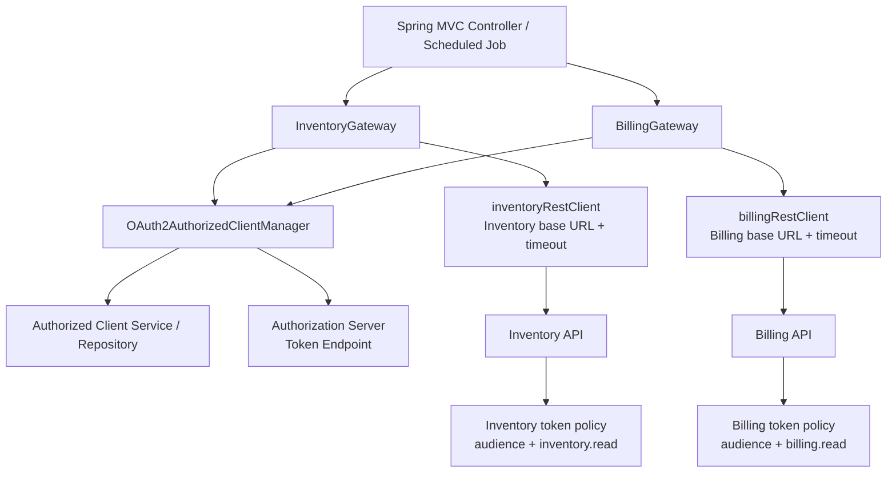

# 18.6. Configuring a Dedicated HTTP Client for Each Downstream

## 1. Problem: One Application Calling Multiple APIs Must Not Mix Configurations

A Spring Boot application using **Spring Security OAuth 2.0/OIDC Client** typically serves HTTP requests from browsers while calling several external APIs (*downstream services*). For instance:

- **Inventory API** to look up stock levels.
- **Billing API** to view invoices and payment statuses.
- **Reporting API** to fetch reports on behalf of an OIDC-logged-in user.
- **Partner API** with its own proxy, internal CA, and timeout policy.

A common design mistake is creating **one shared `RestClient` for all destinations**, attaching a default access token, and letting business classes swap URLs at will:

```java
// Avoid: arbitrary target endpoints + global Authorization header.
RestClient client = RestClient.builder()
    .defaultHeader("Authorization", "Bearer " + someAccessToken)
    .build();

// API A today:
client.get().uri("https://inventory-api.example.com/items").retrieve();

// API B tomorrow:
client.get().uri("https://billing-api.example.com/invoices").retrieve();
```

If `someAccessToken` is meant for Inventory API, sending it to Billing API is a **credential leakage across trust boundaries**. Moreover, the two APIs may differ in timeouts, TLS trust, HTTP proxies, connection policies, retries, error schemas, and data scopes.

This lesson's solution is **giving each downstream its own configured HTTP client**, for example:

```text
inventoryRestClient  → calls only Inventory API
billingRestClient    → calls only Billing API
reportsRestClient    → calls only Reporting API
```

Each client has its own **base URL, transport, timeouts, token attachment, metrics, and error policy**. OAuth2 registration configuration must bind to the exact API, yet **`RestClient` does not automatically become an OAuth2 Client merely because `spring.security.oauth2.client.registration.*` is configured**: you must use `OAuth2AuthorizedClientManager` or integrate an appropriate OAuth2 HTTP interceptor.

**Scope:** **Servlet** applications (Spring MVC/Spring Security Servlet), using Spring Framework 6.1+ synchronous `RestClient` and OAuth2 Client mechanisms. WebFlux components are mentioned for contrast, not as the focus.

### 1.1. Technical Goals

A complete configuration should guarantee:

1. Inventory requests send only tokens meant for Inventory.
2. Billing requests send only tokens meant for Billing.
3. Each downstream has a **fixed base URL**, never taken arbitrarily from user input.
4. Each HTTP client has appropriate timeout, redirect/proxy/TLS policies.
5. Obtaining new tokens uses the exact **client registration** and principal.
6. `401`, `403`, `429`, timeouts, TLS, and business errors are handled at the appropriate layer.
7. Access tokens, refresh tokens, and client secrets are never logged or sent to the wrong system.
8. Business classes receive injections via **`@Qualifier` or well-named wrapper types**, preventing client mix-ups.

## 2. Four Boundaries to Keep Separate

Four concepts are frequently conflated:

| Boundary | Spring Security / Spring HTTP Object | What Does It Hold or Decide? |
| --- | --- | --- |
| **OAuth2 registration** | `ClientRegistration` | Client ID, grant, scopes, authentication method, Token Endpoint |
| **Token lifecycle** | `OAuth2AuthorizedClientManager`, authorized-client service/repository | Acquiring, storing, reusing, and renewing access tokens |
| **HTTP client to API** | `RestClient` and `ClientHttpRequestFactory` | Base URL, request headers, timeouts, proxy, TLS, HTTP connections |
| **Target Resource Server** | Inventory/Billing/Reports API | Validating access token, audience, scope, and business permissions |

These boundaries relate to one another, yet **do not replace one another**.

For example:

```text
registrationId = inventory-m2m
  ├── tokenUri     = https://login.example.com/oauth2/token
  ├── clientId     = inventory-worker
  ├── scope        = inventory.read
  └── grant        = client_credentials

inventoryRestClient
  ├── baseUrl      = https://inventory-api.example.com
  ├── timeout      = 3s connect / 8s read
  ├── redirect     = disabled
  └── bearer token = authorized client of inventory-m2m
```

`tokenUri` and `baseUrl` are **two different endpoints**. `tokenUri` belongs to the **Authorization Server**, whereas `baseUrl` belongs to the **Resource Server**. Setting a timeout on `inventoryRestClient` does not necessarily configure timeouts on the HTTP client Spring Security uses to call the Token Endpoint.

### 2.1. Overview Diagram



Even if the same Authorization Server issues tokens for both Inventory and Billing, the application may still need **two registrations** and two tokens with distinct audiences/scopes. Do not infer that "same issuer" means two APIs may share one access token.

## 3. Choosing the OAuth2 Model: Machine-to-Machine or On Behalf of a User?

Before creating HTTP clients, determine **which identity the target API expects**.

| API/Transaction | Typical Grant | Principal for Authorized Client | Token Meaning |
| --- | --- | --- | --- |
| Batch Inventory Sync | `client_credentials` | Stable service name, e.g., `inventory-worker` | Application/service permissions |
| Billing Reconciliation Job | `client_credentials` | `billing-worker` | Service permissions, scoped down |
| User viewing personal reports | `authorization_code` + optional `refresh_token` | Logged-in user's principal | Permissions granted in user context |
| Backend API protected by incoming bearer tokens | **Resource Server**, not an outbound grant | Caller's JWT/opaque authentication | Validates tokens arriving from external clients |

The first two cases need no browser OIDC Login. The third case may have an `OidcUser` at the portal, yet the backend sends the authorized client's **access token** to the Reporting API, never the OIDC ID Token.

Within this lesson, the primary example uses **two `client_credentials` registrations** to highlight dedicated HTTP client setups. A later section covers a downstream using user-delegated tokens.

## 4. Spring Boot Configuration for Two Downstreams

### 4.1. Dependencies

Example for a Spring MVC application using Spring Boot and `RestClient` (Spring Framework 6.1+):

```gradle
dependencies {
    implementation 'org.springframework.boot:spring-boot-starter-web'
    implementation 'org.springframework.boot:spring-boot-starter-security'
    implementation 'org.springframework.boot:spring-boot-starter-oauth2-client'
}
```

`RestClient` can be used alongside Spring Security across multiple versions, though interceptor/factory APIs may vary. The code snippets here emphasize APIs common in Spring Framework 6.1+/Spring Security 6.x and later; when implementing, use dependencies compatible with your application.

### 4.2. `application.yml`: Client Registrations and Downstream URLs

```yaml
spring:
  security:
    oauth2:
      client:
        registration:
          inventory-m2m:
            provider: company-auth
            client-id: ${INVENTORY_CLIENT_ID}
            client-secret: ${INVENTORY_CLIENT_SECRET}
            authorization-grant-type: client_credentials
            client-authentication-method: client_secret_basic
            scope:
              - inventory.read

          billing-m2m:
            provider: company-auth
            client-id: ${BILLING_CLIENT_ID}
            client-secret: ${BILLING_CLIENT_SECRET}
            authorization-grant-type: client_credentials
            client-authentication-method: client_secret_basic
            scope:
              - billing.read

        provider:
          company-auth:
            token-uri: https://login.example.com/oauth2/token

downstreams:
  inventory:
    base-url: https://inventory-api.example.com
  billing:
    base-url: https://billing-api.example.com
```

These configuration sections serve two distinct purposes:

- **`spring.security.oauth2.client.*`** is bound by Spring Boot/Spring Security into `ClientRegistration` and provider metadata.
- **`downstreams.*.base-url`** are **custom application properties**; read them via `@Value` or `@ConfigurationProperties` when building `RestClient`. Spring Security **does not automatically know** they are target APIs or automatically validate audiences against them.

With providers issuing tokens for distinct audiences, you may need **resource indicators**, an `audience` extension, or separate registrations per Resource Server according to the Authorization Server's contract. Some providers require extra form parameters in the Token Request; **do not assume declaring scopes alone is enough**.

### 4.3. Why Two Registrations Despite Sharing a Token Endpoint?

Two registrations let you separate:

- Client IDs and secrets; rotating Billing's credentials does not affect Inventory.
- Allowed scopes; Inventory does not need `billing.read`.
- Authorized-client storage keys `(registrationId, principalName)`.
- Auditing, rate limits, policies, and privileges per client.
- Error handling, revocation, or disabling a single client independently.

An Authorization Server may require different registrations/resources/audiences than shown here. When only one client is allowed to call multiple APIs, ensure issued access tokens carry **the right audience and permissions for each API**, while still separating HTTP clients and token-attachment logic to prevent misuse.

## 5. Creating One `RestClient` Per Downstream

`RestClient` is Spring Framework's synchronous HTTP client. It fits Spring MVC/Servlet when request handling or background workers run on threads permitted to block on I/O. On a WebFlux event loop, prefer reactive `WebClient` instead of calling blocking `RestClient` directly.

### 5.1. Two Named Beans with Dedicated Base URLs

Configuration example:

```java
@Configuration(proxyBeanMethods = false)
class DownstreamHttpClientConfiguration {

    @Bean("inventoryRestClient")
    RestClient inventoryRestClient(
            RestClient.Builder builder,
            @Value("${downstreams.inventory.base-url}") String baseUrl) {

        return builder.clone()
            .baseUrl(baseUrl)
            .defaultHeader(HttpHeaders.ACCEPT,
                MediaType.APPLICATION_JSON_VALUE)
            .build();
    }

    @Bean("billingRestClient")
    RestClient billingRestClient(
            RestClient.Builder builder,
            @Value("${downstreams.billing.base-url}") String baseUrl) {

        return builder.clone()
            .baseUrl(baseUrl)
            .defaultHeader(HttpHeaders.ACCEPT,
                MediaType.APPLICATION_JSON_VALUE)
            .build();
    }
}
```

**Why `builder.clone()`?**

- Spring Boot may provide a `RestClient.Builder` pre-configured with shared customizers.
- Each clone creates an **independently configured builder** for adding its own base URL/headers/transport.
- You avoid mutating one builder sequentially and accidentally letting Billing inherit a base URL or interceptor meant only for Inventory.

However, cloning a builder **retains shared customizations** already applied by Boot/the app. If a **global interceptor automatically attaches a bearer token**, cloning will not remove that risky policy on its own. Inspect global interceptors and apply OAuth2 interceptors **per downstream**, never across every outbound HTTP request.

### 5.2. Why Not Create a Single Bean Named `restClient`?

Example of a single shared bean:

```java
@Bean
RestClient restClient(RestClient.Builder builder) {
    return builder.build();
}
```

Not inherently wrong if the application only talks to one downstream, yet with multiple APIs you quickly run into:

- Business code passing arbitrary URLs, losing host control.
- Headers/tokens accidentally applied to the wrong domain.
- Shared timeouts: a fast API stuck waiting for a slow API's timeout.
- Shared interceptors despite differing policies/observability.
- Difficulty testing or changing one API's settings without affecting the others.

Using named beans or **dedicated gateway wrappers** keeps flows clear:

```text
InventoryGateway -> @Qualifier("inventoryRestClient")
BillingGateway   -> @Qualifier("billingRestClient")
```

**Note:** a `RestClient` configured with `baseUrl` can still accept an absolute URI at the call site. `baseUrl` **is not a security filter blocking other hosts**. Gateways themselves must use fixed relative paths or verify target origins against an allowlist if URLs are dynamic.

## 6. Configuring Separate Transports: Timeouts, Redirects, and Connections

Two REST APIs may have different requirements:

| Policy | Inventory API | Billing API |
| --- | --- | --- |
| Illustrative connect timeout | 2 seconds | 5 seconds |
| Illustrative read timeout | 5 seconds | 15 seconds |
| HTTP redirects | Do not auto-follow | Do not auto-follow |
| Proxy | Direct or inventory proxy | Billing proxy per infrastructure |
| TLS trust | Public CA or verified internal CA | Dedicated trust material if policy requires |
| Retries | Safe to retry read-only inventory GETs | Careful with payment-creating POSTs |
| Metrics | `downstream=inventory` | `downstream=billing` |

**These numbers are design examples**, not optimal configurations or mandatory defaults.

### 6.1. Using JDK `HttpClient` and `JdkClientHttpRequestFactory`

Example `ClientHttpRequestFactory` for a downstream:

```java
static ClientHttpRequestFactory requestFactory(
        Duration connectTimeout,
        Duration readTimeout) {

    HttpClient jdkHttpClient = HttpClient.newBuilder()
        .connectTimeout(connectTimeout)
        .followRedirects(HttpClient.Redirect.NEVER)
        .build();

    JdkClientHttpRequestFactory factory =
        new JdkClientHttpRequestFactory(jdkHttpClient);

    factory.setReadTimeout(readTimeout);
    return factory;
}
```

Key types:

```java
java.net.http.HttpClient
java.time.Duration
org.springframework.http.client.ClientHttpRequestFactory
org.springframework.http.client.JdkClientHttpRequestFactory
```

Then attach **two distinct request factories**:

```java
@Bean("inventoryRestClient")
RestClient inventoryRestClient(
        RestClient.Builder builder,
        @Value("${downstreams.inventory.base-url}") String baseUrl) {

    return builder.clone()
        .baseUrl(baseUrl)
        .requestFactory(requestFactory(
            Duration.ofSeconds(2),
            Duration.ofSeconds(5)))
        .build();
}

@Bean("billingRestClient")
RestClient billingRestClient(
        RestClient.Builder builder,
        @Value("${downstreams.billing.base-url}") String baseUrl) {

    return builder.clone()
        .baseUrl(baseUrl)
        .requestFactory(requestFactory(
            Duration.ofSeconds(5),
            Duration.ofSeconds(15)))
        .build();
}
```

This is an alternative presentation to the simpler Section 5 example: in a real application, **keep only one bean definition per name**, using the `requestFactory` version when transport configuration is needed.

**Disabling automatic redirect following** is a sound defense when requests carry bearer tokens: you do not want the HTTP client forwarding requests to another host along with credentials. If a downstream returns `302`, handle it deliberately per service policy rather than letting the HTTP layer silently switch destinations.

Configuring `HttpClient.Redirect.NEVER` applies to **the downstream's JDK `HttpClient`**. The HTTP client sending refresh/token requests to the Authorization Server may be a different instance, so its timeouts/proxies are **not automatically inherited** from these beans.

### 6.2. Dedicated Connection Resources Per Client

Creating two separate `HttpClient` instances gives them separate connection resources/policies according to the JDK HTTP Client implementation. This supports isolation and per-downstream measurement.

If you need precise **connection pool limits and per-route concurrency**, you can use Apache HttpComponents/a connection manager compatible with your Spring Framework version; manage lifecycle (`close`), idle connections, and backpressure.

**Do not assume every `RestClient` bean gets its own connection pool by default.** If two RestClients share the same `ClientHttpRequestFactory` or underlying HTTP client, they share connection resources. Conversely, creating too many HTTP client instances has resource overhead. Design reuse around **downstream policies**, never instantiating a new client per HTTP request.

### 6.3. Read Timeout, Connect Timeout, and Overall Deadline

- **Connect timeout:** bounds the time to establish a connection to the remote peer/proxy.
- **Read timeout:** bounds waiting for data according to HTTP client/factory semantics.
- **Overall deadline:** bounds total time including token acquisition, HTTP request, and retries, if required by the system.

Configuring 2s connect + 5s read alone does not guarantee an entire operation finishes in 7 seconds once OAuth token acquisition, DNS, proxies, retries, and other tasks are factored in. For strict SLOs, define end-to-end deadlines and per-hop budgets.

## 7. Configuring a Manager for `client_credentials` (Servlet/Non-Reactive)

In the Inventory and Billing examples, both use `client_credentials` with no interactive user. A manager using service-based storage fits:

```java
@Configuration(proxyBeanMethods = false)
class OutboundOAuth2ManagerConfiguration {

    @Bean("machineAuthorizedClientManager")
    OAuth2AuthorizedClientManager machineAuthorizedClientManager(
            ClientRegistrationRepository registrations,
            OAuth2AuthorizedClientService authorizedClients) {

        OAuth2AuthorizedClientProvider provider =
            OAuth2AuthorizedClientProviderBuilder.builder()
                .clientCredentials()
                .build();

        var manager =
            new AuthorizedClientServiceOAuth2AuthorizedClientManager(
                registrations,
                authorizedClients);

        manager.setAuthorizedClientProvider(provider);
        return manager;
    }
}
```

When Spring Boot already creates an `OAuth2AuthorizedClientService` (often in-memory in simple setups), the manager uses it to save/load authorized clients. If persistence across multiple pods is needed, replace the service with JDBC or another suitable shared implementation.

**Why not use `DefaultOAuth2AuthorizedClientManager` for scheduled jobs?** That default manager targets `HttpServletRequest`/`HttpServletResponse` contexts and `OAuth2AuthorizedClientRepository`. A service-based manager is built for tasks **outside HTTP Servlet requests**.

### 7.1. How the Manager Finds a Token

Inventory example:

```java
OAuth2AuthorizeRequest request =
    OAuth2AuthorizeRequest
        .withClientRegistrationId("inventory-m2m")
        .principal("inventory-worker")
        .build();

OAuth2AuthorizedClient authorized =
    machineAuthorizedClientManager.authorize(request);
```

- `inventory-m2m` is the **registration ID** from YAML.
- `inventory-worker` is a **stable principal name for storing the service token**, not an interactive user.
- `authorize(...)` may reuse a stored authorized client or obtain a new token when needed, depending on the grant provider and policy.
- When authorization cannot succeed, no authorized client may be returned; the application must handle this rather than dereferencing `null`.
- With `client_credentials`, the manager can request a new token using client credentials upon expiration; refresh tokens are usually not issued.

**Never use `.principal(UUID.randomUUID().toString())` on every call**: changing the principal name changes the storage key, preventing token reuse.

### 7.2. Should One Manager Serve Two Downstreams?

Yes, it can. The manager is a **coordinator**, not a single token. It looks up authorized clients by **registration ID and principal name**.

```text
(inventory-m2m, inventory-worker) -> Inventory access token
(billing-m2m, billing-worker)     -> Billing access token
```

Two registrations sharing one manager/service **still have separate entries**. What you must never do is hard-code the manager to always pick `inventory-m2m` for both gateways.

In highly sensitive systems, you may use **separate managers/services** if you need to isolate storage, secret lifecycles, egress paths, or policies. Still, that is not mandatory just to keep tokens separate; two proper registration IDs with clear boundaries already provide the foundation.

## 8. Dedicated Gateway, Fixed Registration ID: Complete Example

An easy-to-audit design principle: **each Gateway knows exactly which API it calls and always selects the matching registration**. Controllers/business services must never pass an unverified registration ID or URL to pick a token dynamically.

### 8.1. `InventoryGateway`

```java
@Service
public class InventoryGateway {

    private final RestClient inventoryClient;
    private final OAuth2AuthorizedClientManager authorizedClientManager;

    public InventoryGateway(
            @Qualifier("inventoryRestClient") RestClient inventoryClient,
            @Qualifier("machineAuthorizedClientManager")
            OAuth2AuthorizedClientManager authorizedClientManager) {

        this.inventoryClient = inventoryClient;
        this.authorizedClientManager = authorizedClientManager;
    }

    public InventoryItem findItem(String itemId) {
        OAuth2AuthorizeRequest request = OAuth2AuthorizeRequest
            .withClientRegistrationId("inventory-m2m")
            .principal("inventory-worker")
            .build();

        OAuth2AuthorizedClient authorized =
            authorizedClientManager.authorize(request);

        if (authorized == null) {
            throw new IllegalStateException(
                "Cannot obtain Inventory API access token");
        }

        return inventoryClient.get()
            .uri(uriBuilder -> uriBuilder
                .path("/api/items/{itemId}")
                .build(itemId))
            .headers(headers -> headers.setBearerAuth(
                authorized.getAccessToken().getTokenValue()))
            .retrieve()
            .body(InventoryItem.class);
    }
}

record InventoryItem(String id, String sku, int availableQuantity) {}
```

This code deliberately fixes:

- The `inventoryRestClient` bean, with the Inventory base URL.
- Registration `inventory-m2m`.
- Principal name `inventory-worker`.
- Relative API path `/api/items/{itemId}`.

Using a URI template instead of raw string concatenation with `itemId` reduces encoding/URL injection risks from manual string building. Appropriate business-level input validation is also needed.

**Never use `inventoryClient.get().uri(userSuppliedAbsoluteUrl)`** because an absolute URI can bypass the base URL and send the bearer token to another host.

### 8.2. `BillingGateway`

```java
@Service
public class BillingGateway {

    private final RestClient billingClient;
    private final OAuth2AuthorizedClientManager authorizedClientManager;

    public BillingGateway(
            @Qualifier("billingRestClient") RestClient billingClient,
            @Qualifier("machineAuthorizedClientManager")
            OAuth2AuthorizedClientManager authorizedClientManager) {

        this.billingClient = billingClient;
        this.authorizedClientManager = authorizedClientManager;
    }

    public InvoiceStatus findInvoice(String invoiceId) {
        OAuth2AuthorizeRequest request = OAuth2AuthorizeRequest
            .withClientRegistrationId("billing-m2m")
            .principal("billing-worker")
            .build();

        OAuth2AuthorizedClient authorized =
            authorizedClientManager.authorize(request);

        if (authorized == null) {
            throw new IllegalStateException(
                "Cannot obtain Billing API access token");
        }

        return billingClient.get()
            .uri(uriBuilder -> uriBuilder
                .path("/api/invoices/{invoiceId}")
                .build(invoiceId))
            .headers(headers -> headers.setBearerAuth(
                authorized.getAccessToken().getTokenValue()))
            .retrieve()
            .body(InvoiceStatus.class);
    }
}

record InvoiceStatus(String invoiceId, String status) {}
```

Billing uses **a separate token path** via `billing-m2m`, even though both downstreams are called by the same Spring Boot application.

### 8.3. Expose Only Gateway Beans to Business Services

Example:

```java
@Service
class OrderSummaryService {

    private final InventoryGateway inventory;
    private final BillingGateway billing;

    OrderSummaryService(
            InventoryGateway inventory,
            BillingGateway billing) {

        this.inventory = inventory;
        this.billing = billing;
    }

    // Business methods use InventoryGateway/BillingGateway;
    // no need to know about access tokens or HTTP base URLs.
}
```

The business layer does not need to know about client secrets, refresh tokens, OAuth2 endpoints, or bearer token selection. This keeps **credential and network** boundaries confined to the integration/gateway layer.

To avoid repeating `authorize` boilerplate across gateways, you can write an internal helper/adapter with registration IDs **configured and constrained within the gateway layer**. Never expose a public API like `callAnyUrlWithAnyRegistration(...)`.

## 9. Using `OAuth2ClientHttpRequestInterceptor`: An Automated Integration Option

Modern Spring Security versions support integrating OAuth2 Client with `RestClient` via `OAuth2ClientHttpRequestInterceptor`. The interceptor obtains an authorized client through the manager and adds the bearer token to the request.

Core idea:

```java
OAuth2ClientHttpRequestInterceptor oauth2Interceptor =
    new OAuth2ClientHttpRequestInterceptor(
        authorizedClientManager);

RestClient restClient = RestClient.builder()
    .requestInterceptor(oauth2Interceptor)
    .build();
```

**Important:** the snippet above is **not sufficient on its own to guarantee downstream isolation**. The interceptor must know **which registration ID** and **which principal** to use; these can be resolved via request attributes, resolvers, or other configuration options depending on your Spring Security version.

### 9.1. Keeping Each Registration Bound to Its Downstream

There are two deliberate implementation approaches:

**Approach A — Each gateway calls the manager and attaches the bearer token explicitly:** as shown in Section 8. The advantage is clearly seeing which registration is picked in code without relying on interceptor defaults.

**Approach B — Each `RestClient` has its own OAuth2 interceptor/resolver:** Inventory's resolver returns only `inventory-m2m`, Billing's resolver returns only `billing-m2m`; the principal must also be resolved safely per context (service or user). Use the **resolver/interceptor APIs matching your Spring Security version**.

Some versions support passing registration via request attributes when making a call, such as `RequestAttributeClientRegistrationIdResolver.clientRegistrationId(...)`. However, on an HTTP client dedicated to a single downstream, repeating `.attributes(clientRegistrationId("..."))` at every call site risks registration typos or mix-ups. **Pinning the registration in the interceptor/gateway configuration** is usually less error-prone.

Never enable a **global OAuth2 interceptor with a default token** across all `RestClient` builders hoping the base URL alone decides the right token. Token selection must be an explicit decision backed by trusted configuration.

### 9.2. Principal Resolver Must Be Checked

For `client_credentials` in background tasks, the principal is normally a **fixed service identity** so the authorized client is reused. For user-facing requests, the principal must be a **verified authentication**.

If the default interceptor relies on `SecurityContextHolder` while a job has no authenticated user, it may fail to find context or accidentally pick up an unintended context. Configure resolvers/managers appropriate to the flow, avoiding `ThreadLocal` assumptions that break in asynchronous executors.

### 9.3. Token Error Handling When Using an Interceptor

Supported Spring Security interceptors provide an authorization failure handling mechanism that can remove invalid authorized clients per policy. Still:

- **401** may relate to expired/revoked/wrong-audience tokens; inspect `WWW-Authenticate` and API responses.
- **403** usually indicates missing scopes/permissions; not necessarily solved by obtaining a new token.
- Automatically retrying a **transaction-creating POST** can cause duplicate side effects.
- Never let an interceptor retry infinitely or forward bearer tokens to redirect hosts.

A well-configured interceptor reduces boilerplate, yet is only safe when **client registration, principal, endpoint, and failure handling** are tightly scoped to the right downstream.

## 10. A Downstream Using Tokens on Behalf of an OIDC-Logged-In User

Not every downstream uses `client_credentials`. For instance, a Reporting API for employees needs per-user tokens.

### 10.1. Separate Registration for Authorization Code

```yaml
spring:
  security:
    oauth2:
      client:
        registration:
          reports-user:
            provider: company-oidc
            client-id: ${REPORTS_USER_CLIENT_ID}
            client-secret: ${REPORTS_USER_CLIENT_SECRET}
            authorization-grant-type: authorization_code
            redirect-uri: "{baseUrl}/login/oauth2/code/{registrationId}"
            scope:
              - openid
              - profile
              - reports.read
        provider:
          company-oidc:
            issuer-uri: https://login.example.com/realms/company

downstreams:
  reports:
    base-url: https://reports-api.example.com
```

This flow **involves browser login and an authorization code callback**. The access token is issued to the client in the user's context, distinct from a client credentials token.

### 10.2. Dedicated `RestClient` for the Reporting API

```java
@Bean("reportsRestClient")
RestClient reportsRestClient(
        RestClient.Builder builder,
        @Value("${downstreams.reports.base-url}") String baseUrl) {

    return builder.clone()
        .baseUrl(baseUrl)
        .requestFactory(requestFactory(
            Duration.ofSeconds(3),
            Duration.ofSeconds(10)))
        .build();
}
```

The `requestFactory(...)` method was defined in Section 6 and can live as a utility/helper in the configuration class.

### 10.3. Passing the Right Per-User Token

Inside an authenticated Servlet controller, Spring Security can inject the corresponding authorized client:

```java
@RestController
class MyReportsController {

    private final RestClient reportsClient;

    MyReportsController(
            @Qualifier("reportsRestClient") RestClient reportsClient) {
        this.reportsClient = reportsClient;
    }

    @GetMapping("/my/reports")
    String myReports(
            @RegisteredOAuth2AuthorizedClient("reports-user")
            OAuth2AuthorizedClient authorizedClient) {

        return reportsClient.get()
            .uri("/api/reports/me")
            .headers(headers -> headers.setBearerAuth(
                authorizedClient.getAccessToken().getTokenValue()))
            .retrieve()
            .body(String.class);
    }
}
```

This snippet illustrates **attaching a user-bound authorized client to `reportsRestClient`**. For automatic refreshes when the access token expires, ensure the argument resolver/manager is wired with `refreshToken()` and appropriate authorized-client storage. **Do not assume the annotation automatically solves every refresh policy across all configurations**.

A shared gateway can accept a verified `OAuth2AuthorizedClient` or token-specific context from the controller, yet should never accept an arbitrary token string from the browser and assume it was issued for the right Resource Server.

### 10.4. Do Not Confuse the OIDC ID Token with the Reporting API Access Token

- `OidcUser.getIdToken()` contains identity authentication assertions meant for the **OIDC Client**.
- `OAuth2AuthorizedClient.getAccessToken()` is the credential for calling the authorized API.
- An ID Token's `aud` claim normally targets the OAuth2 client, not the Reporting API by default.
- The Reporting API, as Resource Server, must independently verify incoming tokens and corresponding access permissions.

## 11. Tokens and HTTP Connections Have Two Independent Lifecycles

A downstream `RestClient` bean can live for the lifetime of the application and reuse connection resources. An access token, however, has a finite lifetime and may rotate many times during that span.

```text
inventoryRestClient bean: created at startup, reused across many requests
  ├── 10:00: calls API with token A
  ├── 10:15: calls API with token A
  ├── 11:00: manager issues token B
  └── 11:15: calls API with token B
```

**Never bake an expiring access token into `.defaultHeader("Authorization", ...)` when building a `RestClient` bean** and keep reusing it; the token will go stale with no replacement mechanism.

Instead, attach tokens **per request** via the manager or a properly configured OAuth2 interceptor.

### 11.1. Authorized Client Storage Key Pair

A service-based manager typically stores authorized clients by:

```text
(registrationId, principalName)
```

For example:

```text
(inventory-m2m, inventory-worker) -> Inventory token
(billing-m2m, billing-worker)     -> Billing token
(reports-user, user-123)          -> User 123's Reports token
```

Using the same registration while changing the principal randomly on every call causes the manager to request tokens far more often than needed. Using one shared fixed principal for **user-delegated** tokens risks mixing tokens between users. **Principal binding must match the grant and trust boundary.**

### 11.2. Logout Does Not Automatically Revoke All Tokens

Web logout, clearing `SecurityContext`, deleting authorized-client records, and revoking tokens at the IdP are distinct actions. For user-delegated clients, establish policies for logout, sessions, refresh tokens, and authorized-client storage. For service clients, one employee logging out should never accidentally delete the shared machine-to-machine token of a batch worker.

## 12. Dedicated Proxies and TLS Trust Per Downstream

Two APIs may have different network topologies:

```text
Inventory:
  app pod → private DNS → Inventory API

Billing:
  app pod → corporate egress proxy → Billing API

OAuth Token Endpoint:
  app pod → HTTPS to Authorization Server (separate path)
```

Do not assume `HTTP_PROXY` settings or a global `RestClient.Builder` will automatically govern **every** HTTP request across all libraries. Downstream `RestClient`s and the token response client inside Spring Security may use different HTTP transports.

### 12.1. Proxy for a Downstream's JDK `HttpClient`

Example if Billing must go through an organization-controlled HTTP proxy:

```java
HttpClient billingHttpClient = HttpClient.newBuilder()
    .connectTimeout(Duration.ofSeconds(5))
    .followRedirects(HttpClient.Redirect.NEVER)
    .proxy(ProxySelector.of(
        new InetSocketAddress("proxy.corp.example", 8080)))
    .build();

JdkClientHttpRequestFactory billingFactory =
    new JdkClientHttpRequestFactory(billingHttpClient);

billingFactory.setReadTimeout(Duration.ofSeconds(15));

RestClient billingClient = RestClient.builder()
    .baseUrl("https://billing-api.example.com")
    .requestFactory(billingFactory)
    .build();
```

This is an example of **Billing's transport**; verify how the proxy handles `CONNECT`, authentication, `NO_PROXY`/bypass rules, and DNS. Some systems require a dedicated `Authenticator`, truststore, or proxy configuration; never hard-code proxy credentials in source code.

Inventory can still use a different `HttpClient` with direct connections. Do not enable a proxy for all downstreams if only one API needs it.

### 12.2. Internal CAs and Truststores

If a downstream uses certificates signed by an internal CA, the JVM/HTTP client must trust the valid CA chain and verify hostnames.

Common error:

```text
javax.net.ssl.SSLHandshakeException
PKIX path building failed
```

Resolution steps:

1. Verify server hostname, SAN, certificate chain, and issuing CA.
2. Import the trusted CA into the relevant HTTP client's trust material/SSL context.
3. Avoid replacing the entire default public CA truststore unintentionally.
4. Check TLS proxy interception if traffic passes through an egress proxy.
5. Keep hostname verification enabled.

**Never use a trust-all `SSLContext`, disable hostname verification, or fall back to plain HTTP without TLS** to fix connectivity errors. When carrying shared secrets or bearer tokens, such workarounds are especially dangerous.

### 12.3. Important Note: The Token Endpoint Uses a Different HTTP Client

Spring Security has token response clients to call the OAuth2 Token Endpoint. If `billingRestClient` uses a proxy or custom SSL context, that configuration **does not automatically apply** to `billing-m2m`'s token requests.

If `token-uri` also requires an internal proxy/CA, customize the **Token Response Client/Authorized Client Provider** matching your Spring Security version and grant. Never try to use Billing's RestClient to call `/token` manually and bypass framework-managed client authentication/token lifecycles.

## 13. Different Error Policies Per Downstream

### 13.1. Do Not Collapse HTTP Errors into One Undifferentiated Exception

Inventory lookups may return `404` when an item does not exist, whereas Billing may return `409` when a payment operation conflicts. A global error handler trying to retry all 4xx/5xx errors is dangerous.

| HTTP/Status | Possible Meaning | Recommended Handling |
| --- | --- | --- |
| `200`/`2xx` | API request succeeded | Parse DTO, validate semantic data |
| `400` | Bad request | Fix input/schema; do not retry blindly |
| `401` | Bearer token rejected | Check token/issuer/audience/expiry, manager/failure handling |
| `403` | Token lacks permissions | Check scope/role/policy; do not blindly refresh |
| `404` | Resource missing or hidden | Business mapping per API |
| `409` | Business conflict | May require idempotency/state lookup |
| `429` | API rate limit | Backoff, quota, respect `Retry-After` when valid |
| `500`/`502`/`503`/`504` | Server/upstream error | Bounded retry for safe operations |
| Connect timeout | Cannot establish connection | Check DNS/routes/proxy/target |
| Read timeout | Remote slow or response hung | Time budget/circuit breaker, idempotency |

**A `401` from a Resource Server is not the same as `invalid_client` at the Token Endpoint.** They are two different network hops, authentication mechanisms, and error responses.

### 13.2. Retries by Method and Business Semantics

A `GET /inventory/items/{id}` may be retried on timeout or certain 5xx errors within policy and time budgets. However, `POST /billing/payments` may create a payment; if the server already executed the operation before the response timed out, uncontrolled retries can **create duplicate transactions**.

For operations with side effects:

- Design idempotency keys when supported by the API.
- Distinguish timeouts before sending from timeouts after the request reached the server.
- Do not retry `401`, `403`, or `400` as transient network glitches.
- Bound retry counts, backoff, and total deadlines.
- Consider per-downstream circuit breakers/bulkheads so one failing API does not exhaust all request threads.

### 13.3. Per-Gateway Error-Handling Pattern

Illustrative handling of Inventory's `404`:

```java
public Optional<InventoryItem> findItemIfPresent(String itemId) {
    try {
        return Optional.ofNullable(findItem(itemId));
    } catch (HttpClientErrorException.NotFound ex) {
        return Optional.empty();
    }
}
```

Here `findItem` is the method on `InventoryGateway` from earlier. Exception/status mapping may need adjustment depending on how `RestClient.retrieve()` is configured; the example highlights that **Inventory's gateway decides what `404` means**, without forcing Billing to share that mapping.

Never put tokens or sensitive response bodies into exception messages. For payment APIs, many error types must be classified far more carefully than `404`.

## 14. Dedicated Observability Per Client

When a system calls multiple downstreams, logs like:

```text
HTTP 503 while calling API
```

are insufficient for operations. Attach the configured downstream name:

```text
downstream=inventory
operation=get-item
outcome=timeout
duration_ms=...
```

Or:

```text
downstream=billing
operation=get-invoice
http_status=403
```

Useful fields:

- Downstream name (`inventory`, `billing`), never taken arbitrarily from user queries.
- Operation name and HTTP method.
- Normalized URI path (never put user IDs/tokens into metric labels).
- HTTP status or exception category.
- Connect/read/overall latency.
- Retry counts and circuit breaker state.
- OAuth2 registration ID and authorize outcome **without tokens**.
- Internal correlation ID/trace ID.

### 14.1. Never Log Sensitive Headers

`RestClient` itself does not make the `Authorization` header safe to log. If using a request/response logging interceptor, **redact**:

```text
Authorization: Bearer <redacted>
Proxy-Authorization: <redacted>
Cookie: <redacted>
Set-Cookie: <redacted>
client_secret: <redacted>
access_token: <redacted>
refresh_token: <redacted>
```

When tracing is enabled, also constrain span attributes and strip PII/tokens. Telemetry should answer "is Billing timing out or is the Token Endpoint failing?" without leaking credentials.

### 14.2. Name Clients After Business Meaning

Bean names like `inventoryRestClient` and `billingRestClient` are much clearer than `client1`/`client2`. The same downstream name can be used consistently across metrics, logs, dashboards, timeout configs, and documentation.

Avoid confusing `clientRegistrationId` with `downstream name` when one downstream uses multiple token types (e.g., Billing having both client credentials and user-delegated flows).

## 15. Protecting Against Credential Leakage and SSRF

**Dedicated HTTP clients** are only one layer of defense; you must also control how URIs are built and how bearer tokens are attached.

### 15.1. Never Let Business Input Decide the Target Host

Wrong:

```java
String url = request.getParameter("target");

return billingRestClient.get()
    .uri(url)
    .headers(h -> h.setBearerAuth(billingToken))
    .retrieve()
    .body(String.class);
```

The input could be an absolute URI to an unexpected host. `baseUrl` does not necessarily block absolute URIs, so the bearer token could be sent to the wrong destination.

Sound design:

```java
return billingRestClient.get()
    .uri(builder -> builder
        .path("/api/invoices/{invoiceId}")
        .build(invoiceId))
    .headers(h -> h.setBearerAuth(billingToken))
    .retrieve()
    .body(InvoiceStatus.class);
```

Here the backend decides the host and relative path; the input is strictly a validated/encoded **path variable**.

### 15.2. Redirects Are Also a Token Leak Vector

An API might return:

```http
HTTP/1.1 302 Found
Location: https://unexpected.example/collect
```

If the HTTP client follows redirects automatically and carries the `Authorization` header, the token risks exposure. Exact behavior can depend on the HTTP library and cross-host redirect policy; the simplest, clearest rule for internal APIs is **never auto-follow redirects** unless explicitly required and controlled.

### 15.3. Proxies Are a Trust Boundary

If an egress/TLS-interception proxy exists, evaluate:

- Which proxies are permitted to observe HTTP metadata and TLS sessions?
- Is a company CA required?
- Are access tokens/secrets protected in transit?
- Is `Proxy-Authorization` ever logged?
- Are bypass rules set properly for internal hostnames?

Proxy configuration must be centrally managed and verified; never copy proxy credentials across individual gateway classes.

### 15.4. Client Credentials Differ from User-Delegated Tokens

An `inventory-m2m` token represents the service itself. A `reports-user` token represents permissions granted in a user's context. **Never send a service token to an API requiring user context** to bypass permission checks, and never send User A's token on User B's request.

Separating gateways per downstream reduces mistakes, yet principal binding and authorized-client repositories still must be accurate.

## 16. Many HTTP Clients, One Controlled Construction Rule Set

If an application has dozens of downstreams, you do not need to hand-write identical builder blocks everywhere. You can build an **internal factory** applying safe defaults:

```java
final class DownstreamRestClientFactory {

    private final RestClient.Builder baseBuilder;

    DownstreamRestClientFactory(RestClient.Builder baseBuilder) {
        this.baseBuilder = baseBuilder;
    }

    RestClient create(
            String trustedBaseUrl,
            Duration connectTimeout,
            Duration readTimeout) {

        return baseBuilder.clone()
            .baseUrl(trustedBaseUrl)
            .requestFactory(
                DownstreamHttpClientConfiguration.requestFactory(
                    connectTimeout, readTimeout))
            .build();
    }
}
```

This is a **design pattern**, assuming the `requestFactory(...)` helper resides in a utility class with suitable visibility. It is not a standard Spring Security class.

Conditions for using a factory safely:

1. `trustedBaseUrl` comes from approved configuration, never user input.
2. Each gateway still pins its own registration.
3. The factory never attaches a shared bearer token to all clients.
4. Each `RestClient` gets appropriate timeout/redirect/TLS policies.
5. Clients are created once and reused; never instantiated per request.
6. Per-downstream metrics/error policies can be attached cleanly.

If two downstreams have completely different SSL/proxy requirements, the factory can accept a pre-configured `ClientHttpRequestFactory` rather than forcing every API onto the same transport.

## 17. What to Watch Out For with Multiple Instances/Pods

A multi-pod application creates `inventoryRestClient` and `billingRestClient` in **each pod**. This is normal: HTTP client beans are in-process resources.

Authorized-client storage, however, may be:

- In-memory per-pod.
- Session-backed.
- JDBC/Redis/shared service.

With `client_credentials`, each pod may fetch its own token; this may be acceptable if the IdP is not overly restrictive. If token issuance must be coordinated due to rate limits, consider a shared store/cache or dedicated client identity strategy.

Even with a shared authorized-client store, **HTTP connections are not shared across pods**. Timeout, proxy, and TLS settings still must be configured on every instance.

### 17.1. When a Token Is Revoked

If the Authorization Server revokes the Inventory token, the Billing token should not be affected simply for sharing a manager. When Inventory API calls hit `401`, handle the authorized client under key `(inventory-m2m, inventory-worker)` rather than wiping authorized clients for all registrations.

A common design flaw is "on 401, clear the global token cache," causing multiple downstreams to re-request tokens simultaneously and flood the Token Endpoint.

## 18. Practical Scenarios

### Scenario A — Inventory 2 Seconds, Billing 15 Seconds

Inventory API has a tight SLO; Billing API runs multi-step processing with higher latency.

**Design:** two `RestClient` beans with separate request factories, matching connect/read timeouts, and independent metrics and circuit breakers. Never let Billing's timeout policy apply to Inventory from sharing a mutated builder.

### Scenario B — Billing Needs a Proxy, Inventory Uses a Private Network

**Design:** Billing `RestClient` configures a `ProxySelector`/HTTP client, while Inventory connects directly. The Token Endpoint may need a **separate** proxy configuration; do not assume a Resource Server's outbound policy automatically applies to the OAuth2 Token Endpoint.

### Scenario C — A Developer Switches `billingRestClient` to Accept an Absolute URI

Code begins reading `https://...` from requests and calling `.uri(absoluteUrl)` with the billing bearer token.

**Analysis:** `baseUrl` does not guarantee host locking. Keep endpoints fixed or origin-allowlisted, restrict redirects, and validate inputs to prevent credential leakage/SSRF.

### Scenario D — Billing API Returns 403 While Inventory Works

**Analysis:** never send Inventory's token to Billing. Inspect Billing's registration, audience, scopes, API roles, and authorized client. Refreshing tokens does not create new permissions.

### Scenario E — Inventory Token Expires by the Time the API Request Arrives

The gateway fetches the token via `authorizedClientService.loadAuthorizedClient(...)` and uses it directly, so the token can be stale.

**Resolution:** call `OAuth2AuthorizedClientManager.authorize(...)` or use an interceptor with a suitable manager; do not expect `load` to refresh tokens automatically.

### Scenario F — User-Delegated Reports Are Using a Service Token

Reporting API requires per-user authorization, yet the gateway uses application-wide `client_credentials`.

**Resolution:** confirm authorization requirements with the API. If user context is required, use the matching Authorization Code/OIDC authorized client bound to the exact authenticated principal—never use a shared service token to bypass authorization.

### Scenario G — After Deploying Multiple Pods, Token Endpoint Traffic Spikes

Each pod runs an in-memory authorized client service and independently requests Inventory/Billing tokens.

**Analysis:** in-memory storage is per-process. Consider a shared cache/coordination or accept per-pod tokens if policies/rate limits permit.

### Scenario H — Payment POST API Times Out and Retries Twice

**Analysis:** a timeout does not prove the server failed to execute the transaction. The Billing gateway needs idempotency keys and a suitable retry policy, rather than reusing Inventory GET's retry rules.

### Scenario I — Validly Signed JWT Still Gets 401 from Billing API

**Analysis:** a validly signed token can still fail audience, issuer, time-validity, tenant, or token-type checks under Resource Server policy. Token endpoint success and valid JWT signatures do not guarantee Billing accepts the token.

### Scenario J — Billing's Certificate Is Signed by a Corporate CA

**Analysis:** Billing's HTTP client needs dedicated TLS trust or an appropriate application truststore. Never use "trust-all" SSL; check hostnames and proxy TLS inspection. If the Token Endpoint also uses that CA, configure the token HTTP client separately.

## 19. Self-Check Questions

**1. Why should there be a separate `RestClient` for each downstream?**

To govern base URLs, tokens, timeouts, proxy/TLS, retries, metrics, and error policies per trust boundary, reducing bearer token leakage and configuration mix-ups.

**2. Does `baseUrl` block all requests to other hosts?**

No. Code can still supply an absolute URI; gateways must restrict hosts/paths and never accept arbitrary URLs from the browser.

**3. How do `ClientRegistration` and `RestClient` differ?**

`ClientRegistration` describes how the OAuth2 Client requests tokens; `RestClient` sends HTTP requests to the target API with transport settings. Token Endpoint and Resource Server base URL are two different values.

**4. Should two downstreams sharing an Authorization Server share one access token?**

Not by default. Evaluate audience, scopes, and policies. Separate registrations/tokens may be needed to isolate privileges and credentials.

**5. In a `client_credentials` batch job, which manager fits?**

Usually `AuthorizedClientServiceOAuth2AuthorizedClientManager` with the `clientCredentials()` provider and `OAuth2AuthorizedClientService`.

**6. Why not set an access token when building `RestClient` and keep it forever?**

Access tokens expire and may be revoked/rotated. Obtain tokens per request using a suitable manager/interceptor.

**7. Can JDK `HttpClient` configure separate timeouts and redirects for Billing?**

Yes. Use separate `HttpClient.newBuilder()` and `JdkClientHttpRequestFactory` instances to configure connect/read timeouts and redirect policies per downstream.

**8. Does Billing `RestClient`'s proxy automatically apply to the OAuth2 Token Endpoint?**

Not guaranteed. The token response client may use a different HTTP client and must be configured at the right extension point.

**9. How do `401` and `403` from a Resource Server differ?**

`401` usually indicates rejected credentials/tokens; `403` usually means the token/principal was authenticated yet lacks permissions. Check the API contract, `WWW-Authenticate`, and actual policies.

**10. Should every POST be retried on timeout?**

No. A POST may already have produced side effects. Use idempotency keys and downstream/operation-specific retry policies.

**11. Where do you get a token for an OIDC user to call the Reporting API?**

From the `OAuth2AuthorizedClient` for the appropriate user registration and principal, not from the `OidcUser` ID Token by default.

**12. Why is `@Qualifier` useful when multiple `RestClient` beans exist?**

It lets Spring inject the exact HTTP client into the matching gateway, preventing Inventory and Billing mix-ups.

**13. Does cloning a builder guarantee you do not inherit a dangerous global auth interceptor?**

No. Cloning preserves shared customizations; inspect interceptors/token policies and attach credentials only for the intended downstream.

**14. Why should you not use a fixed `principalName` for all user-delegated requests?**

Because authorized-client storage keys tokens by principal name. Sharing one fixed name risks serving one user's token to another user.

**15. Does an in-memory authorized-client service share tokens across pods?**

No. Each JVM has its own memory; if sharing or consistency is needed, use appropriate storage/coordination.

**16. If Billing API returns 403, is updating the registration to request another scope enough?**

Not necessarily. The Authorization Server must grant the scope and the Resource Server must allow it. Separate audience/tenant/role policies may also apply.

**17. Why disable automatic redirects on requests carrying bearer tokens?**

To prevent a downstream returning a redirect that causes the HTTP client to follow it and potentially send credentials to an unwanted origin.

**18. Can you share `RestClient` by registration rather than by downstream?**

Possible when one registration maps 1:1 to one downstream with identical transport policies, though remember registration describes token grants while the HTTP client describes the API/network. If one API needs multiple token contexts, gateways should still map to **downstreams** and select tokens safely by context.

## 20. References

- [Spring Framework Reference — REST Clients](https://docs.spring.io/spring-framework/reference/integration/rest-clients.html)
- [Spring Framework API — RestClient](https://docs.spring.io/spring-framework/docs/current/javadoc-api/org/springframework/web/client/RestClient.html)
- [Spring Framework API — JdkClientHttpRequestFactory](https://docs.spring.io/spring-framework/docs/current/javadoc-api/org/springframework/http/client/JdkClientHttpRequestFactory.html)
- [Spring Security Reference — OAuth 2.0 Client (Servlet)](https://docs.spring.io/spring-security/reference/servlet/oauth2/client/index.html)
- [Spring Security Reference — Authorized Clients (Servlet)](https://docs.spring.io/spring-security/reference/servlet/oauth2/client/authorized-clients.html)
- [Spring Security API — OAuth2ClientHttpRequestInterceptor](https://docs.spring.io/spring-security/site/docs/current/api/org/springframework/security/oauth2/client/web/client/OAuth2ClientHttpRequestInterceptor.html)
- [Spring Security API — OAuth2AuthorizedClientManager](https://docs.spring.io/spring-security/site/docs/current/api/org/springframework/security/oauth2/client/OAuth2AuthorizedClientManager.html)
- [Spring Security API — AuthorizedClientServiceOAuth2AuthorizedClientManager](https://docs.spring.io/spring-security/site/docs/current/api/org/springframework/security/oauth2/client/AuthorizedClientServiceOAuth2AuthorizedClientManager.html)
- [Spring Security API — ClientRegistration](https://docs.spring.io/spring-security/site/docs/current/api/org/springframework/security/oauth2/client/registration/ClientRegistration.html)
- [RFC 6749 — OAuth 2.0 Authorization Framework](https://www.rfc-editor.org/rfc/rfc6749)
- [RFC 6750 — Bearer Token Usage](https://www.rfc-editor.org/rfc/rfc6750)
- [RFC 8707 — Resource Indicators for OAuth 2.0](https://www.rfc-editor.org/rfc/rfc8707)

**Key takeaway:** In a Spring Security OAuth2/OIDC Client application on Servlet, **dedicate one `RestClient`/gateway per downstream**, configuring explicit base URLs, request factories, timeouts, TLS/proxies, redirects, and error policies. Keep OAuth2 registration IDs and principals bound to the right API, let `OAuth2AuthorizedClientManager` acquire/renew access tokens, and attach bearer tokens **only to requests targeting permitted Resource Servers**. Never treat `baseUrl` as a security allowlist, never apply a default token to all REST calls, and never let a failing downstream disrupt all other integrations.
