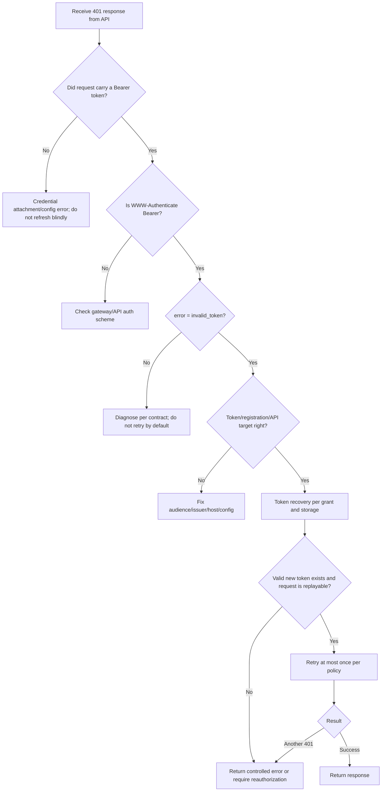
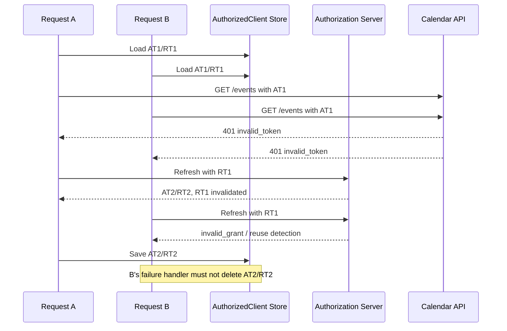

# 18.8. Expired Tokens, 401 Responses, and Request Retry Policies

In a **Spring Security OAuth 2.0 / OpenID Connect (OIDC) Client** application using **Spring MVC/Servlet**, the backend often calls external REST APIs using an **OAuth2 access token**. When a token expires, the Authorization Server revokes it, or the API no longer accepts it, the HTTP client may receive a **401 Unauthorized** response. A common mistaken reflex is: *"If we get a 401, refresh the token and immediately resend the request."*

That approach is **unsafe when applied universally**. A 401 response does not always prove the access token expired; the OAuth2 Client Manager does not automatically know every Resource Server outcome; re-issuing a token can fail; and resending POST/PUT/DELETE or streaming requests can cause **double writes, duplicate transactions, or token leakage**.

This lesson presents the proper handling process in **Spring Boot 3.x, Spring Security 6.x, Servlet, and RestClient**:

- Distinguish **expiration by `expiresAt`**, **401 from a Resource Server**, **403 insufficient permissions**, and Token Endpoint errors.
- Understand how `OAuth2AuthorizedClientManager` refreshes tokens *before a request* and its limits.
- Read `WWW-Authenticate: Bearer ...` per RFC 6750; never guess from HTTP status alone.
- Use Spring Security OAuth2 Client with `RestClient`; choose the integration matching your framework version.
- Design **conditional, bounded retries, strictly for requests safe to replay**.
- Avoid silent retries on state-changing operations, non-replayable bodies, refresh token rotation, and concurrent requests.
- Separate client authentication failures at the Token Endpoint from Bearer token errors at downstream APIs.
- Test and observe without leaking access/refresh tokens.

URLs, scopes, client IDs, and responses in this lesson are illustrative only, not configuration for any specific provider.

## 1. Three Very Different Places Where Errors Occur

Before writing retry logic, identify which hop produced the error.

```mermaid
sequenceDiagram
    autonumber
    actor B as Browser
    participant S as Spring MVC / OAuth2 Client
    participant AS as Authorization Server
    participant API as Resource Server REST API
    B->>S: GET /my-orders + session cookie
    Note over S: User has Authentication
    S->>S: manager.authorize(...)
Check authorized client
    opt Access token needs reauthorization and can be refreshed
        S->>AS: POST /token grant_type=refresh_token
        AS-->>S: new access_token (+ refresh_token if rotated)
        Note over S: Save new OAuth2AuthorizedClient
    end
    S->>API: GET /orders + Authorization: Bearer AT
    alt API accepts token and permissions
        API-->>S: 200 + data
        S-->>B: 200 + response
    else API rejects token
        API-->>S: 401 + WWW-Authenticate
        Note over S: Classify error; do not replay by default
        S-->>B: Appropriate application response
    else Token is valid yet lacks permissions
        API-->>S: 403 insufficient_scope
        Note over S: Never use refresh to self-escalate permissions
        S-->>B: Appropriate application response
    end
```

Three layers must be kept separate:

| Layer | Example | Meaning |
| --- | --- | --- |
| **Browser OIDC login** | Callback `/login/oauth2/code/calendar` reports a `state`/ID Token error | Failed to authenticate browser user; not a REST API 401 |
| **Authorization Server Token Endpoint** | `POST /token` returns `invalid_grant` or `invalid_client` | Client failed to request or refresh a token |
| **Resource Server REST API** | `GET /orders` returns `401`/`403` | API rejected credentials or denied access |

If logs merely say "OAuth2 failed" without the stage, operators easily fix the wrong piece: rotating a client secret to fix an API `insufficient_scope` error, or forcing a re-login when the `Bearer` token was actually sent with the wrong audience.

## 2. An Expired Access Token Does Not Mean the API Just Returned 401

An `OAuth2AuthorizedClient` in Spring Security stores `OAuth2AccessToken` with metadata such as:

```java
OAuth2AuthorizedClient authorizedClient = ...;

Instant issuedAt = authorizedClient.getAccessToken().getIssuedAt();
Instant expiresAt = authorizedClient.getAccessToken().getExpiresAt();
Set<String> scopes = authorizedClient.getAccessToken().getScopes();
```

Using this metadata, `OAuth2AuthorizedClientProvider` can determine **whether it is time for reauthorization**. When configured with a `refreshToken()` provider and a valid refresh token, the manager can refresh before the HTTP request hits the API.

### 2.1. Proactive Refresh Before the Request

```text
Application wants to call API
       |
       v
OAuth2AuthorizedClientManager.authorize(...)
       |
       v
Read current authorized client
       |
       +--- AT still valid ---> return existing AT
       |
       +--- AT expired/expiring
                |
                +--- Refresh token exists + provider supports it
                |       |
                |       v
                |    POST /token, save new token
                |       |
                |       v
                |    Return updated authorized client
                |
                +--- Cannot reauthorize
                        |
                        v
                      null / error depending on context
```

**Not every `authorize()` call sends `POST /token`.** The manager may return the existing authorized client when the provider sees no renewal is needed yet. For `client_credentials`, the manager usually requests a new access token via that grant when needed, rather than using a refresh token.

### 2.2. What Role Does Clock Skew Play?

Suppose the client clock thinks a token expires at 10:00 while the API checks near that boundary. A request sent at 09:59:59 could reach the API after expiration. Some token providers apply **clock skew** to treat nearly expired tokens as needing earlier renewal.

This helps reduce 401s from clock drift and network latency, yet:

- Does not guarantee the API will always accept the token.
- Cannot fix tokens revoked ahead of expiration.
- Cannot fix wrong issuer, audience, or permissions.
- Excessive skew increases Token Endpoint traffic.
- Server clocks still must be synchronized.

Never "fix" errors by arbitrarily raising skew to several hours or disabling token expiration checks.

## 3. Why Can an Unexpired Token Still Receive a 401?

An access token with `expiresAt` in the future **does not mean** every Resource Server must accept it.

Possible reasons include:

1. **Token revoked or account disabled** under Authorization Server/Resource Server policy.
2. **Wrong audience**: token issued for API A yet sent to API B.
3. **Wrong issuer** or API pointing to a different environment/tenant.
4. **Token signature or token introspection failed** at the API.
5. **Token not transmitted**: `Authorization` header lost due to client/gateway configuration.
6. **Wrong format**: sending an ID Token instead of an access token, or using a token from another registration.
7. **Wrong token type/scheme**: API expects Bearer, yet request lacks a proper `Bearer` header.
8. **Key rotation or Resource Server config out of sync** with the OP.
9. **Authorization Server and Resource Server enforce different acceptance windows**.
10. **Header stripped or mishandled across proxy/gateway redirects**.

Therefore, **401 is a signal to classify**, not an unconditional command to "refresh and retry."

## 4. HTTP 401, 403, and `WWW-Authenticate`

Under **RFC 6750** Bearer Token rules, a Resource Server can return a challenge:

```http
HTTP/1.1 401 Unauthorized
WWW-Authenticate: Bearer realm="orders", error="invalid_token"
Cache-Control: no-store
```

Or when the token is valid yet lacks sufficient scopes:

```http
HTTP/1.1 403 Forbidden
WWW-Authenticate: Bearer realm="orders",
    error="insufficient_scope",
    scope="orders.write"
```

The above is illustrative; real challenges may sit on one line and include additional parameters.

### 4.1. Meaning of Common Bearer Errors

| Status/Challenge | Common Meaning | Client-Side Action |
| --- | --- | --- |
| `401` + `Bearer error="invalid_token"` | Token expired, invalid, revoked, or rejected | Check token/registration/audience; consider controlled invalidation/reauthorization |
| `401` + Bearer challenge without `error` | Missing credential or authentication required | Verify the request actually sent the Bearer token to the right place |
| `401` with non-Bearer challenge | Different auth scheme or gateway | Do not default to treating it as OAuth2 access-token expiration |
| `403` + `insufficient_scope` | Valid credential yet lacks scope/permission | Check scopes, consent, client registration, or business rules; do not refresh blindly |
| `403` due to object/tenant policy | API denied record/tenant access | Business authorization; never self-escalate privileges |
| `429` | Rate limit | Back off per policy; not a token error |
| `5xx` | API/gateway failure | Retry per idempotency/network policy, not OAuth2 refresh |
| Timeout/connection reset | Unclear whether API received/processed the request | Never replay state-changing operations without idempotency guarantees |

**`invalid_token` can include expired access tokens**, yet there is no one-to-one mapping. If a response only carries 401 without matching Bearer details, understand the API contract instead of assuming `invalid_token`.

### 4.2. A 401 Might Come from a Gateway Rather Than the API

For instance, a reverse proxy may demand another header, or an API gateway may return 401 before the request reaches the Resource Server. If a handler acts on status alone, the client could delete a perfectly valid user authorized client.

Inspect the response source, challenge type, and called endpoint. You may use correlation IDs/traces in controlled systems, yet **never write raw Bearer tokens or authorization codes to logs**.

### 4.3. Do Not Trust `error_description` as Safe Data

`WWW-Authenticate` and response bodies come from external systems. Never inject raw `error_description` into unescaped HTML, never use it as control directives, and never let external content choose a new API host or token endpoint.

Extract only contract-defined error codes; log minimal information with redaction.

## 5. Relationship Between Client Manager and HTTP Client

In a Servlet application, Spring Security provides these abstractions:

| Component | Responsibility |
| --- | --- |
| `ClientRegistrationRepository` | Configures client ID, secret, grant, provider, token endpoint, scopes |
| `OAuth2AuthorizedClientRepository` | Saves/looks up authorized clients potentially bound to Servlet request/session |
| `OAuth2AuthorizedClientService` | Saves/looks up authorized clients independent of HTTP requests |
| `OAuth2AuthorizedClientManager` | Coordinates authorization and reauthorization |
| `OAuth2AuthorizedClientProvider` | Handles refresh token, client credentials, or other grants |
| `OAuth2AuthorizedClient` | Holds access token, optional refresh token, registration, and principal name |
| `RestClient` | Sends HTTP requests to downstream APIs |
| `OAuth2ClientHttpRequestInterceptor` | Integrates OAuth2 tokens into Spring `RestClient` on supported versions |
| `OAuth2AuthorizationFailureHandler` | Reacts when authorization fails or is wired to handle qualifying failures |

### 5.1. Two Distinct Handling Points

**Point A — before sending the API request:**

```java
OAuth2AuthorizedClient client =
        authorizedClientManager.authorize(authorizeRequest);
```

The manager selects a still-valid authorized client or performs reauthorization per provider. On success, the caller receives an access token.

**Point B — after the API returns 401:**

```text
HTTP client receives 401 response
        |
        v
Client code or OAuth2 HTTP interceptor/failure handler
        |
        v
Is it Bearer invalid_token?
        |
        v
Is invalidation/removal configured and appropriate?
        |
        v
Is reauthorization/reconnect needed?
        |
        v
Is resending the business request permitted?
```

These are **two steps that must not be collapsed into one**. Just because a failure handler can delete an authorized client does not mean it automatically replays the HTTP request after acquiring a new token.

### 5.2. Failure Integration Does Not Equal Automatic Retry

In Spring Security with `RestClient` integration, a configured authorization failure handler can **remove invalid authorized clients** so subsequent calls stop reusing them. Still:

- The handler does not grant missing scopes/consent.
- With Authorization Code Flow, deleting the authorized client can also remove the refresh token stored on that record, leading to **needing user reauthorization**.
- Even if client credentials can fetch a new token, you still must decide **whether to replay the previous HTTP request**.
- A handler knowing only status and token may need storage coordination so it does not wipe out a fresh token just saved by another thread.

Therefore, separate **token recovery** from **business request retry policy**.

## 6. Example Configuration: OIDC User and Service-to-Service

Suppose an application has two REST integrations:

- **Calendar API**: users log in via OIDC, backend calls on the user's behalf via `authorization_code`.
- **Inventory API**: backend runs under its application identity via `client_credentials`.

### 6.1. `application.yml`

```yaml
spring:
  security:
    oauth2:
      client:
        registration:
          calendar-user:
            provider: calendar-oidc
            client-id: ${CALENDAR_CLIENT_ID}
            client-secret: ${CALENDAR_CLIENT_SECRET}
            client-authentication-method: client_secret_basic
            authorization-grant-type: authorization_code
            scope:
              - openid
              - profile
              - calendar.read
              - offline_access
            redirect-uri: "{baseUrl}/login/oauth2/code/{registrationId}"

          inventory-service:
            provider: inventory-as
            client-id: ${INVENTORY_CLIENT_ID}
            client-secret: ${INVENTORY_CLIENT_SECRET}
            client-authentication-method: client_secret_basic
            authorization-grant-type: client_credentials
            scope:
              - inventory.read

        provider:
          calendar-oidc:
            issuer-uri: ${CALENDAR_ISSUER_URI}
          inventory-as:
            token-uri: ${INVENTORY_TOKEN_URI}
```

`calendar.read` and `inventory.read` are illustrative scopes, not universal standards across providers. `offline_access` may relate to refresh token issuance, yet **does not guarantee the OP issues or accepts refresh tokens**.

Client secrets must be stored in a backend secret manager/environment. Never put real active tokens/secrets into repository YAML.

### 6.2. Equivalent `application.properties`

```properties
spring.security.oauth2.client.registration.calendar-user.provider=calendar-oidc
spring.security.oauth2.client.registration.calendar-user.client-id=${CALENDAR_CLIENT_ID}
spring.security.oauth2.client.registration.calendar-user.client-secret=${CALENDAR_CLIENT_SECRET}
spring.security.oauth2.client.registration.calendar-user.client-authentication-method=client_secret_basic
spring.security.oauth2.client.registration.calendar-user.authorization-grant-type=authorization_code
spring.security.oauth2.client.registration.calendar-user.scope=openid,profile,calendar.read,offline_access
spring.security.oauth2.client.registration.calendar-user.redirect-uri={baseUrl}/login/oauth2/code/{registrationId}
spring.security.oauth2.client.provider.calendar-oidc.issuer-uri=${CALENDAR_ISSUER_URI}

spring.security.oauth2.client.registration.inventory-service.provider=inventory-as
spring.security.oauth2.client.registration.inventory-service.client-id=${INVENTORY_CLIENT_ID}
spring.security.oauth2.client.registration.inventory-service.client-secret=${INVENTORY_CLIENT_SECRET}
spring.security.oauth2.client.registration.inventory-service.client-authentication-method=client_secret_basic
spring.security.oauth2.client.registration.inventory-service.authorization-grant-type=client_credentials
spring.security.oauth2.client.registration.inventory-service.scope=inventory.read
spring.security.oauth2.client.provider.inventory-as.token-uri=${INVENTORY_TOKEN_URI}
```

Pick YAML or properties per project convention. Ensure tokens are issued for the **right API audience**, not merely matching scope names.

## 7. Client Manager for Servlet User Requests

With `oauth2Login()`, the user has an `Authentication` in `SecurityContext` and may have an `OAuth2AuthorizedClient` after the Authorization Code Flow.

```java
import org.springframework.context.annotation.Bean;
import org.springframework.context.annotation.Configuration;
import org.springframework.security.oauth2.client.DefaultOAuth2AuthorizedClientManager;
import org.springframework.security.oauth2.client.OAuth2AuthorizedClientManager;
import org.springframework.security.oauth2.client.OAuth2AuthorizedClientProvider;
import org.springframework.security.oauth2.client.OAuth2AuthorizedClientProviderBuilder;
import org.springframework.security.oauth2.client.registration.ClientRegistrationRepository;
import org.springframework.security.oauth2.client.web.OAuth2AuthorizedClientRepository;

@Configuration
public class UserOauth2ManagerConfig {

    @Bean("userClientManager")
    OAuth2AuthorizedClientManager userClientManager(
            ClientRegistrationRepository registrations,
            OAuth2AuthorizedClientRepository authorizedClients) {

        OAuth2AuthorizedClientProvider provider =
                OAuth2AuthorizedClientProviderBuilder.builder()
                        .authorizationCode()
                        .refreshToken()
                        .build();

        DefaultOAuth2AuthorizedClientManager manager =
                new DefaultOAuth2AuthorizedClientManager(
                        registrations, authorizedClients);

        manager.setAuthorizedClientProvider(provider);
        return manager;
    }
}
```

Important points:

- `authorizationCode()` does not open a browser login from an arbitrary service method.
- `refreshToken()` only helps when the authorized client holds a valid refresh token and reauthorization conditions are met.
- `DefaultOAuth2AuthorizedClientManager` is built for environments with a **Servlet request/response**.
- If the OP rejects the refresh or the token was deleted from the store, the application may need to prompt the user to **re-login/re-consent**.

### 7.1. `SecurityFilterChain` for OIDC Login

```java
import org.springframework.context.annotation.Bean;
import org.springframework.context.annotation.Configuration;
import org.springframework.security.config.Customizer;
import org.springframework.security.config.annotation.web.builders.HttpSecurity;
import org.springframework.security.web.SecurityFilterChain;

@Configuration
public class WebSecurityConfig {

    @Bean
    SecurityFilterChain securityFilterChain(HttpSecurity http)
            throws Exception {

        http
            .authorizeHttpRequests(authorize -> authorize
                .requestMatchers("/", "/error", "/assets/**").permitAll()
                .anyRequest().authenticated())
            .oauth2Login(Customizer.withDefaults());

        return http.build();
    }
}
```

You do not need to disable CSRF to make GET calls to external REST APIs. CSRF on a **session-cookie website** and OAuth2 Bearer authentication on a **downstream REST API** are two separate security concerns.

## 8. Client Manager for Application-Initiated API Calls

For `inventory-service` using `client_credentials`, select a manager independent of HTTP requests:

```java
import org.springframework.context.annotation.Bean;
import org.springframework.context.annotation.Configuration;
import org.springframework.security.oauth2.client.AuthorizedClientServiceOAuth2AuthorizedClientManager;
import org.springframework.security.oauth2.client.OAuth2AuthorizedClientManager;
import org.springframework.security.oauth2.client.OAuth2AuthorizedClientProvider;
import org.springframework.security.oauth2.client.OAuth2AuthorizedClientProviderBuilder;
import org.springframework.security.oauth2.client.OAuth2AuthorizedClientService;
import org.springframework.security.oauth2.client.registration.ClientRegistrationRepository;

@Configuration
public class MachineOauth2ManagerConfig {

    @Bean("machineClientManager")
    OAuth2AuthorizedClientManager machineClientManager(
            ClientRegistrationRepository registrations,
            OAuth2AuthorizedClientService authorizedClients) {

        OAuth2AuthorizedClientProvider provider =
                OAuth2AuthorizedClientProviderBuilder.builder()
                        .clientCredentials()
                        .build();

        AuthorizedClientServiceOAuth2AuthorizedClientManager manager =
                new AuthorizedClientServiceOAuth2AuthorizedClientManager(
                        registrations, authorizedClients);

        manager.setAuthorizedClientProvider(provider);
        return manager;
    }
}
```

With `client_credentials`, `OAuth2AuthorizedClientManager` can issue a new access token when the current one is no longer valid. No user or browser login is required. However, `principal("inventory-worker")` when building the authorize request is only a **management key for the workload's authorized client**, not an OIDC end user or automatic admin privilege.

## 9. `RestClient` and the OAuth2 HTTP Interceptor in Spring Security

**Spring Framework 6.1+** provides `RestClient`; the `OAuth2ClientHttpRequestInterceptor` integration for `RestClient` arrived in **Spring Security 6.4+**. If a project runs older Spring Boot/Security versions, use compatible APIs or call the manager explicitly as in Section 10.

### 9.1. Letting the Interceptor Attach the Bearer Token

Servlet web integration example for Spring Security versions that support this API:

```java
import org.springframework.beans.factory.annotation.Qualifier;
import org.springframework.context.annotation.Bean;
import org.springframework.context.annotation.Configuration;
import org.springframework.security.oauth2.client.OAuth2AuthorizedClientManager;
import org.springframework.security.oauth2.client.web.OAuth2AuthorizedClientRepository;
import org.springframework.security.oauth2.client.web.client.OAuth2ClientHttpRequestInterceptor;
import org.springframework.web.client.RestClient;

@Configuration
public class CalendarRestClientConfig {

    @Bean("calendarRestClient")
    RestClient calendarRestClient(
            @Qualifier("userClientManager")
            OAuth2AuthorizedClientManager manager,
            OAuth2AuthorizedClientRepository authorizedClientRepository) {

        OAuth2ClientHttpRequestInterceptor interceptor =
                new OAuth2ClientHttpRequestInterceptor(manager);

        interceptor.setAuthorizationFailureHandler(
                OAuth2ClientHttpRequestInterceptor
                        .authorizationFailureHandler(
                                authorizedClientRepository));

        return RestClient.builder()
                .baseUrl("https://calendar-api.example.com")
                .requestInterceptor(interceptor)
                .build();
    }
}
```

**Version note:** failure-handler factory signatures and client registration resolution details may vary across Spring Security branches. This example relies on the `OAuth2ClientHttpRequestInterceptor` API in supported releases; check the Javadoc for **your exact project version** when implementing.

### 9.2. Selecting the Registration ID in a Request

With the request-attribute resolver supported by matching Spring Security versions:

```java
import static org.springframework.security.oauth2.client.web.client
        .RequestAttributeClientRegistrationIdResolver.clientRegistrationId;

// Inside a controller/service invoked by a logged-in user:
String result = calendarRestClient.get()
        .uri("/v1/events")
        .attributes(clientRegistrationId("calendar-user"))
        .retrieve()
        .body(String.class);
```

`clientRegistrationId("calendar-user")` in this example is a helper for the interceptor to identify the registration, **not an HTTP header or query parameter sent to the API**.

Principal resolution must match the active user/session context; for background tasks, a service manager and explicit principal resolver are usually required. **Never allow the browser to supply an arbitrary registration ID** to invoke the manager with client credentials the user is not authorized to use.

### 9.3. What Does the Failure Handler Do—and Not Do?

In supported configurations, the failure handler can react to a Resource Server returning `401` with a matching Bearer error by **removing the invalid authorized client** from the repository/service. This prevents subsequent requests from reusing the failed credential.

However, **do not assume the interceptor automatically replays the request that just received 401**:

```text
Request #1 -> API returns 401 invalid_token
            -> failure handler may remove authorized client
            -> Request #1 has still failed

Request #2 (later) -> manager authorize() runs again
            -> may request a new token, or
            -> require browser authorization/consent
```

With Authorization Code Flow, deleting the authorized client can also wipe out its refresh token. The next call **cannot refresh automatically** if no authorized client/refresh token remains. The application needs a reconnect policy rather than treating deletion as "instant refresh."

### 9.4. Do Not Mix Two Ways of Attaching the Authorization Header

If `OAuth2ClientHttpRequestInterceptor` is already in use, do not simultaneously attach a manual Bearer header on the same request with another token. Mixing interceptor + manual headers easily causes:

- Sending a token from the wrong registration.
- Tokens overwriting each other in unexpected order.
- The failure handler deleting an authorized client that does not match the actual token sent.
- Harder debugging as one layer overrides another's headers.

Pick one deliberate token-acquisition/attachment path per HTTP client.

## 10. Explicitly Fetching a Token and Sending Requests with `RestClient`

When explicit flow control is desired, a service can call the manager and attach the Bearer token. The following **machine-to-machine GET** example intentionally **does not auto-retry 401s**:

```java
import org.springframework.beans.factory.annotation.Qualifier;
import org.springframework.security.oauth2.client.OAuth2AuthorizeRequest;
import org.springframework.security.oauth2.client.OAuth2AuthorizedClient;
import org.springframework.security.oauth2.client.OAuth2AuthorizedClientManager;
import org.springframework.stereotype.Service;
import org.springframework.web.client.RestClient;
import org.springframework.web.client.RestClientResponseException;

@Service
public class InventoryApiClient {

    private final OAuth2AuthorizedClientManager manager;
    private final RestClient api = RestClient.create(
            "https://inventory-api.example.com");

    public InventoryApiClient(
            @Qualifier("machineClientManager")
            OAuth2AuthorizedClientManager manager) {
        this.manager = manager;
    }

    public String fetchInventory() {
        OAuth2AuthorizeRequest request =
                OAuth2AuthorizeRequest
                        .withClientRegistrationId("inventory-service")
                        .principal("inventory-worker")
                        .build();

        OAuth2AuthorizedClient client = manager.authorize(request);
        if (client == null) {
            throw new IllegalStateException(
                    "Inventory OAuth2 client not authorized");
        }

        try {
            return api.get()
                    .uri("/v1/stock")
                    .headers(headers -> headers.setBearerAuth(
                            client.getAccessToken().getTokenValue()))
                    .retrieve()
                    .body(String.class);
        }
        catch (RestClientResponseException ex) {
            if (ex.getStatusCode().value() == 401) {
                // Classify 401 via WWW-Authenticate if present;
                // handle credential invalidation/reconnect at the policy layer.
                // Do not automatically resend GET solely because status=401.
                throw new IllegalStateException(
                        "Inventory API rejected its Bearer credential", ex);
            }
            throw ex;
        }
    }
}
```

This snippet targets **Spring Framework 6.1+/Spring Boot 3.2+**. On older versions, use a compatible HTTP client while keeping the same manager and token-lifecycle model.

**Security note:** the code attaches the token only to a fixed API host, never exposing the token to browsers or URL query strings. `setBearerAuth(...)` receives a token value that must be treated as a secret; never print it in logs.

### 10.1. Why Does the Example Not Retry Immediately?

When the API returns 401, it is not yet clear:

- Whether the token expired or had the wrong audience.
- Whether the header was missing due to a proxy or misconfiguration.
- Whether the API actually returned Bearer `invalid_token`.
- Which grant the authorized client can renew under.
- Whether a failure handler already deleted or modified token state.
- Whether the request is safe to replay.

The API client layer should pass a normalized error to the right **policy layer**, rather than building an infinite loop inside `catch`.

### 10.2. `retrieve()` and Response Handlers

With `RestClient.retrieve()`, 4xx/5xx responses throw exceptions by default, so `.body(...)` **never returns a value** on 401. You can use `onStatus(...)` or `exchange(...)` if you need to read status/challenge/body within the current API's limits.

Whichever option you pick, ensure:

- Response body reads are size-bounded.
- Raw error bodies containing tokens or sensitive data are never logged.
- Challenges are not parsed with sloppy `contains("expired")` string checks.
- Not every 401 is treated as a retryable error.

## 11. Systematically Classifying a 401 Response

A simple decision tree:



### 11.1. Never Decide from Timestamp Alone

If 401 occurs while `expiresAt` is still in the future, **revocation/wrong audience/wrong issuer** becomes more likely. Still, that metadata is only a clue, not proof.

If `invalid_token` is confirmed from a trusted API, the client can **invalidate the authorized client** per policy, while guarding against race conditions and losing refresh tokens.

### 11.2. Never Let Error Normalization Become Credential Leakage

Safe to log:

```text
targetService=inventory-api
registrationId=inventory-service
httpStatus=401
bearerError=invalid_token
operation=fetchStock
requestId=<opaque-correlation-id>
```

Never log:

```text
Authorization: Bearer eyJ...
refresh_token=...
client_secret=...
Cookie: JSESSIONID=...
```

Even `WWW-Authenticate` should be parsed for allowlisted error codes rather than logging the entire raw header in case a provider includes sensitive details in `error_description`.

## 12. Retrying an HTTP Request Is a Business Decision, Not Purely Technical

Suppose a request is sent to create an order:

```http
POST /v1/orders HTTP/1.1
Host: orders-api.example.com
Authorization: Bearer ACCESS_TOKEN
Content-Type: application/json

{"sku":"BOOK-001","quantity":1}
```

The client receives 401. Resending immediately could cause some systems to create the order twice if the first attempt partially crossed business logic before failing, or if the 401 came from a proxy/post-processing component not reflecting upstream write state.

In standard HTTP design, authentication normally precedes side effects. However, **a general-purpose client must never assume every upstream/gateway enforces that order strictly**. Retry policies must rest on **the contract and idempotency of the operation**, not HTTP method alone.

### 12.1. Safe, Idempotent, and Replayable Are Different

| Concept | Meaning |
| --- | --- |
| **Safe HTTP method** | Under HTTP semantics, the request asks for no client-intended state change; typically GET/HEAD |
| **Idempotent operation** | Executing once or multiple times with the same input produces an equivalent final effect |
| **Replayable request** | The client can faithfully reconstruct the full URL, method, headers/body, and security conditions |
| **Retriable under policy** | Business contract, transport, and security allow resending under specific conditions |

A **GET** is normally safe to retry when the upstream honors HTTP semantics, though a poorly designed GET with side effects is not. **PUT/DELETE** are defined as idempotent in HTTP semantics, yet retrying them may still require ETags, concurrency controls, repeatable bodies, and understanding side effects/audits. **POST** is normally non-idempotent unless the API supports a mechanism such as idempotency keys.

### 12.2. Conservative Initial Retry Policy Matrix

| HTTP Method / Operation | Consider Retry After 401? | Conditions |
| --- | --- | --- |
| `GET` reading data | **Conditional** | Classified Bearer `invalid_token`, fresh credential obtained, fixed host, max one retry |
| `HEAD` checking metadata | **Conditional** | Same as GET, no state change |
| `OPTIONS` | **Conditional** | Only when genuinely needed and contract fits |
| `PUT` updating a specific resource | **Only if policy allows** | Actually idempotent; ETag/`If-Match` if required; replayable body |
| `DELETE` | **Only if policy allows** | Resource semantics and already-deleted state handled consistently |
| `POST` creating orders/transactions/payments | **Not by default** | API supports idempotency keys and verified retry handling |
| `PATCH` partial updates | **Not by default** | Explicit idempotent semantics or deduplication keys and concurrency controls |
| File upload/multipart/streaming POST | **Not by default** | Body can be accurately reconstructed and API guards against duplicates |
| Side-effecting queue command | **Not by default** | Dedupe keys, transactional/outbox/inbox semantics |
| API request to user-supplied URL | **No** | Never send tokens to unapproved hosts |

This is **a conservative starting policy**, not a Spring Security rule requiring auto-retries on GET or banning all POST retries forever. Every API needs its own contract.

### 12.3. Idempotency Key for POST

An API may support:

```http
POST /v1/orders HTTP/1.1
Host: orders-api.example.com
Authorization: Bearer ACCESS_TOKEN
Idempotency-Key: order-request-7e4b... 
Content-Type: application/json

{"sku":"BOOK-001","quantity":1}
```

An idempotency key is generated for **one business intent** and **kept identical when retrying that exact intent**. The server must actually persist and compare keys/payloads over a window, returning the same result or preventing duplicate effects per contract.

If an API does not support idempotency keys, adding the header yourself **does not create idempotency**. Financial systems need idempotency contracts, request IDs, transaction state machines, and reconciliation—not just retry middleware.

## 13. Recommended Bounded Retry Policy

A retry policy can be defined as follows:

1. **Cap at one retry due to 401** per HTTP operation, within an overall per-request retry budget.
2. Trigger only upon recognizing **Bearer `invalid_token`** from a trusted endpoint or an equivalent contract-verified signal.
3. Verify the **exact OAuth2 `ClientRegistration`, principal, and API audience**.
4. Reauthorize only under a valid grant; never self-escalate scopes or switch providers.
5. Proceed only when an **actually new/different credential** is obtained or there is clear evidence the prior token was replaced with a valid one.
6. Replay only when the request is **permitted by policy** and the **body is replayable**.
7. Never resend if an account/tenant/authorization conflict appeared after the first attempt.
8. Never retry if the API returned `403 insufficient_scope`, wrong audience/issuer, or a configuration error.
9. Stop immediately if the second request still gets 401, preventing loops.
10. Log redacted outcomes/metrics; when unrecoverable, return a stable error to the caller or prompt the user to re-authorize.

### 13.1. Pseudocode for a Safe GET

```java
// PSEUDOCODE: not a built-in Spring Security API.
// tokenCoordinator and trustedApi are application abstractions.
Response getWithAtMostOne401Retry(
        AuthenticatedPrincipal principal) {

    TokenSnapshot first = tokenCoordinator
            .authorizeForTrustedApi("calendar-user", principal);

    Response response = trustedApi.getEvents(first.accessToken());

    if (!isTrustedBearerInvalidToken(response)) {
        return response;
    }

    // Coordinate credential recovery for the exact registration/principal.
    // Never delete a newer refresh token/authorized client from a stale failure.
    TokenSnapshot second = tokenCoordinator
            .recoverAfterInvalidTokenIfPermitted(
                    "calendar-user", principal, first.version());

    if (second == null
            || second.sameCredentialAs(first)
            || !trustedApi.isGetEventsReplayable()) {
        throw new ReauthorizationRequiredException();
    }

    // Second and final attempt.
    return trustedApi.getEvents(second.accessToken());
}
```

In this architectural example, `TokenSnapshot`, `tokenCoordinator`, and `trustedApi` are **application-built components**, not built-in classes in Spring Security. Key ideas:

- Only one recovery decision.
- Never reuse the exact token the API just rejected.
- Never delete another flow's fresh authorized client.
- Never retry with the wrong grant/identity.
- Never expose raw Bearer tokens to callers outside the necessary boundary.

### 13.2. Global Retry Budget

If the HTTP client layer already retried a 401 once, the service and controller layers **must not each retry three more times**. Stacked retry layers amplify request counts exponentially.

Pass a **request-scoped retry context** or organize retries in **one single place**:

```text
HTTP operation budget:
  authorization recovery retries = 1
  API network retries             = 0 or per contract
  Token Endpoint retries          = per dedicated provider policy
  deadline                        = never exceed request timeout
```

Numbers are policy examples; actual choices must reflect latency SLOs, idempotency, rate limits, and security.

## 14. Token Recovery Depends on Grant Type

You cannot write one generic "401 -> refresh" function ignoring the registration's grant.

### 14.1. `authorization_code` with a Refresh Token

Flow:

```text
User already consented to calendar
       |
       v
Stored authorized client:
  access token AT1
  refresh token RT1
       |
       v
Manager refreshes when token needs reauthorization
       |
       v
OP returns AT2 and possibly RT2
       |
       v
Persist updated state consistently
```

If the API returns `invalid_token` **before `expiresAt`**, the manager may still consider AT1 unexpired and return AT1 again. Simply calling `authorize()` again **does not guarantee** it will use the refresh token right away.

The application must have an explicit policy for handling credentials rejected by the API while avoiding deleting an authorized client in a way that loses a valid RT. One approach is prompting browser reauthorization if no verified safe recovery mechanism exists.

### 14.2. `authorization_code` Without a Refresh Token

If the OP does not issue refresh tokens, when an access token expires or is revoked, the backend **cannot mint a new authorization code** by calling the manager. The user may have to restart the authorization flow:

```text
/oauth2/authorization/calendar-user
```

This is a browser flow using `state`/PKCE/nonce per config, not an automatic REST API HTTP replay.

### 14.3. `client_credentials`

For machine-to-machine clients, once a token is confirmed unusable, a policy can invalidate the cached authorized client and request a new token via `client_credentials`. Still:

- Never delete a newer token just saved by another worker.
- Never retry infinitely when the API rejects due to wrong issuer/audience.
- Prevent Token Endpoint stampedes when multiple workers receive 401 simultaneously.
- Replay business requests strictly per idempotency policy.

`principal("inventory-worker")` is merely a stable key for authorized client storage, **not an end-user identity**.

### 14.4. Refresh Token Rotation

If the OP rotates refresh tokens from RT1 to RT2:

```text
Stored: AT1, RT1

Refresh:
  send RT1
  receive AT2, RT2

Persist:
  AT2, RT2     (RT1 is gone)
```

**Never retry a refresh request using RT1** when an earlier refresh may have succeeded. If the Authorization Server enables reuse detection, replaying RT1 can revoke the entire token family.

Retrying an **API GET with AT2** and retrying a **Token Endpoint refresh with RT1** are two completely different actions; the second carries much higher risk.

## 15. Concurrency: Multiple Requests Receiving 401 Simultaneously

Suppose two user tabs or two nodes call the Calendar API concurrently:



This is a **race condition**:

1. **Duplicate refresh:** A and B both use RT1; the provider may detect reuse.
2. **Stale delete:** B's failure handler may delete the authorized client A just updated.
3. **Stale write:** an older thread may overwrite the newer refresh token.
4. **Retry amplification:** every request retries independently, overloading the Token Endpoint and API.

### 15.1. Coordinating by Authorized Client Key

A conceptual key:

```text
(registrationId, trustedPrincipalKey, tenantNamespace)
```

To prevent multiple requests refreshing simultaneously:

- Use **single-flight** or per-key locking.
- After acquiring the lock, **re-read the latest authorized client**.
- If another request already obtained AT2, do not use RT1.
- Enforce version/token-generation conditions on writes/deletes.
- Share a retry budget; avoid loops.

Across multiple application replicas, in-JVM `synchronized` is insufficient. You can use distributed locks/leases + fencing and atomic compare-and-swap, while handling lease expiration across network calls.

### 15.2. A Failure Handler Can Delete the New Token

Scenario:

```text
A: refreshes AT1/RT1 -> AT2/RT2, saves version=2
B: handles 401 tied to AT1
B: removeAuthorizedClient(registrationId, principalName)
```

If B deletes unconditionally, A's AT2/RT2 is lost too. A **conditional eviction** mechanism is needed when storage/requirements demand concurrency safety:

```text
Remove only when:
  currentRecord.version == failedRequest.version
or:
  currentRecord.accessTokenGeneration == failedRequest.tokenGeneration
```

This is a **custom application strategy**. Never assume `OAuth2AuthorizedClientRepository.removeAuthorizedClient(...)` provides compare-and-swap semantics, as the general interface makes no such guarantee.

### 15.3. Unknown Outcome: Never Blindly Retry a Refresh Token

If a POST refresh to the Authorization Server times out:

```text
Client -> POST /token RT1
OP may have received and rotated RT1 -> RT2
Network drops the response
Client only has RT1
```

You cannot prove the OP did not process it just because the client timed out. Retrying RT1 may look like reuse. Follow provider-specific recovery: check the token store, wait on the other flight/lease, use a grace period if documented, or require user reauthorization when unrecoverable.

## 16. Request Body and Replayability

Even once a token is refreshed, the HTTP operation itself must be **faithfully replayable**.

### 16.1. Typically Replayable Bodies

An immutable JSON DTO object can be re-serialized:

```java
public record CreateOrderRequest(
        String productId,
        int quantity
) {}
```

Yet a replayable body **does not mean** creating an order is idempotent. The API needs an idempotency contract or proof that the operation has not occurred.

### 16.2. Non-Replayable or Expensive Bodies

Cases requiring careful attention:

- An `InputStream` already read to EOF.
- `StreamingHttpOutputMessage` or streaming upload mechanisms.
- Multipart files sourced from temporary files already deleted.
- Request bodies signed per attempt with timestamp/nonce.
- One-shot publishers or queue messages readable only once.
- Large uploads that cannot be buffered in memory.
- Bodies referencing state/ETags that changed since the first attempt.

An interceptor resending the same request object **must never assume** every stream can be reopened. If retries are needed, the application layer must **reconstruct the request from an immutable command** or a controlled replayable data source.

### 16.3. Conditional Headers Must Also Stay Consistent

With PUT/PATCH, headers like `If-Match: "<etag>"` and versions enforce optimistic concurrency. When retrying, never strip the precondition or swap ETags just to force the operation to "succeed at all costs."

If the first attempt modified the resource, a second attempt may return `412 Precondition Failed`, signaling a need for reconciliation rather than more retries.

## 17. Never Resend Bearer Tokens to the Wrong Host

Another severe failure mode is redirects or target URLs taken from input:

```java
// ANTI-PATTERN: never attach tokens to a user-controlled URL.
String destination = request.getParameter("url");
restClient.get()
        .uri(destination)
        .headers(h -> h.setBearerAuth(accessToken))
        .retrieve();
```

If the client sends credentials to an untrusted host, the access token is exposed. Retry middleware multiplies how often credentials traverse those connections.

Safeguards:

1. Use a **fixed base URL or allowlist** for each API integration.
2. Never let query parameters, headers, or error responses alter the token endpoint/issuer/API host.
3. Control cross-origin redirects and **never forward `Authorization` to another host**.
4. Select `ClientRegistration` strictly from server-side policy.
5. Ensure tokens carry the right **audience/resource** for the called API.
6. Never place tokens in URL query strings or logs.
7. On retry, confirm **the destination is still the same trusted API**.

Do not trust any HTTP client to handle all redirects and headers per your threat model automatically; test actual behavior.

## 18. Web Application 401s and API 401s Are Different

In an application using `oauth2Login()`:

- An unauthenticated browser hitting a protected page may receive a **302 redirect** to login/OP.
- An authenticated browser lacking authority may receive **403**.
- The backend calling an external API and receiving **401** is an **outbound REST call failure**.
- If the backend mishandles the error, it might return 500, 502, 503, or another application response to the browser.
- An API inside the same application might use `oauth2ResourceServer()` and return its own Bearer 401.

**Never turn every outbound 401 into "user is not logged into the website."** The user may hold a valid OIDC session while the Calendar API rejects the token due to audience, revocation, or consent. A sensible UX may prompt "Please reconnect your Calendar account" without destroying the entire Spring session unless policy requires it.

### 18.1. Browser Decision Table

| Scenario | Handling Approach |
| --- | --- |
| User not logged into website | Initiate OIDC login / return 401 per API contract |
| User logged into website yet hasn't authorized external Calendar | Direct user to consent/account linking |
| Calendar access token expired, valid refresh token exists | Manager can refresh before request |
| Calendar token rejected by API with no safe recovery | Prompt user to reconnect Calendar; never use another user's token |
| API reports missing scope | Request permission/consent per contract; do not retry same token |
| API 5xx error | Return dependency error; retry only if idempotent |
| User has session yet API record is forbidden | Show business 403; do not log user out |

## 19. A Defensive Retry Algorithm at the Application Layer

An architecture can separate responsibilities:

```text
Controller
  |
  v
Application Service
  |
  +--> AuthorizationPolicy:
  |      principal, registration, tenant, permissions
  |
  +--> TokenProvider / OAuth2AuthorizedClientManager
  |
  +--> TrustedApiClient (RestClient)
  |
  +--> OutboundResponseClassifier
  |      status + WWW-Authenticate
  |
  +--> RetryPolicy:
         - is request replayable?
         - is there a new credential?
         - is budget remaining?
         - is API host safe?
         - is operation idempotent?
```

### 19.1. Complete Step-by-Step Pseudocode

```text
function callTrustedApi(command, principal):
  assert command.allowedApiHost
  assert command.authorizedRegistration
  assert command.authorizedPrincipal
  assert command.retryBudget >= 0

  authorizedClient = manager.authorize(
      registration, principal
  )

  if authorizedClient == null:
      return AUTHORIZATION_REQUIRED

  firstTokenGeneration = authorizedClient.generation
  firstResponse = sendOnce(command, authorizedClient.accessToken)

  if firstResponse.isSuccess:
      return firstResponse

  if firstResponse.status != 401:
      return classifyOtherFailure(firstResponse)

  if not isBearerInvalidToken(firstResponse):
      return AUTHENTICATION_CONFIG_FAILURE

  if not command.isSafeToReplayUnderBusinessContract:
      return AUTHENTICATION_RECOVERY_REQUIRED

  if not command.hasReplayableBody:
      return AUTHENTICATION_RECOVERY_REQUIRED

  if not retryBudget.allowsOne401Retry:
      return AUTHENTICATION_RECOVERY_REQUIRED

  // May remove/update token cache by version, lock, and provider.
  recovery = recoverCredential(
      registration,
      principal,
      firstTokenGeneration
  )

  if recovery.failed or recovery.accessTokenIsSame:
      return AUTHORIZATION_REQUIRED

  // Use same operation context; never change URL, tenant, scope.
  secondResponse = sendOnce(command, recovery.accessToken)
  return secondResponse  // NEVER retry 401 a second time
```

**This is a policy algorithm**, not a single API provided out of the box by Spring Security. `recoverCredential(...)` must be designed for your grant/storage and may fail or require browser reauthorization. `generation` is application-managed metadata, not a built-in field on `OAuth2AuthorizedClient`.

### 19.2. Why Require the Credential to Change?

If the API rejected AT1 and the retry sends the exact same AT1, it only adds load, pollutes metrics, and risks rate limits. For opaque tokens, never print tokens to logs to compare them; storage can maintain a **version/one-way fingerprint or internal generation identifier** to confirm the token changed.

### 19.3. When Recovery Produces No New Token

If the manager/provider cannot reauthorize, or still returns the old authorized client, **stop**. For OIDC users, user re-authorization may be needed. For service clients, inspect `client_credentials`, client secret, audience, and token endpoint.

## 20. Error Ordering and Handling Order

An easy-to-investigate architecture keeps root errors at the right layer:

| Input Condition | Question to Answer | What Not to Do |
| --- | --- | --- |
| `manager.authorize() == null` | Can the grant/provider authorize in this context? | Never call the API with a null token |
| `OAuth2AuthorizationException` | Why did Token Endpoint/reauthorization fail? | Never relabel it as "API 401" |
| `RestClientResponseException 401` | Did API return Bearer `invalid_token`? | Never assume `invalid_grant` |
| `RestClientResponseException 403` | Scope/permission/object rule? | Never refresh infinitely |
| `RestClientResponseException 429` | API rate limit? | Never mint multiple tokens to dodge limits |
| Network timeout | Might the request have reached the server? | Never replay POSTs unconditionally |
| HTTP 5xx | Transient API error or unknown state? | Never mix with token invalidation |
| Local persistence conflict | Did another thread just update the token? | Never delete a newer token via a stale handler |

### 20.1. Should the Authorized Client Be Deleted on Every 401?

No. Deleting an authorized client makes sense when **the Resource Server asserts Bearer `invalid_token`** and storage policy aligns. Yet if the cause is wrong audience, deleting and requesting under the same registration will not fix it. With Authorization Code, deleting the client also loses the refresh token. Under concurrent requests, deleting by registration/principal without version checks causes races.

A failure handler should know **which token generation it is acting on**, and the application must consider recoverability, especially across multi-instance production deployments.

## 21. Timeouts and Backoff for Token Requests Differ from API Requests

Wait limits must be separated:

```text
Browser request deadline
  |
  +-- token acquisition/refresh
  |     +-- HTTP connect timeout
  |     +-- HTTP read timeout
  |     +-- Token Endpoint retry policy (if safe)
  |
  +-- API request
        +-- HTTP connect timeout
        +-- HTTP read timeout
        +-- API retry policy (idempotency)
```

Do not share one blind retry loop across both. Token refreshes using refresh tokens are subject to **rotation/reuse detection**, so retrying a token request with the same refresh token **after an uncertain timeout** carries distinct risks. An API GET may be retried after a network error, whereas a money-sending API POST is not.

An overall deadline prevents users from waiting endlessly when multiple layers back off together. Also add circuit breakers/bulkheads and concurrency limits so an OP outage does not exhaust all request threads.

### 21.1. Retry Storm

If 100 requests all use an expiring token and each attempts a refresh followed by three API retries, a single Token Endpoint hiccup turns into hundreds of token requests and hundreds of API calls.

Mitigations:

- **Single-flight** per registration/principal.
- Appropriate clock skew.
- Rate-limiting/queuing token acquisitions.
- Circuit breakers when OP is unavailable.
- Retry budgets and jittered backoff where applicable.
- Never auto-retry non-idempotent requests.
- Alerts when token acquisition rates spike unexpectedly.

## 22. Execution Boundaries Inside a Servlet Request

Requests entering Spring MVC normally have the user's `Authentication` and the current `HttpServletRequest`. `DefaultOAuth2AuthorizedClientManager` fits this flow.

However, if an application service is invoked from:

- `@Scheduled` jobs.
- `@Async` methods.
- Message listeners.
- Thread-pool callbacks after the HTTP request finishes.
- Multi-hour batch operations.

then **the original Servlet request context or `SecurityContext` is no longer guaranteed**. You cannot simply call the user manager from a worker and expect it to read the right refresh token.

If a background job needs an **application** token, use a `client_credentials` manager backed by `OAuth2AuthorizedClientService`. If it needs a **delegated user token**, use storage designed for user authorizations with explicit permission/consent/revocation lifecycles—never silently fall back to a service token.

### 22.1. Worker Retries Can Produce Duplicate Results

Jobs handling notifications, webhooks, or background commands may be redelivered by queues under at-least-once delivery. Adding HTTP retries on top of queue redeliveries multiplies call counts.

Bind idempotency keys and durable work state to the **business command**, not only the token request. A successful token refresh does not prove the earlier business operation went unprocessed.

## 23. Example: Web User GET via Manager, Without Auto-Retry

Example with `calendar-user` inside an HTTP request:

```java
import org.springframework.beans.factory.annotation.Qualifier;
import org.springframework.security.core.Authentication;
import org.springframework.security.oauth2.client.OAuth2AuthorizeRequest;
import org.springframework.security.oauth2.client.OAuth2AuthorizedClient;
import org.springframework.security.oauth2.client.OAuth2AuthorizedClientManager;
import org.springframework.stereotype.Service;
import org.springframework.web.client.RestClient;

@Service
public class CalendarApiGateway {

    private final OAuth2AuthorizedClientManager manager;
    private final RestClient client =
            RestClient.create("https://calendar-api.example.com");

    CalendarApiGateway(
            @Qualifier("userClientManager")
            OAuth2AuthorizedClientManager manager) {
        this.manager = manager;
    }

    String readEvents(Authentication authenticatedUser) {
        OAuth2AuthorizeRequest authorizeRequest =
                OAuth2AuthorizeRequest
                        .withClientRegistrationId("calendar-user")
                        .principal(authenticatedUser)
                        .build();

        OAuth2AuthorizedClient authorizedClient =
                manager.authorize(authorizeRequest);

        if (authorizedClient == null) {
            throw new IllegalStateException(
                    "Calendar consent/authorization required");
        }

        return client.get()
                .uri("/v1/events")
                .headers(headers -> headers.setBearerAuth(
                        authorizedClient.getAccessToken()
                                .getTokenValue()))
                .retrieve()
                .body(String.class);
    }
}
```

This is a basic call path with no HTTP interceptor handling downstream 401s and **no automatic retries**. Its advantage is making clear exactly when the token is acquired and sent.

When adding 401 retry support, never simply wrap `client.get()` in `while(true)`. Apply your defined policy: classify Bearer challenges, coordinate authorized client storage, verify a new credential, enforce idempotency, and respect the retry budget.

### 23.1. Unauthenticated User Requests

When controllers are protected by `.anyRequest().authenticated()`, anonymous users are normally redirected to the login flow before `CalendarApiGateway` runs.

**Never** pass an `Authentication` from a query parameter or global variable to substitute for a user. Principals must come from an authenticated context, and all authorized client state must be isolated by principal/registration.

### 23.2. Application REST APIs May Want JSON Errors

If your backend API returns JSON only and should not serve HTML redirects, configure an appropriate `AuthenticationEntryPoint`/`AccessDeniedHandler` for internal API endpoints. Keep in mind that governs **inbound authentication** to the Spring application, distinct from the downstream Calendar API returning 401.

## 24. Testing Retry Policies

A useful test suite does not merely assert "eventually got 200"—it verifies **how many times the Token Endpoint was called, how many times the API operation was replayed, and which token was attached to each request**.

### 24.1. Core Scenarios

| Test | Setup | Expected Outcome |
| --- | --- | --- |
| T1: Unexpired token | Authorized client has valid AT | One API call, no unnecessary refresh |
| T2: Expiring token | Valid RT exists, refresh provider enabled | Token refreshes before API call, state saved properly |
| T3: API 401 Bearer `invalid_token` | API rejects old AT | Invalidation/recovery per policy; no auto-replay if unpermitted |
| T4: API 401 non-Bearer header | Gateway Basic auth challenge | Do not delete OAuth2 client blindly |
| T5: API 403 `insufficient_scope` | Valid token lacking permissions | No infinite refresh/retry |
| T6: API 401 wrong audience | Token from wrong registration | Fix registration/audience; retrying same token disallowed |
| T7: Replayable GET, new credential | Policy allows 1 retry | Max 2 API calls, second call carries new credential |
| T8: Second GET attempt still 401 | API keeps rejecting | Stop, no loop |
| T9: Non-idempotent order POST | 401 from API/gateway | No automatic POST replay |
| T10: POST with idempotency contract | API supports key/dedupe | Retry uses **same key and same business intent**, per policy |
| T11: One-shot stream body | Upload stream cannot reopen | No auto-retry |
| T12: Token rejected after another thread refreshed | Store already holds newer AT | Never delete newer-generation authorized client |
| T13: Refresh token rotation | RT1 rotated to RT2 | Never reuse RT1, never overwrite RT2 |
| T14: Timeout during refresh | OP outcome unknown | Never blindly retry RT1 |
| T15: Client credentials gets 401 | Can fetch new service token | Bounded recovery, no stampede |
| T16: Logout/disconnect mid-retry | User revoked consent | Never resurrect authorized client or replay action |
| T17: Cross-origin API redirect | API returns Location to external host | Never forward Bearer token |
| T18: 100 concurrent GETs | Same user/registration | Coordinated, does not fire 100 refresh requests |
| T19: 429 / 503 | API rate limit/unavailable | Handled separately from credential invalidation |
| T20: DEBUG logging enabled | Requests/responses carry dummy test tokens | No raw tokens/secrets appear in logs |

### 24.2. Using Mock APIs and Mock Token Endpoints

You can use:

- `MockRestServiceServer` when compatible with builder-constructed `RestClient`/HTTP clients.
- WireMock, MockWebServer, or equivalent test HTTP servers.
- An Authorization Server test fixture simulating token expiry/rotation.
- A stub `OAuth2AuthorizedClientManager` for isolated HTTP retry policy tests.
- Real integration tests against a configured `OAuth2AuthorizedClientRepository`/Service.

A simplistic mock:

```text
API first call -> 401 invalid_token
API second call -> 200
```

is **not enough**. Tests must also prove the second request carried **a new token** and only ran when policy allowed. Never use real tokens in tests; create dummy fixtures with clear generation markers like `AT1`/`AT2`.

### 24.3. Testing Non-Retry of Dangerous Operations

Scenario:

```text
Given:
  POST /payments, amount=100
  API stub returns 401
  No server-recognized idempotency key

Then:
  outgoing POST calls = 1
  no automatic replay
  application reports an actionable failure
```

When using an idempotency key per API contract:

```text
Given:
  POST /payments, amount=100, idempotencyKey=K1
  first response uncertain or invalid token according to contract
  policy explicitly permits retry

Then:
  second POST uses same K1 + same immutable payload
  no more than configured attempts
  server deduplicates according to its documented guarantee
```

Do not assume merely sending an `Idempotency-Key` header suffices if the upstream ignores it.

## 25. Metrics, Logging, and Tracing

Fields safe to record:

```text
operation=calendar.readEvents
clientRegistrationId=calendar-user
upstream=calendar-api
status=401
bearerError=invalid_token
retryEligible=true
retryAttempt=0
result=authorization_required
traceId=non-secret-id
```

**Never log**:

- Full Bearer tokens/access tokens.
- Refresh tokens or client secrets.
- HTTP `Authorization` headers.
- Token Endpoint request/response bodies.
- OIDC ID Tokens, callback authorization codes/state/PKCE verifiers.
- Browser session cookies.
- Unnecessary PII for diagnosis.

### 25.1. Recommended Metrics

| Metric | Benefit |
| --- | --- |
| Outbound 401/403 by API and registration | Detect token/permission misconfigurations |
| Token refresh attempts/success/failure | Separate 401s from Token Endpoint errors |
| `invalid_token` challenge count | Track rejected Bearer credentials |
| Retry eligible/executed/skipped | Verify policy behaves as intended |
| Retry success vs. repeated 401 | Spot futile retries |
| Duplicate API requests prevented | Track idempotency protections |
| Token acquisition concurrency / lock wait | Spot stampedes |
| Refresh token rotation/`invalid_grant` metrics | Detect token reuse/races |
| Upstream latency/timeout/rate limits | Separate network issues from auth issues |
| Reauthorization-required cases | Measure UX impact |

Never put access tokens, emails, or raw subjects into metric labels. Keep cardinality low and retention appropriate.

## 26. Troubleshooting Table

| Symptom | Possible Cause | Resolution |
| --- | --- | --- |
| Every request refreshes the token | Excessive clock skew, wrong expiry metadata, storage not saving | Check time sync, token `expiresAt`, authorized client persistence |
| API returns 401 though `expiresAt` is far ahead | Revocation, wrong audience/issuer, missing header | Read Bearer challenge; inspect API contract |
| API returns 401 yet manager does not refresh | Provider only refreshes when expired/expiring | Do not assume calling `authorize()` forces a refresh |
| Handler deletes token and user must re-login | Entire authorized client holding RT was deleted | Design reconnect/consent policy; never use stale tokens |
| Still 401 after refresh | Wrong API audience/issuer, credential not updated | Stop retrying, inspect token/resource server |
| API 403 yet HTTP retries continuously | Misdiagnosed `insufficient_scope` | Stop retrying; check scope/permission/tenant policy |
| Two tabs cause `invalid_grant` | Concurrent refresh reusing RT1 | Single-flight, atomic persistence, prevent stale deletion |
| Resource Server 401 while Token Endpoint works | Two services have differing contracts | Check Resource Server audience/issuer/JWKS/policy |
| Every 401 triggers dozens of token requests | Retry storm or multiple managers/stores | Bound retries, coordinate per authorized client |
| Retried GET still sends the old token | No invalidation, manager returned cached token | Recovery must ensure a new credential or stop |
| POST sent twice | Retry middleware ignored business semantics | Idempotency policy and test outgoing call counts |
| Streaming upload fails on retry | One-shot request body | Do not retry or provide a contract-compliant replayable source |
| Service token sent to unknown host | Redirect/SSRF or dynamic URL | Fix target, control redirects/cross-origin headers |
| Background job lacks request context | Using Default manager inside `@Scheduled` | Use service-based manager |
| Login works yet downstream API returns 401 | Token meant for another API or scope unconsented | Separate OIDC Authentication from OAuth2 API authorization |
| Logs expose Bearer token | HTTP debug/tracing not masking headers | Redact at app/gateway/APM, audit retention |
| `401` from gateway without Bearer challenge | Gateway enforces a different auth scheme | Investigate upstream route instead of deleting authorized client |

### 26.1. Safe Investigation Order

1. Identify whether the failure stems from the **Token Endpoint**, **Resource Server**, **gateway**, or **inbound web authentication**.
2. Inspect HTTP status and `WWW-Authenticate` if present; extract error codes without dumping tokens.
3. Verify the registration, principal, and API host used by the request.
4. Check that the right Bearer access token, audience, and scopes were attached.
5. Inspect access token expiry, skew, and whether a refresh provider is configured.
6. Check that the token store persists the newest record, free of race/stale deletions.
7. Choose recovery based on `authorization_code` vs. `client_credentials`.
8. Evaluate whether the request is safe/idempotent/replayable.
9. Bound retries, measure outgoing calls, and record non-sensitive correlation IDs.
10. If still failing, trigger reconnect/failure handling per contract rather than expanding retries.

## 27. Anti-Patterns to Avoid

### 27.1. `while (status == 401) { retry(); }`

This is an unbounded loop that amplifies load and risks reusing stale credentials. You must enforce a **retry budget**, deadline, and credential-change check.

### 27.2. Calling the Refresh Token Directly on Any 401

A `401` may come from wrong audience, issuer, stripped headers, or gateways; refreshing fixes none of those. When using `OAuth2AuthorizedClientManager`, rely on the right providers/storage before building custom logic.

### 27.3. Clearing the Entire `SecurityContext` on 401

The user may still have a valid website login. An outbound Calendar API error does not automatically mean the Spring web session should be destroyed.

### 27.4. Deleting Authorized Clients Without Considering Concurrency

An older request's failure handler can delete AT2/RT2 just saved by a newer request. Use versioned/conditional deletes when storage and concurrency risk require it.

### 27.5. Retrying POST Assuming "401 Surely Happened Before Business Logic"

Never assume that without an exact contract. Transaction-creating POSTs, uploads, and notifications can cause duplicate side effects.

### 27.6. Retrying GET with the Same Old Token

Provides zero recovery. If the manager returns the exact token that was just rejected, stop or handle reauthorization deliberately.

### 27.7. Treating `client_credentials` as a User Token

This grant authenticates the client application; it does not replace user-delegated access tokens for APIs requiring individual permissions.

### 27.8. Treating Every 403 as an Expired Access Token

`403` usually signals scope/permission issues. Retrying with the same grant will not elevate permissions; handle authorization/consent instead.

### 27.9. Adding Both an Interceptor and Manual Bearer Headers Simultaneously

Two header sources can overwrite or mix up registrations. Use one deliberate credential-attachment path.

### 27.10. Retrying Refresh Token RT1 After a Timeout

The OP may have rotated to RT2 even if the response was lost. Retrying RT1 can trigger reuse detection and revoke the token family.

## 28. Practice Exercises

**Exercise 1 — Token nearly expired.** The manager sees the access token expires in a few seconds, and the authorized client holds a valid refresh token. What should happen before calling the API?

> Let the `refreshToken()` provider/manager reauthorize per policy and use the updated authorized client; do not wait for an API 401 before refreshing if avoidable.

**Exercise 2 — Unexpired token yet API returns 401.** `expiresAt` is 30 minutes away, and the API returns `WWW-Authenticate: Bearer error="invalid_token"`. Can we conclude clock skew is wrong?

> No. The token may have been revoked, have the wrong audience/issuer, or be rejected by the Resource Server for another reason. Classify and verify registration/API contracts.

**Exercise 3 — Status 403.** The API reports `insufficient_scope`. Should you keep refreshing the token to get higher scopes?

> No. Refreshing normally cannot grant unconsented scopes; inspect scopes, consent, registration, and permission policies.

**Exercise 4 — HTTP interceptor.** `OAuth2ClientHttpRequestInterceptor` is configured with a failure handler. Can we assume a GET request that just received 401 will resend automatically?

> No. Failure handling and business HTTP replay are two separate responsibilities. Implement retries separately and only when a new credential exists and replay is safe.

**Exercise 5 — Order-creation POST.** The first request sends `POST /orders` and gets 401 via a gateway. The API has no idempotency contract. Can it be auto-replayed?

> Better not. There is a risk of duplicate side effects or unknown state. Verify the contract or implement idempotency first.

**Exercise 6 — Idempotency key.** The API supports `Idempotency-Key`. When retrying the same business command, which key is used?

> Use **the same key and the same payload** for the same intent. A new key may be treated as a brand-new transaction.

**Exercise 7 — Streaming body.** An upload `InputStream` was fully consumed on the first request. Can the HTTP client be invoked again with the old stream?

> Not guaranteed. You must have a re-openable data source and an API retry contract, or skip replaying.

**Exercise 8 — Two tabs.** A refreshes RT1 → RT2; B uses RT1 and gets `invalid_grant`. Should B delete all authorized clients for that principal?

> Do not delete blindly. A may already have saved the new token. Re-read the store, coordinate refreshes, and use conditional eviction.

**Exercise 9 — Refresh timeout.** POST `/token` with RT1 timed out, and the client does not know whether the OP rotated it. Should RT1 be retried immediately?

> Better not. It could trigger reuse detection. Follow provider-specific recovery and check storage state.

**Exercise 10 — API with a different audience.** The AT has scope `orders.read` yet `aud` is API X, while the request goes to API Y. Will refreshing the AT under the same registration help?

> No, if the Authorization Server keeps issuing the same audience. Use the right registration/resource request for API Y.

**Exercise 11 — Client credentials.** Inventory API rejects the workload's AT. When can requesting a new AT and retrying GET be considered?

> When the failure is classified as credential invalidation, registration/issuer/audience are correct, cache invalidation is controlled, the new token actually differs, and the retry stays within budget/idempotency policy.

**Exercise 12 — Web session.** The user has a valid website login, yet Calendar API returns 401 because consent was revoked. Should the entire website log the user out automatically?

> Not by default. Prompt to reconnect Calendar; log out of the website only if security/business policy requires it.

**Exercise 13 — Retry layering.** The HTTP interceptor retries once, the service retries twice, and the controller retries three times. What is the risk?

> Layers multiply outgoing requests, causing retry storms and duplicate side effects. Centralize retry/budget control at a single point.

**Exercise 14 — Proxy.** The `Authorization` header vanishes after a cross-host redirect. Should the token be forwarded to the new destination to fix the 401?

> Never automatically. Block/control redirects and send credentials only to approved hosts.

**Exercise 15 — Tests.** A test stubs "401 then 200" and asserts the final result is 200. Is that enough?

> No. Assert outgoing API call count, new credential, HTTP method, payload/idempotency key, host, retry budget, and non-retry cases.

## 29. Summary: Making the Right Decision After a 401

```text
Spring OAuth2 Client needs to call REST API
                 |
                 v
manager.authorize(registration, principal)
                 |
          +------+------+
          |             |
      Has token     Cannot authorize
          |             |
          v             v
  Send request      Reconnect / handle error
  to trusted API
          |
          v
       HTTP response
          |
    +-----+-----------------------+
    |              |              |
  2xx            403            401
    |              |              |
    v              v              v
  Success      Check perms    Read Bearer challenge
               and scopes         |
                                  v
                          Valid invalid_token?
                             |           |
                            No          Yes
                             |           |
                             v           v
                         Diagnose     Token recovery
                         auth scheme  per grant/storage
                                          |
                                          v
                                     Truly new token?
                                       |      |
                                      No     Yes
                                       |      |
                                       v      v
                                  Stop/reconn  Replayable?
                                                   |      |
                                                  No     Yes
                                                   |      |
                                                   v      v
                                                  Stop  Retry once
                                                          |
                                                          v
                                                    Return result,
                                                    do not loop
```

**Principles to remember:**

1. **Proactive refresh before requests** prevents some 401s from expired tokens; `OAuth2AuthorizedClientManager` handles this per matching grant/provider.
2. **401 does not strictly mean token expired**. Check `WWW-Authenticate`, issuer, audience, API host, and credential attachment.
3. **403 `insufficient_scope` cannot be fixed by infinite retries**; it is usually an authorization/consent issue.
4. **A failure handler can invalidate an authorized client, yet does not mean the HTTP request was replayed**.
5. **Never simply call `manager.authorize()` again assuming a brand-new token will appear**; the old token may still be considered unexpired.
6. **Retry only when a new credential exists, the request is replayable, the operation is safe/idempotent per contract, and budget remains**.
7. **POST/PATCH/streaming** must be evaluated separately; require idempotency or business reconciliation rather than blind retries.
8. **Refresh token rotation can trigger reuse detection**. Never retry an old refresh token after an uncertain timeout; handle concurrency and conditional persistence.
9. **Separate user-delegated from `client_credentials`**: managers, principals, storage, and recovery all differ.
10. **Keep tokens in the backend, attach them only to trusted API hosts, never log or forward credentials off-target**, and test outgoing call counts.

### References

- [Spring Security Reference — OAuth2 Client](https://docs.spring.io/spring-security/reference/servlet/oauth2/client/index.html).
- [Spring Security Reference — Authorized Clients](https://docs.spring.io/spring-security/reference/servlet/oauth2/client/authorized-clients.html).
- [Spring Security Reference — OAuth2 Login](https://docs.spring.io/spring-security/reference/servlet/oauth2/login/index.html).
- [Spring Security Reference — RestClient](https://docs.spring.io/spring-security/reference/servlet/oauth2/client/authorized-clients.html#oauth2-client-restclient).
- [Spring Security API — OAuth2ClientHttpRequestInterceptor](https://docs.spring.io/spring-security/site/docs/current/api/org/springframework/security/oauth2/client/web/client/OAuth2ClientHttpRequestInterceptor.html).
- [Spring Security API — OAuth2AuthorizedClientManager](https://docs.spring.io/spring-security/site/docs/current/api/org/springframework/security/oauth2/client/OAuth2AuthorizedClientManager.html).
- [Spring Framework Reference — RestClient](https://docs.spring.io/spring-framework/reference/integration/rest-clients.html#rest-restclient).
- [RFC 6750 — OAuth 2.0 Bearer Token Usage, Section 3: WWW-Authenticate](https://www.rfc-editor.org/rfc/rfc6750#section-3).
- [RFC 6749 — OAuth 2.0 Authorization Framework](https://www.rfc-editor.org/rfc/rfc6749).
- [RFC 9110 — HTTP Semantics: Safe and Idempotent Methods](https://www.rfc-editor.org/rfc/rfc9110#section-9.2).
- [RFC 9700 — Best Current Practice for OAuth 2.0 Security](https://www.rfc-editor.org/rfc/rfc9700).
- [OWASP REST Security Cheat Sheet](https://cheatsheetseries.owasp.org/cheatsheets/REST_Security_Cheat_Sheet.html).
