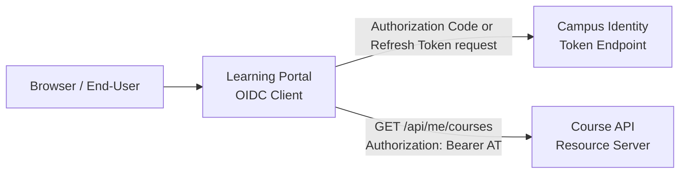

# 18.11. HTTP Client API Compatibility Across Spring Security Versions

## Lesson Objectives

After completing this lesson, you will be able to:

- Understand the changes across **`RestTemplate`**, **`RestClient`**, and **`WebClient`** when a Spring Security OAuth 2.0/OIDC Client calls a Token Endpoint or Resource Server.
- Recognize key version milestones: **Spring Framework 6.1** introduced `RestClient`, while **Spring Security 6.4** introduced `OAuth2ClientHttpRequestInterceptor` and the `RestClient...TokenResponseClient` family.
- Identify why a project can have `RestClient` yet lack `OAuth2ClientHttpRequestInterceptor`, or have `Default...TokenResponseClient` classes without `RestClient...TokenResponseClient` classes.
- Distinguish the **HTTP client calling APIs with a Bearer token** from the **HTTP client exchanging OAuth2 grants at the Token Endpoint**; choose the right extension point for each.
- Use the right imports and methods when configuring `ClientRegistration`, `OAuth2AuthorizedClientManager`, RestClient interceptors, WebClient filters, and Token Response Clients.
- Migrate code from `RestTemplate`/`setRestOperations(...)` to `RestClient`/`setRestClient(...)` when versions permit, avoiding copying legacy converter configs verbatim.
- Plan migrations from Spring Security 5.x or earlier 6.x releases to 6.4+/7.x, managing dependencies via the Spring Boot BOM and testing actual OAuth2 behavior.
- Diagnose compilation errors, default differences, missing beans, malformed HTTP request bodies, mismatched token stores, and security flaws when changing HTTP clients.

## 1. Context: Why Does Spring Security OAuth2 Client Code Not Run on Every Version?

Suppose **Learning Portal** is a Spring Boot Servlet application letting students log in through Campus Identity via OpenID Connect. After OIDC Login, the backend wants to call **Course API** using an access token:

```http
GET /api/me/courses HTTP/1.1
Host: courses.example.org
Authorization: Bearer <access-token>
```

A recent guide might use:

```java
OAuth2ClientHttpRequestInterceptor interceptor =
    new OAuth2ClientHttpRequestInterceptor(authorizedClientManager);

RestClient restClient = RestClient.builder()
    .requestInterceptor(interceptor)
    .build();
```

Yet on an older Spring Security project, the IDE reports:

```text
Cannot resolve symbol: OAuth2ClientHttpRequestInterceptor
```

Or a developer upgrades Spring Framework enough to get `RestClient`, yet Spring Security OAuth2 Client lacks the matching interceptor. Why?

Because **the HTTP client APIs are developed in two separate libraries**:

1. **Spring Framework** defines `RestTemplate`, `RestClient`, `WebClient`, and foundational HTTP interfaces.
2. **Spring Security** adds OAuth2/OIDC Client components, Token Response Clients, authorized client managers, and Bearer token attachment mechanisms.

The two lines have **different release histories and support milestones**. Simply seeing `RestClient` in a project is not enough to conclude you can import every modern Spring Security OAuth2 class.

> **Most important takeaway:** Before applying any OAuth2 HTTP snippet, verify the actual **Spring Boot**, **Spring Framework**, and **Spring Security** versions on your compile/runtime classpath. Pick an API compatible with **both the HTTP and Security layers**, not just by class names seen in an article.

### 1.1. Two Very Easy-to-Confuse HTTP Paths

Within the same application, two kinds of HTTP requests can coexist:



The two outbound HTTP paths need **different integration mechanisms**:

| Request Type | Target | Corresponding Component |
| --- | --- | --- |
| **Token Endpoint request** | Exchange authorization code, refresh token, or obtain client credentials access token | `OAuth2AccessTokenResponseClient<T>` and grant-specific implementations |
| **Protected Resource request** | Call API with an already-issued access token | `RestClient` + `OAuth2ClientHttpRequestInterceptor`, or `WebClient` + OAuth2 filter, or manual solution on older versions |

Example at the Token Endpoint:

```http
POST /oauth2/token HTTP/1.1
Host: login.example.org
Content-Type: application/x-www-form-urlencoded

grant_type=refresh_token&refresh_token=<refresh-token>
```

Example at the Resource Server:

```http
GET /api/me/courses HTTP/1.1
Host: courses.example.org
Authorization: Bearer <access-token>
```

`OAuth2ClientHttpRequestInterceptor` is **not** a drop-in replacement for `DefaultAuthorizationCodeTokenResponseClient` or `RestClientAuthorizationCodeTokenResponseClient`. One attaches tokens for APIs; the other fetches tokens from the Authorization Server.

## 2. API Timeline to Remember

### 2.1. Version Matrix

| Generation | Prominent HTTP APIs | Servlet OAuth2 Client Integration | Practical Notes |
| --- | --- | --- | --- |
| Spring Security **5.x** with Spring Framework 5.x | `RestTemplate`, `WebClient` | `Default...TokenResponseClient` using `RestOperations`; WebClient has Servlet OAuth2 filter when dependencies match | No Spring Framework 6.1 `RestClient` |
| Spring Security **6.0–6.1** | `RestTemplate`, `WebClient`; `RestClient` absent prior to Spring Framework 6.1 | Traditional Token Response Clients; OAuth2 managers and WebClient filter | Do not copy interceptor APIs introduced in 6.4 |
| Spring Security **6.2–6.3** with matching Spring Framework | Framework's `RestClient` may already exist | Servlet Token Endpoint still primarily uses `RestTemplate`/`RestOperations`; OAuth2 Client bean config simplified | Having `RestClient` **does not mean** `OAuth2ClientHttpRequestInterceptor` exists |
| Spring Security **6.4** | `RestClient` and `WebClient` | Added **`OAuth2ClientHttpRequestInterceptor`**, `RestClientAuthorizationCodeTokenResponseClient`, `RestClientRefreshTokenTokenResponseClient`, `RestClientClientCredentialsTokenResponseClient` | Can proactively move Servlet OAuth2 HTTP onto `RestClient` |
| Spring Security **6.5** | Continued RestClient OAuth2 evolution | RestTemplate-based `Default...TokenResponseClient` classes marked deprecated/for removal in several cases; `RestClient` is the replacement path | Use this milestone to prepare for 7.x upgrades |
| Spring Security **7.x** with compatible Spring Boot/Framework | OAuth2 Client RestClient APIs continue in official documentation | Prefer RestClient integrations and configurations supported by the actual runtime version | Check the 7.x migration guide; never assume 6.x deprecated APIs still exist |

**How to read this table:** these are **feature milestones**, not advice to mix JAR versions manually. Minor patches and the Spring Boot BOM can shift exact dependency sets.

Milestones worth remembering:

```text
Spring Framework 6.1:
    RestClient

Spring Security 6.2/6.3:
    Simplified OAuth2 Client bean configuration

Spring Security 6.4:
    OAuth2ClientHttpRequestInterceptor
    RestClient...TokenResponseClient
    RequestAttributeClientRegistrationIdResolver
    RequestAttributePrincipalResolver

Spring Security 6.5:
    Deprecation path for legacy APIs ahead of 7

Spring Security 7:
    Follow the corresponding branch's migration guide
```

### 2.2. Do Not Infer Versions from Java Version Alone

For example, an application running Java 17 does not automatically have:

```java
OAuth2ClientHttpRequestInterceptor
```

This class depends on the **Spring Security version**. Likewise, Spring Security 6.4 cannot operate reliably if paired with an incompatible Spring Framework release merely because the Java version is high enough.

### 2.3. Correlation with Spring Boot

Common release pairings in the Spring Boot ecosystem:

| Spring Boot Line | Typical Spring Framework / Spring Security Pair |
| --- | --- |
| Boot **3.1** | Framework **6.0**, Security **6.1** |
| Boot **3.2** | Framework **6.1**, Security **6.2** |
| Boot **3.3** | Framework **6.1**, Security **6.3** |
| Boot **3.4** | Framework **6.2**, Security **6.4** |
| Boot **3.5** | Framework **6.2**, Security **6.5** |
| Boot **4.0** | Framework **7** line, Security **7** line |

This is a **typical release-line mapping**, not a substitute for inspecting your actual project's dependency tree. BOMs, build plugins, dependency overrides, and patches can make your classpath differ. Never mix `spring-security-oauth2-client` 6.4 with Security 6.1 and Framework 6.0 modules just to get new classes.

### 2.4. Why Is Spring Security 6.4 a Major Milestone?

Prior to 6.4, the Servlet Token Endpoint HTTP client defaulted largely to `RestTemplate`, while outbound API calls integrated via the WebClient filter or manual token retrieval.

Starting in 6.4, applications can use one **synchronous `RestClient`** model for:

- Calling **Resource Servers** with Bearer tokens via `OAuth2ClientHttpRequestInterceptor`.
- Calling **Token Endpoints** via grant-specific `RestClient...TokenResponseClient`s.

This consistency reduces API friction when configuring HTTP clients, without turning those two request types into the same flow.

## 3. Package and Class Map Across Generations

### 3.1. Spring Framework HTTP Clients

| API | Package | What Is It Used For? |
| --- | --- | --- |
| `RestTemplate` | `org.springframework.web.client` | Template-style synchronous HTTP client |
| `RestClient` | `org.springframework.web.client` | Fluent synchronous HTTP client API, since Framework 6.1 |
| `ClientHttpRequestInterceptor` | `org.springframework.http.client` | Synchronous request/response interception interface |
| `WebClient` | `org.springframework.web.reactive.function.client` | Reactive/fluent HTTP client |
| `ExchangeFilterFunction` | `org.springframework.web.reactive.function.client` | `WebClient` hook/filter |

### 3.2. Spring Security OAuth2 Client

| API | Common Package / Module | Purpose |
| --- | --- | --- |
| `OAuth2AuthorizedClientManager` | `org.springframework.security.oauth2.client` | Coordinates authorize/re-authorize |
| `OAuth2AuthorizedClient` | `org.springframework.security.oauth2.client` | Access token/refresh token and registration |
| `DefaultOAuth2AuthorizedClientManager` | `org.springframework.security.oauth2.client.web` | Manager for Servlet request contexts |
| `AuthorizedClientServiceOAuth2AuthorizedClientManager` | `org.springframework.security.oauth2.client` | Service-backed manager suited for jobs without Servlet requests |
| `OAuth2ClientHttpRequestInterceptor` | `org.springframework.security.oauth2.client.web.client` | Outbound `RestClient` Bearer injection, since 6.4 |
| `RequestAttributeClientRegistrationIdResolver` | `org.springframework.security.oauth2.client.web.client` | Resolves registration ID from request attributes, since 6.4 |
| `RequestAttributePrincipalResolver` | `org.springframework.security.oauth2.client.web.client` | Resolves principal from request attributes, since 6.4 |
| `ServletOAuth2AuthorizedClientExchangeFilterFunction` | `org.springframework.security.oauth2.client.web.reactive.function.client` | OAuth2 filter for `WebClient` **inside Servlet applications** |
| `OAuth2AccessTokenResponseClient<T>` | `org.springframework.security.oauth2.client.endpoint` | Exchanges OAuth grants for token responses |

**Two similar-looking classes that cannot substitute for each other:**

```text
RestClient:
  OAuth2ClientHttpRequestInterceptor
  RequestAttributeClientRegistrationIdResolver

WebClient Servlet:
  ServletOAuth2AuthorizedClientExchangeFilterFunction
  its own clientRegistrationId(...) helper
```

The `clientRegistrationId(...)` method name may match, yet attribute types and integration points **differ**.

## 4. Checking Dependencies Before Copying Code

### 4.1. Maven and Spring Boot

For a Servlet OAuth2 Client application, baseline dependencies are normally:

```xml
<dependencies>
    <dependency>
        <groupId>org.springframework.boot</groupId>
        <artifactId>spring-boot-starter-web</artifactId>
    </dependency>
    <dependency>
        <groupId>org.springframework.boot</groupId>
        <artifactId>spring-boot-starter-oauth2-client</artifactId>
    </dependency>
</dependencies>
```

`spring-boot-starter-web` supplies the Spring Web modules required by MVC apps; the OAuth2 Client starter brings Spring Security OAuth2 Client integration and related dependencies.

When the project manages versions via Spring Boot parent/BOM, let the BOM coordinate versions of:

```text
spring-web
spring-security-config
spring-security-oauth2-client
spring-security-oauth2-core
spring-security-web
spring-security-core
```

Do not pin individual Spring Security artifacts to different versions unless following a verified upgrade plan across the entire dependency graph.

### 4.2. Gradle

Gradle Kotlin DSL example:

```kotlin
dependencies {
    implementation("org.springframework.boot:spring-boot-starter-web")
    implementation("org.springframework.boot:spring-boot-starter-oauth2-client")
}
```

With plugins/BOM properly configured, no explicit versions are needed on each starter.

You can **manually inspect** your project with these commands:

```bash
./gradlew dependencyInsight \
  --dependency spring-security-oauth2-client \
  --configuration runtimeClasspath

./gradlew dependencyInsight \
  --dependency spring-web \
  --configuration runtimeClasspath
```

Or Maven:

```bash
mvn dependency:tree -Dincludes=org.springframework.security
mvn dependency:tree -Dincludes=org.springframework:spring-web
```

These commands are guidance for learners, not mandatory in every environment. What matters is checking the **final resolved version**, not just the version written in one dependency declaration.

### 4.3. Symptoms of Dependency Mismatch

For example:

```text
Cannot resolve symbol OAuth2ClientHttpRequestInterceptor
```

Check:

1. Is `spring-security-oauth2-client` actually on the compile classpath?
2. Is its version **6.4** or higher and compatible with Framework?
3. Is another project module pulling an older Security version via dependency management?
4. Is there a typo in the package `...oauth2.client.web.client`?
5. Has the IDE reloaded the build model after updating dependencies?

Runtime examples:

```text
NoSuchMethodError
NoClassDefFoundError
ClassCastException involving internal APIs
```

These often indicate mixing incompatible Spring/Spring Security JARs or building an artifact with a different compile-time version. Never rush to patch around them by casting objects or disabling security filters.

## 5. Before Spring Security 6.4: Calling APIs with `RestTemplate`

In older Servlet projects, a straightforward pattern uses `RestTemplate` and manually attaches the access token supplied by the authorized client manager or argument resolver.

Example with an OIDC Login controller:

```java
@RestController
class LegacyCourseController {

    private final RestTemplate restTemplate;

    LegacyCourseController(RestTemplate restTemplate) {
        this.restTemplate = restTemplate;
    }

    @GetMapping("/api/my-courses")
    String courses(
            @RegisteredOAuth2AuthorizedClient("campus")
            OAuth2AuthorizedClient authorizedClient) {

        HttpHeaders headers = new HttpHeaders();
        headers.setBearerAuth(
            authorizedClient.getAccessToken().getTokenValue()
        );

        HttpEntity<Void> entity = new HttpEntity<>(headers);

        return restTemplate.exchange(
            "https://courses.example.org/api/me/courses",
            HttpMethod.GET,
            entity,
            String.class
        ).getBody();
    }
}
```

A basic bean:

```java
@Bean
RestTemplate restTemplate() {
    return new RestTemplate();
}
```

**Advantages:** compatible with many older projects; does not need 6.4 interceptor APIs.

**Limitations:** the controller or service must explicitly handle:

- Whether the authorized client was resolved for the right principal/registration.
- Whether the access token expired or needs refreshing.
- Repeating Bearer header setup across other requests.
- Updating authorized client state when the Resource Server returns `401 invalid_token`.
- Ensuring tokens cannot be sent to caller-controlled URLs.

`@RegisteredOAuth2AuthorizedClient` can delegate to the manager to resolve/authorize per configuration; however, **`RestTemplate` in the code above does not refresh tokens itself**. Obtaining fresh tokens depends on how the authorized client was supplied to the controller and manager/provider.

### 5.1. `RestTemplate` Does Not Know OAuth2 Automatically

A common mistake:

```java
RestTemplate restTemplate = new RestTemplate();
restTemplate.getForObject(
    "https://courses.example.org/api/me/courses",
    String.class
);
```

A plain `RestTemplate` **does not automatically add a Bearer token** merely because `spring-boot-starter-oauth2-client` is on the classpath.

You must inject the token or attach a properly designed custom interceptor. When legacy code uses a custom interceptor, verify it preserves principal/registration boundaries; never assume every custom interceptor is safe.

### 5.2. Should You Write a Legacy Custom `ClientHttpRequestInterceptor`?

Technically, you can write an interceptor that attaches Bearer tokens manually:

```java
ClientHttpRequestInterceptor customBearer = (request, body, execution) -> {
    // Obtain token from an appropriate OAuth2AuthorizedClientManager,
    // attach Bearer token for permitted requests,
    // avoid global token caches.
    return execution.execute(request, body);
};
```

This is pseudocode highlighting responsibilities, not a complete interceptor. If implemented manually, the application must handle registration IDs, principals, refresh tokens, and errors—which is precisely why Spring Security 6.4 added a dedicated interceptor.

**Never** write:

```java
private static String LAST_BEARER_TOKEN;
```

and share that variable across multiple users or client registrations.

## 6. Spring Security 6.2–6.3: `RestClient` Exists, Yet the Dedicated Interceptor Does Not

A project with Spring Framework 6.1 and Spring Security 6.2/6.3 can compile:

```java
RestClient restClient = RestClient.builder()
    .baseUrl("https://courses.example.org")
    .build();
```

Yet cannot compile:

```java
new OAuth2ClientHttpRequestInterceptor(manager);
```

because this OAuth2 class was introduced **later in Spring Security 6.4**.

This is the key distinction between:

```text
Spring Framework API available
```

and:

```text
Spring Security OAuth2 integration supporting that API
```

Reasonable options in 6.2/6.3 projects:

1. Keep working `RestTemplate` and token management if no upgrade is planned yet.
2. Use **`WebClient` + `ServletOAuth2AuthorizedClientExchangeFilterFunction`** if the project already includes reactive HTTP client dependencies and wants built-in OAuth2 integration.
3. Use `RestClient` with a carefully designed and tested custom interceptor if a synchronous fluent API is required.
4. Upgrade the **entire Spring Boot/Spring Security line** to a compatible release with 6.4+ features before switching to the official interceptor.

Never copy Spring Security 6.4 packages into a 6.2 project and cherry-pick individual JARs based on compiler errors.

## 7. `WebClient` in Servlet Applications: A Different Compatible API

Even when the server runs Spring MVC/Servlet, an application can call outbound APIs using `WebClient`.

Example OAuth2 Client integration:

```java
@Bean
WebClient courseWebClient(
        OAuth2AuthorizedClientManager authorizedClientManager) {

    ServletOAuth2AuthorizedClientExchangeFilterFunction oauth2 =
        new ServletOAuth2AuthorizedClientExchangeFilterFunction(
            authorizedClientManager
        );

    return WebClient.builder()
        .apply(oauth2.oauth2Configuration())
        .baseUrl("https://courses.example.org")
        .build();
}
```

When calling:

```java
import static org.springframework.security.oauth2.client.web.reactive.function.client.ServletOAuth2AuthorizedClientExchangeFilterFunction.clientRegistrationId;

Mono<String> result = courseWebClient.get()
    .uri("/api/me/courses")
    .attributes(clientRegistrationId("campus"))
    .retrieve()
    .bodyToMono(String.class);
```

`Mono<String>` is a reactive type. In an older Servlet app, code may call `.block()` at a synchronous boundary, though consider performance impacts and never confuse it with a reactive WebFlux server.

### 7.1. Details That Must Not Be Mixed Up

| `RestClient` | `WebClient` |
| --- | --- |
| `org.springframework.web.client.RestClient` | `org.springframework.web.reactive.function.client.WebClient` |
| `.requestInterceptor(...)` | `.filter(...)` or `.apply(oauth2.oauth2Configuration())` |
| `OAuth2ClientHttpRequestInterceptor` | `ServletOAuth2AuthorizedClientExchangeFilterFunction` |
| `.retrieve().body(String.class)` | `.retrieve().bodyToMono(String.class)` |
| `RequestAttributeClientRegistrationIdResolver.clientRegistrationId` | `ServletOAuth2AuthorizedClientExchangeFilterFunction.clientRegistrationId` |
| No `Mono` needed | Uses `Mono`/`Flux` |

A very common coding mistake:

```java
// Wrong: WebClient helper used on RestClient
restClient.get()
    .uri("/api/me/courses")
    .attributes(
        ServletOAuth2AuthorizedClientExchangeFilterFunction
            .clientRegistrationId("campus")
    );
```

The right way for `RestClient` 6.4+ is:

```java
import static org.springframework.security.oauth2.client.web.client.RequestAttributeClientRegistrationIdResolver.clientRegistrationId;
```

Do not conflate the two types of request attributes merely because both methods share the name `clientRegistrationId`.

### 7.2. Do Not Convert `WebClient` to `RestClient` by Merely Renaming the Class

Code:

```java
webClient.get()
    .uri("/api/me/courses")
    .retrieve()
    .bodyToMono(CourseDto[].class)
```

cannot be converted by simply writing:

```java
restClient.get()
    .uri("/api/me/courses")
    .retrieve()
    .bodyToMono(CourseDto[].class)
```

`RestClient` does not return `Mono` in its synchronous API. The proper form is:

```java
CourseDto[] courses = restClient.get()
    .uri("/api/me/courses")
    .retrieve()
    .body(CourseDto[].class);
```

If a system genuinely relies on non-blocking I/O, moving to synchronous `RestClient` requires evaluating thread models and throughput rather than just renaming methods.

## 8. Spring Security 6.4+: `RestClient` + `OAuth2ClientHttpRequestInterceptor`

In Spring Security 6.4+ with a compatible Spring Framework, you can configure:

```java
@Configuration
class CourseApiClientConfiguration {

    @Bean
    RestClient courseRestClient(
            OAuth2AuthorizedClientManager authorizedClientManager,
            RestClient.Builder builder) {

        OAuth2ClientHttpRequestInterceptor interceptor =
            new OAuth2ClientHttpRequestInterceptor(
                authorizedClientManager
            );

        return builder
            .baseUrl("https://courses.example.org")
            .requestInterceptor(interceptor)
            .build();
    }
}
```

In the controller:

```java
import static org.springframework.security.oauth2.client.web.client.RequestAttributeClientRegistrationIdResolver.clientRegistrationId;

@RestController
class CourseController {

    private final RestClient courseRestClient;

    CourseController(RestClient courseRestClient) {
        this.courseRestClient = courseRestClient;
    }

    @GetMapping("/api/my-courses")
    String courses() {
        return courseRestClient.get()
            .uri("/api/me/courses")
            .attributes(clientRegistrationId("campus"))
            .retrieve()
            .body(String.class);
    }
}
```

**What changed:** the controller no longer calls `getAccessToken().getTokenValue()` or sets the `Authorization` header itself. The interceptor uses the manager to resolve the authorized client and attach the token.

### 8.1. Role of Each Class

```text
OAuth2ClientHttpRequestInterceptor
    |
    +-- ClientRegistrationIdResolver
    |      +-- RequestAttributeClientRegistrationIdResolver (default)
    |
    +-- PrincipalResolver
    |      +-- SecurityContextHolderPrincipalResolver (default)
    |
    +-- OAuth2AuthorizedClientManager
           +-- Repository / Service
           +-- AuthorizedClientProvider
           +-- Token Response Client
```

- `ClientRegistrationIdResolver` selects the OAuth2 registration.
- `PrincipalResolver` identifies the current user or technical principal.
- Manager finds/requests/renews the authorized client.
- Interceptor attaches the Bearer access token to outbound requests.

Each component has its own responsibility. Never turn `RestClient` into a token store.

### 8.2. Selecting Registration ID Explicitly

Use the static helper:

```java
import static org.springframework.security.oauth2.client.web.client.RequestAttributeClientRegistrationIdResolver.clientRegistrationId;
```

And:

```java
.attributes(clientRegistrationId("campus"))
```

Here:

```text
registrationId = campus
```

looks up the `ClientRegistration`, not the actual OAuth Client ID sent to the Token Endpoint.

If registration declares:

```yaml
registration:
  campus:
    client-id: learning-portal-web
```

then `campus` and `learning-portal-web` are **two different values**.

### 8.3. Default Principal

The interceptor uses `SecurityContextHolderPrincipalResolver` to read the current `Authentication`. In Servlet OIDC Login:

```text
Browser -> SecurityFilterChain
       -> OAuth2AuthenticationToken / OidcUser
       -> Controller
       -> RestClient interceptor
       -> Current user's principal
```

If user A's request and user B's request run concurrently, the authorized client manager/repository must isolate tokens by principal/session.

A background job with no Servlet request and no user `Authentication` should avoid relying on this default.

## 9. With Modern `RestClient`, Use `RequestAttributePrincipalResolver` for M2M

In machine-to-machine systems running without a browser, the token belongs to the client/service, not an End-User. You can use:

```java
OAuth2ClientHttpRequestInterceptor interceptor =
    new OAuth2ClientHttpRequestInterceptor(
        serviceAuthorizedClientManager
    );

interceptor.setPrincipalResolver(
    new RequestAttributePrincipalResolver()
);
```

When calling:

```java
import static org.springframework.security.oauth2.client.web.client.RequestAttributeClientRegistrationIdResolver.clientRegistrationId;
import static org.springframework.security.oauth2.client.web.client.RequestAttributePrincipalResolver.principal;

String result = restClient.get()
    .uri("/api/catalog")
    .attributes(clientRegistrationId("catalog-sync"))
    .attributes(principal("catalog-sync-service"))
    .retrieve()
    .body(String.class);
```

`principal("catalog-sync-service")` is a **stable service principal name** used in the authorized-client store; it does not create an OIDC user.

### 9.1. Choosing the Manager Matching the Request Context

Inside an HTTP Servlet request:

```java
new DefaultOAuth2AuthorizedClientManager(
    clientRegistrationRepository,
    authorizedClientRepository
);
```

Inside a job without a Servlet request:

```java
new AuthorizedClientServiceOAuth2AuthorizedClientManager(
    clientRegistrationRepository,
    authorizedClientService
);
```

Never fabricate a fake `HttpServletRequest` to run the Servlet manager in a scheduled job. `AuthorizedClientServiceOAuth2AuthorizedClientManager` and `OAuth2AuthorizedClientService` are designed for request-independent use cases.

### 9.2. Provider for Client Credentials

Configuration example:

```java
@Bean
OAuth2AuthorizedClientManager serviceAuthorizedClientManager(
        ClientRegistrationRepository registrations,
        OAuth2AuthorizedClientService authorizedClients) {

    OAuth2AuthorizedClientProvider provider =
        OAuth2AuthorizedClientProviderBuilder.builder()
            .clientCredentials()
            .build();

    AuthorizedClientServiceOAuth2AuthorizedClientManager manager =
        new AuthorizedClientServiceOAuth2AuthorizedClientManager(
            registrations, authorizedClients
        );

    manager.setAuthorizedClientProvider(provider);
    return manager;
}
```

When an M2M access token expires, the provider typically requests a new one via `client_credentials` with no browser OIDC Login required.

## 10. A Different HTTP Target: Replacing Legacy Token Response Clients

Developers upgrading Spring Security frequently encounter these class names:

```text
DefaultAuthorizationCodeTokenResponseClient
DefaultRefreshTokenTokenResponseClient
DefaultClientCredentialsTokenResponseClient
```

and want to switch to:

```text
RestClientAuthorizationCodeTokenResponseClient
RestClientRefreshTokenTokenResponseClient
RestClientClientCredentialsTokenResponseClient
```

**This is the Token Endpoint call path, not the Bearer-attaching `RestClient` path calling a Resource Server.**

### 10.1. Common Mapping Table

| Grant | Legacy `RestTemplate` Implementation | Modern `RestClient` Implementation |
| --- | --- | --- |
| Authorization Code | `DefaultAuthorizationCodeTokenResponseClient` | `RestClientAuthorizationCodeTokenResponseClient` |
| Refresh Token | `DefaultRefreshTokenTokenResponseClient` | `RestClientRefreshTokenTokenResponseClient` |
| Client Credentials | `DefaultClientCredentialsTokenResponseClient` | `RestClientClientCredentialsTokenResponseClient` |
| JWT Bearer extension | `DefaultJwtBearerTokenResponseClient` in supported versions | `RestClientJwtBearerTokenResponseClient` |
| Token Exchange extension | Legacy implementation depending on version | `RestClientTokenExchangeTokenResponseClient` in supported versions |

Listing these does not mean every grant is supported in every 5.x/6.x release. The primary milestone for the Servlet `RestClient...` family is **Spring Security 6.4**; legacy APIs were deprecated in the 6.5 line to prepare for the generational transition.

### 10.2. Legacy Example: `DefaultAuthorizationCodeTokenResponseClient`

Common customization in legacy code:

```java
DefaultAuthorizationCodeTokenResponseClient tokenClient =
    new DefaultAuthorizationCodeTokenResponseClient();

RestTemplate restOperations = new RestTemplate(
    Arrays.asList(
        new FormHttpMessageConverter(),
        new OAuth2AccessTokenResponseHttpMessageConverter()
    )
);

restOperations.setErrorHandler(
    new OAuth2ErrorResponseErrorHandler()
);

tokenClient.setRestOperations(restOperations);
```

This snippet belongs to the **legacy `RestOperations`/`RestTemplate` API**. Those token-response converters and error handlers are essential: replacing them with a bare unconfigured `RestTemplate` breaks form encoding and token response parsing.

Never copy this snippet onto a `RestClient...TokenResponseClient` and call:

```java
tokenClient.setRestOperations(...);
```

because the new API uses **`RestClient`**.

### 10.3. Modern Example: `RestClientAuthorizationCodeTokenResponseClient`

In Spring Security 6.4+:

```java
RestClientAuthorizationCodeTokenResponseClient tokenClient =
    new RestClientAuthorizationCodeTokenResponseClient();

RestClient tokenRestClient = RestClient.builder()
    .messageConverters(converters -> {
        converters.clear();
        converters.add(new FormHttpMessageConverter());
        converters.add(
            new OAuth2AccessTokenResponseHttpMessageConverter()
        );
    })
    .defaultStatusHandler(
        new OAuth2ErrorResponseErrorHandler()
    )
    .build();

tokenClient.setRestClient(tokenRestClient);
```

**Note:** `tokenRestClient` here is dedicated to **Token Endpoint requests**. It carries the proper form encoder, token response converter, and OAuth2 error handler.

Never blindly attach `courseRestClient` (which carries `OAuth2ClientHttpRequestInterceptor`) to `tokenClient`. The Token Endpoint expects different HTTP requests/credentials and can trigger recursion during `authorize(...)` if the outbound interceptor tries to acquire an access token again.

### 10.4. Creating Token Response Clients Per Grant

Example:

```java
@Bean
OAuth2AccessTokenResponseClient<OAuth2AuthorizationCodeGrantRequest>
        authorizationCodeTokenResponseClient() {

    return new RestClientAuthorizationCodeTokenResponseClient();
}

@Bean
OAuth2AccessTokenResponseClient<OAuth2RefreshTokenGrantRequest>
        refreshTokenResponseClient() {

    return new RestClientRefreshTokenTokenResponseClient();
}

@Bean
OAuth2AccessTokenResponseClient<OAuth2ClientCredentialsGrantRequest>
        clientCredentialsTokenResponseClient() {

    return new RestClientClientCredentialsTokenResponseClient();
}
```

Declare these beans only when customization is genuinely needed or required by your version/configuration. In newer Spring Security lines, defaults are often auto-configured; you can omit redundant beans and let the framework select the implementation.

When declaring custom beans, match the **generic type** `OAuth2AccessTokenResponseClient<T>` to the corresponding grant request. Registering a client for authorization code does not automatically apply it to refresh tokens.

### 10.5. Bean Configuration Evolves Across Versions

In older versions, Token Response Clients often had to be wired directly into the `oauth2Login()` DSL, providers, or managers in specific ways.

From **6.2–6.3** onward, Spring Security improved configuration by auto-detecting many OAuth2 Client beans, including `OAuth2AccessTokenResponseClient<T>` and `OAuth2AuthorizedClientManager`. The 6.4 line continued this pattern with the new `RestClient` classes.

Still, do not assume every class and generic bean auto-wires identically across all patch releases. Consult the reference guide for your exact application version and verify each grant's execution path.

## 11. Migrating Custom Request Parameter APIs: `add`, `set`, `customizer`

A specialized Token Endpoint may require extra parameters:

```text
audience=course-api
resource=https://courses.example.org
```

In modern Spring Security, Token Response Clients support several customization hooks.

### 11.1. Adding Parameters: `addParametersConverter(...)`

Example with a refresh-token client:

```java
RestClientRefreshTokenTokenResponseClient tokenClient =
    new RestClientRefreshTokenTokenResponseClient();

tokenClient.addParametersConverter(grantRequest -> {
    LinkedMultiValueMap<String, String> parameters =
        new LinkedMultiValueMap<>();

    if (grantRequest.getClientRegistration()
            .getRegistrationId().equals("campus")) {
        parameters.add("audience", "course-api");
    }

    return parameters;
});
```

Use this when you want to **append** parameters to the request without replacing Spring Security's entire standard parameter set.

Note that `audience` is not mandatory for every Authorization Server. Send it only per the provider contract; wrong scope/audience values may be rejected or yield unusable tokens.

### 11.2. Overriding Parameters: `setParametersConverter(...)`

Some newer APIs allow supplying a converter meant to **override default values**. Default grant parameters are still built first and the converter applies afterward according to the implementation's behavior.

This differs from assuming "`set...` always replaces the whole request from scratch." When migrating from legacy APIs to new ones, verify:

- Which converter runs first?
- Are default parameters preserved?
- Are duplicate keys **overwritten** or **appended**?
- Does the Authorization Server accept the extended parameters?

Getting this wrong can drop `grant_type`, `redirect_uri`, or `client_assertion`, or send duplicate `client_id`s.

### 11.3. Removing/Editing All Parameters: `setParametersCustomizer(...)`

Example where a provider uses `client_assertion` and requires removing `client_id` from the form body:

```java
RestClientClientCredentialsTokenResponseClient tokenClient =
    new RestClientClientCredentialsTokenResponseClient();

tokenClient.setParametersCustomizer(parameters -> {
    if (parameters.containsKey(
            OAuth2ParameterNames.CLIENT_ASSERTION)) {
        parameters.remove(OAuth2ParameterNames.CLIENT_ID);
    }
});
```

This illustrates the API in supported releases. The application must also configure appropriate **JWT client authentication** to actually build and sign `client_assertion`; `setParametersCustomizer` does not generate JWTs by itself.

**Never remove `client_id` or alter default parameters just to "fix an error" if the provider does not require it.** Doing so can break the flow, especially when multiple client registrations use different authentication methods.

### 11.4. Distinguishing `addParametersConverter()` and `setParametersCustomizer()`

| API | Typical Purpose | Risk If Misused |
| --- | --- | --- |
| `addParametersConverter(...)` | Add parameters per grant/registration | Sending extra fields disallowed by the provider |
| `setParametersConverter(...)` | Override defaults as required | Accidentally altering `client_id`, `scope`, or grant parameters |
| `setParametersCustomizer(...)` | Edit/remove already-built parameters | Accidentally deleting a required parameter |
| `addHeadersConverter(...)` | Add headers to the token request | Unintentionally overriding the `Authorization` header |
| `setHeadersConverter(...)` | Control header generation | Breaking client authentication or `Content-Type` |

Test how these hooks behave against your **actual API** and wire format. Never rename methods via bulk search-and-replace without understanding converter application order.

## 12. HTTP Message Converters: The Frequently Overlooked Piece

When manually configuring a `RestClient` for the Token Endpoint, the HTTP request body normally must be:

```http
Content-Type: application/x-www-form-urlencoded

grant_type=authorization_code&code=<code>&redirect_uri=<redirect-uri>
```

While a successful response is OAuth2 token JSON:

```json
{
  "access_token": "<token>",
  "token_type": "Bearer",
  "expires_in": 3600
}
```

And a failure response is:

```json
{
  "error": "invalid_grant",
  "error_description": "authorization code expired"
}
```

Therefore, when customizing a Token Response Client on the new API, preserve support for:

1. **Form encoding** requests: `FormHttpMessageConverter`.
2. **Decoding token responses**: `OAuth2AccessTokenResponseHttpMessageConverter`.
3. **Decoding OAuth2 errors**: `OAuth2ErrorResponseErrorHandler` with matching converters.

If you copy configuration from a general JSON API `RestClient` into a token client, requests/responses will fail to parse even though the network works.

### 12.1. Is `RestClient.create(RestTemplate)` Enough for Migration?

Spring Framework lets you adapt one via:

```java
RestClient adapted = RestClient.create(existingRestTemplate);
```

This is a path for carrying HTTP client settings from `RestTemplate` to `RestClient` in compatible cases. Yet creating an adapter **does not automatically add** the 6.4 OAuth2 interceptor, does not convert custom `OAuth2AccessTokenResponseClient`s, and does not change the application's authorization semantics.

Distinguish:

```text
Reusing HTTP client settings
```

from:

```text
Migrating OAuth2 integration architecture
```

Each may need separate verification steps.

### 12.2. Token Endpoint `RestClient` Differs from Resource Server `RestClient`

An intentional bean layout example:

```text
RestClient "tokenEndpointHttp"
   -> form converter
   -> OAuth2 token response converter
   -> OAuth2 error handler
   -> Token Endpoint only

RestClient "courseApi"
   -> OAuth2ClientHttpRequestInterceptor
   -> baseUrl = https://courses.example.org
   -> Course API only
```

Keeping them independent prevents accidentally sending access tokens to the Token Endpoint or client credentials to business APIs.

## 13. Failure Handler: Modern API Adds Token Cleanup After 401

On the 6.4+ `RestClient` interceptor, you can configure a failure handler:

```java
@Bean
RestClient courseApi(
        OAuth2AuthorizedClientManager manager,
        OAuth2AuthorizedClientRepository repository) {

    OAuth2ClientHttpRequestInterceptor interceptor =
        new OAuth2ClientHttpRequestInterceptor(manager);

    interceptor.setAuthorizationFailureHandler(
        OAuth2ClientHttpRequestInterceptor
            .authorizationFailureHandler(repository)
    );

    return RestClient.builder()
        .baseUrl("https://courses.example.org")
        .requestInterceptor(interceptor)
        .build();
}
```

If the manager uses `OAuth2AuthorizedClientService` for M2M:

```java
interceptor.setAuthorizationFailureHandler(
    OAuth2ClientHttpRequestInterceptor
        .authorizationFailureHandler(authorizedClientService)
);
```

Choose the handler matching **the same authorized client store** used by the manager.

### 13.1. What Does This Mechanism Do?

The Resource Server may return:

```http
HTTP/1.1 401 Unauthorized
WWW-Authenticate: Bearer error="invalid_token"
```

On recognized OAuth2 Bearer errors, the failure handler can remove the invalid authorized client from the store. **Subsequent** requests can then obtain a new token if the grant/provider allows.

Do not assume the interceptor **immediately retries the same HTTP request**. Retrying non-idempotent requests can duplicate actions.

### 13.2. `401` and `403` Are Not the Same

| API Response | Common Meaning | Resolution |
| --- | --- | --- |
| `401 invalid_token` | Token expired, revoked, wrong audience/issuer, or invalid | Inspect token/AS/RS; possibly remove and reauthorize |
| `403 insufficient_scope` | Valid token yet missing scope | Address permissions/scopes; do not refresh blindly |
| `403` per business policy | Subject lacks access to record | Check roles/ownership |
| `429` | Rate limit | Bounded retry/backoff |
| `500/503` | Temporary API error | Do not delete OAuth2 grants by default |

Replacing `RestTemplate` with `RestClient` must not change the rule: **Token acquisition differs from business authorization**.

## 14. Bean Configuration Changes Across Spring Security Generations

In an older codebase, you might see scattered configuration:

```text
SecurityFilterChain:
  oauth2Login().tokenEndpoint().accessTokenResponseClient(...)

OAuth2AuthorizedClientManager:
  manager.setAuthorizedClientProvider(...)

Token Response Client:
  DefaultAuthorizationCodeTokenResponseClient
  DefaultRefreshTokenTokenResponseClient
```

In newer releases, publishing `OAuth2AccessTokenResponseClient<T>` beans per grant and `OAuth2AuthorizedClientManager` lets Spring Security auto-wire much of the setup.

Still, understand the precedence:

- Are there default beans from Boot?
- Are there user-declared beans for the same interface?
- Does the token response client's generic type match the right grant?
- Does an MVC `DefaultOAuth2AuthorizedClientManager` share the same repository as OAuth2 Login?
- Does a custom provider chain replace the default refresh token provider?

**Do not rewrite every config just because a new API exists.** If an older project runs reliably and is not upgrading versions, keep one clear integration path; when upgrading, swap pieces in controlled steps.

### 14.1. Example Managing Beans Per Grant

When customizing the Authorization Code Token Endpoint request:

```java
@Bean
OAuth2AccessTokenResponseClient<OAuth2AuthorizationCodeGrantRequest>
        codeTokenClient() {

    RestClientAuthorizationCodeTokenResponseClient client =
        new RestClientAuthorizationCodeTokenResponseClient();

    client.addHeadersConverter(grant -> {
        HttpHeaders headers = new HttpHeaders();
        headers.set("X-Integration", "learning-portal");
        return headers;
    });

    return client;
}
```

This snippet uses 6.4+ APIs, assuming the provider accepts `X-Integration`. If your registration needs no custom headers, omit unnecessary customization.

Another bean for refresh tokens:

```java
@Bean
OAuth2AccessTokenResponseClient<OAuth2RefreshTokenGrantRequest>
        refreshTokenClient() {

    return new RestClientRefreshTokenTokenResponseClient();
}
```

**The two beans have different generic types** and run at two different lifecycle moments. If you customize only authorization code and forget refresh tokens, initial login may succeed while token refreshes use a different configuration.

### 14.2. Do Not Copy Old DSL into New Versions Without Checking Migration Guides

Configurations using:

```java
http.oauth2Login()
    .tokenEndpoint()
    .accessTokenResponseClient(...);
```

reflect an older DSL style. In newer generations, lambda `Customizer` style is standard:

```java
http.oauth2Login(oauth -> oauth
    .tokenEndpoint(token -> token
        .accessTokenResponseClient(customTokenClient)
    )
);
```

Availability of each DSL form and deprecation policies depend on version. When upgrading to Spring Security 7, follow the **7.x migration guide** rather than assuming 5.x code that still compiled on Security 6.0 will survive.

## 15. Servlet API: `javax.servlet` vs. `jakarta.servlet`

When upgrading from Spring Boot 2 / Spring Security 5 to Boot 3 / Spring Security 6, a frequent compile error is:

```text
package javax.servlet.http does not exist
```

Modern Servlet applications on Spring Framework 6+/Security 6+ use the namespace:

```java
import jakarta.servlet.http.HttpServletRequest;
import jakarta.servlet.http.HttpServletResponse;
```

instead of the legacy namespace:

```java
import javax.servlet.http.HttpServletRequest;
import javax.servlet.http.HttpServletResponse;
```

This is a **Servlet API** change, not an OAuth Token Endpoint API change. However, it affects custom `OAuth2AuthorizedClientRepository`s, filters, MVC resolvers, and extension points accepting request/response objects.

### 15.1. Warning When Copying Legacy HTTP Security Code

A snippet using:

```java
DefaultOAuth2AuthorizedClientManager manager = ...;
```

may still be conceptually right, yet a custom repository in the same article importing `javax.servlet` will fail to compile on Framework 6.

Never "fix" this by pulling `javax.servlet-api` into Boot 3 so old code sees the classes. Upgrade APIs and dependencies together on the target stack, while verifying `SecurityFilterChain` and HTTP client configuration changes.

### 15.2. Do Not Conflate Jakarta Migration with `RestClient` Migration

There are at least three independent tasks:

1. **`javax` → `jakarta`** when upgrading the Servlet stack.
2. **DSL/Security configuration** when upgrading Spring Security major versions.
3. **`RestTemplate` → `RestClient`** or **`WebClient` → `RestClient`** when changing outbound HTTP integration.

An application upgrading from Security 5 to 6/7 is not forced to rewrite every HTTP client at the same time. Split changes so regressions are easy to isolate.

## 16. Servlet `RestClient` vs. Reactive `WebClient`: Choose the Right Runtime

### 16.1. Servlet Apps Can Use `RestClient`

In Spring MVC:

```text
HTTP request thread
    -> controller/service
    -> RestClient blocking call
    -> response
```

Fits when synchronous communication is desired and threads are sized appropriately.

### 16.2. Servlet Apps Can Still Use `WebClient`

```text
Spring MVC
    -> WebClient
    -> Mono/Flux outbound
```

Configure the Servlet OAuth2 filter if you want Servlet-style `SecurityContext`/authorized client tokens. Do not arbitrarily substitute WebFlux's `ServerOAuth2AuthorizedClientExchangeFilterFunction`.

### 16.3. Reactive WebFlux Servers Have Their Own OAuth2 APIs

For reactive WebFlux:

```text
ReactiveOAuth2AuthorizedClientManager
ServerOAuth2AuthorizedClientRepository
ReactiveOAuth2AuthorizedClientService
```

These interfaces differ from:

```text
OAuth2AuthorizedClientManager
OAuth2AuthorizedClientRepository
OAuth2AuthorizedClientService
```

Even with the same grant and Authorization Server, **thread context vs. Reactor context** and repository models differ. Never copy WebFlux Security code into Servlet and expect it to work automatically.

## 17. Security Properties Must Not Regress During HTTP Client Upgrades

A successful migration is more than "no compiler errors." It must preserve security boundaries.

### 17.1. Attach Bearer Tokens Only to the Right Host

With `RestClient`:

```java
RestClient.builder()
    .baseUrl("https://courses.example.org")
    .requestInterceptor(oauth2Interceptor)
    .build();
```

URLs still must be controlled. Callers passing absolute URLs or APIs returning HTTP redirects can send requests outside the intended origin depending on the request factory/redirect policy.

**Never** accept arbitrary URLs from query parameters with an OAuth2-interceptor-enabled `RestClient`:

```java
@GetMapping("/proxy")
String proxy(@RequestParam String url) {
    return restClient.get()
        .uri(url)
        .attributes(clientRegistrationId("campus"))
        .retrieve()
        .body(String.class);
}
```

This creates **SSRF or Bearer token forwarding** to attacker-controlled hosts.

### 17.2. Never Log Tokens

Values that must be redacted:

```text
Authorization: Bearer ...
Authorization: Basic ...
access_token
refresh_token
client_secret
client_assertion
session cookie
```

Switching from `RestTemplate` to `RestClient` can alter interceptor chains and HTTP loggers, accidentally logging headers after the OAuth2 interceptor attaches the token.

### 17.3. Never Use the Wrong Principal for a Token

Configuring an interceptor with `RequestAttributePrincipalResolver` does not mean you should set:

```java
.attributes(principal("shared-service-principal"))
```

inside all students' **user-delegated flows**. Because stores key by principal name, multiple users could read the same authorized client by mistake.

For OIDC user-delegated requests, keep the current user's `Authentication` and matching repository. For Client Credentials, use a dedicated, stable service principal.

### 17.4. Never Treat One API's Access Token as Valid for Every API

`clientRegistrationId("campus")` picks the OAuth Client, yet the access token still requires:

- An issuer trusted by the Resource Server.
- Audience matching the Resource Server/Resource Indicator config.
- Granted API scopes/permissions.
- Valid lifetime and security constraints.

Changing the HTTP client does not expand a token's permissions.

## 18. Phased Migration

A risk-reducing approach:

### Step 1 — Inventory the Actual Stack

Record:

```text
Java version
Spring Boot version
Spring Framework version
Spring Security version
Servlet (MVC) or Reactive (WebFlux)
Current HTTP client: RestTemplate / RestClient / WebClient
OAuth grant: authorization_code / refresh_token / client_credentials / ...
```

Do not infer the Security version merely because code can import `RestClient`.

### Step 2 — List All OAuth2 HTTP Integration Points

Categorize clearly:

```text
A. OAuth2 Login / Authorization Code exchange
B. Refresh Token exchange
C. Client Credentials token request
D. Outbound Course API call
E. Outbound Partner API call
F. HTTP client calling UserInfo Endpoint (if any)
```

Never replace all six with a single poorly scoped custom `RestClient`.

### Step 3 — Choose a Supported Baseline

If the project is still on Security 6.2/6.3:

- Use only APIs available in that version.
- Or plan upgrading Boot/Security to a 6.4+ supported line before adopting `OAuth2ClientHttpRequestInterceptor`.
- For Security 7 migrations, review the 6.5 → 7.0 migration guide and matching Framework/Boot requirements.

### Step 4 — Preserve Core OAuth2 Principles

Verify:

```text
ClientRegistration: clientId, grant, provider, redirectUri, scopes
Manager: authorize/re-authorize, provider chain
Repository/Service: token persistence
Principal: End-User or service
HTTP target: Token Endpoint or Resource Server
```

Swapping HTTP clients **must never silently alter** OAuth2 registration semantics.

### Step 5 — Migrating Outbound API Calls

Example:

```text
Before:
  RestTemplate
  @RegisteredOAuth2AuthorizedClient
  manual headers.setBearerAuth(...)

After:
  RestClient
  OAuth2ClientHttpRequestInterceptor
  .attributes(clientRegistrationId("campus"))
```

Verify Bearer tokens are attached once, to the right host, using the right authorized client.

### Step 6 — Migrating Token Endpoint Customization

Example:

```text
Before:
  DefaultAuthorizationCodeTokenResponseClient
  setRestOperations(RestTemplate)

After:
  RestClientAuthorizationCodeTokenResponseClient
  setRestClient(RestClient)
```

During migration, check:

- Form URL-encoded `Content-Type`.
- Client Authentication headers/form fields.
- Grant-specific parameters.
- Response converters and error handlers.
- JWT client assertion/PKCE if used.
- Refresh token grant and all other client registrations.
- Proxies/timeouts/TLS/truststores.

### Step 7 — Test Compatibility Per Flow

For Authorization Code + OIDC Login:

```text
login redirect
 -> callback state
 -> code exchange
 -> ID Token validation
 -> authorized client persisted
 -> RestClient calls API
 -> token expiry/refresh
```

For Client Credentials:

```text
service manager authorize
 -> POST token endpoint
 -> AT
 -> RestClient Bearer request
 -> reauthorize when AT expires
```

### Step 8 — Monitor Regressions and Rollback Plan

Track metrics:

```text
token_exchange_success/failure
authorized_client_refresh_success/failure
outbound_api_401/403
oauth2_authorize_latency
token_endpoint_latency
unknown_client_registration
```

Never log token values, secrets, or ID Tokens. If rollback is needed, roll back the **entire related dependency set and OAuth2 configuration**, not just a single class.

## 19. Cross-Version Behavior Test Matrix

| Scenario | Legacy API | Modern API | Invariant to Preserve |
| --- | --- | --- | --- |
| User OIDC Login succeeds | Token exchanged via legacy implementation | `RestClient` Token Response Client if migrated | Valid ID Token, right issuer/audience |
| Calling Course API | Manual Bearer or WebClient filter | `RestClient` OAuth2 interceptor | Token matches right principal, registration, scope |
| Unexpired access token | Reuses authorized client | Manager/interceptor reuses | Avoids excessive Token Endpoint calls |
| Expired access token | Refreshes via legacy provider | Refreshes via new provider/token client | Persists updated access token and refresh token |
| Client Credentials | Default client credentials token response client | `RestClient` client credentials token client | Never creates an End-User OIDC session |
| Token Endpoint returns `invalid_client` | Rejected | Rejected | Never bypasses client authentication |
| Token Endpoint returns `invalid_grant` | Grant invalid | Grant invalid | Triggers re-authorization, no infinite retries |
| Resource Server returns `invalid_token` | App handles manually or WebClient handler | Interceptor failure handler if configured | Cleans up unusable state per policy |
| Resource Server returns `insufficient_scope` | Does not self-escalate permissions | Does not self-escalate permissions | No infinite refreshes |
| Token Endpoint with custom params | Legacy `RestTemplate` converters | `add/setParametersConverter`, `setParametersCustomizer` | Protocol requests never lose required fields |
| Proxy/timeout/TLS | `RestTemplate` request factory | `RestClient` request factory | Trust and timeouts fit the environment |
| Multi-user concurrency | Repository isolates users | Still isolates users | No token leakage across sessions |

### 19.1. Mocking Outbound `RestClient` HTTP Requests

With supported Spring Framework versions, `MockRestServiceServer` can bind to `RestClient.Builder` to test outbound requests.

Test mindset:

```text
Given:
  manager returns an OAuth2AuthorizedClient with access token test-token

When:
  RestClient GET /api/me/courses
  attributes(clientRegistrationId("campus"))

Then:
  HTTP request targets the right URL
  Authorization header = Bearer test-token
  Never sends client secret/refresh token
```

No real token is needed to test header injection.

### 19.2. Testing the Token Endpoint Differs from Testing the Resource Server

A `MockRestServiceServer` test verifying `RestClient` attaches a Bearer header **does not prove** the Token Response Client sends valid Authorization Code grants or refreshes tokens properly.

Write dedicated tests for:

```text
grant_type=authorization_code
grant_type=refresh_token
grant_type=client_credentials
```

verifying client authentication, encoding, response converters, and error mapping.

## 20. Common Compile and Runtime Errors

| Symptom | Common Cause | Resolution |
| --- | --- | --- |
| `Cannot resolve symbol RestClient` | Spring Framework older than 6.1 or missing `spring-web` | Use a version-compatible API or upgrade the full stack |
| `Cannot resolve symbol OAuth2ClientHttpRequestInterceptor` | Spring Security older than 6.4 or missing OAuth2 Client module | Check `spring-security-oauth2-client` |
| `Cannot resolve symbol RestClientRefreshTokenTokenResponseClient` | Spring Security older than 6.4 | Use the legacy implementation or upgrade stack |
| `setRestOperations` does not exist | Using modern `RestClient`-based token client | Switch to `setRestClient(...)` with proper config |
| `setRestClient` does not exist | Using legacy `Default...TokenResponseClient` | Use the matching `RestClient...` class |
| `.bodyToMono(...)` missing on `RestClient` | Copied `WebClient` API | Use `.body(Type.class)` |
| `.requestInterceptor(...)` missing on `WebClient` | Copied `RestClient` API | Use `WebClient` `ExchangeFilterFunction` |
| Wrong `clientRegistrationId(...)` import | Mixed `WebClient` and `RestClient` helpers | Import from the package matching the HTTP client |
| `package javax.servlet.http does not exist` | Upgraded to Boot 3 / Spring Framework 6 | Use Jakarta Servlet and compatible dependencies |
| `NoClassDefFoundError`/`NoSuchMethodError` | Mixed Spring Framework/Security versions | Inspect dependency tree and BOM |
| `OAuth2AuthorizedClientManager` bean not injected | Missing auto-config condition or overridden by user config | Declare a compatible manager and check beans |
| Access token not attached | Missing registration/principal or manager failed to authorize | Check resolvers and provider chain |
| OIDC Login succeeds yet API lacks token | Login saved to a different repository than manager uses | Align authorized-client stores |
| M2M job fails due to missing request | Using Servlet manager outside a request context | Use a service-based manager |
| 401 after switching HTTP clients | Malformed Bearer header, wrong audience/issuer, or expired token | Inspect Token Endpoint/Resource Server boundaries |
| 403 after switching HTTP clients | Insufficient scope/role/ownership | Check authorization; never weaken security |
| Token Endpoint returns 400 after `setRestClient` | Wrong form converter/request params | Preserve OAuth2 Token Endpoint converters |
| Request auth header logged | Interceptor/logger order changed | Redact credentials in every logger |
| Token sent to wrong host | Unchecked absolute URLs/redirects | Fixed base URL, allowlist, and redirect policy |

### 20.1. Reading Stack Traces

If an error occurs in:

```text
RestClientAuthorizationCodeTokenResponseClient
RestClientRefreshTokenTokenResponseClient
```

execution is at the **Token Endpoint**.

If an error occurs in:

```text
OAuth2ClientHttpRequestInterceptor
RestClient
```

while calling `/api/...`, execution is normally at the **Resource Server outbound request** or interceptor-triggered token resolution.

If you see:

```text
OAuth2AuthorizationException: invalid_grant
```

inspect the corresponding grant and token exchange. If the API returns HTTP `403 insufficient_scope`, do not modify the Token Response Client merely because the API denied permissions.

## 21. Real-World Migration Scenarios

### Scenario A — Boot 3.2 Project Wants to Use `OAuth2ClientHttpRequestInterceptor`

The project has `RestClient`, yet the IDE cannot find the interceptor.

**Cause:** the Framework line is new enough for `RestClient`, while Boot 3.2's Spring Security has not reached 6.4 yet.

**Resolution:** use the HTTP/OAuth2 integration available on that release line, or upgrade Boot/Security as a compatible set before adopting the new API. Never upgrade `spring-security-oauth2-client` in isolation.

### Scenario B — Migrating Token Response Client Breaks Grants

Legacy code uses `DefaultAuthorizationCodeTokenResponseClient#setRestOperations`. A developer switches the class to `RestClientAuthorizationCodeTokenResponseClient` while keeping legacy methods and converters.

**Resolution:** use `setRestClient(...)`, keep `FormHttpMessageConverter`, `OAuth2AccessTokenResponseHttpMessageConverter`, and the OAuth2 error handler; verify exact grant requests/responses.

### Scenario C — `WebClient` Code Copied onto `RestClient`

A service uses:

```java
.attributes(
    ServletOAuth2AuthorizedClientExchangeFilterFunction
        .clientRegistrationId("campus")
)
```

and:

```java
.bodyToMono(String.class)
```

yet the builder is `RestClient`.

**Resolution:** switch the static helper to `RequestAttributeClientRegistrationIdResolver.clientRegistrationId` and the response call to `.body(String.class)`.

### Scenario D — Client Credentials Job Has `RestClient` Interceptor Yet No Principal

A scheduled job has no user/session and uses the default `SecurityContext` interceptor, causing token resolution to fail.

**Resolution:** use `AuthorizedClientServiceOAuth2AuthorizedClientManager`, `RequestAttributePrincipalResolver`, and a stable service principal name. Never simulate an OIDC Login for an M2M workload.

### Scenario E — New Interceptor Configuration Leaks Tokens

A team builds one shared `RestClient` for multiple hosts; users can pass URLs into the controller. The interceptor attaches Bearer tokens to requests targeting off-allowlist hosts.

**Resolution:** split `RestClient` per API, protect registration mappings, restrict hosts and redirects, and never accept unvalidated absolute URLs from clients.

### Scenario F — Two Requests Refresh Simultaneously and Overwrite Tokens

Migration replaces `RestTemplate` with `RestClient` while keeping a repository/database lacking concurrency controls for refresh token rotation. Two requests use RT1; one saves RT2, while the other gets `invalid_grant`.

**Resolution:** implement single-flight refreshes or optimistic locking per principal/registration; switching HTTP clients does not solve distributed races.

### Scenario G — Spring Security 7 Breaks Deprecated APIs

6.5 code still compiled with `Default...TokenResponseClient` classes marked deprecated for removal. Upon upgrading major versions, those classes or methods no longer exist.

**Resolution:** move to `RestClient...` during preparation, read the 6.5 → 7.0 guide, update Java/Jakarta/Boot/Framework, and test all grants. Never restore removed APIs onto the classpath by adding old JARs.

## 22. Practice Exercises

### Exercise 1 — Identifying Version Milestones

An application uses Spring Framework 6.1 and Spring Security 6.3.

**Question:** Can it use `RestClient`? Is `OAuth2ClientHttpRequestInterceptor` available?

**Answer:** Framework's `RestClient` is available, yet the dedicated interceptor was introduced in Spring Security 6.4 so it is absent in Security 6.3.

### Exercise 2 — Choosing the Right Token Response Client

You need to customize the Authorization Code Grant token request on Spring Security 6.4+.

**Suggested answer:**

```java
RestClientAuthorizationCodeTokenResponseClient tokenClient =
    new RestClientAuthorizationCodeTokenResponseClient();
```

Use hooks like `addHeadersConverter`, `addParametersConverter`, and `setRestClient` as actually needed. Never use the Resource Server Bearer interceptor as a substitute for the token client.

### Exercise 3 — Fixing the Static Import

Code calls:

```java
restClient.get()
    .uri("/api/me/courses")
    .attributes(clientRegistrationId("campus"))
    .retrieve()
    .body(String.class);
```

**Question:** Where should the static import come from?

**Answer:**

```java
import static org.springframework.security.oauth2.client.web.client.RequestAttributeClientRegistrationIdResolver.clientRegistrationId;
```

### Exercise 4 — Choosing Managers

A Servlet controller calls Course API on behalf of a user, while a scheduled job uses `client_credentials` to call Catalog API.

**Answer:**

```text
Servlet controller:
  DefaultOAuth2AuthorizedClientManager
  OAuth2AuthorizedClientRepository

Scheduled job:
  AuthorizedClientServiceOAuth2AuthorizedClientManager
  OAuth2AuthorizedClientService
```

### Exercise 5 — Which HTTP Client Has `.bodyToMono(...)`?

**Answer:** `WebClient`, not `RestClient`.

### Exercise 6 — Why Did Token Exchange Return 400 Right After Switching HTTP Clients?

**Suggested answer:** the new custom Token Response Client may lack `FormHttpMessageConverter` or have a parameter converter dropping `grant_type`, `redirect_uri`, or `code`/`refresh_token`; inspect the Token Endpoint HTTP request and error mapping.

### Exercise 7 — Resource Server Returns 403 After Migration

The interceptor attached the Bearer token properly, yet Course API returns `insufficient_scope`.

**Answer:** OAuth2 Client HTTP integration does not grant permissions by itself. Check scopes/consent/roles/ownership rather than refreshing endlessly or bypassing API validation.

### Exercise 8 — Should You Add `spring-security-oauth2-client` 6.4 to Boot 3.2?

**Answer:** do not upgrade a single module in isolation to fix an import error. Pick a compatible Spring Boot, Spring Framework, and Spring Security set, then run regression tests.

### Exercise 9 — Why Shouldn't a Token Endpoint `RestClient` Share the Same Interceptor as an API `RestClient`?

**Answer:** the Token Endpoint needs OAuth grant requests and client authentication, while the Bearer interceptor acquires access tokens to call Resource Servers. Combining them carelessly sends wrong headers, causes infinite recursion, or leaks credentials.

### Exercise 10 — Must a Legacy Application Switch to `RestClient` Immediately?

**Answer:** no. When running an older version, keep using appropriate `RestTemplate`/`WebClient` setups and plan a migration onto a compatible baseline with security and performance tests. Switching HTTP clients only helps when new behavior is well controlled.

## 23. Self-Check Questions

**1. Does `RestClient` belong to Spring Framework or Spring Security?**

> It belongs to **Spring Framework**, introduced in Framework 6.1.

**2. Which library owns `OAuth2ClientHttpRequestInterceptor` and when was it introduced?**

> It belongs to **Spring Security OAuth2 Client**, introduced in Spring Security 6.4 for outbound `RestClient` Bearer token integration.

**3. Can the 6.2/6.3 line have `RestClient` yet lack the interceptor?**

> Yes, because the two APIs belong to different library release milestones.

**4. Does `RestClientAuthorizationCodeTokenResponseClient` have the same job as the interceptor?**

> No. The Token Response Client exchanges authorization codes for tokens at the Token Endpoint; the interceptor uses access tokens to call Resource Servers.

**5. What replaces `setRestOperations(...)` in the new API?**

> When using the `RestClient...TokenResponseClient` family, customize the HTTP client via `setRestClient(...)`.

**6. Should `ServletOAuth2AuthorizedClientExchangeFilterFunction` be used as a `RestClient` interceptor?**

> No. That is the OAuth2 filter for `WebClient` in Servlet applications.

**7. When is `RequestAttributePrincipalResolver` useful?**

> When you want to pass an explicit technical principal for M2M or other contexts that do not rely on `Authentication` from `SecurityContext`.

**8. Does switching from `RestTemplate` to `RestClient` handle refresh tokens automatically?**

> No. Refreshing depends on the authorized-client manager, providers, Token Response Client, and configured grant state.

**9. Does the HTTP client calling the Token Endpoint need a form encoder?**

> Yes, standard OAuth2 Token Endpoint requests use `application/x-www-form-urlencoded`; modern Token Response Clients must support form conversion alongside token/error responses.

**10. When upgrading to Spring Security 7, should you keep all deprecated 6.5 classes?**

> No. Read the migration guide and verify which APIs remain, favoring supported `RestClient` integrations before upgrading major versions.

**11. Should a `RestClient` with a Bearer interceptor accept arbitrary URLs from users?**

> No. That creates SSRF risks and can send tokens to unauthorized hosts; fix or allowlist destinations.

**12. Does a Resource Server returning 403 mean the Token Response Client failed?**

> Not necessarily. The token may be valid while lacking required scopes, roles, or business permissions.

---

## Key Takeaways

**OAuth2 Client HTTP compatibility spans both Spring Framework and Spring Security.** `RestClient` arrived in Framework **6.1**, whereas `OAuth2ClientHttpRequestInterceptor` and the `RestClient...TokenResponseClient` family arrived in Spring Security **6.4**. On older projects, `RestTemplate`/`Default...TokenResponseClient` and `WebClient` filters may remain the right fit. When upgrading, separate **HTTP calls to Resource Servers** (Bearer token injection) from **HTTP calls to Token Endpoints** (grant requests/responses); use the exact methods, converters, resolvers, managers, and repositories matching your runtime version. Maintain a compatible dependency set, never mix Servlet/Reactive APIs, keep tokens bound to the right principal/registration, lock down target hosts, and test login, token exchange, refresh, Client Credentials, and API permissions separately.

## References

- [Spring Security — Authorized Client Features, RestClient Integration](https://docs.spring.io/spring-security/reference/servlet/oauth2/client/authorized-clients.html): `OAuth2ClientHttpRequestInterceptor`, registration/principal resolvers, and failure handlers.
- [Spring Security — Authorization Grant Support](https://docs.spring.io/spring-security/reference/servlet/oauth2/client/authorization-grants.html): `RestClient...TokenResponseClient` implementations, request converters, and token error handling.
- [Spring Security — OAuth2 Servlet](https://docs.spring.io/spring-security/reference/servlet/oauth2/): wiring OAuth2 Client into Servlet.
- [Spring Engineering Blog — RestClient Support for OAuth2 in Spring Security 6.4](https://spring.io/blog/2024/10/28/restclient-support-for-oauth2-in-spring-security-6-4/): the 6.4 milestone and migration path from `RestTemplate`.
- [Spring Security — Migration to 7.0](https://docs.spring.io/spring-security/reference/7.0/migration/index.html): preparing from 6.5 to 7.0, updating dependencies and APIs.
- [Spring Framework — REST Clients](https://docs.spring.io/spring-framework/reference/integration/rest-clients.html): `RestClient`, `RestTemplate`, and HTTP APIs.
- [Spring Security API — OAuth2ClientHttpRequestInterceptor](https://docs.spring.io/spring-security/reference/api/java/org/springframework/security/oauth2/client/web/client/OAuth2ClientHttpRequestInterceptor.html): constructor and extension points.
- [Spring Security API — RestClientAuthorizationCodeTokenResponseClient](https://docs.spring.io/spring-security/reference/api/java/org/springframework/security/oauth2/client/endpoint/RestClientAuthorizationCodeTokenResponseClient.html): Token Endpoint implementation introduced in 6.4.
