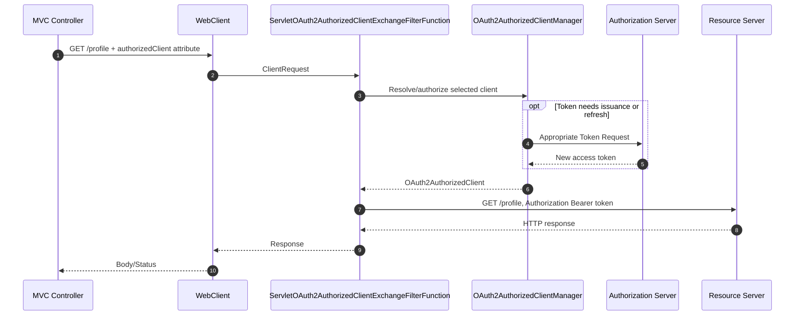
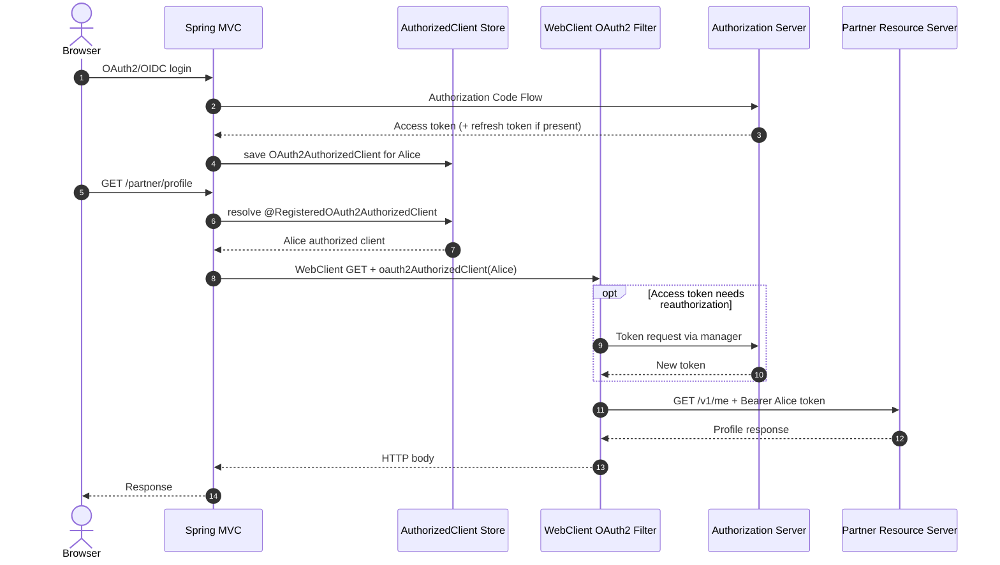

# 19.3. Passing OAuth2AuthorizedClient Per Request

## 1. The Problem: With a Single WebClient, Which Token Does Each HTTP Request Use?

In the **Spring Security OAuth 2.0/OIDC Client** module, a Servlet application such as Spring MVC can both use **OAuth2 Login** to authenticate users and use **WebClient** to call external Resource Servers/APIs.

For example, an enterprise portal lets Alice log in via an OpenID Provider, then calls a Partner API to fetch Alice's own data:

```text
Alice's Browser
    |
    | 1. OIDC Login via Spring Security
    v
Spring Boot MVC / Servlet
    |
    | 2. Alice's OAuth2AuthorizedClient
    |    registrationId = partner-login
    |    principalName = alice-sub
    |    accessToken = AT_ALICE
    v
WebClient calls Partner API
    |
    | Authorization: Bearer AT_ALICE
    v
Resource Server / Partner API
```

An application can simultaneously serve Bob and multiple other registrations. The critical requirement is that **API requests made for Alice must use Alice's exact authorized client**, rather than grabbing the last token stored in a global variable or a default token attached to every outgoing request.

Spring Security provides an API to specify the **`OAuth2AuthorizedClient` to use on each individual WebClient request**:

```java
.attributes(oauth2AuthorizedClient(authorizedClient))
```

where `oauth2AuthorizedClient(...)` is a static helper on:

```java
ServletOAuth2AuthorizedClientExchangeFilterFunction
```

This is the focus of this lesson.

### Objectives

After this lesson, you will:

1. Understand how `WebClient` works in **Servlet/MVC** and how it differs from WebFlux security.
2. Distinguish `ClientRegistration`, `OAuth2AuthorizedClient`, `Authentication`, and access tokens.
3. Configure `ServletOAuth2AuthorizedClientExchangeFilterFunction`.
4. Pass a specific `OAuth2AuthorizedClient` into **a single HTTP request** using `ClientRequest.attributes()`.
5. Combine it with `@RegisteredOAuth2AuthorizedClient` in an MVC controller.
6. Distinguish passing the object directly from `.attributes(clientRegistrationId(...))`.
7. Understand why tokens should not be automatically attached to every request.
8. Understand refresh tokens, storage, token expiry, and failure handling when using WebClient.
9. Avoid leaking tokens, mixing user/service permissions, or sending Bearer tokens to untrusted hosts.
10. Know how to test and diagnose errors without logging access tokens.

> Scope: **WebClient running inside a Servlet/MVC application**, not a pure WebFlux reactive security application. Domains, IDs, tokens, and API responses are all illustrative.

---

## 2. WebClient on Servlet Does Not Mean the App Becomes WebFlux

`WebClient` is an HTTP client from the Spring WebFlux library:

```java
org.springframework.web.reactive.function.client.WebClient
```

It has a reactive API for sending HTTP requests and processing responses. However, **adding WebClient to a Spring MVC application does not turn the server into a WebFlux application**.

For example, the application still has:

```text
Tomcat / Servlet container
    |
    v
DispatcherServlet
    |
    v
Spring MVC @RestController
    |
    v
WebClient -> outbound HTTP -> External API
```

By contrast, a WebFlux server typically uses:

```text
Reactive web runtime
    |
    v
DispatcherHandler
    |
    v
Reactive Controller
    |
    v
WebClient
```

Both architectures can use `WebClient`, but **security context, authorized client repositories, and OAuth2 integration configuration** are not identical.

### 2.1. Why Would an MVC Application Want to Use WebClient?

Reasons may include:

- Needing a modern HTTP client with a fluent API to call APIs.
- Wanting to handle responses as `Mono<T>` or `Flux<T>`.
- Organizing multiple asynchronous HTTP calls.
- Needing a filter to attach OAuth2 access tokens automatically.
- Sharing an outbound client across multiple services.

Even so, WebClient is only an **HTTP client**. The token lifecycle is still managed by Spring Security's OAuth2 Client components.

### 2.2. Required Libraries

Example dependencies with Spring Boot 3.x:

```groovy
dependencies {
    implementation 'org.springframework.boot:spring-boot-starter-web'
    implementation 'org.springframework.boot:spring-boot-starter-security'
    implementation 'org.springframework.boot:spring-boot-starter-oauth2-client'

    // Adds the WebClient API to a Servlet/MVC application.
    implementation 'org.springframework:spring-webflux'

    // A common reactive HTTP transport for WebClient.
    implementation 'io.projectreactor.netty:reactor-netty-http'
}
```

Artifact names and versions should follow the Spring Boot BOM and your actual stack; do not mix versions manually. In Spring Boot 4.x, starter names and modules change, so cross-check with the corresponding BOM.

You can use `spring-boot-starter-webflux` to bring in WebClient dependencies in an app that has the MVC starter; in standard Boot configurations when both MVC and WebFlux are present, MVC takes precedence for the web application type. If your project needs strict control over the web application type, configure it explicitly and include only the needed dependencies.

**Note:** WebClient can use Reactor Netty or another HTTP connector. The HTTP transport governs timeouts, TLS, proxies, and connection pooling; do not confuse these with the OAuth2 exchange filter.

## 3. Objects to Distinguish

### 3.1. ClientRegistration: Configuration for Requesting Tokens

Example:

```text
registrationId = partner-login
clientId = portal-web
authorizationGrantType = authorization_code
tokenUri = https://id.example.com/oauth2/token
scopes = openid profile partner.read
```

`ClientRegistration` is metadata retrieved from `ClientRegistrationRepository`. It describes **how the client is registered with the Authorization Server**, not Alice's specific access token.

### 3.2. OAuth2AuthorizedClient: The Authorized Result

Class:

```java
org.springframework.security.oauth2.client.OAuth2AuthorizedClient
```

Contains information such as:

```text
OAuth2AuthorizedClient
    |
    +-- ClientRegistration
    |      registrationId = partner-login
    |
    +-- principalName = alice-sub
    |
    +-- OAuth2AccessToken
    |      tokenValue
    |      issuedAt
    |      expiresAt
    |      scopes
    |
    +-- OAuth2RefreshToken (if issued by provider)
```

This is the **specific object** the application selects for each outgoing HTTP request.

### 3.3. Authentication: Current Identity in Spring Security

`Authentication` represents the authenticated principal in the security context. With OAuth2 Login, a common implementation is:

```java
org.springframework.security.oauth2.client.authentication.OAuth2AuthenticationToken
```

However, `Authentication` is not itself an `OAuth2AuthorizedClient`.

| Component | Question It Answers |
|---|---|
| `Authentication` | Who is making the request? Are they authenticated? What authorities do they have? |
| `ClientRegistration` | Which OAuth2 client is configured to request tokens? |
| `OAuth2AuthorizedClient` | Which token was issued for which client and principal? |
| `OAuth2AuthorizedClientRepository` or `Service` | Where are issued tokens stored? |
| `OAuth2AuthorizedClientManager` | Does a token need to be issued or refreshed for the principal/registration? |

**Never use an access token based solely on a username or email from a query parameter.** Right registration + right authenticated principal + right authorization are invariants that must be enforced.

## 4. ExchangeFilterFunction: The Filter That Adds a Bearer Token to Outbound Requests

In a Servlet environment, Spring Security provides:

```java
org.springframework.security.oauth2.client.web.reactive.function.client
    .ServletOAuth2AuthorizedClientExchangeFilterFunction
```

This is an `ExchangeFilterFunction` for WebClient. It can:

1. Identify the requested authorized client from `ClientRequest.attributes()`.
2. Coordinate with `OAuth2AuthorizedClientManager` to use or re-authorize the appropriate authorization.
3. Extract the access token from the authorized client.
4. Attach the Bearer token to the outgoing request:

```http
Authorization: Bearer ACCESS_TOKEN_VALUE
```

5. Forward the request to the underlying HTTP connector.
6. Support handling certain authorization failures per configuration.

Diagram:



The diagram illustrates conceptual responsibilities. Whether the manager actually calls the Token Endpoint depends on the current access token, grant, providers, and storage.

### 4.1. Configuring WebClient Once

A reusable bean in an MVC application:

```java
import org.springframework.context.annotation.Bean;
import org.springframework.context.annotation.Configuration;
import org.springframework.security.oauth2.client.OAuth2AuthorizedClientManager;
import org.springframework.security.oauth2.client.web.reactive.function.client.ServletOAuth2AuthorizedClientExchangeFilterFunction;
import org.springframework.web.reactive.function.client.WebClient;

@Configuration
public class PartnerWebClientConfiguration {

    @Bean("partnerWebClient")
    WebClient partnerWebClient(
            OAuth2AuthorizedClientManager authorizedClientManager) {

        ServletOAuth2AuthorizedClientExchangeFilterFunction oauth2 =
            new ServletOAuth2AuthorizedClientExchangeFilterFunction(
                authorizedClientManager
            );

        return WebClient.builder()
            .baseUrl("https://api.partner.example")
            .apply(oauth2.oauth2Configuration())
            .build();
    }
}
```

Note:

- `WebClient` is a **singleton HTTP client bean**, not recreated per request.
- `oauth2.oauth2Configuration()` configures the builder and registers the OAuth2 filter.
- `setDefaultOAuth2AuthorizedClient(true)` is not enabled.
- `setDefaultClientRegistrationId(...)` is not set.
- Therefore, each request must **pass selection information for the authorized client** when a token is needed.
- `authorizedClientManager` is configured appropriately for the Servlet environment, provider grants, and authorized client repository.

This keeps token selection **explicit**, reducing the risk of a shared WebClient accidentally attaching tokens to HTTP requests that do not need OAuth2.

### 4.2. `oauth2Configuration()` Does Not Create a Client Registration

You still need:

- OAuth2 client properties or a `ClientRegistrationRepository` bean.
- Storage for authorized clients such as `OAuth2AuthorizedClientRepository`.
- Grant providers supporting authorization code/refresh token when applicable.
- OAuth2 Login if the application needs users to log in.
- A Resource Server API configured to accept tokens with the proper scope/audience.

The filter **does not issue tokens itself** and does not replace the AS.

---

## 5. Passing an OAuth2AuthorizedClient to a Specific Request

The key API of this lesson:

```java
.attributes(oauth2AuthorizedClient(authorizedClient))
```

Full static import:

```java
import static org.springframework.security.oauth2.client.web.reactive.function.client.ServletOAuth2AuthorizedClientExchangeFilterFunction.oauth2AuthorizedClient;
```

Simple example:

```java
String profile = webClient.get()
    .uri("https://api.partner.example/v1/me")
    .attributes(oauth2AuthorizedClient(authorizedClient))
    .retrieve()
    .bodyToMono(String.class)
    .block();
```

Here:

- `authorizedClient` has type `OAuth2AuthorizedClient`.
- `oauth2AuthorizedClient(authorizedClient)` is **not** an HTTP header.
- The helper creates a consumer that puts the object into `ClientRequest.attributes()`.
- The OAuth2 exchange filter reads that attribute and attaches the appropriate access token for **this HTTP request only**.
- The next request will not automatically reuse that authorized client unless you configured a default token.

### 5.1. Why Use `attributes(...)` Instead of `header(...)`?

Comparison:

```java
// Approach A: hand the authorized client to the Spring Security filter to manage.
webClient.get()
    .uri("/v1/me")
    .attributes(oauth2AuthorizedClient(authorizedClient))
    .retrieve();
```

```java
// Approach B: set Bearer token manually, bypassing much of the token lifecycle.
webClient.get()
    .uri("/v1/me")
    .headers(headers -> headers.setBearerAuth(
        authorizedClient.getAccessToken().getTokenValue()
    ))
    .retrieve();
```

Approach B can work in specialized scenarios, but has drawbacks:

- Application code reads the raw token value and manages the header directly.
- Does not ask the authorized client manager to reauthorize when the token expires.
- Harder to standardize token rotation, expired tokens, and error handling.
- Easy to copy-paste to another client and send a token with the wrong audience.
- Easy to accidentally log or serialize the token if developers are not careful.

Approach A is the right choice when integrating WebClient with **`ServletOAuth2AuthorizedClientExchangeFilterFunction`** and keeping token management inside Spring Security.

**Important limitation:** setting `attributes(...)` **without an exchange filter** does not generate a Bearer header on its own. `attributes` is internal metadata on the WebClient request and only takes effect when a filter/handler understands it.

## 6. Complete Example: @RegisteredOAuth2AuthorizedClient in an MVC Controller

In Spring MVC, Spring Security supports the annotation:

```java
org.springframework.security.oauth2.client.annotation.RegisteredOAuth2AuthorizedClient
```

It can be used to receive the authorized client associated with a client registration in the current request context.

Example:

```java
import static org.springframework.security.oauth2.client.web.reactive.function.client.ServletOAuth2AuthorizedClientExchangeFilterFunction.oauth2AuthorizedClient;

import java.time.Duration;

import org.springframework.beans.factory.annotation.Qualifier;
import org.springframework.security.oauth2.client.OAuth2AuthorizedClient;
import org.springframework.security.oauth2.client.annotation.RegisteredOAuth2AuthorizedClient;
import org.springframework.web.bind.annotation.GetMapping;
import org.springframework.web.bind.annotation.RestController;
import org.springframework.web.reactive.function.client.WebClient;

@RestController
public class PartnerProfileController {

    private final WebClient partnerWebClient;

    public PartnerProfileController(
            @Qualifier("partnerWebClient") WebClient partnerWebClient) {
        this.partnerWebClient = partnerWebClient;
    }

    @GetMapping("/partner/profile")
    public String profile(
            @RegisteredOAuth2AuthorizedClient("partner-login")
            OAuth2AuthorizedClient authorizedClient) {

        return partnerWebClient.get()
            .uri("/v1/me")
            .attributes(oauth2AuthorizedClient(authorizedClient))
            .retrieve()
            .bodyToMono(String.class)
            .block(Duration.ofSeconds(10));
    }
}
```

Explanation:

1. An HTTP request to `/partner/profile` reaches the Spring MVC controller after the security chain authenticates the user.
2. `@RegisteredOAuth2AuthorizedClient("partner-login")` resolves the authorized client matching the registration in the current context.
3. The controller receives **the object for the corresponding principal**, rather than looking up a record by a username sent from the browser.
4. `partnerWebClient.get()` creates a **new outgoing request**.
5. `.attributes(oauth2AuthorizedClient(authorizedClient))` attaches the authorized client to the request attributes.
6. The Servlet OAuth2 exchange filter uses the specified object to attach the Bearer token.
7. The Resource Server validates the token and enforces access control.
8. The controller reads the API response body and returns the appropriate result.

### 6.1. About `.block()` in Spring MVC

The example uses `.block(Duration.ofSeconds(10))` so the controller returns synchronously, making the flow easy to follow.

In **Servlet MVC**, blocking on a servlet request thread is technically acceptable, though it **holds a servlet thread while waiting on the API**. Under high load, consider:

- Spring MVC async return types when the design fits.
- WebClient/HTTP connector timeouts.
- Concurrency limits and connection pools.
- Never blocking inside a Reactor Netty event loop.
- Total wait time including both authorized client resolution/refresh and the API call.

`.block(Duration)` in the controller **does not fully replace** connect/read/response timeouts at the HTTP transport layer. If Token Endpoint requests are slow, check the token response client's timeouts as well.

### 6.2. Can Spring MVC Return `Mono<T>`?

Spring MVC can adapt certain reactive return types through asynchronous request processing/adapters when supported dependencies are present.

An asynchronous controller version:

```java
import reactor.core.publisher.Mono;

@GetMapping("/partner/profile-async")
public Mono<String> profileAsync(
        @RegisteredOAuth2AuthorizedClient("partner-login")
        OAuth2AuthorizedClient authorizedClient) {

    return partnerWebClient.get()
        .uri("/v1/me")
        .attributes(oauth2AuthorizedClient(authorizedClient))
        .retrieve()
        .bodyToMono(String.class);
}
```

This is an **additional method in the already-declared controller**, not a standalone Java file. Check Spring MVC async settings, timeouts, and request lifecycles when using reactive return types, especially if the filter needs the Servlet request/response context during authorization.

Do not assume a `Mono` executing after the HTTP request finishes still has full request attributes or `SecurityContextHolder` thread-locals.

### 6.3. Why Is `@RegisteredOAuth2AuthorizedClient` Useful?

It makes registration selection **explicit at the controller boundary**, after which the controller passes the exact authorized client to the service/API client.

This is far more maintainable than a service taking `"alice"` from a URL, querying all authorized clients, and grabbing an arbitrary token. If you build a custom lookup, you must enforce principal ownership and tenant boundaries.

---

## 7. Configuring OAuth2 Login and Registration for the Example

Spring Boot `application.yml` example:

```yaml
spring:
  security:
    oauth2:
      client:
        registration:
          partner-login:
            provider: partner-oidc
            client-id: ${PARTNER_CLIENT_ID}
            client-secret: ${PARTNER_CLIENT_SECRET}
            client-authentication-method: client_secret_basic
            authorization-grant-type: authorization_code
            redirect-uri: "{baseUrl}/login/oauth2/code/{registrationId}"
            scope:
              - openid
              - profile
              - partner.read
        provider:
          partner-oidc:
            issuer-uri: https://id.partner.example
```

In this example:

- `partner-login`: the registration ID used by Spring Security.
- `partner-oidc`: provider configuration key.
- `authorization-grant-type: authorization_code`: interactive user flow.
- `openid`: scope enabling OIDC Login when supported by the AS.
- `partner.read`: an **illustrative** scope, meaningful only if advertised and granted by the AS/API.
- `issuer-uri`: used for OIDC discovery/issuer metadata when applicable.

**A successful OIDC Login does not automatically guarantee the access token has the audience/scope needed at the Partner API.** The AS must issue a token suited for the API, and the Resource Server must accept the issuer, audience, and scope. Never send an ID Token instead of an access token just because both are JWTs.

### 7.1. Configuring SecurityFilterChain for Servlet

```java
import org.springframework.context.annotation.Bean;
import org.springframework.context.annotation.Configuration;
import org.springframework.security.config.Customizer;
import org.springframework.security.config.annotation.web.builders.HttpSecurity;
import org.springframework.security.web.SecurityFilterChain;

@Configuration
public class SecurityConfiguration {

    @Bean
    SecurityFilterChain securityFilterChain(HttpSecurity http)
            throws Exception {

        http
            .authorizeHttpRequests(authorize -> authorize
                .requestMatchers("/", "/public/**").permitAll()
                .anyRequest().authenticated()
            )
            .oauth2Login(Customizer.withDefaults())
            .oauth2Client(Customizer.withDefaults());

        return http.build();
    }
}
```

This snippet configures OAuth2 Login and OAuth2 Client support in a Servlet security chain.

If the application already has a `SecurityFilterChain`, merge the configuration into the existing chain. Do not create multiple chains that all match every URL and expect the framework to automatically combine all settings.

### 7.2. Full Flow



Note: the token flow may be coordinated by the filter/manager through collaborators; do not assume the filter directly persists tokens itself without going through the repository/service.

## 8. Which Request Does `oauth2AuthorizedClient(...)` Affect?

The key point is **request-local scope**.

Example:

```java
Mono<String> aliceResponse = webClient.get()
    .uri("https://api.partner.example/v1/me")
    .attributes(oauth2AuthorizedClient(aliceAuthorizedClient))
    .retrieve()
    .bodyToMono(String.class);

Mono<String> bobResponse = webClient.get()
    .uri("https://api.partner.example/v1/me")
    .attributes(oauth2AuthorizedClient(bobAuthorizedClient))
    .retrieve()
    .bodyToMono(String.class);
```

These are two separate outgoing HTTP requests. They can share **the same WebClient instance** while selecting different tokens.

However, this example is only safe if `aliceAuthorizedClient` and `bobAuthorizedClient` came from a **trusted authentication/authorization source**. An application must never let Alice supply `bobAuthorizedClient` by requesting `?user=bob` without authorization checks.

### 8.1. What Does Not Happen

`.attributes(oauth2AuthorizedClient(...))` does not:

- Change the default OAuth2 authorized client on the `WebClient` bean.
- Mutate the session's `SecurityContext`.
- Persist a new authorized client to the database the moment the attribute is set.
- Convert the contents of `OAuth2AuthorizedClient` directly into an HTTP header.
- Send the refresh token to the Resource Server.
- Create a new OAuth2 `ClientRegistration`.
- Allow the caller to bypass Resource Server authorization.

Once the request completes, WebClient request attributes are not a long-lived token store. Saving/retrieving authorized clients is the job of the manager and authorized client repository/service.

### 8.2. Request Attributes Differ from HTTP Headers

| Concept | Role | Recipient |
|---|---|---|
| `ClientRequest.attributes()` | Internal metadata for filters/HTTP client. | WebClient pipeline inside the application. |
| `Authorization: Bearer ...` | Credential sent with the HTTP request. | Target Resource Server. |
| `HttpServletRequest` attributes | Data attached to the inbound Servlet request. | Servlet/application server components. |
| `SecurityContext` | Authentication for the request/session. | Spring Security application. |
| `OAuth2AuthorizedClientService` | Authorized client store across requests. | Backend storage abstraction. |

Do not confuse WebClient `.attributes(...)` with Servlet `request.setAttribute(...)` or with JWT claims.

---

## 9. Two Ways to Select a Token: Direct Object vs. Registration ID

Spring Security provides static helpers for the filter.

### 9.1. Approach 1: Passing a Specific `OAuth2AuthorizedClient`

```java
.attributes(oauth2AuthorizedClient(authorizedClient))
```

Meaning: **I already have the authorized client object for the right user and registration; use this object for the outgoing request**.

Strengths:

- Explicit about which authorized client is chosen.
- Easy to verify at the call site.
- Fits naturally when the controller receives the object via `@RegisteredOAuth2AuthorizedClient`.
- Reduces reliance on the filter inferring the registration from the current authentication.
- Allows a shared WebClient bean where each call selects its own authorized client.

Caveats:

- Caller must hold the object for the right subject.
- The object can become stale if cached/held long-term outside the authorized client manager.
- The token may require refresh via the manager; behavior depends on providers and storage.
- Never pass another principal's object when business policy forbids it.

### 9.2. Approach 2: Passing `clientRegistrationId`

```java
import static org.springframework.security.oauth2.client.web.reactive.function.client.ServletOAuth2AuthorizedClientExchangeFilterFunction.clientRegistrationId;

String body = webClient.get()
    .uri("https://api.partner.example/v1/me")
    .attributes(clientRegistrationId("partner-login"))
    .retrieve()
    .bodyToMono(String.class)
    .block();
```

Meaning: **select the registration ID**, and let the filter/manager resolve or authorize the authorized client from the authentication/principal in context.

Strengths:

- No need to thread `OAuth2AuthorizedClient` objects through code layers.
- Useful for API clients dedicated to a single registration or client credentials.
- The manager can load/authorize based on registration and principal.

Risks to manage:

- Must resolve the right principal.
- Without an authenticated user or request context, the manager may fail to find an authorized client or the flow may require interactive authorization.
- Having the right registration alone is not enough: the Resource Server still requires the right scope/audience.
- If the service does not clearly know the current user, supplying only a registration ID does not establish the full authorization context.

### 9.3. Comparison

| Criterion | `oauth2AuthorizedClient(client)` | `clientRegistrationId("id")` |
|---|---|---|
| Specifies authorized client object | **Yes** | No |
| Specifies registration | Indirectly via the object | **Directly** |
| Relies on manager lookup | May use manager to reauthorize/save token | Manager typically resolves/loads/authorizes |
| Fits controller with `@Registered...` | **Ideal fit** | Usable, but less explicit about the object |
| Fits simple service-token calls | Possible if object is already held | Often convenient |
| Risk of sending wrong token | If caller passes the wrong object | If wrong registration/principal is selected |
| Reuses WebClient bean | Yes | Yes |

Neither approach is universally superior. This lesson emphasizes **explicitly passing the object per request**, which is especially helpful for user-delegated tokens.

## 10. Explicit Authorized Client vs. Default Authorized Client

`ServletOAuth2AuthorizedClientExchangeFilterFunction` has default options.

### 10.1. `setDefaultOAuth2AuthorizedClient(true)`

Example:

```java
ServletOAuth2AuthorizedClientExchangeFilterFunction oauth2 =
    new ServletOAuth2AuthorizedClientExchangeFilterFunction(manager);

oauth2.setDefaultOAuth2AuthorizedClient(true);
```

When a current OAuth2 Login authentication exists, the filter can fall back to the default authorized client associated with that principal if the request specifies no other choice.

**Warning:** With a WebClient bean shared across multiple destinations, this setting can cause the access token to be attached to **every HTTP request passing through that WebClient**, including requests that should not carry a Bearer token.

### 10.2. `setDefaultClientRegistrationId("partner-login")`

Example:

```java
oauth2.setDefaultClientRegistrationId("partner-login");
```

The filter can use this registration when a request specifies neither an object nor a registration.

This also carries risk:

```text
Shared WebClient:
    GET https://api.partner.example/v1/me    -> Token should be used
    GET https://weather.example.org/current   -> Token should NOT be used
```

If a default token is configured, the second request could inadvertently send the access token to a host outside trusted Resource Servers.

### 10.3. Recommendation for Shared WebClients

**Do not enable default tokens on a WebClient that calls multiple hosts.** Instead:

```java
webClient.get()
    .uri("https://api.partner.example/v1/me")
    .attributes(oauth2AuthorizedClient(partnerAuthorizedClient))
    .retrieve();
```

Or split WebClient beans by host/resource and only use a default registration when you **strictly control all outgoing destinations** of that client.

### 10.4. Explicit Selection vs. Default Selection

In principle, the filter prioritizes request-specific OAuth2 client selection over configured defaults. Do not rely on a default token as a substitute for per-user/per-tenant authorization checks.

When a request has neither `oauth2AuthorizedClient` nor `clientRegistrationId` and defaults are disabled, the filter **has no explicit basis to attach a Bearer token**. This reduces unintended token propagation.

## 11. Configuring Client Credentials for Requests Without User Login

A backend may simultaneously:

- Use `partner-login` for user-delegated API calls.
- Use `reporting-service` with `client_credentials` for backend batch jobs.

Registration example:

```yaml
spring:
  security:
    oauth2:
      client:
        registration:
          reporting-service:
            provider: internal-as
            client-id: ${REPORTING_CLIENT_ID}
            client-secret: ${REPORTING_CLIENT_SECRET}
            client-authentication-method: client_secret_basic
            authorization-grant-type: client_credentials
            scope:
              - reports.read
        provider:
          internal-as:
            token-uri: https://auth.internal.example/oauth2/token
```

This can be selected per request:

```java
webClient.get()
    .uri("https://reports.internal.example/v1/summary")
    .attributes(clientRegistrationId("reporting-service"))
    .retrieve()
    .bodyToMono(String.class);
```

However, **do not assume** the WebClient Servlet filter has a suitable principal/context if called from a scheduled job without a Servlet request. In background code, you normally use:

```java
AuthorizedClientServiceOAuth2AuthorizedClientManager
```

to authorize under a stable service principal, then call the HTTP client with the right token or a suitably configured integration.

### 11.1. Do Not Turn a Service Token into a User Token

`client_credentials` represents the client/service, not Alice. If Alice's frontend calls a report management endpoint, the backend must still enforce business authorization before using a service token.

Do not use a broad-scoped service token to bypass restrictions that apply to a user-delegated token.

## 12. How Does `OAuth2AuthorizedClientManager` Support the Token Lifecycle?

With a properly configured `OAuth2AuthorizedClientManager`, the filter can leverage:

- Looking up the current authorized client by registration/principal.
- Requesting authorization if no token exists yet and the grant is supported.
- Refreshing the access token with a refresh token if present and needed.
- Obtaining a new token via client credentials when needed.
- Saving the new authorized client to the repository/service via success handling.
- Handling certain errors via failure handling.

`OAuth2AuthorizedClientProviderBuilder` example:

```java
import org.springframework.security.oauth2.client.OAuth2AuthorizedClientProvider;
import org.springframework.security.oauth2.client.OAuth2AuthorizedClientProviderBuilder;

OAuth2AuthorizedClientProvider provider =
    OAuth2AuthorizedClientProviderBuilder.builder()
        .authorizationCode()
        .refreshToken()
        .clientCredentials()
        .build();
```

Combining providers does not mean a broken user token will automatically fall back to a service token. Each grant has its own semantics; the provider chain only attempts strategies matching the registration/context.

### 12.1. When the Passed Object Is Nearly Expired

Suppose:

```text
@RegisteredOAuth2AuthorizedClient -> AT1 nearing expiration, RT1 present
```

In a WebClient request with:

```java
.attributes(oauth2AuthorizedClient(authorizedClient))
```

The filter/manager can perform a refresh if the manager is configured with a refresh provider and the authorized client holds a valid refresh token. The token sent to the API can be **AT2** after successful reauthorization.

Do not assume **the filter blindly sends `getAccessToken().getTokenValue()` from the old object regardless of expiry**; the whole point of using the Spring Security filter instead of manual headers is to keep the token lifecycle tied to the manager.

At the same time, **never promise that the filter can always refresh**: the AS might not issue refresh tokens, the token could be revoked, the provider might lack grant support, or the store might lack the authorized client.

### 12.2. An Expired Access Token Does Not Mean a Refresh Token Always Exists

With OAuth2 Login, the AS might not issue a refresh token even when the user logs in successfully. `OAuth2AuthorizedClient.getRefreshToken()` returning `null` is normal in many setups.

When refreshing is impossible, the application may need a **new Authorization Code Flow** if business logic requires user authorization. Never substitute client credentials for a user token.

### 12.3. Avoid Caching `OAuth2AuthorizedClient` Objects Indefinitely in Application Code

An `OAuth2AuthorizedClient` read at time T0 can become stale:

```text
T0: AT1, RT1
T1: Manager refreshes to AT2, RT2
T2: Old service still holds cached AT1, RT1 object from T0
```

Repeatedly passing a stale object into the filter/manager can trigger duplicate refreshes or `invalid_grant` errors, especially with refresh token rotation.

When a token is needed for a new request, prefer fetching the latest authorized client from a managed source, or let the manager resolve by registration/principal. Never store `OAuth2AuthorizedClient` per user in a global singleton variable.

## 13. ClientRequest Attributes Are Not SecurityContext

A request-specific attribute such as:

```java
.attributes(oauth2AuthorizedClient(authorizedClient))
```

is data belonging to the **outgoing WebClient request**.

By contrast, `SecurityContextHolder` stores `Authentication` in the execution context managed by Spring Security, typically bound to the Servlet request thread.

There are two distinct situations:

1. The controller receives the right user's authorized client and passes that object per HTTP request.
2. The filter must **find the principal/authentication itself from the security context** and resolve the registration.

Approach 1 reduces the filter's need to infer the object from thread context, though it does not eliminate all need for request/response context during reauthorization or token persistence.

### 13.1. ThreadLocal May Not Cross Every Async Boundary

A WebClient pipeline may execute partly on scheduler/reactor threads. Do not assume the `SecurityContextHolder` thread-local is always present as on a controller Servlet thread.

If you use:

```java
someMono.subscribeOn(Schedulers.boundedElastic())
```

or process after the inbound request finishes, understand how security context and Servlet attributes propagate. Passing an explicit authorized client clarifies token selection, yet if the authorization manager needs the Servlet request/response during refresh, you must still ensure the proper environment.

### 13.2. Do Not Retain `HttpServletRequest` After the Request Completes

An `HttpServletRequest` is not a suitable object to store in a singleton service or a long-lived reactive pipeline. When background authorization is needed, use a service-oriented manager and an appropriate stable principal instead of keeping the Servlet request around to invoke later.

## 14. Multiple Users Calling the API Simultaneously: Token Isolation

Suppose:

```text
Alice:
  principalName = alice-sub
  registrationId = partner-login
  accessToken = AT_ALICE

Bob:
  principalName = bob-sub
  registrationId = partner-login
  accessToken = AT_BOB
```

A single WebClient bean can be shared:

```java
WebClient webClient = ...;
```

Yet each call must pick the right token:

```text
Alice controller request
    -> attributes(oauth2AuthorizedClient(authorizedClientOfAlice))
    -> Bearer AT_ALICE

Bob controller request
    -> attributes(oauth2AuthorizedClient(authorizedClientOfBob))
    -> Bearer AT_BOB
```

### 14.1. Mistake: Caching the Authorized Client in a Singleton Field

Do not write:

```java
@Service
public class BadPartnerGateway {

    private OAuth2AuthorizedClient lastAuthorizedClient;

    public void setAuthorizedClient(OAuth2AuthorizedClient client) {
        this.lastAuthorizedClient = client;
    }

    // Another request could read the previous user's token.
}
```

In a singleton service shared across users, this field can be overwritten by Alice/Bob and cause the wrong token to be sent.

It is much better to pass the authorized client as a **method parameter**, or let the manager resolve authorization in the right context.

### 14.2. Mistake: Accepting a Principal Name from the Browser

Dangerous example:

```text
GET /api/partner?principalName=bob-sub
```

and the backend calls:

```java
authorizedClientService.loadAuthorizedClient(
    "partner-login",
    principalNameFromQuery
);
```

Without permission checks, Alice could access Bob's token simply by knowing Bob's identifier.

**Ownership authorization must be enforced on the backend.** `@RegisteredOAuth2AuthorizedClient` in a request with an authenticated principal avoids the arbitrariness of a query param, yet business authorization is still required whenever acting on someone else's behalf is permitted.

### 14.3. Multi-Tenant Systems Also Need Namespacing

If different tenants both have principal names like `admin` or `1234`, ensure authorized client storage/keys do not collide.

With OIDC, the pair `(issuer, subject)` forms the basis for identifying an external identity; the application can map it to a stable local account ID. Never use email or display name as the sole key when they can change or collide.

---

## 15. Do Not Send Tokens to the Wrong Resource Server

Passing the right user's authorized client is **not enough** if the target URL is not the right Resource Server.

For instance, authorized client `partner-login` has a token with:

```text
scope = partner.read
audience = partner-api
```

Using it for:

```text
https://api.partner.example/v1/me
```

may be valid if the API accepts that issuer/audience/scope.

Using the same token for:

```text
https://public-weather.example/data
```

creates a risk of leaking credentials to a host not entitled to receive the token.

### 15.1. Use a Fixed baseUrl for Dedicated API Clients

A safer configuration:

```java
@Bean("partnerWebClient")
WebClient partnerWebClient(OAuth2AuthorizedClientManager manager) {
    ServletOAuth2AuthorizedClientExchangeFilterFunction oauth2 =
        new ServletOAuth2AuthorizedClientExchangeFilterFunction(manager);

    return WebClient.builder()
        .baseUrl("https://api.partner.example")
        .apply(oauth2.oauth2Configuration())
        .build();
}
```

When the service calls:

```java
webClient.get().uri("/v1/me")
```

the target URL is constrained by the base URL you manage.

**However, `baseUrl` is not an absolute security allowlist by itself**: WebClient can still accept absolute URIs or follow redirects depending on connector/client configuration. If URLs come from user input, enforce destination host, redirect, and SSRF controls separately.

### 15.2. What Can Redirects from a Resource Server Do?

An external API might return HTTP 302/307. Depending on the connector, the HTTP client may or may not follow redirects automatically and may alter how headers are forwarded.

Do not allow access tokens to be forwarded to another host via a redirect chain without a policy. Configure redirect handling and destination restrictions appropriate for the API; do not assume every HTTP transport treats the `Authorization` header identically.

### 15.3. Do Not Take a Token from a Provider to Call Any Arbitrary API

An OAuth2 token must target the right resource/audience and carry appropriate scopes. An OIDC ID Token is not a Resource Server Access Token. A Resource Server returning 401/403 may indicate an audience, scope, or authorization issue rather than a problem passing the request attribute.

## 16. One Method Making Two API Calls with the Same Authorized Client

Suppose the application wants to fetch Alice's profile and project list:

```java
import static org.springframework.security.oauth2.client.web.reactive.function.client.ServletOAuth2AuthorizedClientExchangeFilterFunction.oauth2AuthorizedClient;

import reactor.core.publisher.Mono;

public Mono<DashboardDto> loadDashboard(
        OAuth2AuthorizedClient authorizedClient) {

    Mono<ProfileDto> profile = webClient.get()
        .uri("/v1/me")
        .attributes(oauth2AuthorizedClient(authorizedClient))
        .retrieve()
        .bodyToMono(ProfileDto.class);

    Mono<ProjectsDto> projects = webClient.get()
        .uri("/v1/projects")
        .attributes(oauth2AuthorizedClient(authorizedClient))
        .retrieve()
        .bodyToMono(ProjectsDto.class);

    return Mono.zip(profile, projects)
        .map(tuple -> new DashboardDto(
            tuple.getT1(),
            tuple.getT2()
        ));
}
```

`ProfileDto`, `ProjectsDto`, and `DashboardDto` are application-defined types; this example demonstrates passing request attributes **per request** rather than providing full DTO definitions.

### 16.1. Why Must Attributes Be Added to Both Calls?

The two `webClient.get()` chains build **two separate ClientRequests**.

Attaching the object to the profile call does not automatically propagate it to the projects call. This is precisely the benefit of per-request specification: no global token is stored on the WebClient bean to be automatically attached to every destination.

### 16.2. Concurrent Token Refresh Can Occur

If AT1 is nearing expiration, the two outgoing calls in `Mono.zip` may simultaneously ask the manager to refresh the same authorized client.

With refresh token rotation, both calls risk using RT1 before one saves RT2, triggering `invalid_grant`.

Therefore:

- The same authorization can be reused across requests, yet the token lifecycle still needs concurrency control.
- Do not assume the authorized client service/JDBC automatically synchronizes the **entire** load–refresh–save cycle.
- On a single instance, you can use single-flight/per-key locking in the token management path.
- Across multiple instances, shared-store coordination and re-reading state after acquiring a lock are needed when strict rotation is enabled.
- Never cache a stale `OAuth2AuthorizedClient` object in a singleton service just to avoid lookups.

Passing the authorized client per request solves **selecting the right token**, not every refresh race condition.

## 17. Comparing `.attributes(...)` with a Custom Application WebClient Filter

Some projects write a custom filter:

```java
ExchangeFilterFunction bearerFilter =
    (request, next) -> {
        // Fetch token from service manually, set Authorization manually...
        return next.exchange(request);
    };
```

This may make sense for a custom protocol or token source, but when using Spring Security OAuth2 Client contracts, writing your own is usually unnecessary.

`ServletOAuth2AuthorizedClientExchangeFilterFunction` already integrates:

- Selecting authorized clients via request attributes.
- The authorization manager.
- Placing the Bearer token on the request.
- Using issued tokens or supporting reauthorization via the manager.
- Extension points for error handling.

If you build a custom filter, you must solve:

1. How to identify the current principal?
2. How to pick the right registration?
3. How to handle expired tokens?
4. How to handle refresh token rotation?
5. How to persist the new authorized client?
6. How to isolate tokens across users/tenants?
7. How to prevent sending tokens to the wrong host?
8. How to handle 401/403 from the Resource Server?
9. How to avoid logging secrets?
10. How to test without token leakage?

Most of these requirements already have abstractions in Spring Security, so leverage them instead of reinventing them from scratch.

## 18. Handling Resource Server 401/403 Errors

Even after selecting the right authorized client, the Resource Server can still return an error:

```http
HTTP/1.1 401 Unauthorized
WWW-Authenticate: Bearer error="invalid_token"
```

Or:

```http
HTTP/1.1 403 Forbidden
WWW-Authenticate: Bearer error="insufficient_scope"
```

These errors differ from **Token Endpoint errors** like `invalid_grant` or `invalid_client`.

### 18.1. Two Layers of Failure Handling

| Layer | Examples | Location |
|---|---|---|
| Token Endpoint/authorization manager | `invalid_grant`, `invalid_client`, token request timeout | Grant provider, token response client, manager failure handler |
| Resource Server/API | 401, 403, `invalid_token`, `insufficient_scope` | WebClient exchange filter, API error handler |
| HTTP network | DNS, TLS, proxy, connect/response timeout | WebClient HTTP connector |
| Business policy | User is not allowed to view an order | Resource Server and application |

When the Resource Server returns 401 `invalid_token`, a reasonable policy may be to remove the corresponding stored authorized client so **the next request** requests a new token, depending on the error code and manager/repository. However, do not delete all authorized clients whenever any HTTP 403 occurs: a 403 may simply indicate insufficient permissions while the token itself remains valid.

### 18.2. Constructors Affect Failure Handling

In Spring Security's API, note the two constructors:

```java
new ServletOAuth2AuthorizedClientExchangeFilterFunction(
    authorizedClientManager
);
```

and:

```java
new ServletOAuth2AuthorizedClientExchangeFilterFunction(
    clientRegistrationRepository,
    authorizedClientRepository
);
```

In Spring Security lines supporting both constructors:

- **Constructor accepting a manager:** forwarding Resource Server 401/403 responses to an `OAuth2AuthorizationFailureHandler` is **not configured automatically**. If you want to handle invalid tokens by removing the authorized client from the store, configure an appropriate `setAuthorizationFailureHandler(...)`.
- **Constructor accepting repositories:** Spring Security can automatically configure a `RemoveAuthorizedClientOAuth2AuthorizationFailureHandler` for matching Resource Server failures (in versions supporting that behavior).

This is a crucial technical detail when an application integrates the filter yet sees **an invalid token being resent on the next request**.

Which errors trigger removal depends on OAuth2 error semantics and the handler—not “delete the token on every 401 or 403”. Check the API docs for your version and how your custom manager is wired.

### 18.3. Do Not Automatically Retry Every HTTP Operation

If a POST API already modified data but the response was lost, automatically retrying the POST simply because you obtained a new token can create duplicate transactions.

If you want to retry after `invalid_token`, you must:

- Accurately identify the token error.
- Ensure the old authorized client is handled per policy.
- Bound the number of retries.
- Account for API idempotency or use an idempotency key.
- Never re-run business requests when the execution outcome is unknown.
- Never switch to another user's/service's token just to “succeed at any cost”.

---

## 19. `@RegisteredOAuth2AuthorizedClient` Does Not Allow Escalating Across Users

A controller may receive an authorized client via:

```java
@RegisteredOAuth2AuthorizedClient("partner-login")
OAuth2AuthorizedClient authorizedClient
```

This does not mean the controller is permitted to fetch another account's token by arbitrary name.

Right model:

```text
Authenticated Alice
    |
    -> MVC argument resolver
    -> Alice authorized client for partner-login
    -> outgoing API with Alice access token
```

Wrong model:

```text
Alice requests ?account=bob
    |
    -> custom lookup authorized client of Bob
    -> outgoing API using Bob access token
```

Cases where an administrator is genuinely permitted to “act on behalf of” another user require delegated authorization or token exchange designed around protocols and business policy—not merely swapping an object in `.attributes(...)`.

### 19.1. PrincipalName May Differ from Email

`OAuth2AuthorizedClient.getPrincipalName()` typically uses the name from `Authentication` used by Spring Security when storing the authorized client.

With OIDC, relying on `sub` and issuer/local stable identity can be safer than email. If an email address changes, lookups by email can fail or collide across accounts.

Never take `OAuth2User.getName()` and attach it to a different account without verifying the right principal/issuer mapping.

### 19.2. One Registration Can Have Many Authorized Clients

Example:

| Registration | Principal | Token |
|---|---|---|
| `partner-login` | `alice-sub` | Alice's token |
| `partner-login` | `bob-sub` | Bob's token |
| `partner-login` | `charlie-sub` | Charlie's token |

Choosing `partner-login` does not mean there is a single application-wide token. You must select the **corresponding principal**.

## 20. An Application with Multiple Registrations

Suppose the portal logs in via `corporate-oidc` and calls two APIs:

```text
corporate-oidc:
    OIDC Login and corporate API

partner-api:
    Another user OAuth2 authorization, if granted

reporting-service:
    Client Credentials, not tied to a user
```

These three authorized clients can have different grants, scopes, issuers, and principal semantics.

### 20.1. Each WebClient Request Picks the Right Authorized Client

```java
Mono<String> corporateData = webClient.get()
    .uri("https://api.corporate.example/v1/me")
    .attributes(oauth2AuthorizedClient(corporateAuthorizedClient))
    .retrieve()
    .bodyToMono(String.class);

Mono<String> partnerData = webClient.get()
    .uri("https://api.partner.example/v1/tasks")
    .attributes(oauth2AuthorizedClient(partnerAuthorizedClient))
    .retrieve()
    .bodyToMono(String.class);
```

However, this example uses one shared WebClient across multiple hosts. In production, consider **separate WebClients per API host**, fixed `baseUrl`, outbound allowlists, and appropriate HTTP connector settings.

### 20.2. Do Not Mix Client Credentials and User Delegation

An `OAuth2AuthorizedClient` for `reporting-service` using client credentials does not represent Alice. Never use it inside Alice's controller merely to access user resources that Alice has not been authorized to view.

Conversely, Alice's token is unsuitable for calling an API belonging to a backend workflow that expects client/service permissions if the audience/scope does not match.

## 21. How Do `OAuth2AuthorizedClientRepository` and `Service` Relate?

Authorized client storage can include:

| Component | Characteristics |
|---|---|
| `OAuth2AuthorizedClientRepository` | Contract tied to Servlet requests, taking Authentication and HttpServletRequest/Response. |
| `OAuth2AuthorizedClientService` | Loads/saves by `registrationId` and principal name, suitable outside requests too. |
| `AuthenticatedPrincipalOAuth2AuthorizedClientRepository` | For authenticated principals, delegates to a service; anonymous typically goes through session repository. |
| `HttpSessionOAuth2AuthorizedClientRepository` | Stores tokens in the HTTP session. |
| `InMemoryOAuth2AuthorizedClientService` | Stores in RAM of a single application instance. |
| `JdbcOAuth2AuthorizedClientService` | Stores in a DB; requires schema and security policies. |

An authorized client can be obtained via `@RegisteredOAuth2AuthorizedClient` and then passed with `.attributes(oauth2AuthorizedClient(...))`. However, WebClient attributes **do not choose the store**. The configured manager/repository/service governs loading and saving.

### 21.1. When InMemory Loses Tokens After a Restart

A request after a restart may fail to find an old authorized client. That does not mean WebClient attributes are broken; the cause lies in token persistence/lifecycle.

### 21.2. When Multiple Instances Lack a Shared Store

Alice logs in on pod A, yet the `/partner/profile` request lands on pod B, which lacks Alice's token. If the app uses per-node InMemory storage without proper session routing or shared storage, the authorized client cannot be found.

Evaluate session replication and authorized client persistence separately—do not try to work around it by caching tokens globally inside the WebClient bean.

## 22. Request-Specific Tokens and Refresh Token Rotation

A concurrency issue readily appears when the same authorized client is used across multiple parallel outgoing requests.

Example:

```text
Alice authorized client:
    AT1 nearing expiration
    RT1 available

Request 1 and Request 2 both receive the object containing RT1

Request 1:
    refresh(RT1) -> AT2, RT2

Request 2:
    refresh(RT1) -> invalid_grant / replay detection
```

Do not assume the repository/service automatically makes the **entire** load–check–refresh–save cycle an atomic transaction across threads/pods.

Some architectural solutions:

1. Avoid keeping old objects in a singleton cache.
2. Re-resolve the latest authorized client right before refreshing.
3. When the provider enforces strict refresh token rotation, use per-key single-flight.
4. Across multiple instances, distributed coordination may be needed.
5. Re-read the store after acquiring the lock.
6. Use conditional writes/deletes or versioning when storage supports it.
7. Never blindly retry an old refresh token after a timeout.
8. Do not let a stale request's failure handler accidentally delete a newer entry.

**Passing the object per request does not guarantee only one refresh operation occurs.** That is the responsibility of token lifecycle design.

## 23. Real-World Issue: `.attributes(...)` Set Yet No Bearer Header Sent

Common causes:

- The injected `WebClient` bean is not the bean configured with `ServletOAuth2AuthorizedClientExchangeFilterFunction`.
- The request creates a new WebClient via `WebClient.create(...)` instead of using the configured bean.
- Accidentally importing `ReactiveOAuth2AuthorizedClientExchangeFilterFunction` in a Servlet application.
- Using `oauth2AuthorizedClient(...)` without calling `.apply(oauth2.oauth2Configuration())` or registering the filter via the right API.
- The request does not have a valid authorized client.
- A custom filter in the chain overwrites or strips the `Authorization` header.
- Code calls the wrong method overload or passes an object for a different registration.
- The filter/manager fails during authorize/refresh so the API request never runs as expected.
- The outgoing request hits a different endpoint than the one expecting authorization.

### 23.1. Import the Right Class

```java
import static org.springframework.security.oauth2.client.web.reactive.function.client.ServletOAuth2AuthorizedClientExchangeFilterFunction.oauth2AuthorizedClient;
```

and:

```java
import org.springframework.security.oauth2.client.web.reactive.function.client.ServletOAuth2AuthorizedClientExchangeFilterFunction;
```

Having `reactive.function.client` in the package name **does not mean this class is for a WebFlux security server**. The `Servlet` prefix explicitly indicates it is for the Servlet environment.

### 23.2. Why Not Check the Authorization Header via Logs?

Never turn on wiretaps logging Bearer tokens in production just to verify whether the filter is working.

You can verify against a mock API server in tests where tokens are dummy values, or record metrics such as:

```text
clientRegistrationId=partner-login
tokenSelected=true
upstreamStatus=200
requestDurationMs=123
```

Never log raw token values, refresh tokens, client secrets, or HTTP Authorization headers.

---

## 24. Testing: Ensuring Requests A and B Use the Right Tokens

For per-request token selection, the most valuable tests **verify the actual outgoing HTTP request**.

### 24.1. Test Idea with Fake Authorized Clients

Construct two test `OAuth2AuthorizedClient` instances with:

```text
registrationId = partner-login

Alice:
    principalName = alice-sub
    accessToken = fake-alice-token

Bob:
    principalName = bob-sub
    accessToken = fake-bob-token
```

Use a WebClient configured with the OAuth2 filter together with a mock HTTP connector or test HTTP server. Send:

```java
webClient.get()
    .uri("/v1/me")
    .attributes(oauth2AuthorizedClient(aliceClient))
    .retrieve()
    .bodyToMono(String.class);
```

and:

```java
webClient.get()
    .uri("/v1/me")
    .attributes(oauth2AuthorizedClient(bobClient))
    .retrieve()
    .bodyToMono(String.class);
```

Assert that the mock server observes, in turn:

```text
Authorization: Bearer fake-alice-token
Authorization: Bearer fake-bob-token
```

With dummy tokens defined in tests, this assertion is completely appropriate. Never inspect or print real production tokens.

### 24.2. Example Creating a Fake Authorized Client in a Unit Test

```java
import java.time.Instant;
import java.util.Set;

import org.springframework.security.oauth2.client.OAuth2AuthorizedClient;
import org.springframework.security.oauth2.client.registration.ClientRegistration;
import org.springframework.security.oauth2.core.OAuth2AccessToken;

OAuth2AccessToken fakeToken = new OAuth2AccessToken(
    OAuth2AccessToken.TokenType.BEARER,
    "fake-alice-token",
    Instant.now(),
    Instant.now().plusSeconds(600),
    Set.of("partner.read")
);

OAuth2AuthorizedClient aliceClient =
    new OAuth2AuthorizedClient(
        registration,
        "alice-sub",
        fakeToken
    );
```

`registration` is a valid test `ClientRegistration` built with `registrationId = "partner-login"`, token URI, and required fields; this snippet illustrates creating the test object, not a complete test file.

If using an `OAuth2AuthorizedClientManager` stub, ensure it handles authorization requests per the contract the filter sends. Never use a mock manager that always returns Alice's token for every principal when testing token isolation.

### 24.3. Testing `@RegisteredOAuth2AuthorizedClient`

You can use Spring MVC Test/MockMvc with Spring Security Test to simulate authentication and authorized clients, or integration-test the controller with a repository/service.

Distinguish clearly:

- Does the test verify the controller passes the object to WebClient?
- Does the test verify the filter attaches the right Bearer token?
- Does the test verify the manager refreshes tokens when needed?
- Does the test verify the Resource Server accepts the right audience/scope?

A `MockMvc` test using only `.with(oauth2Login())` usually simulates an **authenticated principal**, and does not by itself prove the entire UserInfo/token exchange or `OAuth2AuthorizedClient` storage ran.

Spring Security Test provides post-processors supporting OAuth2 Login and OAuth2 Client. For tests requiring the real behavior of `@RegisteredOAuth2AuthorizedClient`, configure authorized client resolution/repository accordingly.

### 24.4. Testing Error Responses

Mock an API returning:

```http
HTTP/1.1 401 Unauthorized
WWW-Authenticate: Bearer error="invalid_token"
```

Verify that the configured failure handler processes the authorized client as expected, and whether the next request reauthorizes when allowed.

Add a test for HTTP 403 `insufficient_scope`: do not expect every 403 to delete the token or re-run authorization. Resource Server policies must still be respected.

### 24.5. Testing Concurrency

If an API service concurrently calls two endpoints with the same nearly-expired authorized client, simulate refresh token rotation to verify whether duplicate refresh requests occur.

Testing per-request `.attributes(...)` alone does not prove the token lifecycle is concurrency-safe. That is a separate test category, yet vital for multi-request/multi-node systems.

## 25. Diagnostics When a Request Cannot Obtain an Authorized Client

If a controller declares:

```java
@RegisteredOAuth2AuthorizedClient("partner-login")
OAuth2AuthorizedClient authorizedClient
```

yet authorization is missing or the manager cannot issue one, check:

1. Is Spring Security OAuth2 Client support configured?
2. Does `ClientRegistrationRepository` contain `partner-login`?
3. Is the user logged in with the right `Authentication`?
4. Which store does `OAuth2AuthorizedClientRepository` or `Service` use?
5. Was the authorized client saved after a successful login?
6. Did the request hit the right session/instance?
7. Does the authorized client's principal name match the current principal?
8. Is there a refresh token when the access token needs renewal?
9. Does the provider require the user to authorize again?
10. Are there Token Endpoint, redirect/state/PKCE, or client authentication errors?

If the symptom is **no Authorization header on the request**, also inspect the WebClient bean/filter and request attribute.

If the symptom is **API returns 401/403**, check audience, scopes, issuer, API policy, and the failure handler.

If the symptom is **one user receives another user's data**, prioritize checking **token ownership and how objects are passed**, rather than just HTTP connectivity.

## 26. Common Errors and How to Fix Them

| Symptom | Cause | Resolution |
|---|---|---|
| `oauth2AuthorizedClient(...)` has no effect | WebClient lacks the Servlet OAuth2 filter | Configure the filter on the right WebClient bean. |
| API does not receive Bearer header | Forgot `.attributes(...)`, wrong bean, or filter order | Pass the object on the request and verify the connector in tests. |
| Request A uses B's token | Token cached in singleton field or arbitrary user ID accepted | Pass the right authorized client per authenticated principal. |
| WebClient calling public host still sends token | Default authorized client enabled on a shared bean | Disable default, pick tokens per request, or split clients by host. |
| User token expired and refresh fails | No refresh token, provider not configured, or token revoked | Check manager/providers and authorization flow. |
| New token still gets API 403 | Missing scope/business permission | Fix registration/consent/API policy; do not retry blindly. |
| Browser OIDC login succeeds yet API returns 401 | Token has wrong audience/issuer/API | Verify the AS issues tokens for the right Resource Server. |
| Spring MVC controller hangs when calling API | Long block, wrong timeout/proxy/TLS | Configure HTTP transport and timeouts. |
| WebFlux event loop blocked | `.block()` in a reactive server | Use a reactive pipeline; never block the event loop. |
| Scheduled job lacks Servlet context | Using an unsuitable Servlet manager/filter | Use a service manager and appropriate outbound integration. |
| Tokens lost after restart | InMemory storage | Use persistent storage if required. |
| Token unusable on another pod | Local store/session | Use shared storage/session or appropriate architecture. |
| Two requests refresh the same RT1 | Token rotation concurrency race | Single-flight/re-read/coordination. |
| Subsequent requests keep using invalid token | Manager constructor lacks appropriate failure handler | Configure `setAuthorizationFailureHandler(...)` per policy. |
| ID Token sent instead of access token | Confusing OIDC ID Token with API access token | Use `OAuth2AuthorizedClient.getAccessToken()` via the filter. |
| Configured `clientRegistrationId()` yet wrong principal | Manager context lookup mismatch | Pass authorized client explicitly or supply the right Authentication. |
| Logs contain tokens | Wiretap/interceptor prints headers | Disable sensitive body/header logging; redact secrets. |

---

## 27. When Should Each Approach Be Chosen?

### 27.1. Servlet Controller Already Holds the Authorized Client

Choose:

```java
@GetMapping("/partner/data")
public String data(
        @RegisteredOAuth2AuthorizedClient("partner-login")
        OAuth2AuthorizedClient client) {

    return webClient.get()
        .uri("/v1/data")
        .attributes(oauth2AuthorizedClient(client))
        .retrieve()
        .bodyToMono(String.class)
        .block();
}
```

This is the **most classic** scenario for “Passing OAuth2AuthorizedClient Per Request”.

### 27.2. API Client with One Registration, Resolved by the Manager

Choose:

```java
.attributes(clientRegistrationId("partner-login"))
```

when the principal/manager context is clearly designed and you do not need to pass the object directly through method signatures.

### 27.3. WebClient Shared Across Multiple Hosts

Prefer passing the authorized client explicitly **for requests that truly need a token**. Do not enable default tokens without strict destination controls.

### 27.4. Background Service Without a Servlet Request

Use `AuthorizedClientServiceOAuth2AuthorizedClientManager` with `OAuth2AuthorizedClientService` and a stable service principal suited to the grant. Never try to reuse a user's HTTP session when a worker runs outside a request.

### 27.5. Actual Spring WebFlux Server

Use reactive security integration and the corresponding `ServerOAuth2AuthorizedClientExchangeFilterFunction` in WebFlux; do not copy a Servlet sample verbatim into a purely reactive app without checking context APIs.

## 28. Comparing Servlet and WebFlux OAuth2 WebClient Filters

| Aspect | Servlet/MVC | WebFlux |
|---|---|---|
| Web security configuration | `HttpSecurity`, `SecurityFilterChain` | `ServerHttpSecurity`, `SecurityWebFilterChain` |
| WebClient OAuth2 filter | `ServletOAuth2AuthorizedClientExchangeFilterFunction` | `ServerOAuth2AuthorizedClientExchangeFilterFunction` |
| Manager | `OAuth2AuthorizedClientManager` | `ReactiveOAuth2AuthorizedClientManager` |
| Authorized client repository | `OAuth2AuthorizedClientRepository` | `ServerOAuth2AuthorizedClientRepository` |
| Security context | Primarily Servlet request / SecurityContextHolder per app setup | Reactor context/reactive security |
| Resource call | `WebClient` can block in MVC or return reactive types | Typically keeps reactive pipeline without blocking |
| Per-request authorized client selection | `.attributes(oauth2AuthorizedClient(...))` on Servlet filter | Corresponding authorized client API on reactive filter |
| Background service | Service-oriented manager | Reactive service-oriented manager |

**The class names look very similar but cannot be swapped arbitrarily.** The `Servlet` or `Server` prefix and manager type are the signals to verify.

## 29. Scenario Exercises

### Scenario A — Alice and Bob Both Access `/partner/profile`

Alice logs in with `partner-login`, and Bob does too. Each controller receives the authorized client for its own principal.

**Approach:** each outbound call uses:

```java
.attributes(oauth2AuthorizedClient(authorizedClient))
```

Never store `authorizedClient` in a shared singleton field.

### Scenario B — One WebClient Calls Partner API and Public API

WebClient has `.setDefaultOAuth2AuthorizedClient(true)`, and then the application uses it to call an unrelated third-party host.

**Issue:** risk of attaching the Bearer token to the wrong destination.

**Approach:** disable the default, attach tokens per request, and consider separate WebClient beans.

### Scenario C — Controller Has the Client Object but Sets the Header Manually

A developer calls `client.getAccessToken().getTokenValue()` and then `headers.setBearerAuth(...)`.

**Issue:** manual token lifecycle management, easily using stale tokens.

**Approach:** use the OAuth2 exchange filter with `.attributes(oauth2AuthorizedClient(client))`.

### Scenario D — User Token Nearing Expiration

`OAuth2AuthorizedClient` is resolved in the controller; the manager has a refresh provider and a valid store.

**Expectation:** the filter/manager can refresh before the API call when conditions are met. Do not guarantee refresh if the AS did not issue an RT or if the RT was revoked.

### Scenario E — WebClient Missing the OAuth2 Filter

A developer writes `.attributes(oauth2AuthorizedClient(client))` but creates WebClient with `WebClient.create()`.

**Issue:** no filter consumes the attribute; no Bearer header is generated.

**Approach:** use a bean configured with `ServletOAuth2AuthorizedClientExchangeFilterFunction`.

### Scenario F — Multi-Tenant

Tenants A and B both have a user `admin` and the same registration name.

**Issue:** if authorized client lookup is not properly namespaced, tokens can get mixed up.

**Approach:** use a stable tenant-aware principal/registration design and enforce authorization over token sources.

### Scenario G — API Returns 401 invalid_token

Subsequent requests continue sending the old token.

**Issue:** when creating the filter with the manager constructor, the failure handler does not automatically handle Resource Server 401/403 responses.

**Approach:** configure an appropriate authorization failure handler and avoid infinite retries.

### Scenario H — API Returns 403 insufficient_scope

The token is valid but lacks the required scope.

**Approach:** verify scope/consent/AS registration and Resource Server permissions. Passing the right object does not create new permissions.

### Scenario I — Two Calls in Mono.zip

The same authorized client is passed to both profile and projects requests.

**Issue:** each request has its own attributes. If the token is near expiration, both calls may refresh concurrently if the manager/storage lacks concurrency control.

**Approach:** keep per-request selection and add single-flight token refresh when the architecture requires it.

### Scenario J — Scheduled Job Needs a Service Token

A job calls a reporting API using `client_credentials` without a user session.

**Approach:** use a service-oriented manager; never fake Servlet authentication to reuse a user's token.

### Scenario K — Redirect to Another Host

The Partner API returns a redirect to a third-party managed host.

**Issue:** Bearer tokens must not be forwarded uncontrollably.

**Approach:** control redirects, destinations, and HTTP connector security boundaries.

### Scenario L — `@RegisteredOAuth2AuthorizedClient` Cannot Find a Client

The user logged in, yet service storage has no entry or the token was removed.

**Approach:** check registration ID, authenticated principal, authorized client repository/service, and manager behavior—never fabricate an arbitrary string token.

## 30. Self-Check Questions

**Question 1.** Which static helper allows passing an `OAuth2AuthorizedClient` into a WebClient request on Servlet?

**Answer:** `ServletOAuth2AuthorizedClientExchangeFilterFunction.oauth2AuthorizedClient(authorizedClient)`.

**Question 2.** For the helper to take effect, what does WebClient need?

**Answer:** `ServletOAuth2AuthorizedClientExchangeFilterFunction` must be registered, typically via `.apply(oauth2.oauth2Configuration())`.

**Question 3.** Does `.attributes(...)` send the token directly over HTTP?

**Answer:** No. It attaches metadata to the WebClient request; the OAuth2 filter reads that metadata and adds the appropriate Bearer header.

**Question 4.** What is the main difference between `.attributes(oauth2AuthorizedClient(client))` and `.attributes(clientRegistrationId("id"))`?

**Answer:** The first specifies a concrete authorized client object; the second specifies a registration and lets the manager/filter resolve the authorized client from context.

**Question 5.** Why should you avoid storing an authorized client in a field on a singleton WebClient gateway?

**Answer:** Requests for multiple principals can overwrite the field and use each other's tokens by mistake.

**Question 6.** Where is `@RegisteredOAuth2AuthorizedClient` used?

**Answer:** In a Spring MVC handler method to receive the authorized client bound to the registration/principal via the OAuth2 Client infrastructure.

**Question 7.** Why does `setDefaultOAuth2AuthorizedClient(true)` require caution?

**Answer:** It can cause an access token to be attached to many outgoing requests, including requests to hosts not permitted to receive the token.

**Question 8.** If a Resource Server returns 403, can you conclude the token expired?

**Answer:** No. A 403 may be due to missing scopes or business permissions. Inspect error semantics and policies.

**Question 9.** When using the filter constructor that accepts `OAuth2AuthorizedClientManager`, does a Resource Server 401/403 automatically remove the client?

**Answer:** Do not assume so. In modern Spring Security lines, that constructor does not automatically wire the failure handler; configure one when that behavior is needed.

**Question 10.** When a token is near expiration, does passing the object per request prevent two calls from both refreshing RT1?

**Answer:** No. Per-request token selection and refresh concurrency are two separate concerns.

**Question 11.** Must WebClient in Servlet always use `.block()`?

**Answer:** No. MVC can handle appropriate reactive/async return types; `.block()` is simply a synchronous option that requires considering threads and timeouts.

**Question 12.** Should a WebFlux server use `ServletOAuth2AuthorizedClientExchangeFilterFunction`?

**Answer:** It is not the right choice for purely reactive WebFlux security; use the corresponding reactive/server OAuth2 WebClient integration.

**Question 13.** Can an OIDC ID Token be used to call the Partner API instead of an access token?

**Answer:** No. The ID Token is for authenticating the user at the client, not an OAuth2 access token intended for a Resource Server.

**Question 14.** Do WebClient request attributes replace the authorized client service?

**Answer:** No. Attributes select an authorized client for one outgoing request; the store and manager manage tokens across requests.

**Question 15.** If the server receives a target URL from the browser, is adding an authorized client to the request safe?

**Answer:** Not automatically safe. You must control destinations and redirects to prevent SSRF and sending Bearer tokens to untrusted hosts.

## 31. Key Takeaways

| Concept/API | Role |
|---|---|
| **`ServletOAuth2AuthorizedClientExchangeFilterFunction`** | OAuth2 WebClient filter for Servlet environments. |
| **`oauth2Configuration()`** | Configures the WebClient builder with the OAuth2 filter and required request defaults. |
| **`oauth2AuthorizedClient(client)`** | Selects one authorized client object for **a single outgoing request**. |
| **`.attributes(...)`** | Passes request metadata to the exchange filter. |
| **`@RegisteredOAuth2AuthorizedClient`** | Injects the authorized client into an MVC handler by registration. |
| **`clientRegistrationId("id")`** | Selects a registration and lets the manager resolve/authorize from context. |
| **`OAuth2AuthorizedClientManager`** | Handles authorization, token reuse/refresh, and persisting results per configuration. |
| **`OAuth2AuthorizedClientRepository/Service`** | Stores authorized clients, not request attributes. |
| **`setDefaultOAuth2AuthorizedClient(true)`** | Can attach a default token automatically; use caution with multiple destinations. |
| **`setDefaultClientRegistrationId(...)`** | Sets a default registration; not equivalent to per-request token selection. |
| **`setAuthorizationFailureHandler(...)`** | Handles Resource Server authorization failures according to policy. |
| **`Authorization: Bearer ...`** | HTTP header added by the filter once a token is selected. |
| **`OAuth2AuthenticationToken`** | Logged-in user's Authentication, not the authorized client object. |
| **`ServerOAuth2AuthorizedClientExchangeFilterFunction`** | Counterpart for WebFlux/reactive servers. |
| **Token isolation** | Must pick the right user, tenant, registration, audience, and Resource Server. |
| **Refresh concurrency** | Not solved by `.attributes(...)` alone; requires token lifecycle coordination. |

### Conclusion

In a **Spring Security OAuth 2.0/OIDC Client application running on Servlet**, the clearest way to select a token for a WebClient call is to obtain the **`OAuth2AuthorizedClient`** from an authenticated context and pass it using:

```java
webClient.get()
    .uri("/v1/resource")
    .attributes(oauth2AuthorizedClient(authorizedClient))
    .retrieve();
```

You must use a WebClient configured with **`ServletOAuth2AuthorizedClientExchangeFilterFunction`**. Spring Security can then extract the access token from the exact object and coordinate with the authorized client manager to maintain the token lifecycle.

Prefer **per-request selection** when a WebClient is shared or when multiple principals/registrations exist. Only enable default tokens when destinations are tightly controlled. Never send user tokens to other hosts, never attach ID Tokens, never store authorized clients in mutable singleton fields, and never bypass Resource Server authorization. For token expiration, refresh token rotation, and concurrent requests, add proper token/storage management rather than expecting request attributes to solve everything on their own.

## Official References

- [Spring Security — Authorized Client Features (Servlet)](https://docs.spring.io/spring-security/reference/servlet/oauth2/client/authorized-clients.html): `ServletOAuth2AuthorizedClientExchangeFilterFunction`, `oauth2AuthorizedClient`, `clientRegistrationId`, and default authorized client.
- [Spring Security — OAuth2 support in Servlet](https://docs.spring.io/spring-security/reference/servlet/oauth2/): configuring WebClient with OAuth2 Client.
- [Spring Security API — ServletOAuth2AuthorizedClientExchangeFilterFunction](https://docs.spring.io/spring-security/reference/api/java/org/springframework/security/oauth2/client/web/reactive/function/client/ServletOAuth2AuthorizedClientExchangeFilterFunction.html): static helpers, constructors, `oauth2Configuration`, failure handler.
- [Spring Security API — RegisteredOAuth2AuthorizedClient](https://docs.spring.io/spring-security/reference/api/java/org/springframework/security/oauth2/client/annotation/RegisteredOAuth2AuthorizedClient.html): MVC method argument.
- [Spring Security API — OAuth2AuthorizedClient](https://docs.spring.io/spring-security/reference/api/java/org/springframework/security/oauth2/client/OAuth2AuthorizedClient.html): authorized client contents.
- [Spring Security — WebClient integration (Reactive)](https://docs.spring.io/spring-security/reference/reactive/oauth2/client/authorized-clients.html): comparison with the reactive WebFlux stack.
- [Spring Framework — WebClient](https://docs.spring.io/spring-framework/reference/web/webflux-webclient.html): WebClient API, request attributes, filters, timeouts, and connectors.
