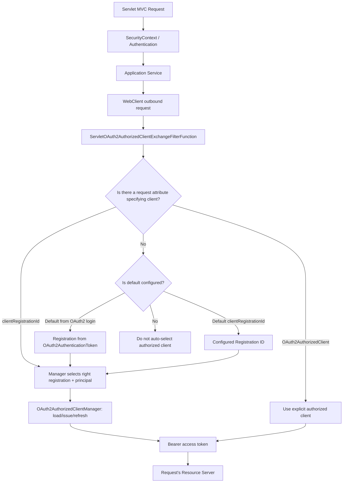

# 19.5. Default Authorized Client and Per-Request Scope

In **Spring Security OAuth 2.0 / OIDC Client**, after a user logs in or grants access to an external service, an application can use **`OAuth2AuthorizedClient`** to call APIs with an access token. On the **Servlet stack**, `WebClient` is integrated via **`ServletOAuth2AuthorizedClientExchangeFilterFunction`**.

When configuring this integration, a crucial question arises: **if a `WebClient` call does not specify an authorized client, which token will Spring Security use?**

There are three scenarios to distinguish:

1. **No default:** each outbound request explicitly specifies `OAuth2AuthorizedClient` or `clientRegistrationId`; if omitted, the OAuth2 filter does not arbitrarily pick a token.
2. **Default based on the logged-in user:** `setDefaultOAuth2AuthorizedClient(true)` allows deriving the authorized client from the current `OAuth2AuthenticationToken` when possible.
3. **Default based on registration:** `setDefaultClientRegistrationId("...")` uses a predefined `ClientRegistration` for calls that do not explicitly specify a client.

Both default mechanisms are convenient, yet they also make it easy for a **Bearer access token to be sent on every HTTP request going through a `WebClient`**. If the same WebClient is used to access other APIs, external hosts, or user-supplied URLs, this can cause a severe **token leakage** vulnerability.

This lesson explains how the default authorized client works, **its scope per outbound request**, how to explicitly override it with request attributes, and how to design safely when dealing with multiple APIs, registrations, or users.

> Scope: **Spring Boot 3.x / Spring Security 6.x, Spring MVC Servlet applications using WebClient**. The package name includes `reactive.function.client` because WebClient uses a reactive API, yet `ServletOAuth2AuthorizedClientExchangeFilterFunction` is built specifically for the **Servlet** environment. Examples using `company-login`, `reports-api`, and `calendar-api` are illustrative registrations.

## 1. Reviewing Four Core Concepts

### 1.1. ClientRegistration

`ClientRegistration` is the configuration of an OAuth2/OIDC client registered with an Authorization Server:

```text
registrationId       = company-login
clientId             = portal-web-prod
authorizationGrant   = authorization_code
scope                = openid, profile
issuer               = https://id.example.test/realms/company
redirectUri          = {baseUrl}/login/oauth2/code/{registrationId}
```

An application can declare multiple registrations even if they share the same OP:

```text
company-login     -> portal login
reports-api       -> read Reports API on behalf of user
calendar-api      -> access Calendar API on behalf of user
billing-service   -> machine-to-machine API calls
```

**`registrationId` is not `client-id`**. It is the key the application uses to select the appropriate configuration.

### 1.2. OAuth2AuthorizedClient

Once a registration is authorized and has a token, Spring Security represents that state with **`OAuth2AuthorizedClient`**:

```text
OAuth2AuthorizedClient
  clientRegistration = reports-api
  principalName      = alice
  accessToken        = <redacted>
  refreshToken       = <optional>
```

It binds the token to a **registration and a principal**. For the same `reports-api` registration, Alice's token must never be used in place of Bob's.

### 1.3. Current Authentication

`Authentication` in `SecurityContextHolder` describes the currently authenticated user or service principal. After `oauth2Login()`, `Authentication` is typically an **`OAuth2AuthenticationToken`**, which includes the `authorizedClientRegistrationId` used to log in.

The registration used for **logging in** is not necessarily the registration used to **call an API**.

### 1.4. WebClient + ExchangeFilterFunction

`WebClient` is Spring Framework's HTTP client. Spring Security uses **`ServletOAuth2AuthorizedClientExchangeFilterFunction`** to:

- Select an authorized client for the outbound request;
- Request or reuse an access token via `OAuth2AuthorizedClientManager`;
- Refresh/renew the token when supported and conditions allow;
- Attach the `Authorization: Bearer <token>` header;
- Support configuring handling of authorization failures from the Resource Server.

**This integration does not replace authorization checks on the downstream Resource Server.** Tokens must still be valid for issuer, audience, scope, and API policy.

## 2. General Flow When WebClient Calls an API



This diagram illustrates **selection rules**, not a guarantee that a token will always exist or that the manager will complete authorization immediately. With `authorization_code`, an unauthorized client may require a browser redirect and consent; with `client_credentials`, the manager can call the token endpoint directly.

Remember that **one WebClient instance has a shared filter configuration**, yet **each outbound call has its own request attributes**.

## 3. Basic Configuration: Default Authorized Client Disabled

This is the safest, clearest starting configuration for an application calling multiple APIs:

```java
import org.springframework.context.annotation.Bean;
import org.springframework.context.annotation.Configuration;
import org.springframework.security.oauth2.client.OAuth2AuthorizedClientManager;
import org.springframework.security.oauth2.client.web.reactive.function.client
    .ServletOAuth2AuthorizedClientExchangeFilterFunction;
import org.springframework.web.reactive.function.client.WebClient;

@Configuration
class WebClientConfiguration {

    @Bean
    WebClient oauth2WebClient(OAuth2AuthorizedClientManager manager) {
        ServletOAuth2AuthorizedClientExchangeFilterFunction oauth2 =
            new ServletOAuth2AuthorizedClientExchangeFilterFunction(manager);

        // Do not enable setDefaultOAuth2AuthorizedClient(true).
        // Do not set setDefaultClientRegistrationId(...).
        return WebClient.builder()
            .apply(oauth2.oauth2Configuration())
            .build();
    }
}
```

In real Java code, **the class import must be on a single line**:

```java
import org.springframework.security.oauth2.client.web.reactive.function.client.ServletOAuth2AuthorizedClientExchangeFilterFunction;
```

Calling `.apply(oauth2.oauth2Configuration())` matters more than just calling `.filter(oauth2)`: it adds the exchange filter and configures request defaults to retrieve `HttpServletRequest` and `HttpServletResponse` from `RequestContextHolder`, as well as Authentication from `SecurityContextHolder` when needed.

**With the manager constructor, `setDefaultOAuth2AuthorizedClient` defaults to `false`**. Keeping defaults disabled forces every call site to state explicitly which client is used.

### 3.1. Dependencies for WebClient in a Servlet Application

A Maven application can use:

```xml
<dependencies>
    <dependency>
        <groupId>org.springframework.boot</groupId>
        <artifactId>spring-boot-starter-web</artifactId>
    </dependency>

    <dependency>
        <groupId>org.springframework.boot</groupId>
        <artifactId>spring-boot-starter-security</artifactId>
    </dependency>

    <dependency>
        <groupId>org.springframework.boot</groupId>
        <artifactId>spring-boot-starter-oauth2-client</artifactId>
    </dependency>

    <!-- Provides WebClient along with the reactive HTTP client. -->
    <dependency>
        <groupId>org.springframework.boot</groupId>
        <artifactId>spring-boot-starter-webflux</artifactId>
    </dependency>
</dependencies>
```

Using `spring-boot-starter-web` and `spring-boot-starter-webflux` together in standard Spring Boot **does not turn an MVC app into a WebFlux server**: Spring MVC normally takes precedence for the web application type when both are present. Here WebClient acts purely as an **HTTP client**.

If your project structures dependencies differently, the core requirement is having the `WebClient` class and version-compatible Spring Security OAuth2 Client modules.

### 3.2. Illustrative Client Registrations

```yaml
spring:
  security:
    oauth2:
      client:
        registration:
          company-login:
            provider: company
            client-id: ${LOGIN_CLIENT_ID}
            client-secret: ${LOGIN_CLIENT_SECRET}
            authorization-grant-type: authorization_code
            redirect-uri: "{baseUrl}/login/oauth2/code/{registrationId}"
            scope: [openid, profile, email]

          reports-api:
            provider: company
            client-id: ${REPORTS_CLIENT_ID}
            client-secret: ${REPORTS_CLIENT_SECRET}
            authorization-grant-type: authorization_code
            redirect-uri: "{baseUrl}/login/oauth2/code/{registrationId}"
            scope: [reports.read]

          calendar-api:
            provider: partner
            client-id: ${CALENDAR_CLIENT_ID}
            client-secret: ${CALENDAR_CLIENT_SECRET}
            authorization-grant-type: authorization_code
            redirect-uri: "{baseUrl}/login/oauth2/code/{registrationId}"
            scope: [calendar.read]

        provider:
          company:
            issuer-uri: https://id.example.test/realms/company
          partner:
            issuer-uri: https://login.partner.example.test/tenant
```

The scopes `reports.read` and `calendar.read` are examples of API permissions that the corresponding provider must support. Declaring a scope does not guarantee the permission has been granted.

## 4. First Approach: Specifying clientRegistrationId Per Outbound Request

This approach fits when a business service knows for certain which client registration an API requires.

```java
import static org.springframework.security.oauth2.client.web.reactive.function.client.ServletOAuth2AuthorizedClientExchangeFilterFunction.clientRegistrationId;

import org.springframework.stereotype.Service;
import org.springframework.web.reactive.function.client.WebClient;

@Service
class ReportGateway {

    private final WebClient oauth2WebClient;

    ReportGateway(WebClient oauth2WebClient) {
        this.oauth2WebClient = oauth2WebClient;
    }

    String loadReports() {
        return oauth2WebClient.get()
            .uri("https://reports.example.test/v1/reports/mine")
            .attributes(clientRegistrationId("reports-api"))
            .retrieve()
            .bodyToMono(String.class)
            .block();
    }
}
```

The `clientRegistrationId(...)` method is a **static helper on `ServletOAuth2AuthorizedClientExchangeFilterFunction`**, not a `RestClient` helper.

### 4.1. Request Attributes Apply Only to the Call Being Built

Two calls on the **same WebClient bean**:

```java
String reports = oauth2WebClient.get()
    .uri("https://reports.example.test/v1/reports")
    .attributes(clientRegistrationId("reports-api"))
    .retrieve()
    .bodyToMono(String.class)
    .block();

String calendar = oauth2WebClient.get()
    .uri("https://calendar.example.test/v1/events")
    .attributes(clientRegistrationId("calendar-api"))
    .retrieve()
    .bodyToMono(String.class)
    .block();
```

The Reports call does not “permanently switch WebClient to `reports-api`”; the Calendar call has independent attributes.

```text
WebClient instance
  |
  +-- Request 1
  |     URI: reports.example.test
  |     attribute: reports-api
  |     -> authorized client (reports-api, current principal)
  |
  +-- Request 2
        URI: calendar.example.test
        attribute: calendar-api
        -> authorized client (calendar-api, current principal)
```

The key principle is **per-outbound-request selection**, not per-thread global mutable state.

### 4.2. Scoping by Principal Matters Even More

Suppose both Alice and Bob use `reports-api`:

```text
(reports-api, alice) -> Alice's access token
(reports-api, bob)   -> Bob's access token
```

When a Servlet request is authenticated as Bob, the manager must operate in **Bob's principal context**. Never save the latest access token in a `static` variable and reuse it across requests.

**`clientRegistrationId("reports-api")` only picks the registration; it does not intentionally pick a different user.**

## 5. Second Approach: Passing OAuth2AuthorizedClient Explicitly to WebClient

If an MVC controller has already had Spring Security resolve an authorized client, you can pass that exact object to WebClient.

```java
import static org.springframework.security.oauth2.client.web.reactive.function.client.ServletOAuth2AuthorizedClientExchangeFilterFunction.oauth2AuthorizedClient;

import org.springframework.security.oauth2.client.OAuth2AuthorizedClient;
import org.springframework.security.oauth2.client.annotation.RegisteredOAuth2AuthorizedClient;
import org.springframework.web.bind.annotation.GetMapping;
import org.springframework.web.bind.annotation.RestController;
import org.springframework.web.reactive.function.client.WebClient;

@RestController
class ReportController {

    private final WebClient webClient;

    ReportController(WebClient webClient) {
        this.webClient = webClient;
    }

    @GetMapping("/my-reports")
    String reports(
            @RegisteredOAuth2AuthorizedClient("reports-api")
            OAuth2AuthorizedClient authorizedClient) {

        return webClient.get()
            .uri("https://reports.example.test/v1/reports/mine")
            .attributes(oauth2AuthorizedClient(authorizedClient))
            .retrieve()
            .bodyToMono(String.class)
            .block();
    }
}
```

Two **distinct Spring Security mechanisms** are at work here:

1. **`@RegisteredOAuth2AuthorizedClient("reports-api")`**: resolves the Spring MVC controller parameter into an authorized client.
2. **`.attributes(oauth2AuthorizedClient(authorizedClient))`**: binds that authorized client to **one outbound WebClient request**.

Both mechanisms play roles in the same flow, though they are not the same thing.

### 5.1. When Should You Pass the Object Instead of Registration ID?

Passing `OAuth2AuthorizedClient` explicitly is helpful when:

- The controller already received the authorized client via an annotation.
- A service was passed a valid authorized client by a caller layer with a clear authentication context.
- You want to guarantee the request uses **that exact authorized client**.
- The application wants to avoid inference from defaults or global state.

**Never look up an object from a token store using a raw username supplied by the user** and pass it to WebClient. An authorized client must belong to the permitted principal and registration.

### 5.2. Explicit Object vs. “Using the Default Login Client”

If the request is logged in via `company-login`, yet the controller has:

```java
@RegisteredOAuth2AuthorizedClient("reports-api")
OAuth2AuthorizedClient reportsClient
```

then the outbound request can specify **reportsClient** without falling back to the `company-login` login token.

When the user has not authorized `reports-api`, resolving the annotation or calling the manager may need to start the corresponding authorization or fail per configuration; it must never silently substitute the login token.

## 6. Without Request Attributes: Does the Default Work Automatically?

**Not necessarily.** Per the `ServletOAuth2AuthorizedClientExchangeFilterFunction` API, `setDefaultOAuth2AuthorizedClient` defaults to **`false`**.

If WebClient has no default configured and the call provides neither:

```java
.attributes(clientRegistrationId("..."))
```

nor:

```java
.attributes(oauth2AuthorizedClient(...))
```

then the OAuth2 filter **has no explicit client to choose via those mechanisms**. It will not “just grab the first token in the store”, nor assume “every API call uses the login token”.

### 6.1. Conceptual Behavior Table

| Request Attribute | Default Setting | Selected Client |
| --- | --- | --- |
| `oauth2AuthorizedClient(A)` | Any | The specified authorized client A |
| `clientRegistrationId("reports-api")` | Any | Registration `reports-api` in the principal's context |
| None | No default enabled | Does not auto-select an OAuth2 client from either default mechanism |
| None | `setDefaultOAuth2AuthorizedClient(true)` | Can infer registration from the current OAuth2 login Authentication |
| None | `setDefaultClientRegistrationId("reports-api")` | Uses `reports-api` as the default registration |

This table describes clear cases when using **one default at a time**. If both defaults are configured simultaneously, verify the exact behavior of your version; never rely on implicit precedence in multi-API architectures. A better approach is **explicit selection or configuring just one appropriate default**.

### 6.2. Why Must Defaults Be Enabled Intentionally?

Because “picking a default token” is a security decision. A WebClient bean can be called by multiple different services and send HTTP requests to many destinations. Enabling a broad default without restricting destinations makes it easy for access tokens to be sent to the wrong place.

## 7. setDefaultOAuth2AuthorizedClient(true): Default from OAuth2 Login

When you enable:

```java
oauth2.setDefaultOAuth2AuthorizedClient(true);
```

and the current request is authenticated with **`oauth2Login()`**, the filter can obtain the authorized client associated with the current **`OAuth2AuthenticationToken`**. The registration is inferred from the login Authentication.

### 7.1. WebClient Configuration

```java
import org.springframework.context.annotation.Bean;
import org.springframework.context.annotation.Configuration;
import org.springframework.security.oauth2.client.OAuth2AuthorizedClientManager;
import org.springframework.security.oauth2.client.web.reactive.function.client.ServletOAuth2AuthorizedClientExchangeFilterFunction;
import org.springframework.web.reactive.function.client.WebClient;

@Configuration
class LoginDefaultWebClientConfig {

    @Bean
    WebClient loginDefaultWebClient(OAuth2AuthorizedClientManager manager) {
        ServletOAuth2AuthorizedClientExchangeFilterFunction oauth2 =
            new ServletOAuth2AuthorizedClientExchangeFilterFunction(manager);

        oauth2.setDefaultOAuth2AuthorizedClient(true);

        return WebClient.builder()
            .baseUrl("https://userinfo-gateway.example.test")
            .apply(oauth2.oauth2Configuration())
            .build();
    }
}
```

In a Servlet request after a user logs in via `company-login`, the following call **without attributes**:

```java
String response = loginDefaultWebClient.get()
    .uri("/v1/profile")
    .retrieve()
    .bodyToMono(String.class)
    .block();
```

can use the access token tied to the current login registration.

### 7.2. This Default Does Not Mean an “All-Users” Token

`setDefaultOAuth2AuthorizedClient(true)` operates on the **currently resolved Authentication**, not an application-wide token. For Alice and Bob:

```text
Alice's Servlet request
  Authentication: OAuth2AuthenticationToken(company-login, alice)
  Default client:  company-login + Alice

Bob's Servlet request
  Authentication: OAuth2AuthenticationToken(company-login, bob)
  Default client:  company-login + Bob
```

This **does not protect you automatically** if the application overrides Authentication with someone else's data, uses shared mutable state, or loses thread context when switching to asynchronous processing.

### 7.3. Conditions for This Default to Take Effect

- The current Authentication matches OAuth2 Login, typically `OAuth2AuthenticationToken`.
- An authorized client exists for the Authentication's registration, or the manager can authorize one per configuration.
- WebClient is configured with the proper filter and request context.
- The request does not specify a different authorized client/registration that takes precedence.
- The Resource Server actually accepts the login registration's access token.

If the user logged in via form login or another mechanism without `OAuth2AuthenticationToken`, **do not assume there is an OIDC login authorized client to infer**.

### 7.4. Major Risk: Every Outbound Call Using That WebClient Can Receive the Token

Suppose `loginDefaultWebClient` is injected into a service that calls both an internal API and an external image/avatar URL:

```java
String internal = loginDefaultWebClient.get()
    .uri("https://api.company.example.test/v1/profile")
    .retrieve()
    .bodyToMono(String.class)
    .block();

String external = loginDefaultWebClient.get()
    .uri("https://untrusted.example.test/collect")
    .retrieve()
    .bodyToMono(String.class)
    .block();
```

**If the default authorized client resolves, both HTTP requests may carry the access token**. The second call risks sending the token to an unauthorized recipient.

Spring Security explicitly warns that enabling `setDefaultOAuth2AuthorizedClient(true)` can cause **every HTTP request sent through that WebClient** to receive an access token. Therefore, only use this setting when **every destination reachable through that instance is allowed to receive that token**.

## 8. setDefaultClientRegistrationId(...): Default to a Fixed Registration

Another option:

```java
oauth2.setDefaultClientRegistrationId("reports-api");
```

With this setting, if a request specifies neither an authorized client nor a registration ID, the filter can use registration **`reports-api`** for the manager to look up/issue a token.

### 8.1. Example Dedicated WebClient for the Reports API

```java
import org.springframework.context.annotation.Bean;
import org.springframework.context.annotation.Configuration;
import org.springframework.security.oauth2.client.OAuth2AuthorizedClientManager;
import org.springframework.security.oauth2.client.web.reactive.function.client.ServletOAuth2AuthorizedClientExchangeFilterFunction;
import org.springframework.web.reactive.function.client.WebClient;

@Configuration
class ReportsDefaultWebClientConfig {

    @Bean
    WebClient reportsWebClient(OAuth2AuthorizedClientManager manager) {
        ServletOAuth2AuthorizedClientExchangeFilterFunction oauth2 =
            new ServletOAuth2AuthorizedClientExchangeFilterFunction(manager);

        oauth2.setDefaultClientRegistrationId("reports-api");

        return WebClient.builder()
            .baseUrl("https://reports.example.test")
            .apply(oauth2.oauth2Configuration())
            .build();
    }
}
```

Service usage:

```java
String response = reportsWebClient.get()
    .uri("/v1/reports/mine")
    .retrieve()
    .bodyToMono(String.class)
    .block();
```

This keeps code concise if the **WebClient instance is solely responsible for calling the Reports API**.

### 8.2. Default Registration Does Not Mean Default Principal

`setDefaultClientRegistrationId("reports-api")` specifies the **client registration**; it does not decide who the user is.

Within a Servlet request, the manager still requires an appropriate principal/Authentication. Two users can share `reports-api` while holding separate authorized clients.

```text
Default registrationId = reports-api

Alice's request -> (reports-api, alice)
Bob's request   -> (reports-api, bob)
```

With `client_credentials`, the principal should usually be an intentional **service identity** rather than accidentally picking up a user's name from SecurityContext when the token really represents the application.

### 8.3. A Fixed Base URL Is Still Not an Absolute Blocker

Even with `WebClient.builder().baseUrl("https://reports.example.test")`, the WebClient API can still accept an absolute URI at another call site. If a developer or input data allows:

```java
reportsWebClient.get()
    .uri("https://other.example.test/path")
    .retrieve()
    .bodyToMono(String.class)
    .block();
```

then the default configuration could send the `reports-api` token to that host.

**Destination restrictions must be enforced through integration service design, allowlists, redirect checks, and egress policies**, not `baseUrl` alone.

## 9. Scope of Use: One WebClient Instance, Many Outbound Requests

The most misunderstood part of the word **default** is its scope.

### 9.1. A Default Is Not a Global Variable Across All WebClients

If the application creates:

```java
WebClient reportsWebClient = /* default reports-api */;
WebClient publicWebClient  = /* no OAuth2 filter */;
```

then enabling a default on `reportsWebClient` **does not cause `publicWebClient` to send tokens**. The setting belongs to the filter on the **WebClient instance / builder configuration** where you applied it.

### 9.2. The Default Applies to Every Non-Overridden Call Through That Instance

```text
WebClient with defaultClientRegistrationId("reports-api")
    |
    +-- GET /v1/reports       no attribute -> reports-api
    |
    +-- GET /v1/status        no attribute -> reports-api
    |
    +-- GET /v1/calendar      has attribute calendar-api -> calendar-api
    |
    +-- GET external absolute URI without attribute -> reports-api (dangerous)
```

Key point: **overriding with request attributes picks a different client for that single request**, without changing the default for subsequent requests.

### 9.3. Default Does Not Mean Sharing One Access Token Across the Entire App

Even with a fixed default registration, tokens are managed by the manager per **registration + principal**, and may have separate refresh/reauthorization lifecycles.

Never implement a static variable `DEFAULT_ACCESS_TOKEN` to simulate a default; that easily leaks user A's token to user B.

### 9.4. Default Is Not the API's Authorization Contract

An API can reject a token even though WebClient attached the header properly. That depends on granted permissions and the Resource Server:

```text
WebClient selects reports-api
    |
    v
Manager obtains access token for reports-api + user
    |
    v
Resource Server validates issuer / audience / scope / policy
    |
    +-- Valid -> 200
    |
    +-- Missing scope -> 403 insufficient_scope
    |
    +-- Wrong/expired/revoked token -> 401 invalid_token
```

A default only handles **selecting the OAuth2 client per configuration policy**; it does not replace business authorization.

## 10. Request Attributes Can Override the Default

This is the most important rule for using a shared WebClient in a multi-API application.

### 10.1. Overriding with registrationId

Suppose WebClient defaults to `reports-api`, yet one request needs `calendar-api`:

```java
import static org.springframework.security.oauth2.client.web.reactive.function.client.ServletOAuth2AuthorizedClientExchangeFilterFunction.clientRegistrationId;

String calendar = reportsWebClient.get()
    .uri("https://calendar.example.test/v1/events")
    .attributes(clientRegistrationId("calendar-api"))
    .retrieve()
    .bodyToMono(String.class)
    .block();
```

The request specifies `calendar-api` instead of relying on the default. Even so, sharing a WebClient named `reportsWebClient` across multiple hosts is a design smell worth revisiting; separate integrations when they have different trust boundaries.

### 10.2. Overriding with an Authorized Client Object

```java
import static org.springframework.security.oauth2.client.web.reactive.function.client.ServletOAuth2AuthorizedClientExchangeFilterFunction.oauth2AuthorizedClient;

String data = webClient.get()
    .uri("https://reports.example.test/v1/reports")
    .attributes(oauth2AuthorizedClient(authorizedClient))
    .retrieve()
    .bodyToMono(String.class)
    .block();
```

`authorizedClient` must come from a valid authorization for the right user/registration. When passed explicitly, it becomes the context requested for this call.

### 10.3. Do Not Combine Conflicting Specifiers and Expect a Fallback

Unclear intent:

```java
webClient.get()
    .uri("https://reports.example.test/v1/reports")
    .attributes(clientRegistrationId("reports-api"))
    .attributes(oauth2AuthorizedClient(calendarAuthorizedClient))
    .retrieve()
    .bodyToMono(String.class)
    .block();
```

This request carries **two different client specifications**. Even if the framework version has an evaluation order, the code is confusing and risks sending the wrong token to the API.

**Pick one clear method per request**: either registration ID or authorized client object. Never rely on ambiguous precedence when two values conflict.

## 11. Why Is Disabling Defaults Recommended for Shared WebClients?

Suppose an application service has:

```text
WebClient commonWebClient
    |
    +-- Reports API
    +-- Calendar API
    +-- Public image service
    +-- Webhook endpoint taking a user-supplied URL
    +-- Internal config API
```

If default tokens are enabled on `commonWebClient`, every non-overridden outbound request risks carrying an access token, including calls to the public image service or webhooks.

A safer setup:

```text
publicWebClient      -> no OAuth2 filter
reportsWebClient     -> OAuth2 filter, explicit reports-api registration
calendarWebClient    -> OAuth2 filter, explicit calendar-api registration
serviceWebClient     -> OAuth2 filter, service registration + dedicated principal
```

You do not necessarily need a WebClient bean for every endpoint, yet you should **separate by trust boundary** and constrain the destination range each client can reach.

### 11.1. With HTTP Clients Calling User-Supplied URLs

A particularly dangerous anti-pattern:

```java
@GetMapping("/preview")
String preview(@RequestParam String url) {
    return loginDefaultWebClient.get()
        .uri(url)
        .retrieve()
        .bodyToMono(String.class)
        .block();
}
```

If a token is attached by default, a user can point `url` to a host they control and capture the Bearer token. This is both **SSRF** and potential **credential exfiltration**.

Do not solve this by “just checking `url.startsWith("https")`”: HTTPS does not prove the origin is permitted. You need an endpoint allowlist, scheme/host/port validation, DNS/rebinding and redirect handling, and outbound network policies where appropriate.

### 11.2. When Calling a Public API in the Same Service

Use a **WebClient without an OAuth2 filter** for public requests:

```java
@Bean
WebClient publicWebClient() {
    return WebClient.builder()
        .baseUrl("https://public-api.example.test")
        .build();
}
```

Do not use tricks like “passing null clientRegistrationId” hoping to turn off a default unless a specific API contract supports it. **Separating token-bearing HTTP clients from tokenless clients** expresses security intent far more clearly.

## 12. Relatively Complete Example: Log In via OP A, Call API B

Suppose the user logs in via `company-login`:

```text
/oauth2/authorization/company-login
```

After OIDC login, the user's `OAuth2AuthenticationToken` is bound to `company-login`. However, the application needs to call `calendar-api` from a different provider.

### 12.1. Wrong: Inferring the Login Client by Default for the Calendar API

```java
ServletOAuth2AuthorizedClientExchangeFilterFunction oauth2 =
    new ServletOAuth2AuthorizedClientExchangeFilterFunction(manager);

oauth2.setDefaultOAuth2AuthorizedClient(true);
```

If the Calendar call has no attributes:

```java
webClient.get()
    .uri("https://calendar.example.test/v1/events")
    .retrieve()
    .bodyToMono(String.class)
    .block();
```

the filter may pick **`company-login`**, not `calendar-api`. The login token may be rejected by the API due to issuer/audience/scope, or worse, sent to an endpoint not authorized to receive that token.

### 12.2. Right: Specifying the Calendar Registration

```java
String events = webClient.get()
    .uri("https://calendar.example.test/v1/events")
    .attributes(clientRegistrationId("calendar-api"))
    .retrieve()
    .bodyToMono(String.class)
    .block();
```

If no authorized client exists yet for `calendar-api`, the manager may require the user to authorize that registration separately. In the UX, display an appropriate **“Connect Calendar”** action rather than trying to replay the Company login token.

### 12.3. Same Browser Session Does Not Mean Same Token

```text
Authentication:
  User Alice logged in via company-login

Authorized clients:
  (company-login, Alice) -> Token A (OIDC login)
  (calendar-api, Alice)  -> Token B (Calendar API)
  (reports-api, Alice)   -> Token C (Reports API)
```

Tokens B and C do not materialize automatically just because the user has Token A. Each registration has its own grant, scope, consent, and lifecycle.

## 13. Request-Scoped Principal and Authentication Attributes

Beyond choosing the authorized client, Spring Security also lets you supply **Authentication** for an outbound request:

```java
import static org.springframework.security.oauth2.client.web.reactive.function.client.ServletOAuth2AuthorizedClientExchangeFilterFunction.authentication;
```

Technical example:

```java
String response = webClient.get()
    .uri("https://reports.example.test/v1/reports")
    .attributes(clientRegistrationId("reports-api"))
    .attributes(authentication(trustedAuthentication))
    .retrieve()
    .bodyToMono(String.class)
    .block();
```

`trustedAuthentication` in this example must come from an **authentication context trusted by the application**. Never build `Authentication` from a username entered by an HTTP caller.

### 13.1. Why Does the Right Authentication Matter?

The manager typically needs to look up the authorized client by:

```text
registrationId + principalName
```

For `reports-api`, if the principal context is swapped:

```text
(reports-api, Alice) -> Alice's access token
(reports-api, Bob)   -> Bob's access token
```

Attaching Bob's Authentication to a request initiated by Alice can cause the API call to use Bob's token. That is a critical access control flaw.

### 13.2. Do Not Ambiguously Substitute a Technical Principal for a User

With `client_credentials`, a service identity such as `billing-worker` makes sense, yet it is **not a delegated user**.

If an API requires user-delegated permissions, the backend's `client_credentials` token must not be used to impersonate Alice's consent. Pick the grant and scopes suited to the business operation.

### 13.3. Do Not Fabricate Authentication to “Work Around a Missing Token”

If a user has not authorized `calendar-api`, never invent an `Authentication` with someone else's username to borrow an existing token. The right flow is requesting dedicated authorization or reporting a disconnected status.

## 14. Servlet Request Context and WebClient Reactive Execution

The name `WebClient` can mislead learners into thinking the app has switched entirely to Spring WebFlux. Yet in this lesson:

```text
Incoming HTTP:
  DispatcherServlet
    -> SecurityFilterChain (Servlet)
    -> Spring MVC Controller
    -> Service
    -> WebClient
    -> ServletOAuth2AuthorizedClientExchangeFilterFunction
    -> Outbound HTTP API
```

`ServletOAuth2AuthorizedClientExchangeFilterFunction` is designed for the Servlet environment and can obtain:

- `HttpServletRequest` and `HttpServletResponse` from `RequestContextHolder`;
- `Authentication` from `SecurityContextHolder`.

`.apply(oauth2.oauth2Configuration())` wires the filter and the necessary default request logic.

### 14.1. Synchronous MVC Controller Example

```java
@GetMapping("/reports")
String reports() {
    return webClient.get()
        .uri("https://reports.example.test/v1/reports")
        .attributes(clientRegistrationId("reports-api"))
        .retrieve()
        .bodyToMono(String.class)
        .block();
}
```

In Spring MVC Servlet, `.block()` can be used when the controller is designed synchronously and runs on a Servlet thread, though it **blocks the thread** while waiting on I/O. Evaluate timeouts, thread pools, and throughput capacity; never copy `.block()` into a WebFlux reactive event loop.

### 14.2. Deferred Subscription Can Lose Context

`WebClient` returns a `Mono`; I/O typically executes only when subscription is triggered. If you create a publisher inside a Servlet request but execute it later on another thread or after the request completes, **thread-local `RequestContextHolder`/`SecurityContextHolder` may no longer hold the right context**.

Risky example:

```java
Mono<String> pending = webClient.get()
    .uri("https://reports.example.test/v1/reports")
    .retrieve()
    .bodyToMono(String.class);

// Do not assume subscribing on a background thread later
// still retains the original Servlet Request/Authentication.
```

If the workflow is genuinely asynchronous:

- Do not expect `SecurityContextHolder` to propagate automatically across every scheduler.
- Use an appropriate manager for background/service-level work.
- Carry a **trusted identity context** via controlled context propagation if delegated authorization is truly required.
- Never push raw `HttpServletRequest` or raw access tokens unprotected into a job queue.
- Distinguish tasks running *inside* a Servlet request from tasks running after the request.

**Default authorized client in Servlet is not an automatic authorization engine for arbitrary asynchronous execution.**

## 15. DefaultClientRegistrationId and client_credentials

A common technical pattern for machine-to-machine calls:

```text
billing-service:
  authorization-grant-type: client_credentials
  scope: billing.read
```

If a WebClient is dedicated solely to calling the Billing API, you may consider:

```java
ServletOAuth2AuthorizedClientExchangeFilterFunction oauth2 =
    new ServletOAuth2AuthorizedClientExchangeFilterFunction(serviceManager);

oauth2.setDefaultClientRegistrationId("billing-service");

WebClient billingWebClient = WebClient.builder()
    .baseUrl("https://billing.example.test")
    .apply(oauth2.oauth2Configuration())
    .build();
```

However, `serviceManager` must be configured to support `client_credentials` and suitable persistence. For background jobs without an HTTP request, the right choice is **`AuthorizedClientServiceOAuth2AuthorizedClientManager`**, not a default manager relying on a Servlet request.

### 15.1. Why Is a Stable Technical Principal Needed?

In `OAuth2AuthorizedClient` storage, tokens are usually keyed by registration and principal name. For machine-to-machine calls, a fixed name like `billing-worker` or service identity keeps tokens separate from user-issued tokens.

Note that setting `defaultClientRegistrationId` **does not automatically set a service principal**. You must configure request authentication/context or use the manager/service API for app-only tokens per your specific design.

### 15.2. Do Not Use a Default User Token for System Tasks

If a WebClient enables `setDefaultOAuth2AuthorizedClient(true)` during Alice's request, the token derives from her login Authentication. Never let a machine-to-machine billing operation accidentally use Alice's login token.

## 16. Security: Which Default Should Be Chosen?

A practical guideline:

| Scenario | Preferred Configuration | Reason |
| --- | --- | --- |
| One WebClient shared across multiple OAuth2 APIs | **Disable defaults**; specify `clientRegistrationId` per request | Prevents sending tokens to the wrong API |
| Controller already received the right authorized client | `.attributes(oauth2AuthorizedClient(client))` | Makes token and context explicit |
| One WebClient dedicated to one trusted API | May consider `setDefaultClientRegistrationId` | Reduces boilerplate, while still controlling destinations |
| WebClient serving only the logged-in provider's API | May consider `setDefaultOAuth2AuthorizedClient(true)` | Follows current Authentication, still must restrict hosts |
| Public API needing no OAuth2 | WebClient **without an OAuth2 filter** | Prevents credential leakage |
| `client_credentials` job | Service-level manager + service principal | Independent of user sessions |
| Multi-tenant / multi-provider app | Explicit mapping from tenant/resource to allowlisted registration | Preserves permission and issuer boundaries |

**Defaults are not always wrong**, yet whenever multiple destinations or registrations exist, **explicit per-request selection** is easier to audit and safer.

### 16.1. Least Privilege

A login token may carry `openid profile` while the Reports API requires `reports.read`. Sending the login token to Reports does not magically create the missing scope.

If an API returns 403 `insufficient_scope`, fix how permissions and registrations are configured rather than switching to a higher-privilege client just to “make it work”.

### 16.2. Do Not Trust Caller-Supplied URLs or Registration IDs

Wrong:

```java
@GetMapping("/fetch")
String fetch(@RequestParam String url,
             @RequestParam String registrationId) {
    return webClient.get()
        .uri(url)
        .attributes(clientRegistrationId(registrationId))
        .retrieve()
        .bodyToMono(String.class)
        .block();
}
```

An attacker can choose a token belonging to an internal registration and send it to a host they control. The backend must map from verified business operations and permissions to an allowlisted **destination + registration**.

### 16.3. Do Not Write Tokens to Logs

Avoid logging:

```java
logger.info("Authorized client: {}", authorizedClient);
logger.info("Access token: {}",
    authorizedClient.getAccessToken().getTokenValue());
```

Only observe logical API names, configured registration IDs, error categories, and internal trace IDs. Never log authorization codes, refresh tokens, ID Tokens, Authorization headers, cookies, or full UserInfo containing PII.

## 17. Designing WebClients Around Trust Boundaries

To avoid default-related mistakes, a sound architecture typically uses dedicated adapters:

```text
Spring MVC Controllers
        |
        v
Business Services
        |
        +-- ReportsGateway
        |     WebClient baseUrl Reports API
        |     registration reports-api (per request)
        |
        +-- CalendarGateway
        |     WebClient baseUrl Calendar API
        |     registration calendar-api (per request)
        |
        +-- PublicMetadataGateway
        |     WebClient without OAuth2 filter
        |
        +-- BillingGateway
              WebClient Billing API
              client_credentials + service principal
```

Those gateways can share one `OAuth2AuthorizedClientManager` when security policies align, or use separate managers depending on grants and storage.

### 17.1. No Need to Clone WebClient Per Request

`WebClient` is designed to be reusable. Varying request attributes via:

```java
webClient.get()
    .uri("/v1/reports")
    .attributes(clientRegistrationId("reports-api"))
```

does not make the bean stateful per user. Avoid global mutable fields such as:

```java
// DO NOT DO THIS:
static String currentRegistrationId;
```

where thread A switches to `reports-api` while thread B needs `calendar-api`.

### 17.2. Two Layers of Security

- **Client selection:** picking the right `ClientRegistration`, principal, and authorized client.
- **Destination control:** restricting the hosts/paths/redirects allowed to receive a Bearer token.

A secure system requires **both**; picking the right registration with an untrusted URI can still leak tokens.

## 18. Failure Handling Is Not Part of Default Selection

Enabling a default only helps WebClient pick a client when a request omits an explicit choice. It **does not replace Authorization Server or Resource Server error handling**.

Possible errors:

| Source | Symptom | Resolution |
| --- | --- | --- |
| Authorization/refresh | `invalid_grant` | Broken/expired/revoked refresh token; stop using old record and reauthorize when appropriate |
| Resource Server | 401 + Bearer `invalid_token` | Token rejected; check audience, expiry, revocation |
| Resource Server | 403 + Bearer `insufficient_scope` | Token lacks permissions/scope; do not wipe and retry infinitely |
| Resource Server | 503 / timeout | API/network outage; do not assume token revocation |
| Not yet authorized | Needs consent/Authorization Code Flow | Guide user to connect the corresponding API |
| No login Authentication | Login-based default has no context | Specify client/principal explicitly or use a service-level manager |

### 18.1. Authorization Failure Handler in WebClient

`ServletOAuth2AuthorizedClientExchangeFilterFunction` supports:

```java
oauth2.setAuthorizationFailureHandler(failureHandler);
```

An `OAuth2AuthorizationFailureHandler` can handle Bearer token errors from the Resource Server and remove the broken `OAuth2AuthorizedClient` per policy.

When using the constructor taking `OAuth2AuthorizedClientManager`, **check the filter's own failure handler configuration** rather than assuming every HTTP 401/403 automatically removes the token; how you construct the filter and your Spring Security version affect the default handler.

Importantly: **removing a local authorized client does not revoke the token at the OP**, nor does it log out the SSO session.

### 18.2. Do Not Retry Every Request After 401

If an API returns 401 due to the wrong audience, requesting a new token under **the same wrong registration** will not fix it. If the call is a payment POST, uncontrolled retries also risk duplicate transactions.

Classify errors, bound retries, use idempotency keys when appropriate, and never automatically escalate registration to a higher-privilege client.

## 19. Comparison with RestClient on Servlet

Both `WebClient` and `RestClient` can integrate with Spring Security OAuth2 Client in a Servlet app, but **their registration-selection APIs differ**:

| Aspect | WebClient on Servlet | RestClient on Servlet |
| --- | --- | --- |
| Integration | `ServletOAuth2AuthorizedClientExchangeFilterFunction` | `OAuth2ClientHttpRequestInterceptor` |
| Per-request registration selection | `ServletOAuth2AuthorizedClientExchangeFilterFunction.clientRegistrationId(...)` | `RequestAttributeClientRegistrationIdResolver.clientRegistrationId(...)` |
| Attaching specific authorized client | `oauth2AuthorizedClient(...)` | Usually chooses registration/principal via interceptor/manager |
| Enable default login client | `setDefaultOAuth2AuthorizedClient(true)` | Customizable registration resolver; does not use this API |
| Default registration | `setDefaultClientRegistrationId(...)` | Appropriate resolver policy; does not use this API |
| HTTP programming model | Reactive-style `Mono`/`Flux`, can `.block()` in synchronous MVC | Synchronous imperative API |

**Do not use the wrong static import**:

```java
// RIGHT: WebClient in Servlet
import static org.springframework.security.oauth2.client.web.reactive.function.client.ServletOAuth2AuthorizedClientExchangeFilterFunction.clientRegistrationId;

// DIFFERENT: RestClient in Servlet
import static org.springframework.security.oauth2.client.web.client.RequestAttributeClientRegistrationIdResolver.clientRegistrationId;
```

Both methods share the same name yet belong to **two different integration paths**.

## 20. Multi-Tenant: Never Use a Default to Cross Tenant Boundaries

A SaaS system may have multiple client registrations:

```text
tenant-a -> reports-tenant-a
tenant-b -> reports-tenant-b
```

Setting `setDefaultClientRegistrationId("reports-tenant-a")` on a WebClient shared by both tenants risks sending tenant A's token when handling tenant B's request.

Solution:

1. Authenticate the user and determine tenant membership from a trusted source.
2. Map the authorized tenant to its corresponding registration.
3. Attach `clientRegistrationId(...)` **per outbound request**.
4. Select the API destination matching the verified tenant.
5. The manager/repository separates authorized clients by registration and principal; if extra tenant isolation is needed, design storage keys and binding rules accordingly.

### 20.1. Do Not Concatenate Registrations from Raw Input

Wrong:

```java
String registrationId = "reports-" + request.getParameter("tenant");
```

A caller can probe another tenant. Map from a tenant ID **already approved by the authorization service** to an allowlisted registration.

### 20.2. Login Default Is Not a Tenant Default

An `OAuth2AuthenticationToken` carries a specific login registration, but that does not mean the login token is authorized for every tenant/app API. Separate identity authentication from tenant-level resource authorization.

## 21. Observing Selection Without Exposing Credentials

An event log should use a constrained schema:

```json
{
  "event": "webclient_oauth2_selection",
  "source": "request_attribute",
  "registration_id": "reports-api",
  "api": "reports",
  "result": "resolved",
  "environment": "staging",
  "trace_id": "internal-trace"
}
```

This is an application-defined schema, **not JSON automatically emitted by Spring Security**.

Safe to log:
- Selection source (explicit authorized client, explicit registration, default login, default registration).
- Registration ID from trusted config.
- Logical API name.
- Success/failure outcome and error category.
- Internal trace ID.

Never log:
- Access tokens, refresh tokens, ID Tokens, or authorization codes.
- Raw Authorization/Cookie headers.
- Client secrets or PKCE verifiers.
- Full `OAuth2AuthorizedClient` objects.
- User-supplied URLs if they contain sensitive parameters.
- Emails, subjects, UserInfo, or JWT claims unnecessary for diagnostics.

**Never infer a “default” source by inspecting token payloads in logs.** Log the source right inside the adapter/service that picks the registration, without revealing tokens.

## 22. Common Troubleshooting

| Symptom | Possible Cause | Diagnostic Direction |
| --- | --- | --- |
| WebClient sends no Bearer token | OAuth2 filter not added, or no explicit/default client | Check `oauth2Configuration()` and request attributes |
| `setDefaultOAuth2AuthorizedClient(true)` enabled yet no token | Authentication is not OAuth2 login, or no matching authorized client | Check SecurityContext and login registration |
| Login token sent to Calendar API | Using default login client instead of `calendar-api` | Attach `clientRegistrationId("calendar-api")` |
| Default registration does not work | Wrong registration ID, missing manager/provider, or client unauthorized | Check `registration.<id>` key, grant, and principal |
| Shared WebClient leaks token to external host | Broad default enabled, user-controlled destination | Split WebClients, restrict URIs, remove unnecessary defaults |
| Alice uses Bob's token | Wrong Authentication/authorized client passed, global token cache key | Check registration + principal and storage |
| `clientRegistrationId(...)` imported from RestClient | Wrong static import | Import helper from `ServletOAuth2AuthorizedClientExchangeFilterFunction` |
| Request uses `.attributes(oauth2AuthorizedClient(...))` yet API 403s | Token lacks scope/policy, not missing selection | Check downstream Resource Server |
| Token expired yet refresh does not run | No refresh token or manager provider lacks support | Check manager and grants |
| WebClient bean exists yet cannot obtain Servlet request | Missing filter/request default config or reactive execution outside request | Use `oauth2Configuration()`; inspect request context |
| Background worker gets wrong principal | Relying on another thread's SecurityContextHolder | Use service-level manager and trusted principal |
| Both defaults enabled and wrong token picked | Relying on unclear precedence | Use only one default or explicit attributes |
| API returns 401 despite token | Wrong audience, issuer, expired, or revoked token | Check Bearer challenge, policy, and registration |
| API returns 403 `insufficient_scope` | API scope not granted | Proper authorization/consent; do not retry with arbitrary clients |
| Calling public API yet Authorization header present | Using WebClient with OAuth2 default | Switch to a WebClient without an OAuth2 filter |
| App has multiple `OAuth2AuthorizedClientManager` beans | Wrong Servlet/service-level manager injected | Use qualifiers; check providers/storage |
| Login works yet calling another API needs consent | API registration not yet authorized | Build a separate “Connect API” step |
| Request uses another user's authorizedClient | Caller supplies object not belonging to current principal | Only accept clients from trusted context/authorization service |

### 22.1. Enabling Default and Assuming Every API Accepts That Token

```java
oauth2.setDefaultOAuth2AuthorizedClient(true);
```

does not give the `company-login` token a `calendar.read` scope. To call the Calendar API, you must use its corresponding registration/consent.

### 22.2. Building WebClient with Only filter()

```java
WebClient webClient = WebClient.builder()
    .filter(oauth2)
    .build();
```

This can miss the default request configuration that captures Servlet request/response context as recommended by Spring Security. Use:

```java
WebClient webClient = WebClient.builder()
    .apply(oauth2.oauth2Configuration())
    .build();
```

in standard Servlet integrations.

### 22.3. Returning the Entire Authorized Client to the Frontend

```java
// Never return an object containing bearer credentials.
@GetMapping("/debug")
OAuth2AuthorizedClient debug(
        @RegisteredOAuth2AuthorizedClient("reports-api")
        OAuth2AuthorizedClient client) {
    return client;
}
```

Only return strictly necessary metadata after filtering and securing the endpoint; never serialize access tokens, refresh tokens, or full objects.

## 23. Practice Exercises

### Exercise A — WebClient Without Default Enabled

Configuration:

```java
ServletOAuth2AuthorizedClientExchangeFilterFunction oauth2 =
    new ServletOAuth2AuthorizedClientExchangeFilterFunction(manager);

WebClient webClient = WebClient.builder()
    .apply(oauth2.oauth2Configuration())
    .build();
```

Request:

```java
webClient.get()
    .uri("https://reports.example.test/v1/reports")
    .retrieve()
    .bodyToMono(String.class)
    .block();
```

**Question:** Will Spring Security definitely attach an access token?

> No. There is no explicit request attribute and default selection is not enabled. Never assume the filter will grab an arbitrary authorized client from the store.

### Exercise B — Default from Login

A user logs in with `company-login`, and WebClient has `setDefaultOAuth2AuthorizedClient(true)`.

**Question:** Which registration will a Calendar API call without attributes pick?

> It can pick the authorized client tied to the login `OAuth2AuthenticationToken`, i.e., `company-login`, not Calendar. That risks sending the token to the wrong Resource Server. You must specify `calendar-api`.

### Exercise C — Default by Registration

WebClient configuration:

```java
oauth2.setDefaultClientRegistrationId("reports-api");
```

**Question:** When user Bob calls the service using the same bean, will Alice's token be used?

> It must not be. The default specifies the client registration; the manager still must resolve the authorized client for the right principal. If Alice's token is used for Bob, that is a serious principal/storage or caching configuration bug.

### Exercise D — Overriding a Request

```java
webClient.get()
    .uri("https://calendar.example.test/v1/events")
    .attributes(clientRegistrationId("calendar-api"))
    .retrieve()
    .bodyToMono(String.class)
    .block();
```

**Question:** Does this attribute change the bean's default for all subsequent requests?

> No. Request attributes belong to the current outbound request. Subsequent requests still use the default (if configured) or their own attributes.

### Exercise E — Passing a Specific Authorized Client

```java
@RegisteredOAuth2AuthorizedClient("reports-api")
OAuth2AuthorizedClient client
```

**Question:** How do you pass it into WebClient?

> Use `.attributes(oauth2AuthorizedClient(client))` with the static helper from `ServletOAuth2AuthorizedClientExchangeFilterFunction`. Never return this client as JSON to the browser.

### Exercise F — WebClient Used for a Public API

A service uses a WebClient with default authorized client enabled to fetch external public metadata.

**Question:** What should be changed?

> Use a WebClient **without an OAuth2 filter** for public APIs. Do not rely on the endpoint “ignoring the Authorization header”; send credentials only to permitted origins.

### Exercise G — User-Supplied URL

A controller reads `url` from a query parameter and uses a WebClient with an OAuth2 default to GET that address.

**Question:** What are the risks?

> SSRF and token exfiltration. Restrict URLs/destinations via an allowlist, never let users choose arbitrary hosts, and separate HTTP clients by trust boundary.

### Exercise H — 403 insufficient_scope

WebClient selected `reports-api`, yet the API returns `insufficient_scope`.

**Question:** Was the default selector wrong?

> Not necessarily. The token may belong to the right registration without having been granted sufficient scopes. Check scope, consent, audience, and Resource Server policies.

### Exercise I — Job Without a Servlet Request

A `@Scheduled` job uses a WebClient configured with `setDefaultOAuth2AuthorizedClient(true)`.

**Question:** Will it grab the last logged-in user's token?

> You should never expect or design it to. A job has no browser Authentication and must not use the last user's token. For app-only tasks, use a service-level manager with a defined service principal.

### Exercise J — Both Defaults Enabled

WebClient enables both `setDefaultOAuth2AuthorizedClient(true)` and `setDefaultClientRegistrationId("reports-api")`.

**Question:** Should this be considered a clear design?

> No. It makes code depend on implementation/version-specific precedence logic. Use only one appropriate default or explicitly attach `clientRegistrationId(...)` at important calls.

### Exercise K — Running a Deferred Mono After the Request Ends

A controller creates a `Mono`, and another worker subscribes after the Servlet request is gone.

**Question:** Can you be sure a default relying on `SecurityContextHolder` still resolves the principal?

> No. Servlet/security context may not carry over to another thread or later point in time. Design controlled context propagation or use appropriate manager/service-level authorization.

### Exercise L — Multi-Tenant

A user only has access to tenant A yet sends `tenant=B` to request selecting `reports-tenant-b`.

**Question:** Can you pass `clientRegistrationId("reports-tenant-b")` from that input?

> Not without verifying membership first. The backend must validate tenant permissions and map to an allowed registration/destination.

## 24. Key Points to Remember

```text
Spring MVC Servlet Request
       |
       v
Current SecurityContext / Authentication
       |
       v
WebClient outbound call
       |
       v
ServletOAuth2AuthorizedClientExchangeFilterFunction
       |
       +-- Explicit OAuth2AuthorizedClient request attribute
       |         |
       |         v
       |     Use exact authorized client
       |
       +-- Explicit clientRegistrationId request attribute
       |         |
       |         v
       |     Manager selects registration + principal
       |
       +-- No explicit attribute
                 |
                 +-- setDefaultOAuth2AuthorizedClient(true)
                 |       -> select from OAuth2 login Authentication
                 |
                 +-- setDefaultClientRegistrationId("reports-api")
                 |       -> select fixed registration
                 |
                 +-- No default configured
                         -> do not auto-select client

       Once authorized client is selected:
                 |
                 v
       Bearer access token -> Resource Server
       (must match origin, audience, scope, and policy)
```

**Five rules to uphold:**

1. **`setDefaultOAuth2AuthorizedClient(true)` is off by default**, and when enabled can use the authorized client from the current user's `OAuth2AuthenticationToken`.
2. **`setDefaultClientRegistrationId(...)`** picks a default registration, yet still must resolve the right principal and grant.
3. **`clientRegistrationId(...)` and `oauth2AuthorizedClient(...)`** attach an explicit choice to **one outbound WebClient request**.
4. **Defaults apply to calls passing through the configured WebClient**, not as global authorization for every API; the biggest risk is **sending a Bearer token to the wrong destination**.
5. **Prefer explicit selection and split WebClients by trust boundary** when an application has multiple APIs, providers, tenants, or public resources.

### Official Documentation

- [Spring Security 6.5 — Authorized Client Features, WebClient Integration for Servlet Environments](https://docs.spring.io/spring-security/reference/6.5/servlet/oauth2/client/authorized-clients.html)
- [Spring Security API — ServletOAuth2AuthorizedClientExchangeFilterFunction](https://docs.spring.io/spring-security/reference/6.5/api/java/org/springframework/security/oauth2/client/web/reactive/function/client/ServletOAuth2AuthorizedClientExchangeFilterFunction.html)
- [Spring Security API — OAuth2AuthorizedClient](https://docs.spring.io/spring-security/reference/6.5/api/java/org/springframework/security/oauth2/client/OAuth2AuthorizedClient.html)
- [Spring Security API — DefaultOAuth2AuthorizedClientManager](https://docs.spring.io/spring-security/reference/6.5/api/java/org/springframework/security/oauth2/client/web/DefaultOAuth2AuthorizedClientManager.html)
- [Spring Security — OAuth2 Client Core Interfaces](https://docs.spring.io/spring-security/reference/6.5/servlet/oauth2/client/core.html)
- [Spring Framework — WebClient](https://docs.spring.io/spring-framework/reference/web/webflux-webclient.html)
- [RFC 6750 — OAuth 2.0 Bearer Token Usage](https://www.rfc-editor.org/rfc/rfc6750)
