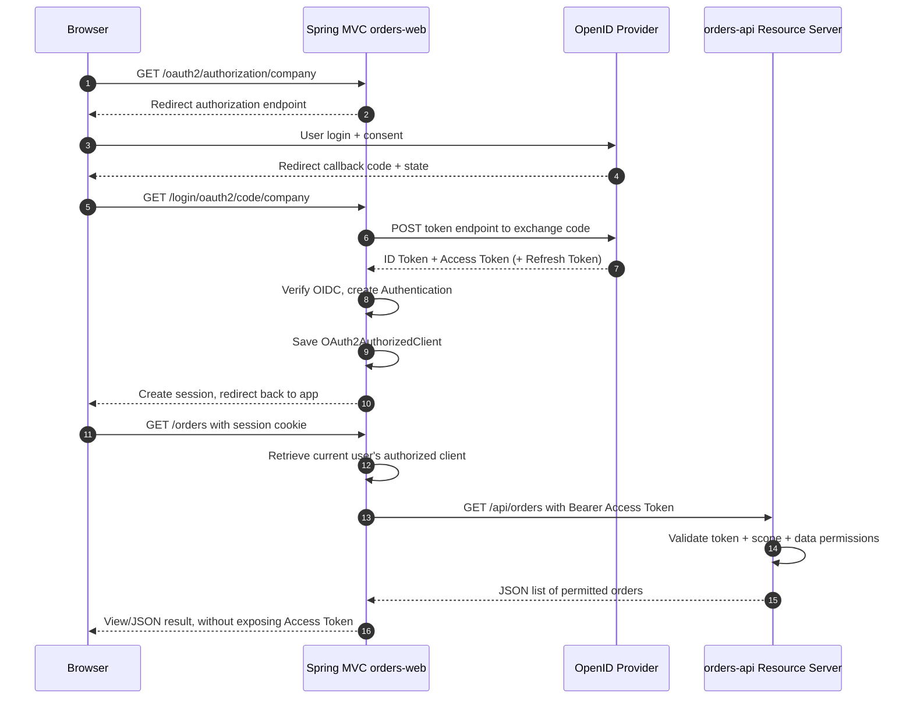
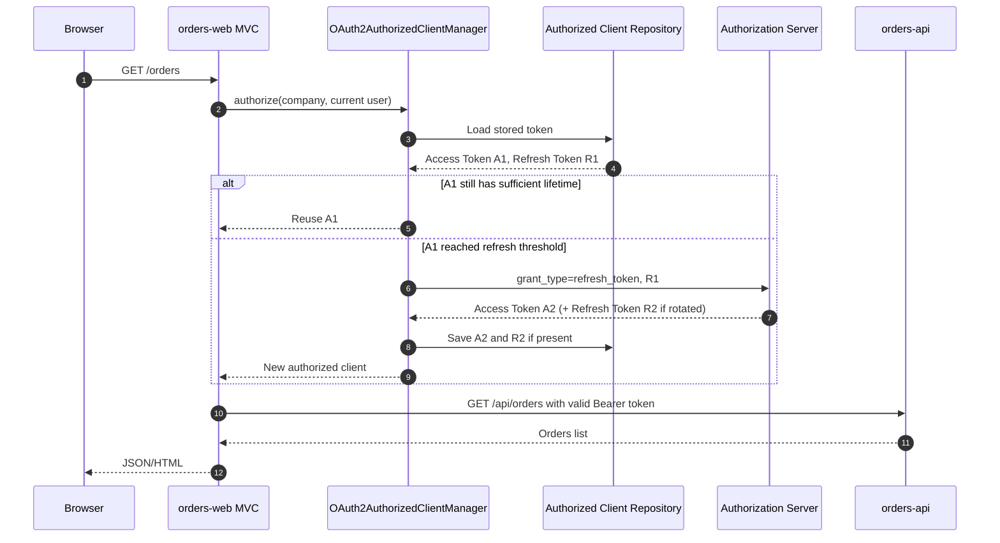
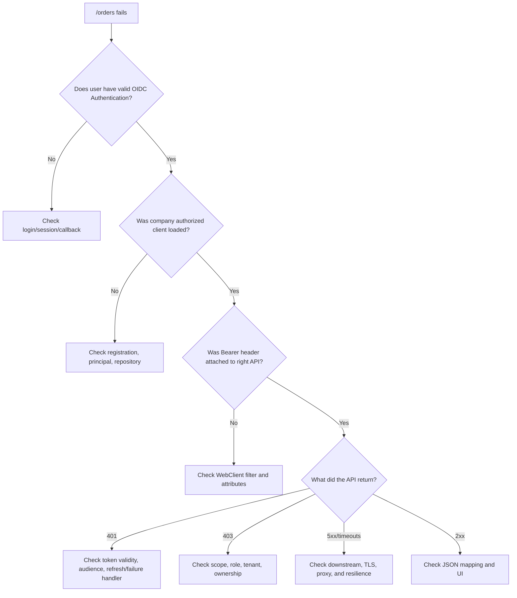

# 19.6. Calling APIs on Behalf of the User After `oauth2Login`

In a **Spring Security OAuth 2.0 / OpenID Connect (OIDC) Client** application, `oauth2Login()` enables users to sign in via an OpenID Provider (OP), receive an ID Token, verify identity, and establish an `Authentication` in `SecurityContext`. However, after a successful login, the application often needs to **call another REST API on behalf of the logged-in user**, such as reading orders, work calendars, or personal information protected by OAuth 2.0.

With **Spring MVC/Servlet** and **`WebClient`**, the right approach is neither taking the ID Token to use as a Bearer token nor arbitrarily copying the Access Token string into a session attribute. Spring Security provides the **`OAuth2AuthorizedClient`** model to bind Access Tokens and Refresh Tokens (if present) to a client registration and principal, along with **`ServletOAuth2AuthorizedClientExchangeFilterFunction`** to attach the Access Token to outbound `WebClient` requests.

This lesson walks through the entire path:

1. The user completes `oauth2Login()` in the browser.
2. Spring Security creates the OIDC principal and stores the corresponding `OAuth2AuthorizedClient`.
3. The controller/service retrieves **the authorized client for the current user**.
4. `WebClient` sends `Authorization: Bearer <access-token>` to **the API permitted to receive that token**.
5. When needed, the authorized client manager handles near-expiry/refresh of the Access Token per configuration.
6. The Resource Server validates the token, audience, scope, and permissions for each resource.

The overarching focus is **preserving the right user context, preventing token leakage to other hosts, and separating OIDC authentication from API authorization**.

## 1. The Problem: Login Succeeds, Yet Calling an API Is Still Required

Suppose an e-commerce system consists of:

- **Browser**: where employees open the application.
- **`orders-web`**: Spring Boot MVC application acting as the OAuth2/OIDC Client.
- **`company-idp`**: OpenID Provider/Authorization Server.
- **`orders-api`**: Resource Server exposing `GET /api/orders`, accepting only Access Tokens with the right audience/scope.

The user has already logged in at `orders-web`, yet the backend still needs to call `orders-api` to fetch the list of orders that user is authorized to access.



Key point: **the browser calls `orders-web` using a session cookie, whereas `orders-web` calls `orders-api` using an Access Token**. Two different credential types are used across the two hops.

In the backend-for-frontend (BFF) model, the browser never needs to read the Access Token from JavaScript to call the Resource Server; the backend holds the token and is responsible for constraining downstream destinations.

### 1.1. What Does “On Behalf of the User” Mean?

In OAuth 2.0, an Access Token can represent permissions granted by the Authorization Server within the context of **a user and a client**. The web application uses that token to access permitted resources.

Saying “on behalf of the user” does **not** mean the application is allowed to arbitrarily:

- Call every API just because the user is logged in.
- Use an ID Token instead of an Access Token.
- Fabricate a Bearer token string from `sub` or email.
- Use user A's Access Token to retrieve user B's data.
- Bypass tenant/ownership checks on the API.
- Use Client Credentials and swap `principalName` to a username to simulate delegation.

True authorization must be backed by a **valid Access Token, audience/scope/policy**, and Resource Server checks.

## 2. Distinguishing Four Objects in the Flow

| Object | When It Appears | What Is It Used For? |
|---|---|---|
| **`Authentication` / `OidcUser`** | After `oauth2Login()` succeeds | Identifies the current user in `orders-web`, along with session authorities and principal. |
| **`OidcIdToken`** | Issued by OP during OIDC login | Proves the authentication event and identity to the OIDC Client; contains `iss`, `sub`, `aud`, and claims. |
| **`OAuth2AuthorizedClient`** | After authorization/token exchange | Binds `ClientRegistration`, `principalName`, and Access/Refresh Tokens together. |
| **`OAuth2AccessToken`** | Inside the authorized client | Sent to the API per Bearer rules and granted permissions. |

Example of an authorized client:

```text
ClientRegistration:
  registrationId = company
  clientId       = orders-web
  provider       = company-idp

OAuth2AuthorizedClient:
  principalName  = employee-sub-2841
  accessToken    = <sensitive>
  refreshToken   = <sensitive or null>
  expiresAt      = 2026-11-16T10:05:00Z

Authentication:
  principal      = OidcUser employee-sub-2841
  authorities    = permissions mapped by the app
```

`principalName` helps **store and load the authorized client in the right user context**. Do not treat it as proof for the API to grant access: the Resource Server validates the request's Access Token rather than reading `principalName` inside the MVC application.

### 2.1. Why Not Use an ID Token as Bearer?

An ID Token is meant for the **OIDC Client** and normally has `aud` containing the web application's `client_id`, such as `orders-web`. The `orders-api` API may require an Access Token with an audience targeting the API.

Putting the ID Token into:

```http
Authorization: Bearer <id-token>
```

violates protocol roles for an API expecting an OAuth2 Access Token. The API may reject it; if an API mistakenly accepts an ID Token, that is also a token validation design flaw.

### 2.2. A Session Cookie Is Not an API Access Token

The browser sends `JSESSIONID` or another session cookie to `orders-web` so Spring Security restores `SecurityContext`. Downstream APIs do not inherently know about or trust that cookie.

Never forward session cookies to APIs to “reuse the login” unless a separate, securely designed session-sharing protocol exists. In an OAuth2 architecture, `orders-web` needs an Access Token issued for the API.

## 3. Prerequisite: Which API Is the Access Token Intended For?

Before writing a single line of `WebClient`, determine **whether the Authorization Server will issue a token capable of accessing `orders-api`**.

Key concepts:

- **Issuer**: the Authorization Server issuing the token and acting as the configured trust source.
- **Audience / resource**: the API or resource group the token targets; representation depends on provider and token format.
- **Scope**: granted API scope, such as `orders.read`.
- **Consent and client policy**: conditions under which the provider lets the client request scopes/resources.
- **Subject**: user identity in the Access Token if the token/profile includes it.
- **Resource Server policy**: granular access rules for tenant, ownership, order ID, and order status.

`openid profile email` are typically OIDC scopes. **They do not automatically grant `orders.read`**, nor do they guarantee the Access Token carries `orders-api`'s audience.

A client configuration can request additional scopes:

```yaml
spring:
  security:
    oauth2:
      client:
        registration:
          company:
            provider: company-oidc
            client-id: ${OIDC_CLIENT_ID}
            client-secret: ${OIDC_CLIENT_SECRET}
            client-authentication-method: client_secret_basic
            authorization-grant-type: authorization_code
            redirect-uri: "{baseUrl}/login/oauth2/code/{registrationId}"
            scope:
              - openid
              - profile
              - orders.read
        provider:
          company-oidc:
            issuer-uri: https://id.example.org/realms/company
```

This configures the **requested** scopes; the Authorization Server decides the actually granted scopes. If the API also requires a specific audience or resource indicator, the client registration and authorization request must be configured using the **mechanism supported by the provider**. A single `scope: orders.read` line does not guarantee the right audience.

### 3.1. When the Provider Only Issues Tokens for UserInfo

Some OPs issue Access Tokens suitable for calling **UserInfo** that cannot be used directly for business APIs. If `orders-api` rejects the token due to `aud` mismatch, never disable audience validation on the Resource Server.

Proper design options may include:

1. Registering the right API resource/audience when requesting authorization.
2. Requesting provider-permitted scopes and user consent when required.
3. Using token exchange/on-behalf-of grants if supported by the Authorization Server and required by the architecture.
4. Separating client registrations or flows for different resources when required by provider policy.

Not every Authorization Server supports the same audience or token exchange mechanism. Follow your provider's contract rather than copying an `audience` parameter into every OP assuming it is a universal standard.

### 3.2. Token Permissions Do Not Replace Object-Level Authorization

An Access Token carrying `orders.read` might still be restricted to reading orders in tenant A. `orders-api` must verify:

```text
valid token
AND scope includes orders.read
AND user/client has permission in the relevant tenant
AND order falls within what the subject is allowed to view
```

WebClient only attaches the Bearer token; it **does not decide** which orders are accessible. The final decision belongs to the Resource Server and business logic.

## 4. Dependencies for `WebClient` in a Servlet Application

A Spring Boot MVC application can use **`WebClient` from Spring WebFlux** as an HTTP client even though inbound requests are handled by the Servlet stack.

Gradle example:

```gradle
dependencies {
    implementation("org.springframework.boot:spring-boot-starter-web")
    implementation("org.springframework.boot:spring-boot-starter-security")
    implementation("org.springframework.boot:spring-boot-starter-oauth2-client")
    implementation("org.springframework.boot:spring-boot-starter-webflux")
}
```

In typical Spring Boot setups, when both Spring MVC and WebFlux are on the classpath, the web application continues using **Servlet/MVC** under the default web application type selection mechanism. `WebClient` is an HTTP client with a reactive API; **it does not mean the entire application switches to WebFlux Security**.

Distinguish clearly:

| Component | Servlet/MVC Side | Reactive/WebFlux Side |
|---|---|---|
| Inbound authentication | `SecurityFilterChain`, `HttpSecurity` | `SecurityWebFilterChain`, `ServerHttpSecurity` |
| OAuth2 client WebClient filter | `ServletOAuth2AuthorizedClientExchangeFilterFunction` | `ServerOAuth2AuthorizedClientExchangeFilterFunction` |
| Principal context | `SecurityContextHolder` and Servlet request context | Reactor Context and reactive security context |
| Authorized client store | Servlet repository/service | Reactive authorized client repository/service |

**Do not use `ServerOAuth2AuthorizedClientExchangeFilterFunction` just because the client is named `WebClient`.** This lesson covers WebClient **inside a Servlet application**, so use the appropriate servlet-specific filter function.

### 4.1. Basic Spring Security Web Configuration

```java
import org.springframework.context.annotation.Bean;
import org.springframework.context.annotation.Configuration;
import org.springframework.security.config.Customizer;
import org.springframework.security.config.annotation.web.builders.HttpSecurity;
import org.springframework.security.web.SecurityFilterChain;

@Configuration
public class SecurityConfiguration {

    @Bean
    SecurityFilterChain securityFilterChain(HttpSecurity http)
            throws Exception {

        http
            .authorizeHttpRequests(auth -> auth
                .requestMatchers("/", "/public/**").permitAll()
                .anyRequest().authenticated()
            )
            .oauth2Login(Customizer.withDefaults())
            .oauth2Client(Customizer.withDefaults());

        return http.build();
    }
}
```

- `oauth2Login()` handles the OIDC login flow.
- `oauth2Client()` integrates OAuth2 Client features for Servlet, including components that resolve authorized clients/annotations when properly configured.
- Requiring login does not mean every outbound WebClient call automatically sends an Access Token. You must configure the filter function or attach tokens in a controlled way.

This pattern fits modern Spring Security using the lambda DSL; exact APIs may vary by project version.

## 5. Key Component: `ServletOAuth2AuthorizedClientExchangeFilterFunction`

Spring Security provides `ServletOAuth2AuthorizedClientExchangeFilterFunction` to integrate OAuth2 authorized clients with outbound `WebClient` requests in a Servlet application.

The filter can:

- Identify the appropriate authorized client for the request.
- Use the Access Token from the authorized client to set `Authorization: Bearer ...`.
- Interact with `OAuth2AuthorizedClientManager` per configuration to handle near-expiry and token refresh.
- Coordinate with a failure handler to handle certain authorized client/token errors.
- Accept explicit selection via `WebClient.RequestHeadersSpec.attributes(...)`.

**Key point:** the filter function **does not** manufacture API permissions out of the web user's `Authentication`; it only uses tokens issued by the Authorization Server in the proper context. The Resource Server remains responsible for token validation and authorization.

### 5.1. Ways to Determine the Authorized Client for a Request

A `WebClient` request can select a token in several ways:

| Approach | Description | Level of Control |
|---|---|---|
| **Pass `OAuth2AuthorizedClient` directly in attributes** | Caller has already resolved the appropriate authorized client. | Clear, easy to audit destination/registration/user. |
| **Specify `clientRegistrationId`** | Filter/manager looks up authorized client by registration and principal/context. | Convenient; requires ensuring user context and repository match. |
| **Default OAuth2 authorized client** | Filter can use the current authentication's token if enabled. | Risks unintentionally attaching tokens to many requests. |
| **Default client registration ID** | Filter uses a default registration for requests that omit one. | Easy to leak tokens if WebClient calls multiple APIs/hosts. |

For APIs carrying user authority, **prefer explicit selection** so anyone reading the code can see which request carries which token.

## 6. Approach 1: Passing the Authorized Client Explicitly — Preferred for User APIs

This is a safe, clear pattern: the controller receives the authorized client for the registration after `oauth2Login()`, passes it to a service, and WebClient attaches the Bearer token only on **that specific request**.

### 6.1. Configuring the WebClient Bean with the OAuth2 Filter

```java
import org.springframework.context.annotation.Bean;
import org.springframework.context.annotation.Configuration;
import org.springframework.security.oauth2.client.registration.ClientRegistrationRepository;
import org.springframework.security.oauth2.client.web.OAuth2AuthorizedClientRepository;
import org.springframework.security.oauth2.client.web.reactive.function.client.ServletOAuth2AuthorizedClientExchangeFilterFunction;
import org.springframework.web.reactive.function.client.WebClient;

@Configuration
public class OrdersWebClientConfiguration {

    @Bean
    WebClient ordersWebClient(
            ClientRegistrationRepository registrations,
            OAuth2AuthorizedClientRepository authorizedClients) {

        ServletOAuth2AuthorizedClientExchangeFilterFunction oauth2 =
            new ServletOAuth2AuthorizedClientExchangeFilterFunction(
                registrations,
                authorizedClients
            );

        // Do not enable defaultOAuth2AuthorizedClient(true).
        return WebClient.builder()
            .baseUrl("https://api.orders.example.org")
            .apply(oauth2.oauth2Configuration())
            .build();
    }
}
```

Benefits of this configuration:

- Creates only the filter meant for **Servlet OAuth2 Client**.
- `baseUrl` points to a fixed, permitted API.
- Does not put an Access Token into WebClient's default header, since tokens vary by user/request.
- Does not enable automatic default token attachment on **every** outbound request.
- Callers decide the authorized client per request.

This example uses the `(ClientRegistrationRepository, OAuth2AuthorizedClientRepository)` constructor. Spring Security integrates an appropriate Servlet manager/repository; if the application needs a custom manager to configure refresh behavior, use the manager-based constructor and corresponding wiring as shown later.

### 6.2. API DTO

```java
public record OrderSummary(
    long id,
    String orderNumber,
    String status
) { }
```

The DTO contains only fields the frontend needs to display. Never include Access Tokens or Refresh Tokens in DTOs. Public Java types in these lesson examples should be placed in separate source files per Java rules when implemented.

### 6.3. Service Making the HTTP Request

```java
import java.util.List;

import org.springframework.core.ParameterizedTypeReference;
import org.springframework.security.oauth2.client.OAuth2AuthorizedClient;
import org.springframework.security.oauth2.client.web.reactive.function.client.ServletOAuth2AuthorizedClientExchangeFilterFunction;
import org.springframework.stereotype.Service;
import org.springframework.web.reactive.function.client.WebClient;
import reactor.core.publisher.Mono;

@Service
public class OrdersApiClient {

    private final WebClient ordersWebClient;

    public OrdersApiClient(WebClient ordersWebClient) {
        this.ordersWebClient = ordersWebClient;
    }

    public Mono<List<OrderSummary>> listOrders(
            OAuth2AuthorizedClient authorizedClient) {

        return ordersWebClient.get()
            .uri("/api/orders")
            .attributes(
                ServletOAuth2AuthorizedClientExchangeFilterFunction
                    .oauth2AuthorizedClient(authorizedClient)
            )
            .retrieve()
            .bodyToMono(
                new ParameterizedTypeReference<List<OrderSummary>>() { }
            );
    }
}
```

The decisive lines are:

```java
.attributes(
    ServletOAuth2AuthorizedClientExchangeFilterFunction
        .oauth2AuthorizedClient(authorizedClient)
)
```

They select a **specific authorized client** so the filter puts the Access Token into the outbound request. The token stays on the backend and is sent only on the call to the designated API.

**Never use `webClient.defaultHeader("Authorization", ...)` with a user's token**: `WebClient` is a bean shared across many requests and users, so attaching a token to global/default configuration risks cross-user credential exposure.

### 6.4. MVC Controller Receiving the Authorized Client

```java
import java.util.List;

import org.springframework.security.oauth2.client.OAuth2AuthorizedClient;
import org.springframework.security.oauth2.client.annotation.RegisteredOAuth2AuthorizedClient;
import org.springframework.web.bind.annotation.GetMapping;
import org.springframework.web.bind.annotation.RestController;
import reactor.core.publisher.Mono;

@RestController
public class OrdersController {

    private final OrdersApiClient ordersApi;

    public OrdersController(OrdersApiClient ordersApi) {
        this.ordersApi = ordersApi;
    }

    @GetMapping("/orders")
    public Mono<List<OrderSummary>> orders(
            @RegisteredOAuth2AuthorizedClient("company")
            OAuth2AuthorizedClient authorizedClient) {

        return ordersApi.listOrders(authorizedClient);
    }
}
```

`@RegisteredOAuth2AuthorizedClient("company")` lets the MVC argument resolver obtain the authorized client for the corresponding registration in the current request context, per Spring Security/OAuth2 Client wiring. Depending on how the manager and providers are configured, argument resolution can participate in authorizing/refreshing when needed.

Spring MVC supports certain reactive return types when the corresponding libraries are on the classpath. The example returns `Mono` to illustrate an asynchronous flow; calling `block()` is not mandatory.

**Security benefit:** the authorized client is resolved within the authenticated request and passed explicitly to WebClient, avoiding reading `SecurityContextHolder` again inside a reactive callback where threads may change.

### 6.5. Why Are Explicit Tokens Better Than Defaults?

Compare two calls:

```java
ordersWebClient.get()
    .uri("/api/orders")
    .attributes(oauth2AuthorizedClient(authorizedClient))
    .retrieve();
```

and:

```java
publicWebClient.get()
    .uri("https://news.example.net/public-feed")
    .retrieve();
```

Only the orders API request needs a Bearer token. If default OAuth2 tokens were enabled on a shared WebClient, the request fetching a public feed could accidentally carry the user's token to an unrelated host.

Create **dedicated WebClients per downstream API** and choose authorized clients explicitly whenever user permissions are required.

## 7. Approach 2: Specifying `clientRegistrationId` for the Request

The filter function also provides an attribute helper for the registration ID:

```java
import static org.springframework.security.oauth2.client.web.reactive.function.client.ServletOAuth2AuthorizedClientExchangeFilterFunction.clientRegistrationId;

Mono<String> response = ordersWebClient.get()
    .uri("/api/orders/summary")
    .attributes(clientRegistrationId("company"))
    .retrieve()
    .bodyToMono(String.class);
```

This approach requires **the manager to be able to resolve the right principal and authorized client store** in the current context. In a normal Servlet request, Spring Security can provide authentication/request context via the filter function's configuration; however, once leaving the Servlet thread or running in a job, never assume those ThreadLocal contexts still exist.

Unlike passing `OAuth2AuthorizedClient`, when only a registration ID is supplied, the filter/manager must **load/authorize** from the store itself. Behavior can therefore depend on:

- Which principal the authorized client was saved under.
- Configuration of `OAuth2AuthorizedClientRepository`/`OAuth2AuthorizedClientService`.
- Whether the provider chain supports refresh or authorization code.
- Whether the proper Servlet request/response and authentication context are present.
- Spring Security version and how the WebClient bean is wired.

For services needing strict isolation of user context, explicit authorized client selection is often easier to reason about.

### 7.1. Do Not Accept Registration ID as a Free Parameter from the Browser

Wrong:

```java
// Dangerous without validation: caller chooses client registration freely
String registrationId = request.getParameter("client");
```

If the application has multiple registrations with different permissions/APIs, a user could trigger tokens from a registration they are not allowed to use. Only permit registrations chosen by policy from an authenticated context.

## 8. Be Careful with `setDefaultOAuth2AuthorizedClient(true)`

Spring Security examples often show the option:

```java
oauth2.setDefaultOAuth2AuthorizedClient(true);
```

When enabled, the filter can use the authorized client tied to the current `OAuth2AuthenticationToken` for requests that do not explicitly specify a token. This is convenient, yet **dangerous if a single WebClient calls multiple hosts or endpoints**.

Imagine:

```text
One shared WebClient:
  GET https://api.orders.example.org/api/orders -> needs user's token
  GET https://status.example.net/health         -> needs no token
  GET https://external.example.com/data         -> different host
```

If default OAuth2 authorized client is enabled, a request without an explicit marker may carry an Access Token to an unintended destination. That is a **token exfiltration** risk.

### 8.1. Principles for Choosing Defaults

- **Prefer leaving default tokens disabled** on shared WebClients.
- Use `oauth2AuthorizedClient(authorizedClient)` on requests that actually need a token.
- You can create a WebClient dedicated to one fixed API, yet still manage redirects and destinations.
- If using `setDefaultClientRegistrationId(...)`, understand that every request without an explicit token may use the default registration.
- In multi-user systems, avoid any global state holding the latest Access Token.

A less surprising configuration is explicit per-request token selection, as shown in section 6.

### 8.2. `setDefaultClientRegistrationId` Does Not Mean the Current User's Token

Setting a default registration makes the filter select that registration when a request lacks specific details. However, picking the **right user's authorized client** still depends on principal/context and storage.

Never use a machine client's default registration as a substitute for a user's delegated Access Token, and do not treat a default registration as a scope/permission check.

## 9. Constructor Accepting `OAuth2AuthorizedClientManager`

If the application needs custom provider chains, refresh clock skew, or custom storage, you can construct `ServletOAuth2AuthorizedClientExchangeFilterFunction` from a configured manager:

```java
import org.springframework.context.annotation.Bean;
import org.springframework.context.annotation.Configuration;
import org.springframework.security.oauth2.client.OAuth2AuthorizedClientManager;
import org.springframework.security.oauth2.client.web.reactive.function.client.ServletOAuth2AuthorizedClientExchangeFilterFunction;
import org.springframework.web.reactive.function.client.WebClient;

@Configuration
public class ManagedOrdersWebClientConfiguration {

    @Bean
    WebClient managedOrdersWebClient(
            OAuth2AuthorizedClientManager authorizedClientManager) {

        ServletOAuth2AuthorizedClientExchangeFilterFunction oauth2 =
            new ServletOAuth2AuthorizedClientExchangeFilterFunction(
                authorizedClientManager
            );

        // With the manager constructor, consider setting an authorization
        // failure handler for supported token errors.
        return WebClient.builder()
            .baseUrl("https://api.orders.example.org")
            .apply(oauth2.oauth2Configuration())
            .build();
    }
}
```

Notes:

1. The manager must access **the same authorized client store** used during login.
2. In a Servlet context, `DefaultOAuth2AuthorizedClientManager` is typically paired with `OAuth2AuthorizedClientRepository`.
3. If refresh is needed, the provider chain must include `RefreshTokenOAuth2AuthorizedClientProvider` appropriately.
4. The manager constructor **should not be assumed to auto-configure all authorization failure handlers** like every other constructor. Check your Spring Security version and set a handler when needed.
5. Never declare multiple WebClient beans without qualifiers and expect dependency injection to always pick the right one.

### 9.1. Default Manager for Servlet vs. Service Manager for Jobs

| Manager | Suitable Context |
|---|---|
| `DefaultOAuth2AuthorizedClientManager` | Servlet request/response, using `OAuth2AuthorizedClientRepository`. |
| `AuthorizedClientServiceOAuth2AuthorizedClientManager` | Background jobs and service-to-service calls without Servlet requests, using `OAuth2AuthorizedClientService`. |

If a batch job must call an API on behalf of a user without a Servlet request, design formal delegation/token storage and offline access policies; never randomly reuse `SecurityContextHolder` from an earlier request.

## 10. Refreshing the Access Token Before Calling an API

After login, the Access Token may be nearing expiration by the time the user opens the orders page. If a Refresh Token was issued, the Spring Security authorized client manager/provider can **refresh** and save the new authorized client.



**Not every WebClient call refreshes automatically**: refreshing depends on the filter being configured with an appropriate manager, client registration, Access Token expiry, presence of a Refresh Token, and authorization context.

### 10.1. Configuring the Refresh Provider with Clock Skew

Example when manually creating a manager for Servlet:

```java
import java.time.Duration;

import org.springframework.context.annotation.Bean;
import org.springframework.context.annotation.Configuration;
import org.springframework.security.oauth2.client.AuthorizationCodeOAuth2AuthorizedClientProvider;
import org.springframework.security.oauth2.client.DefaultOAuth2AuthorizedClientManager;
import org.springframework.security.oauth2.client.DelegatingOAuth2AuthorizedClientProvider;
import org.springframework.security.oauth2.client.OAuth2AuthorizedClientManager;
import org.springframework.security.oauth2.client.OAuth2AuthorizedClientProvider;
import org.springframework.security.oauth2.client.RefreshTokenOAuth2AuthorizedClientProvider;
import org.springframework.security.oauth2.client.registration.ClientRegistrationRepository;
import org.springframework.security.oauth2.client.web.OAuth2AuthorizedClientRepository;

@Configuration
public class AuthorizedClientManagerConfiguration {

    @Bean
    OAuth2AuthorizedClientManager authorizedClientManager(
            ClientRegistrationRepository registrations,
            OAuth2AuthorizedClientRepository authorizedClients) {

        RefreshTokenOAuth2AuthorizedClientProvider refresh =
            new RefreshTokenOAuth2AuthorizedClientProvider();

        refresh.setClockSkew(Duration.ofSeconds(60));

        OAuth2AuthorizedClientProvider provider =
            new DelegatingOAuth2AuthorizedClientProvider(
                new AuthorizationCodeOAuth2AuthorizedClientProvider(),
                refresh
            );

        DefaultOAuth2AuthorizedClientManager manager =
            new DefaultOAuth2AuthorizedClientManager(
                registrations,
                authorizedClients
            );

        manager.setAuthorizedClientProvider(provider);
        return manager;
    }
}
```

`clockSkew=60s` means a token can be considered due for refresh **about 60 seconds before `expiresAt`** when the manager is invoked. It **does not create a background auto-refresh timer**, nor does it guarantee the provider will issue a new token if the Refresh Token was revoked/expired.

### 10.2. A Note on Explicit `OAuth2AuthorizedClient`

When passing an authorized client directly into a request, understand **the relationship between that attribute and the manager** in your Spring Security version. If a service holds onto an old authorized client object in a long-lived variable, it can fall out of sync with the newly saved token in the repository.

Safe practice:

- Resolve the authorized client per **current request and principal** through the appropriate resolver/manager.
- Never cache `OAuth2AuthorizedClient` in a singleton field across all users.
- Once a refresh returns a new token, do not keep attaching the old Access Token to subsequent requests.
- Check the failure handler and load/save policies for rotated tokens.

### 10.3. Refreshing a Token Does Not Extend the Session

Refresh Tokens belong to the OAuth2 authorized client lifecycle. HTTP sessions belong to the application's authentication lifecycle.

A user may still have an active session even after their Refresh Token was revoked; or their Access Token may have just refreshed while the app session is about to expire. Never rely on refresh outcomes to re-issue internal roles/permissions or extend an SSO session.

## 11. Handling 401/403 Errors from Downstream APIs

A WebClient call can fail even after a successful login. Categorize errors properly:

| HTTP Status | Common Meaning | Resolution |
|---|---|---|
| **401 Unauthorized** | Access Token invalid, expired, revoked, or missing credentials. | Verify token matches API, audience, expiry, failure handler, and refresh/reauthorization. |
| **403 Forbidden** | Token/identity valid but operation not permitted. | Check scope, permissions, tenant/ownership, and API policy. |
| **404 Not Found** | Resource does not exist; sometimes APIs mask unauthorized resources as 404. | Follow Resource Server contract; do not automatically infer login failure. |
| **429 Too Many Requests** | API rate limit hit. | Respect backoff and `Retry-After` when provided. |
| **5xx** | Downstream service error. | Apply timeouts, bounded retries, and circuit breakers where appropriate. |
| **Connection/TLS error** | No HTTP response received. | Check DNS, proxy, trust store, timeouts, and network; never disable TLS. |

### 11.1. `retrieve()` and WebClient Response Exceptions

With:

```java
webClient.get()
    .uri("/api/orders")
    .retrieve()
    .bodyToMono(String.class);
```

HTTP 4xx/5xx statuses by default throw `WebClientResponseException` when the publisher is subscribed. The controller/service layer should map errors to an appropriate application response, **never forwarding raw Access Tokens or sensitive downstream responses back to the browser**.

Policy example:

```text
orders-api 401:
  -> inspect rejected authorized client/token
  -> handle failure/reauthorization in a controlled manner
  -> browser receives re-authentication prompt if required by policy

orders-api 403:
  -> browser receives 403/insufficient permissions
  -> do not auto-refresh or switch grants to escalate privileges

orders-api 503:
  -> browser receives temporary service error
  -> retry only when request is suitable and bounded
```

### 11.2. Authorization Failure Handler

Spring Security provides handlers such as `RemoveAuthorizedClientOAuth2AuthorizationFailureHandler` to remove broken authorized clients in appropriate cases, allowing subsequent requests to reauthorize via supported flows.

Key points:

- Do not assume **every 401** deletes the token.
- Handling behavior depends on the HTTP OAuth2 error code, filter constructor, manager, and Spring Security version.
- If using the `ServletOAuth2AuthorizedClientExchangeFilterFunction(OAuth2AuthorizedClientManager)` constructor, evaluate configuring `setAuthorizationFailureHandler(...)` explicitly.
- Removing a local authorized client does not mean the token was revoked at the Authorization Server.
- For user-delegated tokens, reauthorization may require sending the user through a new browser flow.

Never write a handler like “401 => grab the app's shared Client Credentials token => retry” in place of the user's token. That changes identity/authority rather than handling expiration.

### 11.3. Retries Must Account for Idempotency

A call like:

```http
POST /api/orders/42/approve
Authorization: Bearer <user-access-token>
```

mutates data. If the downstream API returns 401/timeout, the application must not blindly retry infinitely without knowing whether the first request executed. You need idempotency mechanisms, retry bounds, and a clear API contract.

## 12. Servlet Context and Reactive WebClient: Common Pitfalls

`WebClient` has a reactive API, whereas MVC apps usually bind `SecurityContextHolder` and the Servlet request context to the **request thread's ThreadLocal**.

A request may flow like this:

```text
Servlet request thread
   -> Controller (@RegisteredOAuth2AuthorizedClient)
   -> Service creates Mono for WebClient
   -> Reactor/HTTP client subscribes, possibly on a different thread
   -> Response returns to controller/browser
```

If reactive callback code calls:

```java
SecurityContextHolder.getContext().getAuthentication()
```

on another thread, the authentication may be empty or unexpected unless context was formally propagated. Likewise, `RequestContextHolder` may be absent inside background jobs or asynchronous callbacks.

### 12.1. What Does Passing an Explicit Authorized Client Solve?

When the controller resolves the authorized client **within the authenticated HTTP request** and passes that object down to the service, the API-calling layer does not need to look up identity via ThreadLocal in a deferred callback.

```java
@GetMapping("/orders")
public Mono<List<OrderSummary>> orders(
        @RegisteredOAuth2AuthorizedClient("company")
        OAuth2AuthorizedClient client) {

    return ordersApi.listOrders(client);
}
```

The required data is passed explicitly. This is a clear advantage when using WebClient in a Servlet application.

However, **an authorized client object is not an unbounded capability**. The service layer must still ensure the caller is permitted to use that client and that the destination is the matching API.

### 12.2. Do Not Take a Principal from a User Request and Use It in a Job

A scheduled job has no browser `HttpServletRequest`. If the job needs Client Credentials, use `AuthorizedClientServiceOAuth2AuthorizedClientManager` with a technical principal.

If a job must continue acting on behalf of an absent user, there must be **formal offline/delegation permissions and token storage**, rather than keeping an old HTTP request's `Authentication` or Access Token in memory.

### 12.3. `block()` in MVC: Usable, Yet Know the Cost

For instance, a synchronous controller might call:

```java
List<OrderSummary> orders = ordersApi
    .listOrders(authorizedClient)
    .block();
```

On a normal Servlet/MVC request thread, blocking the publisher works, yet it **holds the thread waiting for I/O**, reducing resource efficiency under heavy load. Never call `block()` on a Reactor event-loop thread, as doing so can throw errors or stall the pipeline.

Options:

- Return `Mono` or a reactive type supported and properly configured in MVC.
- If the API controller must be synchronous, accept blocking while configuring timeouts, concurrency limits, and latency monitoring.
- Consider `RestClient` when the architecture is intentionally synchronous and WebClient adds no extra value.
- Avoid calling `subscribe()` and returning HTTP 200 before knowing whether the downstream call succeeded.

### 12.4. Do Not Call `subscribe()` to “Run in the Background” Inside a Controller

Mistake:

```java
ordersWebClient.get()
    .uri("/api/orders")
    .retrieve()
    .bodyToMono(String.class)
    .subscribe();

// Controller returns 200 before knowing whether the API succeeded.
```

Besides losing error/timeout management, calling `subscribe()` freely can break context/security lifecycles. Return the publisher to MVC or use structured asynchronous orchestration when background processing is genuinely required.

## 13. Protecting Access Tokens When Using WebClient

An Access Token is a **bearer credential**: any party holding it may be accepted by the Resource Server while the token remains valid and policy permits. Therefore, feeding tokens into WebClient must follow strict rules.

### 13.1. Send Only to Permitted Resources

Use a `WebClient` configured with a fixed base URL for the API the token was issued for:

```java
WebClient.builder()
    .baseUrl("https://api.orders.example.org")
    .apply(oauth2.oauth2Configuration())
    .build();
```

Avoid:

```java
// Unsafe if URL comes directly from untrusted input:
webClient.get()
    .uri(userProvidedAbsoluteUrl)
    .attributes(oauth2AuthorizedClient(authorizedClient))
    .retrieve();
```

An attacker can supply a URL pointing to a host they control and make the backend send the Bearer token there (**token exfiltration/SSRF**).

Even with `baseUrl` set, still guard against absolute URIs overriding the destination, redirects, DNS/proxies, and dynamic application endpoints.

### 13.2. Guarding HTTP Redirects

If a downstream server returns a 302 to another host, the HTTP client needs a redirect policy that **does not leak the Authorization header** to untrusted origins. Never treat redirects as a reason to send the same Access Token to any host.

If an API moves hosts, update endpoint configuration through deployment/allowlist processes rather than letting users enter a new URL at runtime and sending the token there.

### 13.3. HTTPS and TLS Verification

Use HTTPS, verify server certificates/hostnames, and configure the proper trust store. Never disable TLS verification when staging uses a private CA; configure the approved CA chain/trust material instead.

Tokens can be stolen or responses tampered with if WebClient sends Bearer credentials over unprotected connections.

### 13.4. Do Not Log Raw Requests/Responses Containing Credentials

Be careful with:

- Custom `ExchangeFilterFunction`s that log HTTP headers.
- Reactor Netty wiretap/debug logging.
- APM/distributed tracing capturing headers.
- Error handlers embedding the full request in exceptions.
- Proxy/gateway logging.

Never log `Authorization: Bearer ...`, Access Tokens/Refresh Tokens, ID Tokens, session cookies, authorization codes, or PKCE verifiers. Metrics may record host aliases, registration IDs, status codes, durations, and normalized error codes.

### 13.5. Do Not Put Tokens in URLs

Wrong:

```text
GET /api/orders?access_token=<bearer-token>
```

URLs can appear in logs, traces, history, and caches. Use the `Authorization` header per Bearer Token Usage.

## 14. Ensuring User A Never Uses User B's Token

Suppose two employees exist:

```text
User A:
  registrationId = company
  principalName = employee-A
  Access Token = token-A

User B:
  registrationId = company
  principalName = employee-B
  Access Token = token-B
```

`OAuth2AuthorizedClientRepository`/`OAuth2AuthorizedClientService` must preserve boundaries by **client registration and principal**. When the service calls an API on behalf of user A, it must use A's authorized client.

### 14.1. Never Store Tokens in a Singleton Field

Wrong:

```java
@Service
public class BadTokenCache {
    private String latestAccessToken;
}
```

A singleton bean serving multiple requests can have A's token overwritten by user B. If the service later reads `latestAccessToken`, the risk of calling the API under the wrong identity is obvious.

Use Spring Security's authorized client storage and pass authorized clients/tokens per request context. Never build a shared raw Access Token cache across users.

### 14.2. Never Look Up a Principal by User-Supplied Email

Wrong in principle:

```text
GET /orders?user=alice@example.org
    -> loadAuthorizedClient(company, "alice@example.org")
    -> use the found token
```

If the `user` parameter is unchecked, a caller can attempt to load someone else's token. The principal must come from the **verified `Authentication`**, not an untrusted query parameter.

### 14.3. Multi-Tenant Systems Still Require Tenant Checks

Even when the token belongs to the right user, the API may serve multiple tenants. A request:

```text
GET /api/tenants/beta/orders
Authorization: Bearer token-of-user-A
```

is valid only if user A is authorized to access tenant beta. The API must enforce membership/ownership checks; WebClient cannot prove tenant rights with a token alone.

## 15. Where Is the Authorized Client Stored After Login?

Spring Security has two related abstractions:

| Interface | Context | Purpose |
|---|---|---|
| `OAuth2AuthorizedClientRepository` | Servlet `HttpServletRequest`/`HttpServletResponse` and `Authentication` | Saves/loads authorized clients within web flows. |
| `OAuth2AuthorizedClientService` | `registrationId` and `principalName` | Saves/loads authorized clients independently of HTTP requests. |

Implementations include:

- `HttpSessionOAuth2AuthorizedClientRepository`.
- `AuthenticatedPrincipalOAuth2AuthorizedClientRepository`.
- `InMemoryOAuth2AuthorizedClientService`.
- `JdbcOAuth2AuthorizedClientService`.

Some systems use sessions, while others use databases or a repository delegating to a service. **The WebClient filter/manager must use the same storage strategy as login** to locate the user's authorized client.

### 15.1. Troubleshooting “Login Succeeded Yet No Token Found”

Possible causes:

- Login saved under registration `company-login`, while WebClient looks up `company`.
- Authorized client stored under a principal name different from the request's principal.
- WebClient uses a separate in-memory service rather than login's repository.
- HTTP session expired or request landed on a node without shared sessions.
- Provider did not grant permissions/tokens for the API the app expects.
- Controller runs outside the current authentication context.

Increasing clock skew will not fix an **authorized client not found** error. Investigate registration, principal, repository/service, and Servlet context first.

### 15.2. Database Persistence Does Not Recreate an HTTP Login Session

Having a Refresh Token stored in JDBC does not automatically authenticate the browser after a restart. `OAuth2AuthorizedClient` is the OAuth2 Client's token store; `SecurityContext`/HTTP session are separate data. Never treat a token remaining in the database as proof that the user is currently logged in.

### 15.3. An Active Session Does Not Guarantee the Access Token Is Still Valid

Conversely, a user can have a valid Spring Security session while their Access Token has expired. Before calling an API, use a manager/provider capable of refreshing or initiating a new authorization flow per policy.

## 16. When Should `@RegisteredOAuth2AuthorizedClient` Be Used?

An MVC controller can declare:

```java
@GetMapping("/orders")
public Mono<List<OrderSummary>> orders(
        @RegisteredOAuth2AuthorizedClient("company")
        OAuth2AuthorizedClient authorizedClient) {
    return ordersApi.listOrders(authorizedClient);
}
```

This pattern fits when:

- The endpoint is called by an authenticated user.
- The registration to use is known explicitly.
- The controller/service wants to use that user's own Access Token.
- The WebClient destination is fixed and permitted to receive the token.
- There is no complex dynamic delegation or tenant routing requirement.

If the controller only needs profile details, use `@AuthenticationPrincipal OidcUser`. If it needs to call a delegated API, use the authorized client; never manually read `OidcUser.getIdToken().getTokenValue()` and send it as Bearer.

### 16.1. Obtaining Both Identity and Token in the Same Endpoint

Illustrative example:

```java
@GetMapping("/orders/me")
public Mono<List<OrderSummary>> myOrders(
        @AuthenticationPrincipal OidcUser user,
        @RegisteredOAuth2AuthorizedClient("company")
        OAuth2AuthorizedClient authorizedClient) {

    // Can use user.getSubject() for internal auditing per policy.
    // Downstream API receives ACCESS TOKEN, not ID Token.
    return ordersApi.listOrders(authorizedClient);
}
```

Corresponding imports include `org.springframework.security.core.annotation.AuthenticationPrincipal` and `org.springframework.security.oauth2.core.oidc.user.OidcUser`.

Never pass `sub` from `OidcUser` as an API query parameter as authorization proof instead of a token. The Resource Server must rely on the verified token and its own policies.

### 16.2. When a Request Has No User Login

If a scheduler must call an API using Client Credentials, do not inject a user's `@RegisteredOAuth2AuthorizedClient` into a job lacking a Servlet request. Use a service-backed manager and a technical principal.

If business requirements call for **acting offline on behalf of a user**, design Refresh Token/delegation storage around consent, lifecycle, logout, and policy. Never copy a token from a controller request into a scheduler for indefinite reuse.

## 17. Calling Multiple Downstream APIs After Login

Suppose the application calls:

```text
orders-api: https://api.orders.example.org
billing-api: https://api.billing.example.org
profile-api: https://api.profile.example.org
```

Do not use a single global WebClient with `defaultOAuth2AuthorizedClient(true)` and send the same token to all three.

A clearer architecture:

1. Each API has a **dedicated WebClient** with a configured/allowlisted base URL.
2. Registrations and scopes/audiences match the permissions granted by the Authorization Server.
3. Only calls needing user delegation attach the user's authorized client.
4. If an API requires a different audience, use a valid token issuance/token exchange flow instead of blindly forwarding the same token.
5. Never let a service pick tokens from arbitrary registrations via free-form input.
6. Monitor errors by API alias, registration, and token policy.

### 17.1. Can One Authorization Be Used Across Multiple APIs?

Yes, if the Authorization Server and Resource Servers designed the token to access those resources. However, never **assume** an Access Token for API A is valid for API B.

Each Resource Server should check the audience/scopes relevant to it. If a token is rejected for audience mismatch, that is an authorization design policy issue to fix, not a WebClient bug.

### 17.2. Distinguishing User Tokens from Application Tokens

`orders-web` can simultaneously use:

- Delegated user tokens from `oauth2Login()` to read the logged-in user's orders.
- Client Credentials tokens to run report synchronization jobs.

Both types must have distinct registrations, principals, managers/stores, and API policies. Never use a high-privilege machine token to substitute for a missing/expired user token.

## 18. Configuring Timeouts and Resilience for WebClient

A downstream API may be slow or encounter network errors. Choose timeouts appropriate for MVC requirements rather than waiting indefinitely.

Reactor Netty example:

```java
import java.time.Duration;

import io.netty.channel.ChannelOption;
import reactor.netty.http.client.HttpClient;

import org.springframework.http.client.reactive.ReactorClientHttpConnector;
import org.springframework.web.reactive.function.client.WebClient;

HttpClient httpClient = HttpClient.create()
    .option(ChannelOption.CONNECT_TIMEOUT_MILLIS, 3000)
    .responseTimeout(Duration.ofSeconds(5));

WebClient webClient = WebClient.builder()
    .baseUrl("https://api.orders.example.org")
    .clientConnector(new ReactorClientHttpConnector(httpClient))
    .apply(oauth2.oauth2Configuration())
    .build();
```

This illustrates configuring network timeouts for WebClient; in a real bean configuration, `oauth2` is the filter function created earlier. **3 seconds / 5 seconds** are illustrative limits; measure API latency and product SLAs to pick proper values.

### 18.1. Timeouts vs. Access Token Expiry

- Connect timeout: waiting to establish the TCP/TLS connection.
- Response timeout: waiting for the HTTP response.
- Access Token expiry: lifetime of the credential issued by the Authorization Server.
- Refresh Token lifetime: lifetime of the credential used to request new tokens.

If an API returns 401 due to wrong audience, raising the response timeout does nothing. If the network is slow, raising clock skew will not help either. Diagnose the right failure type before tuning configuration.

### 18.2. Circuit Breakers and Retries

You can integrate concurrency limits, circuit breakers, or policy-driven retries when downstream APIs are unavailable. However:

- Never retry infinitely.
- Never auto-retry side-effecting POST/PUT calls without idempotency.
- Never send Access Tokens to an untrusted fallback host.
- Never swap a user token for a machine token just to retry.
- Never log Bearer headers through retry/debug filters.

## 19. Mapping API Responses to the Frontend Without Exposing Tokens

Once the Resource Server validates the token and returns JSON, the MVC backend can return a DTO to the browser.

Example:

```json
[
  {
    "id": 42,
    "orderNumber": "SO-2026-0042",
    "status": "APPROVED"
  },
  {
    "id": 43,
    "orderNumber": "SO-2026-0043",
    "status": "PENDING"
  }
]
```

The frontend only needs the permitted list. Never return:

```json
{
  "accessToken": "<access-token>",
  "refreshToken": "<refresh-token>",
  "orders": []
}
```

when the architecture requires the backend to retain credentials. Let the backend handle API calls and emit the minimal business result.

### 19.1. Do Not Blindly Trust Returned Data for Display

Even if the API is a trusted downstream service, text fields like `orderNumber`, `description`, or `customerName` still need proper encoding/escaping when rendered as HTML. OAuth2 token validation does not replace XSS protection or input validation.

### 19.2. Do Not Forward Full API Error Bodies to the Browser

Error bodies can contain internal request IDs, service topology, or sensitive details. The web layer should normalize errors into safe responses, keeping diagnostic details in controlled logs with tokens and raw headers stripped.

## 20. Proxies, Sessions, and Multiple Instances

In production, `orders-web` may run multiple replicas behind a load balancer:

```text
Browser -- HTTPS --> Load Balancer --> orders-web node A
                              \----> orders-web node B
                                      |
                                      v
                                   orders-api
```

If login completes on node A while the `/orders` request hits node B, ensure:

- Session/`SecurityContext` is shared or routed appropriately.
- Authorized client repository/service stores tokens readable by node B.
- Client registration/provider configs are consistent across nodes.
- Principal names are used consistently during load/save.
- TLS/forwarded headers are accurate so authorization redirect URIs stay valid.
- Token refresh rotation does not race across two nodes.

### 20.1. Refresh Race When Concurrent Requests Call the API

Suppose Access Token A1 is nearing expiry and Refresh Token R1 is in a shared store:

```text
Request X hits node A: loads A1/R1 -> needs refresh
Request Y hits node B: loads A1/R1 -> also needs refresh

Node A: exchanges R1 -> A2/R2
Node B: reuses R1 -> invalid_grant or token reuse detection
```

If the provider uses Refresh Token Rotation, a race can cause the token family to be revoked. Consider coordination/single-flight, optimistic locking, or distributed locking per authorized client key, persisting the new Access/Refresh Tokens atomically and re-reading the record after acquiring the lock.

**The WebClient filter does not automatically provide distributed refresh serialization.** That is the responsibility of the manager/storage architecture and provider policy in clustered deployments.

### 20.2. Clock Skew Avoids Cutting It Close, Not Concurrency

`RefreshTokenOAuth2AuthorizedClientProvider` can use `clockSkew` to consider an Access Token due for refresh ahead of `expiresAt`. Yet if multiple requests arrive concurrently, they can still all decide to refresh at once. Handling races requires coordination at the token storage/manager layer.

### 20.3. Session Timeout Does Not Mean Token Revocation

If a browser session expires while a Refresh Token remains in the DB, an unauthenticated browser must never be allowed to reload that user's token. HTTP authentication state and OAuth2 authorized clients are two separate objects.

## 21. Handling Logout and Permission Revocation

A user logs out of `orders-web`. Several things can happen:

- Local HTTP session is invalidated.
- `SecurityContext` is cleared.
- Local authorized client may be removed per application policy.
- OP SSO session may or may not end depending on OIDC logout integration.
- Issued Access/Refresh Tokens may or may not be revoked at the Authorization Server.

**Local logout does not automatically invalidate tokens across every API**. If the product requires immediate token revocation, implement revocation/cleanup aligned with provider capabilities.

### 21.1. Application Permissions Changing While a Session Still Exists

A user might lose `orders.read` or have their internal account locked after logging in. `OAuth2AuthorizedClient` may still hold an unexpired Access Token. APIs must check current policies or token revocation mechanisms by design.

Do not rely solely on authorities cached in a session hours earlier when authorizing sensitive orders. You may need fresh authorization lookups, short policy cache TTLs, or session invalidation.

### 21.2. An Access Token Can Be Rejected Before `expiresAt`

The Authorization Server or Resource Server may revoke a token, change policy, or detect risk. WebClient must handle 401/403 appropriately rather than treating the `expiresAt` timestamp as a guarantee the API will accept the token.

## 22. Troubleshooting: Login Succeeds Yet API Calls Fail

| Symptom | Causes to Consider | Resolution |
|---|---|---|
| `@RegisteredOAuth2AuthorizedClient` cannot find token | Wrong registration ID, unconfigured resolver/repository, principal mismatch, token not saved. | Check `oauth2Client()`, registration, repo, and user session. |
| WebClient does not attach Bearer header | Missing OAuth2 filter/attributes, or manager cannot find authorized client. | Check which WebClient bean is used and explicit attributes. |
| API returns 401 right after login | Access Token not meant for the API, wrong audience/issuer, missing header, or API does not trust provider. | Inspect API contract and Access Token validation. |
| API returns 403 | Insufficient scope/role/tenant/ownership. | Inspect Resource Server policy, not just login. |
| WebClient sends token to unrelated host | Default authorized client enabled, or uncontrolled dynamic URIs/redirects. | Disable defaults, split WebClients, allowlist destinations. |
| API request carries another user's token | Global token cache, wrong principal lookup, or shared state in service. | Use per-request/per-user authorized client; remove singleton token fields. |
| Token expired while session is alive | Manager did not refresh, no Refresh Token, or refresh disallowed. | Inspect provider chain, `expiresAt`, and failure handler. |
| `invalid_grant` on refresh | Refresh Token expired, revoked, rotated, or multi-node refresh race. | Clean up/re-login and resolve concurrency. |
| Fails only in multi-node setup | Non-distributed session/store, clock drift, token refresh race. | Check session sharing, authorized client persistence, and time sync. |
| Reactor callback sees no Authentication | Relying on `SecurityContextHolder` ThreadLocal on another thread. | Pass explicit authorized client or propagate context via standard mechanisms. |
| Controller returns 200 yet API call fails silently | Calling `subscribe()` without awaiting or returning the publisher. | Return `Mono` to MVC or manage async orchestration properly. |
| WebClient response fails to parse | API changed schema/Content-Type or incompatible DTO. | Inspect contract/mapping and sanitized error logs. |
| Login works yet second API is inaccessible | Token audience/scope only covers the first API. | Design authorization/token acquisition for the right resource. |
| 401 appears even though token is unexpired | Token revoked, wrong issuer/audience, or Resource Server policy. | Categorize the error instead of just raising clock skew. |
| Request hangs | Slow connection/proxy/downstream, missing timeouts. | Configure timeouts, limit concurrency, and monitor latency. |

### 22.1. Distinguishing Three Common Error Categories

**Login error:** Spring Security has not yet built a valid OIDC `Authentication`, usually involving callbacks, token exchange, ID Token validation, state/nonce, or sessions.

**Authorized client error:** the user logged in, yet the app cannot locate an Access Token for the right registration/principal, or refresh is rejected.

**Resource Server error:** WebClient sent the token, yet the API rejected it due to token validation, scope, audience, tenant, or business permissions.

These three categories lead to different fixes. Do not try to solve every case by forcing users to repeatedly log out and back in.

### 22.2. Investigation Workflow Without Leaking Tokens



Never print Access Tokens in production logs just to inspect `aud`/`scope`. When token inspection is needed for diagnostics, use properly authorized, data-protected tools and log only metadata sufficient to pinpoint the root cause.

## 23. Behavior Verification Scenarios

When integrating WebClient into a Servlet app, keep these scenarios in mind:

| Scenario | Expected Outcome |
|---|---|
| User A logged in, calls `/orders` | WebClient uses User A's Access Token. |
| User B logged in with same registration | Never uses A's token; results are authorized for B. |
| Unauthenticated browser | Redirected to login or receives 401 per endpoint policy; never borrows another user's token. |
| Valid ID Token yet token lacks API audience | Resource Server rejects; app does not disable audience validation. |
| Access Token still valid | Manager can reuse it; avoids unnecessary token endpoint calls. |
| Access Token in refresh window with Refresh Token | Manager/provider refreshes per config and saves new token. |
| Refresh Token revoked | Does not keep using stale token; handles reauthorization cleanly. |
| API returns 403 | Does not swap to a higher-privilege token. |
| API returns 429/503 | Retries/backs off per policy without logging tokens. |
| API redirects to unknown host | Token is not forwarded across untrusted redirects. |
| User passes absolute URL to proxy API | Never sends Bearer token to user-chosen host. |
| Multi-node with separate session stores | Surfaces inconsistent session/context errors. |
| Two nodes refresh concurrently | Design prevents token rotation races. |
| MVC returns Mono from WebClient | Response/error handled within lifecycle, not fire-and-forget. |
| Background job without Servlet request | Does not rely on ThreadLocal user context; uses purpose-built flow/manager. |
| User logs out then calls `/orders` again | Does not use tokens from an unauthenticated session. |
| Token revoked prior to expiry | API error handled; does not rely solely on `expiresAt`. |

These scenarios illustrate design expectations; automated tests and content QA are handled in separate module stages.

## 24. Anti-Patterns to Avoid

### 24.1. Putting a User Access Token in a Singleton WebClient's `defaultHeader`

```java
// WRONG if accessToken belongs to a specific user:
WebClient.builder()
    .defaultHeader("Authorization", "Bearer " + userAccessToken)
    .build();
```

WebClient is a shared bean; the token can leak to other requests/users. Select tokens per request via attributes/filter.

### 24.2. Enabling `defaultOAuth2AuthorizedClient(true)` on a Client Calling Any Host

This can automatically attach Bearer tokens to unrelated requests. Specify authorized clients explicitly and separate WebClients by downstream target.

### 24.3. Reading `OidcUser.getIdToken()` and Sending It to APIs

ID Tokens serve the OIDC Client, not Resource Server APIs. Use `OAuth2AuthorizedClient.getAccessToken()` via the filter/manager.

### 24.4. Treating Valid `Authentication` as Permission to View All Orders

APIs still need to check token audience/scope and tenant/resource limits. Never skip Resource Server authorization just because the web user logged in.

### 24.5. Fetching Tokens via a `user=...` Query Parameter

Without strong authorization this easily becomes cross-user token leakage. Caller identity must come from Spring Security's verified session/authentication.

### 24.6. Ignoring Refresh Policy

Grabbing an Access Token at login and caching it in a field until logout leads to 401 errors once it expires. Use the authorized client manager properly.

### 24.7. Calling `subscribe()` Arbitrarily in Controllers

Fire-and-forget drops downstream error handling and can lose context. Return `Mono` or manage async workflows cleanly.

### 24.8. Retrying Any Request After 401

Side-effecting POSTs need idempotency; 401 is not always expiry; retries must be conditional and bounded.

### 24.9. Mixing User Tokens and Machine Tokens

Never use a broad Client Credentials token to “rescue” a user-facing API call when a delegated token is missing. That alters identity/authorization and requires explicit design.

## 25. Reference Architecture

```text
                      Browser
                        |
                        | Cookie session
                        v
               Spring MVC Servlet App
                        |
              Spring Security oauth2Login()
                        |
       +----------------+-------------------+
       |                                    |
       v                                    v
  Authentication                        Authorized Client
  OidcUser (identity)                   Repository/Service
       |                                    |
       |                                    v
       |                           OAuth2AuthorizedClient
       |                           Access/Refresh Token
       |                                    |
       +----------------+-------------------+
                        |
                        v
                  Orders Controller
                        |
              @RegisteredOAuth2AuthorizedClient
                        |
                        v
                  OrdersApiClient
                        |
                        v
                    WebClient
           ServletOAuth2AuthorizedClient
             ExchangeFilterFunction
                        |
                        | Authorization: Bearer <access-token>
                        v
                orders-api Resource Server
                        |
              issuer / audience / scope
                 tenant / ownership
                        |
                        v
                 Response DTO / JSON
                        |
                        v
                       Browser
```

Boundaries to preserve:

- **OIDC login** verifies identity and establishes the web session.
- **Authorized client store/manager** manages tokens for the right client registration and principal.
- **WebClient filter** injects the Bearer token into designated outbound requests.
- **Resource Server** validates the token and decides access to resources.
- **Backend controller** returns appropriate business data to the browser without exposing tokens.

## 26. References

- [Spring Security Reference — OAuth 2.0 Login (Servlet)](https://docs.spring.io/spring-security/reference/servlet/oauth2/login/index.html)
- [Spring Security Reference — OAuth 2.0 Client (Servlet)](https://docs.spring.io/spring-security/reference/servlet/oauth2/client/index.html)
- [Spring Security Reference — OAuth 2.0 Client Core](https://docs.spring.io/spring-security/reference/servlet/oauth2/client/core.html)
- [Spring Security Reference — Authorized Clients](https://docs.spring.io/spring-security/reference/servlet/oauth2/client/authorized-clients.html)
- [Spring Security API — ServletOAuth2AuthorizedClientExchangeFilterFunction](https://docs.spring.io/spring-security/site/docs/current/api/org/springframework/security/oauth2/client/web/reactive/function/client/ServletOAuth2AuthorizedClientExchangeFilterFunction.html)
- [Spring Security API — RegisteredOAuth2AuthorizedClient](https://docs.spring.io/spring-security/site/docs/current/api/org/springframework/security/oauth2/client/annotation/RegisteredOAuth2AuthorizedClient.html)
- [Spring Security API — OAuth2AuthorizedClient](https://docs.spring.io/spring-security/site/docs/current/api/org/springframework/security/oauth2/client/OAuth2AuthorizedClient.html)
- [Spring Framework Reference — WebClient](https://docs.spring.io/spring-framework/reference/web/webflux-webclient.html)
- [OAuth 2.0 RFC 6749](https://www.rfc-editor.org/rfc/rfc6749)
- [OAuth 2.0 Bearer Token Usage — RFC 6750](https://www.rfc-editor.org/rfc/rfc6750)
- [OAuth 2.0 Security Best Current Practice — RFC 9700](https://www.rfc-editor.org/rfc/rfc9700)

**Conclusion:** calling APIs on behalf of a user after `oauth2Login()` in a Servlet application should rely on **the logged-in principal's own `OAuth2AuthorizedClient`**, use **`ServletOAuth2AuthorizedClientExchangeFilterFunction`** to attach the Access Token to **specific WebClient requests**, and let `OAuth2AuthorizedClientManager` manage the token lifecycle per configuration. Never use an ID Token as Bearer, never place tokens into a shared WebClient's default header, never send tokens to user-chosen hosts, and never treat a successful login as universal permission to access every API. Cleanly separating OIDC identity, authorized client storage, Resource Server authorization, and browser responses keeps API calls context-accurate, maintainable, and secure as you scale across users, APIs, and instances.
