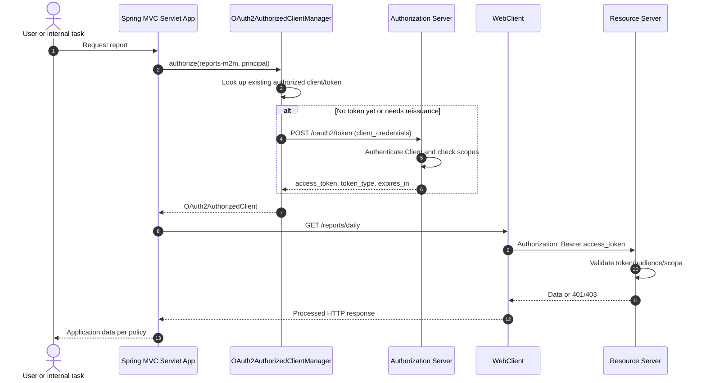
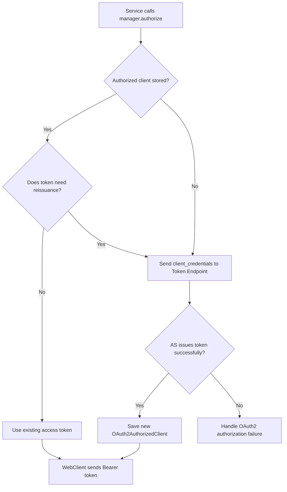

# 19.7. Calling APIs with Client Credentials in a Servlet Application

> **Module:** Spring Security OAuth 2.0 OIDC Client  
> **Chapter:** 19. WebClient on Servlet  
> **Scope:** Spring Boot/Spring Security Servlet (Spring MVC) using `WebClient` as an HTTP client to call a Resource Server with the **OAuth 2.0 Client Credentials Grant**, independent of user OIDC login.

A Spring Boot application exposing Servlet-style controllers can still use `WebClient` to call external HTTP services. When that service requires a bearer access token and the application needs to access it under **the application's own identity**, the standard model is the OAuth 2.0 **Client Credentials Grant**.

For example: an admin system has an API `GET /internal/reports/daily`; the reporting service must call `https://api.example.test/reports/daily`. The target API does not need to know which user opened the dashboard, yet it must verify that Client `reporting-worker` has been granted `reports.read` by the Authorization Server. The flow needs to:

1. Spring Security resolves the OAuth2 Client registration `reports-m2m`.
2. The OAuth2 Authorized Client Manager locates a stored token or requests one via `client_credentials`.
3. The Authorization Server authenticates the Client using the registered method and issues an access token for the permitted scopes.
4. `WebClient` sends an HTTP request to the Reports API with `Authorization: Bearer <access-token>`.
5. The Resource Server checks issuer, token validity, audience/scope, and its own policies before returning data.

A key highlight of this lesson is that **WebClient does not turn a Servlet application into a Reactive WebFlux server**. It is simply an HTTP client choice built on Reactor. The application can still use `SecurityFilterChain`, `HttpSecurity`, `@RestController`, and Spring MVC HTTP sessions. Likewise, Client Credentials **is not user OAuth2 Login**: it requires no browser, redirect URI, authorization code, ID token, or `OidcUser`.

This lesson presents two valid integration approaches for different contexts: (A) letting Spring Security's `ServletOAuth2AuthorizedClientExchangeFilterFunction` attach bearer tokens to `WebClient` inside HTTP requests; (B) using `AuthorizedClientServiceOAuth2AuthorizedClientManager` with a stable system principal for machine-to-machine APIs, including when no HTTP request exists.

---

## 1. Learning Objectives

After this lesson, you will be able to:

1. Explain why `WebClient` can be used inside a Spring MVC Servlet application.
2. Distinguish the Client Credentials Grant from browser-based OAuth2/OIDC Login.
3. Configure a `ClientRegistration` including `client-id`, `client-secret`, `authorization-grant-type: client_credentials`, `scope`, and `token-uri`.
4. Explain the roles of `OAuth2AuthorizedClientManager`, `OAuth2AuthorizedClientService`, and `OAuth2AuthorizedClientRepository`.
5. Build a `WebClient` integrated with `ServletOAuth2AuthorizedClientExchangeFilterFunction` when handling Servlet HTTP requests.
6. Specify the API call's registration with `clientRegistrationId(...)` instead of automatically sending the user's login token to every URL.
7. Use a service-backed manager and fixed principal key to avoid mixing machine tokens with web users' principals.
8. Call a Resource Server using `WebClient` with a Bearer token and handle 401/403 responses according to root cause.
9. Understand why Client Credentials typically **has no refresh token**, yet the manager can still request a new access token when needed.
10. Choose appropriate places to call `.block()` in Servlet MVC without blocking a Reactor event loop.
11. Distinguish token endpoint credentials from access tokens and session cookies.
12. Design timeouts, retries, caching, concurrency, tests, and secure logging for outbound API calls.
13. Recognize cases where a Resource Server requires provider-specific audience, scope, resource, or app roles.
14. Avoid pitfalls such as using a user's `OAuth2AuthenticationToken` as the basis for authorizing a machine client.

## 2. Architecture Overview

A Servlet backend often plays two distinct roles:

- **Web application:** receives requests from browsers/users and owns authentication/authorization for its own endpoints.
- **OAuth2 Client:** calls another API and authenticates as a Client with an Authorization Server to obtain the right access token.



The diagram does not require a browser user. A `@Scheduled` job can trigger `WebClient` as well. However, if a call is triggered by a user, **the application must still protect its own endpoints**; a Client Credentials token does not prove that the user accessing the endpoint is allowed to view all data from the API.

### 2.1. Three Security Boundaries

| Boundary | Mechanism | Who Checks? |
|---|---|---|
| Browser → Spring MVC | Session/OIDC Login, bearer token, or other auth method | Application's Spring Security |
| Spring MVC → Authorization Server | Client authentication, `client_credentials` grant | Authorization Server |
| Spring MVC → Resource Server | Bearer access token, scopes/audience, and API authorization | Resource Server |

A successful browser request at the first layer does not imply the Client is permitted to obtain machine-to-machine tokens. Conversely, a Client holding a valid token does not imply all users have permission to use that API.

## 3. How Does the Client Credentials Grant Work?

The Client Credentials Grant in OAuth 2.0 is designed for a Client authorized by the AS to act with **the Client's or workload's own authority**, rather than via an authorization code tied to a recently logged-in user.

Typical token request:

```http
POST /oauth2/token HTTP/1.1
Host: login.example.test
Authorization: Basic <redacted-client-credentials>
Content-Type: application/x-www-form-urlencoded

grant_type=client_credentials&scope=reports.read
```

Illustrative token response:

```json
{
  "access_token": "<redacted-access-token>",
  "token_type": "Bearer",
  "expires_in": 3600,
  "scope": "reports.read"
}
```

What can happen:

- The Authorization Server validates the Client ID and credentials against the registration.
- The Authorization Server grants only scopes/resources the Client is allowed to use.
- The access token carries an expiration or validity conditions per policy.
- The Resource Server validates the token when receiving an API request.
- When the token expires, the Client Credentials provider can **execute a new grant** to obtain a new token.

What does **not** happen by default as part of this grant:

- No OP login page for an end-user.
- No Authorization Code callback.
- No OIDC ID Token used to construct an `OidcUser`.
- No user `HttpSession` required.
- Typically no refresh token issued for this grant.
- Does not extend the login session of any user browsing the portal.

### 3.1. Client ID and Secret Differ from Bearer Access Token

| Credential | Where Used | Purpose |
|---|---|---|
| Client ID | Token Endpoint and registration | Identifies the Client |
| Client secret or private key | Token Endpoint | Authenticates the registered Client |
| Access token | Resource Server API | Lets the API evaluate the Client's permissions |
| HTTP session cookie | Browser ↔ web app | Maintains user session (if any) |
| OIDC ID Token | RP during OIDC Login | Verifies user identity |

Never send the Client secret to a Resource Server as a bearer token. Never use a machine client's access token to establish a user login session.

## 4. How Does WebClient on Servlet Differ from a WebFlux Server?

`WebClient` belongs to the Spring WebFlux ecosystem yet can be used as an **HTTP client inside a Spring MVC application**.

An application can simultaneously contain:

```java
@RestController
class ReportsController {
    @GetMapping("/reports")
    String reports() {
        // Servlet request thread calls a service using WebClient.
        return "...";
    }
}
```

and:

```java
WebClient webClient = WebClient.builder()
    .baseUrl("https://api.example.test")
    .build();
```

This does **not** mean:

- `HttpSecurity` becomes `ServerHttpSecurity`.
- Servlet's `SecurityContextHolder` becomes Reactor Context.
- `ClientRegistrationRepository` automatically turns into `ReactiveClientRegistrationRepository`.
- A Servlet `@RestController` is forced to return `Mono`/`Flux`.
- OAuth2 Client Credentials requires deploying a reactive server.

### 4.1. Two Types of OAuth2 WebClient Filter

| Context | Integration | Infrastructure |
|---|---|---|
| **Servlet/MVC** | `ServletOAuth2AuthorizedClientExchangeFilterFunction` | `OAuth2AuthorizedClientManager` using Servlet or service abstractions |
| **Reactive WebFlux** | `ServerOAuth2AuthorizedClientExchangeFilterFunction` | Reactive authorized client/registration abstractions |

This lesson uses the **Servlet** integration. Do not copy a Reactive `ServerOAuth2AuthorizedClientExchangeFilterFunction` snippet into MVC just because both use `WebClient`.

### 4.2. Should You Call `block()`?

`WebClient` returns `Mono<T>` or `Flux<T>`. In a synchronous MVC controller, if a service needs the result before returning a response, it can write:

```java
ReportSummary result = webClient.get()
    .uri("/reports/daily")
    .retrieve()
    .bodyToMono(ReportSummary.class)
    .block();
```

That is **blocking at the Servlet boundary**: the MVC request thread waits for the network response. This can fit when the system is already synchronous and has proper timeouts and pools. However:

- Never call `block()` inside a Reactor event loop or a reactive stream managed non-blockingly.
- Do not default to blocking in every service if the app already uses async composition.
- Configure timeouts and monitor latency so Servlet threads are not held too long.
- Never call `subscribe()` and return a result while side effects are still running without control mechanisms.

If the entire request path is designed reactively, preserve `Mono`/`Flux` instead of blocking.

## 5. Maven Dependencies in Spring Boot Servlet

Example Spring MVC web module using Spring Security OAuth2 Client and WebClient:

```xml
<dependencies>
    <dependency>
        <groupId>org.springframework.boot</groupId>
        <artifactId>spring-boot-starter-web</artifactId>
    </dependency>

    <dependency>
        <groupId>org.springframework.boot</groupId>
        <artifactId>spring-boot-starter-security</artifactId>
    </dependency>

    <dependency>
        <groupId>org.springframework.boot</groupId>
        <artifactId>spring-boot-starter-oauth2-client</artifactId>
    </dependency>

    <dependency>
        <groupId>org.springframework.boot</groupId>
        <artifactId>spring-boot-starter-webflux</artifactId>
    </dependency>
</dependencies>
```

In typical Spring Boot configurations containing both MVC and WebFlux starters, MVC is chosen as the web server stack while WebClient is available for making HTTP calls. Check your project's Spring Boot/framework version when selecting HTTP connectors and security settings.

In projects wanting minimal dependencies, you can include `spring-webflux` and a supported HTTP client connector instead of the full WebFlux starter; in that case, manage the related HTTP client components yourself.

### 5.1. Do Not Confuse Client Configuration with Resource Server

If an application only **calls APIs** using Client Credentials, it needs the OAuth2 Client starter. It does not necessarily need:

```text
spring-boot-starter-oauth2-resource-server
```

unless the application is also responsible for **receiving bearer access tokens and validating them** on inbound endpoints.

An application can be both an OAuth2 Client and a Resource Server, but inbound and outbound security must be configured separately.

## 6. `application.yml` for a Machine-to-Machine Client

Suppose the Authorization Server provides Token Endpoint `https://login.example.test/oauth2/token` and the Resource Server is `https://api.example.test`:

```yaml
spring:
  security:
    oauth2:
      client:
        registration:
          reports-m2m:
            provider: internal-as
            client-id: reporting-worker
            client-secret: ${REPORTING_CLIENT_SECRET}
            client-authentication-method: client_secret_basic
            authorization-grant-type: client_credentials
            scope:
              - reports.read

        provider:
          internal-as:
            token-uri: https://login.example.test/oauth2/token
```

Explanation:

| Property | Value | Meaning |
|---|---|---|
| `registration.reports-m2m` | `reports-m2m` | Internal registration ID selected by WebClient/manager |
| `provider` | `internal-as` | Links to the Token Endpoint provider |
| `client-id` | `reporting-worker` | Machine Client's ID at the AS |
| `client-secret` | Environment variable | Sensitive credential; never hard-code |
| `client-authentication-method` | `client_secret_basic` | Client authentication method at the Token Endpoint |
| `authorization-grant-type` | `client_credentials` | Machine-to-machine grant |
| `scope` | `reports.read` | Permissions the Client requests from the AS |
| `token-uri` | HTTPS URL | Token Endpoint for requesting access tokens |

**No `redirect-uri` or `scope: openid` is needed** in this Client Credentials registration. There is no interactive OIDC login in this grant.

### 6.1. Configuring Two Separate Resources

If the application must call both Reports and Inventory, consider separate registrations:

```yaml
spring:
  security:
    oauth2:
      client:
        registration:
          reports-m2m:
            provider: internal-as
            client-id: reporting-worker
            client-secret: ${REPORTING_CLIENT_SECRET}
            client-authentication-method: client_secret_basic
            authorization-grant-type: client_credentials
            scope: [reports.read]

          inventory-m2m:
            provider: internal-as
            client-id: inventory-worker
            client-secret: ${INVENTORY_CLIENT_SECRET}
            client-authentication-method: client_secret_basic
            authorization-grant-type: client_credentials
            scope: [inventory.read]

        provider:
          internal-as:
            token-uri: https://login.example.test/oauth2/token
```

Two registrations separate permissions and help avoid sending Reports tokens to Inventory. If the AS uses `resource` per RFC 8707 or a custom `audience` extension, the Token Endpoint request also needs the matching parameters — **specifying a scope in YAML does not guarantee the token carries the right audience**.

## 7. Registering the Client at the Authorization Server

Spring Boot properties describe only the **application-side** Client. The AS must also have a matching Client registration.

Example setup:

- Client ID `reporting-worker` exists at the AS.
- The Client is registered as a **confidential client** or uses a Client authentication mechanism accepted by the AS.
- The `client_credentials` grant is enabled for the Client.
- The token authentication method matches `client_secret_basic` (or the actual method).
- The Client is permitted to request scope `reports.read`.
- Issued access tokens carry the right Reports API audience/resource.
- Token lifetime and revocation policies are appropriate.
- The Resource Server trusts the issuer and enforces the right permissions.

If the AS does not allow `client_credentials`, editing YAML to add the grant **will not change the AS's policy**. An `unauthorized_client` error may occur.

### 7.1. Do Not Choose a Public Client for a Machine Grant Just to Avoid a Secret

In standard practice, the Client Credentials Grant relies on workload Client authentication. Never switch to `client-authentication-method: none` to “fix” `invalid_client` when the AS requires a confidential Client.

Instead of removing credentials, fix the Client ID, secret, or authentication method, or use an AS-supported option such as `private_key_jwt` or mutual TLS per security requirements.

## 8. Components Managing Authorized Clients

Spring Security provides several easily confused abstractions:

| Component | Role |
|---|---|
| `ClientRegistrationRepository` | Looks up Client configuration by registration ID |
| `OAuth2AuthorizedClient` | Client registration together with access token, optional refresh token, and principal name |
| `OAuth2AuthorizedClientRepository` | Saves/reads authorized clients with `HttpServletRequest`/`HttpServletResponse` in Servlet |
| `OAuth2AuthorizedClientService` | Saves/reads/removes authorized clients independently of HTTP requests |
| `OAuth2AuthorizedClientManager` | Coordinates authorize/reauthorize using grant providers and storage |
| `OAuth2AuthorizedClientProvider` | Executes enabled grants, e.g. `clientCredentials()` |
| `ServletOAuth2AuthorizedClientExchangeFilterFunction` | Attaches OAuth2 authorization to `WebClient` requests in Servlet integration |

### 8.1. Manager Is Not Storage

A manager can:

1. Look up a stored `OAuth2AuthorizedClient`.
2. Check whether the token is still eligible for use.
3. Call the Token Endpoint when reauthorization is needed.
4. Save the new authorized client via the success handler.
5. Return the authorized client to the caller.

A storage service/repository does not request tokens on its own when you simply call `loadAuthorizedClient(...)`.

### 8.2. Client Credentials Normally Does Not Use Refresh Tokens

When a machine-grant access token expires, the manager/provider normally executes a **new Client Credentials Grant**:

```text
grant_type=client_credentials
```

rather than:

```text
grant_type=refresh_token
```

for standard Client Credentials token responses. Never assume `OAuth2AuthorizedClient.getRefreshToken()` will be non-null.

## 9. Approach A — WebClient Filter Integrated with Servlet Requests

When a Spring MVC controller or service runs **inside an HTTP request**, you can configure `ServletOAuth2AuthorizedClientExchangeFilterFunction` with `DefaultOAuth2AuthorizedClientManager`. This manager interacts with `OAuth2AuthorizedClientRepository` and the Servlet context.

Flow:

```text
MVC request
  -> Service using WebClient
     -> ServletOAuth2AuthorizedClientExchangeFilterFunction
        -> DefaultOAuth2AuthorizedClientManager
           -> ClientRegistrationRepository
           -> OAuth2AuthorizedClientRepository (HTTP context)
           -> OAuth2AuthorizedClientProvider.clientCredentials()
              -> Token Endpoint if needed
     -> WebClient sends Bearer token to API
```

This approach is useful when the authorized client needs to tie into the HTTP context or the application already uses a suitably designed web repository.

### 9.1. Creating `DefaultOAuth2AuthorizedClientManager`

```java
package example.security;

import org.springframework.context.annotation.Bean;
import org.springframework.context.annotation.Configuration;
import org.springframework.security.oauth2.client.OAuth2AuthorizedClientManager;
import org.springframework.security.oauth2.client.OAuth2AuthorizedClientProvider;
import org.springframework.security.oauth2.client.OAuth2AuthorizedClientProviderBuilder;
import org.springframework.security.oauth2.client.registration.ClientRegistrationRepository;
import org.springframework.security.oauth2.client.web.DefaultOAuth2AuthorizedClientManager;
import org.springframework.security.oauth2.client.web.OAuth2AuthorizedClientRepository;

@Configuration
public class ServletMachineClientConfiguration {

    @Bean("servletMachineClientManager")
    OAuth2AuthorizedClientManager servletMachineClientManager(
            ClientRegistrationRepository registrations,
            OAuth2AuthorizedClientRepository authorizedClients) {

        OAuth2AuthorizedClientProvider provider =
            OAuth2AuthorizedClientProviderBuilder.builder()
                .clientCredentials()
                .build();

        DefaultOAuth2AuthorizedClientManager manager =
            new DefaultOAuth2AuthorizedClientManager(
                registrations,
                authorizedClients
            );

        manager.setAuthorizedClientProvider(provider);
        return manager;
    }
}
```

Key points:

- `DefaultOAuth2AuthorizedClientManager` fits the **Servlet request context**.
- It uses the repository requiring request/response per the active mechanism.
- The `clientCredentials()` provider is enabled explicitly.
- The client registration determines the Token Endpoint and Client authentication.
- The user's session/AuthN is never treated as **proof of the machine client's permissions**.

### 9.2. Wiring the Manager into `ServletOAuth2AuthorizedClientExchangeFilterFunction`

```java
package example.security;

import org.springframework.beans.factory.annotation.Qualifier;
import org.springframework.context.annotation.Bean;
import org.springframework.context.annotation.Configuration;
import org.springframework.security.oauth2.client.OAuth2AuthorizedClientManager;
import org.springframework.security.oauth2.client.web.reactive.function.client.ServletOAuth2AuthorizedClientExchangeFilterFunction;
import org.springframework.web.reactive.function.client.WebClient;

@Configuration
class ServletWebClientConfiguration {

    @Bean("reportsServletWebClient")
    WebClient reportsServletWebClient(
            @Qualifier("servletMachineClientManager")
            OAuth2AuthorizedClientManager manager) {

        ServletOAuth2AuthorizedClientExchangeFilterFunction oauth2 =
            new ServletOAuth2AuthorizedClientExchangeFilterFunction(
                manager
            );

        return WebClient.builder()
            .baseUrl("https://api.example.test")
            .apply(oauth2.oauth2Configuration())
            .build();
    }
}
```

`oauth2.oauth2Configuration()` attaches the OAuth2 `ExchangeFilterFunction` and related configuration to `WebClient.Builder`. There is no need to manually build `Authorization: Basic ...` for the API; Basic Client credentials are used in the token request per `ClientRegistration`, whereas the API receives a Bearer access token.

**Do not set a global default OAuth2 Client for every outbound URL** unless every request targets the exact trusted Resource Server with matching permissions. Avoid accidentally sending tokens to untrusted URLs.

### 9.3. Explicitly Specifying the Registration Per Request

In the service:

```java
package example.reports;

import org.springframework.beans.factory.annotation.Qualifier;
import org.springframework.stereotype.Service;
import org.springframework.web.reactive.function.client.WebClient;

import static org.springframework.security.oauth2.client.web.reactive.function.client.ServletOAuth2AuthorizedClientExchangeFilterFunction.clientRegistrationId;

@Service
public class ServletReportsClient {

    private final WebClient reportsWebClient;

    public ServletReportsClient(
            @Qualifier("reportsServletWebClient")
            WebClient reportsWebClient) {
        this.reportsWebClient = reportsWebClient;
    }

    public String loadDailyReport() {
        return reportsWebClient.get()
            .uri("/reports/daily")
            .attributes(clientRegistrationId("reports-m2m"))
            .retrieve()
            .bodyToMono(String.class)
            .block();
    }
}
```

The critical line:

```java
.attributes(clientRegistrationId("reports-m2m"))
```

tells the OAuth2 filter: authorize **registration `reports-m2m`** for this request. This is the registration ID in `application.yml`, not the OAuth2 `client-id` at the AS.

Do not put the target API name into `clientRegistrationId`; if the base URL is `https://api.example.test` while the registration ID is `reports-m2m`, you must pass `reports-m2m`.

### 9.4. Limitations of the Servlet Repository Approach

`ServletOAuth2AuthorizedClientExchangeFilterFunction` can use Servlet request, response, and Authentication information to authorize. During an HTTP request with a logged-in user, the manager/repository may store the authorized client under **the visiting user's principal name** depending on configuration.

This **does not turn Client Credentials into a delegated user token**. The access token still represents the Client/service; the principal name may simply serve as the **storage key for the authorized client**.

Notable consequences:

- Multiple users can cause the service to store duplicate authorized client records for the same Client Credentials registration.
- With an HTTP-session repository, machine-to-machine tokens may be stored unnecessarily per session.
- If the business logic only needs one shared machine credential, you may prefer **one stable logical principal** rather than per-web-session principals.
- If invoked from a `@Scheduled` job, do not expect a Servlet request for this style of filter/manager to work properly.

In frequent machine-to-machine systems, consider Approach B to cleanly separate token storage from web users.

## 10. Approach B — A Manager Independent of HTTP Requests

For the requirement “Servlet application calling an API with Client Credentials” where **the token belongs to a shared workload**, or both endpoints and scheduled jobs call the same API, the clear approach is using `AuthorizedClientServiceOAuth2AuthorizedClientManager`.

This manager works with:

- `ClientRegistrationRepository`;
- `OAuth2AuthorizedClientService`;
- `OAuth2AuthorizedClientProvider.clientCredentials()`.

It needs no `HttpServletRequest`, `HttpServletResponse`, or browser Authentication. The application chooses a **fixed workload principal key** to store the token, such as `"reports-service"`.

### 10.1. Creating the Service-Backed Manager

```java
package example.security;

import org.springframework.context.annotation.Bean;
import org.springframework.context.annotation.Configuration;
import org.springframework.security.oauth2.client.AuthorizedClientServiceOAuth2AuthorizedClientManager;
import org.springframework.security.oauth2.client.OAuth2AuthorizedClientManager;
import org.springframework.security.oauth2.client.OAuth2AuthorizedClientProvider;
import org.springframework.security.oauth2.client.OAuth2AuthorizedClientProviderBuilder;
import org.springframework.security.oauth2.client.OAuth2AuthorizedClientService;
import org.springframework.security.oauth2.client.registration.ClientRegistrationRepository;

@Configuration
public class MachineAuthorizedClientConfiguration {

    @Bean("machineAuthorizedClientManager")
    OAuth2AuthorizedClientManager machineAuthorizedClientManager(
            ClientRegistrationRepository registrations,
            OAuth2AuthorizedClientService authorizedClientService) {

        OAuth2AuthorizedClientProvider provider =
            OAuth2AuthorizedClientProviderBuilder.builder()
                .clientCredentials()
                .build();

        AuthorizedClientServiceOAuth2AuthorizedClientManager manager =
            new AuthorizedClientServiceOAuth2AuthorizedClientManager(
                registrations,
                authorizedClientService
            );

        manager.setAuthorizedClientProvider(provider);
        return manager;
    }
}
```

If the application has both a Servlet manager and a background manager, use distinct bean names and `@Qualifier`. Never declare two beans with the same name in one context.

### 10.2. Creating a Service That Acquires the Authorized Client with a Machine Principal

```java
package example.reports;

import org.springframework.beans.factory.annotation.Qualifier;
import org.springframework.security.oauth2.client.OAuth2AuthorizeRequest;
import org.springframework.security.oauth2.client.OAuth2AuthorizedClient;
import org.springframework.security.oauth2.client.OAuth2AuthorizedClientManager;
import org.springframework.stereotype.Service;

@Service
public class MachineAuthorizationService {

    private final OAuth2AuthorizedClientManager manager;

    public MachineAuthorizationService(
            @Qualifier("machineAuthorizedClientManager")
            OAuth2AuthorizedClientManager manager) {
        this.manager = manager;
    }

    public OAuth2AuthorizedClient authorizeReports() {
        OAuth2AuthorizeRequest request =
            OAuth2AuthorizeRequest
                .withClientRegistrationId("reports-m2m")
                .principal("reports-service")
                .build();

        OAuth2AuthorizedClient client = manager.authorize(request);

        if (client == null) {
            throw new IllegalStateException(
                "Cannot authorize Client Credentials for reports-m2m"
            );
        }

        return client;
    }
}
```

`"reports-service"` is a **token storage key**, not a logged-in user. Reusing the same principal key across requests/jobs allows the manager to find the existing authorized client and reuse a still-valid access token.

### 10.3. Attaching the Token to WebClient

A transparent example setting the bearer token in a service:

```java
package example.reports;

import java.time.Duration;

import org.springframework.beans.factory.annotation.Qualifier;
import org.springframework.stereotype.Service;
import org.springframework.web.reactive.function.client.WebClient;

@Service
public class ReportsApiClient {

    private final MachineAuthorizationService authorization;
    private final WebClient webClient;

    public ReportsApiClient(
            MachineAuthorizationService authorization,
            @Qualifier("reportsApiWebClient") WebClient webClient) {
        this.authorization = authorization;
        this.webClient = webClient;
    }

    public String fetchDailyReport() {
        var authorizedClient = authorization.authorizeReports();

        return webClient.get()
            .uri("/reports/daily")
            .headers(headers -> headers.setBearerAuth(
                authorizedClient.getAccessToken().getTokenValue()
            ))
            .retrieve()
            .bodyToMono(String.class)
            .timeout(Duration.ofSeconds(5))
            .block();
    }
}
```

Plain WebClient bean:

```java
import org.springframework.context.annotation.Bean;
import org.springframework.context.annotation.Configuration;
import org.springframework.web.reactive.function.client.WebClient;

@Configuration
class ReportsApiHttpConfiguration {

    @Bean("reportsApiWebClient")
    WebClient reportsApiWebClient(WebClient.Builder builder) {
        return builder
            .baseUrl("https://api.example.test")
            .build();
    }
}
```

In this approach:

- The manager handles the Client Credentials grant and token storage.
- `WebClient` sends the access token to the right API when requested by the service.
- There is no dependency on an active HTTP session.
- The exact same service can be called from an MVC controller or a scheduled job.
- A stable principal name enables token reuse within a JVM or shared store.

**Trade-off:** this code injects the Bearer token manually. You must restrict WebClient to trusted endpoints and avoid exposing tokens during logging/retries. When your version offers a matching OAuth2-aware WebClient filter, you can wire the service-backed manager directly so the filter authorizes and attaches the token; the manual pattern here clarifies the boundary.

### 10.4. Can the Servlet Filter Be Used with a Service-Backed Manager?

Yes. `ServletOAuth2AuthorizedClientExchangeFilterFunction` accepts an `OAuth2AuthorizedClientManager` in its constructor, so you can pass a service-backed manager if you want to use the filter on the HTTP client.

However, **you must control the principal/authorized-client context** the filter passes to the manager. If it defaults to the web request's Authentication, you may still create authorized clients per user rather than per workload, even though the manager itself does not depend on Servlet requests. Thus, for shared machine tokens and background jobs, calling `authorize(...).principal("reports-service")` explicitly is clear and predictable.

Never fabricate an `"admin"` `Authentication` and put it into `SecurityContext` just to obtain a machine token. Keep machine identities separate and do not corrupt the meaning of web principals.

## 11. Why Choose a Service-Backed Manager for Shared Workloads?

Comparison:

| Scenario | Servlet Manager + WebClient Filter | Service-Backed Manager + Fixed Principal |
|---|---|---|
| MVC request with Authentication | Suitable | Suitable |
| `@Scheduled` job with no HTTP request | Not the typical choice | **Suitable** |
| Token needs to tie to session/user in web request | Can fit | Needs explicit user principal design |
| Token truly belongs to the application | Must avoid unnecessary per-user storage | **Clearer** |
| WebClient auto-injects Bearer token | Yes, via filter | Can inject manually or wire filter with controlled context |
| Sharing token between requests and jobs | Depends on web repository | Can share the service store |
| Single-instance in-memory cache | Depends on storage | Yes, with in-memory service and stable principal |
| Multiple nodes | Needs proper storage/coordination | Needs JDBC/shared storage and concurrency policy |

“Cleaner” code is not the only priority. Pick the design that reflects **who owns the authorization** and what HTTP context exists when calling the manager.

## 12. Connecting an MVC Controller to ReportsApiClient

A simple Spring MVC controller:

```java
package example.reports;

import org.springframework.web.bind.annotation.GetMapping;
import org.springframework.web.bind.annotation.RestController;

@RestController
class ReportsController {

    private final ReportsApiClient reports;

    ReportsController(ReportsApiClient reports) {
        this.reports = reports;
    }

    @GetMapping("/internal/reports/daily")
    String daily() {
        return reports.fetchDailyReport();
    }
}
```

This controller **does not protect** the endpoint on its own. The application needs a `SecurityFilterChain` specifying who may access the report-reading feature. Because the backend calls the API with machine-to-machine credentials, leaving the inbound endpoint open to everyone lets unauthorized callers indirectly invoke the API using a privileged token.

Example HTTP security for an application with its own authentication:

```java
import org.springframework.context.annotation.Bean;
import org.springframework.context.annotation.Configuration;
import org.springframework.security.config.annotation.web.builders.HttpSecurity;
import org.springframework.security.web.SecurityFilterChain;

@Configuration
class WebAccessPolicy {

    @Bean
    SecurityFilterChain webSecurityChain(HttpSecurity http)
            throws Exception {

        return http
            .authorizeHttpRequests(auth -> auth
                .requestMatchers("/public/**").permitAll()
                .requestMatchers("/internal/reports/**")
                    .hasAuthority("REPORT_VIEWER")
                .anyRequest().authenticated()
            )
            .build();
    }
}
```

This access policy example is **illustrative** and omits how a user acquires the `REPORT_VIEWER` authority. In an app with OIDC Login, add `.oauth2Login(Customizer.withDefaults())` and map authorities from trusted sources. If the product accepts inbound JWT bearer tokens, configure `oauth2ResourceServer(...)` appropriately.

**Never grant `REPORT_VIEWER` to everyone just because the machine Client was granted `reports.read` by the AS.** Those are two separate permission levels across two different boundaries.

## 13. Scheduled Job Sharing WebClient and Machine Token

The same `ReportsApiClient` can be invoked from a scheduler:

```java
package example.reports;

import org.springframework.scheduling.annotation.Scheduled;
import org.springframework.stereotype.Component;

@Component
class DailyReportSyncJob {

    private final ReportsApiClient reportsApi;

    DailyReportSyncJob(ReportsApiClient reportsApi) {
        this.reportsApi = reportsApi;
    }

    @Scheduled(cron = "0 0 2 * * *", zone = "UTC")
    void syncReports() {
        String report = reportsApi.fetchDailyReport();

        // Process data after receiving the report.
        // Never write access tokens or client secrets to logs.
    }
}
```

To enable scheduling:

```java
import org.springframework.boot.autoconfigure.SpringBootApplication;
import org.springframework.boot.SpringApplication;
import org.springframework.scheduling.annotation.EnableScheduling;

@SpringBootApplication
@EnableScheduling
public class Application {

    public static void main(String[] args) {
        SpringApplication.run(Application.class, args);
    }
}
```

Strength of the service-backed approach: `authorizeReports()` requires no session or user Authentication. There is no need to fake a Servlet request or rely on `SecurityContextHolder` inside a scheduler.

### 13.1. An Easy Mistake

Do not write:

```java
String principalName =
    SecurityContextHolder.getContext()
        .getAuthentication()
        .getName();  // May be null inside @Scheduled.
```

When a job uses `client_credentials`, the principal key must describe the workload, not originate from an end user.

## 14. Expired Access Token: Does the Manager Handle It Automatically?

When using `OAuth2AuthorizedClientManager` with the `clientCredentials()` provider, the manager can:

1. Load the stored authorized client by registration ID and principal.
2. If the access token is still usable per provider logic, reuse it.
3. If missing or requiring renewal, call the Token Endpoint via the Client Credentials Grant.
4. Save the new authorized client if a success handler/storage is configured.
5. Return the authorized client to the caller.

This is **reauthorization via `client_credentials`**, not necessarily the Refresh Token Grant.



**Do not** spin up your own job refreshing tokens every few seconds just to dodge access token expiry when the manager already reuses and re-issues tokens on demand. Factor in token TTL policies, concurrency, and token request volume.

### 14.1. Never Assume Every Access Token Has a Refresh Token

With Client Credentials, responses usually contain `access_token`, `token_type`, and `expires_in`; refresh tokens are typically omitted. You can inspect:

```java
OAuth2AuthorizedClient authorized = ...;
boolean hasRefreshToken = authorized.getRefreshToken() != null;
```

However, this is only for diagnostics; for a machine grant API, never try to invoke a refresh grant when the AS does not support it.

### 14.2. Token Expiration Differs from API Rejection

A token whose metadata shows it is unexpired can still be rejected by the Resource Server due to:

- Token revocation.
- Wrong audience.
- Insufficient scope/role.
- Resource Server not trusting the issuer or signing key.
- Changed authorization policies.
- Token sent to the wrong API.

The manager knows expiration metadata and grant providers, yet cannot guess every cause behind API 401/403 responses. Handle those properly in HTTP client/error policies.

## 15. Scope, Audience, and Resource Must Match the API

Configuring:

```yaml
scope:
  - reports.read
```

requests the corresponding permission from the AS for the Client. Yet scope **does not automatically determine audience** under any universal OAuth2 rule.

Some Authorization Servers require:

- `resource` at the Token Endpoint per RFC 8707 Resource Indicators.
- `audience` per custom extension, such as certain API/M2M providers.
- `scope=<resource>/.default` in Microsoft identity platform v2 Client Credentials scenarios.
- Audience mappers/client scopes in Keycloak or other provider policies.

To include provider-specific parameters, customize the **Client Credentials Token Endpoint request**, for instance via `OAuth2AccessTokenResponseClient<OAuth2ClientCredentialsGrantRequest>` in supported Spring Security versions.

### 15.1. Do Not Put Audience in the WebClient Request Sent to the API

If the AS requires an `audience` to mint a token for the right API, that audience must be requested **when acquiring the token**, not by adding an arbitrary `X-Audience` HTTP header when calling the Resource Server expecting the access token's `aud` to mutate.

An already-issued access token has fixed claims/metadata. The Client **cannot edit the token** to change its resource/scope. It must request a new token under the appropriate registration/AS policy.

### 15.2. Watch the Cache Key

Authorized clients are typically stored by **(registration ID + principal name)**. If you reuse the same key across two dynamically changing resource audiences, the manager may reuse resource A's token when you intend to call resource B.

A clear strategy: dedicated registrations/keys per API, or a custom cache/token manager whose key includes target/scopes/tenant for complex cases. Never assume adding `audience` to a token request automatically partitions the cache.

## 16. HTTP Responses: Handling 2xx, 401, 403, and 5xx

When calling APIs with WebClient, distinguish **Token Endpoint** errors from **Resource Server** errors.

### 16.1. Token Endpoint Errors

| OAuth2 Code | Common Cause | What to Check |
|---|---|---|
| `invalid_client` | Wrong Client ID/secret or auth method | Credentials, registration, Client auth method |
| `unauthorized_client` | Client not permitted to use Client Credentials | AS grant policy |
| `invalid_scope` | Disallowed or malformed scope | Registration scopes and AS permissions |
| `invalid_target` | Invalid/disallowed resource indicator when AS supports RFC 8707 | Resource targeting policy |
| `server_error` or HTTP 5xx | AS system error | Timeouts, retry/backoff, circuit breaker |

If the Token Endpoint fails to issue a token, WebClient must never attempt to send an empty Bearer token or substitute the Client secret.

### 16.2. Resource Server Errors

| HTTP Status | Possible Cause | Resolution |
|---|---|---|
| 401 | Missing, invalid, expired, wrong-audience/issuer, or revoked token | Check token, Resource Server config; consider bounded reissuance where appropriate |
| 403 | Insufficient scope/app role/authorization | Fix permissions/AS/API policy; never retry infinitely |
| 404 | Wrong endpoint or nonexistent resource | Verify URI; avoid assuming 404 is always auth-related |
| 429 | Rate limit | Honor `Retry-After` and backoff per contract |
| 5xx | Target service error | Bounded retries on idempotent requests, timeouts/circuit breakers |

**Never** “fix” a 403 by arbitrarily adding an `admin` scope. Tokens issued by the AS do not replace Resource Server business authorization.

### 16.3. Do Not Log Error Bodies Containing Tokens

Some OAuth2 HTTP clients or interceptors log raw HTTP bodies at DEBUG level. Avoid returning raw Token Endpoint responses or headers containing credentials. In production, classify errors and use correlation IDs without putting secrets into tickets.

## 17. Handling `WebClientResponseException`

With `WebClient.retrieve()`, HTTP 4xx/5xx responses normally produce `WebClientResponseException` when subscribed/blocked.

Example status-based handling without returning raw response bodies to the browser:

```java
import org.springframework.web.reactive.function.client.WebClientResponseException;

public String fetchDailySafely() {
    try {
        return reportsApiClient.fetchDailyReport();
    } catch (WebClientResponseException.Unauthorized ex) {
        throw new IllegalStateException(
            "Reports API rejected the machine access token"
        );
    } catch (WebClientResponseException.Forbidden ex) {
        throw new IllegalStateException(
            "Reports API denied the requested operation"
        );
    } catch (WebClientResponseException ex) {
        throw new IllegalStateException(
            "Reports API call failed with status " +
            ex.getStatusCode().value()
        );
    }
}
```

This is an example of service-level exception mapping. In production, use standardized Spring MVC error handlers/mappings, correlation IDs, and retry policies. Do not simply wrap every error in `IllegalStateException` and dump stack traces to the browser.

### 17.1. Token Errors May Not Be `WebClientResponseException`

If `manager.authorize(...)` fails before WebClient sends the API request, the error may be `OAuth2AuthorizationException` or an exception from the Client Credentials provider/Token Endpoint. Distinguish:

```text
authorize manager -> Token Endpoint (OAuth2 error)
                        |
                        v
                 If token obtained
                        |
                        v
                 WebClient -> API (HTTP 401/403/5xx error)
```

Never lump an AS `invalid_client` error together as “Reports API 403”.

## 18. Tokens Must Never Leak via Redirects or URLs

Most Client Credentials access tokens are Bearer credentials. Anyone holding a valid token can try sending it to any Resource Server that accepts it.

Safeguards required:

- Never put access tokens in query strings (`?access_token=...`).
- Never return `authorizedClient.getAccessToken().getTokenValue()` to the browser.
- Never use WebClient with untrusted user-supplied URLs alongside tokens.
- Never write the `Authorization` header to logs.
- Never store Client secrets in source code or public config.
- Never serialize the entire `OAuth2AuthorizedClient`.
- Never place tokens into exception messages, metric labels, or traces.
- Only call APIs using permitted HTTPS base URLs.

If an API URL can originate from a request parameter, guard against SSRF and token exfiltration using allowlists/URI validation and per-destination HTTP clients, never allowing arbitrary hosts to receive Bearer tokens.

## 19. Timeouts, Connections, and Thread Model

Using `WebClient` in MVC can generate many concurrent outbound requests. Control:

- Connection timeouts when connecting to the API.
- Response timeouts/overall timeouts.
- Connection pooling and limits.
- Retries on transient errors.
- Circuit breakers to avoid exhausting Servlet threads when target APIs slow down.
- Graceful handling when the Token Endpoint is slow or unreachable.

### 19.1. Pipeline-Level Timeout

```java
String response = webClient.get()
    .uri("/reports/daily")
    .retrieve()
    .bodyToMono(String.class)
    .timeout(java.time.Duration.ofSeconds(5))
    .block();
```

A Reactor pipeline timeout caps how long this operation waits, but does not replace connect timeouts, response timeouts, or network-level timeouts.

### 19.2. Reactor Netty Connector Example

When the project uses Reactor Netty:

```java
import java.time.Duration;

import org.springframework.context.annotation.Bean;
import org.springframework.context.annotation.Configuration;
import org.springframework.http.client.reactive.ReactorClientHttpConnector;
import org.springframework.web.reactive.function.client.WebClient;

import reactor.netty.http.client.HttpClient;

@Configuration
class OutboundHttpConfiguration {

    @Bean("reportsApiWebClient")
    WebClient reportsApiWebClient(WebClient.Builder builder) {
        HttpClient client = HttpClient.create()
            .responseTimeout(Duration.ofSeconds(5));

        return builder
            .baseUrl("https://api.example.test")
            .clientConnector(new ReactorClientHttpConnector(client))
            .build();
    }
}
```

This is a configuration option **replacing the plain WebClient bean** from section 10.3; do not declare both beans with the same name. If using a different connector, use its corresponding timeout API.

### 19.3. Never Block on a Reactor Event Loop

If a service calls `.block()` on a Servlet MVC thread, that is an intentional synchronous model. If the same service is invoked inside `Mono.flatMap(...)` or on a Reactor event loop, blocking can throw errors or stall the reactive pipeline.

When building an end-to-end reactive app, have services return `Mono<T>`, use reactive OAuth2 Client integration, and propagate context per WebFlux. **This lesson focuses on Servlet**, so examples use `block()` at the MVC boundary.

## 20. Token Reuse and Principal Key Partitioning

`OAuth2AuthorizedClientService` typically stores authorized clients by:

```text
(clientRegistrationId, principalName)
```

In Approach B:

```text
(reports-m2m, reports-service)    -> token for Reports API
(inventory-m2m, inventory-service)-> token for Inventory API
```

Here the principal name is a **machine workload identity** used purely to key the token record.

### 20.1. Never Generate a Random Principal Every Time

Avoid:

```java
.principal(java.util.UUID.randomUUID().toString())
```

on every API call. That makes the manager see a brand-new key each time, firing redundant token requests and bloating storage.

### 20.2. Never Share One Unpartitioned Principal Across Tenants

If the application has tenants A and B whose tokens carry distinct audiences/permissions, sharing `(reports-m2m, reports-service)` can mix tokens if Client registration/AS policies are not actually isolated.

Design registration IDs, principal keys, resource targeting, and authorized client storage to align with tenant/workload boundaries. A `client_credentials` token does not bypass tenant data isolation rules.

### 20.3. Multiple Instances

With `InMemoryOAuth2AuthorizedClientService`, tokens live only in each JVM's memory. In a multi-pod cluster, pods may request separate tokens.

If shared storage is desired, use `JdbcOAuth2AuthorizedClientService` or an appropriate implementation. However, a shared database **does not solve concurrency by itself**: multiple pods may simultaneously see an expired token and re-request it. Add coordination if the AS enforces rate limits or strict token issuance rules.

## 21. InMemory and JDBC Authorized Client Services

### 21.1. In-Memory Service

In simple apps, Spring Boot can auto-configure an in-memory service when conditions match, or you can declare it explicitly:

```java
import org.springframework.context.annotation.Bean;
import org.springframework.security.oauth2.client.InMemoryOAuth2AuthorizedClientService;
import org.springframework.security.oauth2.client.OAuth2AuthorizedClientService;
import org.springframework.security.oauth2.client.registration.ClientRegistrationRepository;

@Bean
OAuth2AuthorizedClientService authorizedClientService(
        ClientRegistrationRepository registrations) {
    return new InMemoryOAuth2AuthorizedClientService(registrations);
}
```

Suitable for development/testing or single instances where losing tokens on restart is acceptable.

### 21.2. JDBC Service

For persistent storage:

```java
import org.springframework.context.annotation.Bean;
import org.springframework.jdbc.core.JdbcOperations;
import org.springframework.security.oauth2.client.JdbcOAuth2AuthorizedClientService;
import org.springframework.security.oauth2.client.OAuth2AuthorizedClientService;
import org.springframework.security.oauth2.client.registration.ClientRegistrationRepository;

@Bean
OAuth2AuthorizedClientService authorizedClientService(
        JdbcOperations jdbc,
        ClientRegistrationRepository registrations) {
    return new JdbcOAuth2AuthorizedClientService(jdbc, registrations);
}
```

Requires JDBC dependencies, a `DataSource`, and a schema compatible with your Spring Security version. A reference schema script is packaged in the library:

```text
org/springframework/security/oauth2/client/oauth2-client-schema.sql
```

Never declare both InMemory and JDBC beans with the same name/type unintentionally. Use migrations and secure the database since it can store raw access/refresh tokens.

### 21.3. Choosing Storage by Requirement

| Scenario | Storage to Consider |
|---|---|
| Demo/POC | InMemory |
| Single stateless pod where tokens can be re-requested cheaply | InMemory or matching policy |
| Multiple pods wanting fewer token requests | Shared service/JDBC with a concurrency strategy |
| Storing long-lived refresh tokens | Secure persistent store with rotation/revocation policy |
| Tokens must be deleted on user logout | Matching repository/session/lifecycle depending on context |
| Machine tokens independent of user sessions | Service-backed manager and explicit principal key |

Never use the Servlet WebClient filter without knowing where the authorized-client repository actually stores tokens.

## 22. Design Flaw: Substituting a Machine Token for User Permissions

Suppose a user is not permitted to view sensitive reports. If an MVC endpoint uses a `reports.read-all` machine token to call the API, the backend may access data the user is forbidden to see.

This is a **confused deputy** risk: the backend holds higher privileges than the caller and inadvertently performs an unauthorized action.

Solution:

1. Protect inbound endpoints with authentication.
2. Check user roles/permissions in Spring Security and the business layer.
3. Filter data by tenant and resource ownership in the backend/API.
4. Use Client Credentials access tokens only for operations the service itself is designed to execute.
5. If an API needs user-delegated permissions, use Authorization Code/On-Behalf-Of/Token Exchange per AS policy—**never substitute a default machine token**.

**Valid OAuth2 Client Credentials can still cause product authorization vulnerabilities if the backend skips user permission checks.**

## 23. Why Is an OIDC ID Token Not Needed in Client Credentials?

An OIDC ID Token asserts an end-user's identity to the Client/Relying Party in OIDC flows using the `openid` scope and an authentication request.

Client Credentials has no newly logged-in user. The AS may issue a JWT access token containing claims identifying the service principal, yet that is **not a user OIDC ID Token**.

Do not do:

```java
// Wrong in principle:
OidcUser user = parseMachineAccessTokenAsOidcUser(token);
SecurityContextHolder.getContext().setAuthentication(
    createLoginSessionForUser(user)
);
```

That fabricates a user identity out of a machine access token, violating trust boundaries. If an app uses both OIDC Login and Client Credentials, maintain separate flows and policies.

## 24. Safe Logging and Observability

During development, you must distinguish Token Endpoint errors from outbound API errors, without turning on uncontrolled raw HTTP request/response logging.

**Safe to log:**

```text
event=machine_api_call
registrationId=reports-m2m
grantType=client_credentials
destination=reports-api
tokenObtained=true
resourceServerStatus=200
durationMs=145
correlationId=opaque-generated-id
```

**Never log:**

- `client_secret`, private keys, client assertions.
- Token Endpoint `Authorization: Basic ...` headers.
- Resource Server `Authorization: Bearer ...` headers.
- `access_token`/`refresh_token` response bodies.
- Full `OAuth2AuthorizedClient` objects without guaranteed masking.
- Raw exception/HTTP traces that may contain tokens or sensitive data.
- Sensitive tenant/user identifiers not approved for logging.

For outbound WebClient calls, audit any filters/interceptors used for wire logging, especially in Reactor Netty/HTTP clients. Even dev-environment logs with test data should not become long-term credential stores.

## 25. Do Not Use Arbitrary Dynamic URLs with a Bearer Filter

A major risk is configurations like:

```java
webClient.get()
    .uri(userProvidedUrl)
    .attributes(clientRegistrationId("reports-m2m"))
    .retrieve()
    ...
```

If a caller can control the destination host, they can trick the OAuth2 filter into attaching the Bearer token to an untrusted server. Never assume the OAuth2 filter restricts tokens to the right API audience on its own.

Mitigations:

- Use a fixed `baseUrl` and controlled URI paths.
- For multiple APIs, create a separate WebClient per API/registration.
- Never accept absolute URLs from untrusted input without an allowlist.
- Check HTTP client redirect behavior so tokens are not forwarded over unexpected redirects.
- Scope credentials tightly by audience/resource and scopes.
- Consider infrastructure-level network egress policies and SSRF protection.

Requiring tokens to be issued for the right audience lets the Resource Server reject mismatched tokens, yet **does not replace preventing tokens from being sent to an attacker-controlled host**.

## 26. Mocking and Integration Tests

Testing should cover multiple layers.

### 26.1. Service Unit Test

Mock `OAuth2AuthorizedClientManager` to return an `OAuth2AuthorizedClient` holding a dummy access token. Use a mock HTTP server or fake `ExchangeFunction` to verify WebClient sends:

```http
Authorization: Bearer fake-test-token
```

to the right API URL. Never use real tokens. This unit test verifies header attachment, yet **does not test the actual Token Endpoint grant**.

### 26.2. Integration Test with Mock Authorization Server

A test server can simulate:

1. `POST /oauth2/token`.
2. Verify `grant_type=client_credentials`.
3. Verify the registered Client authentication method.
4. Verify requested scope/resource if supported by the AS.
5. Return a mock token response with `access_token` and `expires_in`.
6. Resource API verifies `Authorization: Bearer ...`.
7. Log requests with credentials masked; never persist real tokens.

This tests the full manager + WebClient flow without touching production OP/AS systems.

### 26.3. Session-Independent Tests

For Servlet MVC, verify that:

- A logged-in web user can invoke the authorized endpoint.
- A user lacking `REPORT_VIEWER` cannot cause the backend to call the Reports API.
- A scheduler without an HTTP session can still call the Resource API when using a service-backed manager.
- `reports-m2m` tokens are never sent to `inventory-api`.
- Token Endpoint errors never leak raw client secrets or stack traces to the browser.

### 26.4. Expiry and Reuse Tests

Give test tokens short lifetimes or use a controlled clock:

- First `authorize` call → Token Endpoint is called.
- Next call while token is still valid → manager reuses the authorized client.
- When token requires renewal → Client Credentials token request runs per policy.
- If credentials are rejected → manager does not send an empty token to the API.
- When code merely calls `OAuth2AuthorizedClientService.loadAuthorizedClient(...)` → test confirms no new token is requested automatically.

## 27. Lab A — Calling an API from Spring MVC with the Servlet Filter

**Goal:** use `ServletOAuth2AuthorizedClientExchangeFilterFunction` to attach the `reports-m2m` token to a WebClient request.

**Setup:** a test AS supporting Client Credentials, a test Reports API, and a Spring Boot MVC project with OAuth2 Client and WebClient dependencies.

**Steps:**

1. Register the machine Client in the test AS; enable Client Credentials and grant `reports.read`.
2. Set `REPORTING_CLIENT_SECRET` in the environment.
3. Declare `reports-m2m` in `application.yml`.
4. Create `DefaultOAuth2AuthorizedClientManager` with `clientCredentials()`.
5. Create `ServletOAuth2AuthorizedClientExchangeFilterFunction` and WebClient per section 9.
6. Call WebClient with `.attributes(clientRegistrationId("reports-m2m"))`.
7. In the test API, assert the presence of the Bearer token without logging `tokenValue`.
8. Run the same request again and observe token reuse per repository/principal lifecycle.
9. Try a nonexistent registration ID to recognize configuration errors.

**Expected result:** WebClient calls the Reports API with the AS-issued access token. The API response contains no Client secret or token.

**Question:** if the web repository stores authorized clients keyed by the browser's principal, when two different users call the endpoint, can the authorized client keys differ?

## 28. Lab B — Using a Service-Backed Manager with a Fixed Principal

**Goal:** use a clear, session-independent machine token context.

**Steps:**

1. Create the `AuthorizedClientServiceOAuth2AuthorizedClientManager` bean per section 10.
2. Create `MachineAuthorizationService.authorizeReports()` with `principal("reports-service")`.
3. Use `ReportsApiClient` to send the Bearer token via WebClient.
4. Invoke it from a secured MVC controller.
5. Invoke the same service from a `@Scheduled` job in tests.
6. Confirm no HTTP session is needed in the job.
7. Observe storage keyed by `(reports-m2m, reports-service)`.
8. Restart the app using the in-memory service; observe a new token is needed next time.
9. Try JDBC/shared store if persistence is required.

**Expected result:** the machine token lifecycle is independent of web users' principals. No user Authentication is created from a Client Credentials token.

## 29. Lab C — Missing Scope and Wrong Audience

**Goal:** distinguish Token Endpoint grant issuance from Resource Server authorization.

**Steps:**

1. Test API requires `reports.read` and audience `reports-api`.
2. Issue the Client a token with the right audience but missing `reports.read`; the API must reject per policy.
3. Issue a token with the right scope but audience `inventory-api`; the API must reject.
4. Configure the proper scopes/resource targeting in the AS.
5. Request a new token under the corresponding registration.
6. Call the API again and verify success when policy permits.
7. Log status and granted scopes, never raw tokens.

**Expected result:** OAuth2 Client Credentials does not automatically grant permissions. The target API enforces audience and scopes.

## 30. Lab D — Token Endpoint Errors and API Errors

**Goal:** handle errors at the right layer.

**Scenarios:**

| Test | Induced Error | What to Observe |
|---|---|---|
| Wrong Client secret | `invalid_client` at Token Endpoint | Manager authorization fails; API is never called with a fake token |
| Client grant not enabled | `unauthorized_client` | Needs AS registration fix |
| Scope not granted | `invalid_scope` | Needs permission fix |
| Token has wrong API audience | HTTP 401/invalid token | Resource Server rejects |
| Token has right audience, lacks permission | HTTP 403 | No infinite retry |
| API 5xx | Target backend failure | Timeout/backoff and safe error message |
| Slow Token Endpoint | Token client timeout | Does not hang Servlet thread indefinitely |
| Old token expired | Manager reissues via `client_credentials` | Does not ask user for OIDC Login |

Test against a mock AS/API; never alter production settings.

## 31. Lab E — Protecting the Proxy Endpoint

**Goal:** prevent under-privileged users from abusing the machine Client token.

**Steps:**

1. Configure `/internal/reports/**` to require `REPORT_VIEWER` authority.
2. Log in with a user lacking that authority; the request must be blocked before calling the API.
3. Use an authorized user; only then does the request reach `ReportsApiClient`.
4. Ensure business authorization does not rely solely on registration `reports-m2m`.
5. Test with tenants A and B to verify data isolation if the API is multi-tenant.
6. Verify the API token is never serialized into browser responses.
7. Pass an untrusted absolute URL in a unit test to verify the outbound client does not forward tokens to another host.

**Expected result:** the machine token authorizes only the workload at the API layer; end users remain bound by the application's own policies.

## 32. Lab F — Concurrency Limits and Retries

**Goal:** observe multiple requests concurrently seeking tokens upon expiration.

**Steps:**

1. Run two threads calling `ReportsApiClient` with the same principal key.
2. Have the test AS record token request counts and statuses.
3. With in-memory storage, observe token reuse within a single JVM per manager policy.
4. Test two instances with separate stores; they may request separate tokens.
5. Test a shared JDBC store and examine whether coordination is needed upon token expiry.
6. On Token Endpoint 5xx, apply timeouts and bounded retries; never retry infinitely.
7. On API 401, handle cleanly; never self-grant higher scopes.
8. If operations have side effects, add business-level idempotency rather than expecting the token manager to deduplicate jobs.

**Expected result:** token storage addresses part of token reuse, but does not automatically provide distributed locking, rate limiting, or business idempotency.

## 33. Common Troubleshooting Table

| Symptom | Possible Cause | Resolution |
|---|---|---|
| `NoSuchBeanDefinitionException` for WebClient | Missing dependency/bean or Spring Boot auto-configuration mismatch | Check WebClient dependencies and bean wiring |
| Servlet WebClient filter does not run | Missing `apply(oauth2.oauth2Configuration())` or wrong bean | Wire the right filter into WebClient |
| `clientRegistrationId("reports-m2m")` not found | Wrong registration ID | Match against YAML key, not the AS client ID |
| Token Endpoint `invalid_client` | Wrong secret/method | Fix Client registration and AS config |
| Token Endpoint `unauthorized_client` | Grant not permitted | Enable Client Credentials policy at the AS |
| Token Endpoint `invalid_scope` | Scope not granted | Check AS permissions |
| API 401 after acquiring token | Audience/issuer/expiry/revocation | Check Resource Server validation |
| API 403 | Missing scope/role/permission | Fix authorization; never retry infinitely |
| No token in scheduled job | Using Servlet manager needing HTTP request | Use service-backed manager and fixed principal |
| Multiple users spawn multiple machine tokens | Repository/principal tied per user | Consider service-backed manager with workload key |
| `.block()` causes stalls | Blocking on event loop or slow API | Use reactive composition where needed; configure timeouts and thread controls |
| API hangs | Missing timeouts | Configure response/network/pipeline timeouts |
| Access token sent to unknown URL | WebClient accepts untrusted absolute URI | Allowlist destinations; separate WebClients |
| Old token still used after changing scopes | Old authorized client remains in storage | Controlled invalidation/reauthorization |
| Test gets token yet wrong response | API needs different audience/resource | Check AS targeting and API policy |
| Restart wipes tokens | InMemory service | Choose shared/persistent store if genuinely needed |
| User logout does not delete machine token | Machine storage is independent of user session | May be intended design; define separate lifecycle |
| Manager `authorize()` returns null | No matching provider/authorization path | Configure `clientCredentials()` and `ClientRegistration` |
| API token returned to browser | Serializing authorized client/token | Return business DTOs; never return Bearer credentials |

## 34. Misconceptions to Avoid

| Misconception | Accurate Understanding |
|---|---|
| “WebClient can only be used in a Reactive WebFlux server.” | WebClient works as an HTTP client inside Spring MVC Servlet. |
| “Servlet apps must use `ServerOAuth2AuthorizedClientExchangeFilterFunction`.” | Servlet integration uses `ServletOAuth2AuthorizedClientExchangeFilterFunction`. |
| “Client Credentials is OIDC login.” | It is machine-to-machine authorization and creates no OIDC end-user session. |
| “Calling `clientRegistrationId(...)` passes the OP's Client ID.” | It passes the Spring registration ID. |
| “If a scope is in YAML, the API will always accept it.” | The AS and Resource Server still check permissions and target. |
| “Every WebClient API call requests a brand-new token.” | The manager can reuse an authorized client while it remains valid. |
| “Client Credentials always has a refresh token.” | Normally reissued via a new `client_credentials` grant. |
| “Whichever user calls the API owns the machine-to-machine token.” | Machine tokens belong to the Client/workload; the principal may simply be a storage key. |
| “When a session expires, machine tokens cannot be used.” | Service-backed managers operate outside HTTP requests given AS authorization. |
| “Because the machine token has `read-all`, any user can view all reports.” | That is a confused deputy risk; inbound authorization is still required. |
| “WebClient validates the API audience for the server.” | The Resource Server must validate audience/tokens itself. |
| “A bearer token is safe across any HTTPS URL.” | It must only be sent to trusted destinations with matching audience. |
| “`.block()` can be called anywhere.” | Block only intentionally on suitable threads; never block a Reactor event loop. |
| “Changing YAML scopes updates cached tokens immediately.” | Requires token lifecycle/invalidation/reauthorization. |
| “JDBC prevents pods from requesting duplicate tokens.” | Shared storage alone does not solve concurrency. |
| “401/403 is always solved by fetching a new token.” | 403 can mean insufficient permissions; 401 can mean wrong audience or revocation. |

## 35. Self-Check Questions

**Question 1.** Why can a Spring MVC application still use WebClient?

*Hint:* WebClient is an HTTP client; using it does not change the Servlet server stack.

**Question 2.** With Client Credentials, do you need an authorization code callback or `OidcUser`?

*Hint:* there is no end-user interaction in this grant.

**Question 3.** Which component does Spring Security use to automatically attach an OAuth2 authorized client to WebClient requests in Servlet integration?

*Hint:* `ServletOAuth2AuthorizedClientExchangeFilterFunction`.

**Question 4.** Does `.attributes(clientRegistrationId("reports-m2m"))` take Spring's registration ID or the AS's client ID?

*Hint:* it takes Spring's registration ID.

**Question 5.** When should `AuthorizedClientServiceOAuth2AuthorizedClientManager` be used instead of `DefaultOAuth2AuthorizedClientManager`?

*Hint:* tasks without a Servlet request and when needing service-backed storage/a stable principal key.

**Question 6.** Why does `principal("reports-service")` not represent the user viewing the dashboard?

*Hint:* it is the storage key for the machine workload's authorized client.

**Question 7.** When a Client Credentials access token expires, must you use the refresh token grant?

*Hint:* normally a new `client_credentials` grant is executed.

**Question 8.** The API returns 403 after the Token Endpoint successfully issued a token. Should you disable the API's authorization check?

*Hint:* no; the API may require different scopes/roles/permissions.

**Question 9.** Why should an `OAuth2AuthorizedClient` never be returned directly from a REST controller?

*Hint:* it holds bearer credentials and may contain sensitive data.

**Question 10.** If WebClient calls a user-supplied URI, what risk occurs when a Bearer token is attached automatically?

*Hint:* SSRF/token exfiltration.

**Question 11.** In a Spring MVC service, when is `.block()` appropriate and when is it not?

*Hint:* the synchronous Servlet boundary differs from a Reactor event loop.

**Question 12.** Why is a machine token granted `reports.read` by the AS not enough for every web user to view reports?

*Hint:* inbound user authorization and backend business policies are independent of machine permissions.

## 36. References

- [RFC 6749 — OAuth 2.0 Authorization Framework, Client Credentials](https://www.rfc-editor.org/rfc/rfc6749#section-4.4): machine-to-machine grant and Token Endpoint.
- [RFC 6750 — OAuth 2.0 Bearer Token Usage](https://www.rfc-editor.org/rfc/rfc6750): sending bearer access tokens to a Resource Server.
- [RFC 8707 — Resource Indicators for OAuth 2.0](https://www.rfc-editor.org/rfc/rfc8707): requesting a target resource for access tokens when supported by the AS.
- [RFC 9700 — OAuth 2.0 Security Best Current Practice](https://www.rfc-editor.org/rfc/rfc9700): Client, token, and authorization security.
- [Spring Security Reference — OAuth 2.0 Client](https://docs.spring.io/spring-security/reference/servlet/oauth2/client/index.html): configuring OAuth2 Client on Servlet.
- [Spring Security Reference — WebClient Integration](https://docs.spring.io/spring-security/reference/servlet/oauth2/client/authorized-clients.html): using authorized clients/HTTP clients in Servlet.
- [Spring Security API — ServletOAuth2AuthorizedClientExchangeFilterFunction](https://docs.spring.io/spring-security/reference/api/java/org/springframework/security/oauth2/client/web/reactive/function/client/ServletOAuth2AuthorizedClientExchangeFilterFunction.html): filter integrating OAuth2 with WebClient in Servlet.
- [Spring Security API — DefaultOAuth2AuthorizedClientManager](https://docs.spring.io/spring-security/reference/api/java/org/springframework/security/oauth2/client/web/DefaultOAuth2AuthorizedClientManager.html): manager within HTTP Servlet requests.
- [Spring Security API — AuthorizedClientServiceOAuth2AuthorizedClientManager](https://docs.spring.io/spring-security/reference/api/java/org/springframework/security/oauth2/client/AuthorizedClientServiceOAuth2AuthorizedClientManager.html): manager using service-backed storage outside HTTP requests.
- [Spring Security API — OAuth2AuthorizedClientProviderBuilder](https://docs.spring.io/spring-security/reference/api/java/org/springframework/security/oauth2/client/OAuth2AuthorizedClientProviderBuilder.html): configuring the `clientCredentials()` provider.
- [Spring Security API — OAuth2AuthorizedClientService](https://docs.spring.io/spring-security/reference/api/java/org/springframework/security/oauth2/client/OAuth2AuthorizedClientService.html): saving/reading/removing authorized clients.
- [Spring Framework Reference — WebClient](https://docs.spring.io/spring-framework/reference/web/webflux-webclient.html): HTTP client API, retrieve, error handling, timeouts, and client connectors.
- [Spring Security Reference — Servlet Authorization](https://docs.spring.io/spring-security/reference/servlet/authorization/authorize-http-requests.html): securing inbound endpoints to prevent confused deputy vulnerabilities.

**Key takeaway:** a Spring MVC/Servlet application can use **`WebClient` to call a Resource Server via the Client Credentials Grant**. Configure the Client registration and manager to obtain/reuse access tokens; use `ServletOAuth2AuthorizedClientExchangeFilterFunction` inside HTTP requests when you want automatic token attachment, or a **service-backed manager with a stable workload principal** for use across both controllers and background jobs. Either way, a machine-to-machine token is not a user login session: protect inbound endpoints, target APIs with the right audience/scope, never expose bearer tokens, and control timeouts, retries, storage, and concurrency.
