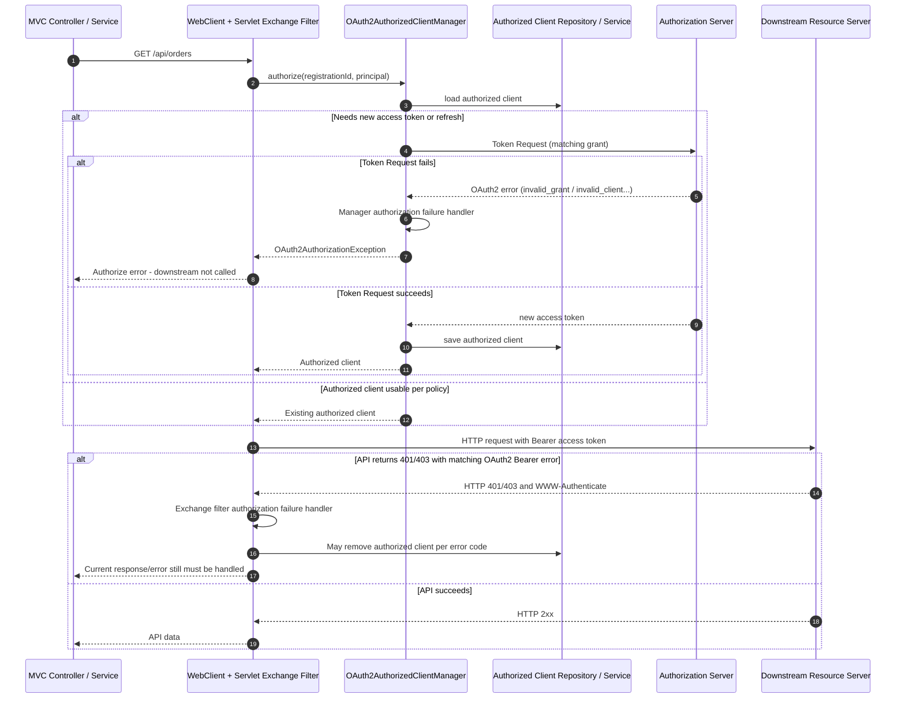

# 19.8. Handling Authorize Errors and the Exchange Filter's Failure Handler

## 1. Context: OAuth2 Errors Can Appear in Two Different Places

A **Spring Boot application running on Servlet/MVC** can use `WebClient` to call an external Resource Server after a user signs in via **Spring Security OAuth 2.0/OIDC Client**. When integrating OAuth2 Client with `WebClient`, the application typically uses the filter:

```java
org.springframework.security.oauth2.client.web.reactive.function.client
    .ServletOAuth2AuthorizedClientExchangeFilterFunction
```

This filter retrieves the `OAuth2AuthorizedClient` for the registration/principal, uses `OAuth2AuthorizedClientManager` to authorize or re-authorize a token when needed, and places the access token into the outbound HTTP header:

```http
Authorization: Bearer <access-token>
```

However, **two distinct stages can fail**:

1. **Authorize/re-authorize before calling downstream:** the manager cannot obtain a token or cannot refresh an existing token. Errors usually originate from the Authorization Server/Token Endpoint, such as `invalid_client`, `invalid_grant`, `invalid_scope`, timeouts, or TLS failures. At this stage, the request to the Resource Server may **not have been sent yet**.
2. **Resource Server returns an error after a token was obtained:** `WebClient` sent the HTTP request with a bearer token, yet the API responded with `401 Unauthorized` or `403 Forbidden`. This may happen because the token was revoked, is no longer valid, has the wrong audience, lacks scope, or was rejected by policy.

**These two failures are not handled with a single “on any error, refresh the token” rule.** `OAuth2AuthorizedClientManager` has a failure handler for **authorize/re-authorize** errors, whereas `ServletOAuth2AuthorizedClientExchangeFilterFunction` has `setAuthorizationFailureHandler(...)` to handle OAuth2 authentication/authorization errors **returned by the Resource Server**.

An `OAuth2AuthorizationFailureHandler` can be used at **both integration points**, yet *invocation timing, context data, and root causes* differ. Failing to distinguish them can cause the application to delete valid tokens, retry infinitely, or keep resending a rejected access token.

### 1.1. Learning Objectives

After this lesson, learners should be able to explain and configure:

- `ServletOAuth2AuthorizedClientExchangeFilterFunction` when using `WebClient` in **Servlet**, without confusing it with the WebFlux filter.
- `OAuth2AuthorizationException` inside the manager/provider and its corresponding failure handler.
- `401/403` errors from a Resource Server, their relationship with `WWW-Authenticate: Bearer ...`, and removing unusable authorized clients.
- The difference between the two constructors of the Servlet exchange filter, especially the **default failure handler**.
- How to attach `RemoveAuthorizedClientOAuth2AuthorizationFailureHandler` to the filter when constructed with `OAuth2AuthorizedClientManager`.
- How to choose between `OAuth2AuthorizedClientRepository` and `OAuth2AuthorizedClientService` to remove the right entry.
- The lifecycle after removal: the current request does not automatically succeed; the **next** call can obtain a new token.
- Strategies for handling `invalid_grant`, `invalid_token`, `insufficient_scope`, HTTP 429/5xx, timeouts, and concurrency.
- Limitations when using reactive `WebClient` inside a synchronous Servlet application.

## 2. Architecture: `WebClient` on Servlet Does Not Turn the App into WebFlux

`WebClient` belongs to Spring WebFlux, yet it can be used as an **HTTP client** inside a Spring MVC/Servlet application. Thus you can use both simultaneously:

```text
Inbound:
  Servlet Filter Chain
  Spring MVC Controller
  SecurityContextHolder / HttpServletRequest

Outbound:
  WebClient
  ExchangeFilterFunction
  Reactor Mono / Flux
  Netty or another HTTP connector
```

For OAuth2 Client in Servlet, the right component is:

```java
ServletOAuth2AuthorizedClientExchangeFilterFunction
```

**Do not confuse it with:**

```java
ServerOAuth2AuthorizedClientExchangeFilterFunction
```

`ServerOAuth2AuthorizedClientExchangeFilterFunction` is for a **WebFlux server** with a reactive security context and `ReactiveOAuth2AuthorizedClientManager`. The `Servlet...` class uses Servlet abstractions such as `HttpServletRequest`, `HttpServletResponse`, `Authentication`, `OAuth2AuthorizedClientRepository`, and a non-reactive manager.

### 2.1. Illustrative Dependencies

An MVC application can declare:

```gradle
dependencies {
    implementation 'org.springframework.boot:spring-boot-starter-web'
    implementation 'org.springframework.boot:spring-boot-starter-security'
    implementation 'org.springframework.boot:spring-boot-starter-oauth2-client'

    // To use WebClient as an outbound HTTP client
    implementation 'org.springframework.boot:spring-boot-starter-webflux'
}
```

Having both `spring-boot-starter-web` and `spring-boot-starter-webflux` **does not mean the application necessarily runs a reactive web server**. Spring Boot selects the web application type based on classpath/configuration; in this lesson's setup, inbound traffic remains Servlet/MVC.

The examples follow common Spring Security 6.x/7.x API styles. Some extension points vary across versions, so verify against your exact dependencies when integrating.

## 3. Flow with Two Failure Handler Branches



**Two things to remember:**

- When the **Token Endpoint** rejects a refresh token (`invalid_grant`), that is usually a **manager and provider** concern. The manager can use `RemoveAuthorizedClientOAuth2AuthorizationFailureHandler` to delete the stale authorized client per policy.
- When the **Resource Server** rejects an access token (`invalid_token` in the HTTP Bearer challenge), that occurs **after WebClient has sent the HTTP request**. The exchange filter can forward that signal to an `OAuth2AuthorizationFailureHandler` to delete the stale token.

Not every `401/403` response carries enough OAuth2 information to conclude the token must be deleted. The difference lies in the **OAuth2 error code, challenge header, how the filter parses the response, and the failure handler's policy**.

## 4. Related Components and Roles

| Component | Function | Related Failures |
| --- | --- | --- |
| `ClientRegistrationRepository` | Stores client config, grants, Token Endpoint | Missing/wrong registration |
| `OAuth2AuthorizedClient` | Registration, principal, access token, optional refresh token | Stale/expired/revoked token |
| `OAuth2AuthorizedClientRepository` | Saves/loads/removes tokens in Servlet requests | Removes authorized client per request/principal |
| `OAuth2AuthorizedClientService` | Saves/loads/removes by registration + principal outside requests | Removes authorized client by storage key |
| `OAuth2AuthorizedClientProvider` | Issues/reissues tokens per grant | Token Endpoint errors |
| `OAuth2AuthorizedClientManager` | Coordinates providers, storage, success/failure handlers | Authorize/re-authorize failures |
| `ServletOAuth2AuthorizedClientExchangeFilterFunction` | Integrates WebClient with OAuth2 Client | Resource Server 401/403 |
| `OAuth2AuthorizationFailureHandler` | Interface receiving OAuth2 authorization failures | Used in manager or exchange filter |
| `RemoveAuthorizedClientOAuth2AuthorizationFailureHandler` | Can remove records for configured error codes | Token/grant considered no longer valid |
| `WebClient.ResponseSpec` / `retrieve()` | Handles downstream HTTP responses | `WebClientResponseException`/business mapping |
| Resource Server | Validates bearer token and API permissions | `invalid_token`, `insufficient_scope`, policy denial |

### 4.1. What Is the Signature of `OAuth2AuthorizationFailureHandler`?

Core contract:

```java
void onAuthorizationFailure(
        OAuth2AuthorizationException authorizationException,
        Authentication principal,
        Map<String, Object> attributes);
```

Where:

- `authorizationException` wraps an `OAuth2Error` with the error code and contextual error details.
- `principal` is the authentication associated with the authorized client.
- `attributes` is context-dependent metadata, which may hold the Servlet request/response or other required information.

**Never log entire exceptions or attributes indiscriminately** if they can contain sensitive data. Never log raw access tokens, refresh tokens, client secrets, HTTP Authorization headers, or cookies.

### 4.2. What Does `RemoveAuthorizedClientOAuth2AuthorizationFailureHandler` Do?

This class implements `OAuth2AuthorizationFailureHandler` and **removes the authorized client only when `OAuth2Error.getErrorCode()` belongs to the configured set of error codes**.

Logic:

```text
OAuth2 error occurs
    ↓
Failure handler reads OAuth2 error code
    ↓
If error code is in the remove set:
    locate the matching registration + principal
    remove authorized client from repository/service
Otherwise:
    do not necessarily delete the entry
```

The implementation defines the constant:

```java
RemoveAuthorizedClientOAuth2AuthorizationFailureHandler
    .DEFAULT_REMOVE_AUTHORIZED_CLIENT_ERROR_CODES
```

Do not write custom logic like `if (status == 401 || status == 403) remove everything`. **The HTTP status is only an initial signal**; the actual OAuth2 reason determines whether stored tokens should be invalidated.

## 5. An Easily Missed Detail: The Constructor Determines the Default Failure Handler

`ServletOAuth2AuthorizedClientExchangeFilterFunction` has two common ways to construct it, with **different default behavior**.

### 5.1. Constructing with Registration Repository + Authorized Client Repository

```java
new ServletOAuth2AuthorizedClientExchangeFilterFunction(
    clientRegistrationRepository,
    authorizedClientRepository);
```

With this constructor, Spring Security pre-configures **`RemoveAuthorizedClientOAuth2AuthorizationFailureHandler`** to receive OAuth2 authentication/authorization failures from the Resource Server and *optionally* remove the authorized client depending on the error code.

Example:

```java
@Configuration
class DefaultWebClientConfiguration {

    @Bean
    WebClient protectedApiWebClient(
            ClientRegistrationRepository registrations,
            OAuth2AuthorizedClientRepository authorizedClients) {

        var oauth2 = new ServletOAuth2AuthorizedClientExchangeFilterFunction(
            registrations, authorizedClients);

        return WebClient.builder()
            .baseUrl("https://api.example.com")
            .apply(oauth2.oauth2Configuration())
            .build();
    }
}
```

**Pros:** easy to use and includes the filter's default remove-on-relevant-OAuth2-error behavior.

**Limitation:** this constructor builds/manages authorization itself from the repositories; if the application has a custom `OAuth2AuthorizedClientManager` (providers, clock skew, success handler, Token Endpoint HTTP client...), consider the manager constructor and configure the handler explicitly.

### 5.2. Constructing with `OAuth2AuthorizedClientManager`

```java
new ServletOAuth2AuthorizedClientExchangeFilterFunction(
    authorizedClientManager);
```

**With the manager constructor, the failure handler for Resource Server `401/403` responses is not automatically configured like the repository constructor.** That means a token rejected by the API can remain stored and get reused on the next request unless the application attaches a handler itself.

You must call:

```java
oauth2.setAuthorizationFailureHandler(
    authorizationFailureHandler);
```

to configure handling of errors from the Resource Server.

> **This is a key distinction of this lesson:** the manager may have an **internal** failure handler to handle Token Endpoint errors during authorization, yet that **does not mean** the exchange filter has a failure handler for Resource Server `401/403` responses.

### 5.3. Comparison Table

| How Servlet Exchange Filter Is Constructed | Has Manager? | Resource Server 401/403 Failure Handler |
| --- | --- | --- |
| `(ClientRegistrationRepository, OAuth2AuthorizedClientRepository)` | Configured by the filter per constructor | `RemoveAuthorizedClient...` configured by default |
| `(OAuth2AuthorizedClientManager)` | Uses application-supplied manager | **No default remove handler**; call `setAuthorizationFailureHandler(...)` |
| WebFlux `ServerOAuth2AuthorizedClientExchangeFilterFunction` | **Different API** | Uses reactive manager/repository and reactive failure handler |

The behavior above reflects the Servlet exchange filter contract described in Spring Security versions supporting failure forwarding (5.3+). Still verify the API/behavior of the exact version you are using.

## 6. Configuring Spring Boot and OAuth2 Client for the Servlet Example

### 6.1. OIDC Registration with User Token and Refresh Token

Example `application.yml`:

```yaml
spring:
  security:
    oauth2:
      client:
        registration:
          corporate:
            provider: company-oidc
            client-id: ${CORPORATE_CLIENT_ID}
            client-secret: ${CORPORATE_CLIENT_SECRET}
            authorization-grant-type: authorization_code
            client-authentication-method: client_secret_basic
            redirect-uri: "{baseUrl}/login/oauth2/code/{registrationId}"
            scope:
              - openid
              - profile
              - email
              - reports.read
              - offline_access

        provider:
          company-oidc:
            issuer-uri: https://idp.example.com/realms/employees
```

This configures an OAuth2 Client Registration with Authorization Code/OIDC Login. The `offline_access` scope may relate to refresh tokens, yet **does not guarantee the provider issues a refresh token**: that still depends on IdP policy, consent, allowed scopes, and client type.

### 6.2. Minimal SecurityFilterChain Configuration

```java
@Configuration
class SecurityConfiguration {

    @Bean
    SecurityFilterChain securityFilterChain(HttpSecurity http)
            throws Exception {

        http
            .authorizeHttpRequests(auth -> auth
                .requestMatchers("/", "/assets/**").permitAll()
                .anyRequest().authenticated())
            .oauth2Login(Customizer.withDefaults())
            .oauth2Client(Customizer.withDefaults());

        return http.build();
    }
}
```

Upon successful login, Spring Security can populate `OidcUser` in `Authentication` and `OAuth2AuthorizedClient` with an access token/refresh token (if issued). The manager/repository later uses this authorized client to call downstream APIs.

**Never treat the ID Token from `OidcUser` as a bearer access token** to call the Reports API. `OAuth2AuthorizedClient.getAccessToken()` is the token source for outbound Resource Server requests.

## 7. Explicitly Configuring the Servlet Manager and Failure Handler

This is a complete configuration *architecturally*: the manager handles authorize/re-authorize, while the exchange filter handles Resource Server OAuth2 failures.

### 7.1. Creating the Manager with `authorization_code` and `refresh_token`

```java
@Configuration(proxyBeanMethods = false)
class OAuth2ClientManagerConfiguration {

    @Bean
    OAuth2AuthorizedClientManager servletAuthorizedClientManager(
            ClientRegistrationRepository clientRegistrations,
            OAuth2AuthorizedClientRepository authorizedClients) {

        OAuth2AuthorizedClientProvider provider =
            OAuth2AuthorizedClientProviderBuilder.builder()
                .authorizationCode()
                .refreshToken()
                .build();

        var manager = new DefaultOAuth2AuthorizedClientManager(
            clientRegistrations,
            authorizedClients);

        manager.setAuthorizedClientProvider(provider);
        return manager;
    }
}
```

`DefaultOAuth2AuthorizedClientManager` is built for **HTTP Servlet requests** and uses `OAuth2AuthorizedClientRepository`. On successful authorize/re-authorize, the manager saves the new authorized client in the repository by default. On `invalid_grant` errors (e.g. a refresh token no longer valid), the manager has default failure handling to remove the stale authorized client per policy.

That **does not replace** the WebClient exchange filter's failure handler, because **Resource Server** errors occur after the manager has already returned a token.

### 7.2. Simple Option for Service-Backed Authorized Clients: Removing via Service

If authorized clients are stored in `OAuth2AuthorizedClientService`, you can build a remover via its dedicated interface.

```java
@Configuration(proxyBeanMethods = false)
class ReportsWebClientConfiguration {

    @Bean
    WebClient reportsWebClient(
            OAuth2AuthorizedClientManager servletAuthorizedClientManager,
            OAuth2AuthorizedClientService authorizedClientService) {

        var oauth2 =
            new ServletOAuth2AuthorizedClientExchangeFilterFunction(
                servletAuthorizedClientManager);

        var removeHandler =
            new RemoveAuthorizedClientOAuth2AuthorizationFailureHandler(
                (registrationId, principal, attributes) -> {
                    if (principal != null) {
                        authorizedClientService.removeAuthorizedClient(
                            registrationId,
                            principal.getName());
                    }
                });

        oauth2.setAuthorizationFailureHandler(removeHandler);

        return WebClient.builder()
            .baseUrl("https://reports-api.example.com")
            .apply(oauth2.oauth2Configuration())
            .build();
    }
}
```

**Condition:** this is the right approach when `OAuth2AuthorizedClientService` is genuinely the store backing the authorized clients used by the manager/filter. If the web flow stores them in an **HTTP session repository** or a different repository, calling `removeAuthorizedClient(...)` on an unused service may **fail to remove the offending token**.

Therefore, in a Servlet application backed by `OAuth2AuthorizedClientRepository`, it usually makes more sense to build a **remover wired to the exact repository** (section 7.3).

### 7.3. Removing via the Exact `OAuth2AuthorizedClientRepository`

`RemoveAuthorizedClientOAuth2AuthorizationFailureHandler` accepts an `OAuth2AuthorizedClientRemover`. This callback has the logical signature:

```java
void removeAuthorizedClient(
    String clientRegistrationId,
    Authentication principal,
    Map<String, Object> attributes);
```

A Servlet adapter can access the request/response from `attributes` when supplied by the filter/manager:

```java
@Bean
OAuth2AuthorizationFailureHandler webClientFailureHandler(
        OAuth2AuthorizedClientRepository repository) {

    return new RemoveAuthorizedClientOAuth2AuthorizationFailureHandler(
        (registrationId, principal, attributes) -> {

            HttpServletRequest servletRequest =
                (HttpServletRequest) attributes.get(
                    HttpServletRequest.class.getName());

            HttpServletResponse servletResponse =
                (HttpServletResponse) attributes.get(
                    HttpServletResponse.class.getName());

            if (servletRequest == null || servletResponse == null) {
                // Do not guess another session/request to delete the token.
                // Handle missing context according to actual architecture.
                return;
            }

            repository.removeAuthorizedClient(
                registrationId,
                principal,
                servletRequest,
                servletResponse);
        });
}
```

This snippet illustrates wiring the handler to **HTTP-request-based storage**. The attributes are supplied by the filter in a Servlet context; if the application calls `WebClient` from a scheduler or async task where the request no longer exists, use a **service-based remover** or another explicitly designed context.

**Important code note:** in Spring Security versions that provide request/response context via `ClientRequest.attributes()`, the static APIs `ServletOAuth2AuthorizedClientExchangeFilterFunction.httpServletRequest(...)` and `httpServletResponse(...)` help place those objects into request attributes. Whenever custom code relies on them, ensure they share the **same context and lifetime** as the active HTTP request—never store request/response objects for reuse after the request completes.

Configuring the filter:

```java
@Bean
WebClient reportsWebClient(
        OAuth2AuthorizedClientManager servletAuthorizedClientManager,
        OAuth2AuthorizationFailureHandler webClientFailureHandler) {

    var oauth2 =
        new ServletOAuth2AuthorizedClientExchangeFilterFunction(
            servletAuthorizedClientManager);

    oauth2.setAuthorizationFailureHandler(webClientFailureHandler);

    return WebClient.builder()
        .baseUrl("https://reports-api.example.com")
        .apply(oauth2.oauth2Configuration())
        .build();
}
```

The two beans above are an **alternative** to the service-backed WebClient bean in section 7.2; in a real application **pick one suitable configuration**, never declaring two beans with the same name and expecting Spring to guess.

### 7.4. Minimal-Config Option: Two-Repository Constructor

If no custom manager is required:

```java
@Bean
WebClient reportsWebClient(
        ClientRegistrationRepository registrations,
        OAuth2AuthorizedClientRepository authorizedClients) {

    var oauth2 =
        new ServletOAuth2AuthorizedClientExchangeFilterFunction(
            registrations,
            authorizedClients);

    return WebClient.builder()
        .baseUrl("https://reports-api.example.com")
        .apply(oauth2.oauth2Configuration())
        .build();
}
```

This constructor already has a default `RemoveAuthorizedClientOAuth2AuthorizationFailureHandler` for appropriate OAuth2 Resource Server failure codes. Understand the lifecycle configured by the filter and ensure registrations/providers match your application.

**Using the `OAuth2AuthorizedClientManager` constructor does not mean the filter automatically inherits a default handler from the manager.** The manager's handler and the filter's handler are independent here.

## 8. Using WebClient Properly in a Servlet Controller

Example MVC endpoint calling the Reports API using registration `corporate`:

```java
@RestController
class ReportsController {

    private final WebClient reportsWebClient;

    ReportsController(WebClient reportsWebClient) {
        this.reportsWebClient = reportsWebClient;
    }

    @GetMapping("/my/reports")
    String myReports() {

        return reportsWebClient.get()
            .uri("/api/reports/me")
            .attributes(
                ServletOAuth2AuthorizedClientExchangeFilterFunction
                    .clientRegistrationId("corporate"))
            .retrieve()
            .bodyToMono(String.class)
            .block();
    }
}
```

In simple scenarios, code runs on a **Servlet request thread** already authenticated by Spring Security. `oauth2Configuration()` lets the filter populate default Servlet request/response and authentication into request attributes from the active context while that context exists.

Calling `.block()` **can fit synchronous Spring MVC**, though it blocks the Servlet thread while waiting on the result. Set timeouts/deadlines, bound concurrency, and avoid calling `.block()` if code runs on a Reactor event loop. If a call moves to another scheduler/thread, ThreadLocal context may **not propagate automatically** to where subscription occurs.

### 8.1. Explicitly Selecting the Registration per Downstream Target

In the example above, `clientRegistrationId("corporate")` is a static helper on the Servlet exchange filter. It instructs the filter to use registration `corporate`.

**Do not broadly enable `setDefaultOAuth2AuthorizedClient(true)`**, because that setting can cause every outbound request from that WebClient to carry the current user's token, even to unintended URLs. Similarly, `setDefaultClientRegistrationId(...)` applies a default registration to **every request through that client** and requires great care.

Architectural recommendation: a dedicated WebClient/gateway per downstream service, fixed base URL, and registrations chosen from **trusted configuration**, never from user queries or arbitrary URLs.

### 8.2. When Passing an Already-Resolved Authorized Client

If the controller receives `@RegisteredOAuth2AuthorizedClient`:

```java
@GetMapping("/my/profile")
String myProfile(
        @RegisteredOAuth2AuthorizedClient("corporate")
        OAuth2AuthorizedClient authorizedClient) {

    return reportsWebClient.get()
        .uri("/api/me")
        .attributes(
            ServletOAuth2AuthorizedClientExchangeFilterFunction
                .oauth2AuthorizedClient(authorizedClient))
        .retrieve()
        .bodyToMono(String.class)
        .block();
}
```

This **selects a specific authorized client** rather than only a registration ID. With a custom failure handler, identify the storage/repository backing that authorized client so the right record can be deleted when the token is rejected.

### 8.3. `HttpServletRequest` Context When Using Async WebClient

`ServletOAuth2AuthorizedClientExchangeFilterFunction` uses Spring Servlet contexts (`RequestContextHolder`, `SecurityContextHolder`) to resolve default authentication and request/response.

In straightforward Spring MVC, if `.block()` is called right inside the controller, the context usually remains intact. However, when:

- Creating a `Mono` in request A and subscribing after request A has ended.
- Offloading the publisher to a task scheduler.
- Using `publishOn`, `subscribeOn` on threads that do not propagate context.
- Retrieving tokens when no HTTP session/request exists.
- Sharing a single `Mono` across multiple users.

do not assume the Servlet request context still exists. Depending on architecture, pass a verified authorized client/authentication safely, or use a **service-based authorized-client manager** for background tasks—never pass an expired `HttpServletRequest` object into a background task.

## 9. Difference Between Authorize Errors and Resource Server 401/403 Errors

### 9.1. Group A — Errors Before Sending the Outbound API Request

For example, initial client credentials or refresh token:

```text
WebClient filter
  └── manager.authorize(...)
      └── Token Endpoint
          └── error: invalid_client / invalid_grant / timeout ...
```

Common errors:

| Error/Symptom | Common Meaning | Responsible Side |
| --- | --- | --- |
| `invalid_client` | Wrong secret, client authentication method, or certificate | Authorization Server / client registration |
| `invalid_grant` | Refresh token expired, revoked, or rotated | Provider/manager failure handler |
| `unauthorized_client` | Client not permitted for grant | Authorization Server policy |
| `invalid_scope` | Requested scope not granted | Authorization Server/client config |
| TLS `PKIX` | HTTP client calling Token Endpoint does not trust certificate | Truststore/transport of token response client |
| Connect/read timeout | Token Endpoint/proxy/network slow or unreachable | Manager/provider network/HTTP client |
| Missing registration | Wrong `registrationId`/wiring | `ClientRegistrationRepository` |
| Manager returns `null` | Grant/provider unsupported or cannot authorize per contract | `OAuth2AuthorizedClientManager` configuration |

At this stage, **the Resource Server may not have received any request yet**. Therefore, `ServletOAuth2AuthorizedClientExchangeFilterFunction` has no downstream `401/403` to inspect.

### 9.2. Group B — Resource Server Returns an HTTP Failure

Examples:

```http
HTTP/1.1 401 Unauthorized
WWW-Authenticate: Bearer error="invalid_token"
```

or:

```http
HTTP/1.1 403 Forbidden
WWW-Authenticate: Bearer error="insufficient_scope", scope="reports.admin"
```

These are **HTTP responses from the API**, not JSON errors from the Token Endpoint.

`ServletOAuth2AuthorizedClientExchangeFilterFunction` can forward matching OAuth2/Bearer errors from these responses to the configured handler. `RemoveAuthorizedClientOAuth2AuthorizationFailureHandler` evaluates the **OAuth2 error code** rather than wiping every token simply because the HTTP status is 4xx.

### 9.3. Distinguishing `invalid_token` and `insufficient_scope`

| Error | Common Interpretation | Should the Authorized Client Be Removed? |
| --- | --- | --- |
| `invalid_token` in Bearer challenge | Resource Server rejects the access token | **Usually helpful** to stop resending the stale token; per remove policy |
| `insufficient_scope` | Token reached API yet lacks scope | Do not auto-delete and re-request the same scopes; fix permissions |
| `invalid_grant` from Token Endpoint | Refresh token/grant is no longer valid | Manager can remove the stale authorized client |
| `invalid_client` from Token Endpoint | Wrong client authentication | Deleting token and retrying with the same secret will not fix it |
| HTTP 401 without clear Bearer error | Possibly gateway auth, proxy, or another app | Cannot conclude old token should be deleted from status alone |
| Business HTTP 403 unrelated to OAuth2 Bearer | User/service lacks operation permissions | Not necessarily a reason to delete token |

When a Resource Server **only returns status 401/403** without an appropriate OAuth2/Bearer challenge, the exchange filter may not have an error code to decide removal. Diagnose based on actual response headers and contracts, not guesswork.

## 10. `WWW-Authenticate` and the Bearer Token Error Standard

Per RFC 6750, a Resource Server can return Bearer challenges such as:

```http
HTTP/1.1 401 Unauthorized
WWW-Authenticate: Bearer realm="reports",
                  error="invalid_token",
                  error_description="Token has expired"
```

Or:

```http
HTTP/1.1 403 Forbidden
WWW-Authenticate: Bearer realm="reports",
                  error="insufficient_scope",
                  scope="reports.write"
```

Systems behind proxies/WAFs or custom middleware sometimes return non-standard HTML or JSON instead of a Bearer challenge. In such cases, the filter may be unable to interpret the OAuth2 reason even though the HTTP layer sees 401/403.

**Never use `error_description` as the sole signal to automatically delete credentials.** It is a descriptive string from the server; decisions must rely on error codes, policies, and trusted response sources.

### 10.1. Why Not Remove Every Token on 403?

`403 Forbidden` usually indicates **insufficient permissions** rather than an expired token. For example:

```text
Access token:
    scope = reports.read

API endpoint:
    requires reports.admin
```

If you delete the token and re-request using the exact same client registration and scopes, the Authorization Server may issue a new token **that still only has `reports.read`**, leading to repeated 403s.

The fix is updating **authorized scopes/consent/business permissions** through approved processes, not infinitely refreshing and retrying.

### 10.2. Why Should 401 `invalid_token` Remove by the Exact Key?

If a token was revoked, the API should not keep receiving it on subsequent requests. Removing the **exact authorized client** by `(registrationId, principalName)` allows the manager to attempt issuing a fresh token next time (assuming the grant/client remains valid).

However, if the root cause is a wrong audience or the provider disabled the entire client, reissuance may keep failing. Removal does not replace fixing **Authorization Server config, Resource Server validation, or client credentials**.

## 11. Failure Handlers Do Not Automatically Retry the Current HTTP Request

A serious misconception:

> “WebClient gets 401, the filter deletes the token, so that same request immediately retries and succeeds with a new token.”

**Do not assume that happens.** The main role of `RemoveAuthorizedClientOAuth2AuthorizationFailureHandler` is **removing the stale record**, so the **next request** can obtain a new token when the manager re-authorizes. The current request's 401/403 response still must be handled by application code.

Example:

```text
Call #1:
  Token A has been revoked by Resource Server
  WebClient sends Bearer A
  Resource Server returns 401 invalid_token
  Exchange filter invokes failure handler
  Authorized client (registration, principal) removed if error code matches
  Call #1 still ends with 401/error

Call #2:
  Manager loads -> Token A is gone
  Manager uses valid grant/provider to obtain Token B
  WebClient sends Bearer B
  API may accept or still reject
```

There is no guarantee Call #2 will succeed: client credentials could be wrong, the refresh grant could be invalid, scopes could be missing, audience could be wrong, or downstream could still fail.

### 11.1. How Does `retrieve()` Handle Status Codes?

MVC example:

```java
try {
    return reportsWebClient.get()
        .uri("/api/reports/me")
        .attributes(
            ServletOAuth2AuthorizedClientExchangeFilterFunction
                .clientRegistrationId("corporate"))
        .retrieve()
        .bodyToMono(String.class)
        .block();
} catch (WebClientResponseException.Unauthorized ex) {
    // API returned 401. The filter may have handled the matching Bearer error,
    // yet the exception for the current request still needs handling.
    throw new ResponseStatusException(
        HttpStatus.BAD_GATEWAY,
        "Downstream rejected authorization");
}
```

Returning `502 Bad Gateway` is only one illustrative choice. User-facing APIs need a clear error mapping contract: returning 401 to trigger a fresh login if the **portal session** itself is invalid, or returning 503 when downstream/service tokens are temporarily unavailable. Never blindly mirror every downstream 401 as a 401 to the browser, as those are two different authentication layers.

### 11.2. `onStatus` Does Not Replace the Exchange Filter Handler

You can configure:

```java
webClient.get()
    .uri("/api/reports/me")
    .retrieve()
    .onStatus(
        status -> status.value() == 403,
        (request, response) ->
            Mono.error(new AccessDeniedException(
                "Reports permission denied")))
    .bodyToMono(String.class);
```

This maps **HTTP responses into business errors** at the WebClient consumer layer. It does not invoke `OAuth2AuthorizationFailureHandler` and does not remove authorized clients.

Conversely, the exchange filter's failure handler owns the **token lifecycle** upon OAuth2 Bearer failures rather than deciding the entire error response for controllers/business services. Both layers complement each other.

## 12. Retrying Carefully: At Most Once Under Suitable Conditions

On `invalid_token`, you might consider **controlled retries** for certain operations, but never configure a global `retryWhen(...)` for all `401/403` errors.

### 12.1. Design Rules

A sound retry must verify:

1. Is the request **idempotent** (e.g. GET) or side-effecting (e.g. payment POST)?
2. Was the error genuinely `invalid_token` in a Bearer challenge from a trusted Resource Server?
3. Has the stale authorized client already been removed/invalidated?
4. Can the manager obtain a fresh token via a valid grant?
5. Is there a strict limit of one retry (or very few) with a timeout/budget?
6. Is there a risk of multiple concurrent requests all fetching new tokens and hitting rate limits?
7. Can user tokens be kept separate from service tokens to prevent cross-principal leakage?
8. If the error persists, does it stop and return an error rather than looping forever?

**Never auto-retry `insufficient_scope`**: a new token normally will not have new permissions.

### 12.2. Why Retrying `POST /payments` Can Be Dangerous

A side-effecting HTTP request may have already been processed by the Resource Server before the response was lost; uncontrolled retries risk creating duplicate transactions. Although 401s usually happen in an auth filter ahead of business logic, never assume every proxy, middleware, and API runs in the exact same order.

For critical actions, use an **idempotency key** when supported downstream along with mechanisms to check operation status.

### 12.3. Gateway Retry Pseudocode

```text
callDownstream(request):
    result = executeWithAuthorizedClient()

    if result = 401 invalid_token:
        ensure old authorized client removed under the correct key
        if request operation is safe-to-retry
           and retriesRemaining > 0
           and current identity/context is still valid:
            authorize again
            call downstream one additional time
        else:
            return mapped failure

    if result = 403 insufficient_scope:
        return authorization failure without token retry

    otherwise:
        return result
```

This is pseudocode describing a **policy**, not a built-in exchange filter API. Avoid both pitfalls: (a) retrying while still sending the same old access token; (b) retrying a request for a different principal or after the Servlet session has ended.

## 13. Handling Authorize Errors in the Manager

`DefaultOAuth2AuthorizedClientManager` provides:

```java
setAuthorizationFailureHandler(
    OAuth2AuthorizationFailureHandler handler)
```

This handler runs when **authorize/re-authorize** fails, such as when the Token Endpoint returns `invalid_grant` during refresh. By default, the manager includes handling that removes authorized clients on `invalid_grant` per policy.

Conceptual example of custom logging **without losing removal handling**:

```java
OAuth2AuthorizationFailureHandler managerHandler =
    (exception, principal, attributes) -> {
        String errorCode =
            exception.getError().getErrorCode();

        // Record sanitized metrics/telemetry by error code.
        // Then preserve appropriate removal logic if this error
        // makes the authorized client unusable.
    };
```

**This is only a skeleton illustrating the contract**, not a complete production handler. Calling `manager.setAuthorizationFailureHandler(managerHandler)` with a handler that **only logs** can accidentally **replace** the default behavior that removes invalid authorized clients when refresh tokens get `invalid_grant`.

Choose one of these approaches:

- Keep the default manager handler unless you have a clear reason to change it.
- Wrap/delegate to `RemoveAuthorizedClientOAuth2AuthorizationFailureHandler` when adding telemetry.
- Implement a well-grounded custom failure policy that handles `invalid_grant` and the right storage.

### 13.1. Comparing Failure Handlers at Both Levels

| Attribute | Manager Failure Handler | Exchange Filter Failure Handler |
| --- | --- | --- |
| Timing | When OAuth2 Client requests/reissues a token | After outbound Resource Server returns a response |
| Hook point | `manager.setAuthorizationFailureHandler(...)` | `servletExchangeFilter.setAuthorizationFailureHandler(...)` |
| Typical error | `invalid_grant` from Token Endpoint | `invalid_token` from Bearer challenge |
| Storage | Manager's authorized-client repository/service | Must delete from the exact repository/service holding the token |
| Included by default? | Yes, per manager type and default policy | **Depends on filter constructor** |
| Auto-retries current downstream call? | N/A; downstream may not have been called | Not by default |
| Modifies permissions/scopes? | No | No |

That is why diagnostics must identify **which stage threw the error**, rather than looking only at the `OAuth2AuthorizationException` message.

## 14. WebClient for `client_credentials` Outside Servlet Requests

A scheduled job can use WebClient in the same Servlet application, yet it has no user/browser request.

### 14.1. Service-Based Manager for Background Jobs

```java
@Configuration
class MachineTokenManagerConfig {

    @Bean("machineAuthorizedClientManager")
    OAuth2AuthorizedClientManager machineAuthorizedClientManager(
            ClientRegistrationRepository registrations,
            OAuth2AuthorizedClientService authorizedClients) {

        var provider =
            OAuth2AuthorizedClientProviderBuilder.builder()
                .clientCredentials()
                .build();

        var manager =
            new AuthorizedClientServiceOAuth2AuthorizedClientManager(
                registrations,
                authorizedClients);

        manager.setAuthorizedClientProvider(provider);
        return manager;
    }
}
```

`AuthorizedClientServiceOAuth2AuthorizedClientManager` does not require an `HttpServletRequest`. In batch jobs, use a stable principal name to retain the token:

```text
registrationId = reporting-m2m
principalName  = reporting-worker
```

Generating a random principal each time fragments the token store into many entries and causes the manager to request new tokens far more often than necessary.

### 14.2. Manager-Based Exchange Filter for Jobs

```java
@Bean
WebClient machineReportsWebClient(
        @Qualifier("machineAuthorizedClientManager")
        OAuth2AuthorizedClientManager manager,
        OAuth2AuthorizedClientService authorizedClients) {

    var oauth2 =
        new ServletOAuth2AuthorizedClientExchangeFilterFunction(manager);

    var removeHandler =
        new RemoveAuthorizedClientOAuth2AuthorizationFailureHandler(
            (registrationId, principal, attributes) -> {
                if (principal != null) {
                    authorizedClients.removeAuthorizedClient(
                        registrationId,
                        principal.getName());
                }
            });

    oauth2.setAuthorizationFailureHandler(removeHandler);

    return WebClient.builder()
        .baseUrl("https://reports-api.example.com")
        .apply(oauth2.oauth2Configuration())
        .build();
}
```

**However:** the filter must determine the right registration/principal. In a scheduled job, never assume `SecurityContextHolder` contains a user. You can call `OAuth2AuthorizedClientManager` directly to acquire the authorized client with `.principal("reporting-worker")` and then attach the bearer token to the request; or configure an explicit authentication/principal resolver on the filter per your version's API.

Clearer example for a job:

```java
OAuth2AuthorizeRequest authorizeRequest =
    OAuth2AuthorizeRequest
        .withClientRegistrationId("reporting-m2m")
        .principal("reporting-worker")
        .build();

OAuth2AuthorizedClient authorized =
    manager.authorize(authorizeRequest);

if (authorized == null) {
    throw new IllegalStateException(
        "Cannot authorize reporting machine client");
}

Mono<String> response = machineReportsWebClient.get()
    .uri("/api/reports/daily")
    .attributes(
        ServletOAuth2AuthorizedClientExchangeFilterFunction
            .oauth2AuthorizedClient(authorized))
    .retrieve()
    .bodyToMono(String.class);
```

Here `manager` is invoked explicitly to issue the token for the job's principal. Passing a specific `OAuth2AuthorizedClient` as a request attribute lets the filter use the resolved token; **deletion/lookup in the failure handler must use the same registration/principal**, and you must understand how filter request attributes behave without a Servlet request.

Some filter versions provide `setPrincipalResolver(...)` or the `authentication(...)` helper. Check your project's Spring Security version if you want to customize the principal resolver instead of passing the authorized client directly.

### 14.3. Do Not Rely on a Servlet Repository Handler When No Servlet Request Exists

If a handler calls:

```java
authorizedClientRepository.removeAuthorizedClient(
    registrationId, principal, httpServletRequest, httpServletResponse);
```

in a background job, `httpServletRequest`/`httpServletResponse` may not exist. Never fabricate a dummy Servlet request or try to reuse an old request just to remove a token.

With a service-based manager, use a remover backed by `OAuth2AuthorizedClientService` or the matching storage API. What matters is **same store, same registration, same principal**.

## 15. Concurrency and Refresh Token Rotation

Deleting an authorized client sounds simple, yet can trigger race conditions when multiple requests refresh concurrently or receive `401` simultaneously.

### 15.1. Two Requests Using the Same Access Token A

```text
Request X loads A from store.
Request Y loads A from store.

X -> API 401 invalid_token.
Y -> API 200 OK.

X -> failure handler removes authorized client by key.
```

Here removal may make sense if token A is genuinely no longer valid per policy, yet it can also force the next request to ask for a new token even though Y just succeeded. Never treat one API/tenant/endpoint returning `invalid_token` as proof that every other token/registration must be deleted.

### 15.2. Race: Deleting a New Token Due to a Stale Error

```text
T0: Token A is in the store.
T1: Request X uses A; API responds slowly.
T2: Request Y refreshes/reauthorizes and saves Token B.
T3: X's response returns 401 invalid_token for A.
T4: X's handler deletes by key -> risks deleting entry B too.
```

With a store that only supports `remove(registrationId, principalName)`, the handler cannot tell whether the current value is A or B. This is a **compare-and-remove** problem under concurrency.

When strict guarantees are needed:

- Maintain an internal version or token fingerprint in the store to delete **only if the stored record is still the old token**.
- Limit concurrent refreshes per registration/principal.
- Use transactions/CAS when shared storage exists.
- Apply cooldowns/rate limits to avoid token request storms.
- Check TTL, refresh token rotation, and network errors before retrying.

**Never log raw token values for comparison**; use a protected identifier/fingerprint if needed.

### 15.3. Refresh Token Rotation and `invalid_grant`

If the Authorization Server issues a new refresh token R2 after R1 is used, another request still using R1 can receive `invalid_grant`. The manager's failure handler may remove the authorized client, yet if the first request already saved R2, avoid **accidentally deleting the newer record**.

That is why multi-pod deployments with shared token stores must address concurrency and failure policies rather than merely adding `RemoveAuthorizedClientOAuth2AuthorizationFailureHandler` and calling it done.

## 16. Token Deleted While User Remains Logged In: Is That Abnormal?

**Not necessarily.** A Spring MVC app using OIDC Login may keep `Authentication` in the HTTP session. When the exchange filter removes `OAuth2AuthorizedClient` from the repository/service, the browser session can remain intact.

Distinguish clearly:

| Action | Meaning |
| --- | --- |
| Remove authorized client | Stop reusing the stale token in the token store |
| Refresh token reissued | Token lifecycle updated; does not implicitly change principal |
| Invalidate HTTP session | End the browser's authenticated session |
| Logout at OIDC Provider | End the SSO session per protocol/policy |
| Token revocation | Ask the Authorization Server to revoke the token |
| Resource Server 403 | API permission denied; does not necessarily require logout |

If a user-delegated token is rejected by the API due to revocation and the client cannot issue a new token, the application may need a **re-login/re-consent** flow per policy instead of silently refreshing forever.

**Do not automatically log out every user when a downstream service returns 403**; the error might simply be a missing scope for one operation.

## 17. Classifying Errors: Do Not Confuse Token Endpoint, API, and HTTP Network

| Stage | Signal | Causes to Examine | Resolution |
| --- | --- | --- | --- |
| Manager authorize | `invalid_client` | Wrong secret/method/cert/realm | Fix client registration/client auth |
| Manager refresh | `invalid_grant` | Refresh token expired/revoked/rotated | Manager handler, reauthorization, or login |
| Manager authorize | `invalid_scope` | Scopes not granted | IdP config/consent |
| Manager authorize | TLS/PKIX | Token Endpoint cert untrusted | Token exchange HTTP client/truststore |
| Manager authorize | Connect/read timeout | IdP/proxy/egress failure | Timeout/backoff; do not treat as invalid token |
| Resource Server | `401` + `invalid_token` | API rejects bearer token | Exchange filter failure handler can remove |
| Resource Server | `403` + `insufficient_scope` | Token lacks scope | Permissions/consent/config; do not retry infinitely |
| Resource Server | `401` without Bearer error | Proxy/other auth or non-standard response | Inspect headers and contract |
| Resource Server | HTTP 429 | Rate limit | Backoff, quota; do not delete tokens needlessly |
| Resource Server | HTTP 5xx | API failure | Bounded retries if idempotent |
| Resource Server | DNS/TLS/socket exception | Network, trust, proxy | Outbound HTTP client config |
| Consumer | JSON parse failure | Wrong body/schema | API DTO/error mapping; do not refresh by default |
| Servlet context | Missing principal | Lost request context, off-thread execution | Pass auth properly or use service manager |
| Authorized-client store | Entry not found | Wrong registration/principal or already removed | Check keys/wiring/lifecycle |

A `WebClientResponseException` is an HTTP-layer signal, whereas `OAuth2AuthorizationException` carries OAuth-layer error codes. Never write `catch (Exception e) { refreshAndRetry(); }` across every error type.

## 18. Observing Errors Without Exposing Credentials

Suggested events/metrics to attach to the Gateway/Manager:

```text
oauth2_authorize_attempt
oauth2_authorize_success
oauth2_authorize_failure
oauth2_authorized_client_removed
downstream_http_401
downstream_bearer_invalid_token
downstream_bearer_insufficient_scope
downstream_http_403
downstream_network_timeout
downstream_retry_attempt
```

These are **suggested names**, not built-in Spring Security metrics.

Appropriate log fields:

```text
registrationId=corporate
principalRef=<internal-correlation-id>
downstream=reports-api
stage=resource_server_response
httpStatus=401
oauth2ErrorCode=invalid_token
authorizedClientRemoval=attempted
```

Never log:

```text
Authorization: Bearer <raw-access-token>
refresh_token=<raw-secret>
client_secret=<secret>
Cookie: JSESSIONID=<value>
ID Token=<raw-jwt>
```

### 18.1. Do Not Put Raw Principal Names into Metric Labels

Principal names can be user IDs, emails, or subjects; millions of distinct values explode metric cardinality and create personal data risks. Metric labels should use normalized `registrationId`, `downstream`, `stage`, and `errorCode`. When correlation is needed, use short-lived trace IDs in access-controlled logs.

### 18.2. Observe Both the Handler and Storage

A handler can be invoked yet **delete nothing** because the error code is not in the remove set or because it points to the wrong store. When diagnosing, verify:

1. Did the filter receive a valid Bearer challenge?
2. What is `OAuth2Error.getErrorCode()`?
3. Is the handler configured on the right filter bean?
4. Does the handler use `OAuth2AuthorizedClientRepository` or a service?
5. Do registration/principal match the saved entry?
6. Did the handler actually call remove successfully?
7. On the next request, did the manager request a fresh token?

Never assume `setAuthorizationFailureHandler(...)` works merely because the Spring Boot app starts cleanly.

## 19. Cases Where the Failure Handler Runs Yet the Token Is Still Reused

Common real-world causes:

### 19.1. Deleting from the Wrong Store

The manager uses `AuthenticatedPrincipalOAuth2AuthorizedClientRepository` or a custom session repository, while the handler deletes from an `InMemoryOAuth2AuthorizedClientService` that does not hold that record. The token remains in the repository the manager reads.

**Fix:** identify the real store and connect the handler to that exact repository/service.

### 19.2. Mismatched Principal Names

The authorized client was saved under `(corporate, sub-123)`, while the handler removes `(corporate, user@example.com)` or a different service principal.

**Fix:** use a stable, consistent principal across authorize, save, and remove, and never mix user tokens with machine tokens.

### 19.3. HTTP Response Lacks a Standard Bearer Challenge

The Resource Server returns `401` without an appropriate `WWW-Authenticate: Bearer error="invalid_token"`; the filter lacks information to map a matching OAuth2 removal error.

**Fix:** align the Resource Server with OAuth2 Bearer Token Error semantics rather than forcing client-side token deletion on every 401.

### 19.4. Filter Created with Manager Constructor Without Setting a Handler

Because the manager has a default failure handler, a developer assumes the exchange filter also auto-removes on API 401s.

**Fix:** explicitly configure `oauth2.setAuthorizationFailureHandler(...)`, or use the `(registrations, repository)` constructor if appropriate for the architecture.

### 19.5. Another Request Already Saved a New Token

A stale request's handler deletes by key after another request already completed a refresh.

**Fix:** where necessary, use compare-and-remove or versioned records with concurrency control; never assume every delete affects only the token that specific request used.

### 19.6. Authorization Server Keeps Issuing the Same Token/Policy

After removal, the manager obtains a new token, yet the API still returns 401 due to wrong audience/issuer or a registration scoped to a different resource.

**Fix:** inspect both token issuance and Resource Server validation. Removal cannot fix trust or audience mismatches.

## 20. Practical Scenarios

### Scenario A — `invalid_token` from the Reports API

The browser is still logged in; the Reports API returns:

```http
HTTP/1.1 401 Unauthorized
WWW-Authenticate: Bearer error="invalid_token"
```

**Explanation:** the Resource Server rejected the current access token. The exchange filter with `RemoveAuthorizedClientOAuth2AuthorizationFailureHandler` can delete the authorized client if the error code is in the remove set. The next call can trigger the manager to fetch a new token. **The current call still needs error mapping.**

### Scenario B — Reports API Returns `insufficient_scope`

```http
HTTP/1.1 403 Forbidden
WWW-Authenticate: Bearer error="insufficient_scope", scope="reports.admin"
```

**Explanation:** the token lacks permissions. Do not auto-delete and retry infinitely. Review consent, allowed scopes, business permissions, and API policy.

### Scenario C — Refresh Token Endpoint Returns `invalid_grant`

The manager loads the old authorized client and calls refresh, yet the provider returns `invalid_grant`.

**Explanation:** the error occurred **before** the downstream request; the manager's failure handler handles the old token. Determine whether the refresh token expired/was revoked/rotated or the wrong client was used, then trigger reauthorization when appropriate.

### Scenario D — Manager Constructor Does Not Auto-Remove Token

The application uses:

```java
new ServletOAuth2AuthorizedClientExchangeFilterFunction(manager);
```

without calling `setAuthorizationFailureHandler(...)`. The API returns 401 across consecutive requests with the same token.

**Explanation:** this is a documented difference between constructors. Wire a `RemoveAuthorizedClient` handler to the exact store.

### Scenario E — Batch Job Without a Servlet Request

A job uses a service-based manager, yet a custom handler tries to pull `HttpServletRequest` from `attributes` and returns early when null.

**Explanation:** storage/context model mismatch. For background jobs, use a service remover keyed by the job's registration/principal; never build fake HTTP requests to delete tokens.

### Scenario F — One User Has Multiple Client Registrations

The same user calls both Reports and Calendar APIs. The Reports token is revoked while the Calendar token remains valid.

**Explanation:** remove **only** `(reports, user)`; do not delete `(calendar, user)` or log out the user because one API failed.

### Scenario G — Two Concurrent Requests and Refresh Token Rotation

One request refreshes token A into B; an older request using A gets a 401 and deletes by key.

**Explanation:** it may accidentally delete the newly saved token B. In multi-user/multi-pod systems, consider a versioned store or atomic conditional removal.

### Scenario H — WebClient Returns 401 Yet API Does Not Use OAuth2 Bearer

A gateway in front of the API returns 401 for a different authentication mechanism with no Bearer challenge.

**Explanation:** do not conclude the OAuth2 Client's access token is invalid. Inspect the gateway/proxy/API contract.

### Scenario I — Resource Server Returns 503

The API is under maintenance; the token is still valid.

**Explanation:** do not remove the authorized client. Apply appropriate timeouts, retries, and circuit breakers, especially for idempotent operations.

### Scenario J — User Supplies an Absolute URL to WebClient

A gateway takes a URI from a query parameter and sends the access token to an arbitrary host.

**Explanation:** the issue is credential leakage/SSRF, not the failure handler. Restrict base URLs/permitted hosts and never enable `setDefaultOAuth2AuthorizedClient(true)` on a client reaching untrusted destinations.

## 21. Review Questions

**Question 1. How do `ServletOAuth2AuthorizedClientExchangeFilterFunction` and `ServerOAuth2AuthorizedClientExchangeFilterFunction` differ?**

The `Servlet...` class is for Servlet/MVC apps using non-reactive OAuth2 Client abstractions; the `Server...` class is for WebFlux reactive servers.

**Question 2. At which layer is an `invalid_grant` error from the Token Endpoint handled?**

During manager/provider authorize or re-authorize; the manager's failure handler can remove the stale authorized client.

**Question 3. At which layer is a `401 invalid_token` error from the Resource Server handled?**

The Servlet WebClient exchange filter can forward the OAuth2 Bearer failure to `OAuth2AuthorizationFailureHandler`; the remover can delete the authorized client per policy.

**Question 4. Which constructor provides a default remove handler for matching Resource Server errors?**

The constructor of `ServletOAuth2AuthorizedClientExchangeFilterFunction` that accepts `ClientRegistrationRepository` and `OAuth2AuthorizedClientRepository`.

**Question 5. When using the constructor that accepts `OAuth2AuthorizedClientManager`, is a 401/403 failure handler configured automatically?**

Not per documented behavior. Attach a handler explicitly via `setAuthorizationFailureHandler(...)` if you want stale tokens removed on OAuth2 Bearer errors.

**Question 6. Does `RemoveAuthorizedClientOAuth2AuthorizationFailureHandler` delete every token whenever it sees HTTP 403?**

No. It inspects whether the OAuth2 error code belongs to the configured remove set; `403 insufficient_scope` does not mean the token is invalid.

**Question 7. Does deleting an authorized client automatically retry the HTTP request that received 401?**

Not by default. The current request still fails; the next call gets the opportunity to request a new token.

**Question 8. Why might a service-based remover fail to take effect in an MVC web app?**

Because the actual manager/repository may store authorized clients in the HTTP session or another store rather than the service the remover deletes from.

**Question 9. In a background job with no Servlet request, how should tokens be removed?**

Use `OAuth2AuthorizedClientService`/storage matching `AuthorizedClientServiceOAuth2AuthorizedClientManager`; do not attempt to fake Servlet requests/responses.

**Question 10. Does `WebClient.retrieve().onStatus(...)` replace the OAuth2 failure handler?**

No. `onStatus` primarily maps HTTP responses into business-layer errors; token invalidation belongs to the exchange filter/authorized-client management.

**Question 11. Why should 401/403 errors never be retried infinitely?**

The cause may be wrong scope/audience/client configuration, lack of permissions, or a side-effecting request; infinite retries cause loops, token issuance storms, and duplicate operations.

**Question 12. If an access token is unexpired yet the API returns `invalid_token`, what could be the cause?**

Token revocation, wrong audience/issuer, changed Resource Server policy, or key/trust mismatch; `expiresAt` is only one condition.

**Question 13. If the manager already saved token B, can an old request's handler delete it by mistake?**

Yes, if the store deletes purely by registration/principal without checking the current version/token. That is a race condition to address in concurrent environments.

**Question 14. What risk does `setDefaultOAuth2AuthorizedClient(true)` carry?**

It can automatically attach an access token to every request sent through that WebClient, including requests to unintended downstream hosts. Attach tokens only to trusted targets and appropriate registrations.

**Question 15. Why does `offline_access` not guarantee a refresh token?**

The provider still checks client type, consent, allowed grants/scopes, and refresh token issuance policies.

**Question 16. If an API returns 429 or 503, should the token be removed?**

Usually no; these indicate rate limits or availability issues, not proof of an invalid token. Use appropriate timeouts, backoff, and circuit breakers.

**Question 17. Can you rely solely on `SecurityContextHolder` inside a publisher subscribed on a background thread after the request?**

Do not assume so. Servlet security contexts are typically bound to the request/thread and may not propagate. Use the right manager/context or safely pass a verified identity.

**Question 18. What information should be logged when handling an OAuth2 failure?**

Registration ID, downstream target, HTTP status, normalized OAuth2 error code, correlation ID, and outcome; never log raw tokens, refresh tokens, secrets, or cookies.

## 22. Official References

- [Spring Security Reference — OAuth 2.0 Client (Servlet)](https://docs.spring.io/spring-security/reference/servlet/oauth2/client/index.html)
- [Spring Security Reference — Authorized Clients (Servlet), WebClient Integration](https://docs.spring.io/spring-security/reference/servlet/oauth2/client/authorized-clients.html)
- [Spring Security Reference — Core Interfaces and Classes](https://docs.spring.io/spring-security/reference/servlet/oauth2/client/core.html)
- [Spring Security API — ServletOAuth2AuthorizedClientExchangeFilterFunction](https://docs.spring.io/spring-security/reference/api/java/org/springframework/security/oauth2/client/web/reactive/function/client/ServletOAuth2AuthorizedClientExchangeFilterFunction.html)
- [Spring Security API — RemoveAuthorizedClientOAuth2AuthorizationFailureHandler](https://docs.spring.io/spring-security/reference/api/java/org/springframework/security/oauth2/client/RemoveAuthorizedClientOAuth2AuthorizationFailureHandler.html)
- [Spring Security API — OAuth2AuthorizationFailureHandler](https://docs.spring.io/spring-security/reference/api/java/org/springframework/security/oauth2/client/OAuth2AuthorizationFailureHandler.html)
- [Spring Security API — DefaultOAuth2AuthorizedClientManager](https://docs.spring.io/spring-security/reference/api/java/org/springframework/security/oauth2/client/web/DefaultOAuth2AuthorizedClientManager.html)
- [Spring Security API — AuthorizedClientServiceOAuth2AuthorizedClientManager](https://docs.spring.io/spring-security/reference/api/java/org/springframework/security/oauth2/client/AuthorizedClientServiceOAuth2AuthorizedClientManager.html)
- [Spring Framework Reference — WebClient](https://docs.spring.io/spring-framework/reference/web/webflux-webclient.html)
- [RFC 6749 — OAuth 2.0 Authorization Framework](https://www.rfc-editor.org/rfc/rfc6749)
- [RFC 6750 — OAuth 2.0 Bearer Token Usage and Error Response](https://www.rfc-editor.org/rfc/rfc6750)
- [RFC 7009 — OAuth 2.0 Token Revocation](https://www.rfc-editor.org/rfc/rfc7009)
- [RFC 9700 — Best Current Practice for OAuth 2.0 Security](https://www.rfc-editor.org/rfc/rfc9700)

**Key takeaway:** in Spring Security WebClient running on Servlet, separate **authorize/re-authorize errors in `OAuth2AuthorizedClientManager`** from **Bearer `401/403` errors returned by the Resource Server**. A `ServletOAuth2AuthorizedClientExchangeFilterFunction` created from repositories comes with a default remove handler; when creating one from a manager, configure `setAuthorizationFailureHandler(...)` and wire the remover to the **exact authorized-client store**. `RemoveAuthorizedClientOAuth2AuthorizationFailureHandler` checks the **OAuth2 error code** rather than wiping every token on 401/403, and does not automatically retry the current request. Managing principals/registrations, clock/refresh behavior, concurrency, and response error mapping properly keeps the application from reusing broken tokens or mistakenly deleting valid ones.
