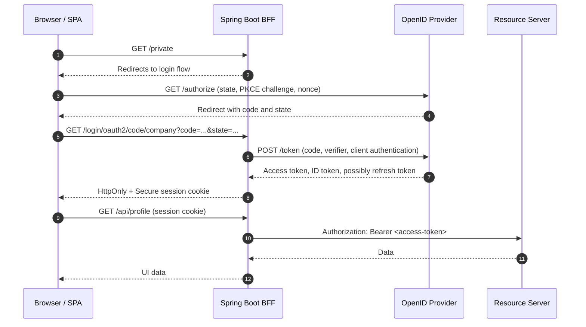

# 2.2. Public Clients, Confidential Clients, and Application Deployment Models

In OAuth 2.0, distinguishing between a **public client** and a **confidential client** determines whether an application can authenticate itself to the Authorization Server using secret credentials. This classification directly affects client registration, authorization flow selection, token management, and Spring Security OAuth2/OIDC Client implementation.

An application whose UI runs in a browser is not necessarily a public client; if the UI only communicates with a backend that owns the entire OAuth flow, the **backend** can be a confidential client. Conversely, a mobile application distributed as an installable package remains a public client even if its source code is compiled and the operating system provides secure storage.

## 1. Where Does the Client Fit in OAuth 2.0 and OIDC?

The fundamental roles:

| Role | Responsibility | Example |
|---|---|---|
| Resource Owner | Entity that grants access to data; usually a user | A user logging in and consenting to grant permissions |
| Client | Application requesting permissions or login on behalf of a user | Spring MVC, SPA, Android app |
| Authorization Server (AS) | Authenticates users, handles authorization, issues tokens | Identity Provider supporting OAuth 2.0 |
| Resource Server (RS) | Protects APIs and validates access tokens | Spring Boot REST API |

**OpenID Connect (OIDC)** adds an identity layer on top of OAuth 2.0. When a client requests the `openid` scope under the OIDC protocol, the OpenID Provider (OP) can issue an **ID token** for the client to verify information about the login session. The **access token** is used to access APIs; the ID token is for the client to receive and verify login information, and does not replace the access token at the API.

In the examples below:

- **Login client**: a Spring Boot application using `oauth2Login()`.
- **API-calling client**: a Spring Boot application using `oauth2Client()` to obtain and attach access tokens.
- **Resource Server**: an API using `oauth2ResourceServer()` to validate bearer access tokens.

A single Spring Boot process can serve multiple roles, but each role has distinct security responsibilities.

## 2. How Are Public Clients and Confidential Clients Distinguished?

The core criterion is **the ability to protect client credentials from the user/whoever controls the runtime environment**, according to the threat model and agreement with the Authorization Server.

### 2.1. Public Client

A **public client** cannot keep a shared secret (e.g., `client_secret`) safe across all installations from users who control the execution environment.

Typical examples:

- **Single-Page Application (SPA) running entirely in the browser**: JavaScript, source maps, network traffic, and downloaded configs can be inspected; never embed `client_secret` in the bundle, HTML, or frontend build environment variables.
- **Native/mobile/desktop applications distributed to user devices**: a secret packaged inside an APK, IPA, or executable can be extracted, even when obfuscated.
- **CLI tools installed on user machines**: the runner has permissions to read local config files and processes.

Typically, this client registers a `client_id` and redirect URIs, and uses **Authorization Code + PKCE** with client authentication method `none`. `client_id` is only an identifier and **is not a secret**.

Public clients can still log users in securely when using Authorization Code + PKCE, validating `state`, strictly matching redirect URIs, using TLS, and protecting tokens appropriately. PKCE reduces the risk of an attacker stealing an authorization code to exchange for tokens; **PKCE does not turn a public client into a confidential client** and does not protect against all forms of browser XSS.

### 2.2. Confidential Client

A **confidential client** has a trusted execution environment to protect credentials and can authenticate the client's identity to the Authorization Server. Examples:

- A Spring Boot web backend running in infrastructure managed by the organization.
- A Backend for Frontend (BFF) executing OAuth on behalf of a web UI.
- A scheduled service or server-to-server service using `client_credentials`.

Client authentication mechanisms can include:

| Mechanism | Characteristics | Notes |
|---|---|---|
| `client_secret_basic` | Backend sends client ID/secret via HTTP Basic when calling the token endpoint | HTTPS only; the secret must remain server-side |
| `client_secret_post` | Backend places the secret in the request body to the token endpoint | Usually not preferred when a more suitable mechanism is available |
| `private_key_jwt` | Client signs a JWT assertion with a private key | Suitable when strict key management and certificate lifecycle are in place |
| Mutual TLS (mTLS) | Authenticates the client using a TLS certificate | Depends on AS support and infrastructure configuration |

Being a confidential client **does not mean** being granted broader access permissions; permissions still depend on the grant, scopes, audience, policies, and user consent. Confidential clients should also use **PKCE with Authorization Code** to bind the code exchange to the initial authorization request.

### 2.3. Comparison Table

| Property | Public Client | Confidential Client |
|---|---|---|
| Keep a shared secret safe | Cannot be assumed | Possible in a trusted server environment |
| `client_id` | Yes, public | Yes, public |
| `client_secret` in user-side runtime | Must not be used | Must not be exposed to the user side |
| Client authentication at token endpoint | Usually `none` | Secret, JWT assertion, mTLS… |
| Authorization Code + PKCE | Required by modern security practice | Strongly recommended, should be enabled |
| Where tokens are held | In the user-side app, minimizing exposure | Backend/server-side |
| Examples | Pure SPA, mobile, desktop, CLI | Spring MVC server, BFF, backend-to-backend |

**Subtlety:** The classification applies to **the OAuth client and the environment that actually executes the protocol**, not simply to labels like "web app", "mobile app", or "Spring Boot app". If a product has both an SPA and a backend, identify **which component sends the authorization request and exchanges the code for tokens**. The two components may be two separately registered OAuth clients with different security types.

## 3. Why Does Authorization Code + PKCE Fit Public Clients?

The standard flow for interactive login in a public client is the **Authorization Code Flow combined with Proof Key for Code Exchange (PKCE)**.

1. Before redirecting, the client generates a high-entropy random `code_verifier`, then computes `code_challenge = BASE64URL(SHA256(code_verifier))`; using method `S256`.
2. The client redirects the browser to the authorization endpoint with `client_id`, `redirect_uri`, `response_type=code`, `scope`, `state`, and the PKCE parameters.
3. The Authorization Server handles authentication and permissions, then returns an **authorization code** via the registered redirect URI.
4. The client verifies `state` and sends the code along with the **original `code_verifier`** to the token endpoint.
5. The Authorization Server matches the verifier against the challenge before issuing tokens.

`code_verifier` must be freshly generated for **every authorization request**, not reused as a fixed string across the application. In a public client, the token request normally does not include `client_secret`.

```text
Authorization request:
GET /authorize?
  response_type=code
  &client_id=spa-client
  &redirect_uri=https%3A%2F%2Fapp.example.com%2Fcallback
  &scope=openid%20profile
  &state=<random-state>
  &code_challenge=<S256-challenge>
  &code_challenge_method=S256

Token request (illustrative):
POST /token
  grant_type=authorization_code
  code=<authorization-code>
  redirect_uri=https://app.example.com/callback
  client_id=spa-client
  code_verifier=<original-verifier>
```

Four mechanisms that are often confused:

| Mechanism | Question It Answers | What It Does Not Replace |
|---|---|---|
| **PKCE** | Does the party exchanging the authorization code hold the verifier from the initial request? | Does not authenticate a public client's identity and does not provide complete XSS protection |
| **`state`** | Does the callback correspond to a request initiated by the client? | Does not replace PKCE |
| **`nonce` (OIDC)** | Is the ID token bound to the original authentication request? | Does not replace signature, issuer, and audience validation |
| **Client authentication** | Can the client prove its registered credentials? | Does not replace PKCE in flows with an authorization code |

Additionally, redirect URIs must be registered and strictly matched; use HTTPS (except loopback exceptions for native apps per the standard), restrict scopes, and avoid logging codes/tokens. Do not use the **Implicit Flow** just to avoid the token endpoint in an SPA; Authorization Code + PKCE is the modern approach. **Resource Owner Password Credentials** is also unsuitable for new applications.

## 4. Common Deployment Models

| Model | Component Acting as OAuth Client | Typical Client Type | Where Are Tokens Usually Kept? | Browser/User Interaction Mechanism |
|---|---|---|---|---|
| Server-rendered web (MVC/SSR) | Spring backend | Confidential | Server | Session cookie |
| SPA + BFF | Spring BFF backend | Confidential | Server | Session cookie to BFF |
| Pure SPA calling APIs | JavaScript in the browser | Public | Browser side | Authorization Code + PKCE and bearer token |
| Mobile/native | App installed on the device | Public | Device side | System browser + PKCE |
| Desktop/CLI | Local application | Public | Local device/context | Loopback redirect or Device Authorization |
| Backend-to-backend | Service or batch job | Confidential | Server | `client_credentials`; no user session |

This is a design guidance table, not a framework-enforced rule. A backend can **only be a Resource Server** without being an OAuth client; a static frontend can access APIs through a BFF without owning tokens itself.

### 4.1. Server-Rendered Web: Spring MVC / Thymeleaf

For a Spring Boot application rendering HTML server-side, Spring Security OAuth2 Login can perform the redirect to the OpenID Provider, receive the authorization code, exchange it for tokens on the backend, and establish a login session.

- The backend holds client credentials and tokens.
- The browser only receives a session cookie; it does not need access to the access token.
- OAuth2 Client can be used to attach the access token when the backend calls APIs on behalf of the user.
- You must protect the session, prevent CSRF on state-changing operations, ensure HTTPS, and configure cookies properly.

The client is **confidential** when the backend holds and uses credentials securely.

### 4.2. SPA + BFF: JavaScript UI, OAuth on the Backend

A Backend for Frontend provides APIs tailored to the UI; **the BFF is the OAuth client**, managing the authorization code, PKCE, client authentication, and tokens. The frontend communicates with the BFF using a **session cookie** instead of holding access tokens in JavaScript.



The main benefit is reducing the chance of **JavaScript directly reading and stealing tokens**, because tokens remain on the backend. Even so, XSS can still send requests **through the user's session**, so output encoding, an appropriate CSP, CSRF protection, and session controls are still necessary. A true BFF does not return access tokens to JavaScript; if the backend re-issues tokens for the browser to call APIs directly, browser-side token risk analysis is still required.

With multiple Spring Boot instances, session storage and authorized client/token storage must support distributed deployment; avoid accidentally relying on single-node in-memory state.

### 4.3. Pure SPA + Spring REST API

When React/Vue/Angular is served as static files and talks directly to the Authorization Server:

- **The SPA is a public OAuth/OIDC client**, registered separately without a client secret.
- The frontend uses an OAuth/OIDC library supporting Authorization Code + PKCE, `state`, `nonce`, and callback validation.
- The Authorization Server must allow appropriate CORS at the token endpoint if the browser needs to call it.
- The SPA sends the access token to the API via `Authorization: Bearer ...`.
- The Spring REST API acts as a **Resource Server**, validating issuer, signature, expiration, audience, and endpoint permissions.

The primary risk is that XSS can access tokens or perform actions while the user is logged in. Avoid keeping tokens in long-lived JavaScript storage; if refresh tokens are needed in an SPA, use them only according to the AS policy, preferring rotation or sender constraints and appropriate lifetimes. No browser token-storage mechanism completely eliminates XSS risk.

**Do not** add `client_secret` to a frontend `.env` file and assume the secret is protected: variables bundled into the final build or browser network traffic can still be exposed.

### 4.4. Native/Mobile/Desktop Clients

Applications on phones or personal computers are typically **public clients**:

- Open the Authorization Server using the **system browser** or OS-provided authentication tab mechanism, rather than asking users to enter passwords into an app-controlled WebView.
- Use Authorization Code + PKCE and an appropriate redirect URI: verified app/universal links or a loopback URI on desktop following native app guidelines.
- Use the operating system's secure storage for tokens when needed; this reduces risk but **does not make an embedded secret a trustworthy client secret**.
- For CLIs or devices with constrained keyboards/browsers, the **OAuth 2.0 Device Authorization Grant** can be used if the AS supports it and the use case fits.

A Spring backend serving a mobile app can be a **Resource Server** receiving bearer tokens. That same backend can also act as an independent confidential OAuth client when calling other services.

### 4.5. Service-to-Service or Batch Jobs

A Spring Boot service calling another API without an interactive user typically uses the **Client Credentials Grant**. The service authenticates itself using a secret, private-key JWT, or mTLS and receives an access token for the client/workload identity:

```text
Spring batch/service --(client authentication + client_credentials)--> AS
Spring batch/service <--(access token)------------------------------- AS
Spring batch/service --(Bearer access token)-----------------------> API
```

This is **client authorization**, not an OIDC user login process. You should not expect an ID token or end-user identity from `client_credentials`. When multiple services share a single secret, consider separating registrations/credentials to limit blast radius on key compromise and support independent revocation.

## 5. Applying with Spring Security OAuth2/OIDC Client

### 5.1. Configuring a Confidential OIDC Client on the Backend

Example of a Spring Boot server-side web application using OAuth2 Login. On the Authorization Server side, register the confidential client `company`, enable Authorization Code, declare the exact redirect URI, and configure the corresponding client authentication.

Add dependencies (Gradle Groovy):

```groovy
dependencies {
    implementation 'org.springframework.boot:spring-boot-starter-security'
    implementation 'org.springframework.boot:spring-boot-starter-oauth2-client'
}
```

Configure `application.yml`:

```yaml
spring:
  security:
    oauth2:
      client:
        registration:
          company:
            provider: company
            client-id: ${OIDC_CLIENT_ID}
            client-secret: ${OIDC_CLIENT_SECRET}
            client-authentication-method: client_secret_basic
            authorization-grant-type: authorization_code
            redirect-uri: "{baseUrl}/login/oauth2/code/{registrationId}"
            scope:
              - openid
              - profile
              - email
        provider:
          company:
            issuer-uri: ${OIDC_ISSUER_URI}
```

The `OIDC_ISSUER_URI` value must be the issuer published by the OP (for example `https://id.example.org/realms/learning`); Spring Security uses discovery metadata to locate endpoints and public keys if the provider supports it. `client-secret` is injected into the server runtime via a secret manager or environment variables—**never commit it to the repository**.

A minimal Servlet Security Filter Chain configuration that actively enables PKCE even for a confidential client:

```java
import org.springframework.context.annotation.Bean;
import org.springframework.context.annotation.Configuration;
import org.springframework.security.config.Customizer;
import org.springframework.security.config.annotation.web.builders.HttpSecurity;
import org.springframework.security.oauth2.client.registration.ClientRegistrationRepository;
import org.springframework.security.oauth2.client.web.DefaultOAuth2AuthorizationRequestResolver;
import org.springframework.security.oauth2.client.web.OAuth2AuthorizationRequestCustomizers;
import org.springframework.security.web.SecurityFilterChain;

@Configuration
public class SecurityConfig {

    @Bean
    SecurityFilterChain appSecurity(
            HttpSecurity http,
            ClientRegistrationRepository registrations) throws Exception {

        var resolver = new DefaultOAuth2AuthorizationRequestResolver(
                registrations, "/oauth2/authorization");

        resolver.setAuthorizationRequestCustomizer(
                OAuth2AuthorizationRequestCustomizers.withPkce());

        http
            .authorizeHttpRequests(auth -> auth
                .requestMatchers("/", "/error").permitAll()
                .anyRequest().authenticated())
            .oauth2Login(login -> login
                .authorizationEndpoint(endpoint ->
                    endpoint.authorizationRequestResolver(resolver)))
            .oauth2Client(Customizer.withDefaults());

        return http.build();
    }
}
```

The default login initiation path is `/oauth2/authorization/company`; the corresponding callback redirect URI is `/login/oauth2/code/company` (or the absolute URI expanded by `{baseUrl}`). In real deployments behind a reverse proxy, you must properly determine the public origin and trusted proxy forwarded headers to avoid generating incorrect redirect URIs.

The `oauth2Login()` layer handles OAuth2/OIDC-based login; `oauth2Client()` supports using the authorized client when calling downstream APIs. Both features can coexist, but they do not replace bearer token validation of a Resource Server.

**Note on PKCE:** auto-configuration and default support levels may vary across Spring Security versions and client types. The resolver snippet above explicitly enforces PKCE for Authorization Code; the Authorization Server must support verifying code challenge/verifier. When acting as a public client in Spring, you must configure `ClientAuthenticationMethod.NONE`, enable PKCE, and omit any client secret; a pure SPA typically handles the flow on the frontend rather than using `oauth2Login()` on the API.

### 5.2. Spring REST API Behind a Public SPA

A Spring Boot API sitting behind an SPA is typically a **Resource Server**. Install dependencies:

```groovy
dependencies {
    implementation 'org.springframework.boot:spring-boot-starter-security'
    implementation 'org.springframework.boot:spring-boot-starter-oauth2-resource-server'
}
```

Example with a JWT access token whose issuer publishes verification keys:

```yaml
spring:
  security:
    oauth2:
      resourceserver:
        jwt:
          issuer-uri: ${OIDC_ISSUER_URI}
```

```java
import org.springframework.context.annotation.Bean;
import org.springframework.context.annotation.Configuration;
import org.springframework.security.config.Customizer;
import org.springframework.security.config.annotation.web.builders.HttpSecurity;
import org.springframework.security.config.annotation.web.configurers.AbstractHttpConfigurer;
import org.springframework.security.config.http.SessionCreationPolicy;
import org.springframework.security.web.SecurityFilterChain;

@Configuration
public class ApiSecurityConfig {

    @Bean
    SecurityFilterChain apiSecurity(HttpSecurity http) throws Exception {
        http
            .sessionManagement(session ->
                session.sessionCreationPolicy(SessionCreationPolicy.STATELESS))
            .authorizeHttpRequests(auth ->
                auth.anyRequest().authenticated())
            .oauth2ResourceServer(resourceServer ->
                resourceServer.jwt(Customizer.withDefaults()))
            .csrf(AbstractHttpConfigurer::disable);

        return http.build();
    }
}
```

This snippet is intended for **stateless APIs that only accept bearer tokens via the Authorization header and do not authenticate with cookies**. If the application also uses cookies/sessions, do not copy the disabled CSRF configuration directly; separate the security filter chains or design CSRF protection appropriately. Cross-origin APIs also require a clear CORS policy.

A Spring Resource Server must accept **access tokens intended for this API**: in addition to validating issuer, signature, and expiration, configure validation for the API's **audience** and per-endpoint scope/authority policies. Do not accept an ID token as an access token simply because both are formatted as JWTs. If the AS issues opaque access tokens, use token introspection instead of the JWT configuration above.

### 5.3. Client Credentials in Spring

Another registration in `application.yml` for backend-to-backend calls:

```yaml
spring:
  security:
    oauth2:
      client:
        registration:
          inventory-service:
            provider: internal-as
            client-id: ${INVENTORY_CLIENT_ID}
            client-secret: ${INVENTORY_CLIENT_SECRET}
            client-authentication-method: client_secret_basic
            authorization-grant-type: client_credentials
            scope: inventory.read
        provider:
          internal-as:
            token-uri: https://auth.example.org/oauth2/token
```

This registration does not use `oauth2Login()` because there is no redirected user. The application uses `OAuth2AuthorizedClientManager` or Spring Security's HTTP client integration to acquire/renew tokens and attach them to API calls. Design an authorized-client storage suitable for background services and choose an appropriate technical principal; avoid relying on a non-existent user HTTP session.

## 6. Choosing a Model Through Real-World Scenarios

**Scenario A — Internal admin portal written in Spring MVC.** HTML and protected operations all go through the Spring backend. Choose a confidential OIDC client, `oauth2Login()`, store tokens server-side, and return a session cookie to the browser.

**Scenario B — React hosted on a CDN, calling a Spring API directly.** Choose a public OIDC client for React with Authorization Code + PKCE; the Spring API is a Resource Server. Do not give React a secret; the API only accepts access tokens with the right issuer/audience.

**Scenario C — React using a Spring BFF to communicate with APIs.** Choose a confidential client for the BFF. The browser uses a session cookie protected with HttpOnly/Secure/SameSite and CSRF protection; the BFF holds and uses the access token when calling downstream APIs. If the browser does not need to call the token endpoint, avoid sending tokens to JavaScript.

**Scenario D — Android app with company login.** Choose a public native client, system browser, PKCE, and platform-appropriate callback. The Spring API backend validates the bearer access token.

**Scenario E — Hourly inventory sync job.** Choose a confidential service client with `client_credentials`. Permissions granted to the job must be restricted to the necessary APIs and actions; do not fabricate an OIDC session for a fake user.

## 7. Common Design Mistakes and How to Handle Them

| Mistake | Why It Is Dangerous or Wrong | How to Handle It |
|---|---|---|
| Embedding `client_secret` in a frontend bundle or mobile APK | Users can extract the shared secret | Register a public client; or move all OAuth handling into a trusted BFF |
| Treating `client_id` as a password | Provides no secret authentication value | Use a proper authentication method for confidential clients; use PKCE for public clients |
| Skipping PKCE because the backend already has a client secret | The authorization code still needs to be bound to the original request | Use PKCE `S256` with Authorization Code |
| Using Implicit Flow for SPA login | Access tokens travel through the front channel and are more easily exposed | Use Authorization Code + PKCE |
| Using an ID token as a bearer token to call APIs | ID tokens have a different purpose and audience than access tokens | APIs must only accept access tokens issued for the API |
| Using `client_credentials` to simulate user login | This grant represents the client and carries no user context | Use OIDC Authorization Code for interactive login |
| Leaving redirect URIs open with uncontrolled wildcards | Creates risks of authorization code theft and open redirects | Register and strictly match redirect URIs by client type |
| Putting tokens in URLs, logs, or analytics | Tokens can be persisted in browser history, referrers, and logging systems | Pass bearer tokens in headers; strip sensitive data from logs |
| Disabling CSRF for applications using session cookies | Browsers automatically send cookies in certain contexts | Enable appropriate CSRF protection; cookie flags are only one defense layer |
| Checking only that a JWT has a valid signature | A valid token from another API/issuer could still be misused | Validate issuer, audience, expiration, and authorization at the API |
| Keeping long-lived SPA refresh tokens without controls | Expands the impact if a token is compromised | Apply rotation or sender constraints, expiry, and AS-managed sessions |
| Using a single registration for both SPA and server with the same secret | Blurs trust boundaries | Separate client registrations, redirect URIs, and policies by component |

## 8. Architectural Decision-Making Mindset

When designing an application, determine each point in order:

1. **Who is actually the OAuth client?** Does the browser call the authorization/token endpoints directly, or does a backend execute the protocol steps?
2. **Can credentials be protected from the end user?** If not, register a public client. Do not "upgrade" a client to confidential merely by placing a secret in a device config file.
3. **Which components do tokens pass through?** If business requirements allow, SSR/BFF keeps tokens on the backend and simplifies frontend token handling.
4. **Is a user logging in?** Yes: OIDC Authorization Code + PKCE is typically appropriate. No: consider `client_credentials` for service-to-service or another grant matching the use case.
5. **Who verifies the access token at the API?** The Resource Server must check the right issuer, audience, expiry, and permissions; successful client login does not exempt API checks.
6. **Where do trust boundaries change?** Each distinct trust environment may need its own registration, redirect URI, cookie policy, and token policy.

**Practical rule:** Do not put confidential client OAuth secrets into environments controlled by end users; use Authorization Code + PKCE for modern login flows, protect tokens according to their deployment location, and clearly separate **OIDC login**, **OAuth 2.0 authorization**, and **access token validation at the API**.

## 9. Authoritative References for Deeper Study

- [RFC 6749 — The OAuth 2.0 Authorization Framework](https://www.rfc-editor.org/rfc/rfc6749): classification of public/confidential clients and grants.
- [RFC 7636 — Proof Key for Code Exchange by OAuth Public Clients](https://www.rfc-editor.org/rfc/rfc7636): verifier/challenge workflow.
- [RFC 8252 — OAuth 2.0 for Native Apps](https://www.rfc-editor.org/rfc/rfc8252): system browser and redirects for native apps.
- [RFC 8628 — OAuth 2.0 Device Authorization Grant](https://www.rfc-editor.org/rfc/rfc8628): input-constrained devices.
- [RFC 9700 — Best Current Practice for OAuth 2.0 Security](https://www.rfc-editor.org/rfc/rfc9700): modern OAuth 2.0 security recommendations.
- [OpenID Connect Core 1.0](https://openid.net/specs/openid-connect-core-1_0.html): ID token, nonce, and OIDC login.
- [Spring Security — OAuth 2.0 Login](https://docs.spring.io/spring-security/reference/servlet/oauth2/login/index.html) and [OAuth 2.0 Resource Server](https://docs.spring.io/spring-security/reference/servlet/oauth2/resource-server/index.html): configuration according to your Spring Security version.
