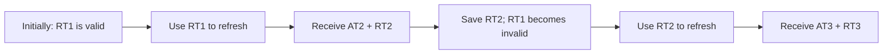
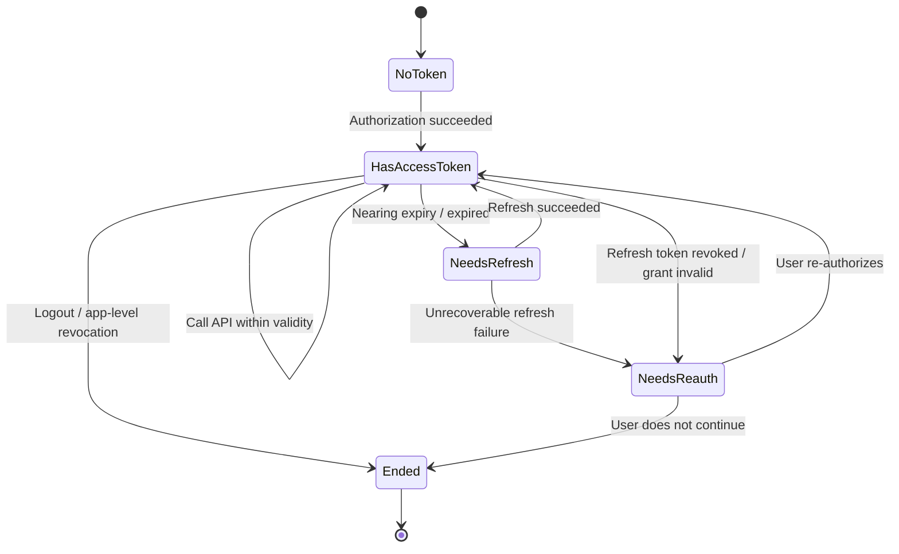

# 2.8. Refresh Token Grant and Token Renewal Lifecycle

## Lesson Objectives

After this lesson, you will be able to:

- Explain why **access tokens** are usually short-lived while applications still maintain an access session without forcing users to log in every few minutes.
- Accurately describe the **Refresh Token Grant**: the client sends a refresh token to the Authorization Server to request a new access token; the Resource Server does not handle this request.
- Distinguish **access token renewal**, **refresh token rotation**, **re-login**, **application session extension**, and **token revocation**.
- Understand scenarios where a refresh token expires, is revoked, is reused, is rejected, or is never issued in the first place.
- Configure and use Spring Security OAuth2 Client components to manage refresh tokens according to the `OAuth2AuthorizedClient` lifecycle.
- Design token storage, synchronization across concurrent requests/instances, error handling, and refresh token protection in systems using OAuth 2.0 and OpenID Connect (OIDC).

## 1. Why Are Refresh Tokens Needed?

Suppose a Spring Boot application named **Course Portal** logs users in via **Campus Identity** (Authorization Server/OpenID Provider), then calls **Course API** using an access token. The Authorization Server issues an access token with a 5-minute lifetime. A user studies for 45 minutes and keeps opening materials.

If every access token forced the user to log in again upon expiration, the experience would be disrupted. Conversely, issuing access tokens valid for too long can increase the damage if a token leaks.

A **refresh token** is a credential issued by the Authorization Server to the client (when policy permits) so the client can request a new access token without repeating the full user login and consent steps every time. This is part of OAuth 2.0: the Refresh Token Grant.

Four roles to remember:

| Component | In the Example | Relation to Refresh |
| --- | --- | --- |
| Resource Owner / End-User | Course Portal user | Initially authenticates and may grant consent; usually does not interact during normal refreshes |
| Client | Course Portal | Stores the refresh token securely and sends it to the token endpoint when needed |
| Authorization Server | Campus Identity | Decides whether to issue, accept, rotate, or revoke refresh tokens; issues new access tokens |
| Resource Server | Course API | Only receives and validates **access tokens** to protect APIs; does not accept refresh tokens for renewal |

**A refresh token is not a long-lived access token.** It has its own purpose, target recipient, and usage scope. The Client does not send a refresh token in `Authorization: Bearer ...` to business APIs.

### 1.1. Three Lifecycles to Distinguish

1. **Access token:** permission to call one or a group of Resource Servers for a limited time.
2. **Refresh token:** ability to obtain subsequent access tokens under Authorization Server conditions. It can expire, be revoked, be rotated, or not be issued at all.
3. **Application login session / SSO session:** the session cookie at Course Portal and the user's session at Campus Identity have their own lifecycles; they do not automatically equal the lifetimes of either token.

For example: a user may still hold a valid session cookie at Course Portal while the refresh token has been revoked. When the next API call is needed, Portal may have to prompt the user to re-authorize/re-login. Conversely, logging out of Portal does not necessarily revoke all tokens issued by the Authorization Server automatically.

## 2. Access Tokens, Refresh Tokens, and Timelines

A token endpoint response after the Authorization Code flow **might** look like this:

```json
{
  "access_token": "eyJ...example",
  "token_type": "Bearer",
  "expires_in": 300,
  "refresh_token": "rt_example_opaque",
  "scope": "courses.read"
}
```

The values above are illustrative only; do not use them as real tokens. In OIDC, an eligible response may also include `id_token`.

| Field | Practical Meaning |
| --- | --- |
| `access_token` | Credential the client uses to call the Resource Server |
| `token_type` | Usually `Bearer`; indicates how the access token is used |
| `expires_in` | Access token lifetime in seconds at the moment the response is generated |
| `refresh_token` | Optional credential to request new tokens; **not issued for every grant, client, or provider** |
| `scope` | Granted scope; may be omitted when identical to the request per OAuth rules |

Typically, the client stores the access token alongside its expected expiration timestamp (`expiresAt`) and the active refresh token. Never assume a refresh token has the same lifetime as an access token. Depending on the Authorization Server, a refresh token may have absolute limits, inactivity limits, session limits, or other security rules; many responses do not disclose the refresh token's expiration time to the client.

An illustrative timeline:

```text
09:00  User completes Authorization Code + OIDC.
       Client receives AT1 (expected expiry 09:05) and RT1.

09:04  Client is about to call Course API; AT1 is nearing expiration.
       Client sends RT1 to the token endpoint.

09:04  Authorization Server returns AT2 (expected expiry 09:09).
       If refresh-token rotation is enabled, it may return RT2 replacing RT1.

09:07  Client calls Course API with AT2 without asking the user to log in again.

10:00  Current RT expires/is revoked per policy.
       Next access token request is rejected; Client must handle re-authorization.
```

Token renewal at 09:04 is **reissuing an access token**; it does not mean the SSO session or all user permissions were extended indefinitely.

## 3. How Does the Refresh Token Grant Work?

The Refresh Token Grant is defined in OAuth 2.0, RFC 6749, Section 6. It is a **direct request from the Client to the Authorization Server's token endpoint**. Browser redirects, authorization codes, and consent screens generally do not participate during normal renewal.

```mermaid
sequenceDiagram
    autonumber
    actor U as User
    participant C as Course Portal (Client)
    participant AS as Campus Identity (Authorization Server)
    participant RS as Course API (Resource Server)

    U->>C: Uses Portal after logging in
    Note over C: AT1 nearing expiration; stores RT1
    C->>AS: POST token endpoint, grant_type=refresh_token, RT1
    AS->>AS: Validates refresh token, client, scope, policy
    alt Valid refresh
        AS-->>C: AT2 and possibly RT2
        C->>C: Saves AT2; replaces RT1 with RT2 if issued
        C->>RS: GET /api/me/courses, Bearer AT2
        RS-->>C: Authorized data
        C-->>U: Displays result
    else Refresh rejected
        AS-->>C: OAuth error, e.g. invalid_grant
        C->>C: Clears unusable token state
        C-->>U: Prompts for re-login/re-authorization when appropriate
    end
```

### 3.1. HTTP Request at the Token Endpoint

Example of a **confidential client** configured with HTTP Basic authentication sending a request:

```http
POST /oauth2/token HTTP/1.1
Host: login.example.org
Authorization: Basic <base64-client-id-and-secret>
Content-Type: application/x-www-form-urlencoded

grant_type=refresh_token&refresh_token=<current-refresh-token>
```

In HTTP Basic, the header value must be built per OAuth rules for client credentials; expressions inside `<...>` are placeholders only. Communication must use HTTPS. The actual token endpoint and authentication method are determined by provider configuration.

Key parameters:

| Parameter | Required? | Meaning |
| --- | --- | --- |
| `grant_type=refresh_token` | Yes | Identifies the grant type being executed |
| `refresh_token` | Yes | Current refresh token issued by the Authorization Server |
| `scope` | Optional | If present, must not request scopes exceeding those originally granted; providers may enforce stricter policies |
| Client authentication credentials | Depends on client type and config | Confidential clients must authenticate when required; public clients cannot rely on an embedded client secret |

A refresh request **does not** send `authorization_code`, `code_verifier`, or `code_challenge` like an authorization code exchange request. PKCE protects the initial authorization code exchange. Refresh tokens have their own bindings, authentication, and protections.

In a public client, how client identity is represented and how refresh tokens are protected depends on the Authorization Server. Never copy a confidential client's HTTP Basic snippet into an SPA/mobile app and embed a client secret.

### 3.2. Token Response on Successful Refresh

```http
HTTP/1.1 200 OK
Content-Type: application/json
Cache-Control: no-store
Pragma: no-cache

{
  "access_token": "new_access_token_example",
  "token_type": "Bearer",
  "expires_in": 300,
  "refresh_token": "new_refresh_token_example",
  "scope": "courses.read"
}
```

The Client must:

1. Read the new access token and update its expiration time.
2. If the server issues a **new refresh token**, replace the stored old refresh token with the new one. Do not keep using the old token assuming it remains valid.
3. Attach the new access token to requests sent to the right Resource Server.
4. Maintain security boundaries: never log or return the refresh token to the frontend if the backend manages credentials.

The server does not return a `refresh_token` on every refresh. If no new token is returned, the client continues using the existing refresh token within provider policy limits. If the server rotates tokens, the old token may be invalidated immediately upon issuing the new one.

### 3.3. What Can a Refresh Token Do?

It is not a request for arbitrary privilege escalation:

- Requested scopes cannot be broader than the original authorization. The server may grant narrower scopes.
- New tokens may still be subject to audience/resource, user policies, client bindings, and the remaining lifetime of an authorization session.
- The Authorization Server can reject a refresh if the user revoked consent, the account was locked, risk increased, or the client is no longer allowed.
- A refresh token does not guarantee valid access tokens forever; the client must always handle the end of an authorization session.

## 4. Refresh Token Rotation and Reuse Detection

Refresh tokens typically live longer than access tokens, so if stolen, the exposure window can be prolonged. An important safeguard is **refresh-token rotation**: on every successful refresh, the Authorization Server issues a new refresh token and invalidates the token just used.



When two parties attempt to use the same old token, the Authorization Server can treat that as a sign of **token replay**. Depending on policy, the server may invalidate the entire related token chain (token family) and require the client to re-authorize.

Example attack scenario:

1. An attacker copies `RT1`.
2. The legitimate client exchanges `RT1` for `RT2`.
3. The attacker subsequently sends `RT1` to the token endpoint.
4. The Authorization Server detects reuse and can revoke tokens belonging to that grant/rotation chain to block both parties from continuing access.

**Operational note:** Two legitimate concurrent requests can also trigger reuse:

```text
Request A reads RT1 ─┬─> exchanges RT1 for RT2 (succeeds)
Request B reads RT1 ─┘─> exchanges RT1 again   (invalid_grant or reuse detected)
```

This can break the entire token session if the system enforces strict replay detection. Therefore, refresh token rotation requires **persisting the latest token version** and **synchronizing refreshes** across requests/instances.

Some Authorization Servers have a brief grace window for race conditions, but clients must never rely on that assumption.

### 4.1. Rotation vs. Sender-Constrained Refresh Tokens

Two groups of techniques are commonly used to reduce harm when a refresh token is stolen:

- **Rotation:** a new token replaces the old one; abnormal reuse can be detected.
- **Sender-constraining:** the token is bound to cryptographic material of the client/sender, such as a key-based proof-of-possession mechanism. Holding the token string alone without proof of key possession is insufficient to use it.

According to OAuth 2.0 Security Best Current Practice (RFC 9700), refresh tokens issued to **public clients** must be protected by rotation **or** sender-constraining per standard requirements. Specific mechanisms and detection/revocation behavior depend on Authorization Server, client, and application type support.

## 5. Token Lifecycle States

From the client's perspective, this can be modeled as:



The states above are a **client mental model**, not a mandatory OAuth state machine.

| Event | How the Client Should Interpret It | Typical Action |
| --- | --- | --- |
| Access token is valid | Can attempt API call if audience/scope match | Use the access token |
| Access token nearing expiry and refresh token exists | Can request a new access token | Refresh before calling the API |
| Access token expired, no refresh token | No credential available for Refresh Token Grant | Re-initiate authorization flow or use another allowed grant |
| Refresh succeeds, response has a new refresh token | Rotation may have occurred | Store new token, discard old token |
| Refresh succeeds, no new refresh token | Server did not issue a new one this time | Keep current refresh token per policy |
| Refresh returns `invalid_grant` | Token/grant may be expired, revoked, or invalid | Do not retry infinitely; clear unusable state, prompt re-authorization when appropriate |
| API returns 401 `invalid_token` | API rejects the access token | Check expiry/issuer/audience/revocation; retry only in a controlled way |
| API returns 403 due to missing permissions | Insufficient permissions even if token is valid | Check scopes and authorization; refreshing does not increase scopes |
| User logs out | Local session ends | Clear local session and client-stored tokens; coordinate provider revocation/logout if applicable |

### 5.1. When Should Refresh Happen?

Two common strategies:

- **Lazy (on-demand) refresh:** before calling an API, if the access token has expired or falls within a buffer window, the client calls the token endpoint. This integrates easily with `OAuth2AuthorizedClientManager`.
- **Proactive refresh:** the application schedules refreshes ahead of expiration. Requires considering background jobs, user status, downtime, and concurrency; do not continuously refresh just to keep tokens alive forever.

With concurrent requests, there should be one refresh flight per authorized client/grant at a time, rather than each HTTP request refreshing independently.

**Clock skew:** Client and server clocks are never perfectly synchronized. When checking "nearing expiry," subtract a suitable buffer to avoid sending an access token that expires while the request is in flight. This is a timing buffer, not permission to extend token validity.

## 6. Cases Where the Refresh Token Grant Cannot Be Used

### 6.1. Client Was Never Issued a Refresh Token

OAuth allows the Authorization Server to omit refresh tokens. Even requesting `offline_access` in OIDC does not guarantee issuance; providers have their own policies and consent conditions. When `refresh_token` does not exist, you cannot fabricate or derive it from `access_token` or `id_token`.

### 6.2. Client Credentials Grant

In machine-to-machine communication using **Client Credentials**, the application typically requests a new access token using its own client credentials when the old token expires. OAuth 2.0 discourages issuing refresh tokens for Client Credentials; many providers do not issue them.

This differs from interactive user login via Authorization Code + OIDC: there, a refresh token lets the client continue using a user-granted authorization within policy limits.

### 6.3. Refresh Token Expired, Revoked, or Replay Detected

The Authorization Server may return `invalid_grant`. The client must stop using the invalid token, update its store, and go through a new authorization flow if the user still wants access. Continuously retrying the same rejected refresh token can trigger session locks, add load, or obscure root causes.

### 6.4. New Access Token Still Rejected by the Resource Server

A successful refresh only proves the token endpoint processed the grant according to policy. The Resource Server can still reject the token due to wrong audience, missing scopes, JWT validation failure, token revocation, or lack of record-level access permissions. **Refreshing does not replace API authorization checks.**

## 7. Relationship with OIDC and Login Sessions

An OIDC Client typically has three credentials/artifacts to distinguish:

| Artifact | Used For What? | Sent to Call Course API? |
| --- | --- | --- |
| Access token | Authorizing API access | Yes, when intended for that API |
| Refresh token | Requesting a new access token at the Authorization Server | No |
| ID token | Client/Relying Party validating End-User login event info | No |

OIDC may return a new ID token in the token response after a refresh depending on specification rules and provider. If an ID token is received, the client must validate it per applicable OIDC rules; never treat a new ID token as an access token. Depending on architecture, the application can keep the existing local session rather than recreating a login session on every refresh.

The `offline_access` scope in OIDC expresses a request for potentially continued access when the user is not present. Each provider defines exact usage conditions, interaction/consent rules, client types, and lifetimes. Do not equate `openid`, `profile`, or `email` with an automatic right to receive a refresh token.

### 7.1. Distinguishing Four Events

- **Refreshing the access token:** OAuth2 Client requests a new API credential; can happen entirely on the backend.
- **Re-logging in at the OpenID Provider:** user performs a fresh authentication or uses an existing SSO session.
- **Extending Portal's HTTP session:** the application's session/cookie mechanism, managed independently of provider tokens.
- **Logout/revocation:** clearing local state and optionally asking the provider to revoke tokens / perform SSO logout if supported by the integration.

If Portal uses cookie sessions while APIs use OAuth access tokens, both lifetimes must be designed together. A user logging out does not mean the refresh token was automatically revoked on the provider side; handle the token store and revocation workflow accordingly.

## 8. Where Does Spring Security Manage Refresh Tokens?

In a **Spring Security OAuth2 Client** application, the central concept is `OAuth2AuthorizedClient`, representing a client registration authorized for a corresponding principal context. This object stores the access token and, if issued, the refresh token.

Related components:

| Component | Role |
| --- | --- |
| `ClientRegistration` | Client and provider info: client ID, grant type, token endpoint, scopes, etc. |
| `OAuth2AuthorizedClient` | Authorized state: client registration, principal, access token, optional refresh token |
| `OAuth2AuthorizedClientRepository` | Stores/loads authorized clients in the Servlet HTTP request context |
| `OAuth2AuthorizedClientService` | Stores/loads authorized clients by client registration and principal name, not tied to an HTTP request |
| `OAuth2AuthorizedClientProvider` | Decides how to authorize/re-authorize by grant type, e.g., `refreshToken()` |
| `OAuth2AuthorizedClientManager` | Coordinates authorize/refresh, storage mechanisms, and result/error handling |
| `DefaultOAuth2AuthorizedClientManager` | Manager commonly used in a Servlet `HttpServletRequest` context |
| `AuthorizedClientServiceOAuth2AuthorizedClientManager` | Manager used outside a request context, e.g., background workers/services |

Spring Security can typically retrieve a stored access token and invoke the **refresh-token provider** when the token is nearing expiration, a refresh token is available, and provider conditions permit. This does not mean a background timer is constantly running to renew all tokens. Most often when using the manager, refresh is evaluated **when an `authorize` call is made to use the client**.

### 8.1. Configuring the Application as an OIDC Client

Assuming Course Portal is a confidential web backend client authenticating with `client_secret_basic`, and Campus Identity supports OIDC discovery:

```yaml
spring:
  security:
    oauth2:
      client:
        registration:
          campus:
            provider: campus
            client-id: ${CAMPUS_CLIENT_ID}
            client-secret: ${CAMPUS_CLIENT_SECRET}
            client-authentication-method: client_secret_basic
            authorization-grant-type: authorization_code
            redirect-uri: "{baseUrl}/login/oauth2/code/{registrationId}"
            scope:
              - openid
              - profile
              - courses.read
        provider:
          campus:
            issuer-uri: https://login.example.org
```

This is an example configuration, not details of a real provider. Before expecting a refresh token, verify **whether the provider issues refresh tokens for this registration, scopes, and grant**. Some systems require `offline_access` and specific consent conditions; adding a scope to YAML alone does not guarantee token issuance.

OIDC login and OAuth2 Client features can be enabled:

```java
@Configuration
class WebSecurityConfig {
    @Bean
    SecurityFilterChain securityFilterChain(HttpSecurity http) throws Exception {
        http
            .authorizeHttpRequests(auth -> auth
                .requestMatchers("/", "/error").permitAll()
                .anyRequest().authenticated()
            )
            .oauth2Login(Customizer.withDefaults())
            .oauth2Client(Customizer.withDefaults());

        return http.build();
    }
}
```

The Java snippets in this lesson focus on the relevant components, assuming the corresponding Spring Security imports and dependencies are already added to the project.

### 8.2. Configuring `AuthorizedClientManager` with a Refresh Token Provider

Example for a Servlet application handling HTTP requests:

```java
@Configuration
class OAuth2ClientConfiguration {

    @Bean
    OAuth2AuthorizedClientManager authorizedClientManager(
            ClientRegistrationRepository registrations,
            OAuth2AuthorizedClientRepository authorizedClients) {

        OAuth2AuthorizedClientProvider provider =
            OAuth2AuthorizedClientProviderBuilder.builder()
                .authorizationCode()
                .refreshToken()
                .build();

        DefaultOAuth2AuthorizedClientManager manager =
            new DefaultOAuth2AuthorizedClientManager(
                registrations,
                authorizedClients
            );

        manager.setAuthorizedClientProvider(provider);
        return manager;
    }
}
```

When the client already has an access token, the manager can reuse the valid token. When the token is close enough to expiration and a valid refresh token is present, the `refreshToken()` provider can execute the Refresh Token Grant, and the manager saves the updated `OAuth2AuthorizedClient` via the repository.

Keep in mind:

- If the Authorization Server **does not issue a refresh token**, the manager cannot synthesize one.
- If no authorized client exists, the grant type, provider, and authentication context determine whether initial authorization can run. On the web, redirecting the user to the login page is the responsibility of the OIDC/OAuth login flow.
- If refresh fails, handle authorized client state and controlled redirect/re-authorization properly. Never treat a stale access token as valid forever.
- The illustrated manager configuration applies to Servlet requests; background jobs or service-to-service calls require the appropriate manager type and principal.

### 8.3. Using the Manager Before Calling the Resource Server

An endpoint running in a logged-in user's context:

```java
@RestController
class CourseController {

    private final OAuth2AuthorizedClientManager authorizedClientManager;
    private final RestClient restClient;

    CourseController(
            OAuth2AuthorizedClientManager authorizedClientManager,
            RestClient.Builder restClientBuilder) {
        this.authorizedClientManager = authorizedClientManager;
        this.restClient = restClientBuilder.build();
    }

    @GetMapping("/my-courses")
    String myCourses(Authentication authentication) {
        OAuth2AuthorizeRequest authorizeRequest =
            OAuth2AuthorizeRequest
                .withClientRegistrationId("campus")
                .principal(authentication)
                .build();

        OAuth2AuthorizedClient authorizedClient =
            authorizedClientManager.authorize(authorizeRequest);

        if (authorizedClient == null) {
            throw new IllegalStateException(
                "No authorized client available; reauthorization required"
            );
        }

        String accessToken =
            authorizedClient.getAccessToken().getTokenValue();

        return restClient.get()
            .uri("https://courses.example.org/api/me/courses")
            .headers(headers -> headers.setBearerAuth(accessToken))
            .retrieve()
            .body(String.class);
    }
}
```

This code illustrates the token's path in the backend; real integrations must add HTTP error handling, DTO mapping, token store synchronization, and exception handling. Most importantly: every call to `authorize(...)` gives the manager a chance to return a valid authorized client or attempt a refresh before reading `accessToken`. **Never grab a token once and hold it forever in a singleton field**, because it will expire and will not reflect rotation.

Applications can use OAuth2 HTTP client integrations to avoid manual header manipulation, while always ensuring the right `clientRegistrationId`, principal, and target Resource Server are selected.

### 8.4. Observing Expiration Without Exposing Credentials

Example to inspect stored metadata for debugging:

```java
@GetMapping("/oauth-status")
Map<String, Object> oauthStatus(
        @RegisteredOAuth2AuthorizedClient("campus")
        OAuth2AuthorizedClient client) {

    return Map.of(
        "registrationId",
        client.getClientRegistration().getRegistrationId(),
        "accessTokenExpiresAt",
        client.getAccessToken().getExpiresAt().toString(),
        "hasRefreshToken",
        client.getRefreshToken() != null
    );
}
```

Do not expose such a debug endpoint publicly without a clear purpose and authorization controls. **Never return `getTokenValue()` of a refresh token or access token in debug APIs or logs.** A refresh token's expiration time may not be provided; `getRefreshToken().getExpiresAt()` is not always non-`null`.

### 8.5. Running a Manager Outside an HTTP Request

If a backend task needs OAuth authorization without a Servlet request, Spring Security provides `AuthorizedClientServiceOAuth2AuthorizedClientManager` with `ClientRegistrationRepository` and `OAuth2AuthorizedClientService`:

```java
@Bean
OAuth2AuthorizedClientManager backgroundAuthorizedClientManager(
        ClientRegistrationRepository registrations,
        OAuth2AuthorizedClientService clients) {

    OAuth2AuthorizedClientProvider provider =
        OAuth2AuthorizedClientProviderBuilder.builder()
            .refreshToken()
            .clientCredentials()
            .build();

    AuthorizedClientServiceOAuth2AuthorizedClientManager manager =
        new AuthorizedClientServiceOAuth2AuthorizedClientManager(
            registrations, clients
        );

    manager.setAuthorizedClientProvider(provider);
    return manager;
}
```

This configuration is **an option for contexts without an HTTP request**; the application must supply the exact stored principal/authorized client when refreshing a user-delegated grant. With `client_credentials`, `clientCredentials()` requests a new access token when needed; do not assume this grant has a refresh token. Carefully evaluate whether a user's grant should be persisted for background execution or whether an appropriately permissioned service identity should be used instead.

## 9. Secure Refresh Token Storage

### 9.1. Web Backend / BFF

A server-side application or Backend for Frontend (BFF) can keep access tokens and refresh tokens on the server, sending only a session cookie to the browser. This is a useful pattern when you want to minimize token exposure in browser-side JavaScript.

Important considerations:

- Never store refresh tokens in JavaScript-readable storage, URLs, query strings, logs, analytics, or API responses.
- If stored in a database, consider encryption at rest and restrict read/write permissions. Storage must support updates and revocation.
- If stored in an HTTP session, understand timeouts, persistence, multi-node setups, and post-logout behavior.
- If keyed by principal, choose an accurate identifier key for user/tenant/client registration; avoid overwriting another user's token.
- Protect session cookies with HTTPS, `HttpOnly`, `Secure`, an appropriate `SameSite` policy, and CSRF protection for cookie-authenticated endpoints.

**A refresh token is a sensitive credential even when it is an opaque string.** Anyone who reads it can try requesting new access tokens at the token endpoint; whether that succeeds depends on client binding, rotation, and other protections.

### 9.2. SPAs and Mobile Public Clients

Public clients cannot keep a static client secret confidential. If the Authorization Server permits refresh tokens for public clients, follow provider security requirements and the OAuth 2.0 Security BCP—especially rotation or sender-constrained refresh tokens.

- Pure browser SPAs have an attack surface from XSS and same-origin scripts. Never assume `localStorage` is a safe vault for refresh tokens.
- Mobile apps should use OS-supported credential storage mechanisms, protect redirect URIs/deep links, and apply PKCE to authorization codes.
- Where feasible, consider a BFF architecture so the backend holds tokens; this design still requires protecting cookies, sessions, and forged requests.

There is no single storage approach fitting every application: the choice depends on threat model, UX, client type, and issuer policy.

## 10. Synchronizing Refreshes Across Multiple Requests and Instances

### 10.1. Race Condition Scenario

Suppose Portal runs three instances sharing one `OAuth2AuthorizedClient` in a common store. AT1 is nearing expiration, and requests A and B arrive simultaneously:

1. Both read the old state containing RT1.
2. A uses RT1 to refresh and receives AT2/RT2.
3. B still sends RT1. If RT1 has been invalidated, B gets `invalid_grant`; some providers may even trigger reuse detection.
4. If B overwrites the record just updated by A with stale data, the application loses the newest token.

### 10.2. Handling Principles

- **Single-flight / per-grant lock:** only one refresh operation runs at a time for a `(principal, clientRegistration, authorization)` tuple.
- **Conditional updates:** use optimistic locking/versioning or compare-and-swap to avoid overwriting a new RT with an old RT.
- **Re-read the store after a contention failure:** another instance may have already refreshed successfully; check the latest state before concluding the whole session is broken.
- **Do not blindly retry with an old refresh token:** it can trigger reuse detection.
- **Respect lifetimes/revocation:** do not artificially recreate tokens or retain grants forever just to avoid re-login.
- **Clear state within the right scope:** when a token is revoked, avoid accidentally deleting another client/user/tenant's tokens.

`OAuth2AuthorizedClientManager` handles the authorize/refresh lifecycle within a call context, but **does not automatically provide distributed locking across all deployment topologies**. When multiple nodes share a token store, synchronization is a design responsibility of the application and store.

## 11. Error Handling and Retry Decisions

A failed refresh is not the same as Course API returning an error.

### 11.1. Errors from the Token Endpoint

Example response:

```http
HTTP/1.1 400 Bad Request
Content-Type: application/json
Cache-Control: no-store

{
  "error": "invalid_grant"
}
```

| Signal | Possible Causes | How to Handle |
| --- | --- | --- |
| `invalid_grant` | Refresh token expired, revoked, reused, or mismatched with client/grant | Stop retrying the same token; clear unusable state and re-authorize when needed |
| `invalid_client` | Wrong client authentication, expired credentials, or config mismatch | Check client config/password/keys; do not loop with wrong credentials |
| `invalid_scope` | Requested refresh scope not accepted | Adjust scopes to match existing grant and policy |
| `unsupported_grant_type` | Token endpoint/client does not support refresh grant | Check client/provider registration; do not send refresh for unsupported grants |
| HTTP 429, 5xx, or network error | Rate limiting or transient outage | Bounded backoff and retry only when safe; check whether rotation occurred before timeout |

With a timeout after sending a refresh request, the client may **not know** whether the Authorization Server already issued a new RT. Directly retrying the old RT can trigger reuse detection. Choose a strategy based on idempotency guarantees, token store, provider policy, and re-authorization capability; in many cases you must ask the user to authenticate again.

### 11.2. Errors from the Resource Server

- **401 Unauthorized / `invalid_token`:** the access token was rejected by the API; it may have expired or have the wrong issuer/audience. The client can re-read the authorized client, refresh if eligible, and perform a **bounded** retry, avoiding loops.
- **403 Forbidden / `insufficient_scope`:** the token lacks required permissions. Refreshing does not automatically grant additional permissions; you may need a new authorization with permitted scopes or a business-authorization fix.
- **404/403 on individual records:** may be an ownership/tenant check. Refreshing tokens cannot solve data-level permission issues.

Spring Security decides when to attempt a refresh when authorizing the client; it cannot automatically infer every 401 reason coming from a business service. API error handling should be kept separate from client token-expiration checking logic.

### 11.3. Avoid Masking Errors with Constant Re-Logins

If the token endpoint suffers a temporary 5xx error and the application immediately wipes the user's entire session, UX becomes unstable. Yet if the refresh token has been revoked, retrying forever is wrong. Classify failures: **recoverable errors** (network/transient) vs. **no-longer-valid grant** (`invalid_grant`), combining retry limits, token-free telemetry, and clear notifications.

## 12. Security and Lifecycle Governance

Refresh tokens must be managed as credentials that could be stolen. Principles by role:

| Role | Responsibilities to Watch |
| --- | --- |
| Authorization Server | Issue refresh tokens only when appropriate; bind to client and scope; apply rotation or sender-constraining for public clients; enforce idle/absolute expiry, revocation, and reuse detection per policy |
| OAuth2 Client | Protect token store; use HTTPS; refresh via token endpoint; save rotated RTs; prevent concurrent refreshes; stop using rejected credentials |
| Resource Server | Only accept appropriate access tokens; validate issuer/audience/scope/expiry and resource permissions; never accept refresh tokens instead of access tokens |
| User/Admin | Can revoke permissions or terminate sessions via supported mechanisms; understand that local logout, IdP logout, and token revocation are three distinct actions |

### 12.1. A Refresh Lifecycle Does Not Mean an Infinite Session

An Authorization Server may enforce:

- **Absolute lifetime:** a token family or grant ends after a fixed deadline regardless of how many times it is refreshed.
- **Idle timeout:** if no refresh occurs within a period, the refresh token is no longer usable.
- **Rotation:** each use replaces the old token with a new refresh token.
- **Revocation:** user/admin or security event revokes the grant/token.
- **Client/session policy:** requires re-authentication, MFA, or consent when policy dictates.

Do not assume a provider always enforces all five policies, nor infer lifetimes from the access token's `expires_in`.

### 12.2. Secrets and Logs

In production systems, avoid writing `access_token`, `refresh_token`, `client_secret`, `Authorization` headers, or token endpoint response bodies into application logs, traces, crash reports, or errors returned to clients. For monitoring, log only non-sensitive metadata: client registration, error type, HTTP status, timestamp, issuer, and sanitized correlation ID.

### 12.3. Token Revocation

OAuth 2.0 Token Revocation (RFC 7009) defines a mechanism for a client to ask the Authorization Server to revoke a token when supported by the provider. Secure logout typically involves removing tokens from the client's store and coordinating revocation/logout with the provider per product requirements. Do not treat deleting a browser cookie as proof that all refresh tokens have been revoked on the server side.

## 13. Practical Scenarios

### Scenario A — User Is Studying, Access Token Expires

Course Portal has an expired AT1 and a valid RT1. Before calling Course API, `OAuth2AuthorizedClientManager` attempts a refresh and retrieves AT2. The user keeps studying without seeing a login page. If the server issues RT2, the state must save RT2 before any subsequent refreshes.

**Takeaway:** this is where the Refresh Token Grant keeps API calls working within the granted authorization.

### Scenario B — User Revoked Consent at the Identity Provider

RT1 is revoked at Campus Identity. The next refresh returns `invalid_grant`. Portal must stop using RT1, clear the invalid token state, and request new authorization if the user wants to continue.

**Takeaway:** a refresh token is not a permanent right; the final authority always remains with the Authorization Server.

### Scenario C — Two Portal Instances Refresh the Token Simultaneously

Instances A and B both read RT1; A receives RT2, while B sends RT1 and fails. If B retries RT1 repeatedly, things can get worse. The store must synchronize refreshes, avoid overwriting RT2, and check whether instance A already completed the refresh.

**Takeaway:** rotation requires coordinating state across requests/instances, beyond simply configuring Spring Security's `refreshToken()`.

### Scenario D — API Returns 403 Even After a Successful Refresh

Portal gets a fresh AT2, yet Course API returns `403 insufficient_scope`. The token's lifetime was extended, but `courses.write` was never granted.

**Takeaway:** refresh only renews credentials for the existing grant; it never escalates scopes or bypasses Resource Server authorization.

## 14. Self-Check Questions

**1. The access token lives 5 minutes and the refresh token lives 7 days. Why not just use the refresh token to call the API for convenience?**

> Refresh tokens are meant only for the Authorization Server/token endpoint; Resource Servers require access tokens with the right permissions and audience. Sending a refresh token to an API exposes a long-lived credential and violates separation of responsibilities.

**2. When refresh succeeds but the response has no `refresh_token` field, what should the client do?**

> Use the new access token and keep the existing refresh token per server policy. Do not synthesize a refresh token; do not assume an omitted field means the refresh failed.

**3. What if the response contains a new refresh token?**

> Update the store with the new token and stop using the old token. With multiple requests/instances, update atomically to avoid races/replay.

**4. With `openid` present, is an OIDC Client guaranteed to receive a refresh token?**

> No. Refresh tokens are optional depending on grant, client type, and provider policy; `offline_access` does not guarantee automatic issuance either.

**5. If a refresh token is rejected with `invalid_grant`, is continuously retrying the same token right?**

> No. Determine whether the grant is no longer valid, stop using the invalid credential, and re-authorize when appropriate; distinguish this from transient network/5xx errors.

**6. Does `OAuth2AuthorizedClientManager` automatically run in the background refreshing every token continuously?**

> Normally no. The manager evaluates issuing/renewing tokens when `authorize(...)` is called with an appropriate provider. Proactive refreshing requires an explicit scheduling mechanism if truly needed.

**7. When the token endpoint returns a new access token but the API still returns 403, what needs fixing?**

> Check scopes/permissions/audience and business authorization at the API; refreshing does not turn a granted permission into a broader one.

---

## Remember

The **Refresh Token Grant** is how an OAuth2 Client asks the Authorization Server for a new access token based on a valid refresh token. It preserves API calling ability without forcing users to re-authenticate every time an access token expires. The Authorization Server can reject, rotate, or revoke refresh tokens; the Resource Server only accepts appropriate access tokens. In Spring Security, `OAuth2AuthorizedClientManager` combined with `OAuth2AuthorizedClientProvider` and an `OAuth2AuthorizedClient` store supports this lifecycle, though the application must still solve secure storage, concurrent refreshes, token errors, and when to trigger re-authorization.
