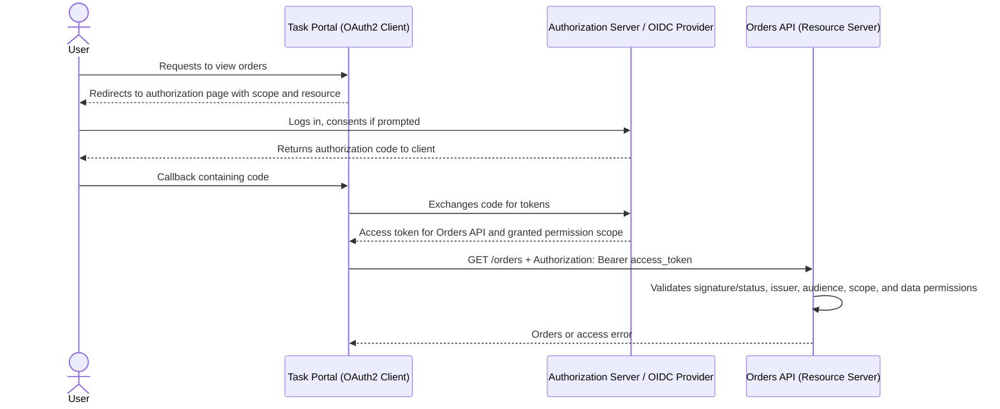
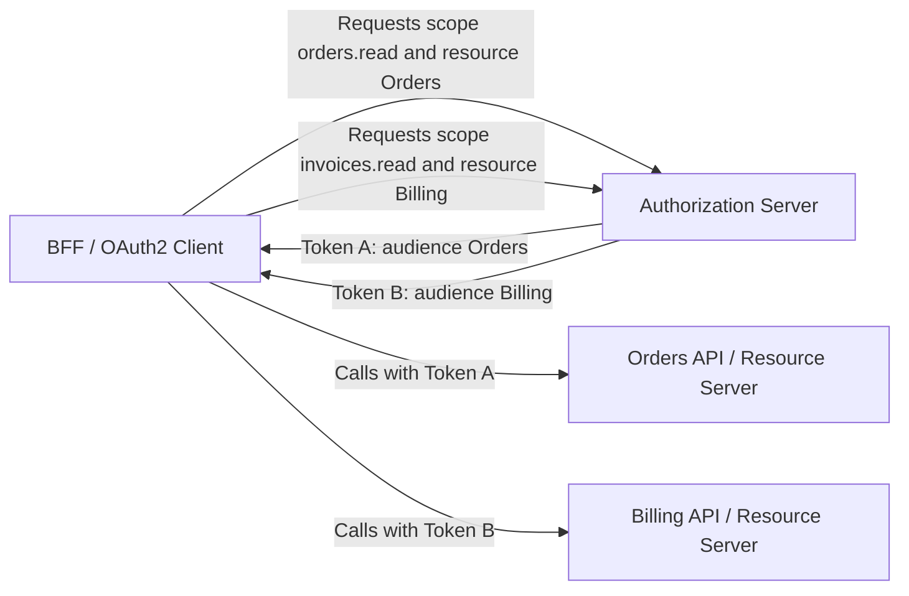

# 2.9. Scope, Consent, Audience, and Resource in OAuth 2.0 / OpenID Connect

In OAuth 2.0, an application holding an access token **does not mean** it is allowed to call every API or perform every operation. Access is constrained by several factors, four important ones being **scope**, **consent**, **audience**, and **resource**. They are closely related yet answer different questions.

| Concept | Question It Answers | Illustration |
| --- | --- | --- |
| **Scope** | What **kind of permissions** is the Client requesting/granted? | `orders.read`, `orders.write` |
| **Consent** | Does the authoritative entity (usually the user) **agree to authorize** the client, when consent is required? | "Allow this application to read your orders?" |
| **Audience (`aud`)** | Which **recipient/API is this access token intended for**? | `https://orders-api.example.com` |
| **Resource** | Which **protected resource or service** does the client want to access? | The Orders API declared by the client via the `resource` parameter |

**Remember the distinction:** *scope* is about **actions/permissions**, *consent* is about **the approval decision**, *audience* restricts **the token's intended recipient**, and *resource* indicates **the requested target resource**. Although a resource indicator sometimes has the same value as `aud`, the two concepts are not arbitrarily interchangeable fields.

## 1. Placing All Four Concepts into the OAuth 2.0 Flow

Suppose a system has:

- **Task Portal**: the web app employees log into; it is the OAuth2 Client.
- **Identity Provider (IdP)**: the Authorization Server / OIDC Provider that authenticates and issues tokens.
- **Orders API**: the Resource Server providing APIs to read/write orders.
- **Employee**: the user who can grant the application access to data they are permitted to use.

The employee wants to use Task Portal to view orders. Task Portal requests the `orders.read` scope for Orders API. The IdP authenticates the employee, decides whether a consent screen is needed, and then issues a token bound to Orders API per its policy. Task Portal sends the access token to Orders API. Orders API must verify that the token **is genuinely intended for it** and **has order-reading permission**, and then still verify whether the employee is allowed to view *that specific order*.



The diagram illustrates the **authorization code grant**. If the client uses `client_credentials`, there is no interactive user and no consent screen in the sense of user review; nevertheless, scope, audience, and resource can still play a role.

## 2. Scope: Names of Permissions the Client Requests and Receives

### 2.1. What Is Scope Really?

`scope` in OAuth 2.0 is one or more **strings representing access permission boundaries** whose meanings are agreed upon by the Authorization Server and APIs. For example:

| Illustrative Scope | Meaning Per System Policy |
| --- | --- |
| `orders.read` | Allows reading orders within a valid account/subject boundary |
| `orders.write` | Allows creating or modifying orders per business rules |
| `reports.export` | Allows requesting report exports |
| `profile.read` | Allows reading profile info via an API that defines this scope |

These strings are merely **illustrative conventions**, not a universal standard scope list. Two different Authorization Servers may use the same `orders.read` name with different meanings, enforcing Resource Servers, and granting policies. Therefore, rely on the security contract between the client, Authorization Server, and Resource Server.

In standard OAuth 2.0 requests, a client can request multiple scopes using a space-delimited string:

```text
scope=orders.read orders.write
```

When sent in a URL or form-encoded payload, spaces are typically encoded as `%20` or `+` depending on context:

```text
scope=openid%20profile%20orders.read
```

**A scope is not an API URL, a database role name, or a standalone token.** A scope is part of the permission-granting and enforcement policy. One scope may cover multiple endpoints; conversely, a single endpoint may require multiple conditions beyond scope.

### 2.2. *Requested* Scopes vs. Actually *Granted* Scopes

Distinguish between:

1. **Requested scopes:** permissions the client declares it wants when initiating authorization or requesting tokens.
2. **Granted scopes:** permissions the Authorization Server actually grants after applying policies, client config, user choices, and other constraints.
3. **Enforced permissions:** conditions the Resource Server uses to accept a request, potentially combining granted scopes with fine-grained data permissions.

The Authorization Server can reject disallowed scopes (`invalid_scope`) or grant only a subset. In an OAuth 2.0 token response, if the granted scope **differs** from the requested scope, the `scope` field must describe the actually granted scope; when identical, it may be omitted per specification. Never treat the scope list in client config as proof that the current token holds all those permissions.

Example:

```http
POST /oauth2/token HTTP/1.1
Host: idp.example.com
Content-Type: application/x-www-form-urlencoded

grant_type=client_credentials&scope=orders.read%20orders.write
```

Illustrative token response when only read permission is granted:

```json
{
  "access_token": "<opaque-or-jwt-token>",
  "token_type": "Bearer",
  "expires_in": 3600,
  "scope": "orders.read"
}
```

`scope` in the token response is **grant metadata**; the internal format of the access token is a separate matter. A JWT access token may carry a `scope` claim (space-separated string) or `scp` (often an array, depending on the system). An opaque token does not require letting the client read scopes from the token structure; the Resource Server can obtain that info via introspection.

### 2.3. OIDC Scopes Are Not Completely the Same as Business API Scopes

OIDC defines several standard scopes:

| OIDC Scope | Primary Effect |
| --- | --- |
| `openid` | Indicates this is an OpenID Connect request, targeting user authentication and an ID Token |
| `profile` | Requests access to standard profile claims, subject to available claims and consent/policy |
| `email` | Requests access to email-related claims, potentially including `email` and `email_verified` |
| `phone` | Requests access to phone-number-related claims |
| `address` | Requests access to address-related claims |
| `offline_access` | Requests potential offline access when the user is absent per OIDC/provider conditions; does not guarantee a refresh token will be issued |

`openid profile email` usually relates to **login and identity claims**; `orders.read` relates to **authorizing calls to Orders API**. An access token with only `openid profile email` does not automatically authorize calling Orders API. Conversely, an access token with `orders.read` does not become an ID Token used for login.

### 2.4. Is a Scope Enough to Read a Record?

No. If a token has the `orders.read` scope, you still must check whether the principal is allowed to read order `order-732`. The Resource Server may need to combine:

- **Scope/authority**: the request is permitted to perform the order-reading operation type.
- **Audience and issuer**: the token is valid for this exact API and issued by a trusted source.
- **Object permissions**: which tenant the order belongs to, and whether the user or service has access to that specific record.
- **Business constraints**: whether the order is locked or belongs to an authorized department.

API pseudo-code example:

```java
@PreAuthorize("hasAuthority('SCOPE_orders.read')")
@GetMapping("/api/orders/{id}")
OrderDto findOrder(@PathVariable Long id, Authentication authentication) {
    // Inside the service, still check tenant/owner/record-specific permissions.
    return orderService.findReadableOrder(id, authentication);
}
```

`@PreAuthorize` requires enabling method security (e.g., `@EnableMethodSecurity`) and implementing the corresponding data-checking method. Record-level permission policies **cannot be replaced by an overly broad scope**.

## 3. Consent: Approving Delegated Permissions

### 3.1. What Decision Is Consent?

**Consent** is the act of approving a client's use of specific access permissions, usually given by the user on the Authorization Server's UI. A consent screen might display:

> Task Portal wants to view the orders you have access to. Do you allow this?

The user sees the application name, data types, requested permissions, and buttons to allow or deny. The Authorization Server is the party that decides which grant may be issued, based on consent and policy. The Client **must not** treat displaying a checkbox of its own as permission granted by the Authorization Server.

Consent differs from **authentication** and **authorization**:

| Action | Meaning |
| --- | --- |
| User enters password, uses passkey, or SSO | **Authentication**: verifying identity |
| User clicks "Allow" for `orders.read` | **Consent**: approving the authorization request when applicable |
| Authorization Server issues a permission-bounded token | **Authorization grant/token issuance**: granting permissions per policy |
| Orders API validates scope and per-order permissions | **Authorization enforcement**: enforcing policy on resources |

User consent **does not override** system policy. For example, even if they consent to `reports.export`, if their role forbids exporting reports, the Authorization Server or Resource Server can still deny it.

### 3.2. Does a Consent Screen Appear Every Time a Token Is Requested?

No. Whether a consent screen appears depends on IdP policy, client type, previously granted permissions, organization settings, and OIDC parameters:

- **First time requesting new permissions:** user approval may be required.
- **Previously consented to those scopes:** the IdP may remember and skip asking again.
- **Internal/first-party apps or admin-preapproved permissions:** interactive consent may be skipped per policy.
- **Client credentials:** no user interactively approves during token issuance; service permissions are pre-configured/governed.
- **Requesting additional scopes later:** the IdP may prompt for incremental consent (incremental authorization) if supported.

In OIDC, the `prompt=consent` parameter asks the OpenID Provider to display a consent UI, provided the provider properly supports that parameter's behavior. Do not treat `prompt=consent` as a universal standard parameter across all OAuth2 providers. Additionally, `prompt=none` can fail a request if interaction is required while UI display is forbidden.

### 3.3. What Happens When the User Denies Consent?

In the authorization code flow, the Authorization Server typically returns an error to the verified redirect URI, such as:

```http
GET /login/oauth2/code/acme?error=access_denied&state=<original-state>
```

The Client must handle this as a denied decision, display an understandable message, and avoid trying to use ungranted permissions. `state` is an anti-forgery/response-correlation value; it does not represent consent.

### 3.4. Secure Consent Design Mindset

Request the **minimum permissions** needed for the current task. If the user only views orders, request `orders.read` rather than `orders.read orders.write`; only consider requesting additional permissions later if they enable editing features. Use clear language describing data and operations instead of cramming every scope into an incomprehensible prompt. Manage the lifecycle of granted permissions, revocation, and policy changes according to your IdP's capabilities.

## 4. Audience: Who Is the Token Issued For?

### 4.1. Role of the `aud` Claim

**Audience** is the set of recipients for which a token is intended. For a JWT access token, the `aud` field may be a string or an array of strings depending on the case/token specification in use:

```json
{
  "iss": "https://idp.example.com",
  "sub": "employee-42",
  "aud": "https://orders-api.example.com",
  "scope": "orders.read",
  "iat": 1790000000,
  "exp": 1790003600
}
```

This JSON only illustrates a JWT's **decoded payload**, not a real signed token. When protecting Orders API, the Resource Server should verify that the token was issued for an audience accepted by the API, alongside signature and other checks. Audience naming is a convention between the Authorization Server and the API: some systems use URLs, while others use logical identifiers (`orders-api`). The API must not infer an audience from the request URL if the IdP's policy uses a different identifier.

A JWT may have multiple audiences:

```json
{
  "aud": ["https://orders-api.example.com", "https://billing-api.example.com"]
}
```

This means the token targets multiple recipients if the token contract permits it. However, **separate tokens per API** generally make it easier to bound permissions and reduce blast radius if a token leaks. Having multiple audiences merely for token reuse convenience is a design choice to weigh carefully.

### 4.2. Why Is Having the Right Scope Still Not Enough?

Suppose `payment-api` receives a JWT like this:

```json
{
  "iss": "https://idp.example.com",
  "aud": "https://orders-api.example.com",
  "scope": "payments.read"
}
```

Even if the token has `payments.read` and a valid signature, Payment API **must reject it** if the audience is not intended for it. This mitigates the risk of a token being replayed (*token replay*) to another service, often called **cross-resource token substitution**.

An API generally needs to verify these elements:

1. The token originates from a trusted **issuer** (`iss`).
2. The signature/algorithm and verification keys match trusted configuration, if it is a JWT.
3. The token has not expired (`exp`), and is past its not-before time (`nbf`) if present.
4. The **Audience** contains this API's identifier (`aud`).
5. The token has the required permissions/scopes and access constraints.

`scope` and `aud` complement each other: `aud` selects **the receiving service**; `scope` selects **the allowed operation types**. Neither replaces authorization checks on actual records.

### 4.3. ID Token Audience Differs from Access Token Audience

In **OIDC**, the ID Token is issued for **the client to verify the user's login information**. The ID Token's `aud` must contain the Relying Party's `client_id`; other constraints such as `azp` per the OIDC spec may also apply when multiple audiences are present.

Conversely, the **access token's** audience identifies the API/Resource Server where the token is used. Therefore:

- **ID Token:** `aud = portal-web-client` for the client to verify login info.
- **Access Token:** `aud = https://orders-api.example.com` for Orders API to verify request tokens.

Never send an ID Token as a bearer token to call Orders API. A structurally valid JWT does not prove it is **the right token type** or has **the right audience**.

With **opaque access tokens**, the API cannot directly inspect an `aud` claim inside the token string; the API must validate via a supported mechanism, typically introspection and checking audience metadata/attributes published by the Authorization Server. Never assume every opaque token carries JWT claims.

## 5. Resource: Specifying the Target Resource or API

### 5.1. Three Uses of the Word "Resource" to Distinguish

In an OAuth2 system, the word *resource* can appear at three levels:

| Usage | Example | Meaning |
| --- | --- | --- |
| **Protected resource** | An order, file, profile data | Specific object needing protection |
| **Resource Server** | `orders-api` | Service hosting/serving protected resources |
| **Resource indicator** | `resource=https://orders-api.example.com` | Parameter telling the Authorization Server **which target resource service** the client wants a token to access |

This section focuses on the third usage: **resource indicators** per [RFC 8707 — Resource Indicators for OAuth 2.0](https://www.rfc-editor.org/rfc/rfc8707).

### 5.2. What Problem Does the Standard `resource` Parameter Solve?

When a single Authorization Server issues tokens for multiple APIs, `scope=read` alone may not specify **which API** the token should be issued for. RFC 8707 adds the `resource` request parameter so the client explicitly names the desired protected resource when requesting authorization or tokens:

```text
scope=orders.read
resource=https://orders-api.example.com
```

When supported by the IdP, resource information helps the Authorization Server issue tokens scoped to the intended target, avoid issuing tokens valid for unnecessary APIs, and populate the corresponding audience.

Per RFC 8707, a `resource` value is an **absolute URI** without a fragment; the URI serves as a target identifier and is **not required** to be an address the client calls directly. For example, `https://orders-api.example.com` is a resource indicator, whereas `https://orders-api.example.com/orders/123` is a URL for a specific record/endpoint and is usually **not** the scope identifier for the entire API. Use the exact identifier published or registered by the Authorization Server.

Note: `resource` is a **standard OAuth 2.0 extension parameter**, yet **not every Authorization Server implements RFC 8707**. Some products offer a custom `audience` parameter in the authorization request; that `audience` parameter is a vendor convention, not RFC 8707's standard parameter. Read your specific IdP documentation when integrating.

### 5.3. How Do `resource` and `aud` Relate?

Suppose the client sends:

```text
resource=https://orders-api.example.com
```

The Authorization Server may issue a JWT access token with:

```json
{
  "aud": "https://orders-api.example.com",
  "scope": "orders.read"
}
```

In this example, the resource indicator and audience match. That is **a reasonable design choice**, not a rigid transformation applying to every IdP:

- **`resource`** is an **input parameter** in the authorization/token request, identifying the target API the client wants to access.
- **`aud`** is information **inside the token** or token metadata, used by the recipient to verify it is an authorized audience.
- The Authorization Server may normalize or map a resource URI to a different audience identifier depending on the configuration contract. The Client and API must use **the exact agreed-upon value**.

An Authorization Server can reject an unregistered or disallowed resource (`invalid_target` per RFC 8707). Do not treat a client-sent parameter as an automatically granted right; the Authorization Server still decides where the resulting token is actually targeted.

### 5.4. Can Multiple Resources Be Requested?

RFC 8707 allows requesting multiple resource indicators where supported by the provider. Conceptual example:

```text
resource=https://orders-api.example.com
resource=https://billing-api.example.com
```

Requesting multiple resources **does not guarantee** the Authorization Server will issue a single token valid for all of them, nor does it mean any Resource Server should accept multi-audience tokens. Policy may reject the request or restrict the token. When two APIs have different security boundaries, a client should usually request **a dedicated token per API** with matching scopes.

### 5.5. `resource` Does Not Replace Resource-Level Authorization

`resource=https://orders-api.example.com` only names the **target API**; it does not mean "allowed to read every order of every tenant." A token with the right audience and `orders.read` can still be rejected if the user does not own the order, the tenant mismatches, or a policy denies access. API authorization design must separate **token targeting** from **object authorization**.

## 6. Combining All Four Concepts in One Transaction

Suppose a user wants to read orders in Portal. The flow below uses OIDC authorization code with PKCE and Resource Indicators when supported by the IdP.

### 6.1. Authorization Request from the Browser

Example URL line-wrapped for readability:

```http
GET /authorize?
    response_type=code&
    client_id=portal-web&
    redirect_uri=https%3A%2F%2Fportal.example.com%2Flogin%2Foauth2%2Fcode%2Facme&
    scope=openid%20profile%20orders.read&
    resource=https%3A%2F%2Forders-api.example.com&
    state=<random-state>&
    nonce=<random-nonce>&
    code_challenge=<pkce-challenge>&
    code_challenge_method=S256
Host: idp.example.com
```

*Line breaks after `?` are illustrative only; a real HTTP URL must be joined onto one line and special values properly URL-encoded. `state`, `nonce`, and PKCE must be generated, stored, and validated per standard—never use literal placeholder strings.*

Each field has a distinct role:

| Field | Role |
| --- | --- |
| `scope=openid profile orders.read` | Requests OIDC authentication and order-reading permission |
| `resource=https://orders-api.example.com` | Specifies the target API per RFC 8707 if supported by the IdP |
| `client_id=portal-web` | Identifies the client requesting access; **not Orders API's audience** |
| `state` | Links request/response, helping prevent CSRF in the redirect flow |
| `nonce` | Binds the ID Token to the corresponding OIDC request, mitigating replay in relevant scenarios |
| `code_challenge` | PKCE challenge protecting the authorization code, to be verified against `code_verifier` at the token endpoint |

The Authorization Server authenticates the user and may show consent: "Task Portal can read your orders." If the user agrees and all policies allow it, the IdP returns an **authorization code** to the redirect URI.

### 6.2. Client Exchanges Authorization Code for Tokens

In the authorization code flow, the client sends the code and required parameters to the Token Endpoint. If the IdP implements RFC 8707 and requires `resource` in the token request, the client also passes the exact resource identifier per its contract with the IdP:

```http
POST /token HTTP/1.1
Host: idp.example.com
Content-Type: application/x-www-form-urlencoded

grant_type=authorization_code&code=<authorization-code>&redirect_uri=https%3A%2F%2Fportal.example.com%2Flogin%2Foauth2%2Fcode%2Facme&client_id=portal-web&code_verifier=<pkce-verifier>&resource=https%3A%2F%2Forders-api.example.com
```

The example assumes the client uses a Token Endpoint authentication method suited to its client type; for a confidential client, authenticate per registration. PKCE and client authentication serve different roles. Never place a client secret into the browser or a frontend unable to protect secrets.

The response might contain:

```json
{
  "access_token": "<signed-or-opaque-access-token>",
  "token_type": "Bearer",
  "expires_in": 900,
  "scope": "openid profile orders.read",
  "id_token": "<oidc-id-token>"
}
```

`id_token` appears when OIDC conditions are met; the access token and ID Token have **different intended recipients**. The `expires_in` value and fields in the example illustrate one response; not every IdP returns an identical structure.

### 6.3. Client Calls the Resource Server

Portal sends the **access token**, not the ID Token:

```http
GET /api/orders/732 HTTP/1.1
Host: orders-api.example.com
Authorization: Bearer <access-token>
```

Orders API validates the token, checks that the audience matches `orders-api` and scope/authority matches `orders.read`, and then verifies permission for order 732. If any step fails, the API must reject the request; it must not infer from "the user clicked Allow" that every access is permitted.

## 7. Configuring in Spring Security OAuth2 Client

### 7.1. Registering Scopes in Spring Boot

For a web application logging in via OIDC and needing to call Orders API on the user's behalf:

```gradle
dependencies {
    implementation 'org.springframework.boot:spring-boot-starter-security'
    implementation 'org.springframework.boot:spring-boot-starter-oauth2-client'
    implementation 'org.springframework.boot:spring-boot-starter-web'
}
```

```yaml
spring:
  security:
    oauth2:
      client:
        registration:
          acme:
            provider: acme-idp
            client-id: ${ACME_CLIENT_ID}
            client-secret: ${ACME_CLIENT_SECRET}
            authorization-grant-type: authorization_code
            redirect-uri: "{baseUrl}/login/oauth2/code/{registrationId}"
            scope:
              - openid
              - profile
              - orders.read
        provider:
          acme-idp:
            issuer-uri: https://idp.example.com/realms/acme
```

In this configuration:

- `scope` is **what the client requests**, not guaranteed granted permissions.
- `issuer-uri` instructs Spring to use the provider's OIDC/OAuth2 metadata to determine endpoints and related details.
- `client-id` identifies the application to the IdP; it **does not** identify the target API where the access token will be accepted.
- The callback path must be registered with the IdP; the secret must come from the environment/secret manager, never committed to source code.

A minimal `SecurityFilterChain` for the web application:

```java
@Bean
SecurityFilterChain webSecurity(HttpSecurity http) throws Exception {
    http
        .authorizeHttpRequests(authorize -> authorize
            .requestMatchers("/", "/assets/**").permitAll()
            .anyRequest().authenticated())
        .oauth2Login(Customizer.withDefaults());
    return http.build();
}
```

The Java snippets in this lesson omit `import`, `@Configuration`, and enclosing class boilerplate where unnecessary to highlight the core idea. `oauth2Login()` handles the login session; when Portal calls Orders API, use the **access token belonging to `OAuth2AuthorizedClient`** or an HTTP client integrated with `OAuth2AuthorizedClientManager`.

### 7.2. Adding a Resource Indicator: No Automatic Inference from Scope

`scope: orders.read` **does not automatically imply** `resource=https://orders-api.example.com`. If the IdP supports RFC 8707, the client must customize authorization request construction. Example configuration for a registration targeting a fixed Orders API:

```java
@Bean
SecurityFilterChain webSecurity(
        HttpSecurity http,
        ClientRegistrationRepository registrations) throws Exception {

    DefaultOAuth2AuthorizationRequestResolver resolver =
        new DefaultOAuth2AuthorizationRequestResolver(
            registrations, "/oauth2/authorization");

    resolver.setAuthorizationRequestCustomizer(builder ->
        builder.additionalParameters(params ->
            params.put("resource", "https://orders-api.example.com")));

    http
        .authorizeHttpRequests(auth -> auth
            .anyRequest().authenticated())
        .oauth2Login(oauth2 -> oauth2
            .authorizationEndpoint(endpoint -> endpoint
                .authorizationRequestResolver(resolver)));

    return http.build();
}
```

In this example, `resource` is added to the **authorization request** going to the IdP. If the application has multiple client registrations, choose the resource per `registrationId`/context instead of attaching the same resource to every client. **This example does not automatically add parameters to the token request.** If the IdP also requires the `resource` parameter at the Token Endpoint, configure the appropriate token response client for your Spring Security version—specifically check how to customize the authorization code token client or client credentials token client in that version.

Some providers do not use RFC 8707 and instead require a custom `audience` parameter on the authorization request. In that case, parameter name and value must follow the provider's documentation; you cannot simply put an API URL in `scope` or expect Spring to synthesize an audience automatically.

### 7.3. With Client Credentials, Scope Is Still Needed Without User Consent

Example of a service calling an API periodically:

```yaml
spring:
  security:
    oauth2:
      client:
        registration:
          orders-machine:
            provider: acme-idp
            client-id: ${ORDERS_CLIENT_ID}
            client-secret: ${ORDERS_CLIENT_SECRET}
            authorization-grant-type: client_credentials
            scope: orders.read
        provider:
          acme-idp:
            token-uri: https://idp.example.com/oauth2/token
```

The backend uses `OAuth2AuthorizedClientManager` to acquire and manage the access token, then sends it when calling Orders API. In the `client_credentials` grant, scopes are granted according to policies for the **client/service**, not via a user consent screen. If the IdP requires a resource indicator when calling the Token Endpoint, customize the token request accordingly; the standard client registration config above only specifies `scope`.

## 8. Configuring in Spring Security Resource Server

### 8.1. The Resource Server Must Validate Audience and Scope

On the Orders API side, configuration must answer two independent questions:

- **Is the token intended for this API?** Validate audience (in addition to issuer, signature, expiration, and other checks).
- **Does the token allow reading orders?** Validate the corresponding scope or authority.

Common dependency for JWT bearer tokens:

```gradle
dependencies {
    implementation 'org.springframework.boot:spring-boot-starter-security'
    implementation 'org.springframework.boot:spring-boot-starter-oauth2-resource-server'
    implementation 'org.springframework.boot:spring-boot-starter-web'
}
```

Example configuration on a Spring Boot version supporting the `audiences` property:

```yaml
spring:
  security:
    oauth2:
      resourceserver:
        jwt:
          issuer-uri: https://idp.example.com/realms/acme
          audiences:
            - https://orders-api.example.com
```

`issuer-uri` typically configures the JWT decoder with issuer validation; `audiences` specifies audiences accepted by Orders API. Depending on your Spring Boot/Spring Security version, if `audiences` is not yet supported, configure a `JwtDecoder` with a dedicated audience validator. Never skip audience validation merely because you verified the token was signed by a valid IdP.

```java
@Configuration
@EnableMethodSecurity
class OrdersApiSecurity {
    @Bean
    SecurityFilterChain apiSecurity(HttpSecurity http) throws Exception {
        http
            .authorizeHttpRequests(auth -> auth
                .requestMatchers(HttpMethod.GET, "/api/orders/**")
                    .hasAuthority("SCOPE_orders.read")
                .requestMatchers(HttpMethod.POST, "/api/orders/**")
                    .hasAuthority("SCOPE_orders.write")
                .anyRequest().authenticated())
            .oauth2ResourceServer(oauth2 ->
                oauth2.jwt(Customizer.withDefaults()));
        return http.build();
    }
}
```

With default JWT configuration, Spring Security typically converts scopes from the `scope` or `scp` claim into authorities prefixed with `SCOPE_`. `orders.read` therefore becomes `SCOPE_orders.read`. If the IdP emits claims in another format, customize a `JwtAuthenticationConverter` or equivalent converter. Defining GET/POST rules here is only illustrative; real APIs must cover all relevant HTTP methods and endpoints and also enforce per-order permissions.

If the access token is **opaque**, the Resource Server can configure `opaqueToken(...)` and introspection instead of `jwt(...)`. Then audience/scope checks must rely on information returned by the IdP from introspection or additional validation policies; never try to parse an opaque token directly as a JWT.

### 8.2. Which Validation Layer Do HTTP Errors Reflect?

| Symptom | Example Cause | Typical Response |
| --- | --- | --- |
| Missing bearer token or expired/invalid signature | Request lacks valid authentication credentials | `401 Unauthorized` with `Bearer` challenge |
| Valid signature but wrong audience | Token intended for another API; invalid at current API | Typically `401 Unauthorized` |
| Valid token but missing `orders.read` scope | Authenticated, insufficient privileges | Typically `403 Forbidden`; may include `insufficient_scope` |
| Has `orders.read` but not allowed to read order 732 | Insufficient object-level permission | Typically `403 Forbidden`, or `404` if policy hides resource existence |

`insufficient_scope` is an error code in RFC 6750's bearer token mechanism. Exact status codes and `WWW-Authenticate` headers may depend on Spring Security's entry point / access denied handler configuration and API policies.

## 9. Two APIs, Two Audiences: An Easy Mistake

A BFF application needs to call both **Orders API** and **Billing API**. The two APIs have separate policies:

| Step | Orders API | Billing API |
| --- | --- | --- |
| Desired resource indicator | `https://orders-api.example.com` | `https://billing-api.example.com` |
| Scope to request | `orders.read` | `invoices.read` |
| Valid token audience | Orders API | Billing API |
| Party validating the token | Orders Resource Server | Billing Resource Server |

Suppose the client has token A with `aud=orders-api`, `scope=orders.read` and token B with `aud=billing-api`, `scope=invoices.read`. When calling Orders API, the client uses **A**; when calling Billing API, it uses **B**. If A is sent to Billing API, Billing API must reject it because the audience is wrong, even though the client logged in once with a shared OIDC Provider.



If an IdP does not support multiple audiences/resources or uses another mechanism to request target-API tokens, design according to the IdP's capabilities: e.g., separate client registrations, different grants, or appropriate token exchange. Never manually alter the `aud` claim in a signed JWT: doing so breaks the signature and does not create valid access rights.

## 10. Common Misconceptions

1. **Scope is an endpoint.** `orders.read` is not the URL `/api/orders`; it is the name of a permission. One scope can cover multiple URLs depending on API policy.
2. **Having the right scope lets you call any API.** The token must still have an audience accepted by the API; matching scope names do not make a token intended for another API valid.
3. **Consent means permission to access all data.** User approval is only one part of granting authorization. The API still checks roles, tenants, data ownership, legal policies, and business rules.
4. **Every OAuth2 login requires consent.** An IdP may use previously granted permissions, organization settings, pre-authorization, or other interaction policies.
5. **The `client_credentials` grant needs a user to click Allow.** It is for a client/service requesting tokens on its own behalf; permissions are governed and granted per client policy.
6. **ID Token `aud` and access token `aud` are the same.** An ID Token typically has the client ID as its audience; an access token has the Resource Server's audience. Mixing the two risks token substitution vulnerabilities.
7. **`resource` always equals `aud`.** They may coincide in one system, but Resource Indicator is an input request parameter and audience is a token constraint; the IdP decides how to map them.
8. **Just listing `scope` in `application.yml` makes Spring automatically send `resource`.** RFC 8707 Resource Indicators require extra configuration and IdP support.
9. **`audience` in an authorization request URL is always a standard OAuth2 parameter.** In reality, many providers use proprietary extensions; RFC 8707's standard parameter is `resource`.
10. **Opaque tokens do not need an audience.** The API must still ensure the token is valid for itself; the only difference is that validation relies on introspection/metadata rather than locally decoded JWT claims.
11. **Requested scopes are guaranteed to be granted.** The Authorization Server may deny them or grant narrower permissions. Always check what was actually granted.
12. **The `openid` scope grants access to every API.** This scope initiates an OIDC request, not a wildcard for business APIs.

## 11. Self-Check Questions

**Exercise 1.** A client requests `scope=orders.read` and `resource=https://orders-api.example.com`. The Authorization Server issues a JWT with `aud=https://orders-api.example.com`, `scope=orders.read`. What must the Resource Server validate?

**Suggested answer:** Beyond validating issuer/signature/expiration/appropriate token type, it must verify that the audience is Orders API, the permission `orders.read` is present, and conditions to read the specific order are met. Sending `resource` in the request does not replace API-side validation.

**Exercise 2.** A user consented to `orders.read` last month. Today they log in again and the IdP does not prompt for consent. Is this an OAuth2 bug?

**Suggested answer:** Not necessarily. The IdP may remember grants/consent per policy. A consent screen is not required on every single login.

**Exercise 3.** A JWT has `scope=payments.write` but `aud=orders-api`. Is Payment API allowed to accept that token?

**Suggested answer:** No, if Payment API is not within the token's valid audience. A matching-looking scope does not fix an audience mismatch.

**Exercise 4.** A scheduler uses `client_credentials` to call Orders API. Where is the user's consent?

**Suggested answer:** There is no interactive user consent in that grant. The Authorization Server grants permissions to the client based on registration and service-to-service policy.

**Exercise 5.** Spring OAuth2 Client declares `scope: orders.read`, but the received token is not intended for Orders API. What configuration should change before proceeding with development?

**Suggested answer:** Check API/audience configuration at the IdP, see whether the provider supports RFC 8707 `resource` or a provider-specific audience parameter, and configure the authorization/token request per provider requirements. Never edit JWTs manually and never disable audience validation on the API just to make requests succeed.

## 12. Authoritative References

- [RFC 6749 — The OAuth 2.0 Authorization Framework](https://www.rfc-editor.org/rfc/rfc6749) — defines scopes, authorization grants, and token responses.
- [RFC 8707 — Resource Indicators for OAuth 2.0](https://www.rfc-editor.org/rfc/rfc8707) — `resource` parameter, resource indicator syntax, and handling multiple resources.
- [RFC 9068 — JWT Profile for OAuth 2.0 Access Tokens](https://www.rfc-editor.org/rfc/rfc9068) — JWT access token profile, `aud`, `scope`, and token constraints.
- [RFC 6750 — OAuth 2.0 Bearer Token Usage](https://www.rfc-editor.org/rfc/rfc6750) — bearer tokens, `invalid_token`, and `insufficient_scope` scenarios.
- [OpenID Connect Core 1.0](https://openid.net/specs/openid-connect-core-1_0.html) — OIDC scopes, ID Token audience, prompt/consent, and authentication requirements.
- [Spring Security — OAuth 2.0 Client](https://docs.spring.io/spring-security/reference/servlet/oauth2/client/index.html) — client registration, authorization code, access tokens, and HTTP client integration.
- [Spring Security — OAuth 2.0 Resource Server](https://docs.spring.io/spring-security/reference/servlet/oauth2/resource-server/index.html) — handling bearer tokens and API authorization.

A secure design must clearly answer: **what the client wants to do (`scope`), how permission granting is decided (`consent` and policies), which API the token is intended for (`audience`), and how the target API is specified when requesting the token (`resource`)**. The Resource Server is always the final enforcement point for access to the resources it manages.
