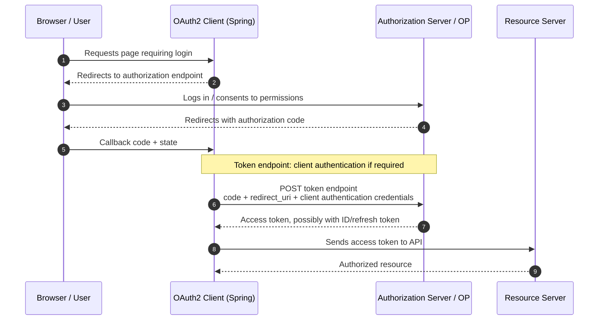

# 2.11. Client Authentication and Token Endpoint Authentication Methods

In OAuth 2.0 and OpenID Connect (OIDC), **client authentication** is how a client application proves its own identity to the Authorization Server, especially when sending requests to the **token endpoint** to exchange an authorization code, request an access token via `client_credentials`, or refresh tokens. This differs from a user logging in with a password, passkey, or federated account; the user authenticates with the OpenID Provider, whereas the OAuth2 Client may have to authenticate to the token endpoint on behalf of the registered application.

Spring Security OAuth2 Client provides the `ClientRegistration` configuration to describe the client's authentication method, along with components that execute token requests for Servlet and Reactive applications. Understanding **`token_endpoint_auth_method`** helps you choose the right way to send a client secret, sign a JWT assertion, use an mTLS certificate, or operate a public client with PKCE. It is also one of the most common causes of `invalid_client` errors when integrating an identity provider.

## 1. Where Does Client Authentication Fit in OAuth 2.0?

A typical system involves four roles:

- **Resource Owner**: the user or entity that owns the resource.
- **Client**: the application wanting to obtain tokens to perform an authorized task.
- **Authorization Server / OpenID Provider**: the system that issues tokens, manages client registrations, and authenticates clients when policy requires it.
- **Resource Server**: the API receiving the access token to grant access to resources.

With the authorization-code flow, the token request occurs **after** the browser is redirected back to the client with the authorization code:



In this diagram there are **three distinct security activities**:

1. The user authenticates with the Authorization Server/OpenID Provider and may grant consent to the client.
2. The client authenticates with the **token endpoint** per its registered method, if the client is of a type that must authenticate.
3. The Resource Server validates the access token presented by the client; this is not the client authentication step at the token endpoint.

An authorization code, PKCE `code_verifier`, or access token **does not automatically replace** client authentication. Depending on client type and grant, a token request may simultaneously require an authorization code, PKCE, and client authentication.

### 1.1. Is Client ID a Secret?

`client_id` is an identifier issued by the Authorization Server for the client. It commonly appears publicly in authorization requests and **is not a secret authentication factor**. Sending only `client_id` does not prove that the sender owns that client registration.

Conversely, `client_secret` is sensitive credential data. Depending on the method, the client may use the secret directly in HTTP Basic/form body, use it to sign a JWT with HMAC, or use a private key/certificate instead of a secret.

### 1.2. Confidential Client vs. Public Client

| Client Type | Ability to Protect Credentials | Common Examples | Authentication Approach |
|---|---|---|---|
| **Confidential client** | Can safely hold a secret/private key in a trusted environment | Spring MVC backend, BFF, backend service | `client_secret_basic`, `client_secret_post`, `private_key_jwt`, mTLS, ... |
| **Public client** | Cannot trust a secret embedded in code/distributed to users | Browser SPA, mobile app, desktop app shipped to user devices | `none`, typically paired with Authorization Code + PKCE |

Classification is based on **the secrecy capability of the component executing OAuth**, not merely on the framework name or whether the application has a web UI. For example, a server-side Spring BFF can be a confidential client; JavaScript running entirely in the browser should not be given a client secret embedded in the bundle.

OAuth 2.0 `client_credentials` is a grant meant for confidential clients; a public client cannot make `client_credentials` secure simply by sending `client_id`.

## 2. What Is a Token Endpoint Authentication Method?

Each OAuth client registration declares an **authentication method for the token endpoint**, typically named `token_endpoint_auth_method` in OIDC specifications, client registration metadata, and identity provider admin consoles. Common values:

| Method | Proof Sent by Client | Characteristics | Suitable Cases |
|---|---|---|---|
| `client_secret_basic` | Client ID and client secret via HTTP `Authorization: Basic ...` | Simple, widely supported; Basic is only Base64 encoding, must rely on TLS | Traditional OAuth 2.0 compatible confidential clients |
| `client_secret_post` | `client_id` + `client_secret` in form body | Useful for providers requiring form body; easily exposed if systems log bodies | Use only when supported/required by provider |
| `client_secret_jwt` | JWT assertion signed with HMAC using shared client secret | Avoids sending raw secret in every token request; requires agreeing on signing alg and assertion rules | Providers supporting JWT client authentication with a shared secret |
| `private_key_jwt` | JWT assertion signed with the client's private key | Authorization Server verifies with registered public key/JWKS | Backends needing independent key management, orgs with PKI/KMS |
| `tls_client_auth` | Client certificate over a mutual TLS connection | Authentication based on PKI and registered certificate subject attributes | B2B environments, systems managing certificate lifecycles |
| `self_signed_tls_client_auth` | Self-signed certificate pre-registered with server | Server matches registered public certificate | mTLS connections using pinned certificate authentication |
| `none` | No client secret/assertion/certificate to authenticate | Client is identified by ID but **not authenticated as a confidential client** | Public clients using Authorization Code + PKCE |

Not every Authorization Server supports every value. Two similarly named methods still produce different token requests; configuring `client_secret_basic` cannot arbitrarily substitute for `client_secret_post`. Per OAuth 2.0, **a single token request must not use multiple client authentication methods simultaneously**.

### 2.1. Distinguishing Method, Grant Type, Scope, and Token Format

These configuration fields are independent of one another:

| Property | Question It Answers | Examples |
|---|---|---|
| `authorization_grant_type` | Which workflow is the client using to request tokens? | `authorization_code`, `refresh_token`, `client_credentials` |
| `token_endpoint_auth_method` | How does the client prove its identity when calling the token endpoint? | `client_secret_basic`, `private_key_jwt`, `none` |
| `scope` | Which permission boundaries does the client request? | `openid`, `profile`, `orders.read` |
| Access-token format | What representation does the issued token have? | Opaque token or JWT |
| `response_type` | What does the authorization endpoint return? | `code` in the authorization-code flow |

For example, a confidential client may use `authorization_code` + `client_secret_basic` and also use `refresh_token` + `client_secret_basic` after the user has logged in. Another service may use `client_credentials` + `private_key_jwt`. In both cases, the issued access token could be a JWT or an opaque token; **`private_key_jwt` does not mean the access token must also be a JWT**.

## 3. The `client_secret_basic` Method

This is HTTP Basic Authentication at the token endpoint. The Authorization header value is constructed from the client ID and client secret per RFC 6749 rules: form-url-encode each value per `application/x-www-form-urlencoded`, join them with `:`, and Base64-encode the result.

Example with Authorization Code (values are illustrative only):

```http
POST /oauth2/token HTTP/1.1
Host: idp.example.test
Content-Type: application/x-www-form-urlencoded
Authorization: Basic <BASE64_OF_ENCODED_CLIENT_ID_COLON_CLIENT_SECRET>

grant_type=authorization_code&
code=AUTHORIZATION_CODE&
redirect_uri=https%3A%2F%2Fclient.example.test%2Flogin%2Foauth2%2Fcode%2Fportal&
code_verifier=PKCE_CODE_VERIFIER
```

The form body lines above are wrapped **for readability**; the actual HTTP request sends form parameters with standard encoding. In this flow:

- `code` is the authorization code received from the redirect callback.
- `redirect_uri` must satisfy the server's matching rules (in many implementations, matching the value in the authorization request).
- `code_verifier` is present only when the flow uses PKCE; whether PKCE is used depends on client/policy.
- The `Authorization` header carries the **client's** identity and secret, not the user's username/password.

Base64 is reversible encoding, **not security encryption**; TLS is mandatory to protect credentials in transit. Secrets can still leak if proxies/APMs/debuggers record HTTP headers.

With Spring Security, configuring `client_secret_basic` in `ClientRegistration` is the standard way to have the OAuth2 Client send Basic credentials when executing token requests with a supported client.

### 3.1. Client Credentials Grant with Basic

When a backend calls another backend and no user authorization code is needed, the request typically looks like:

```http
POST /oauth2/token HTTP/1.1
Host: idp.example.test
Authorization: Basic <BASE64_OF_ENCODED_CLIENT_ID_COLON_CLIENT_SECRET>
Content-Type: application/x-www-form-urlencoded

grant_type=client_credentials&scope=inventory.read
```

Here the Authorization Server authenticates **the application itself** and issues tokens according to permissions granted to the application. There is no browser redirect, no `code`, and typically no OIDC ID Token. The token does not by default represent a human user.

## 4. The `client_secret_post` Method

`client_secret_post` moves credentials into the form body of the token request:

```http
POST /oauth2/token HTTP/1.1
Host: idp.example.test
Content-Type: application/x-www-form-urlencoded

grant_type=authorization_code&
code=AUTHORIZATION_CODE&
redirect_uri=https%3A%2F%2Fclient.example.test%2Flogin%2Foauth2%2Fcode%2Fportal&
client_id=portal-service&
client_secret=CLIENT_SECRET_VALUE
```

In practice, the body is single-line form URL-encoded; line breaks here are only for presentation. Never send both `Authorization: Basic ...` and `client_secret` as a second authentication method. Sending via body does not automatically make the secret safer: many HTTP request observers, access logs, or exception reports can capture payloads. Configure exclusion/redaction of the `client_secret` field from logs.

**When to choose it?** When the provider's client registration and token endpoint specify `client_secret_post`. If the provider accepts `client_secret_basic`, Basic is generally the standard choice and avoids placing secrets in the form body.

## 5. `none`: Public Clients, Authorization Code, and PKCE

The `none` method means the client **does not authenticate with a secret, JWT assertion, or certificate** at the token endpoint. It does not mean the token endpoint skips all checks: the server still validates the authorization code, client ID, redirect URI, PKCE, grant, and other policies.

Example token request of a public client using PKCE:

```http
POST /oauth2/token HTTP/1.1
Host: idp.example.test
Content-Type: application/x-www-form-urlencoded

grant_type=authorization_code&
client_id=public-browser-app&
code=AUTHORIZATION_CODE&
redirect_uri=https%3A%2F%2Fspa.example.test%2Fcallback&
code_verifier=ORIGINAL_HIGH_ENTROPY_VERIFIER
```

Previously, the client sent `code_challenge` and `code_challenge_method=S256` at the authorization endpoint. The Authorization Server compares `code_verifier` against the stored challenge. As a result, someone stealing an authorization code alone struggles to exchange it for tokens without the matching verifier.

Points to remember:

1. **PKCE is not client authentication**: it binds the authorization code exchange to the initiator of the authorization request; a public client still cannot prove a confidential secret identity.
2. **Never embed client secrets in JavaScript, mobile apps, or desktop apps**: a secret distributed to user devices is no longer a confidential secret.
3. Public clients must be registered with the provider per appropriate policy; you cannot simply switch `client_secret_basic` to `none` without updating the Authorization Server.
4. For OIDC, ID Token validation, `state`/`nonce`, redirect protection, and token management requirements still apply alongside PKCE.
5. Never use `none` for the client credentials grant; that grant relies on authorization meant for confidential clients.

## 6. JWT Client Authentication: `client_secret_jwt` and `private_key_jwt`

Instead of sending a raw secret at the token endpoint, the client can create a signed JWT **client assertion**. The token endpoint verifies the signature and claims, thereby authenticating the client. This mechanism belongs to JWT client authentication (commonly referencing RFC 7523 and OIDC Core).

Two primary methods:

- `client_secret_jwt`: JWT signed using a MAC/HMAC algorithm, where the shared secret between the client and Authorization Server acts as the signing key.
- `private_key_jwt`: JWT signed using the client's private key; the Authorization Server uses a registered public key or JWKS to verify.

The difference lies in the signing key, key distribution, and trust configuration. Both send a `client_assertion` in the request, yet **you cannot rename the method to turn an HMAC-signed JWT into an asymmetrically signed JWT**.

### 6.1. Structure of a JWT Client Assertion

A typical assertion contains these claims:

| Claim/Header | Role |
|---|---|
| `iss` | Issuer of the assertion, usually equal to `client_id`. |
| `sub` | Subject of the assertion, usually also equal to `client_id`. |
| `aud` | Identifier of the assertion recipient per Authorization Server requirements, usually the token endpoint URL or an audience value specified by the provider. |
| `exp` | Expiration timestamp; assertions should be short-lived. |
| `iat` | Issued-at timestamp, depending on provider profile/requirements. |
| `jti` | Unique ID to help prevent replay when checked by the provider. |
| `alg` (JOSE header) | Signature algorithm permitted by the provider; never accept `none` for an assertion that must be signed. |
| `kid` (JOSE header, when used) | Key ID helping the Authorization Server select the matching public key in the key set. |

Illustrative payload structure example:

```json
{
  "iss": "portal-service",
  "sub": "portal-service",
  "aud": "https://idp.example.test/oauth2/token",
  "iat": 1700000000,
  "exp": 1700000300,
  "jti": "unique-per-assertion"
}
```

`iat`/`exp` here are merely illustrative numbers with a 5-minute lifespan; in production they must be computed from current real time. Providers may require extra claims or specific audience rules, so rely on metadata and the integration contract.

A token request using JWT client authentication typically looks like:

```http
POST /oauth2/token HTTP/1.1
Host: idp.example.test
Content-Type: application/x-www-form-urlencoded

grant_type=client_credentials&
scope=orders.read&
client_id=portal-service&
client_assertion_type=urn%3Aietf%3Aparams%3Aoauth%3Aclient-assertion-type%3Ajwt-bearer&
client_assertion=SIGNED_JWT_VALUE
```

The form parameters in the example are line-wrapped for readability. `client_assertion_type` has the full logical value:

```text
urn:ietf:params:oauth:client-assertion-type:jwt-bearer
```

`client_assertion` serves **client authentication at the token endpoint**. It is not an access token, not a user's ID Token, and must never be sent as `Authorization: Bearer` to a Resource Server.

### 6.2. When Choosing `client_secret_jwt`

The Client and Authorization Server use the same sufficiently strong secret to sign/verify with a supported HMAC algorithm (e.g., an HS256/HS384/HS512 variant per provider specification). Avoiding sending the raw secret in the form body is helpful, though security still depends on keeping the shared secret confidential, key strength, TLS, assertion verification implementation, and anti-replay policy.

A short password is not suitable to use casually as an HMAC signing key. If an organization needs to decouple client signing privileges from a shared secret, manage keys centrally, and rotate keys flexibly, `private_key_jwt` is often worth considering.

### 6.3. When Choosing `private_key_jwt`

A typical design:

```text
Client / Spring application                 Authorization Server
  Private key                                   Public key / JWKS
      |                                              ^
      v                                              |
Sign JWT assertion  ---- POST token endpoint ----> Verify JWT signature
      |                                              |
      |                                    Verify iss/sub/aud/exp/jti...
      |                                              |
      <---------------- Access token ----------------+
```

Necessary operational responsibilities:

- The Client generates a key pair in a protected environment and registers the public key or `jwks_uri` with the Authorization Server.
- The private key resides in a keystore, HSM, KMS, or equivalent key-protection solution; never put it in source code or send it over the token endpoint.
- The Client sets the proper `kid` when multiple keys exist, signs with an algorithm agreed with the server, and generates a fresh `jti` for every assertion.
- The Authorization Server validates the signature, audience, issuer/subject, time validity, and replay conditions per contract.
- When rotating keys, coordinate an overlap window accepting both old and new public keys to avoid `invalid_client` errors.

Note: `private_key_jwt` **is not the same as** the OAuth JWT bearer authorization grant. A JWT assertion used for client authentication and a JWT assertion used as an authorization grant are two different protocol roles, even though both can use the JWT representation.

### 6.4. mTLS Methods

With `tls_client_auth` or `self_signed_tls_client_auth`, the client completes authentication using its TLS certificate during the connection to the token endpoint:

- `tls_client_auth` relies on PKI rules and identity attributes inside the certificate matching the client registration.
- `self_signed_tls_client_auth` lets the client use a self-signed certificate previously known to and matched by the Authorization Server.

The Client must configure its HTTP/TLS transport to present the right certificate and private key. Merely declaring the method name in the client registration **does not automatically configure the mTLS connection**. Pay special attention to paths passing through load balancers/reverse proxies: which party actually terminates the TLS handshake and how the Authorization Server verifies certificate identity.

OAuth 2.0 Mutual-TLS Client Authentication can also relate to certificate-bound access tokens. That is a feature binding tokens to certificates, **distinct** from merely using a certificate to authenticate the client at the token endpoint; never assume both features are always enabled together.

## 7. How Does the Authorization Server Know Which Methods Are Accepted?

The token endpoint needs to know the client ID, registered methods, corresponding secret/public key/certificate, and grant policy. A request using `client_secret_post` will fail if the provider only permits `private_key_jwt` for that client.

With OpenID Connect Discovery or OAuth Authorization Server Metadata, metadata can provide:

```json
{
  "issuer": "https://idp.example.test",
  "token_endpoint": "https://idp.example.test/oauth2/token",
  "token_endpoint_auth_methods_supported": [
    "client_secret_basic",
    "client_secret_post",
    "private_key_jwt"
  ],
  "token_endpoint_auth_signing_alg_values_supported": [
    "RS256",
    "PS256"
  ]
}
```

This is **example metadata**; real values depend on the provider. If metadata advertises support for a set of methods, that only says the endpoint is capable of handling them—**it does not guarantee every client registration is allowed to use all of them**. A client registration may allow only one specific method; per-registration metadata (if exposed by the provider) is what must be matched when integrating.

In OIDC Discovery, when `token_endpoint_auth_methods_supported` is omitted, the default value per specification is `client_secret_basic`. Never infer that a provider supports JWT or mTLS methods when metadata does not advertise them and provider documentation does not confirm them.

### 7.1. Steps to Align Configuration Between Client and Provider

1. Determine whether the application type is confidential or public and which grant will be used.
2. Check methods supported by the Authorization Server; then check the method assigned specifically to the client registration.
3. Agree on the distribution mechanism for secrets, public keys/JWKS, or certificates per the chosen method.
4. Set the corresponding `client-authentication-method` in Spring Security and configure the token client/HTTP transport when the method requires customization.
5. Test the token request in a staging environment, ensuring secrets, assertions, access tokens, or refresh tokens are never logged.

If a provider supports dynamic client registration, the `token_endpoint_auth_method` field sits in the registered client's metadata. This protocol field name differs from Spring Boot's corresponding property `client-authentication-method`.

## 8. Configuring Token Endpoint Auth Method in Spring Security OAuth2 Client

Spring Security represents an OAuth2 Client registration with `ClientRegistration`. The authentication field sits in:

```java
ClientRegistration registration = /* configured client registration */;
ClientAuthenticationMethod method = registration.getClientAuthenticationMethod();
```

Common constants of `ClientAuthenticationMethod` include `CLIENT_SECRET_BASIC`, `CLIENT_SECRET_POST`, `CLIENT_SECRET_JWT`, `PRIVATE_KEY_JWT`, and `NONE`; support for mTLS and specific variants depends on the API/version/integration in use.

In Spring Boot, the property `spring.security.oauth2.client.registration.<registrationId>.client-authentication-method` configures the method per registration. This is the direct link between the protocol concept and the mechanism sending requests to the token endpoint.

### 8.1. Confidential Client Using `client_secret_basic` for OIDC Login

Example `application.yml`:

```yaml
spring:
  security:
    oauth2:
      client:
        registration:
          portal:
            provider: company-idp
            client-id: ${OIDC_CLIENT_ID}
            client-secret: ${OIDC_CLIENT_SECRET}
            client-authentication-method: client_secret_basic
            authorization-grant-type: authorization_code
            redirect-uri: "{baseUrl}/login/oauth2/code/{registrationId}"
            scope: openid, profile, email
        provider:
          company-idp:
            issuer-uri: https://idp.example.test
```

This example is for a **Spring backend capable of protecting a secret**. Environment variables hold credentials provisioned from a secrets system; never commit secrets into repositories. The address `idp.example.test` is only a placeholder and must be replaced with the provider's valid issuer.

When using OIDC discovery, Spring Boot/Spring Security can retrieve endpoints and signing keys based on `issuer-uri` when the provider publishes valid metadata. Having `openid` in the scope triggers an OIDC request, while the client authentication method remains `client_secret_basic` as registered.

With Servlet, OAuth2 Login is integrated via `SecurityFilterChain` and `HttpSecurity`. With Reactive, it is integrated via `SecurityWebFilterChain` and `ServerHttpSecurity`. The registration properties above have a similar structure for both; each stack creates its corresponding repository/HTTP token client.

### 8.2. When the Provider Requires `client_secret_post`

Typically, you only need to change the method on the registration **if the token client and grant in use support that method**:

```yaml
spring:
  security:
    oauth2:
      client:
        registration:
          portal:
            provider: company-idp
            client-id: ${OIDC_CLIENT_ID}
            client-secret: ${OIDC_CLIENT_SECRET}
            client-authentication-method: client_secret_post
            authorization-grant-type: authorization_code
            scope: openid, profile
        provider:
          company-idp:
            issuer-uri: https://idp.example.test
```

With this method, the token client sends credentials in the form body instead of HTTP Basic. Double-check against the Authorization Server's requirements, since `invalid_client` errors can happen from a method mismatch even when both client ID and secret are correct.

### 8.3. Public Client with Method `none`

Example of a registration marked as public by the provider:

```yaml
spring:
  security:
    oauth2:
      client:
        registration:
          public-app:
            provider: company-idp
            client-id: public-app-id
            client-authentication-method: none
            authorization-grant-type: authorization_code
            redirect-uri: "{baseUrl}/login/oauth2/code/{registrationId}"
            scope: openid, profile
        provider:
          company-idp:
            issuer-uri: https://idp.example.test
```

When configuring OAuth2 Login with a public client, Spring Security has mechanisms to support PKCE depending on client registration conditions. However, if you want to build a pure browser-based SPA, the SPA's OAuth/token storage architecture must be designed separately; this server-side Spring configuration only illustrates the `none` property, not a guide to embedding a Spring Security backend into an SPA.

### 8.4. What Extra Configuration Do JWT and mTLS Methods Need?

Changing the property to `private_key_jwt` or `client_secret_jwt` **is not enough** to ensure the token endpoint receives a valid assertion across all Spring Security configurations/versions. The Client needs a component that builds assertions, manages keys, and passes the corresponding `client_assertion_type` / `client_assertion` parameters.

In supported Spring Security versions, one approach for JWT client authentication is creating a `NimbusJwtClientAuthenticationParametersConverter` with a key lookup mechanism from `ClientRegistration` and attaching this converter to the appropriate OAuth2 token-response client. How the converter is attached differs by grant (`authorization_code`, `client_credentials`, `refresh_token`) and by Servlet/Reactive. For mTLS, you must configure an HTTP client supporting certificate authentication and set up corresponding server TLS trust. You cannot assume adding one YAML property automatically configures private keys, JWKS, or TLS handshakes.

Before customizing, identify **your application's exact Spring Security version** and the actual token-response client API in use; class names, configuration hooks, and supported method values can change across versions.

### 8.5. Do Servlet and Reactive Change the Protocol Authentication Method?

No. The protocol semantics of sending `client_secret_basic`, `client_secret_post`, or a JWT assertion are the same; the difference lies in how Spring executes requests and stores state:

| Responsibility Layer | Servlet / Spring MVC | Reactive / Spring WebFlux |
|---|---|---|
| Registration repository | `ClientRegistrationRepository` | `ReactiveClientRegistrationRepository` |
| Authorized-client manager | `OAuth2AuthorizedClientManager` | `ReactiveOAuth2AuthorizedClientManager` |
| Token-response client | `OAuth2AccessTokenResponseClient<T>` | `ReactiveOAuth2AccessTokenResponseClient<T>` |
| HTTP mechanism | Typically uses blocking client | Uses reactive HTTP client suited to Reactor |
| Security context | `SecurityContextHolder` with Servlet model | `ReactiveSecurityContextHolder` inside Reactor context |

Choose `ClientRegistration` by grant, method, and provider first; then configure the token-response client matching your stack. Never take Servlet classes directly and plug them into a Reactive pipeline or vice versa.

## 9. The Same Method Can Apply to Different Token Grants

The token endpoint serves multiple grants; the client authentication method still belongs to the client registration, not hardcoded per grant name:

```text
authorization_code + client_secret_basic
    => code, redirect_uri, and (if used) code_verifier
    => authenticates confidential client with Basic

refresh_token + client_secret_basic
    => refresh_token
    => continues authenticating confidential client per policy

client_credentials + private_key_jwt
    => scopes authorized for the client itself
    => JWT assertion signed with private key

authorization_code + none + PKCE
    => public client: client_id, code, redirect_uri, code_verifier
    => no shared secret; server validates PKCE
```

### 9.1. Authorization Code Exchange

The Authorization Server needs to know which client and redirect URI the authorization code was issued to. For confidential clients, client authentication prevents a party holding only `client_id` and a code from abusing the token endpoint. PKCE is a separate binding layer that strengthens protection against authorization code theft, and is now widely recommended even when the client can authenticate.

### 9.2. Refresh Token

When a confidential client uses a refresh token, it typically continues authenticating per its registered method. Holding only a refresh token without the matching client secret, private key, or certificate may be insufficient to call the token endpoint. Public clients may be issued refresh tokens under dedicated policies (e.g., rotation), but require corresponding storage and anti-theft design.

### 9.3. Client Credentials

Because there is no interactive user, there is no `openid`/ID Token authenticating a user by default. Authenticating the client's identity and authorization to use the client credentials grant is central to the request. When using `private_key_jwt`, this is typically a machine-to-machine pattern: a service signs an assertion to request tokens for the service itself.

## 10. Why Does the Token Endpoint Return `invalid_client`?

The Authorization Server usually returns standard OAuth errors in the HTTP response, such as:

```http
HTTP/1.1 401 Unauthorized
Content-Type: application/json

{
  "error": "invalid_client",
  "error_description": "Client authentication failed"
}
```

The exact HTTP status code and message detail are determined by the Authorization Server; with HTTP Basic, a `401` response and `WWW-Authenticate` may appear, while other methods may lead to different error formatting per protocol/profile.

Some real-world causes:

| Symptom | Likely Cause to Check | Approach |
|---|---|---|
| `invalid_client` right on code exchange | Configured `client_secret_basic` but provider expects `client_secret_post`, or vice versa | Compare method in client registration and provider |
| `invalid_client` after changing/rotating secret | App still uses old secret, wrong environment, or secret truncated | Inspect secret store and rotation process without printing secrets |
| `invalid_client` with `private_key_jwt` | Invalid signature, stale public key/JWKS, mismatched `kid` | Inspect key registration and JWT header metadata |
| JWT assertion rejected | Wrong `iss`/`sub`/`aud`, expired `exp`, clock skew, or reused `jti` | Check assertion policy and clock synchronization |
| mTLS handshake failure | Client certificate not sent, invalid trust chain, proxy not forwarding certificate | Check TLS transport and mTLS routing |
| `unauthorized_client` | Client can authenticate, but is not allowed to use the selected grant or policy | Check `authorization_grant_type` and provider-granted permissions |
| `invalid_grant` | Expired/used code, redirect URI or PKCE mismatch, expired refresh token | Check grant logic; do not randomly swap auth methods to fix it |
| `invalid_scope` | Scope not granted or invalid for client | Check registered scopes |

**`invalid_client` and `invalid_grant` differ in nature**: the first primarily concerns client authentication/identification; the second usually concerns authorization grant inputs. Providers may minimize error messages to reduce information leakage, so coordinate with Authorization Server logs or safe tracing when diagnosing.

### 10.1. Observing Token Requests Without Exposing Credentials

In development, inspect information that can be displayed safely: registration ID, expected method, grant type, token endpoint host/path, response status, and OAuth error code. Never write to logs:

- `Authorization` header (Basic carries Base64-encoded credentials).
- Form `client_secret` or `client_assertion`.
- Authorization codes, `code_verifier`, access tokens, refresh tokens, or ID Tokens.
- Private keys, keystore passwords, and sensitive values in exceptions/debug dumps.

When using proxies, reverse proxies, APMs, or HTTP wire logging, consider whether those layers retain copies of headers/bodies. Production environments should enforce redaction and centralized secret management.

## 11. Security Design and Credential Lifecycle

### 11.1. Protecting and Rotating Secrets

Credentials must never be hardcoded in Java or committed in config files. Use securely managed environment variables, a secret manager, KMS, or an equivalent system per organizational policy. Enforce least-privilege access to credentials and configure rotation aligned with operational lifecycles.

A rotation strategy must account for multiple application instances: if a provider allows only one active secret, replacing the secret can break token endpoint calls from some instances during rollout. When the provider supports overlapping secrets or multiple keys, roll out and cut over gradually within actual capabilities.

### 11.2. Distinguishing Secrets, Signing Keys, and Certificates

| Credential | Typical Method | What Must Be Protected |
|---|---|---|
| Shared client secret | `client_secret_basic` / `client_secret_post` | Secret value at both client and Authorization Server |
| Shared HMAC secret | `client_secret_jwt` | HMAC signing key, entropy, and permitted algorithms |
| Client private key | `private_key_jwt` | Private key, signing access, and key lifecycle; public key published appropriately |
| Client certificate private key | mTLS | Private key, certificate/chain, trust, and TLS client configuration |
| No secret | `none` | Authorization Code + PKCE, redirect/callback, browser/native app token storage |

Never use an API key or user password as `client_secret` unless the identity management system explicitly designates it as a client-specific credential. Avoid reusing the same secret across all applications and environments whenever possible.

### 11.3. TLS, Redirect URI, and Relationship to OAuth Login

The token endpoint must be called over HTTPS and the client must validate a valid TLS certificate. The authorization endpoint and redirect/callback also require secure design. In OIDC Login:

- `state` links the callback to the authorization request;
- `nonce` (when applicable) binds the ID Token to the OIDC authentication request;
- PKCE protects the authorization-code exchange;
- client authentication authenticates confidential clients per the registered method;
- ID Token validation ensures the login result came from the expected issuer and is meant for the right client.

These mechanisms each have distinct roles; never disable one simply because another is enabled.

## 12. Typical Architectural Scenarios

### Scenario A: Spring MVC BFF for Employees

A Spring MVC application runs server-side, maintains sessions, and calls internal APIs on users' behalf. Register a confidential OIDC client using `authorization_code`, scopes `openid profile`, and `client_secret_basic` or `private_key_jwt` per provider. At the token endpoint, the BFF must authenticate as the client and exchange the authorization code; when calling downstream APIs, it uses the issued access token via the authorized-client manager.

### Scenario B: Scheduled Data Sync Job

A Spring service has no browser or interactive user. Use `client_credentials`, a confidential client, and `private_key_jwt` or `client_secret_basic` per policy. Client authentication occurs whenever calling the token endpoint. Use an authorized-client manager suited for background services, independent of `HttpServletRequest` or `ServerWebExchange`.

### Scenario C: Mobile App with OIDC Login

An application distributed to user devices cannot safely retain a shared secret. Register a public client with `none`, using the authorization-code flow with PKCE and allowed redirect URIs. Any Spring backend, if present, is a separate component with its own authentication policy and credential storage; never share a confidential client secret to devices.

### Scenario D: Enterprise Integration Requiring mTLS

A partner requires service-to-service communication over TLS client certificates. Beyond registering method `tls_client_auth` or `self_signed_tls_client_auth`, configure the HTTP stack to send the right certificate in the TLS handshake, register the certificate/identity attributes at the provider, and coordinate certificate issuance, rotation, and revocation lifecycles.

## 13. Key Takeaways

1. **Client authentication proves the OAuth client's identity to the token endpoint**, distinct from user login or APIs validating access tokens.
2. `client_id` is an identifier, not a secret used for authentication.
3. `client_secret_basic`, `client_secret_post`, `client_secret_jwt`, `private_key_jwt`, mTLS, and `none` are methods with different mechanisms; a single token request uses only one client authentication method.
4. **Grant type** (`authorization_code`, `refresh_token`, `client_credentials`) and **client authentication method** are two independent choices that must align with client type and provider policy.
5. Public clients typically use `none` paired with Authorization Code + PKCE; PKCE protects the code exchange but does not make a public client confidential.
6. In Spring Boot, `client-authentication-method` belongs under `spring.security.oauth2.client.registration.<registrationId>`; JWT/mTLS methods generally require customizing keys, signers, or HTTP transport.
7. When receiving `invalid_client`, check registration ID, authentication method, secret/key/certificate, and provider metadata before altering OAuth Login logic.

## References

- [RFC 6749 — The OAuth 2.0 Authorization Framework](https://www.rfc-editor.org/rfc/rfc6749.html), especially sections on client authentication and the token endpoint.
- [RFC 7523 — JWT Profile for OAuth 2.0 Client Authentication and Authorization Grants](https://www.rfc-editor.org/rfc/rfc7523.html).
- [RFC 7636 — Proof Key for Code Exchange by OAuth Public Clients](https://www.rfc-editor.org/rfc/rfc7636.html).
- [RFC 8414 — OAuth 2.0 Authorization Server Metadata](https://www.rfc-editor.org/rfc/rfc8414.html).
- [RFC 8705 — OAuth 2.0 Mutual-TLS Client Authentication and Certificate-Bound Access Tokens](https://www.rfc-editor.org/rfc/rfc8705.html).
- [OpenID Connect Core 1.0](https://openid.net/specs/openid-connect-core-1_0.html), Client Authentication section.
- [Spring Security — OAuth2 Client (Servlet)](https://docs.spring.io/spring-security/reference/servlet/oauth2/client/index.html).
- [Spring Security — OAuth2 Client (Reactive)](https://docs.spring.io/spring-security/reference/reactive/oauth2/client/index.html).
