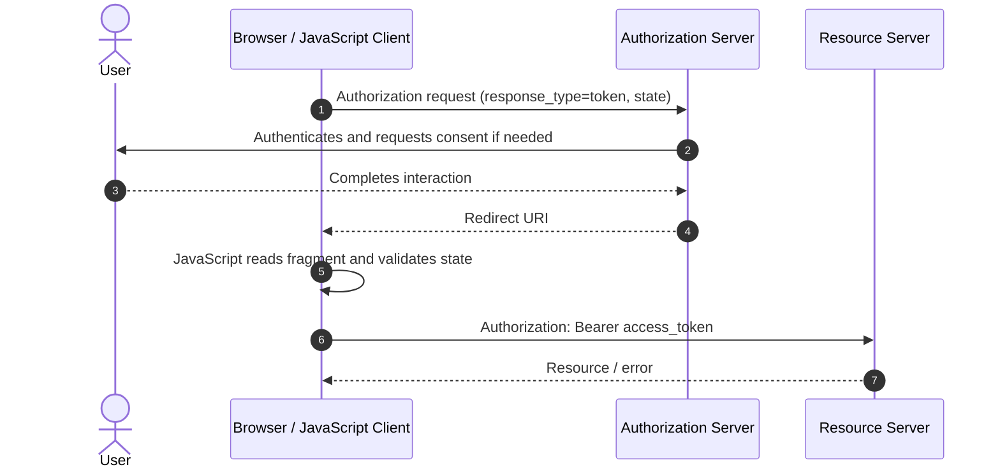
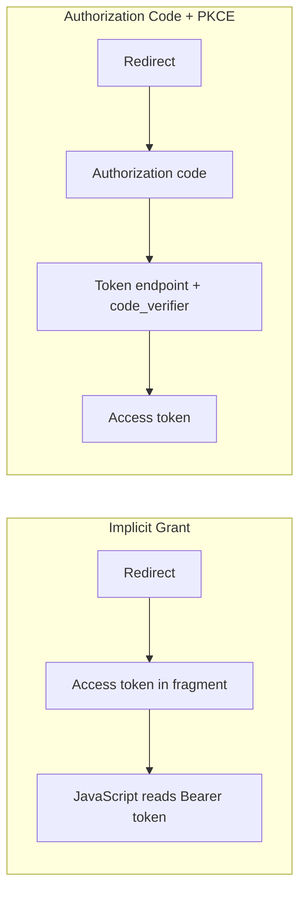
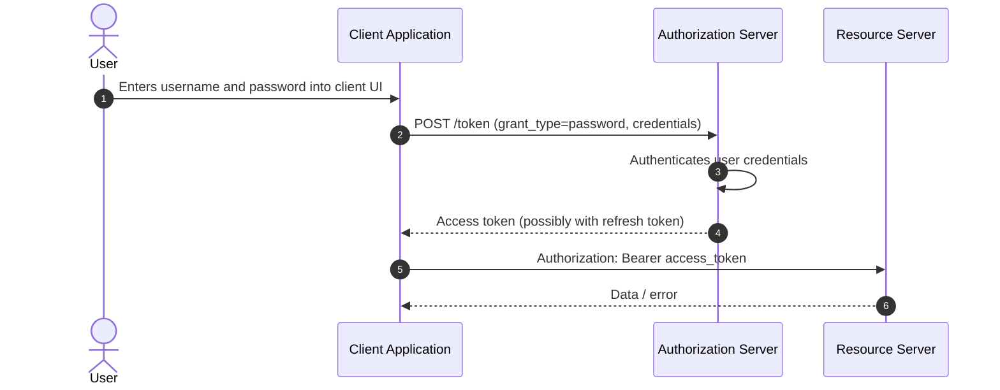

# 2.12. Implicit Grant, Password Grant, and Risks to Recognize

In OAuth 2.0, the **grant type** determines how a client obtains permission to receive an access token from the Authorization Server. Two grants that frequently appeared in legacy documentation and applications are the **Implicit Grant** and the **Resource Owner Password Credentials Grant (ROPC, commonly called password grant)**. Both are part of traditional OAuth 2.0, yet **neither is an appropriate choice for designing new applications**.

This lesson focuses on recognizing both flows in real-world systems, understanding the mechanisms that create risk, distinguishing them from OIDC login, and choosing alternatives when using **Spring Security OAuth 2.0 / OIDC Client**.

## 1. Placing Both Grants in Proper Context

OAuth 2.0 solves *granting permission to access resources*; OIDC extends OAuth 2.0 to *authenticate user identity*. In a typical architecture:

- **Resource Owner**: entity holding rights to the resource, usually a user.
- **Client**: application wanting permission to access resources.
- **Authorization Server (AS)**: authenticates and issues tokens per policy.
- **Resource Server (RS)**: API protecting resources and validating access tokens.
- **OpenID Provider (OP)**: role of an Authorization Server when supporting OIDC, capable of also issuing ID tokens.

Grants differ in **who interacts with the AS, what travels through the browser, and what is sent to the token endpoint**.

| Flow | How the Client Receives Tokens | Redirects the User? | Current Reality |
| --- | --- | --- | --- |
| **Authorization Code + PKCE** | Receives authorization code via redirect, exchanges code for tokens at token endpoint with code verifier | Yes, when authenticating a user | Preferred choice for clients with user interaction |
| **Implicit** | Access token is delivered directly via browser redirect | Yes | Not recommended for new designs |
| **Password grant / ROPC** | Client collects username/password and sends both directly to token endpoint | Not via standard redirect | Not recommended; should be eliminated from new designs |
| **Client Credentials** | Client authenticates with its own identity at token endpoint | No | Suitable for policy-governed service-to-service communication |
| **Device Authorization Grant** | Device displays a code/URL; user authenticates on another device with a browser | Yes, on another device | Suitable for TVs, CLIs, and input-constrained devices |

Note that **Authorization Code is a grant**, whereas **PKCE is a mechanism protecting the authorization code exchange**. PKCE is not a separate grant.

Regarding standard guidance, OAuth 2.0 Security Best Current Practice recommends avoiding the Implicit Grant and **not using the password grant**. OAuth 2.1 drafts move toward removing both grants from the modern grant set. However, when reading logs or maintaining legacy systems, you may still encounter both.

## 2. What Is the Implicit Grant?

### 2.1. Historical Purpose

The Implicit Grant was created for clients running directly in the browser, especially early JavaScript applications. At the time, calling the token endpoint from the browser and protecting a code exchange was harder to implement, so OAuth 2.0 allowed **returning the access token directly in the authorization response**.

Instead of receiving an authorization code and exchanging it at the token endpoint, the client used:

```text
response_type=token
```

and received the **access token in the redirect URI fragment**.

Simulated example request:

```http
GET /authorize?response_type=token
    &client_id=legacy-spa
    &redirect_uri=https%3A%2F%2Fapp.example.test%2Fcallback
    &scope=profile.read
    &state=random-request-value HTTP/1.1
Host: id.example.test
```

If the user was authorized, the Authorization Server might return:

```http
HTTP/1.1 302 Found
Location: https://app.example.test/callback#access_token=ACCESS_TOKEN_VALUE&token_type=Bearer&expires_in=3600&state=random-request-value
```

This is an example for **identifying a legacy protocol**, not a template for implementing new features.

The part after `#` is the **URL fragment**. The browser processes fragments client-side; fragments **are not sent in the subsequent HTTP request path** to `app.example.test`. However, JavaScript running on the callback page can still read `window.location.hash`. That places the access token into the browser's execution environment.

### 2.2. Processing Flow



**Identifying characteristics:**

1. The authorize URL has `response_type=token`.
2. The redirect response contains `#access_token=...` along with `token_type`, `expires_in`, and possibly `state`.
3. The Client **has no authorization code exchange step** with `grant_type=authorization_code`.
4. By definition of the Implicit Grant in OAuth 2.0, **the Authorization Server does not issue a refresh token** in this flow.
5. A public client running in the browser cannot reliably keep a `client_secret` confidential.

**Do not confuse with OIDC Implicit Flow.** OIDC previously had variants `response_type=id_token` or `id_token token`, delivering an ID token (and possibly an access token) over the front channel. The ID token describes the authentication result for the client; it does not become an access token simply by being returned alongside one. For modern OIDC login, use the **Authorization Code Flow**, combined with PKCE where appropriate.

## 3. Why Is the Implicit Grant Recommended for Removal?

The biggest problem is **passing the access token directly through the front channel**: the browser becomes the recipient of a bearer token in a redirect. Risks whose mechanisms must be understood clearly:

### 3.1. Tokens Are Easily Exposed in the Browser Environment

If the application has **cross-site scripting (XSS)**, malicious JavaScript can steal the access token from the URL fragment, JavaScript memory, or wherever the app stores tokens. Third-party scripts loaded onto the same page can also access data permitted by the page; malicious browser extensions are another risk.

Example security flaw in a legacy application:

```javascript
// Anti-pattern example: do not do this in real applications.
const params = new URLSearchParams(window.location.hash.slice(1));
const token = params.get("access_token");

// If a malicious script reads the token,
// it can exfiltrate the token and impersonate the client when calling APIs.
```

**Important nuance:** fragments are not automatically sent to the server in ordinary HTTP requests, so claiming "fragments always end up in server access logs" is inaccurate. Tokens still risk appearing in logged `Location` headers in some systems, client-side monitoring tools, unsafely handled/copied URLs, browser history or extensions, and especially in attacker-controlled JavaScript. Risk must be analyzed based on how the application actually operates.

### 3.2. Lacks Protection of a PKCE Code Exchange Step

With **Authorization Code + PKCE**, the redirect carries a **code** instead of an access token; the client must prove possession of `code_verifier` when exchanging the code for tokens. An attacker stealing an isolated code cannot easily use it without the verifier.

The Implicit Grant has no code exchange step to bind with PKCE. Once an access token is stolen, whoever holds the bearer token can try using it against APIs within its validity window.



PKCE helps prevent **authorization code interception**; it **does not cure XSS** if the JavaScript application still holds the access token. Therefore, never treat "switching to PKCE" as having solved all token security in an SPA.

### 3.3. Risks of Token Injection, Client Mix-Up, or Context Confusion

A client processing redirects without proper checks can accept a token that does not belong to the expected authorization transaction. Validating `state` helps correlate the authorization response with the initial request and mitigates CSRF, yet does not turn an access token into a PKCE-bound message.

A client must also avoid **token substitution**: never mistakenly send another user's, tenant's, or resource's token. Depending on the token mechanism, the API must validate issuer, audience, expiry, and appropriate permissions. When using multiple Authorization Servers, the client must also handle issuer and response metadata properly to avoid token-source mix-ups.

### 3.4. No Refresh Token in the Implicit Grant

When an access token expires, legacy apps might try "silent authorization" via an iframe, relying on login cookies at the Identity Provider. That approach easily breaks under third-party cookie policies, browser restrictions, interaction requirements, and modern security controls.

When moving to Authorization Code + PKCE, **a refresh token may be issued if the server and policy allow it**. For public clients, refresh token storage, rotation, or sender-constraining mechanisms must be designed carefully; having PKCE **does not automatically** mean receiving a refresh token.

## 4. What Is the Password Grant (ROPC)?

The **Resource Owner Password Credentials Grant** lets the client collect **the user's username and password**, then send both to the **token endpoint** to request a token:

```text
grant_type=password
```

In early OAuth 2.0, this grant was sometimes chosen for user-trusted "first-party" apps or when migrating from username/password systems. However, it erodes a vital boundary: **users must hand their password to the client application instead of logging in solely at the Authorization Server**.

Historical request example:

```http
POST /oauth2/token HTTP/1.1
Host: id.example.test
Content-Type: application/x-www-form-urlencoded
Authorization: Basic <client-credentials>

grant_type=password&username=alice&password=<user-password>&scope=profile.read
```

This is only a pattern for reading logs and understanding the legacy protocol. Never put real passwords in examples, docs, terminal history, or logs.

The Authorization Server receives the request, verifies the password per its mechanism, and if accepted, issues tokens. The client may have to authenticate itself at the token endpoint if it is a confidential client. **A client secret and a user password are two different kinds of credentials**; client authentication does not make ROPC safe.

### 4.1. Lifecycle Diagram



**Identifying characteristics**: source code or requests contain `grant_type=password`, `username`, and `password` in the token request payload; no typical OAuth2 redirect; the application is prompting the user for their Identity Provider account password.

**Do not confuse the following cases with ROPC:**

- The user enters a password **on the Identity Provider's page** after the client redirects for Authorization Code: that is delegated login at the OP/AS, not ROPC.
- Spring Security `formLogin()` authenticating username/password directly against **your own application's** account store: that is internal web authentication; it only becomes ROPC if the client uses that password to request an OAuth token via `grant_type=password`.
- `client_credentials` sends the **application's** credentials, not a user's username/password; that is a separate grant.
- "Passwordless login" with passkey/WebAuthn or OTP on the OP's page is not the OAuth password grant.

## 5. Risks of the Password Grant

### 5.1. The Client Must See the User's Password

In Authorization Code + OIDC, the client redirects to the OP; the user hands credentials to the OP. With ROPC, the client application collects the password directly in its own UI.

This multiplies the places where passwords can leak: forms, JavaScript, user devices, memory dumps, error-tracking systems, middleware, proxies, logs, or modified client code. Because passwords are often reused, the fallout can far exceed a short-lived access token.

**TLS protects data in transit, yet does not protect credentials from the client collecting them**, malware on the device, or unsafe logging configurations.

### 5.2. Breaks Centralized Login and Weakens Phishing Resistance

Users accustomed to typing their password into many client interfaces are more easily tricked by fake apps requesting credentials. The modern OAuth/OIDC model directs users to an authentication UI controlled by the Identity Provider, centralizing control over domains, login methods, and policies.

ROPC weakens the trust boundary between the token-consuming app and the party performing identity authentication.

### 5.3. Poor Support for Modern Interactive Authentication

Standard ROPC has only a single username/password submission to the token endpoint; it **does not describe a full interactive flow** for:

- Multi-factor authentication (MFA), adaptive authentication, or step-up authentication.
- Passkeys/WebAuthn, passwordless login, or browser-based authentication methods.
- Federated SSO across multiple organizations/Identity Providers.
- Consent approval, account selection, terms acceptance, password recovery, or other interactive screens.

A provider might add non-standard extensions or return errors requiring interaction, yet that **does not make ROPC equivalent** to Authorization Code + OIDC.

### 5.4. Blurred Roles and High Maintenance Burden

The client ends up handling password lifecycles: password changes, account lockouts, federated accounts, MFA policies, error messages, and revocation. This tightly couples the client to how the AS authenticates users.

Background services sometimes store a "service user" username/password and use ROPC to call APIs. This is a sign that refactoring is needed. If it is truly machine-to-machine communication, consider **Client Credentials** or an appropriate workload identity mechanism with least privilege.

### 5.5. Password Grant Is Not a Foundation for Modern OIDC Login

OIDC standardizes user authentication flows with artifacts like authentication requests and client-bound ID tokens. **Do not treat ROPC as a substitute for `oauth2Login()`** or expect that simply sending `scope=openid` with `grant_type=password` delivers a complete OIDC experience. Such behavior, if supported at all by a vendor, is proprietary and lacks required interactive authentication steps.

## 6. Direct Comparison of Both Legacy Grants vs. Authorization Code + PKCE

| Criterion | Implicit Grant | Password Grant (ROPC) | Authorization Code + PKCE |
| --- | --- | --- | --- |
| Protocol indicator | `response_type=token` | `grant_type=password` | `response_type=code`, `code_challenge`, and `code_verifier` |
| Where does the user enter their password? | At the AS/OP | At the client | At the AS/OP |
| Does the access token appear in a redirect? | **Yes**, in the URL fragment | No | **No**; redirect carries only a code |
| Is there a token endpoint exchange? | Not in the Implicit flow | Yes; sends user password | Yes; sends code and verifier |
| Can the code be protected with PKCE? | No code to protect | No code to protect | Yes |
| Refresh token | Not issued per Implicit Grant spec | May be issued per policy | May be issued per policy |
| Browser-based MFA/SSO/federation | Follows AS flow, but token exposed on front channel | Severely limited by password model | Well-suited for interactive flows |
| Recommendation for new development | Avoid | Avoid | Preferred for user-facing apps |

Note especially: **"We already have HTTPS" does not make either legacy grant acceptable by design**. HTTPS protects transport; it does not eliminate the risk of passwords inside the client or bearer tokens on the front channel.

## 7. Alternative Flow: Authorization Code + PKCE and OIDC

### 7.1. Why Does the Architectural Difference Matter?

The Authorization Code Flow separates two phases:

1. **Front channel** (via the browser): the user is redirected to the OP/AS; the response back to the client contains a temporary authorization code and `state`.
2. **Token endpoint**: the client exchanges the code for tokens. With PKCE, the code exchange request must include the `code_verifier` matching the `code_challenge` sent initially.

```mermaid
sequenceDiagram
    autonumber
    actor User as User
    participant Browser as Browser
    participant Client as Spring Security Client
    participant AS as Authorization Server / OP

    Browser->>Client: Opens resource requiring login
    Client-->>Browser: Redirect /authorize (code, state, code_challenge)
    Browser->>AS: Authorization request
    AS->>User: Login / MFA / consent when needed
    AS-->>Browser: Redirect back to callback with code and state
    Browser->>Client: Sends callback containing code and state
    Client->>Client: Validates state and initial request
    Client->>AS: POST /token (code, code_verifier, client auth if needed)
    AS-->>Client: Access token, possibly refresh token, ID token if OIDC
    Client->>Client: Validates OIDC; saves Authentication and authorized client
```

In OIDC:

- **`scope=openid`** signals an OIDC authentication request.
- **ID token** authenticates identity for the client and must pass appropriate checks such as signature, issuer, audience, expiration, and nonce when used.
- **Access token** accesses APIs with matching permissions; never use an ID token in place of an access token.
- **`state`** binds the callback to the initial request; **PKCE** protects the authorization code exchange. The two mechanisms have different purposes and do not replace each other.

### 7.2. What Does PKCE Help With, and What Does It Not?

When creating a request, the client generates an unpredictable random string called `code_verifier`. From the verifier, the client computes `code_challenge`, usually using method `S256`:

```text
code_challenge = BASE64URL(SHA256(code_verifier))
code_challenge_method = S256
```

The AS records the challenge and subsequently only accepts token requests with the matching verifier. An attacker intercepting the authorization code on redirect without the verifier cannot easily exchange the code for tokens.

However:

- If XSS can read the verifier, tokens, or act directly on the user's behalf inside an SPA, PKCE is not enough protection.
- Public clients cannot keep a client secret truly confidential; thus PKCE is a critical protection requirement for native/browser clients.
- When using a **Backend for Frontend (BFF)** pattern, the backend holds tokens and the browser communicates via a session cookie protected with appropriate `HttpOnly`, `Secure`, `SameSite`, plus CSRF controls. A BFF can reduce direct token exposure to JavaScript, yet you still must protect sessions and the backend.
- Tokens returned from the token endpoint must be stored and used per policy, never placed in URLs or logs.

## 8. How Does Spring Security OAuth 2.0 / OIDC Client Handle This?

Modern Spring Security targets **Authorization Code / OIDC Login** and manages authorized clients for supported grants, such as Authorization Code and Client Credentials.

Three common abstractions are:

- **`ClientRegistration`**: describes client configuration and grant type.
- **`OAuth2AuthorizedClient`**: holds the access token and optional refresh token, bound to a `ClientRegistration` and principal.
- **`OAuth2AuthorizedClientManager`** with **`OAuth2AuthorizedClientProvider`**: coordinates token acquisition, reuse, and refresh when appropriate.

**Do not expect `oauth2Login()` to process Implicit Grant or password grant like a standard OIDC Login flow.** Spring Security configuration is designed for Authorization Code callbacks; a callback delivering `#access_token` to the browser is not equivalent to a `?code=...` callback to the backend.

Older versions of Spring Security had support for the password grant in certain APIs, but this support has been deprecated/removed from modern client APIs. If you see legacy code relying on `password()`, the right approach is to **evaluate and migrate the flow**, rather than trying to recreate the password grant with custom extensions.

### 8.1. Example of a Safer Registration for a Servlet Web Application

```yaml
spring:
  security:
    oauth2:
      client:
        registration:
          company-oidc:
            provider: company
            client-id: ${OIDC_CLIENT_ID}
            client-secret: ${OIDC_CLIENT_SECRET}
            authorization-grant-type: authorization_code
            redirect-uri: "{baseUrl}/login/oauth2/code/{registrationId}"
            scope:
              - openid
              - profile
              - email
        provider:
          company:
            issuer-uri: https://id.example.test/realms/company
```

This example is for a **web backend capable of keeping a client secret**. `issuer-uri` is an illustrative address. In production deployments, the AS/OP must serve metadata compatible with discovery configuration, and the client/redirect URI must be properly registered.

For public clients, use an appropriate client authentication method (typically no client secret) and **Authorization Code + PKCE**; never move a backend client secret into JavaScript.

### 8.2. Configuring `oauth2Login()`

```java
import org.springframework.context.annotation.Bean;
import org.springframework.context.annotation.Configuration;
import org.springframework.security.config.Customizer;
import org.springframework.security.config.annotation.web.builders.HttpSecurity;
import org.springframework.security.web.SecurityFilterChain;

@Configuration
class SecurityConfig {

    @Bean
    SecurityFilterChain filterChain(HttpSecurity http) throws Exception {
        return http
            .authorizeHttpRequests(auth -> auth
                .requestMatchers("/public/**", "/error").permitAll()
                .anyRequest().authenticated())
            .oauth2Login(Customizer.withDefaults())
            .oauth2Client(Customizer.withDefaults())
            .build();
    }
}
```

In a Servlet application, users can start login at:

```text
/oauth2/authorization/company-oidc
```

With default configuration, the Authorization Code callback typically arrives at:

```text
/login/oauth2/code/company-oidc?code=...&state=...
```

After exchanging the code and validating OIDC successfully, Spring Security sets `Authentication` in `SecurityContext` and saves `OAuth2AuthorizedClient` via the configured repository/service. The access token is used for APIs; the ID token serves user authentication.

Even when a `client-secret` is present, environments supporting PKCE should enable PKCE per modern security policy. Whether PKCE is added automatically depends on client type and Spring Security version/configuration; verify on the AS and in actual authorize requests that `code_challenge_method=S256` is present rather than assuming.

### 8.3. Do Not Use Resource Owner Password Credentials for "Quick Login"

This is an anti-pattern:

```text
[Application's username/password form]
    -> POST /token (grant_type=password)
    -> Save token in localStorage
    -> Treat user as OIDC-logged-in
```

It causes the client to touch passwords, easily exposes tokens via JavaScript, and bypasses interactive/OIDC validation steps inherent to login redirects.

Instead, the primary flow should be:

```text
[User clicks "Log in"]
    -> /oauth2/authorization/company-oidc
    -> OpenID Provider's authentication page (with MFA/SSO per policy)
    -> Callback with authorization code
    -> Spring Security exchanges code, validates OIDC, creates session
```

There is no need for the OAuth client to collect or store user passwords.

## 9. Identifying Legacy Code and Traffic

When reviewing a system, look for **protocol indicators** rather than guessing from class names:

| Indicator | Explanation | How to Handle |
| --- | --- | --- |
| `response_type=token` in authorize URL | OAuth2 Implicit Grant | Migrate to Authorization Code + PKCE |
| `#access_token=` in callback URL | Access token traveling via front channel | Identify what generates the redirect, where JavaScript reads the token, and how it is stored |
| `response_type=id_token` / `id_token token` | OIDC Implicit Flow | Migrate to OIDC Authorization Code |
| `grant_type=password` at token endpoint | ROPC/password grant | Identify the client/business flow and replace with a suitable flow |
| Client prompts for IdP `username/password` | Likely recreating ROPC or custom login | Verify actual flow; prefer redirecting to the OP |
| Script stores bearer token in `localStorage` | Token can be read by same-origin JavaScript/XSS | Assess threat model; consider BFF/well-protected session |
| Job sets `service-user-password` to call APIs | Likely using ROPC as a machine credential | Migrate to client credentials/workload identity where appropriate |
| Missing checks for `state`, issuer, audience, or nonce | Callback/token easily accepted in wrong context | Use standard libraries and configure full validation |

When inspecting logs, **never print access tokens, refresh tokens, client secrets, or passwords**. For observability, log only non-sensitive metadata such as grant type, client registration ID, error status, valid issuer, and timestamp; never store raw Authorization headers or request bodies containing `password`.

### 9.1. Example: SPA with Fragment and Ad Scripts

A legacy app receives `#access_token=...` and a script reads the token. Later, the product team adds a third-party script to the same page. If that script is compromised, it can steal the token.

**Indicator:** token sits in JavaScript; no token exchange step. **Fundamental fix:** switch the flow to Authorization Code + PKCE, strengthen XSS defenses, and consider a BFF if you need to shrink token exposure in the browser. Clearing the fragment after reading only reduces some leak paths; **it does not stop malicious scripts already running on the page**.

### 9.2. Example: App Using Password Grant to Avoid the SSO Screen

A desktop application has a username/password form and sends `grant_type=password` to obtain an access token. When the company turns on mandatory passkeys or MFA, the flow stops working.

**Indicator:** client collects the password and calls the token endpoint directly. **Fix:** use the system browser + Authorization Code + PKCE for native apps, letting the OP handle MFA/SSO. For a CLI without a convenient browser, consider the Device Authorization Grant.

### 9.3. Example: Batch Job Logging In with an Employee Account

A nightly cron stores a user's password in a secret manager, sends a password grant, and calls APIs. A secret manager helps manage secrets, yet **does not eliminate the problem of using a human user's identity for an automated workload**.

**Indicator:** no user present; service account config carries username/password and `grant_type=password`. **Fix:** provision a dedicated client identity with minimal scopes/permissions and use Client Credentials or a system-accepted workload identity mechanism.

## 10. Choosing Alternative Flows by Application Type

| Application Type / Need | Usually Suitable Choice | Implementation Notes |
| --- | --- | --- |
| Server-side Spring MVC web app, user login | **OIDC Authorization Code**, add PKCE when supported | `oauth2Login()`, session, and authorized-client repository |
| Browser-based SPA | **Authorization Code + PKCE** | Handle tokens securely; consider BFF to keep tokens out of JavaScript |
| Mobile / native desktop | **Authorization Code + PKCE** with system browser | Avoid embedded WebViews collecting IdP passwords |
| CLI, TV, input-constrained device | **Device Authorization Grant**, when AS supports it | Authenticates in the browser of another device |
| Backend calling API under app identity | **Client Credentials** | Least privilege, no user identity |
| Backend needing to act on a user's behalf | **Authorization Code** or system-standard delegation/token exchange mechanism | Never use the user's password directly to fetch tokens |
| System needing SSO/MFA/passkeys | **OIDC Authorization Code**, via OP | Let the Identity Provider control authentication policies |

Some systems have specialized requirements for token exchange, workload federation, mTLS, or DPoP; the final choice must match the capabilities of the Authorization Server and Resource Server. Never build a "safer" password grant simply by renaming an endpoint.

## 11. Migration Roadmap Away from Both Legacy Grants

Changing flows can affect clients, the Authorization Server, token storage, and Resource Servers, so organize it step by step.

### Step 1 — Inventory and Scope

Identify registrations/client IDs using `response_type=token` or `grant_type=password`. Document application types, users, scopes, target APIs, refresh token policies, and library dependencies. Use sanitized logs to measure actual traffic flows.

### Step 2 — Design Replacement Flows

- For Implicit SPAs: choose Authorization Code + PKCE, and evaluate BFF and token storage strategies.
- For user-facing apps on password grant: move to OIDC redirect login, delegating MFA/SSO to the OP.
- For batch jobs on password grant: establish dedicated workload identities and scope permissions via Client Credentials.
- For CLIs/constrained devices: use Device Authorization Grant if supported.

Not every client should use the same grant: user model and application architecture are the selection criteria.

### Step 3 — Configure Clients and Harden Callbacks

Register exact redirect URIs, scopes, grants, and client types; enable PKCE (S256) where applicable. Enforce `state`, OIDC nonce, issuer, audience, token expiry, cookie/session security, and callback error handling. Never put authorization codes, access tokens, or refresh tokens in logs.

### Step 4 — Migrate State and Verify Behavior

Test first-time login, MFA, re-login, account switching, logout, expired tokens, missing scopes, token revocation, and failure flows. If a client previously used ROPC to "auto-login" in the background, redesign the authentication experience; **you cannot swap a password submission for a zero-interaction code flow while keeping all old assumptions intact**.

### Step 5 — Retire the Legacy Grants

Once clients have migrated, disable Implicit/password grants at the Authorization Server on schedule, revoke/rotate unused client secrets, revoke suspected exposed tokens, remove password storage, and delete legacy fragment/token handling logic. Monitor post-change errors using non-sensitive metadata.

## 12. Common Misconceptions

**"Implicit is faster because it skips calling the token endpoint, so is it still good for SPAs?"**

No. Saving one request does not compensate for issuing access tokens directly over the front channel. Authorization Code + PKCE has become the better solution for public clients.

**"Fragments aren't sent to the server, so an access token in the fragment is completely safe?"**

No. Fragments are not sent in the HTTP request to the target URL, yet JavaScript, browser extensions, or client-side URL handling can still reach the token. The bearer token model means a leaked token can lead to API abuse.

**"If a client has a `client_secret`, is the password grant safe?"**

No. A client secret proves the client's identity to the Authorization Server; it does not eliminate the client receiving user passwords or bypassing MFA/SSO.

**"Switching to Authorization Code + PKCE eliminates XSS risk?"**

No. PKCE protects the code exchange; it does not prevent malicious JavaScript from stealing tokens or acting inside a valid session. You still need CSP, script controls, appropriate cookies/sessions, and safe token storage design.

**"Password grant and OIDC login are the same because both enter a username/password?"**

No. OIDC code flow sends the user to the OP's UI; password grant puts the password into the client application. Where passwords are received and how clients receive tokens differ in trust boundaries.

**"Turning off password grant means switching every backend to `client_credentials`?"**

No. Only workloads acting under the **application's identity** fit client credentials. If representing a user is required, use a delegation mechanism with proper consent/authorization.

## 13. Scenario Questions

**Scenario A:** A URL from the Authorization Server looks like:

```text
https://spa.example.test/callback#access_token=abc...&token_type=Bearer
```

Which flow does this indicate, and what is the core issue?

> This indicates the **Implicit Grant**. The access token appears directly in the browser front channel. Evaluate migrating to Authorization Code + PKCE while also addressing token risks in JavaScript.

**Scenario B:** A piece of code calls:

```text
POST /token
grant_type=password
username=...
password=...
```

Why not just "add TLS and encrypt the password before sending" to keep the existing flow?

> TLS is necessary, yet it does not change the fact that the client receives the user's password and the grant poorly supports MFA/SSO/OP interaction. Custom encryption can also break interoperability and introduce key-management risks. Migrate to OIDC Authorization Code or a grant suited to the workload.

**Scenario C:** An SPA switched to code + PKCE but stores the access token in `localStorage`. Can we conclude the app is safe from XSS?

> No. XSS can still read tokens from `localStorage`. PKCE protects the authorization code exchange, not token storage from a compromised script.

**Scenario D:** A scheduled service has no logged-in user, yet still calls the token endpoint with an employee's password. What should replace it?

> If the task truly needs **service** permissions, use Client Credentials or an equivalent workload identity with least privilege. If business logic requires per-user authorization, design an appropriate delegation mechanism instead of storing an employee's password.

---

## Summary of Key Takeaways

- **Implicit Grant** is identified by `response_type=token` and an access token in the redirect fragment; its main risk is front-channel token exposure without PKCE-bound code exchange.
- **Password grant (ROPC)** is identified by `grant_type=password`; its main risk is the client collecting user passwords and failing to support MFA, federated SSO, and modern login cleanly.
- **Authorization Code + PKCE** is the preferred choice for user-facing clients; for OIDC, use the code flow to establish login. **Client Credentials** is for machine-to-machine communication; **Device Authorization** is for constrained devices.
- **Spring Security OAuth2/OIDC Client** should use standard mechanisms like `oauth2Login()` and an authorized-client manager while managing tokens/sessions carefully; never recreate legacy grants merely for a login shortcut.
