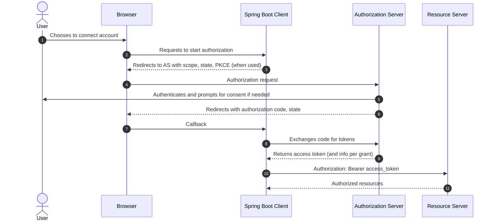
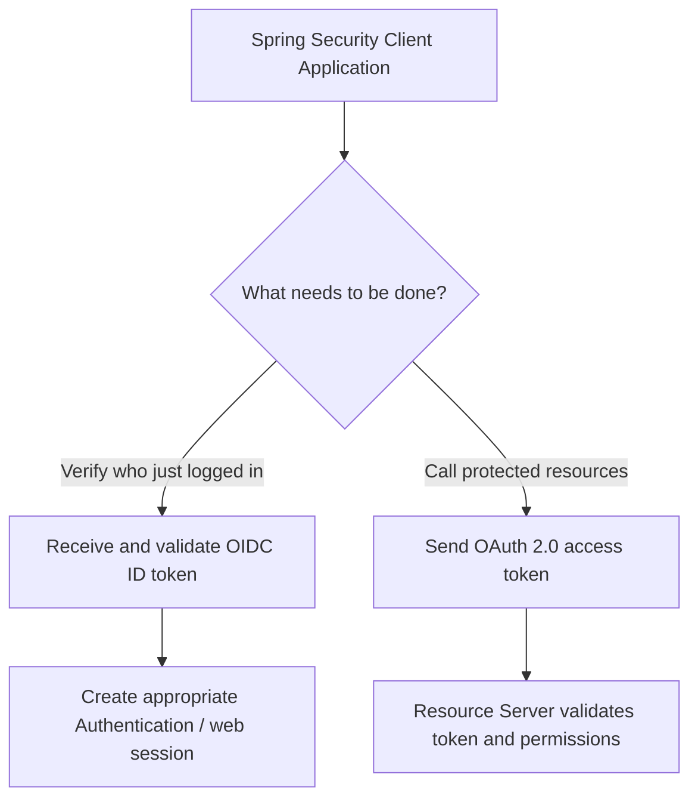

# 2.13. OAuth 2.0 Supports Authorization and Its Limitations for Authentication

> **Topic:** Spring Security OAuth 2.0 OIDC Client  
> **Chapter:** 2. OAuth 2.0 Fundamentals  
> **Summary:** OAuth 2.0 is designed to grant permission to access resources; a successful OAuth 2.0 flow does not automatically yield standardized identity proof for the Client application. OpenID Connect (OIDC) solves the login need on top of OAuth 2.0.

When a Spring Boot application displays a "Log in with external account" button, learners easily assume that OAuth 2.0 itself is a login protocol. In reality, **OAuth 2.0 is an authorization framework**. It enables a Client application to receive limited access to resources, typically on a user's behalf, without receiving the user's password. Determining "which user just logged into the Client?" is a different goal: **identity authentication**.

This distinction has direct consequences when using Spring Security: configuring an OAuth 2.0 Client to call APIs, configuring OIDC Login to log users in, and configuring a Resource Server to validate access tokens are three related yet distinct responsibilities.

## 1. Learning Objectives

After this lesson, you will be able to:

1. Explain how OAuth 2.0 solves the authorization problem and why the Authorization Server may have to authenticate the user during that process.
2. Distinguish **access permissions**, **user identity**, **application login**, and **business authorization**.
3. Explain why an access token, authorization code, scope, and a successful HTTP response are not interchangeable login proof.
4. Describe how OIDC adds an ID token, issuer, subject, and standardized identity verification rules.
5. Choose the right Spring Security mechanism for each scenario: `oauth2Login()` with OIDC, `oauth2Client()` for calling APIs, or `oauth2ResourceServer()` on APIs receiving bearer tokens.
6. Independently inspect scenarios: OIDC login, Client calling an authorized API, tokens used against the wrong audience, and flows without a user.

## 2. Three Questions Often Merged into One

Imagine an application "PhotoPrint" wants to fetch photos from "PhotoCloud" to print. This application must answer these questions:

| Question | Concept | Example |
|---|---|---|
| Is the application allowed to read photos? | **Access authorization** | The user grants PhotoPrint `photos.read` permission on PhotoCloud |
| Who is using PhotoPrint? | **Identity authentication** | PhotoPrint verifies the logged-in person is a principal confirmed by an identity provider |
| What is that person allowed to do **inside PhotoPrint**? | **Application authorization** | Only internal accounts with the "admin" role can edit billing settings |

OAuth 2.0 focuses on the first question. OIDC standardizes how to answer the second question when using an OpenID Provider. The third question remains decided by the application or internal policy; it can rely on validly mapped identity and permissions, yet does not follow automatically from logging in.

For example: a user grants PhotoPrint permission to read their public photos. This **does not mean** PhotoPrint is allowed to access private photos outside the granted scope; even less does it mean the user has admin rights over all of PhotoPrint.

### 2.1. Where Does "Authentication" Happen?

In the Authorization Code flow, the Authorization Server may ask the user to enter a password, complete MFA, or use an existing SSO session. That is **user authentication at the Authorization Server** so the server can decide whether to grant permissions.

However, OAuth 2.0 does not mandate a standardized user-identity message meant specifically for the Client, with complete verification rules like an OIDC ID token. Therefore:

- **The Authorization Server authenticated the user** does not mean **the Client received a valid identity assertion with sufficient semantics to log the user in**.
- The Authorization Server can grant permissions in contexts with no interactive user. For example, the `client_credentials` grant represents the Client itself.
- A token issued to an API for reading data has a different purpose and target recipient than an identity authentication message meant for the Client.

This is why using "OAuth login" in feature names can be misleading. Some products implement login based on OAuth 2.0 plus a proprietary profile API; that can work under a vendor-specific contract, but **plain OAuth 2.0 does not deliver interoperable, standardized login like OIDC**.

## 3. How Does OAuth 2.0 Support Authorization?

OAuth 2.0 defines four core roles:

- **Resource Owner:** entity with authority to grant access to protected resources; usually the end user in user-facing scenarios.
- **Client:** application needing resource access, e.g., a Spring Boot application.
- **Authorization Server:** server processing authorization and issuing access tokens.
- **Resource Server:** API/resource receiving tokens and deciding whether to grant access.

In a user-facing web scenario, the Authorization Code flow works along these main lines:



The endpoint of the OAuth 2.0 flow is that **the Client is granted a way to access resources within the Authorization Server's scope/rules**. The following may occur in the transaction without changing the protocol's purpose:

- The user logged in at the Authorization Server.
- The user saw a consent prompt.
- The Client received an authorization code and then an access token.
- The API returned data belonging to an account.

These signals **do not automatically create a standardized identity credential for the Client**. The Client needs a purpose-built identification mechanism if it wants to establish a login session based on user identity.

### 3.1. An Access Token Is Access Permission, Not an "ID Card"

Access tokens are usually bearer tokens: whoever holds a valid token can present it to make requests within the accepted scope. Tokens can be opaque strings or JWTs, depending on the Authorization Server. OAuth 2.0 **does not require** the Client to read the internal structure of an access token.

Example of how an API receives an access token:

```http
GET /api/photos HTTP/1.1
Host: api.photocloud.example
Authorization: Bearer <access-token>
```

The Resource Server must perform checks suited to its token type and architecture: validity, issuer/audience where applicable, expiration, permissions, and access conditions. **The Client should not infer login identity by decoding the access token itself and reading a field like `sub` or `email`**, because:

1. The token may be opaque, containing no claims for the Client to read.
2. The `sub` claim or JWT structure is not defined by plain OAuth 2.0 as a login identity assertion across all providers.
3. The access token may be issued for the **Resource Server**, not meant for the Client as an identity assertion recipient.
4. Two tokens from different resources, Clients, or issuers can have different semantics.
5. Self-interpreting a token bypasses purpose-built identity verification and trust boundaries.

**Example:** A JWT access token has `aud: "photos-api"` and `scope: "photos.read"`. Even with `sub: "12345"`, the PhotoPrint Client must not treat it as an ID token meant for `web-client`. For an API, `aud` indicates the token's intended recipient; for an OIDC login Client, the **ID token's** `aud` must include the corresponding client ID.

### 3.2. Scope Limits Requested/Granted Permissions

Scopes are strings representing access boundaries per Authorization Server policy, such as `photos.read` or `calendar.write`. A Client requesting a scope does not mean it is always granted that exact scope; the server may narrow or deny it. The Resource Server also must evaluate permissions on specific resources.

Scopes are also **not automatically internal roles**. `photos.read` does not mean "authenticated user with role ADMIN." Even a scope named `admin` only carries meaning per contract between systems, without a universal default meaning.

OIDC uses the special `openid` scope to request processing under the OIDC protocol. Scopes `profile` and `email` relate to requesting profile claims, without guaranteeing every claim is always present or verified identically.

### 3.3. Authorization Code and `state` Are Not Identity

An authorization code is a short-lived code the Client exchanges for tokens; it is not an access token, ID token, or string certifying "this is Alice." The `state` parameter correlates the authorization request with the callback and helps prevent attacks such as CSRF against login/authorization flows. PKCE binds the code exchange to the Client that initiated the request, helping prevent code theft and reuse.

These mechanisms protect the **OAuth transaction**, yet do not replace a standardized identity assertion.

## 4. Specific Limitations When Using OAuth 2.0 for Login

### 4.1. No Mandatory Identity Assertion Format

OAuth 2.0 does not require the Authorization Server to issue an ID token with standardized claims like `iss`, `sub`, and `aud` to the Client. Receiving only an access token leaves the Client without a structured authentication message and target recipient defined for login.

An application could call the provider's profile API using an access token, yet the endpoint name, claims, and trustworthiness depend on each provider. "Sign in with X" built on a proprietary profile API is therefore not automatically compatible with another provider.

### 4.2. Token Audience Confusion

Suppose Client A receives an access token meant for API B. If Client A accepts that token as proof of its own login, the token can be used **outside its intended purpose**.

Semantic illustration, not a real token:

```json
{
  "iss": "https://login.example.test",
  "sub": "resource-owner-42",
  "aud": "orders-api",
  "scope": "orders.read",
  "exp": 1893456000
}
```

A web Client with client ID `shop-web` cannot simply see `sub` and assert this is a login session for `shop-web`. The token in the example was issued for `orders-api`; that API itself must validate the matching token before granting access.

**Consequence:** tokens used to access resources and tokens used to authenticate users must have separate verification workflows and intended recipients.

### 4.3. No Universal Guarantee of User Identity Across All Grants

OAuth 2.0 has multiple grants suited to different needs. The table below shows why you cannot say "having an OAuth token means a user is logged in":

| Flow / Usage Pattern | Is There an Interactive User? | Primary Meaning |
|---|---|---|
| Authorization Code with user | Usually yes, or reuses a session at the Authorization Server | Client receives access permissions on behalf of the Resource Owner |
| Authorization Code + OIDC | Usually yes, or reuses a valid session at the OpenID Provider | Besides authorization, Client receives an ID token for identity authentication |
| Client Credentials | No user needed | Client accesses resources under its own permissions |
| Refresh Token | Not necessarily new interaction | Client requests new tokens based on a prior authorization |

Even with Authorization Code, user authentication at the IdP may happen via an existing SSO session rather than a new password prompt. Never mistake "no login screen shown" for "not authenticated," nor conclude in reverse that "seeing a login screen" proves the application verified identity according to standard.

### 4.4. Does Not Automatically Prevent Provider Mix-Up or Session Confusion

When an application supports multiple Authorization Servers, the Client must recognize that callbacks and identity details belong to the exact server that initiated the transaction. If an application relies solely on a token without proper issuer/audience recognition rules, the risk of provider mix-up, account mix-up, or accepting out-of-session results increases.

Measures such as `state`, PKCE, issuer verification, and corresponding protections safeguard OAuth flows. When **federated login** is required, OIDC adds clear identity messages and verification rules.

### 4.5. Authentication and Session Are Two Different Layers

An application can hold its own session cookie after login and keep serving requests even if the access token used to call APIs has expired. Conversely, holding a valid access token to call an API does not mean the browser has a login session at the web Client.

| Artifact | Primary Consumer | Role |
|---|---|---|
| Access token | Resource Server | Requests access to APIs/resources |
| OIDC ID token | Client (Relying Party) | Verifies the authentication event and OP-asserted identity |
| Web app session cookie | Browser and web application | Maintains session state within the application |
| Refresh token | Client per token-issuance policy | Requests new access tokens when permitted |

Tokens and sessions have different lifecycles. Logout, expiration, re-issuance, and revocation workflows must be specified separately in application design.

## 5. What Does OpenID Connect Add on Top of OAuth 2.0?

**OpenID Connect 1.0** is an identity layer built on OAuth 2.0. With the OIDC Authorization Code flow, the Client (commonly called a **Relying Party — RP**) receives an **ID token** from the **OpenID Provider — OP**, alongside tokens serving requested access permissions.

An ID token is typically a signature-protected JWT. It contains claims for authentication, typically:

| Claim | Meaning During Verification |
|---|---|
| `iss` | Issuer — provider issuing the identity assertion |
| `sub` | Subject — user identifier within the issuer's scope |
| `aud` | Audience — one or more client IDs permitted to receive the ID token |
| `exp` | ID token expiration timestamp |
| `iat` | ID token issued-at timestamp |
| `nonce` | Links the ID token to the authentication request when `nonce` is used per flow/rules |
| `auth_time` | Time of user authentication, when requested/provided |
| `azp` | Authorized party, which may need evaluation per OIDC conditions |

**Illustrative** payload example; this JSON is not a signed JWT and must not be used to test real authentication:

```json
{
  "iss": "https://login.example.test",
  "sub": "person-42",
  "aud": "shop-web",
  "iat": 1893450000,
  "exp": 1893453600,
  "nonce": "example-nonce"
}
```

In practice, the Client must use an OIDC-capable library to **verify** the ID token rather than merely decoding the payload. Critical checks include a valid signature and verification key, expected issuer, matching audience/client ID, validity window, and `nonce`/`azp`/`auth_time` conditions when applicable.

Never treat strings inside a JWT as trustworthy before verification completes. Note that `sub` is only meaningful together with `issuer`; for internal identification, typically use the **(issuer, subject)** pair rather than email or `sub` alone. An OP may also issue different pairwise identifiers per Client group.

### 5.1. An ID Token Does Not Replace an Access Token

Both tokens often appear together in the OIDC Code flow, yet serve two different recipients:



**Never send an ID token as a bearer token to call an API** when the API expects an OAuth access token. Conversely, **never use an API access token as an ID token** to establish a login session.

### 5.2. UserInfo Supplements Profile Data, Does Not Replace the ID Token

An OP may support a **UserInfo endpoint** to supply additional profile claims per scope and policy. The Client calls this endpoint with an access token per OIDC rules. When using UserInfo, the Client must ensure `sub` in the response matches `sub` of the valid ID token.

Claims such as `email`, `name`, and `picture` are only profile attributes; availability and verification level depend on the IdP. Never use an unverified email address as an immutable identity, or assume every provider always returns `email_verified`.

### 5.3. What Does OIDC Solve, and What Still Belongs to the Application?

OIDC gives the Client **a standardized protocol-based identity assertion**. However, OIDC does not itself decide:

- Whether that account should be newly provisioned in the internal database.
- Whether the user has roles `ADMIN`, `EDITOR`, or can view a specific organization's data.
- How to handle linking accounts across multiple IdPs, account lockouts, permission revocation, or group changes.
- How long the web session lasts, or whether re-authentication is needed for sensitive operations.

The application must still define authorization policies and corresponding session management.

## 6. Side by Side: OAuth 2.0 Authorization and OIDC Authentication

| Aspect | OAuth 2.0 | OIDC (on OAuth 2.0) |
|---|---|---|
| Standardization goal | Authorize a Client to access resources | Add user identity authentication for the Client |
| Primary result recipient | Client gets tokens to access Resource Server | Relying Party receives ID token; Resource Server still receives access token when needed |
| Core artifact | Access token and grant components | ID token alongside OAuth 2.0 components |
| End-user identity | No universal mandatory identity assertion for the Client | Standardized `iss`, `sub`, `aud`, and ID token verification rules |
| Typical scopes | API-oriented scopes like `files.read` | `openid`, plus `profile`/`email` when claims are needed |
| Usable without a user? | Yes, e.g., `client_credentials` | OIDC login targets end-user authentication |
| Valid conclusion by Client | "I hold a token granted to access this resource." | "I verified an OIDC identity assertion meant for this Client." |

The accurate way to explain the system is: **OAuth 2.0 lets an application be authorized to act on resources; OIDC lets an application verify a user's identity based on assertions from a trusted OP**. When a user logs in via OIDC, the application may also use an access token to access APIs, yet both purposes must be executed and verified separately.

## 7. Connecting to Spring Security OAuth 2.0/OIDC Client

In Spring Security, familiar components express these three roles:

| Spring Security | Goal | Typical Data / Mechanisms |
|---|---|---|
| `oauth2Login()` | Log users in with OAuth 2.0/OIDC via redirect | Authorization Code, `OAuth2AuthenticationToken`; with OIDC, `OidcUser` and ID token |
| `oauth2Client()` | Manage authorized clients to call protected APIs | `ClientRegistration`, `OAuth2AuthorizedClient`, `OAuth2AuthorizedClientManager` |
| `oauth2ResourceServer()` | Protect APIs receiving bearer access tokens | JWT decoder or token introspection; request verification and authorization |

Spring Security can support provider-specific **OAuth 2.0 Login** without OIDC—for instance, fetching user info via a custom UserInfo endpoint and `OAuth2UserService`. That creates an `Authentication` inside the Spring application, yet does not turn OAuth 2.0 itself into an interoperable identity protocol. For providers supporting OIDC, prefer OIDC Login when the goal is verifying user identity.

### 7.1. Sample OIDC Login Configuration

Example using Spring Boot 3.x/Spring Security 6.x in a Servlet/MVC application. Suppose a **local** OP runs at `http://localhost:9000/realms/demo` and a confidential Client with a matching redirect URI has been registered. This address/value is illustrative only; production environments require HTTPS and parameters provided by your IdP.

Minimal Maven dependencies for the web Client:

```xml
<dependency>
    <groupId>org.springframework.boot</groupId>
    <artifactId>spring-boot-starter-web</artifactId>
</dependency>
<dependency>
    <groupId>org.springframework.boot</groupId>
    <artifactId>spring-boot-starter-oauth2-client</artifactId>
</dependency>
```

`application.yml` configuration:

```yaml
server:
  port: 8080

spring:
  security:
    oauth2:
      client:
        registration:
          demo:
            provider: demo
            client-id: demo-web
            client-secret: ${OIDC_CLIENT_SECRET}
            authorization-grant-type: authorization_code
            redirect-uri: "{baseUrl}/login/oauth2/code/{registrationId}"
            scope: [openid, profile, email]
        provider:
          demo:
            issuer-uri: http://localhost:9000/realms/demo
```

Explanation:

- `registrationId` is `demo`; users can initiate the flow at `/oauth2/authorization/demo`.
- `issuer-uri` points to the provider and lets Spring Security retrieve OIDC metadata when supported.
- `openid` marks the request as OIDC. Scopes `profile` and `email` are optional for profile claims.
- `redirect-uri` must match the URI registered at the OP: `http://localhost:8080/login/oauth2/code/demo`.
- `OIDC_CLIENT_SECRET` must be supplied via environment variable/secret manager; never copy real secrets into Git. For a public client, the Client authentication method and PKCE configuration will differ.

Example `SecurityFilterChain`:

```java
import org.springframework.context.annotation.Bean;
import org.springframework.context.annotation.Configuration;
import org.springframework.security.config.Customizer;
import org.springframework.security.config.annotation.web.builders.HttpSecurity;
import org.springframework.security.web.SecurityFilterChain;

@Configuration
class WebSecurityConfig {

    @Bean
    SecurityFilterChain webSecurityFilterChain(HttpSecurity http) throws Exception {
        return http
            .authorizeHttpRequests(auth -> auth
                .requestMatchers("/", "/error").permitAll()
                .anyRequest().authenticated())
            .oauth2Login(Customizer.withDefaults())
            .oauth2Client(Customizer.withDefaults())
            .build();
    }
}
```

With successful OIDC login, a controller can read subject/issuer from `OidcUser`:

```java
import java.util.Map;
import org.springframework.security.core.annotation.AuthenticationPrincipal;
import org.springframework.security.oauth2.core.oidc.user.OidcUser;
import org.springframework.web.bind.annotation.GetMapping;
import org.springframework.web.bind.annotation.RestController;

@RestController
class WhoAmIController {

    @GetMapping("/me")
    Map<String, String> me(@AuthenticationPrincipal OidcUser user) {
        return Map.of(
            "subject", user.getSubject(),
            "issuer", user.getIdToken().getIssuer().toString()
        );
    }
}
```

After OIDC verification, Spring Security creates an authentication object and typically stores it in the web app's HTTP session. The `/me` endpoint displays only minimal identity details. **Do not return raw ID tokens, access tokens, refresh tokens, or session cookies to a demo page** to prove login succeeded.

### 7.2. Interpreting Login Results for the Right Purpose

Several things must be interpreted carefully when observing the application:

- An HTTP redirect from `/me` to the IdP means the application is **initiating login**; it is not yet proof the user has authenticated.
- A callback containing `code` means the OP redirected back to the Client with transaction data; the app still needs to validate `state` and exchange a valid code.
- An OIDC token response contains an ID token; the application must validate the ID token before trusting the identity.
- When `/me` returns subject/issuer from the principal after the flow completes, you are observing **the application's authentication state**.
- Successfully calling another API still requires an access token **suitable for that API** and the Resource Server's permission policies.

## 8. Contrast Examples: Same OAuth 2.0, Different Conclusions

### Scenario A — App Granted Calendar Read Access, Without OIDC Identity

A user opens `reporting-client` and allows it to read calendar events via Authorization Code. The Authorization Server issues an access token with scope `calendar.read`; the Client calls the calendar API successfully.

**Right conclusion:** The Client was granted permission to read events per API policy. If the application has no separately verified identification mechanism, this OAuth 2.0 token does not by itself guarantee identity for federated login.

**Wrong conclusion:** "The token can read Alice's calendar, so Alice must have safely logged into my app."

If the provider offers a user profile API, the app can use it under its specific contract. For standardized identity assertions, use OIDC where supported.

### Scenario B — OIDC Login Succeeded, Yet the API Still Returns 403

`reporting-client` validates an ID token for `client-id=reporting-client` and creates a user session. Then it calls the documents API with an access token **missing the `documents.write` scope**.

**Right conclusion:** The user is authenticated at the Client, yet the document write request lacks permissions at the API. The Resource Server can return **403 Forbidden** when a token is accepted but lacks sufficient privileges.

**Wrong conclusion:** "Once OIDC login succeeds, every API must return 200."

### Scenario C — Token Exists, No End-User

A scheduled job uses the `client_credentials` grant to fetch an access token for calling an internal billing API. There is no browser, redirect, or end user.

**Right conclusion:** The system authenticated the Client and granted it machine-to-machine permissions. There is no basis to establish a "user Alice" login session from this grant.

**Wrong conclusion:** "Every access token corresponds to a logged-in user."

### Scenario D — Valid Token, Wrong Audience

A JWT has a valid signature from the same issuer, but was issued with `aud=inventory-api`. `billing-api` is configured to accept only tokens with audience `billing-api`.

**Right conclusion:** `billing-api` must reject a wrong-audience token when token/JWT API policy requires that check. A valid signature and issuer alone are not enough to accept a token issued for another resource.

**Wrong conclusion:** "A token from the same identity provider works at any API."

## 9. Hands-On Lab: Distinguishing by Observation

A small lab with an **IdP/OpenID Provider**, **Spring Boot web Client**, and **Resource Server** is sufficient. Suppose the Client runs on port 8080, the API on port 8081, and the OP on port 9000. Ports, realms, scopes, and client IDs must be adjusted to match your actual environment.

### Lab 1 — Tracing an OIDC Login

**Setup:** create Client `demo-web`, register the redirect URI and `openid` scope. Start the app with `oauth2Login()` and the `/me` controller from Section 7.

**Steps:**

1. Use a private browser window to avoid stale login sessions, and visit `http://localhost:8080/me`.
2. Observe the browser redirecting to the OP via the authorization URL, then log in with a lab account.
3. Observe the `/login/oauth2/code/demo` callback and the `/me` visit after the flow finishes.
4. Record the **issuer** and **subject** displayed by the app, without copying codes, tokens, session cookies, or client secrets.
5. Open the diagram in Section 3 and mark which parts the browser performs and which parts Spring Security performs server-side.

**Expected outcome:** `/me` shows a valid OIDC principal after login; the app holds its own authentication state. The Client's server-side call to the token endpoint may not appear as a direct request in the browser's Network tab.

**Questions:** Which party issued the ID token? Why must the ID token's `aud` match the Client? What differs between a session cookie and an access token?

### Lab 2 — Login Succeeds, Yet API Permissions Are Missing

**Setup:** Resource Server protects `GET /api/reports` with scope `reports.read`. Configure it to validate the right access token type (JWT or introspection per OP) and token conditions, including issuer and audience where appropriate.

**Steps:**

1. Log in via OIDC so the web app has a valid principal.
2. Have the web Client call `/api/reports` using the **access token** managed via the authorized client; the API does not accept ID tokens as bearer credentials.
3. Observe the response with an appropriate access token, then use the lab's permission config to test a missing-scope case.
4. Compare the web Client's login state with the API's authorization state.

**Expected outcome:** when the API requires `reports.read`, a valid token with that scope can be authorized per policy; an authenticated token lacking permissions typically yields 403. Missing/expired/invalid tokens typically yield 401. Exact behavior depends on `SecurityFilterChain` config and API policy.

**Questions:** Who authenticates user identity at the web Client? Who decides whether `/api/reports` can be read?

### Lab 3 — Comparing OIDC and Provider-Specific OAuth 2.0 Login

**Setup:** in a provider lab supporting OIDC, optionally create a separate Client registration to test OAuth 2.0 Login when the provider offers an eligible profile API.

**Steps:**

1. Note the OIDC configuration with `openid` scope and `OidcUser` principal.
2. In the separate test registration, configure non-OIDC OAuth 2.0 Login per provider docs, only when the provider publishes a clear profile endpoint and contract.
3. Compare the data source creating the principal and what artifacts the app can verify. Do not treat a single failed scope change as proof the provider does not support OAuth.

**Expected outcome:** OIDC has an ID token and standardized validation rules; plain OAuth 2.0 Login depends on the provider's user profile contract and Spring Security configuration. A profile API returning 200 is not itself an ID token.

**Questions:** If you switch providers, which application requires rewriting custom profile mapping? Which mechanism provides more standardized identity?

### Lab 4 — Observing a Machine-to-Machine Grant

**Setup:** a `client_credentials` Client registration in the test environment, granted permission solely to call a machine-to-machine API.

**Steps:**

1. Acquire an access token via `client_credentials` using the appropriate authorized-client mechanism.
2. Call the API registered to accept that token.
3. Compare with OIDC login: there is no user login interaction, no ID token for a user session, and no browser OIDC principal created merely because a token was issued.

**Expected outcome:** authorization is granted to the Client without requiring end-user authentication. This clearly demonstrates that an "OAuth token" alone cannot establish user identity.

## 10. Security Principles When Integrating OAuth 2.0 and OIDC

The distinction between authorization and authentication also leads to concrete implementation rules:

1. **Use the right token type for the right recipient.** Access tokens to call Resource Servers; ID tokens for the Client to verify identity. Never let an API accept an ID token in the role of an access token.
2. **Use Authorization Code with modern protections.** Apply PKCE per Client type and current security recommendations; protect `state`/correlation and same-session callbacks. Do not use implicit grant as a default for new apps.
3. **Validate OIDC with libraries.** Check issuer, audience/client ID, signature, token expiration, and relevant OIDC conditions. Never use `Base64.decode` or check only `email` to "validate a JWT."
4. **Isolate providers.** When multiple issuers are configured, never assume a token or user ID from one provider has meaning in another; account linking requires explicit policy.
5. **Design Resource Servers independently.** APIs verify bearer tokens and required permissions themselves; the web Client having a session is not enough to bypass API checks.
6. **Protect sensitive data.** Never write tokens, authorization codes, client secrets, session cookies, or passwords into logs or lesson materials. Use HTTPS outside local localhost test environments.
7. **Do not infer business permissions from login.** Successful authentication only establishes identity at an accepted assurance level; the app still must check permissions for each action and resource.
8. **Understand session/token lifecycles.** Access token expiration, ID token expiration, app session expiration, and OP session expiration can occur at different times; handle renewal, re-authentication, and logout per requirements.

### 10.1. Error Symptoms and Where to Check

| Symptom | Premature Conclusion to Avoid | Where to Check |
|---|---|---|
| Client has access token but no `OidcUser` | "Spring Security doesn't support OIDC" | `openid` scope, issuer/discovery, login type, and registration config |
| API returns 401 after login | "User identity is wrong" | Was the properly formatted access token sent? Is the token expired, wrong issuer/audience, or invalid signature? |
| API returns 403 after login | "Must log in again" | Token was accepted, but are scopes/authorities/resource policies missing? |
| JWT decodes cleanly yet login is rejected | "JWT is valid because payload reads fine" | Signature/JWK, issuer, audience, expiration, nonce, and applicable OIDC rules |
| Using Client Credentials and controller has no user login | "Token is broken" | This grant does not represent an end user; it is not designed to produce an `OidcUser` |
| UserInfo succeeds yet identity is untrusted | "API returned profile so OIDC auth is valid" | Was an ID token verified and `sub` matched? |

## 11. Comprehension Check Questions

**Question 1:** A user granted an application an access token with scope `files.read`. What is definitely established per OAuth 2.0's purpose?

**Hint:** the application received a credential to request resource access within policy boundaries; the token does not automatically become an OIDC login assertion.

**Question 2:** The Authorization Server just prompted the user for a password. Why can the Client not conclude "I have authenticated the user's identity" solely from receiving an authorization code?

**Hint:** authentication occurred at the Authorization Server; the Client needs an identity message and verification rules intended for itself.

**Question 3:** Should `sub` from a JWT access token issued for `inventory-api` be used to log into a `billing-web` account?

**Hint:** do not infer identity from a token with a different audience; use a valid OIDC identity assertion or a purpose-built, thoroughly evaluated authentication contract.

**Question 4:** After a successful OIDC login, an API returns 403. Which component must determine the cause?

**Hint:** check permissions on the Resource Server, scopes/authorities in the access token, and endpoint policies; do not assume a login failure.

**Question 5:** Why does `client_credentials` demonstrate that OAuth 2.0 is not synonymous with user login?

**Hint:** it grants permissions to the Client itself with no interactive end user.

**Question 6:** In Spring Security, when do you choose `oauth2Client()`, `oauth2Login()`, and `oauth2ResourceServer()`?

**Hint:** respectively for managing API-calling permissions, logging users into the Client, and validating tokens on incoming API requests.

## 12. Takeaways for System Design

Explicitly describe **three trust boundaries** in your architecture diagrams:

- **Between Client and Authorization Server/OP:** Client initiates the flow, matches callbacks, receives tokens, and verifies OIDC results on login.
- **Between Client and Resource Server:** Client presents an access token to request operations on resources; Resource Server evaluates token/permissions.
- **Inside the application:** the authenticated principal is mapped to accounts, sessions, and business permissions per application policy.

If you need "Log in with an enterprise account," first look for **OIDC** support at the IdP and use Spring Security's OIDC libraries. If the Client only needs to call APIs on a user's behalf, use **OAuth 2.0 authorization** with least-privilege scopes. When both needs coexist, the application uses OIDC to identify the user and OAuth 2.0 access tokens to access resources, matching each token's intended recipient.

## 13. References

- [RFC 6749 — The OAuth 2.0 Authorization Framework](https://www.rfc-editor.org/rfc/rfc6749): roles, authorization flows, and meaning of access tokens.
- [RFC 6750 — OAuth 2.0 Bearer Token Usage](https://www.rfc-editor.org/rfc/rfc6750): using bearer access tokens when accessing Resource Servers.
- [RFC 9700 — Best Current Practice for OAuth 2.0 Security](https://www.rfc-editor.org/rfc/rfc9700): security recommendations for modern OAuth 2.0 flows.
- [OpenID Connect Core 1.0](https://openid.net/specs/openid-connect-core-1_0.html): ID token, user authentication, UserInfo, and verification rules.
- [Spring Security — OAuth 2.0 Login](https://docs.spring.io/spring-security/reference/servlet/oauth2/login/index.html): OAuth 2.0/OIDC login in Servlet applications.
- [Spring Security — OAuth 2.0 Client](https://docs.spring.io/spring-security/reference/servlet/oauth2/client/index.html): managing `ClientRegistration` and `OAuth2AuthorizedClient`.
- [Spring Security — OAuth 2.0 Resource Server](https://docs.spring.io/spring-security/reference/servlet/oauth2/resource-server/index.html): validating bearer tokens and protecting APIs.

In practice, cross-check documentation with your exact Spring Security version and identity provider requirements—especially issuer, redirect URI, token format, audience, claim mapping, and refresh token issuance policies.
