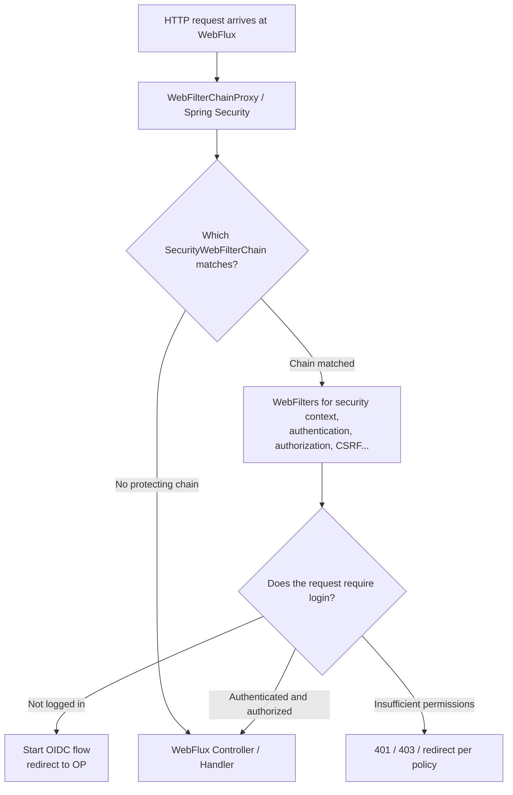
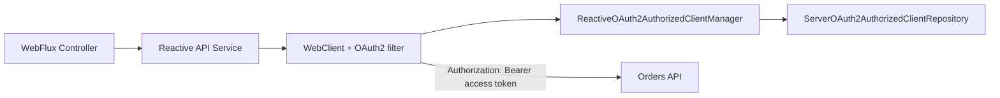

# 20.1. SecurityWebFilterChain and oauth2Login Configuration

In **Spring Security OAuth 2.0/OIDC Client**, a **Spring WebFlux** application can let users log in through an OpenID Provider (OP) such as an enterprise SSO system. Unlike a Spring MVC/Servlet application, WebFlux uses a **reactive security chain** built with `ServerHttpSecurity` and returning `SecurityWebFilterChain`.

A concise configuration can look like this:

```java
@Bean
SecurityWebFilterChain springSecurityFilterChain(ServerHttpSecurity http) {
    return http
        .authorizeExchange(exchanges -> exchanges
            .pathMatchers("/", "/error").permitAll()
            .anyExchange().authenticated())
        .oauth2Login(Customizer.withDefaults())
        .build();
}
```

However, to implement this correctly and securely, you need to understand **what `SecurityWebFilterChain` does**, where Spring resolves **`ReactiveClientRegistrationRepository`** from, which request initiates login, how the callback is handled, how authentication is stored in the reactive security context, and why you should not copy Servlet's `HttpSecurity` straight into WebFlux.

This lesson walks through architecture, dependencies, and minimal OIDC configuration through to custom login pages, multiple providers, multiple security filter chains, CSRF/session handling, the OIDC principal, downstream API calls, and real-world pitfalls.

## 1. Choose Servlet or Reactive Properly Before Configuring

Spring Security has two different web security models:

| Aspect | Spring MVC / Servlet | Spring WebFlux / Reactive |
|---|---|---|
| HTTP abstraction | `HttpServletRequest`, `HttpServletResponse` | `ServerWebExchange` |
| Security DSL | `HttpSecurity` | **`ServerHttpSecurity`** |
| Security chain | `SecurityFilterChain` | **`SecurityWebFilterChain`** |
| Matcher | `RequestMatcher` | `ServerWebExchangeMatcher` |
| Authentication result | Usually synchronous `Authentication` | Usually handled as `Mono<Authentication>` |
| Security context | `SecurityContextHolder` bound to a thread in the traditional model | **`ReactiveSecurityContextHolder`** bound to the Reactor Context |
| OAuth client registration | `ClientRegistrationRepository` | **`ReactiveClientRegistrationRepository`** |
| Authorized client in request | `OAuth2AuthorizedClientRepository` | **`ServerOAuth2AuthorizedClientRepository`** |
| OAuth client manager | `OAuth2AuthorizedClientManager` | **`ReactiveOAuth2AuthorizedClientManager`** |
| Login DSL | `http.oauth2Login(...)` | **`http.oauth2Login(...)` on ServerHttpSecurity** |

They share the same `oauth2Login` method name, but they are **two different DSL objects**. In WebFlux, declare:

```java
SecurityWebFilterChain securityWebFilterChain(ServerHttpSecurity http)
```

and do not use:

```java
// Wrong stack if the target is WebFlux.
SecurityFilterChain securityFilterChain(HttpSecurity http)
```

An application can use Reactor or WebClient libraries while **still running Servlet MVC**. Merely seeing `Mono` or `WebClient` in the codebase does not mean the web stack of the entire application is WebFlux.

### 1.1. Be Careful When Both starter-web and starter-webflux Are Present

In Spring Boot projects that include both:

```groovy
implementation 'org.springframework.boot:spring-boot-starter-web'
implementation 'org.springframework.boot:spring-boot-starter-webflux'
```

Spring Boot normally **prefers the Servlet MVC application** when both web stacks are present. Because of that, a `SecurityWebFilterChain` bean might not protect requests as you expect if the application is actually running Servlet.

For a project intended to run on WebFlux, choose consistent dependencies and verify the web application type. You can configure `spring.main.web-application-type: reactive` when there is a clear reason, but do not use that property to mask an application structure that still depends on blocking MVC components.

### 1.2. Reactive Does Not Automatically Make Everything Non-Blocking

`SecurityWebFilterChain` runs inside a reactive pipeline; however, if you call blocking JDBC, `Thread.sleep`, or `Mono.block()` directly on the Netty event-loop, the application can still stall.

Reactive login requires:

- Not blocking the event-loop thread in a custom authentication service.
- Using reactive repositories/HTTP clients whenever possible.
- If you must integrate with a blocking legacy API, isolating it on an appropriate scheduler/layer instead of calling it directly on the event-loop.
- Preserving the Reactor Context so the security context propagates across asynchronous steps.

## 2. What Is SecurityWebFilterChain?

`SecurityWebFilterChain` is **Spring Security's chain of `WebFilter`s** applied to matching `ServerWebExchange` instances. This chain handles many responsibilities, not just OAuth Login:

- Restoring/saving the security context.
- Detecting whether a request is already authenticated.
- Enforcing authorization by path and HTTP method.
- Coordinating the entry point when a request is unauthenticated.
- Executing OAuth2/OIDC login via redirect and callback.
- Managing CSRF, security headers, logout, and other policies.
- Translating authentication/authorization errors into appropriate responses.

In Spring WebFlux, you can define one or more `SecurityWebFilterChain` beans. Each chain has its own matcher and rules.



**Having no matching chain** can let a request pass through without the security rules you intended. When splitting into multiple chains, you must define a catch-all chain for the remaining paths if you want to avoid gaps caused by matchers.

### 2.1. Do Not Create a Chain Only for Login and Forget Authorization

For example:

```java
return http
    .oauth2Login(Customizer.withDefaults())
    .build();
```

may rely on unintended default behaviors. A clearer approach is to declare access rules explicitly:

```java
.authorizeExchange(exchanges -> exchanges
    .pathMatchers("/", "/login", "/css/**", "/error").permitAll()
    .anyExchange().authenticated())
```

Place `anyExchange().authenticated()` after public exceptions; avoid configuring every path as permitted just to make the login page render.

## 3. Dependencies for Spring Boot WebFlux OAuth2 Login

With Gradle Groovy DSL:

```groovy
dependencies {
    implementation 'org.springframework.boot:spring-boot-starter-webflux'
    implementation 'org.springframework.boot:spring-boot-starter-security'
    implementation 'org.springframework.boot:spring-boot-starter-oauth2-client'
}
```

The three starters are responsible for:

| Starter | Role |
|---|---|
| `spring-boot-starter-webflux` | Reactive HTTP stack, WebFlux handlers/routers, reactive runtime |
| `spring-boot-starter-security` | Spring Security core and WebFlux security |
| `spring-boot-starter-oauth2-client` | OAuth 2.0/OIDC Client, registration, token exchange, principal |

You **do not need** `spring-boot-starter-oauth2-resource-server` just to let users log in via OIDC. That starter is for an app/API that **receives** bearer access tokens. If an application acts as both an OAuth Client and a Resource Server, those are two separate responsibilities requiring properly scoped filter chains and credentials.

### 3.1. Application Entry Point

```java
import org.springframework.boot.SpringApplication;
import org.springframework.boot.autoconfigure.SpringBootApplication;

@SpringBootApplication
public class ReactivePortalApplication {

    public static void main(String[] args) {
        SpringApplication.run(ReactivePortalApplication.class, args);
    }
}
```

The snippet above contains nothing OAuth-specific, but Spring Boot will create a reactive web application when the dependencies and web application type match.

## 4. ClientRegistration for OIDC on WebFlux

### 4.1. Configuring issuer-uri

Example with an OP supporting OIDC Discovery:

```yaml
spring:
  security:
    oauth2:
      client:
        registration:
          company:
            provider: company
            client-id: ${COMPANY_OIDC_CLIENT_ID}
            client-secret: ${COMPANY_OIDC_CLIENT_SECRET}
            client-authentication-method: client_secret_basic
            authorization-grant-type: authorization_code
            redirect-uri: "{baseUrl}/login/oauth2/code/{registrationId}"
            scope:
              - openid
              - profile
              - email
        provider:
          company:
            issuer-uri: https://login.example.org
```

Explanation:

- `company` is the **registrationId** — the local name Spring uses to select the client.
- `client-id` is the OAuth client ID issued by the OP to the app, and **does not have to equal `company`**.
- `client-secret` is used for a confidential client and must only be stored on the backend.
- `authorization-grant-type: authorization_code` uses authorization code, often combined with PKCE depending on policy/client type.
- `redirect-uri` specifies the callback where the OP is allowed to return the code.
- `scope: openid` makes the flow an OIDC flow and requests an ID Token.
- `issuer-uri` provides the starting point for OP metadata discovery, including the appropriate endpoints.

When the OP does not support Discovery, you may need to configure endpoints such as `authorization-uri`, `token-uri`, `jwk-set-uri`, and `user-info-uri` per the contract; at the same time, never drop OIDC verification conditions just to make configuration simpler.

### 4.2. The Callback URL Must Be Registered Exactly at the OP

For a website at:

```text
https://portal.example.org
```

and registration ID `company`, the default callback is:

```text
https://portal.example.org/login/oauth2/code/company
```

This URL must match the redirect URI declared/allowed at the OP according to the provider's rules. Do not use a broad wildcard redirect URI like:

```text
https://*.example.org/*
```

unless required and tightly controlled by provider/risk policy; an arbitrary redirect URI is a serious OAuth risk.

### 4.3. ReactiveClientRegistrationRepository

In WebFlux, Spring Security uses:

```java
org.springframework.security.oauth2.client.registration
    .ReactiveClientRegistrationRepository
```

This repository lets you look up registrations by ID using a reactive API.

```java
import reactor.core.publisher.Mono;
import org.springframework.security.oauth2.client.registration.ClientRegistration;
import org.springframework.security.oauth2.client.registration.ReactiveClientRegistrationRepository;

public final class RegistrationLookup {

    private final ReactiveClientRegistrationRepository registrations;

    public RegistrationLookup(ReactiveClientRegistrationRepository registrations) {
        this.registrations = registrations;
    }

    public Mono<ClientRegistration> findCompany() {
        return registrations.findByRegistrationId("company");
    }
}
```

With Spring Boot properties, the framework usually creates the appropriate repository automatically. If you define a custom repository (for multi-tenant/dynamic registrations), ensure registrations come from a trusted source and that issuer/endpoints/client secrets cannot be controlled directly by user input.

## 5. Minimal SecurityWebFilterChain for oauth2Login

### 5.1. Recommended Configuration for This Lesson

```java
import org.springframework.context.annotation.Bean;
import org.springframework.context.annotation.Configuration;
import org.springframework.security.config.Customizer;
import org.springframework.security.config.annotation.web.reactive.EnableWebFluxSecurity;
import org.springframework.security.config.web.server.ServerHttpSecurity;
import org.springframework.security.web.server.SecurityWebFilterChain;

@Configuration
@EnableWebFluxSecurity
public class ReactiveSecurityConfig {

    @Bean
    SecurityWebFilterChain webSecurity(ServerHttpSecurity http) {
        return http
            .authorizeExchange(exchanges -> exchanges
                .pathMatchers("/", "/error", "/css/**", "/js/**").permitAll()
                .anyExchange().authenticated())
            .oauth2Login(Customizer.withDefaults())
            .build();
    }
}
```

Breakdown:

1. `@EnableWebFluxSecurity` enables Spring Security configuration for WebFlux in the given context; Spring Boot provides auto-configuration mechanisms, but declaring it explicitly makes this lesson easier to follow.
2. `@Bean SecurityWebFilterChain` creates the security chain used by the framework to protect requests.
3. `ServerHttpSecurity` is the WebFlux DSL equivalent to Servlet's `HttpSecurity`.
4. `authorizeExchange` configures policies based on `ServerWebExchange`.
5. `pathMatchers(...).permitAll()` permits public pages, error pages, and static assets.
6. `anyExchange().authenticated()` requires all other requests to be authenticated.
7. `oauth2Login(Customizer.withDefaults())` enables login via OAuth2/OIDC client registrations.
8. `build()` builds the complete chain.

**Do not call `block()` in configuration or filter code to "wait" for an OAuth2 result.** The reactive pipeline processes results through publisher composition.

### 5.2. You Do Not Need to Override Every Default Up Front

For a learning application, the chain above plus a valid `ClientRegistration` is enough to demonstrate the OAuth2 Login flow. Only customize the entry point, authorization request resolver, failure handler, authorized client storage, or login page when you have a specific requirement.

Any customization should preserve the default security checks: state, redirect URI correlation, issuer/audience/signature/time checks, and related protections.

## 6. Login Initiation URL and Callback URL

These are the two most frequently confused URLs.

| URL | Who calls it first? | Purpose |
|---|---|---|
| `/oauth2/authorization/company` | Browser to RP | **Starts** the OAuth2 authorization request for registration `company` |
| OP `/authorize` | Browser via redirect | OP handles authentication/consent |
| `/login/oauth2/code/company` | Browser redirected back from OP to RP | **Callback** for RP to process `code` and `state` |
| OP `/token` | Server/backend call | Exchanges code for access token/ID token |
| `/login` | Browser to RP | Login page, default or custom |

### 6.1. Starting the Flow

For example, the user clicks:

```html
<a href="/oauth2/authorization/company">
  Log in with company account
</a>
```

Spring Security handles the initiation endpoint with its OAuth2 authorization request redirect logic. The RP builds a request with the appropriate parameters, such as:

```text
response_type=code
client_id=portal-web-prod
scope=openid profile email
redirect_uri=https://portal.example.org/login/oauth2/code/company
state=<random-value>
nonce=<when-used-by-oidc-flow>
code_challenge=<when-pkce-is-used>
code_challenge_method=S256
```

The actual parameters depend on the grant, registration, Spring version, and provider policy. Do not hard-code `state`, `nonce`, or the PKCE verifier; these values must be generated and managed according to the protocol.

### 6.2. The Callback Is Not the Login Page

The OP redirects the browser back to:

```http
GET /login/oauth2/code/company?code=<authorization-code>&state=<state>
```

At the callback, Spring handles correlation against the saved authorization request, exchanges the authorization code for tokens, verifies OIDC data, and creates the authentication.

**Do not write your own `@GetMapping("/login/oauth2/code/company")` controller to decode `code` or the ID Token when the framework already handles the callback.** Doing so can bypass state checks, token exchange, PKCE, and Spring's security verifications.

### 6.3. Do Not Treat 302 as a Failure

OAuth2 Login in a browser involves multiple redirects:

```text
GET /protected
  -> 302 /login (or OAuth authorization entry point)
GET /oauth2/authorization/company
  -> 302 https://login.example.org/authorize?...
OP authentication / consent
  -> 302 https://portal.example.org/login/oauth2/code/company?...
RP login succeeds
  -> 302 original URL or default success URL
```

These redirects are the normal mechanism of the Authorization Code Flow. Do not design a JSON API expecting a POST `/login` with username/password when SSO/OIDC has been chosen.

## 7. Where Does Spring Store the Authorization Request and State?

In the Authorization Code Flow, the RP must verify that the returning callback belongs to the **exact original authorization request**. The `state` parameter binds the request and response together.

On WebFlux, Spring Security uses reactive/server context abstractions, including:

- `ServerOAuth2AuthorizationRequestResolver` — builds the authorization request from the registration and request context.
- `ServerAuthorizationRequestRepository<OAuth2AuthorizationRequest>` — saves/loads the authorization request for the callback.
- Spring Security's `WebSession`-based implementations may be used under the default configuration.

Specific class names can vary by version, but the principle stays the same: **never read `state` from the callback and simply assume it is valid**. The callback must be matched against the saved request belonging to the same flow.

### 7.1. WebSession Is Not HttpSession

WebFlux uses `WebSession` instead of the Servlet API's `HttpSession`. Reactive code should never assume it can obtain an `HttpServletRequest` from the current thread.

Pay attention to:

- Session cookies having `Secure`, `HttpOnly`, and `SameSite` attributes appropriate for the deployment.
- HTTPS and reverse proxies providing accurate scheme/host information.
- In multi-node systems, session storage allowing the callback to retrieve the saved authorization request, or the application having an appropriate routing/session policy.
- The session potentially expiring while the user is authenticating at the OP.

If the state/authorization request disappears, the callback may be rejected — this is usually a necessary protection and should not be disabled just to "reduce login errors."

## 8. SecurityContext in WebFlux

### 8.1. Authentication Does Not Automatically Persist in ThreadLocal Across Steps

In the Servlet stack, synchronous code commonly uses:

```java
SecurityContextHolder.getContext().getAuthentication();
```

However, WebFlux relies on the **Reactor Context**, where the security context propagates along the reactive subscription pipeline.

The API to know:

```java
import org.springframework.security.core.context.ReactiveSecurityContextHolder;
import reactor.core.publisher.Mono;

Mono<String> currentPrincipalName =
    ReactiveSecurityContextHolder.getContext()
        .map(context -> context.getAuthentication().getName());
```

Reactive code should compose `Mono`/`Flux` instead of calling `block()` or moving the context into a static variable.

### 8.2. After OIDC Login, the Principal Is Typically OidcUser

An `Authentication` from OAuth2 Login typically holds a principal that is an `OidcUser` when the flow uses OIDC:

```text
Authentication
  name: user-subject-or-configured-claim
  principal: OidcUser
    idToken
    userInfo (if available)
    claims
  authorities:
    OIDC_USER
    ... authorities mapped according to configuration
```

The actual list of authorities depends on the framework and custom mapping. **Successful login does not mean the user is granted `ROLE_ADMIN` or all API scopes.**

### 8.3. Controller Retrieving the OIDC Principal in Reactive Style

```java
import java.util.Map;

import org.springframework.security.core.annotation.AuthenticationPrincipal;
import org.springframework.security.oauth2.core.oidc.user.OidcUser;
import org.springframework.web.bind.annotation.GetMapping;
import org.springframework.web.bind.annotation.RestController;

import reactor.core.publisher.Mono;

@RestController
public class ReactiveProfileController {

    @GetMapping("/me")
    public Mono<Map<String, Object>> me(
            @AuthenticationPrincipal Mono<OidcUser> principal) {

        return principal.map(user -> Map.of(
            "subject", user.getSubject(),
            "issuer", user.getIdToken().getIssuer().toString(),
            "displayName", displayName(user)
        ));
    }

    private static String displayName(OidcUser user) {
        String name = user.getFullName();
        if (name != null && !name.isBlank()) {
            return name;
        }

        String preferred = user.getPreferredUsername();
        if (preferred != null && !preferred.isBlank()) {
            return preferred;
        }

        return user.getSubject();
    }
}
```

In this example:

- Only necessary display fields are returned, not the raw ID Token or access token.
- `sub` together with `iss` forms a stable external identity pair per OIDC.
- `name` and `preferred_username` may be missing, so a fallback is used for the UI.
- The endpoint assumes the principal is `OidcUser`; if the app also supports non-OIDC OAuth2 Login, the corresponding principal type must be handled.

`Map.of` does not accept `null`, so the example uses `displayName(...)` to guarantee a non-null name when `sub` is valid.

## 9. Default Login Page and Custom Login Page

### 9.1. Auto-Generated Login Page

When OAuth2 Login is enabled and client registrations can be enumerated by the framework, Spring Security can provide a **generated login page** with links to start authorization for the configured providers.

The exact behavior depends on configuration/version and the repository. A dynamic repository that cannot enumerate registrations may prevent the default login page from knowing which providers to display.

Do not treat the generated login page as a complete production UX. Applications typically want a login page with their own branding, language, specific SSO links, and appropriate error handling.

### 9.2. Creating GET /login in WebFlux

Example adding Thymeleaf reactive view support:

```groovy
dependencies {
    implementation 'org.springframework.boot:spring-boot-starter-thymeleaf'
}
```

Controller:

```java
import org.springframework.stereotype.Controller;
import org.springframework.web.bind.annotation.GetMapping;

@Controller
public class LoginPageController {

    @GetMapping("/login")
    public String login() {
        return "login";
    }
}
```

Template `src/main/resources/templates/login.html`:

```html
<!DOCTYPE html>
<html lang="en" xmlns:th="http://www.thymeleaf.org">
<head>
  <meta charset="UTF-8">
  <title>Login</title>
</head>
<body>
  <main>
    <h1>System Login</h1>
    <a th:href="@{/oauth2/authorization/company}">
      Log in with company account
    </a>
  </main>
</body>
</html>
```

Access configuration:

```java
.authorizeExchange(exchanges -> exchanges
    .pathMatchers("/", "/login", "/css/**", "/error").permitAll()
    .anyExchange().authenticated())
```

### 9.3. When Should You Configure the Login Page in the OAuth DSL?

Creating the `/login` route and declaring public access is only part of it; where the OAuth2 Login entry point sends users must match the active **WebFlux OAuth2 Login configuration**.

Spring Security versions provide DSL options to customize the login entry point/login page. When customizing, ensure:

- An unauthenticated browser is directed to the right login page.
- `/login` is not itself protected by the authenticated rule, which would cause a redirect loop.
- The login page links to the **authorization start endpoint**, not directly to the callback.
- `/oauth2/authorization/company` is still handled by Spring Security.
- The callback `/login/oauth2/code/company` is not shadowed by a custom controller.
- If there are multiple filter chains, the login route and callback sit in the appropriate chain.

Do not modify the token exchange or callback matcher just to change the HTML appearance of `/login`.

### 9.4. Login Page with Multiple Providers

If you have registrations `company` and `partner`:

```html
<a href="/oauth2/authorization/company">Company account</a>
<a href="/oauth2/authorization/partner">Partner account</a>
```

The two registration IDs are server-controlled choices. Do not allow arbitrary input to become `registrationId`, as that could trigger a sensitive client registration that the product does not permit users to choose.

## 10. Configuring Multiple OpenID Providers

Example:

```yaml
spring:
  security:
    oauth2:
      client:
        registration:
          company:
            provider: company
            client-id: ${COMPANY_CLIENT_ID}
            client-secret: ${COMPANY_CLIENT_SECRET}
            client-authentication-method: client_secret_basic
            authorization-grant-type: authorization_code
            redirect-uri: "{baseUrl}/login/oauth2/code/{registrationId}"
            scope: openid,profile,email

          partner:
            provider: partner
            client-id: ${PARTNER_CLIENT_ID}
            client-secret: ${PARTNER_CLIENT_SECRET}
            client-authentication-method: client_secret_basic
            authorization-grant-type: authorization_code
            redirect-uri: "{baseUrl}/login/oauth2/code/{registrationId}"
            scope: openid,profile

        provider:
          company:
            issuer-uri: https://login.company.example
          partner:
            issuer-uri: https://login.partner.example
```

Paths:

```text
/oauth2/authorization/company
/login/oauth2/code/company

/oauth2/authorization/partner
/login/oauth2/code/partner
```

For each flow:

- The right `ClientRegistration` must be selected.
- The callback must correspond to the prior authorization request.
- The ID Token must be verified against the right issuer, client ID/audience, signature, and timestamps.
- Never use signing keys/JWKS from a different issuer.
- Identity usually needs to be keyed by **(iss, sub)** rather than just `sub` or email.

### 10.1. Do Not Merge Accounts Just Because Emails Match

Two OPs can issue the claim `email=person@example.org` for two different external identities. Email addresses can change, be reassigned, or be unverified.

If the application wants to link accounts across providers, it needs an authenticated linking workflow and a clear policy; never treat two principals with different issuers as the same local account based solely on email.

### 10.2. RegistrationId Is Not clientId

`registrationId=company` is the name in Spring configuration; `clientId=portal-web-prod` is the RP identifier at the OP.

This affects `aud`/`azp` validation. Do not compare the audience or authorized party claim against the string `company` when the actual client ID is `portal-web-prod`.

## 11. Distinguishing oauth2Login and oauth2Client in Reactive

The names of these two features often lead learners to think they are the same.

### 11.1. oauth2Login() Is for User Login

`oauth2Login()` handles a browser login flow, authenticates the End-User, and creates an `Authentication` and corresponding web session.

### 11.2. oauth2Client() Is for OAuth Client Authorization

`oauth2Client()` deals with managing OAuth authorized clients so the application can **call downstream APIs**. An app can use both `oauth2Login()` and `oauth2Client()`/a reactive authorized client manager for API operations.

Example configuration with both features (when the architecture needs both):

```java
@Bean
SecurityWebFilterChain webSecurity(ServerHttpSecurity http) {
    return http
        .authorizeExchange(exchanges -> exchanges
            .pathMatchers("/", "/error").permitAll()
            .anyExchange().authenticated())
        .oauth2Login(Customizer.withDefaults())
        .oauth2Client(Customizer.withDefaults())
        .build();
}
```

Do not conflate a user's `Authentication.getAuthorities()` with the granted scopes in `OAuth2AuthorizedClient.getAccessToken()`. User roles and access token scopes belong to different authorization boundaries.

### 11.3. Authorized Client Storage in WebFlux

Key abstractions to know:

| Reactive Abstraction | Meaning |
|---|---|
| `ReactiveClientRegistrationRepository` | Looks up `ClientRegistration` reactively |
| `ServerOAuth2AuthorizedClientRepository` | Saves/loads authorized clients by `ServerWebExchange` and principal |
| `ReactiveOAuth2AuthorizedClientService` | Saves/loads authorized clients by registration + principal without depending on Servlet |
| `ReactiveOAuth2AuthorizedClientManager` | Coordinates reactive authorization/reauthorization |
| `DefaultReactiveOAuth2AuthorizedClientManager` | Suitable when a `ServerWebExchange` is available |
| `AuthorizedClientServiceReactiveOAuth2AuthorizedClientManager` | Suitable for tasks outside a web exchange |

Do not use Servlet's `OAuth2AuthorizedClientRepository` inside a WebFlux chain. Manager/repository types must match the reactive stack.

## 12. Spring WebFlux SecurityContext and Session Lifecycle

### 12.1. WebSession and SecurityContext

After login, Spring Security needs to restore the `Authentication` on subsequent requests. In WebFlux, `ServerSecurityContextRepository` manages loading/saving the security context, with `WebSessionServerSecurityContextRepository` used in many session-based configurations.

This does not mean "every access token always lives inside the same session object"; the authorized client repository/service is a separate abstraction.

### 12.2. Logout Does Not Automatically Mean OP Logout

Example basic logout configuration:

```java
.logout(Customizer.withDefaults())
```

Logging out of the RP can clear the Authentication/session per Spring's policy. However, it **does not automatically guarantee**:

- That all persistent authorized client storage has been cleared.
- That access/refresh tokens have been revoked at the AS.
- That the OP SSO session has ended.
- That sessions/tokens on all devices have been cleared.

If the product needs OIDC RP-Initiated Logout, configure it according to the OP's metadata and the Spring Security version's capabilities, rather than hitting an arbitrary logout URL and assuming tokens are revoked.

### 12.3. Session Timeout During the Login Flow

If the user stays on the OP page too long, the `WebSession` holding the authorization request can expire before the callback. When that happens, the RP may reject `state`/the authorization response.

This is not necessarily a decoder bug. Distinguish between lost session, callback URL mismatch, token endpoint error, and OIDC validation error.

## 13. CSRF, Cookies, and Protecting Reactive Web Pages

### 13.1. CSRF Is Still Needed for Browser/Session Apps

WebFlux uses `ServerHttpSecurity.csrf(...)` to manage CSRF. For browser applications that send session cookies automatically, state-changing endpoints still need CSRF protection.

Do not do:

```java
// Avoid disabling CSRF across the entire web app just to "make login work".
http.csrf(ServerHttpSecurity.CsrfSpec::disable);
```

without a concrete architecture and threat model justifying why it is disabled.

The Authorization Code Flow uses `state` to bind the authorization response, but **OAuth state does not replace CSRF protection for business POST forms**.

### 13.2. Session Cookies Need Proper Configuration

In production:

- Use HTTPS.
- Enable `Secure` on session cookies.
- Enable `HttpOnly` where appropriate.
- Set `SameSite` according to the browser/OP flow and application requirements.
- Never embed access tokens or refresh tokens in custom cookies sent to the browser.
- Control session fixation and logout/session invalidation.

Login via redirect to the OP can be affected by `SameSite` cookie policies, proxies, and host configuration. When state/session errors happen after callback, investigate cookie behavior instead of turning off validation.

### 13.3. CORS Is Different from CSRF

- **CORS** governs which browser script origins may read/send cross-origin requests under browser policy.
- **CSRF** concerns the browser automatically sending a user's credentials/cookies when performing an unintended action.

Do not use `cors().disable()` or open `Access-Control-Allow-Origin: *` to "fix" an OIDC redirect without understanding origin/client architecture. Browser redirect login follows a different model from a cross-origin XHR `fetch()`.

## 14. Two SecurityWebFilterChains for UI and API

An application can both serve a UI with OAuth2 Login and expose APIs using Bearer JWT authentication.

If a single chain covers all paths, an unauthenticated API request might receive an HTML redirect to the OP instead of a `401 Unauthorized`. API clients usually expect token-based responses.

Example splitting by path:

```java
import org.springframework.context.annotation.Bean;
import org.springframework.context.annotation.Configuration;
import org.springframework.core.annotation.Order;
import org.springframework.http.HttpMethod;
import org.springframework.security.config.Customizer;
import org.springframework.security.config.annotation.web.reactive.EnableWebFluxSecurity;
import org.springframework.security.config.web.server.ServerHttpSecurity;
import org.springframework.security.web.server.SecurityWebFilterChain;

@Configuration
@EnableWebFluxSecurity
public class DualChainSecurityConfig {

    @Bean
    @Order(1)
    SecurityWebFilterChain apiChain(ServerHttpSecurity http) {
        return http
            .securityMatcher(
                org.springframework.security.web.server.util.matcher
                    .ServerWebExchangeMatchers.pathMatchers("/api/**"))
            .authorizeExchange(exchanges -> exchanges
                .pathMatchers(HttpMethod.GET, "/api/public/**").permitAll()
                .anyExchange().authenticated())
            .oauth2ResourceServer(resource -> resource
                .jwt(Customizer.withDefaults()))
            .csrf(ServerHttpSecurity.CsrfSpec::disable)
            .build();
    }

    @Bean
    @Order(2)
    SecurityWebFilterChain webChain(ServerHttpSecurity http) {
        return http
            .authorizeExchange(exchanges -> exchanges
                .pathMatchers("/", "/login", "/error", "/css/**")
                    .permitAll()
                .anyExchange().authenticated())
            .oauth2Login(Customizer.withDefaults())
            .build();
    }
}
```

This example assumes the API uses **stateless Bearer JWTs** and does not rely on browser cookies, so disabling CSRF in the **separate API chain** can be appropriate. Never copy `csrf().disable()` from the API chain into a web login chain that uses session cookies.

In real deployments, ensure the API decoder verifies the **API audience**, in addition to issuer/signature/timestamps. Also consider whether `/api/public/**` requests truly belong on the same Bearer-token chain as other APIs; the public path here is only illustrative.

### 14.1. @Order Precedence

If a chain without `securityMatcher(...)` is ordered before the `/api/**` chain, it can match **every request** and prevent the API chain from ever being selected.

Practical rules:

1. Specialized chains (`/api/**`, `/admin/**`) go first.
2. Keep matchers for specialized chains as explicit as possible.
3. The general web chain goes later to cover the remainder.
4. Leave no gaps for paths that need protection.
5. Never place the OAuth callback inside an API-only chain if the callback requires browser login filters.

### 14.2. oauth2Login Is a Web Feature, Not Bearer API Authentication

If an API accepts `Authorization: Bearer ...`, it needs **Resource Server support**, not just `oauth2Login()`.

If a UI needs browser SSO redirect, it needs **oauth2Login**, not just `oauth2ResourceServer().jwt()`.

The same application may need both, but **each request type must be handled by the appropriate chain**.

## 15. Customizing Redirect / Entry Point Must Have a Clear Purpose

Not every application wants a `/login` page. Some want to redirect straight to a single OP.

Architectural choices include:

- A login page for multiple providers.
- An entry point leading directly to `/oauth2/authorization/company`.
- A custom login page with trusted tenant/provider selection.

When customizing, keep in mind:

- The OAuth2 Authorization Request initiation URL remains owned by Spring.
- Avoid creating a redirect loop between `/login` and the authorization start endpoint.
- The callback must be handled by Spring with the right matcher and registration.
- Never skip checks for `state`, `nonce`, redirect URI, or PKCE.
- Never trust provider selection controlled by an arbitrary URL without allowlisting.

### 15.1. Example of Provider Selection in a Controller

A simple approach is letting the browser click an explicit link in the template. No controller like this should be written:

```java
@GetMapping("/start")
public Mono<Void> start(@RequestParam String url) {
    // Redirecting directly to a URL from input - open redirect risk.
}
```

If you have automatic provider selection by enterprise domain/tenant, build an allowlist mapping on the server; never let the caller supply a full issuer URI or redirect URI.

## 16. OIDC Validation in Reactive Login

`oauth2Login()` does more than redirect the browser to the OP. With the `openid` scope, Spring runs the OIDC validation pipeline on the ID Token and builds the appropriate principal.

Key checks:

| Condition | Why does it matter? |
|---|---|
| ID Token signature | Confirms the token was actually issued by a trusted OP |
| `iss` | Matches the issuer configured in the registration |
| `aud` | The RP client ID must be included in the audience |
| `azp` when present | Authorized party must match policy/client ID |
| `exp`/`iat` and clock skew | Prevents accepting expired or severely time-skewed tokens |
| `nonce` when sent | Binds the ID Token to the authentication request |
| `state` of the OAuth flow | Binds the authorization response to the initial request |
| `sub` | Identifies the End-User at the issuer |
| PKCE when applicable | Reduces the risk of authorization code interception |

**Never Base64-decode an ID Token payload and construct a `SecurityContext` manually.** An unverified JWT payload can contain any attacker-chosen values.

### 16.1. UserInfo and Subject

When the OP provides UserInfo, OIDC requires the `sub` in the UserInfo response to match the `sub` in the verified ID Token. Never skip this check just to accommodate a provider returning slightly different JSON.

Fields such as `name`, `preferred_username`, and `email` are usually display/optional data; do not use them as an identity key or to grant admin permissions automatically.

### 16.2. OIDC vs. OAuth2-Only Login

An OAuth2-only provider might expose a profile API with `id`, `login`, or `avatar_url`, with no OIDC ID Token. Spring can create an `OAuth2User` for that login.

With OIDC, the principal is typically `OidcUser`. When code handles multiple providers, distinguish the two types and do not force everything into OIDC if a registration does not include `openid`.

## 17. Reactive User Service and Profile Customization

Spring Security provides reactive user services for OAuth2/OIDC. In a multi-provider integration, you may need to normalize profile claims, add authorities, or look up an internal user.

Recommended principles:

1. Let Spring complete OIDC ID Token validation.
2. Never skip the `sub` check between the ID Token and UserInfo.
3. Identify external identities using `(iss,sub)`.
4. Use a reactive service to look up user/profile/authorities when needed.
5. Never block the event-loop with blocking database calls inside a custom reactive user service.
6. Keep domain authorities separate from OAuth access token scopes.

### 17.1. Looking Up an Internal User with a Reactive Repository

Example business contract receiving a verified issuer/subject:

```java
import reactor.core.publisher.Mono;

public interface LocalAccountService {
    Mono<LocalAccount> findByExternalIdentity(
        String issuer, String subject);
}

public record LocalAccount(
    String id,
    String displayName,
    java.util.Set<String> roles) {}
```

A real service can use a reactive DB driver or a non-blocking client. If calling a blocking legacy DB is unavoidable, offload it in a controlled manner so the Netty event-loop is not blocked.

This snippet does not wire itself into OAuth2 Login; it illustrates a domain-layer contract **after identity has been verified**.

### 17.2. Authorities Are Not Scopes

An `OidcUser` may have authorities such as `OIDC_USER` or roles mapped from a trusted source, whereas `OAuth2AuthorizedClient` holds an access token with granted scopes, such as `orders.read`.

Do not treat:

```text
scope=openid profile email
```

as:

```text
ROLE_ADMIN
ROLE_ORDER_EDITOR
```

User permissions require their own source of truth and must be checked by the Resource Server/domain policy when accessing APIs.

## 18. When a WebFlux App Needs to Call a Downstream API After Login

After browser login succeeds, the RP can use an access token to call a Resource Server via `WebClient`.

### 18.1. Do Not Use the ID Token as a Bearer Access Token

Obtain the access token from the Spring-managed authorized client, not from the `OidcUser`'s ID Token. Avoid:

```java
// Wrong purpose if calling the Orders API with an ID token.
String bearer = oidcUser.getIdToken().getTokenValue();
```

Use the appropriate authorized client for the API instead.

### 18.2. ReactiveOAuth2AuthorizedClientManager

The reactive stack provides `ReactiveOAuth2AuthorizedClientManager` to coordinate loading and re-authorizing clients. When a `ServerWebExchange` is available, the usual implementation is `DefaultReactiveOAuth2AuthorizedClientManager`.

The principle mirrors Servlet, but returns reactive types such as `Mono<OAuth2AuthorizedClient>`. Do not force reactive code to use Servlet's synchronous `OAuth2AuthorizedClientManager`.

### 18.3. WebClient Integration

Spring Security provides `ServerOAuth2AuthorizedClientExchangeFilterFunction` to inject bearer tokens from reactive authorized clients.

Model:



In a multi-registration system, the caller must specify the right registration/authorized client and resource destination. Never enable a default filter that attaches an access token to **every host** `WebClient` might call, because a Bearer token is a sensitive credential.

### 18.4. The API Still Verifies the Token

The Resource Server must verify:

- Issuer and signature/introspection.
- Audience/resource binding.
- Expiration/validity.
- Granted scopes.
- User/tenant/object permissions or workload policy.

Successful OIDC Login does not automatically authorize viewing all downstream data.

## 19. Common Errors When Porting Configuration from Servlet to Reactive

| Symptom | Possible Cause | Where to Check |
|---|---|---|
| `SecurityWebFilterChain` is not applied | Application is actually running Servlet MVC | Dependencies and web application type |
| Cannot inject `ServerHttpSecurity` | Missing reactive security setup or wrong stack | `@EnableWebFluxSecurity` / Boot config |
| Using `SecurityFilterChain` for WebFlux | Mixed up with Servlet DSL | Switch to `SecurityWebFilterChain` |
| Client registration not found | Wrong `registrationId` or missing client config | `ReactiveClientRegistrationRepository` |
| No login links on generated page | Repository cannot enumerate registrations or custom config | Registration list and custom login page |
| Callback returns 404/mismatch | Wrong redirect URI or matcher/chain excludes OAuth callback | `/login/oauth2/code/{registrationId}` |
| State/correlation error | `WebSession` lost, cookie/proxy issue | Authorization request storage, session continuity |
| Redirect loop at `/login` | Login page is protected or entry point misconfigured | Public routes and login entry point |
| ID Token validation failed | Issuer, audience, signature, expiry, nonce... | OP config and OIDC validation |
| API request gets 302 to OP | Using web login chain for API bearer clients | Separate API `SecurityWebFilterChain` |
| API returns 401 even though user logged in | Sending ID token or access token with wrong audience | Token type/resource policy |
| API returns 403 | Missing scope or domain permission | Granted scopes and authorization |
| BlockingOperationError / event-loop stall | Calling blocking JDBC/`block()` on reactive path | Switch to non-blocking / offload properly |
| `SecurityContext` is null in background pipeline | Detached from Reactor Context or running on thread without context propagation | Reactor Context propagation |
| Fails only on one node | Inconsistent session storage or configuration | Cluster/`WebSession` persistence |

### 19.1. Distinguishing Errors by Layer

A login flow can fail at:

1. **Authorization start:** registration not found or no redirect.
2. **Browser/session:** lost state or callback URL mismatch.
3. **Token endpoint:** `invalid_client`, `invalid_grant`, invalid PKCE verifier.
4. **OIDC ID Token validation:** signature, issuer, audience, timestamps, nonce.
5. **UserInfo/profile:** OP returns wrong subject or schema.
6. **Spring Security context:** `Authentication` not saved/restored.
7. **Domain authorization:** valid user lacks permission for the page/API.
8. **Downstream API:** access token lacks scope, has wrong audience, or is expired.

Never resolve a layer 4 error by disabling signature verification. Never resolve a layer 7 error by permitting all `anyExchange()`.

## 20. Debugging Redirects and Proxies in Production

When Spring WebFlux sits behind an ingress/reverse proxy:

```text
Browser --HTTPS--> Reverse Proxy --internal HTTP--> Spring WebFlux
```

Spring may see a different scheme/host from the public URL if forwarded headers are not processed properly, producing a callback like:

```text
http://internal-host:8080/login/oauth2/code/company
```

instead of:

```text
https://portal.example.org/login/oauth2/code/company
```

Steps to examine:

- What is the RP's public URL?
- Does the proxy send trusted `Forwarded`/`X-Forwarded-*` headers?
- Is Spring Boot/WebFlux configured with an appropriate forwarded-header handling strategy?
- Has the AS registered the exact redirect URI?
- Does the proxy strip/restrict forwarded headers that a browser could spoof?
- Are HTTPS, session cookies, and path prefixes compatible?

Never trust forwarded headers from arbitrary direct internet clients without a trusted proxy boundary. Using host/scheme from untrusted input can lead to open redirects or unsafe callback URLs.

## 21. Do Not Call block() or Manual subscribe() in the Authentication Flow

### 21.1. Anti-Pattern: Blocking Inside a Request Handler

```java
// Should not be executed on the WebFlux event-loop.
User user = reactiveUserRepository.findById(id).block();
```

This can block the event-loop and reduce concurrent request capacity.

Prefer:

```java
Mono<User> user = reactiveUserRepository.findById(id);

return user.map(this::toView);
```

`User`/`toView` are illustrative application types/logic, not OAuth-specific classes.

### 21.2. Anti-Pattern: Subscribing Manually and Returning Immediately

```java
// Incorrect way to return authenticated information from an async operation.
Mono<User> pending = reactiveUserRepository.findById(id);
pending.subscribe(user -> updateSomething(user));
return Mono.just("success");
```

This detaches the work from the request pipeline, making errors, cancellation, and security context hard to manage. Compose with `flatMap`, `then`, and appropriate operators instead:

```java
return reactiveUserRepository.findById(id)
    .flatMap(user -> updateSomething(user))
    .thenReturn("success");
```

If a genuine background workflow is needed, dispatch it through a reliable queue/scheduler with explicit identity delegation, rather than relying on the Reactor Context of an already-completed request.

### 21.3. Reactive Authorization Does Not Replace Domain Authorization

A user with a valid `Authentication` may still not be permitted to view a specific report. Even if WebFlux authorization determines a request is `authenticated()`, the domain service must still check tenant/resource permissions when business rules require it.

## 22. Security Principles to Keep When Customizing OAuth2 Login

### 22.1. Protect Client Credentials and Tokens

- Client secrets belong only on the backend/secret manager, never in the browser.
- Access tokens/refresh tokens must not be logged or returned raw in `/me`.
- Avoid recording raw authorization codes and token responses in traces.
- Never send a Bearer token to an arbitrary URL controlled by query/user input.
- Protect `WebSession` storage and session cookies.
- Design logout/token revocation according to product policy.

### 22.2. Do Not Let Arbitrary Input Control the Issuer

When supporting multiple tenants, never accept:

```text
/login?issuer=https://attacker.example
```

and fetch metadata/JWKS from that URL to trust tokens. Issuers/registrations must belong to a controlled trust policy with SSRF protections.

### 22.3. Do Not Accept an Unverified ID Token as a Principal

Base64-decoding a JWT payload is not validation. Let Spring Security verify it against OP metadata/JWKS for the right issuer and client ID. If you add a custom validator, it must **augment** core validations, not bypass them.

### 22.4. State and Nonce

- `state` links the authorization response to the request.
- `nonce` in OIDC, when used, binds the ID Token to the authentication request.
- PKCE, when used, binds the authorization code to the client that created the verifier.

Never hard-code or leak these values. Never disable correlation validation just because callbacks fail after a session expires.

### 22.5. Authorization Codes Are Single-Use

Authorization codes are typically short-lived and can only be exchanged once at the Token Endpoint. If a callback runs again with the same code, `invalid_grant` can be a valid response. Do not replay old codes or retry uncontrollably.

## 23. Step-by-Step Workflow to Build a Working Example

An ordered workflow helps avoid mixing up Servlet and Reactive:

1. **Create a WebFlux project** with WebFlux, Security, and OAuth2 Client starters.
2. **Confirm the runtime is reactive**; do not keep unnecessary MVC starters.
3. **Register a confidential/public client** at the OP with the right flow and redirect URI.
4. **Configure `spring.security.oauth2.client.registration.company`** and `provider.company.issuer-uri`.
5. **Create a `SecurityWebFilterChain` bean**, using `ServerHttpSecurity`, `authorizeExchange`, and `oauth2Login`.
6. **Allow public/login/asset pages**, and require authentication for protected resources.
7. **Start authorization** via `/oauth2/authorization/company`.
8. **Let Spring handle the callback** `/login/oauth2/code/company`.
9. **Read `OidcUser` in a WebFlux handler** to inspect verified subject/claims.
10. **Keep `SecurityContext` in the reactive pipeline**, avoiding ThreadLocal assumptions.
11. **If calling APIs**, use the reactive authorized client manager and corresponding WebClient filter.
12. **If exposing API bearer endpoints**, create an appropriate chain/resource server policy instead of redirecting API requests to login.
13. **Protect sessions, CSRF, proxy headers, and tokens**.
14. **Isolate errors by layer** so you never bypass OAuth/OIDC checks.

You do not need to rewrite the Token Endpoint client, OIDC decoder, or authentication WebFilters when you just want a basic OIDC login page.

## 24. Servlet-to-Reactive API Mapping Table

| Goal | Servlet Stack | Reactive Stack |
|---|---|---|
| Enable web security | `@EnableWebSecurity` | `@EnableWebFluxSecurity` |
| Create chain | `SecurityFilterChain` | **`SecurityWebFilterChain`** |
| Security DSL | `HttpSecurity` | **`ServerHttpSecurity`** |
| Authorize routes | `authorizeHttpRequests` | **`authorizeExchange`** |
| Route matcher | `requestMatchers` | `pathMatchers` / `securityMatcher` |
| OIDC login | `oauth2Login` | **`oauth2Login` on ServerHttpSecurity** |
| Client registration lookup | `ClientRegistrationRepository` | **`ReactiveClientRegistrationRepository`** |
| Authorized client per web request | `OAuth2AuthorizedClientRepository` | **`ServerOAuth2AuthorizedClientRepository`** |
| Authorized client service | `OAuth2AuthorizedClientService` | **`ReactiveOAuth2AuthorizedClientService`** |
| Authorized client manager | `OAuth2AuthorizedClientManager` | **`ReactiveOAuth2AuthorizedClientManager`** |
| Request abstraction | `HttpServletRequest` | **`ServerWebExchange`** |
| Session | `HttpSession` | **`WebSession`** |
| Security context propagation | `SecurityContextHolder` | **`ReactiveSecurityContextHolder`** |
| API bearer validation | `oauth2ResourceServer().jwt()` | `oauth2ResourceServer().jwt()` via WebFlux DSL |
| Downstream HTTP integration | `RestClient`/Servlet WebClient filter | `WebClient` + reactive OAuth2 filter |

APIs with similar names do not always share the same parameter types, lifecycle, or storage. When hitting compile/runtime errors after copying a Servlet example, check **the exact package, DSL, matcher, repository, and thread context**, rather than casting types to force it to run.

## 25. Conclusion and Key Takeaways

`SecurityWebFilterChain` is the central Spring Security configuration point for **WebFlux**, while `ServerHttpSecurity.oauth2Login(...)` enables browser authentication with OAuth2/OIDC. These two APIs correspond to Servlet's `SecurityFilterChain`/`HttpSecurity`, serving the same overarching goals: protecting requests, performing login with the OP, and maintaining the authenticated principal.

When implementing:

- Use **WebFlux/Reactive dependencies and `SecurityWebFilterChain`** matching the stack.
- Declare **`ReactiveClientRegistrationRepository`** / trusted client registrations.
- Understand the difference between the **authorization start URL** and the **callback URL**.
- Let Spring handle **`state`, token exchange, and OIDC ID Token validation**.
- Keep **`SecurityContext` in the Reactor Context**, without relying on thread-local assumptions.
- Configure **sessions, CSRF, and login pages** appropriately for browser applications.
- Distinguish **OAuth2 Login** from **Reactive OAuth2 Client** for calling APIs and **Resource Server** for receiving bearer tokens.
- When splitting into multiple security filter chains, control **matchers/order** so paths are not exposed and callbacks are not hijacked.
- Never sacrifice issuer/audience/signature/nonce validation just to get login "working."

A good initial configuration is usually short. What makes it secure and scalable is **understanding the reactive web lifecycle, authentication/authorization boundaries, and Spring Security's extension points**.

## 26. References

- [Spring Security — Reactive OAuth 2.0 Login](https://docs.spring.io/spring-security/reference/reactive/oauth2/login/index.html): OAuth2/OIDC login in WebFlux.
- [Spring Security — Reactive OAuth 2.0 Client](https://docs.spring.io/spring-security/reference/reactive/oauth2/client/index.html): reactive registrations, authorized client manager, and WebClient.
- [Spring Security — WebFlux Security](https://docs.spring.io/spring-security/reference/reactive/configuration/webflux.html): `SecurityWebFilterChain` and `ServerHttpSecurity`.
- [Spring Security — Reactive OAuth 2.0 Resource Server](https://docs.spring.io/spring-security/reference/reactive/oauth2/resource-server/index.html): protecting APIs that receive bearer access tokens.
- [Spring Security — Reactive Method Security](https://docs.spring.io/spring-security/reference/reactive/authorization/method.html): authorization in reactive method invocations.
- [Spring Framework — WebFlux](https://docs.spring.io/spring-framework/reference/web/webflux.html): Reactor pipeline, reactive handlers, and event-loop model.
- [Spring Boot — OAuth2 Client properties](https://docs.spring.io/spring-boot/reference/web/spring-security.html): configuring `spring.security.oauth2.client` with Boot.
- [OpenID Connect Core 1.0](https://openid.net/specs/openid-connect-core-1_0.html): ID Token, issuer, audience, UserInfo, and OIDC login.
- [RFC 6749 — The OAuth 2.0 Authorization Framework](https://www.rfc-editor.org/rfc/rfc6749): Authorization Code Flow, state, token endpoint.
- [RFC 7636 — Proof Key for Code Exchange](https://www.rfc-editor.org/rfc/rfc7636): protecting authorization codes with PKCE.
- [RFC 9700 — Best Current Practice for OAuth 2.0 Security](https://www.rfc-editor.org/rfc/rfc9700): modern OAuth2 security recommendations.
