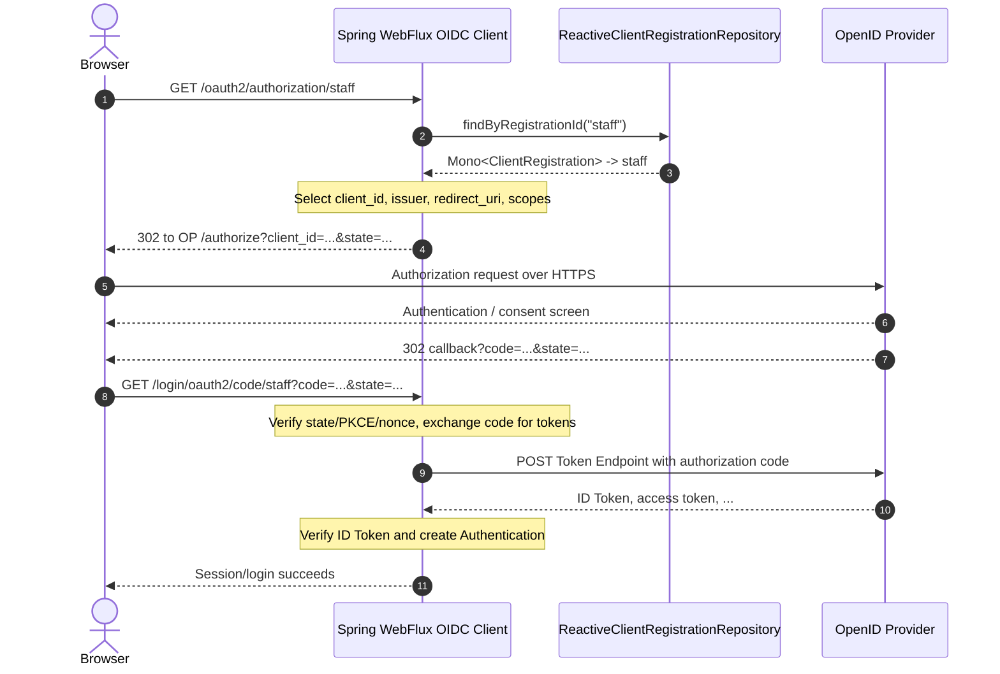
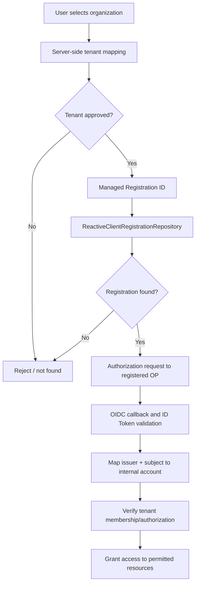

# 20.3. ReactiveClientRegistrationRepository and Registration Selection

In **Spring Security OAuth 2.0 / OpenID Connect (OIDC) Client** running on **Spring WebFlux**, an application can let users log in through one or more OpenID Providers (OPs): internal SSO, a partner, or organization-specific identity providers. For Spring Security to know **which client to use when initiating login**, the application must have a place to look up the configurations of registered clients.

That place is **`ReactiveClientRegistrationRepository`**. It receives a **registration ID** managed by the application and returns `Mono<ClientRegistration>`; `ClientRegistration` holds the information needed to start the Authorization Code Flow and communicate with the right provider. Selecting the wrong registration can result in the wrong client ID, redirect URI, issuer, scopes, and even authorization policy.

This lesson focuses on **Spring Boot 3.x, Spring Security 6.x, WebFlux/Reactor, and `oauth2Login()`**:

- Understand what `ClientRegistration` and `ReactiveClientRegistrationRepository` do.
- Distinguish the **reactive** configuration from Servlet's `ClientRegistrationRepository`.
- Declare one or more registrations using `application.yml`/`application.properties`.
- Understand how `/oauth2/authorization/{registrationId}` selects a provider.
- Look up registrations asynchronously with `findByRegistrationId(...)` without calling `block()`.
- Restrict the list of providers users are allowed to pick; never let external input dictate arbitrary issuers or token endpoints.
- Know when to use `InMemoryReactiveClientRegistrationRepository` versus a custom repository.
- Distinguish the **registration repository** from the **authorized client repository/service** that stores access/refresh tokens.
- Test, observe, and handle real-world errors in multi-provider login flows.

All domains, client IDs, secrets, and scopes below are illustrative examples. Never use real credentials in source code or test examples.

## 1. Context of OIDC Login in WebFlux

A user clicks **"Log in with Staff SSO"**. WebFlux needs to find the right registration before creating an authorization request to the OP:



Note: `ReactiveClientRegistrationRepository` **does not authenticate users**. It only supplies the **trusted OAuth2 client configuration** so web filters and OIDC login components can carry out the protocol. Verifying the ID Token, callback `state`, signature, issuer, audience, and nonce is the responsibility of other components in the flow.

### 1.1. Why Does WebFlux Need a Separate Repository?

On Servlet, Spring Security provides the interface:

```java
ClientRegistrationRepository
```

with synchronous registration lookups. In WebFlux, Spring Security uses:

```java
ReactiveClientRegistrationRepository
```

whose contract returns `Mono<ClientRegistration>`. This fits Reactor's **non-blocking** execution model.

The two interfaces cannot be swapped just by renaming a bean. A project using `ServerHttpSecurity`/WebFlux must provide a **reactive repository**; a Servlet repository will not automatically satisfy reactive OAuth2 login injection.

### 1.2. The Goal of This Lesson Is Not "Storing Tokens"

Two concepts are easy to confuse:

- **Client registration repository:** stores information on *how the client is registered*, such as `client-id`, grant type, issuer, and endpoints.
- **Authorized client repository/service:** stores *which tokens have been issued to the client for which principal*, potentially including access tokens/refresh tokens.

When the user clicks an SSO button, the first step is looking up the **registration**, not searching for a refresh token.

## 2. What Does `ClientRegistration` Store?

`ClientRegistration` describes an OAuth2 Client configuration understood and used by Spring Security:

| Field/Property | Example | Purpose |
| --- | --- | --- |
| `registrationId` | `staff` | Internal Spring key used to look up the registration and form URL segments |
| `clientId` | `academy-web-client` | Client ID issued by the Authorization Server |
| `clientSecret` | Secret from environment | Confidential client credential; never sent to the browser |
| `clientAuthenticationMethod` | `client_secret_basic` | How the client authenticates to the Token Endpoint |
| `authorizationGrantType` | `authorization_code` | Grant used for browser-based OAuth2/OIDC login |
| `redirectUri` | `{baseUrl}/login/oauth2/code/{registrationId}` | Callback URL used by Spring and allowed by the OP |
| `scopes` | `openid`, `profile` | Scopes requested by the client in the authorization request |
| `providerDetails.authorizationUri` | OP authorization endpoint | Where the browser is redirected for user login |
| `providerDetails.tokenUri` | OP token endpoint | Where the backend exchanges authorization codes/refresh tokens |
| `providerDetails.jwkSetUri` | OP JWKS endpoint | Public key source for verifying JWT/JWS signatures |
| `providerDetails.issuerUri` | Issuer URL | Anchors OP identity and ID Token verification |
| `clientName` | `Staff SSO` | Display name of the registration when needed by the app |

**`registrationId` is not `clientId`.** You can name the registration ID `staff` in Spring while the OP issues a long, non-user-friendly `client_id`.

An application can have multiple `ClientRegistration` entries with different client IDs, providers, scopes, and redirect URIs. Two registrations using the same OP can also represent **two distinct OAuth2 clients** with separate permissions and consent.

### 2.1. Do Not Confuse the OAuth2 Provider Alias with the Registration ID

In YAML, you might write:

```yaml
registration:
  staff:
    provider: corporate-op

provider:
  corporate-op:
    issuer-uri: https://idp.example.com/realms/staff
```

Here:

- `staff` is the **registration ID** used to look up the client.
- `corporate-op` is the **provider configuration group name**.
- `https://idp.example.com/realms/staff` is the **actual issuer URI**.
- `client-id` is the value issued by the OP.

Spring's default URL selects the registration via:

```text
/oauth2/authorization/staff
```

and not `/oauth2/authorization/corporate-op`, unless you also declare a registration with that ID.

### 2.2. A Registration Does Not Represent a User

Many users logging in via `staff` share the same client registration, while each login has its own **authorization request**, `state`, session, and user `Authentication`.

Do not create a new `ClientRegistration` every time a user opens a browser just to store an email or `sub`. User identity information arrives **after login**, and does not belong in client registration configuration.

## 3. The `ReactiveClientRegistrationRepository` Interface

Interface in Spring Security reactive OAuth2 Client:

```java
package org.springframework.security.oauth2.client.registration;

import reactor.core.publisher.Mono;

public interface ReactiveClientRegistrationRepository {

    Mono<ClientRegistration> findByRegistrationId(
            String registrationId);
}
```

This is a **conceptual signature** to explain the interface; you do not need to redefine it in your project. Spring Security already provides it.

Semantics:

1. The caller passes a `registrationId`.
2. The repository returns a `Mono<ClientRegistration>`.
3. If found, the `Mono` emits exactly one registration and completes.
4. If not found, standard implementations emit **`Mono.empty()`**.
5. If an error occurs accessing configuration/storage, the `Mono` may emit an **error signal**.

With `Mono`, the lookup executes lazily along the pipeline upon subscription (depending on the `Mono` source). Do not think of `Mono<ClientRegistration>` as a `ClientRegistration` already materialized in a Java variable.

### 3.1. Distinguishing the Three Outcomes

```text
findByRegistrationId("staff")
           |
           +--> onNext(ClientRegistration) + onComplete
           |
           +--> onComplete (no value)
           |
           +--> onError(Throwable)
```

**Missing registration** and **repository failure** are two different cases. The application should handle `Mono.empty()` deliberately; do not turn every storage error into "registration does not exist."

### 3.2. Example of Proper Reactive Lookup

```java
import org.springframework.security.oauth2.client.registration.ClientRegistration;
import org.springframework.security.oauth2.client.registration.ReactiveClientRegistrationRepository;
import org.springframework.stereotype.Service;
import reactor.core.publisher.Mono;

@Service
public class RegistrationLookupService {

    private final ReactiveClientRegistrationRepository registrations;

    public RegistrationLookupService(
            ReactiveClientRegistrationRepository registrations) {
        this.registrations = registrations;
    }

    public Mono<String> displayName(String registrationId) {
        return registrations.findByRegistrationId(registrationId)
                .map(ClientRegistration::getClientName)
                .switchIfEmpty(Mono.error(
                        new IllegalArgumentException(
                                "Unknown client registration")));
    }
}
```

The `.map(...)` step only runs when the `Mono` contains a `ClientRegistration`. `switchIfEmpty(...)` distinguishes a missing ID, though in a production HTTP application this business error should be mapped to an appropriate HTTP status (e.g., 404) without exposing configuration details to the caller.

### 3.3. Do Not Call `block()` in a WebFlux Request

This is an anti-pattern:

```java
// DO NOT do this on the WebFlux event-loop:
ClientRegistration registration =
        registrations.findByRegistrationId("staff").block();
```

`block()` stalls the thread waiting for the result, defeating non-blocking execution; on some WebFlux/Reactor threads, blocking even throws an exception when executed on a non-blocking thread.

**Compose using Reactor operators** instead:

```java
return registrations.findByRegistrationId("staff")
        .flatMap(registration -> doSomethingReactive(registration));
```

In the snippet above, `doSomethingReactive` is a hypothetical method returning `Mono<T>`. Never call `subscribe()` manually in a controller to "start" login and return immediately; WebFlux subscribes to the response pipeline properly.

## 4. Common Implementation: `InMemoryReactiveClientRegistrationRepository`

Spring Security provides:

```java
InMemoryReactiveClientRegistrationRepository
```

This implementation keeps a pre-built set of `ClientRegistration` objects in memory and serves `findByRegistrationId(...)` by ID. It is a common choice when:

- The number of OP/client registrations is small and fixed.
- Configuration comes from application configuration/environment.
- No tenant lookup from a dynamic registry is needed.
- You want simple configuration that is easy to test.

The name "in-memory" **does not mean user tokens are stored in the same repository**. It only holds **client registration metadata and client credentials**, not per-user access/refresh tokens.

### 4.1. Two Ways to Initialize

**Most common approach:** let Spring Boot create the reactive registration repository from properties.

**Deliberate customization approach:** declare the bean directly:

```java
@Bean
ReactiveClientRegistrationRepository registrations(
        ClientRegistration staff,
        ClientRegistration partner) {

    return new InMemoryReactiveClientRegistrationRepository(
            staff, partner);
}
```

This illustrates the wiring; if applied, you need **two actual `ClientRegistration` beans**, or to construct the objects from trusted configuration. A complete `@Bean` example is shown in Section 8.

### 4.2. A Useful Trait: `Iterable<ClientRegistration>`

`InMemoryReactiveClientRegistrationRepository` also implements `Iterable<ClientRegistration>`, allowing configured registrations to be enumerated. This is useful for certain login UI components provided by Spring Security.

**Do not assume every `ReactiveClientRegistrationRepository` implementation is `Iterable`.** The reactive interface only guarantees lookup by ID. If you replace it with a dynamic repository that does not support enumeration, the default login UI may not know which options to render; in that case, build a login page/endpoint listing the application's **controlled list**.

## 5. Spring Boot Auto-Configuration for WebFlux OAuth2 Client

When using `spring-boot-starter-oauth2-client` in a WebFlux application with security properly enabled, Spring Boot can read `spring.security.oauth2.client.registration.*` and `spring.security.oauth2.client.provider.*` properties to build the corresponding `ClientRegistration` instances.

An appropriate `ReactiveClientRegistrationRepository` is typically auto-configured from this data. Applications do not necessarily need to write a manual bean for common scenarios.

### 5.1. Maven Dependencies

```xml
<dependencies>
    <dependency>
        <groupId>org.springframework.boot</groupId>
        <artifactId>spring-boot-starter-webflux</artifactId>
    </dependency>

    <dependency>
        <groupId>org.springframework.boot</groupId>
        <artifactId>spring-boot-starter-oauth2-client</artifactId>
    </dependency>
</dependencies>
```

### 5.2. Gradle Dependencies

```groovy
dependencies {
    implementation 'org.springframework.boot:spring-boot-starter-webflux'
    implementation 'org.springframework.boot:spring-boot-starter-oauth2-client'
}
```

If `spring-boot-starter-web` (Spring MVC) is inadvertently included in the same project, Spring Boot may choose the **Servlet web application type** based on classpath detection. You will then hit different configurations/filters from WebFlux; do not try to fix that by defining a reactive repository inside an application still running Servlet.

Verify the web application architecture type before troubleshooting reactive OAuth2 errors. If the project intentionally includes both stacks, design the context and security configuration appropriately rather than merely swapping imports.

## 6. Declaring Multiple OIDC Registrations in YAML

Suppose the application supports two OPs:

- `staff`: employees logging in via internal SSO.
- `partner`: partners logging in via their own OP.

**`application.yml`:**

```yaml
spring:
  security:
    oauth2:
      client:
        registration:
          staff:
            provider: staff-oidc
            client-id: ${STAFF_OIDC_CLIENT_ID}
            client-secret: ${STAFF_OIDC_CLIENT_SECRET}
            client-authentication-method: client_secret_basic
            authorization-grant-type: authorization_code
            redirect-uri: "{baseUrl}/login/oauth2/code/{registrationId}"
            scope:
              - openid
              - profile
              - email
            client-name: "Staff SSO"

          partner:
            provider: partner-oidc
            client-id: ${PARTNER_OIDC_CLIENT_ID}
            client-secret: ${PARTNER_OIDC_CLIENT_SECRET}
            client-authentication-method: client_secret_basic
            authorization-grant-type: authorization_code
            redirect-uri: "{baseUrl}/login/oauth2/code/{registrationId}"
            scope:
              - openid
              - profile
            client-name: "Partner Login"

        provider:
          staff-oidc:
            issuer-uri: https://sso.example.com/realms/staff
          partner-oidc:
            issuer-uri: https://id.partner.example.com/oidc
```

**Why declare `issuer-uri`?** For providers supporting OIDC Discovery, Spring can obtain the authorization, token, UserInfo, and JWKS endpoints from the issuer's metadata. The Client must still verify the exact registered issuer and redirect URI.

`scope: [openid, ...]` marks this as an OIDC flow, rather than plain OAuth2 login without an ID Token. Even if an OP permits many scopes, **request only the claims and permissions actually needed**. `email` is neither a reliable unique identifier nor proof that a user is an admin.

### 6.1. Equivalent in `application.properties`

```properties
spring.security.oauth2.client.registration.staff.provider=staff-oidc
spring.security.oauth2.client.registration.staff.client-id=${STAFF_OIDC_CLIENT_ID}
spring.security.oauth2.client.registration.staff.client-secret=${STAFF_OIDC_CLIENT_SECRET}
spring.security.oauth2.client.registration.staff.client-authentication-method=client_secret_basic
spring.security.oauth2.client.registration.staff.authorization-grant-type=authorization_code
spring.security.oauth2.client.registration.staff.redirect-uri={baseUrl}/login/oauth2/code/{registrationId}
spring.security.oauth2.client.registration.staff.scope=openid,profile,email
spring.security.oauth2.client.registration.staff.client-name=Staff SSO
spring.security.oauth2.client.provider.staff-oidc.issuer-uri=https://sso.example.com/realms/staff

spring.security.oauth2.client.registration.partner.provider=partner-oidc
spring.security.oauth2.client.registration.partner.client-id=${PARTNER_OIDC_CLIENT_ID}
spring.security.oauth2.client.registration.partner.client-secret=${PARTNER_OIDC_CLIENT_SECRET}
spring.security.oauth2.client.registration.partner.client-authentication-method=client_secret_basic
spring.security.oauth2.client.registration.partner.authorization-grant-type=authorization_code
spring.security.oauth2.client.registration.partner.redirect-uri={baseUrl}/login/oauth2/code/{registrationId}
spring.security.oauth2.client.registration.partner.scope=openid,profile
spring.security.oauth2.client.registration.partner.client-name=Partner Login
spring.security.oauth2.client.provider.partner-oidc.issuer-uri=https://id.partner.example.com/oidc
```

Use either YAML **or** properties according to project convention. In Java code, never expose client secrets in HTML, controller responses, or debug endpoints.

### 6.2. Redirect URI Must Match OP Configuration

For registration `staff`, if the application runs at `https://app.example.com`, the redirect URI normally expands to:

```text
https://app.example.com/login/oauth2/code/staff
```

The OP must allow that URI per client registration policy. For `partner`:

```text
https://app.example.com/login/oauth2/code/partner
```

Both URIs can share the same host while differing by registration ID. Mismatched callback errors must never be "solved" by dropping `state` verification or allowing arbitrary redirect URIs at the OP.

**When running behind a reverse proxy**, configure trusted forwarded headers, public scheme/host, and proxy boundaries properly. Never trust `X-Forwarded-Host` from external internet clients if the proxy does not strip/filter it; computing `{baseUrl}` from untrusted headers can cause callback errors or host-header/open-redirect vulnerabilities.

## 7. Enabling OAuth2/OIDC Login in `SecurityWebFilterChain`

On **WebFlux**, use `ServerHttpSecurity` and `SecurityWebFilterChain`, not Servlet's `HttpSecurity`/`SecurityFilterChain`.

```java
import org.springframework.context.annotation.Bean;
import org.springframework.context.annotation.Configuration;
import org.springframework.security.config.Customizer;
import org.springframework.security.config.web.server.ServerHttpSecurity;
import org.springframework.security.web.server.SecurityWebFilterChain;

@Configuration
public class ReactiveWebSecurityConfig {

    @Bean
    SecurityWebFilterChain springSecurityFilterChain(
            ServerHttpSecurity http) {

        return http
                .authorizeExchange(exchange -> exchange
                        .pathMatchers(
                                "/", "/login", "/error",
                                "/css/**", "/js/**", "/sso/start/**")
                            .permitAll()
                        .anyExchange()
                            .authenticated())
                .oauth2Login(Customizer.withDefaults())
                .build();
    }
}
```

This snippet permits public paths and requires `Authentication` for everything else. Depending on how the login page is structured, different matching rules may be needed. **Do not call `csrf().disable()` just to make OIDC login work**, because a WebFlux session-based application still needs CSRF protection for state-changing operations.

For a custom login page, ensure the page path is `permitAll` and login links point to declared registration IDs. Each security chain must actually cover the authorization request and callback of the flow it handles.

### 7.1. Which Filter Determines the Registration?

In reactive OAuth2 login, the participating components include:

- **`OAuth2AuthorizationRequestRedirectWebFilter`:** handles requests starting OAuth2 authorization and builds the redirect to the OP.
- **`ServerOAuth2AuthorizationRequestResolver`:** resolves and builds `OAuth2AuthorizationRequest` based on `ServerWebExchange` and the client registration.
- **`ReactiveClientRegistrationRepository`:** returns the `ClientRegistration` for the registration ID.
- **`OAuth2LoginAuthenticationWebFilter`:** processes the redirect/callback result from the OP during the login flow.
- Reactive authentication, token response, and OIDC validation components validate the outcome.
- **`ServerSecurityContextRepository`** and web session/context components persist `Authentication` after login per configuration.

Having the repository alone does not complete login. The repository is a **configuration lookup point** within a larger pipeline.

### 7.2. WebFilter Chain vs. Servlet Filter Chain

| Servlet | WebFlux |
| --- | --- |
| `HttpSecurity` | `ServerHttpSecurity` |
| `SecurityFilterChain` | `SecurityWebFilterChain` |
| `ClientRegistrationRepository` | `ReactiveClientRegistrationRepository` |
| `OAuth2AuthorizationRequestRedirectFilter` | `OAuth2AuthorizationRequestRedirectWebFilter` |
| `OAuth2LoginAuthenticationFilter` | `OAuth2LoginAuthenticationWebFilter` |
| `HttpSession` | `WebSession` (when using reactive sessions) |
| `SecurityContextHolder` in Servlet request | `ReactiveSecurityContextHolder` via Reactor Context |
| `OAuth2AuthorizedClientRepository` | `ServerOAuth2AuthorizedClientRepository` |

Do not copy a Servlet guide and merely rename `HttpSecurity` without updating repository, filter, and service types. OAuth2 Login, reactive authentication, and HTTP client integration configurations must all match the same stack.

## 8. Creating a Repository Manually in Java When Truly Needed

If you do not want to use Boot properties, you can build trusted `ClientRegistration` instances and place them in `InMemoryReactiveClientRegistrationRepository`.

Example declaring one registration directly:

```java
import org.springframework.beans.factory.annotation.Value;
import org.springframework.context.annotation.Bean;
import org.springframework.context.annotation.Configuration;
import org.springframework.security.oauth2.client.registration.ClientRegistration;
import org.springframework.security.oauth2.client.registration.InMemoryReactiveClientRegistrationRepository;
import org.springframework.security.oauth2.client.registration.ReactiveClientRegistrationRepository;
import org.springframework.security.oauth2.core.AuthorizationGrantType;
import org.springframework.security.oauth2.core.ClientAuthenticationMethod;

@Configuration
public class ManualReactiveRegistrationConfig {

    @Bean
    ReactiveClientRegistrationRepository clientRegistrations(
            @Value("${STAFF_OIDC_CLIENT_ID}") String clientId,
            @Value("${STAFF_OIDC_CLIENT_SECRET}") String clientSecret) {

        ClientRegistration staff =
                ClientRegistration.withRegistrationId("staff")
                        .clientId(clientId)
                        .clientSecret(clientSecret)
                        .clientAuthenticationMethod(
                                ClientAuthenticationMethod.CLIENT_SECRET_BASIC)
                        .authorizationGrantType(
                                AuthorizationGrantType.AUTHORIZATION_CODE)
                        .redirectUri(
                                "{baseUrl}/login/oauth2/code/{registrationId}")
                        .scope("openid", "profile")
                        .authorizationUri(
                                "https://sso.example.com/realms/staff/authorize")
                        .tokenUri(
                                "https://sso.example.com/realms/staff/token")
                        .jwkSetUri(
                                "https://sso.example.com/realms/staff/jwks")
                        .issuerUri(
                                "https://sso.example.com/realms/staff")
                        .clientName("Staff SSO")
                        .build();

        return new InMemoryReactiveClientRegistrationRepository(
                staff);
    }
}
```

These endpoints are illustrative. With a real OP, use accurate discovery metadata/URIs and client registration settings. **Never guess URLs** just because the host looks similar. If using `ClientRegistrations.fromIssuerLocation(issuer)`, note the warning in Section 15 regarding metadata discovery and startup blocking.

### 8.1. Be Careful When Declaring a Manual Bean

When Boot auto-configures a registration repository from properties, an application-defined `ReactiveClientRegistrationRepository` bean can **replace/override Boot's default repository creation** per auto-configuration conditions.

If your custom bean contains only `staff`, then `partner` from YAML may **no longer be present** in the repository the application expects. You must register the **complete set of registrations** explicitly, or design a reliable composition strategy.

Do not create a custom bean just to change a display name when the `client-name` property works.

### 8.2. Client Secret and Public Client Configuration

The example above is a **confidential client** using `client_secret_basic`. For a public client (such as an app unable to keep a secret), OAuth2/OIDC requires **PKCE and a different trust model** — never copy `client-secret` to the frontend.

A server-side WebFlux backend can usually protect a client secret, yet PKCE, redirect, and token policies must still match the real client registration. Do not switch `client_secret_basic` to `none` just to get past an `invalid_client` error.

### 8.3. Never Hardcode Secrets in Java Classes

`client-id`/`client-secret` values in samples are supplied via environment variables. Never do:

```java
.clientSecret("production-real-client-secret")
```

Never output the whole `ClientRegistration` object to logs or JSON: it may contain secrets and internal parameters that should not be exposed.

## 9. Selecting a Registration via the Default URL

In WebFlux OAuth2 Login, a familiar URL for **initiating an authorization request** is:

```text
GET /oauth2/authorization/{registrationId}
```

With the declared registrations:

```text
GET /oauth2/authorization/staff
GET /oauth2/authorization/partner
```

Flow:

1. Spring matches the authorization initiation URL pattern.
2. Extracts `registrationId` from the path.
3. The repository returns the corresponding registration.
4. The framework builds a request with `client_id`, `redirect_uri`, `response_type=code`, `scope`, `state`, and other valid parameters.
5. The browser is redirected to the configured OP's Authorization Endpoint.
6. The OP sends the callback to the registration's redirect URI.

**The browser does not send `client_secret` to the OP.** A confidential client authenticates at the Token Endpoint from the backend. The browser goes through the authorization redirect and should never see the token endpoint secret.

### 9.1. Login Links

A simple UI might render:

```html
<nav aria-label="Login">
  <a href="/oauth2/authorization/staff">
    Staff login
  </a>
  <a href="/oauth2/authorization/partner">
    Partner login
  </a>
</nav>
```

These URLs are **predetermined by the application**, never built by concatenating an issuer URI sent by the browser. Hiding a login button only affects UI; server-side policy must still enforce which registrations each user group/tenant is allowed to use.

### 9.2. How Choosing a Different Provider Maps to Different Accounts

If the same person has accounts at both `staff` and `partner`, the two OPs might issue:

```text
staff:
  iss = https://sso.example.com/realms/staff
  sub = 4242

partner:
  iss = https://id.partner.example.com/oidc
  sub = 4242
```

Two matching `sub` strings **do not mean the same person**, because `sub` is scoped to its issuer. The system should bind identities by `(issuer, subject)` and a verified account-linking process, never merging users solely because their emails match.

**Registration selection** decides **which OP to log in with**. **Account linking** decides whether identities from multiple OPs link to the same internal account. These are two separate concerns.

## 10. Writing an Allowlist-Based Provider Selection Controller

You can expose friendly URLs such as:

```text
GET /sso/start/staff
GET /sso/start/partner
```

However, the controller must map public names to an **approved** registration ID rather than accepting arbitrary URIs from the browser.

### 10.1. Safe WebFlux Controller Example

```java
import java.net.URI;

import org.springframework.http.HttpStatus;
import org.springframework.http.ResponseEntity;
import org.springframework.security.oauth2.client.registration.ReactiveClientRegistrationRepository;
import org.springframework.web.bind.annotation.GetMapping;
import org.springframework.web.bind.annotation.PathVariable;
import org.springframework.web.bind.annotation.RestController;
import org.springframework.web.server.ResponseStatusException;

import reactor.core.publisher.Mono;

@RestController
public class SsoStartController {

    private final ReactiveClientRegistrationRepository registrations;

    public SsoStartController(
            ReactiveClientRegistrationRepository registrations) {
        this.registrations = registrations;
    }

    @GetMapping("/sso/start/{organization}")
    public Mono<ResponseEntity<Void>> start(
            @PathVariable String organization) {

        // Mapping decided by the SERVER, not taken from arbitrary query URL.
        String registrationId = switch (organization) {
            case "staff" -> "staff";
            case "partner" -> "partner";
            default -> throw new ResponseStatusException(
                    HttpStatus.NOT_FOUND);
        };

        return registrations.findByRegistrationId(registrationId)
                .switchIfEmpty(Mono.error(
                        new ResponseStatusException(HttpStatus.NOT_FOUND)))
                .map(registration ->
                        ResponseEntity.status(HttpStatus.FOUND)
                                .location(URI.create(
                                        "/oauth2/authorization/"
                                                + registrationId))
                                .<Void>build());
    }
}
```

The controller does not take `clientId`, `clientSecret`, issuer, or token endpoint from input. It simply redirects to an **internal URL managed by Spring Security**; the OAuth2 filter then builds the authorization request.

Ensure `/sso/start/**` is permitted as in the `SecurityWebFilterChain` in Section 7. If certain providers are restricted to specific users/tenants, the mapping must also verify **trusted context** before redirecting.

### 10.2. Why Not Redirect Directly to a User-Supplied OP URL?

Never do:

```java
// ANTI-PATTERN: letting the browser choose the Authorization Server.
String issuer = request.getQueryParams().getFirst("issuer");
return redirectTo(issuer + "/authorize");
```

An attacker could point the browser to a fake authorization endpoint or trick the backend into fetching metadata from an untrusted host if a custom registration loader uses that URL. Risks include phishing, open redirect, SSRF, issuer/tenant confusion, and theft of the authorization response if redirect URIs are misconfigured.

**Issuers, discovery metadata, and client credentials must come from controlled configuration**, never arbitrary user input.

### 10.3. Does the Path Variable Need Additional Validation?

Even though `/oauth2/authorization/{registrationId}` is a default endpoint, Spring still looks up the registration in the repository. A non-existent ID will not start a valid flow. Yet in multi-tenant apps, **"the registration exists" does not prove the user/tenant is allowed to use it**.

Where restrictions apply, enforce server-side mappings/policies and avoid displaying or permitting registrations not meant for the current tenant.

## 11. Using the Repository to Safely Publish Login Options

An application may need to render a provider picker page. If you do not want to rely on whether the repository implements `Iterable`, keep an **approved list of registration IDs** separately in application configuration/policy and look them up reactively.

Example API returning only display names and internal paths:

```java
import java.util.List;

import org.springframework.security.oauth2.client.registration.ReactiveClientRegistrationRepository;
import org.springframework.web.bind.annotation.GetMapping;
import org.springframework.web.bind.annotation.RestController;

import reactor.core.publisher.Flux;
import reactor.core.publisher.Mono;

@RestController
class LoginOptionsController {

    record LoginOption(
            String registrationId,
            String name,
            String startUrl) {}

    private static final List<String> APPROVED_IDS =
            List.of("staff", "partner");

    private final ReactiveClientRegistrationRepository registrations;

    LoginOptionsController(
            ReactiveClientRegistrationRepository registrations) {
        this.registrations = registrations;
    }

    @GetMapping("/api/login-options")
    Mono<List<LoginOption>> options() {
        return Flux.fromIterable(APPROVED_IDS)
                .concatMap(registrations::findByRegistrationId)
                .map(reg -> new LoginOption(
                        reg.getRegistrationId(),
                        reg.getClientName(),
                        "/oauth2/authorization/" + reg.getRegistrationId()))
                .collectList();
    }
}
```

**Never return the full `ClientRegistration` through this endpoint.** It may contain `clientSecret`, internal metadata, and fields not meant for browsers. A small DTO clarifies exactly what may be exposed.

If the login-options API is public, make sure `SecurityWebFilterChain` permits `/api/login-options` before `anyExchange().authenticated()`. If the list depends on a tenant, obtain the tenant from a **verified source** and apply policy before choosing IDs.

### 11.1. What Does `concatMap` Mean Instead of `flatMap`?

`concatMap` processes the source in order so login button ordering stays deterministic. For a small list, performance is negligible. `flatMap` fits when concurrency is desired, though results may not preserve order. Neither **requires `block()`**.

If a custom repository emits `Mono.error(...)`, the pipeline fails; if the login page must stay available when one provider is unavailable, design an explicit error-classification/circuit-breaker policy. Never silently swallow all errors as "no provider" if that hides a security or configuration issue.

## 12. After Login: Determining Which Registration Was Used

Once OAuth2 Login completes, `Authentication` can carry the **authorized client registration ID**. With `OAuth2AuthenticationToken`:

```java
OAuth2AuthenticationToken token = ...;

String registrationId =
        token.getAuthorizedClientRegistrationId();
```

This tells the application whether the user logged in via `staff` or `partner`, for example to apply policies or choose the right integration.

### 12.1. Reading Authentication from the Reactor Context

In WebFlux, read `ReactiveSecurityContextHolder` rather than relying on Servlet-style thread-locals:

```java
import java.util.Map;

import org.springframework.http.HttpStatus;
import org.springframework.security.core.context.ReactiveSecurityContextHolder;
import org.springframework.security.core.context.SecurityContext;
import org.springframework.security.oauth2.client.authentication.OAuth2AuthenticationToken;
import org.springframework.security.oauth2.client.registration.ReactiveClientRegistrationRepository;
import org.springframework.web.bind.annotation.GetMapping;
import org.springframework.web.bind.annotation.RestController;
import org.springframework.web.server.ResponseStatusException;

import reactor.core.publisher.Mono;

@RestController
public class CurrentLoginProviderController {

    private final ReactiveClientRegistrationRepository registrations;

    public CurrentLoginProviderController(
            ReactiveClientRegistrationRepository registrations) {
        this.registrations = registrations;
    }

    @GetMapping("/api/login-provider")
    Mono<Map<String, String>> currentProvider() {
        return ReactiveSecurityContextHolder.getContext()
                .map(SecurityContext::getAuthentication)
                .filter(auth -> auth instanceof OAuth2AuthenticationToken)
                .cast(OAuth2AuthenticationToken.class)
                .flatMap(auth -> registrations.findByRegistrationId(
                        auth.getAuthorizedClientRegistrationId()))
                .map(registration -> Map.of(
                        "registrationId",
                        registration.getRegistrationId(),
                        "displayName",
                        registration.getClientName()))
                .switchIfEmpty(Mono.error(
                        new ResponseStatusException(
                                HttpStatus.UNAUTHORIZED)));
    }
}
```

This snippet returns only minimal metadata — **not the ID Token, access token, refresh token, user claims, or client secret**. It assumes the route is protected and the request went through a valid OAuth2/OIDC login.

In applications supporting multiple Authentication types (API keys, JWT Resource Server, form login), the current `Authentication` is not necessarily an `OAuth2AuthenticationToken`. Handle that explicitly with an appropriate response policy rather than casting blindly.

### 12.2. Authentication Does Not Replace Client Registration

`OAuth2AuthenticationToken.getAuthorizedClientRegistrationId()` returns the **ID of the registration used**, rather than turning `Authentication` into a `ClientRegistration`. When you need issuer/client metadata, look it up in the repository by ID within the reactive pipeline.

Never store a full `ClientRegistration` in a user-facing JWT or session attribute just for convenience reading `clientId`. Client configuration has its own lifecycle and may hold secrets.

## 13. The Repository Only Stores Client Metadata, Not Authorized Clients

Important comparison table in reactive Spring Security:

| Interface / Class | Looked Up By? | Returns | When Used? |
| --- | --- | --- | --- |
| **`ReactiveClientRegistrationRepository`** | `registrationId` | `Mono<ClientRegistration>` | Selecting OAuth2 client/OP configuration |
| **`ServerOAuth2AuthorizedClientRepository`** | Registration + Authentication + `ServerWebExchange` per contract | Authorized client with issued tokens | Persisting tokens in an appropriate web/session context |
| **`ReactiveOAuth2AuthorizedClientService`** | Registration + principal name | `Mono<OAuth2AuthorizedClient>` | Managing authorized clients independently of Servlet requests |
| **`ReactiveOAuth2AuthorizedClientManager`** | `OAuth2AuthorizeRequest` and context | `Mono<OAuth2AuthorizedClient>` | Coordinating obtaining/reusing/refreshing tokens to call APIs |
| **`ServerOAuth2AuthorizationRequestRepository`** | Authorization request in flight | Temporary authorization request, including correlation state | Holding in-progress requests awaiting callback |

These interfaces have distinct responsibilities. In particular, **`ClientRegistration` does not contain a user's access token after login**. If code looks up tokens using:

```java
registrations.findByRegistrationId("staff")
```

the result is only **client metadata**; you cannot extract a Bearer access token from it.

### 13.1. Registration Selection Can Precede the Authorized Client Manager

In a downstream API call flow:

```text
Business service determines which API is needed
             |
             v
Select registration ID per policy
             |
             v
ReactiveOAuth2AuthorizedClientManager.authorize(...)
             |
             v
Look up corresponding authorized client or obtain/refresh token
             |
             v
WebClient sends Bearer access token to approved API
```

This is an **OAuth2 Client API call**, distinct from **OIDC browser login**. A `client_credentials` registration can be used to call an API from a job, but **cannot serve as an OIDC login button** because that grant has no browser user authorization flow.

### 13.2. Do Not Conflate Registration with Principal Key

`registrationId` answers *"which client?"*.

An authorized client's `principalName` answers *"which principal does this token state belong to?"*.

Two users logging in via the same `staff` registration still have separate authorized clients. If the system uses a shared principal name for all users, it risks mixing up tokens; that is an authorized-client storage/policy bug, not a registration repository bug.

## 14. Integrating `WebClient` with the Selected Registration

In WebFlux, the outbound client is typically `WebClient`. Spring Security provides `ServerOAuth2AuthorizedClientExchangeFilterFunction` to attach OAuth2 access tokens to `WebClient` requests.

Example built on a properly configured `ReactiveOAuth2AuthorizedClientManager`:

```java
import org.springframework.context.annotation.Bean;
import org.springframework.context.annotation.Configuration;
import org.springframework.security.oauth2.client.ReactiveOAuth2AuthorizedClientManager;
import org.springframework.security.oauth2.client.web.reactive.function.client.ServerOAuth2AuthorizedClientExchangeFilterFunction;
import org.springframework.web.reactive.function.client.WebClient;

@Configuration
public class CalendarWebClientConfig {

    @Bean
    WebClient calendarWebClient(
            ReactiveOAuth2AuthorizedClientManager manager) {

        ServerOAuth2AuthorizedClientExchangeFilterFunction oauth2 =
                new ServerOAuth2AuthorizedClientExchangeFilterFunction(
                        manager);

        return WebClient.builder()
                .baseUrl("https://calendar-api.example.com")
                .filter(oauth2)
                .build();
    }
}
```

When making a call:

```java
import static org.springframework.security.oauth2.client.web.reactive.function.client
        .ServerOAuth2AuthorizedClientExchangeFilterFunction.clientRegistrationId;

// In a context with an appropriate principal/authorization:
Mono<String> events = calendarWebClient.get()
        .uri("/v1/events")
        .attributes(clientRegistrationId("staff"))
        .retrieve()
        .bodyToMono(String.class);
```

In this example, the registration ID is decided **by the server-side business service**. Never treat an unverified `?registrationId=...` query parameter as sufficient basis for selecting which client to use, because different client credentials or tokens may carry different permission scopes.

**Context note:** When using a manager tied to WebFlux requests, resolving the user principal and `ServerWebExchange` must match the actual flow. `WebClient` does not turn an unauthorized login into an authorized API token on its own. Flows running without an HTTP request require a dedicated manager/service and principal context.

### 14.1. Do Not Force the Repository to Act as a Token Manager

If an API returns 401 because the access token expired, do not mutate `ClientRegistration` or invent timestamped registration IDs. Re-issuing tokens is the job of **`ReactiveOAuth2AuthorizedClientManager`/providers** and authorized client storage. A registration describes client configuration, not the lifecycle of individual access tokens.

### 14.2. Watch Out for `clientCredentials` and Users

A `client_credentials` registration does not authenticate an OIDC user. If an application has both `staff-login` and `inventory-service`, expose only `staff-login` in OIDC login options. Never create a `/oauth2/authorization/inventory-service` link expecting the Authorization Code Flow to work.

## 15. What If the Provider List Changes Dynamically?

In larger applications, registrations may be managed from a configuration service or database. In that case, a custom `ReactiveClientRegistrationRepository` can be useful.

**However, this is a security decision**, not just an R2DBC/HTTP query exercise. Each record can contain:

- Issuer and metadata discovery URL.
- Client ID and client authentication method.
- Client secret or secret manager reference.
- Registered redirect URI.
- Scopes and tenant boundaries.
- OP/JWKS endpoints.
- Owner metadata and activation status.

If users can insert arbitrary records, the backend can be abused to fetch discovery metadata from internal hosts (SSRF), select a spoofed provider, or send credentials to untrusted destinations.

### 15.1. Responsibilities of a Custom Reactive Repository

A design may look like:

```text
findByRegistrationId(id)
      |
      v
Validate ID syntax/allowlist
      |
      v
Read trusted registration record from reactive DB/config store
      |
      v
Verify record is approved and active
      |
      v
Fetch secret from controlled source
      |
      v
Return immutable/cached ClientRegistration
```

An **administrative enrollment process** is required to add or update issuers and client credentials. Never let a logged-in user swap an issuer and use it immediately just because they can send an HTTP request.

### 15.2. Example of a Non-Blocking Allowlisted Repository

If the set of registrations is built safely at startup, a custom repository can be as simple as:

```java
import java.util.Collection;
import java.util.Map;
import java.util.function.Function;
import java.util.stream.Collectors;

import org.springframework.security.oauth2.client.registration.ClientRegistration;
import org.springframework.security.oauth2.client.registration.ReactiveClientRegistrationRepository;

import reactor.core.publisher.Mono;

public final class AllowlistedReactiveRegistrationRepository
        implements ReactiveClientRegistrationRepository {

    private final Map<String, ClientRegistration> allowed;

    public AllowlistedReactiveRegistrationRepository(
            Collection<ClientRegistration> registrations) {

        this.allowed = registrations.stream()
                .collect(Collectors.toUnmodifiableMap(
                        ClientRegistration::getRegistrationId,
                        Function.identity()));
    }

    @Override
    public Mono<ClientRegistration> findByRegistrationId(
            String registrationId) {

        return Mono.justOrEmpty(allowed.get(registrationId));
    }
}
```

Because data sits in a pre-built immutable `Map`, lookups are fast and free of blocking I/O. However, this custom implementation **does not implement `Iterable<ClientRegistration>`**, so if the application expects the framework to list providers on a default login page, you must build your own selection UI.

This code does not talk to a database; it illustrates the **`Mono<ClientRegistration>`** contract and deny-by-default behavior for unknown registration IDs.

### 15.3. When Using R2DBC or an HTTP Service

A dynamic repository can be built on a reactive client:

```java
// ARCHITECTURAL PSEUDOCODE, NOT a built-in Spring class:
@Override
public Mono<ClientRegistration> findByRegistrationId(String id) {
    return trustedRegistrationStore.findApprovedById(id)
            .flatMap(record -> secretResolver.resolve(record)
                    .map(secret -> buildClientRegistration(record, secret)))
            .cache(cachePolicy);
}
```

Here `trustedRegistrationStore`, `secretResolver`, `buildClientRegistration`, and `cachePolicy` are custom abstractions; the snippet illustrates **reactive composition**, not copy-paste project code. Caching a `Mono` here requires careful design around tenants, credential rotation, concurrency, and invalidation.

**Never run `JdbcTemplate` or blocking HTTP discovery on the event-loop** and simply wrap the result with `Mono.just(...)`. Creating a `Mono` after a blocking call does not make the I/O non-blocking.

### 15.4. Startup Metadata Discovery

Helper APIs such as `ClientRegistrations.fromIssuerLocation(...)` can query OIDC/OAuth metadata to build a registration. Discovery can involve **HTTP I/O**. When using it, understand when it executes and whether it can block:

- Run discovery/bootstrap on an appropriate startup path rather than the request event-loop.
- Allow only approved issuers.
- Configure timeouts and TLS validation.
- Verify the issuer in metadata matches the expected issuer.
- Never redirect to or fetch metadata from browser-supplied hosts.
- Plan caching and metadata/key-rotation refresh per framework mechanisms.

Do not trade away reactive scalability by loading a new provider via a blocking call every time a user clicks login.

## 16. Tenant-Based Registration Selection in Multi-Organization Applications

A SaaS platform might have:

```text
Organization "alpha" -> registrationId "alpha-oidc"
Organization "beta"  -> registrationId "beta-oidc"
Organization "gamma" -> registrationId "gamma-oidc"
```

Before login, the application may use the user's chosen organization, a controlled subdomain, or a dedicated tenant discovery flow to pick a registration. **However, tenant selection is a routing input, not proof of identity or tenant access.**

### 16.1. A Step-by-Step Sound Design

1. User chooses an organization or visits a managed subdomain.
2. Server maps this value to a **registered organization record**.
3. Server resolves the **permitted registration ID** for that organization.
4. Repository returns the corresponding `ClientRegistration`.
5. Spring starts the Authorization Code Flow, preserving `state` and required correlation values.
6. After callback, Spring verifies the ID Token and completes `Authentication`.
7. Application checks **issuer/subject** and the user's membership in the actual organization, rather than blindly trusting the organization string the browser sent.



### 16.2. Is an Email Domain Enough to Select and Grant Access?

No. An email domain can serve as a **UX hint** in some products, but you should never:

- Grant admin privileges just because an address ends in `@company.example`.
- Merge accounts across two OPs solely because their emails match.
- Treat a pre-login email entered by the user as proof of tenant membership.
- Trust an arbitrary provider just because it returns `email_verified=true` without a trust policy.

OIDC identity should be anchored by **issuer + subject** along with internal account-linking and tenant-membership policies.

### 16.3. Avoid "Dynamic Issuer" from Query Strings

Anti-pattern:

```text
GET /login?issuer=https://arbitrary-host.example
```

where the server immediately builds a `ClientRegistration` and fetches metadata from that URL. That creates an SSRF/phishing surface and risks leaking client configuration. Instead use:

```text
GET /sso/start/alpha
```

and let the server map `alpha` to an approved registration.

## 17. Custom Authorization Request Resolver for Complex Selection Rules

The default path `/oauth2/authorization/{registrationId}` is usually sufficient. When an application needs:

- Login links tied to an identified organization.
- Policy-driven OIDC parameters (such as `prompt` or `login_hint`).
- Provider selection rules from an internal route.
- Tenant-specific consent or login-page behavior.

you can extend **`ServerOAuth2AuthorizationRequestResolver`**, such as the default **`DefaultServerOAuth2AuthorizationRequestResolver`**, alongside `ServerHttpSecurity`'s OAuth2 Login configuration for your version.

**Do not customize the resolver just to render two SSO buttons**: YAML configuration and `/oauth2/authorization/staff` links are simpler and less error-prone.

### 17.1. Be Careful with `state` and `redirect_uri`

A custom authorization request resolver must **preserve flow security guarantees**:

- Sufficiently random `state` binding callback to authorization request.
- `nonce` when required/used by the OIDC flow.
- PKCE `code_challenge`/`code_verifier` where applicable.
- Exact `client_id`, `redirect_uri`, and registration issuer/endpoints.
- Never allow users to change `redirect_uri` to their own domain.
- Never mix `state` between two browser sessions or two registrations.

If you need to carry `returnTo`/tenant context across login, store verified data through an appropriate correlation mechanism and validate the destination path before redirecting after login. Never replace Spring's OAuth2 callback with an arbitrary external callback URL.

### 17.2. Different Kinds of "Redirect"

**Login-start redirect:** browser moves from the app to the OP's Authorization Endpoint.

**Callback redirect:** OP sends the browser back to the registered `/login/oauth2/code/{registrationId}`.

**Post-login redirect:** app sends the user to the page they originally requested or a default landing page.

A UI `returnTo` must never replace the **OIDC redirect URI** at the Token Endpoint. Mixing up these three redirects causes `redirect_uri_mismatch` errors and open-redirect vulnerabilities.

## 18. Reactive Context: Do Not Assume a Thread-Local Current User

In Servlet guides, code often reads:

```java
SecurityContextHolder.getContext().getAuthentication();
```

In WebFlux, the principal/security context propagates via the **Reactor Context**, read through:

```java
ReactiveSecurityContextHolder.getContext()
```

If you stash `Authentication` into an arbitrary `ThreadLocal` or run code on another scheduler without preserving the Reactor Context per contract, user identity can be lost.

### 18.1. A Service Using Reactor Context

```java
import org.springframework.security.core.Authentication;
import org.springframework.security.core.context.ReactiveSecurityContextHolder;
import org.springframework.security.core.context.SecurityContext;
import org.springframework.stereotype.Service;

import reactor.core.publisher.Mono;

@Service
public class ReactiveIdentityService {

    public Mono<String> authenticationType() {
        return ReactiveSecurityContextHolder.getContext()
                .map(SecurityContext::getAuthentication)
                .map(Authentication::getClass)
                .map(Class::getSimpleName)
                .defaultIfEmpty("anonymous");
    }
}
```

This snippet only observes the `Authentication` type without exposing OIDC claims. Exposing class names in a production API should also be weighed carefully; here it illustrates Reactor Context versus thread-local.

### 18.2. Do Not Manually Call `subscribe()` and Mutate the Response

Anti-pattern:

```java
// WRONG: runs side effect detached from the WebFlux pipeline.
registrations.findByRegistrationId("staff")
        .subscribe(reg -> mutableHolder.set(reg));

// Returns response before the lookup result is processed.
return Mono.just("done");
```

The right way is composition:

```java
return registrations.findByRegistrationId("staff")
        .map(reg -> "Using " + reg.getRegistrationId());
```

If the lookup fails, the error signal stays in the same pipeline and can be handled consistently.

### 18.3. Is Configuration Reloaded on Every Request?

With `InMemoryReactiveClientRegistrationRepository`, configuration resides in memory. Each `findByRegistrationId` call does not perform a new HTTP metadata discovery request.

With a custom repository, per-request querying vs. caching depends on the implementation. If backed by a database/config service, design caching, TTL, credential rotation, and avoid blocking. Do not assume Spring automatically caches every custom repository.

## 19. Multi-Provider Login Flows: Where Errors Commonly Happen

### 19.1. Registration ID Errors

User hits:

```text
/oauth2/authorization/corporate
```

but YAML only defines `staff` and `partner`.

The repository cannot find `corporate`. Do not try to fix this by changing `client-id` at the OP; this is a **registration key mismatch in the app or URL**.

Ensure:

```text
login link registrationId == ClientRegistration.getRegistrationId()
```

### 19.2. Issuer or Discovery Errors

YAML declares:

```yaml
provider:
  staff-oidc:
    issuer-uri: https://wrong.example.com/realms/staff
```

Possible failures:

- Metadata fails to download.
- Invalid TLS certificate.
- Metadata `issuer` does not match the configured issuer.
- Wrong Token Endpoint / Authorization Endpoint.
- ID Token issuer validation fails.

Never disable HTTPS, JWS, or issuer validation just to "log in." Cross-check OP documentation and actual client registration settings.

### 19.3. Redirect URI Errors

Application runs behind a proxy or uses a callback route different from what was registered:

```text
Registered at OP:
  https://app.example.com/login/oauth2/code/staff

Sent by client:
  http://internal-container:8080/login/oauth2/code/staff
```

The OP may report `redirect_uri_mismatch`. Configure trusted proxy/forwarded headers and the public base URL rather than opening wildcards on redirect URIs.

### 19.4. `state`/Session Errors

The user starts login on one node, but the callback lands on another node without shared state/session:

```text
Login initiation  -> Node A stores authorization request/state
Callback          -> Node B cannot find state
```

This causes authentication failure. This is not a reason to swap the registration repository bean: **authorization request repository/session** is a different component.

In multi-instance environments, implement a proper session/correlation strategy, protect cookies, and use sticky sessions or a distributed session store as required by the architecture.

### 19.5. Multiple Registrations Sharing One Issuer

Both `staff-web` and `staff-admin` might point to the same issuer while using different **client IDs, scopes, and redirect URIs**. Do not assume from a shared issuer that authorized clients for the two registrations can share tokens.

## 20. Testing the Repository with Reactor `StepVerifier`

`reactor-test` provides `StepVerifier` to assert signals emitted by `Mono<ClientRegistration>`.

### 20.1. Test Dependencies

Gradle:

```groovy
dependencies {
    testImplementation 'io.projectreactor:reactor-test'
    testImplementation 'org.springframework.boot:spring-boot-starter-test'
    testImplementation 'org.springframework.security:spring-security-test'
}
```

Maven:

```xml
<dependency>
    <groupId>io.projectreactor</groupId>
    <artifactId>reactor-test</artifactId>
    <scope>test</scope>
</dependency>
<dependency>
    <groupId>org.springframework.boot</groupId>
    <artifactId>spring-boot-starter-test</artifactId>
    <scope>test</scope>
</dependency>
<dependency>
    <groupId>org.springframework.security</groupId>
    <artifactId>spring-security-test</artifactId>
    <scope>test</scope>
</dependency>
```

### 20.2. Unit Test for Lookup

Example building a test registration without calling a real OP:

```java
import static org.junit.jupiter.api.Assertions.assertEquals;

import org.junit.jupiter.api.Test;
import org.springframework.security.oauth2.client.registration.ClientRegistration;
import org.springframework.security.oauth2.client.registration.InMemoryReactiveClientRegistrationRepository;
import org.springframework.security.oauth2.client.registration.ReactiveClientRegistrationRepository;
import org.springframework.security.oauth2.core.AuthorizationGrantType;
import org.springframework.security.oauth2.core.ClientAuthenticationMethod;

import reactor.test.StepVerifier;

class ReactiveRegistrationRepositoryTest {

    private ClientRegistration testRegistration() {
        return ClientRegistration.withRegistrationId("staff")
                .clientId("test-staff-client")
                .clientSecret("test-only-secret")
                .clientAuthenticationMethod(
                        ClientAuthenticationMethod.CLIENT_SECRET_BASIC)
                .authorizationGrantType(
                        AuthorizationGrantType.AUTHORIZATION_CODE)
                .redirectUri(
                        "{baseUrl}/login/oauth2/code/{registrationId}")
                .scope("openid")
                .authorizationUri("https://idp.test/authorize")
                .tokenUri("https://idp.test/token")
                .jwkSetUri("https://idp.test/jwks")
                .issuerUri("https://idp.test")
                .clientName("Test Staff SSO")
                .build();
    }

    @Test
    void foundRegistrationEmitsExpectedClient() {
        ReactiveClientRegistrationRepository repository =
                new InMemoryReactiveClientRegistrationRepository(
                        testRegistration());

        StepVerifier.create(
                repository.findByRegistrationId("staff"))
                .assertNext(registration -> {
                    assertEquals("staff",
                            registration.getRegistrationId());
                    assertEquals("test-staff-client",
                            registration.getClientId());
                })
                .verifyComplete();
    }

    @Test
    void missingRegistrationCompletesEmpty() {
        ReactiveClientRegistrationRepository repository =
                new InMemoryReactiveClientRegistrationRepository(
                        testRegistration());

        StepVerifier.create(
                repository.findByRegistrationId("unknown"))
                .verifyComplete();
    }
}
```

This test verifies **lookup behavior**, not that the Authorization Code Flow, state/nonce/PKCE, or ID Token validation work. The `idp.test` URLs are not meant for network calls; the in-memory repository in tests only holds metadata.

### 20.3. Testing Registration Selection Decisions

If you have `/sso/start/{organization}`, test:

| Input | Expected registration | Result |
| --- | --- | --- |
| `staff` | `staff` | Internal redirect `/oauth2/authorization/staff` |
| `partner` | `partner` | Internal redirect `/oauth2/authorization/partner` |
| `unknown` | None | 404/rejected |
| URL containing external domain | Not mapped | No redirect to external host |
| `staff` missing from repository | None | Controlled error, no OP request created |
| Unauthorized/disabled organization | Not selected | Denied per policy |
| Two tenants with identical `sub` | Different issuer/context | Identities are never merged |

With `WebTestClient`, you can assert the HTTP status and `Location` header on the start route. Still, a controller unit test alone does not prove the security filter actually redirects the browser to the OP; add integration tests with the security chain and registration fixtures.

## 21. Integration Testing the WebFlux OAuth2 Login Flow

An integration test suite should use a mock OP or test provider (never production credentials), verifying:

1. WebFlux app has two registrations.
2. Link `/oauth2/authorization/staff` redirects to the right Authorization Endpoint.
3. Link `/oauth2/authorization/partner` redirects to the other provider.
4. Callback preserves the right registration and `state`.
5. Token Endpoint response and ID Token are verified for the matching issuer/client.
6. User A/B and tenant A/B never share authorized clients/sessions.
7. Invalid OP metadata/certificates/JWKS are rejected without bypassing verification.
8. Custom login UI exposes only permitted providers.
9. Unknown registrations are rejected.
10. WebFlux request pipeline is free of blocking I/O from any custom repository.

Example `WebTestClient` skeleton when the app already has a security chain and registration fixtures:

```java
import org.junit.jupiter.api.Test;
import org.springframework.beans.factory.annotation.Autowired;
import org.springframework.boot.test.autoconfigure.web.reactive.AutoConfigureWebTestClient;
import org.springframework.boot.test.context.SpringBootTest;
import org.springframework.test.web.reactive.server.WebTestClient;

@SpringBootTest(webEnvironment =
        SpringBootTest.WebEnvironment.RANDOM_PORT)
@AutoConfigureWebTestClient
class OAuth2LoginSelectionIntegrationTest {

    @Autowired
    WebTestClient webTestClient;

    @Test
    void staffLoginStartsOAuth2Redirect() {
        webTestClient.get()
                .uri("/oauth2/authorization/staff")
                .exchange()
                .expectStatus().is3xxRedirection();
    }
}
```

The test above only asserts a redirect, which is **not enough to prove `Location` points to the right provider**. With an OP test fixture, also assert that `Location` contains the authorization endpoint of the right issuer, the `client_id` of the right registration, the expected `redirect_uri`, and a present `state`; never log real state/code values.

If Boot auto-config needs to fetch metadata over the network, use a test provider configuration that does not rely on live Internet access or mock the metadata endpoint in tests. Not every test can run completely offline if issuer discovery points externally.

### 21.1. What Is `mockOidcLogin` Used to Test?

Spring Security Test for WebFlux provides helpers like `mockOidcLogin()` when using `WebTestClient` with proper test setup. They help test **controller authorization** with a mocked OIDC principal without running a full browser redirect flow.

However, `mockOidcLogin()` **does not prove**:

- `ReactiveClientRegistrationRepository` resolves the right registration when the browser clicks a link.
- The OP returns a valid ID Token.
- Signature/issuer/audience/nonce are actually verified.
- Callback URL/state/PKCE work end-to-end.
- Multi-OP mapping keeps identities separate.

Separate **repository unit tests**, **WebFlux authorization tests**, and **OIDC protocol integration tests**.

## 22. Common Design Mistakes

| Symptom | Possible Cause | How to Fix |
| --- | --- | --- |
| `ReactiveClientRegistrationRepository` bean missing | Missing OAuth2 Client starter/config or app runs wrong web stack | Confirm WebFlux app type, dependencies, and registration properties |
| Using Servlet's `ClientRegistrationRepository` in WebFlux | Wrong interface/Spring stack | Use `ReactiveClientRegistrationRepository` |
| `/oauth2/authorization/staff` does not work | No registration ID `staff` | Check path and key name under `registration` |
| Link uses `corporate-op` when ID is `staff` | Confused provider alias and registration ID | Use the exact `registrationId` |
| Second provider vanishes after adding custom repository | Custom bean replaced Boot auto-config repo and omitted registrations | Register all registrations or remove custom bean |
| Login page does not list providers | Custom reactive repo is not `Iterable`/doesn't support listing | Build login page/options endpoint from an allowlist |
| `findByRegistrationId` emits nothing | ID does not exist or filtered by policy | Handle explicitly with `switchIfEmpty`; avoid arbitrary fallbacks |
| Event-loop blocked | Called `block()`/`JdbcTemplate`/blocking HTTP inside repository | Use R2DBC/WebClient or bootstrap/cache outside event-loop |
| Redirect goes to wrong OP | Wrong tenant/provider mapping | Verify allowlist and trusted configuration source |
| OP reports `redirect_uri_mismatch` | Proxy base URL/callback mismatch | Align public URL and URI registered at OP |
| OIDC issuer validation error | `issuer-uri` doesn't match metadata/ID Token | Fix issuer to match actual OP; never disable validation |
| Callback reports invalid `state` | Lost authorization request/session or mixed flows | Check `WebSession`/correlation/sticky routing |
| Using email as multi-OP user key | Emails can collide or change | Use `(issuer, subject)` and account-linking policy |
| Looking up registration repo for access token after login | Confused client metadata with authorized client | Use authorized client repository/manager |
| `client_credentials` appears as SSO button | App-only registration exposed in login options | Allow only appropriate `authorization_code`/OIDC registrations |
| Multi-OP app shares admin permissions | Authority mapping isn't scoped by issuer | Scope policy by issuer/registration/tenant; never trust arbitrary `groups` |
| Dynamic login URL takes issuer from query | SSRF/open redirect/provider confusion | Server-side tenant-to-registration mapping |
| `WebClient` lacks Bearer header | OAuth2 authorized client not integrated | Configure `ServerOAuth2AuthorizedClientExchangeFilterFunction`/manager |
| User logs in fine but lacks token for another API | Client/scope not authorized for that API | Configure appropriate registration, consent, or account linking |
| Secret appears in response/logs | Serialized full `ClientRegistration` or dumped config | Use minimal DTOs, redaction, and secret management |
| Registration not found after runtime config change | Uninvalidated cache or uneven rollout | Consistent versioning/caching/reload policy |

## 23. Security: Trust Boundaries When Choosing an OP

### 23.1. Allow Only Organization-Approved Providers

`ReactiveClientRegistrationRepository` should be treated as an **authoritative configuration source**. If the application supports dynamic enrollment, the onboarding workflow must verify:

- The administrator is authorized to make the change.
- The issuer uses HTTPS and is approved.
- Discovery/JWKS/Token Endpoints belong to trusted sources.
- Client ID/secret are stored securely.
- Redirect URIs are fixed and match the application's domain.
- Client authentication method and grant are appropriate.
- Scopes are limited to the minimum needed.
- Tenant/user mapping policies are explicit.
- Cache/rotation lifecycles are controlled.
- Configuration changes are audited without leaking credentials.

### 23.2. Do Not Grant Permissions Based on Registration Selection

A user clicking the `staff` button **does not prove** they are staff. Only after the OP authenticates the user and Spring verifies the ID Token does the application hold an OP-trusted principal. Even then, application access must still be determined by role/authority/tenant policies.

Do not do:

```java
if ("staff".equals(selectedRegistrationId)) {
    grantRole("ROLE_ADMIN");
}
```

`selectedRegistrationId` is a **routing** input, not an authorization result. Even an identity from the staff OP does not automatically carry internal admin rights.

### 23.3. Controlling Redirects and Callbacks

- Start flows at endpoints managed by Spring.
- Have the OP call back only to registered redirect URIs.
- Store and verify `state`; enforce PKCE/nonce as appropriate.
- Never swap issuer/JWKS based on a token header.
- Never forward tokens to hosts outside an allowlist.
- Never accept an external `returnTo` domain and redirect blindly.
- Ensure reverse proxies are trusted when constructing `{baseUrl}`.
- Reject missing or unauthorized registration IDs.

### 23.4. Metadata and Secrets Are Not UI Information

While `ClientRegistration.getClientId()` is sometimes not treated as secret, **`clientSecret` is unambiguously a credential**. The whole object can also hold internal endpoints/metadata. When exposing login options, send only:

```json
{
  "name": "Staff SSO",
  "startUrl": "/oauth2/authorization/staff"
}
```

Never send a JSON-serialized `ClientRegistration` to the browser. Even when using a public OAuth2 client with no secret, do not assume all metadata/tenant mappings should be public.

## 24. Observability Without Leaking Data

When initiating login, useful logs typically include:

```text
event=oidc_login_started
registrationId=staff
requestId=non-secret-correlation-id
result=redirect
```

When lookup fails:

```text
event=registration_lookup_failed
registrationId=unknown
reason=not_found
```

Never log:

- Client secrets or token endpoint client assertions.
- Authorization codes in callback queries.
- Raw `state`, nonce, PKCE verifier, or access/refresh/ID tokens.
- Cookie/session IDs.
- Full UserInfo, emails, phone numbers, or subjects unnecessarily.
- Full `ClientRegistration.toString()` or application config maps.

Log only allowlisted/canonical registration IDs; never use arbitrary unvalidated user input as metric labels. In multi-tenant setups, keep observability metadata cardinality controlled, standardize error codes, and enforce proper retention.

### 24.1. Recommended Metrics

| Metric | What It Detects |
| --- | --- |
| Login starts by registration | Which provider is selected, traffic anomalies |
| Unknown registration requests | Broken links, ID probing, or routing bugs |
| Metadata discovery/bootstrap failures | Unreachable issuer, TLS/config errors |
| Authorization callback success/failure | State, nonce, token, or issuer errors |
| Authorization redirect latency | Request-building performance |
| Reactive repository lookup latency | Slow I/O if using a custom dynamic repository |
| WebSession correlation failures | Callback state/session issues across nodes |
| OIDC login errors by provider | Provider outages or misconfiguration |
| Login options visibility errors | Wrong tenant mapping or missing registration |
| Authorized client token failures | Must be distinguished from registration lookup |

Never use raw access tokens, emails, or `sub` values as metric labels.

## 25. Practice Exercises

**Exercise 1 — Finding the right registration ID.** YAML defines `registration.staff.provider=staff-oidc`. Which URL should the user click to start login?

> `/oauth2/authorization/staff`. `staff-oidc` is only the provider alias in configuration.

**Exercise 2 — Reactive interface.** Why does WebFlux not use Servlet's `ClientRegistrationRepository`?

> WebFlux uses the `ReactiveClientRegistrationRepository.findByRegistrationId` contract returning `Mono<ClientRegistration>` to fit a non-blocking pipeline.

**Exercise 3 — Missing registration.** `findByRegistrationId("unknown")` returns `Mono.empty()`. Should you default to picking the first registration as a fallback?

> Never by default. Selecting another provider the user didn't ask for can mix up identities/issuers; handle unknown IDs with an error or explicit policy.

**Exercise 4 — Blocking lookup.** Inside a WebFlux controller, a developer calls `.block()` to retrieve the client registration. What needs to change?

> Compose the `Mono` with `map`/`flatMap`/`switchIfEmpty`. If custom storage is blocking, move to reactive I/O or explicitly handle it off the event-loop.

**Exercise 5 — Multiple OPs.** Both `staff` and `partner` issue `sub="123"`. Can accounts be merged automatically?

> No. `sub` must be interpreted within the scope of its issuer. Require issuer+subject and an account-linking policy.

**Exercise 6 — Leaked secret.** `/api/login-options` returns serialized `ClientRegistration` JSON. What is wrong?

> It can expose `clientSecret` and internal metadata. Return only a DTO with the display name and internal login start URL.

**Exercise 7 — Replaced repository.** After adding a custom bean containing only `staff`, the `partner` registration in YAML stops working. Why?

> The custom bean can prevent Boot from creating its default repository; include all valid registrations in the bean or remove the custom bean.

**Exercise 8 — Tenant routing.** A user sends `?issuer=https://evil.example`. Should a registration be created from this issuer?

> No. Use a server-side allowlist/tenant mapping and an approved provider enrollment process.

**Exercise 9 — Login vs. getting a token.** Why does calling `findByRegistrationId` for `ClientRegistration` not return the user's access token?

> `ClientRegistration` holds client configuration; user tokens are managed by authorized client repositories/services and managers.

**Exercise 10 — Callback.** The OP reports `redirect_uri_mismatch` after deploying behind a reverse proxy. What should you check?

> Public base URL, trusted forwarded headers, scheme/host, `redirect-uri` template, and the URI registered at the OP.

**Exercise 11 — Logout and re-login.** A user logs in with `staff`, logs out, then logs in with `partner`. Should roles from the `staff` login carry over to `partner`?

> No. Authorities and tenant mapping must be re-evaluated for the new issuer and principal; never carry permissions across OPs.

**Exercise 12 — WebClient.** A service has a registration repository, yet outbound API calls fail with 401 due to missing Bearer auth. Does the repo attach tokens automatically?

> No. You need an authorized client manager/repository/service and proper `WebClient` OAuth2 integration.

**Exercise 13 — Dynamic config.** A repository queries the database with blocking JDBC inside `findByRegistrationId` and wraps it in `Mono.just(result)`. Is it now non-blocking?

> No. JDBC still blocks before the `Mono` is created. Use a reactive driver or move bootstrap/caching to an appropriate architecture.

**Exercise 14 — `client_credentials`.** Registration `inventory-service` uses client credentials. Should it be placed on the OIDC login page?

> No. That grant does not authenticate a browser user, so it is unsuitable as an OIDC login option.

**Exercise 15 — Testing.** `StepVerifier` confirms `findByRegistrationId("staff")` returns the right client. Is that enough to prove OIDC login is secure?

> No. Integration tests are also needed for authorization redirects, callback state/PKCE/nonce, ID Token validation, and account linking.

## 26. Summary

```text
Browser chooses OIDC provider
               |
               v
Server-permitted Registration ID
               |
               v
ReactiveClientRegistrationRepository
  findByRegistrationId(id)
               |
        +------+------+
        |             |
    Mono.empty     Mono<ClientRegistration>
        |             |
        v             v
    Missing ID     Has client metadata
    -> reject           |
                        v
              Authorization request
              /oauth2/authorization/{id}
                        |
                        v
                OpenID Provider
                        |
                        v
                 Callback + state
                        |
                        v
                 ID Token validation
                        |
                        v
                 Authentication
                        |
                        v
              Check role/tenant
              and permitted access
```

**Key principles to remember:**

1. **`ReactiveClientRegistrationRepository` is the lookup point for OAuth2 Client configuration in WebFlux**, with API `Mono<ClientRegistration> findByRegistrationId(String)`.
2. **`registrationId` differs from `clientId`, provider alias, and issuer URI.** Spring selects the default registration via `/oauth2/authorization/{registrationId}`.
3. **Spring Boot can auto-configure the repository from properties/YAML**; no custom Java bean is needed for standard setups.
4. **`InMemoryReactiveClientRegistrationRepository` fits a stable set of registrations**; custom repositories must handle reactive I/O, caching, invalidation, and trust policy.
5. **Never call `block()` on the WebFlux event-loop.** Compose publishers using `map`/`flatMap`/`switchIfEmpty`.
6. **Reactive login uses `ServerHttpSecurity`/`SecurityWebFilterChain`**, not Servlet classes.
7. **The registration repository is not a token store**. Access/refresh tokens belong to `ServerOAuth2AuthorizedClientRepository`/`ReactiveOAuth2AuthorizedClientService` and the appropriate manager.
8. **Select providers using a server-side allowlist**; never accept arbitrary issuers, token endpoints, or redirect URIs from the browser.
9. **An SSO button does not grant application permissions.** After callback, enforce OIDC validation and authorization per issuer+subject/tenant policy.
10. **Tests must cover both lookup and the full login flow**, while avoiding leaks of secrets, state, authorization codes, and tokens in logs/UI.

### References

- [Spring Security Reference — Reactive OAuth 2.0 Login](https://docs.spring.io/spring-security/reference/reactive/oauth2/login/index.html).
- [Spring Security Reference — Reactive OAuth 2.0 Client](https://docs.spring.io/spring-security/reference/reactive/oauth2/client/index.html).
- [Spring Security Reference — Reactive OAuth 2.0 Login Advanced Configuration](https://docs.spring.io/spring-security/reference/reactive/oauth2/login/advanced.html).
- [Spring Security API — ReactiveClientRegistrationRepository](https://docs.spring.io/spring-security/site/docs/current/api/org/springframework/security/oauth2/client/registration/ReactiveClientRegistrationRepository.html).
- [Spring Security API — InMemoryReactiveClientRegistrationRepository](https://docs.spring.io/spring-security/site/docs/current/api/org/springframework/security/oauth2/client/registration/InMemoryReactiveClientRegistrationRepository.html).
- [Spring Security API — ClientRegistration](https://docs.spring.io/spring-security/site/docs/current/api/org/springframework/security/oauth2/client/registration/ClientRegistration.html).
- [Spring Security API — ServerHttpSecurity](https://docs.spring.io/spring-security/site/docs/current/api/org/springframework/security/config/web/server/ServerHttpSecurity.html).
- [Spring Security API — DefaultServerOAuth2AuthorizationRequestResolver](https://docs.spring.io/spring-security/site/docs/current/api/org/springframework/security/oauth2/client/web/server/DefaultServerOAuth2AuthorizationRequestResolver.html).
- [Spring Security Reference — Reactive WebTestClient Security Testing](https://docs.spring.io/spring-security/reference/reactive/test/web/setup.html).
- [Project Reactor Reference](https://projectreactor.io/docs/core/release/reference/).
- [Spring Boot Reference — OAuth2 Client](https://docs.spring.io/spring-boot/reference/web/spring-security.html).
- [OpenID Connect Core 1.0](https://openid.net/specs/openid-connect-core-1_0.html).
- [OpenID Connect Discovery 1.0](https://openid.net/specs/openid-connect-discovery-1_0.html).
- [RFC 6749 — OAuth 2.0 Authorization Framework](https://www.rfc-editor.org/rfc/rfc6749).
- [RFC 9700 — OAuth 2.0 Security Best Current Practice](https://www.rfc-editor.org/rfc/rfc9700).
