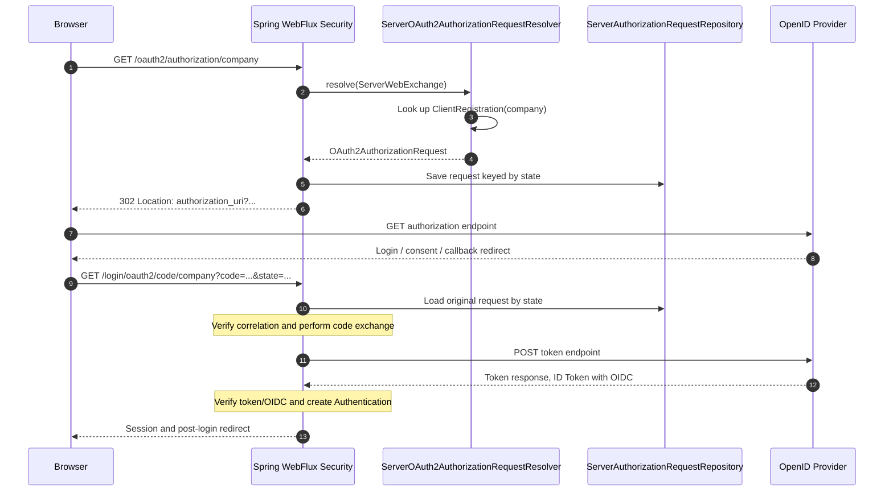
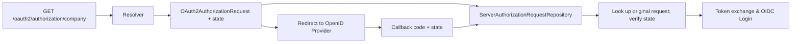
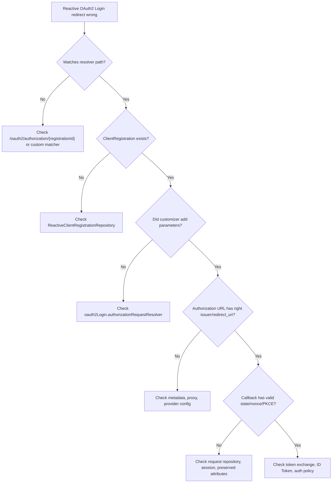

# 20.4. ServerOAuth2AuthorizationRequestResolver and Request Customization

In **Spring Security OAuth 2.0 / OpenID Connect (OIDC) Client** running on **Spring WebFlux**, the login process starts when the application redirects the browser to an Authorization Server or OpenID Provider. Before returning the HTTP redirect, Spring Security must construct an **OAuth2 Authorization Request** containing values such as `client_id`, `redirect_uri`, `response_type=code`, `scope`, and `state`; with OIDC and PKCE, additional parameters or binding attributes are also included.

The component responsible for building that request on the Reactive side is **`ServerOAuth2AuthorizationRequestResolver`**. The default implementation **`DefaultServerOAuth2AuthorizationRequestResolver`** covers most needs; an application can customize it to add `prompt`, `login_hint`, `max_age`, `acr_values`, scopes, or support a custom login initiation path.

However, the Authorization Request is part of the **OAuth2/OIDC security boundary**. Mistakenly altering `state`, `nonce`, PKCE `code_challenge`, the redirect URI, the issuer, or trusting unvalidated browser inputs can cause authentication failures, login loops, tokens sent to the wrong callback, or serious vulnerabilities. This lesson explains how to customize the right WebFlux APIs while preserving Spring Security's built-in protections.

## 1. Objectives and Scope

After this lesson, you should be able to distinguish:

1. What `ServerOAuth2AuthorizationRequestResolver` is, when it is called, and what object it returns.
2. How `DefaultServerOAuth2AuthorizationRequestResolver` uses `ReactiveClientRegistrationRepository` to look up client configurations.
3. How to attach the resolver to `ServerHttpSecurity.oauth2Login()` and when `oauth2Client()` applies.
4. How to add OIDC parameters to the redirect using `setAuthorizationRequestCustomizer(...)`.
5. How to write a custom resolver or wrapper when rules depend on `ServerWebExchange`.
6. The differences between **authorization request**, **authorization request repository**, **callback**, **token request**, and **outbound WebClient requests**.
7. How to protect `state`, `nonce`, PKCE, redirect URIs, scopes, user hints, and tenant boundaries.
8. How to test redirect flows in a controlled manner with `WebTestClient`.

This lesson covers **Reactive web login / Authorization Code Flow**, not building an Authorization Server or issuing access tokens yourself.

## 2. Where Does the Authorization Request Fit in the Reactive Login Flow?

Suppose a WebFlux application has registration `company`. A user visits:

```http
GET /oauth2/authorization/company HTTP/1.1
Host: portal.example.org
```

Spring Security processes this according to the following flow:



Roles:

- **`OAuth2AuthorizationRequestRedirectWebFilter`** triggers the Authorization Code Flow and uses the resolver to build the request.
- **`ServerOAuth2AuthorizationRequestResolver`** selects the OAuth2 registration and builds `OAuth2AuthorizationRequest`.
- **`ServerAuthorizationRequestRepository<OAuth2AuthorizationRequest>`** retains the original request between the outbound redirect and the returning callback.
- **Reactive authentication manager / callback filters** process the code, validate tokens, and create the principal; they are not the resolver.

This flow is **not the same** as an API endpoint receiving bearer tokens (`oauth2ResourceServer()`). A Resource Server validates access tokens sent to APIs; OAuth2 Login lets a web application authenticate users via a provider.

### 2.1. Two Endpoints to Distinguish

| Endpoint | Purpose | Handled By |
|---|---|---|
| `/oauth2/authorization/{registrationId}` | **Initiates** login: builds Authorization Request and redirects to provider | Resolver + Authorization Request Redirect WebFilter |
| `/login/oauth2/code/{registrationId}` | **Receives callback** containing authorization code and state from provider | Spring Security callback/authentication components |

Changing the initiation path does not automatically change the callback. Conversely, editing `redirect-uri` in `ClientRegistration` does not automatically change the URL users click to start login.

### 2.2. What Does an Authorization Request Contain?

Example URL-encoded query, formatted for readability:

```text
GET https://idp.example.org/realms/company/protocol/openid-connect/auth
    ?response_type=code
    &client_id=portal-web
    &redirect_uri=https%3A%2F%2Fportal.example.org%2Flogin%2Foauth2%2Fcode%2Fcompany
    &scope=openid%20profile%20email
    &state=<GENERATED_UNPREDICTABLE_VALUE>
    &nonce=<GENERATED_IF_APPLICABLE>
    &code_challenge=<GENERATED_IF_PKCE_IS_USED>
    &code_challenge_method=S256
    &prompt=consent
```

The `nonce` and PKCE parameters appear only when the flow/registration and configuration require them. `state`, `nonce`, and `code_challenge` above are placeholders; never use fixed strings in production.

`prompt=consent` is an example of an **added custom** OIDC parameter. It is not a mandatory OAuth2 parameter and is not added automatically just because the client requests the `openid` scope.

## 3. ServerOAuth2AuthorizationRequestResolver: API Contract

The `ServerOAuth2AuthorizationRequestResolver` interface lives in:

```java
org.springframework.security.oauth2.client.web.server
        .ServerOAuth2AuthorizationRequestResolver
```

It resolves an `OAuth2AuthorizationRequest` from a `ServerWebExchange` using a reactive API with two primary methods:

```java
Mono<OAuth2AuthorizationRequest> resolve(ServerWebExchange exchange);

Mono<OAuth2AuthorizationRequest> resolve(
        ServerWebExchange exchange, String clientRegistrationId);
```

Returning `Mono.empty()` normally indicates the resolver **did not produce a request** for that exchange, such as when the path does not match. A resolver may emit an error when the registration does not exist or input is invalid; let Spring handle errors per contract rather than turning every error into a redirect to an arbitrary host.

### 3.1. Explaining the Parameters

`ServerWebExchange` represents the Reactive HTTP context, including request, response, attributes, asynchronous session, and routing metadata. It is not `HttpServletRequest`.

`clientRegistrationId` is the internal key matching a `ClientRegistration`, such as `company` or `partner`. It is **not** the provider-side `client_id`. If the client registration is defined with ID `company`, the default path is:

```text
/oauth2/authorization/company
```

The string `company` is managed by the application; the actual client ID known to the OP might be `portal-web-prod`.

### 3.2. What Does the Default Resolver Handle?

`DefaultServerOAuth2AuthorizationRequestResolver`:

1. Receives the authorization initiation request.
2. Matches the path against a pattern, defaulting to `/oauth2/authorization/{registrationId}`.
3. Queries `ReactiveClientRegistrationRepository` to locate `ClientRegistration`.
4. Uses the registration and request context to build `OAuth2AuthorizationRequest`.
5. Allows a customizer to adjust the builder before the request is finalized.

It also handles protocol details around `redirect_uri`, `state`, and PKCE according to configuration, instead of forcing developers to concatenate URLs manually.

### 3.3. Why Keep the Default Resolver?

If the requirement is simply "add `prompt=consent`" or "add `login_hint`", rewriting the whole resolver and assembling URLs manually is unnecessary. Keeping the default resolver lets you continue relying on framework logic for:

- Selecting the client registration.
- Generating unpredictable `state` values.
- Expanding redirect URI templates.
- Supporting PKCE when configuration conditions apply.
- Constructing a properly formatted Authorization Request.
- Interacting with the Authorization Request Repository.

Customizations should focus on the **business-specific delta**, without inadvertently replacing default security guarantees.

## 4. Initial WebFlux OIDC Login Configuration

A Spring Boot Reactive example needs these core dependencies:

```xml
<dependencies>
    <dependency>
        <groupId>org.springframework.boot</groupId>
        <artifactId>spring-boot-starter-webflux</artifactId>
    </dependency>
    <dependency>
        <groupId>org.springframework.boot</groupId>
        <artifactId>spring-boot-starter-security</artifactId>
    </dependency>
    <dependency>
        <groupId>org.springframework.boot</groupId>
        <artifactId>spring-boot-starter-oauth2-client</artifactId>
    </dependency>
</dependencies>
```

OIDC registration in `application.yml`:

```yaml
spring:
  security:
    oauth2:
      client:
        registration:
          company:
            provider: corporate-op
            client-id: "${OIDC_CLIENT_ID}"
            client-secret: "${OIDC_CLIENT_SECRET}"
            client-authentication-method: client_secret_basic
            authorization-grant-type: authorization_code
            redirect-uri: "{baseUrl}/login/oauth2/code/{registrationId}"
            scope:
              - openid
              - profile
              - email
        provider:
          corporate-op:
            issuer-uri: "https://idp.example.org/realms/company"
```

`issuer-uri` enables discovery when the OP publishes valid metadata; the application verifies the issuer and resolves endpoints/token/JWK Set URI via metadata per framework support. The URI shown is illustrative and must be replaced with a real trusted issuer. Secrets must come from secret configuration outside source code.

Default security chain:

```java
import org.springframework.context.annotation.Bean;
import org.springframework.context.annotation.Configuration;
import org.springframework.security.config.annotation.web.reactive.EnableWebFluxSecurity;
import org.springframework.security.config.web.server.ServerHttpSecurity;
import org.springframework.security.web.server.SecurityWebFilterChain;

@Configuration
@EnableWebFluxSecurity
class ReactiveSecurityConfig {

    @Bean
    SecurityWebFilterChain securityWebFilterChain(ServerHttpSecurity http) {
        return http
                .authorizeExchange(exchanges -> exchanges
                        .pathMatchers("/", "/error").permitAll()
                        .anyExchange().authenticated())
                .oauth2Login(oauth2 -> {})
                .build();
    }
}
```

When only standard login is needed, declaring a custom resolver is unnecessary. Spring Security uses the default resolver and client configs from `ReactiveClientRegistrationRepository`.

### 4.1. How Servlet and Reactive Differ

| Servlet / Spring MVC | Reactive / WebFlux |
|---|---|
| `HttpSecurity` | `ServerHttpSecurity` |
| `SecurityFilterChain` | `SecurityWebFilterChain` |
| `OAuth2AuthorizationRequestResolver` | `ServerOAuth2AuthorizationRequestResolver` |
| `DefaultOAuth2AuthorizationRequestResolver` | `DefaultServerOAuth2AuthorizationRequestResolver` |
| `ClientRegistrationRepository` | `ReactiveClientRegistrationRepository` |
| `HttpServletRequest` | `ServerWebExchange` |
| `HttpSessionOAuth2AuthorizationRequestRepository` (Servlet) | `WebSessionOAuth2ServerAuthorizationRequestRepository` (Reactive) |
| `OAuth2AuthorizationRequestRedirectFilter` | `OAuth2AuthorizationRequestRedirectWebFilter` |

**Never take a Servlet example and only rename variables.** Request types, repositories, filter chains, and return types are all different.

## 5. Customizing OIDC Parameters with setAuthorizationRequestCustomizer

The most common case is adding parameters to the authorization redirect **for every request** handled by a resolver. The default API provides:

```java
resolver.setAuthorizationRequestCustomizer(
        builder -> builder.additionalParameters(parameters ->
                parameters.put("prompt", "consent")));
```

`additionalParameters` is the map of extension parameters on the Authorization Request. `builder.build()` inside the resolver produces the request/URI with those parameters included.

### 5.1. Complete Example: prompt=consent

```java
import org.springframework.context.annotation.Bean;
import org.springframework.context.annotation.Configuration;
import org.springframework.security.config.annotation.web.reactive.EnableWebFluxSecurity;
import org.springframework.security.config.web.server.ServerHttpSecurity;
import org.springframework.security.oauth2.client.registration.ReactiveClientRegistrationRepository;
import org.springframework.security.oauth2.client.web.server.DefaultServerOAuth2AuthorizationRequestResolver;
import org.springframework.security.oauth2.client.web.server.ServerOAuth2AuthorizationRequestResolver;
import org.springframework.security.web.server.SecurityWebFilterChain;

@Configuration
@EnableWebFluxSecurity
public class OidcRequestConfig {

    @Bean
    SecurityWebFilterChain securityWebFilterChain(
            ServerHttpSecurity http,
            ReactiveClientRegistrationRepository registrations) {

        ServerOAuth2AuthorizationRequestResolver resolver =
                authorizationRequestResolver(registrations);

        return http
                .authorizeExchange(exchanges -> exchanges
                        .pathMatchers("/", "/error").permitAll()
                        .anyExchange().authenticated())
                .oauth2Login(oauth2 ->
                        oauth2.authorizationRequestResolver(resolver))
                .build();
    }

    private ServerOAuth2AuthorizationRequestResolver
            authorizationRequestResolver(
                    ReactiveClientRegistrationRepository registrations) {

        var resolver = new DefaultServerOAuth2AuthorizationRequestResolver(
                registrations);

        resolver.setAuthorizationRequestCustomizer(builder ->
                builder.additionalParameters(params ->
                        params.put("prompt", "consent")));

        return resolver;
    }
}
```

When a user visits `/oauth2/authorization/company`, the redirect URL will include the default parameters along with `prompt=consent`, provided the provider supports that parameter.

This customizes the **authorization endpoint**, not the token endpoint. The `prompt` parameter is not sent in the HTTP POST that exchanges the authorization code for an access token.

### 5.2. Meaning of prompt

OIDC defines common values:

| `prompt` | Meaning |
|---|---|
| `none` | Asks the OP not to display interactive UI; may return errors such as `login_required` or `interaction_required` |
| `login` | Asks the OP to re-authenticate the user |
| `consent` | Asks the OP to prompt for consent per policy |
| `select_account` | Asks the OP to prompt the user to select an account |

Some values can be space-separated, though `none` must not be combined with other values. Whether the OP honors the parameter depends on its support and policy; never rely on `prompt=login` as the sole proof that the user achieved the required MFA level.

### 5.3. Adding Multiple Extension Parameters

Example for an OP that supports them:

```java
resolver.setAuthorizationRequestCustomizer(builder ->
        builder.additionalParameters(params -> {
            params.put("prompt", "select_account");
            params.put("ui_locales", "vi en");
            params.put("max_age", "3600");
        }));
```

Parameters:

- `ui_locales`: UI language hint; does not guarantee the OP renders in Vietnamese.
- `max_age`: maximum elapsed seconds since the user's last authentication per OIDC; may force OP re-authentication per policy.
- `prompt`: requested interactive behavior at the OP.

Never pass both `prompt=none` and `prompt=login` together. If a parameter is unsupported by the OP, the OP may ignore it or return an error; design the application around the provider contract.

## 6. Commonly Customized Parameters and Risks

| Parameter | Purpose | Recommended Value Source | Notes |
|---|---|---|---|
| `prompt` | Controls interaction/consent prompt | Fixed values or server-controlled allowlist | Do not combine `none` with other values; avoid login loops |
| `login_hint` | Hints at the account at the OP | Known identity permitted to share with provider | May contain email/username, exposing PII in URLs/logs |
| `max_age` | Requests recent authentication | Server-side step-up policy | Non-negative integer; verify results when required |
| `acr_values` | Suggests authentication class/level | ACR allowlist agreed upon with OP | OP might not satisfy it; verify actual `acr` claim |
| `ui_locales` | Preferred UI language | Normalized value from preference/allowlist | Not a security claim |
| `id_token_hint` | Hints at an existing OIDC session | Only when required by the OIDC flow; handle tokens confidentially | Never take arbitrary ID Tokens from the browser |
| `scope` | Requested permission scopes | `ClientRegistration` and scope policy | Requesting more scopes does not guarantee they are granted |
| `redirect_uri` | Callback returning the code to client | Pre-registered and server-side configuration | Never use user-supplied URLs |
| `state` | Binds request to callback, prevents CSRF | Randomly generated and stored by framework | Never override with a static string |
| `nonce` | Binds ID Token to OIDC request | Managed by framework for OIDC | Never drop or corrupt its value |
| `code_challenge` | PKCE binding code to verifier | Generated by framework alongside `code_verifier` | Never invent challenges or put the verifier in the URL |

### 6.1. login_hint Is Not Impersonation

Example:

```java
builder.additionalParameters(params ->
        params.put("login_hint", "employee@example.org"));
```

`login_hint` is strictly a **hint** sent to the OP. It does not prove the authenticated person owns that email, does not lock the user into that account, and does not allow the app to accept a login response with an unexpected `sub`.

When supported by the OP, `login_hint` can improve login UX, but emails can appear in redirect URLs, browsing history, reverse proxy logs, and telemetry. Send only necessary data with an appropriate privacy basis; avoid logging full URLs if they contain sensitive data.

### 6.2. acr_values and MFA

Example:

```java
builder.additionalParameters(params ->
        params.put("acr_values", "urn:example:loa:high"));
```

This is an **illustrative value**, not a universal ACR understood by every IdP. If an application requires high-assurance authentication, establish a contract with the OP regarding `acr_values`, MFA policy, and `max_age`, and verify the result via claims like `acr`/`auth_time` per contract. Never assume that **requesting** an ACR means the OP actually **fulfilled** it.

### 6.3. max_age=0 and Checking auth_time

`max_age=0` is the OIDC way to ask the OP to perform fresh authentication, suitable for certain step-up flows. However, an application requiring fresh authentication or bounded session age should inspect the ID Token per OIDC standards, such as `auth_time` and constraints supported by the framework/provider.

Never turn an unverified `?max_age=0` query parameter into the sole mechanism gating sensitive transactions. Step-up policies and permissions still belong on the backend.

## 7. Per-Request Customization: Writing a Wrapper Resolver

`setAuthorizationRequestCustomizer(...)` receives only `OAuth2AuthorizationRequest.Builder`; it does not receive `ServerWebExchange` directly. When customization depends on the path, tenant, valid cookies/sessions, or login policy of the current request, you can **wrap** `DefaultServerOAuth2AuthorizationRequestResolver`.

Pattern:

```text
ServerWebExchange
      |
      v
Custom ServerOAuth2AuthorizationRequestResolver
      |
      +--> delegate DefaultServerOAuth2AuthorizationRequestResolver
      |        +--> look up ClientRegistration
      |        +--> build standard request (state, nonce, PKCE...)
      |
      +--> check business/login policy from exchange
      |
      +--> OAuth2AuthorizationRequest.from(original)
               +--> add only allowlisted parameters
               +--> build()
```

This avoids rewriting protocol protections from scratch.

### 7.1. Wrapper Example Using Controlled Prompt Selection

Suppose the app offers a UI option to *re-select an account*. The browser may send `?account_selection=yes`, while the server accepts only that exact allowlisted value and **never lets the browser modify `state`, `nonce`, `redirect_uri`, or `client_id`**.

```java
import org.springframework.security.oauth2.client.web.server
        .ServerOAuth2AuthorizationRequestResolver;
import org.springframework.security.oauth2.core.endpoint.OAuth2AuthorizationRequest;
import org.springframework.web.server.ServerWebExchange;
import reactor.core.publisher.Mono;

final class AccountSelectionAuthorizationRequestResolver
        implements ServerOAuth2AuthorizationRequestResolver {

    private final ServerOAuth2AuthorizationRequestResolver delegate;

    AccountSelectionAuthorizationRequestResolver(
            ServerOAuth2AuthorizationRequestResolver delegate) {
        this.delegate = delegate;
    }

    @Override
    public Mono<OAuth2AuthorizationRequest> resolve(
            ServerWebExchange exchange) {
        return delegate.resolve(exchange)
                .map(request -> customize(exchange, request));
    }

    @Override
    public Mono<OAuth2AuthorizationRequest> resolve(
            ServerWebExchange exchange,
            String clientRegistrationId) {
        return delegate.resolve(exchange, clientRegistrationId)
                .map(request -> customize(exchange, request));
    }

    private OAuth2AuthorizationRequest customize(
            ServerWebExchange exchange,
            OAuth2AuthorizationRequest original) {

        String selection = exchange.getRequest().getQueryParams()
                .getFirst("account_selection");

        if (!"yes".equals(selection)) {
            return original;
        }

        return OAuth2AuthorizationRequest.from(original)
                .additionalParameters(params ->
                        params.put("prompt", "select_account"))
                .build();
    }
}
```

In this example, the browser may request only a low-sensitivity UI behavior with the fixed value `yes`; **it is not allowed to supply an arbitrary `prompt` string**. For sensitive policies such as MFA, tenant selection, or elevated scopes, decisions must rest on **server-verified** data and permissions, never just a query string.

`OAuth2AuthorizationRequest.from(original)` initializes a builder from the request built by the delegate. Modifying only `additionalParameters` preserves key properties of the original request far better than rebuilding from scratch.

### 7.2. Registering the Wrapper in SecurityWebFilterChain

```java
@Bean
SecurityWebFilterChain securityWebFilterChain(
        ServerHttpSecurity http,
        ReactiveClientRegistrationRepository registrations) {

    var defaultResolver =
            new DefaultServerOAuth2AuthorizationRequestResolver(
                    registrations);

    var resolver =
            new AccountSelectionAuthorizationRequestResolver(
                    defaultResolver);

    return http
            .authorizeExchange(exchanges -> exchanges
                    .pathMatchers("/", "/error").permitAll()
                    .anyExchange().authenticated())
            .oauth2Login(oauth2 ->
                    oauth2.authorizationRequestResolver(resolver))
            .build();
}
```

This configuration **replaces** the `SecurityWebFilterChain` in Section 5.1; an application should have one appropriate chain for the same set of routes rather than unintentionally duplicating beans with overlapping scopes.

### 7.3. When Policy Must Query a Reactive Service

For example, checking whether a user/tenant has a "require high-assurance authentication" policy enabled. If the policy is an asynchronous service, the resolver can use `flatMap`:

```java
@Override
public Mono<OAuth2AuthorizationRequest> resolve(
        ServerWebExchange exchange) {

    return delegate.resolve(exchange)
            .flatMap(original ->
                    stepUpPolicy.shouldRequireFreshLogin(exchange)
                            .map(required -> {
                                if (!required) {
                                    return original;
                                }
                                return OAuth2AuthorizationRequest
                                        .from(original)
                                        .additionalParameters(params -> {
                                            params.put("prompt", "login");
                                            params.put("max_age", "0");
                                        })
                                        .build();
                            }));
}
```

`stepUpPolicy` is an **application-implemented service**, for example returning `Mono<Boolean>` from verified/approved session state. In a complete resolver, implement the `resolve(exchange, registrationId)` overload with the same policy as well. In particular, returning `Mono.empty()` from the policy would drop the Authorization Request, so the service needs explicit semantics and deliberate fallbacks.

Never call `block()` on the Reactor event-loop to read a database or policy. A Reactive resolver must keep lookups and logic non-blocking within the reactive pipeline.

## 8. Customizing the Login Initiation Path

By default, the resolver matches:

```text
/oauth2/authorization/{registrationId}
```

If the application wants the path:

```text
/login/oauth2/authorization/{registrationId}
```

provide a `ServerWebExchangeMatcher`:

```java
import org.springframework.security.oauth2.client.registration.ReactiveClientRegistrationRepository;
import org.springframework.security.oauth2.client.web.server
        .DefaultServerOAuth2AuthorizationRequestResolver;
import org.springframework.security.web.server.util.matcher
        .PathPatternParserServerWebExchangeMatcher;
import org.springframework.security.web.server.util.matcher.ServerWebExchangeMatcher;

ServerWebExchangeMatcher matcher =
        new PathPatternParserServerWebExchangeMatcher(
                "/login/oauth2/authorization/{registrationId}");

var resolver = new DefaultServerOAuth2AuthorizationRequestResolver(
        registrations, matcher);
```

Then wire `resolver` via `oauth2Login(...authorizationRequestResolver(resolver))`.

Any custom login page must render links **matching** the new pattern:

```html
<a href="/login/oauth2/authorization/company">
  Log in with company account
</a>
```

If the UI still links to `/oauth2/authorization/company` while the resolver listens only on the new pattern, the flow will not start.

### 8.1. Initiation Path vs. Callback Path

Two distinct paths:

```text
Authorization initiation:
    /login/oauth2/authorization/company

OAuth2 redirect callback:
    /login/oauth2/code/company
```

The callback path comes from the registration's `redirect-uri` and the callback authentication matcher configuration. Do not change only `ServerWebExchangeMatcher` on the resolver and assume the callback changes too.

### 8.2. Custom Login Page and Security Matchers

If you build a custom login page, make sure:

- The login page path is accessible while unauthenticated.
- Login links use valid registration IDs.
- Authorization Server URLs are never taken from the browser to construct direct links.
- `returnUrl` cannot become an open redirect after login.
- A second custom security chain does not intercept the initiation endpoint or callback.

Let Spring Security generate `state` and persist the original request; never craft static links containing hardcoded state in HTML templates.

## 9. Policy-Based Scope Customization

OAuth2 `scope` sits in the Authorization Request and normally comes from `ClientRegistration.getScopes()`. At the Authorization Server, scopes are only a **permission request**; the scopes actually granted and the token audience depend on the provider.

### 9.1. Static Scope Configuration

```yaml
spring:
  security:
    oauth2:
      client:
        registration:
          company:
            scope:
              - openid
              - profile
              - email
```

This is simple, easy to operate, and straightforward to audit. If all users/flows of a client always need the same scopes, you do not need a custom resolver just to rebuild the exact same list.

### 9.2. Adding Scopes via the Builder When Policy Requires

A customizer can request an additional scope that the **client has registered and the provider allows**:

```java
import java.util.HashSet;

resolver.setAuthorizationRequestCustomizer(builder ->
        builder.scopes(new HashSet<>(java.util.Set.of(
                "openid",
                "profile",
                "reports.read"))));
```

This illustrates the `scopes(Set<String>)` API, but replacing the entire scope set with a constant can drop scopes defined elsewhere in configuration. In production, prefer clear registration scope configs or use a wrapper that receives the **resolved** request and builds the new set from the original scopes:

```java
private OAuth2AuthorizationRequest withReportScope(
        OAuth2AuthorizationRequest original) {

    Set<String> scopes = new HashSet<>(original.getScopes());
    scopes.add("reports.read"); // Only when permitted by policy/OP.

    return OAuth2AuthorizationRequest.from(original)
            .scopes(scopes)
            .build();
}
```

This method assumes `Set` and `HashSet` are imported. Never add `reports.admin` to the request just because the browser sent `?scope=reports.admin`; enforce an allowlist, client permissions, and business policy checks.

### 9.3. Why Requested Scopes Are Not Enough for Authorization

A user might request `reports.read` while the OP grants only a subset or the user lacks permission to view all reports. When calling a Resource Server, the **access token** must match the audience/scopes, and the API must check permissions against the organization/resource. Obtaining OAuth2 Login does not authorize viewing all data.

For incremental authorization, the user may have to grant additional consent; an existing authorized client does not automatically gain new scopes just because the application later mutates a map.

## 10. Protecting state, nonce, and PKCE

This is the most critical area when customizing an OAuth2 Authorization Request.

### 10.1. state Prevents Confusion and Callback Attacks

`state` binds the outbound authorization request to the callback the application receives. Spring Security generates and stores the original request to verify correlation.

**Do not**:

```java
// INSECURE: state must not be fixed or taken arbitrarily from the browser.
builder.state("fixed-state-value");
```

And never replace `state` with a `?state=...` query parameter from the frontend. A static or predictable state weakens request/callback binding. If you need to preserve "where to return after login," use a validated server-side mechanism rather than abusing `state` as an unprotected data container.

### 10.2. nonce Protects OIDC ID Token Binding

OIDC can include `nonce` in the Authorization Request to bind the received ID Token to the initial login request. It is important for preventing token injection/replay in the flow. In Spring Security OIDC configurations, the framework manages `nonce` and its validation through supported mechanisms.

Never:

- Delete `nonce` when modifying `additionalParameters`.
- Set `nonce` to a constant string.
- Share a `nonce` across different login requests.
- Accept an ID Token from a different issuer without checking issuer/audience.

If a custom resolver rebuilds the entire `OAuth2AuthorizationRequest`, preserve `state`, `nonce`, and attributes supporting validation.

### 10.3. PKCE Binds the Authorization Code to code_verifier

PKCE works as follows:

```text
Client generates secret code_verifier
   |
   +--> code_challenge = BASE64URL(SHA256(code_verifier))
   |
   +--> Authorization Request sends code_challenge and method=S256
   |
   +--> When exchanging code at token endpoint, client sends code_verifier
   |
   +--> Authorization Server verifies relationship
```

Spring Security supports PKCE for public clients and when `ClientRegistration.clientSettings.requireProofKey` is enabled per the relevant API/version. In a custom resolver:

- Never replace `code_challenge` with a constant.
- Never send `code_verifier` in the authorization URL.
- Never drop internal attributes storing the `code_verifier` needed for token exchange.
- Never disable PKCE just to "fix a callback error."
- Never write codes or PKCE verifiers to logs.

### 10.4. Why Use from(original)?

When customizing a request already produced by the default resolver:

```java
OAuth2AuthorizationRequest.from(original)
        .additionalParameters(params ->
                params.put("prompt", "select_account"))
        .build();
```

usually preserves the original request's values and attributes much more safely than starting a fresh builder from `OAuth2AuthorizationRequest.authorizationCode()`. Even so, avoid altering sensitive builder fields unless a concrete protocol requirement demands it.

## 11. How ServerAuthorizationRequestRepository Differs from the Resolver

`ServerOAuth2AuthorizationRequestResolver` **creates the request**; `ServerAuthorizationRequestRepository<OAuth2AuthorizationRequest>` **persists the request** between initiation and callback.



Default implementation typically used:

```java
WebSessionOAuth2ServerAuthorizationRequestRepository
```

which stores `OAuth2AuthorizationRequest` inside Spring WebFlux's `WebSession`.

### 11.1. Do Not Confuse with OAuth2AuthorizedClient Storage

| Component | Data Type | Lifecycle |
|---|---|---|
| `ServerOAuth2AuthorizationRequestResolver` | Builds request before redirect | At authorization initiation |
| `ServerAuthorizationRequestRepository` | Authorization Request with `state` and attributes needed for callback | Short-lived, between request and callback |
| `ServerOAuth2AuthorizedClientRepository` | Authorized client and tokens for user/session | After tokens are issued |
| `ReactiveOAuth2AuthorizedClientService` | Authorized client in Reactive service storage | After tokens are issued, per policy |
| `ServerSecurityContextRepository` | Authentication/security context | Tied to session/request per config |

A login failure caused by a `state` mismatch should never be "fixed" by deleting an `OAuth2AuthorizedClient`. They are two distinct stores with different responsibilities.

### 11.2. Why You Should Not Store State in Unprotected Query Parameters

If you must preserve business metadata across the redirect:

- Store it server-side keyed by `state` or a separate correlation key.
- Bind the data to the request/user/session with a reasonable TTL.
- Never place client secrets, code verifiers, or sensitive data in query URLs.
- Never trust `returnTo` or `tenant` merely because they reappear on the callback.
- Never replace Spring Security's `state` check with an unprotected custom cookie.

In multi-instance deployments, the session/repository must suit a distributed architecture—using session affinity or shared session storage depending on strategy. If the callback lands on an instance that cannot locate the original request, state correlation will fail.

## 12. Redirect URI and Reverse Proxies

The Authorization Request carries `redirect_uri` pointing to the client's callback URL. This value must match a URI registered at the Authorization Server per provider policy to prevent open redirects and code exfiltration.

Spring Security supports placeholders in the registration:

```yaml
redirect-uri: "{baseUrl}/login/oauth2/code/{registrationId}"
```

Placeholders depend on the scheme, host, port, and base path seen by the framework. When the application runs behind a reverse proxy:

```text
Browser -> https://portal.example.org
             |
             v
Reverse proxy -> http://portal-service:8080
```

if the application resolves the base URL incorrectly, the redirect URI may become `http://portal-service:8080/...` and the provider will reject it with `redirect_uri_mismatch`.

The standard fix is configuring trusted forwarded headers and proper reverse proxy settings alongside an exact callback URI list at the OP. **Never trust arbitrary `X-Forwarded-Host` headers from the Internet without a proxy trust boundary**, as that can cause host-header injection or redirects to unauthorized hosts.

### 12.1. When Should You Modify Authorization Request URI?

`DefaultServerOAuth2AuthorizationRequestResolver` lets the builder customize `authorizationRequestUri` when a provider requires a special URL shape. However, this is a high-privilege extension point: getting it wrong can drop `state`, `nonce`, `code_challenge`, or break URL encoding.

If you only need to add `prompt=consent`, use:

```java
builder.additionalParameters(params ->
        params.put("prompt", "consent"));
```

instead of concatenating strings:

```java
// DO NOT: build URL manually and drop security parameters.
String url = authEndpoint + "?client_id=" + clientId
        + "&redirect_uri=" + redirectUri;
```

For static provider-specific parameters, configuring `authorization-uri` with static query parameters can be an option, provided you check the provider contract and avoid duplicate parameters. Customizing the builder is usually clearer when policies vary.

## 13. Customizing by Provider or Registration

An application may integrate both a Corporate OP and a Partner OP:

```text
/oauth2/authorization/company
/oauth2/authorization/partner
```

The two providers may interpret `prompt` or `acr_values` differently. A customizer applied across every registration can inadvertently send unsupported parameters to the partner OP.

A safer strategy is a custom wrapper **keyed on the registration already resolved by the resolver**, rather than guessing the provider from a browser query parameter.

### 13.1. Reading the Registration from the Resolved Request

`OAuth2AuthorizationRequest` holds attributes used for OAuth2 processing. When a wrapper needs to branch on provider/registration, you can structure the resolver and policy around the matched path or controlled metadata from the registration repository.

Design example:

```text
request path -> default resolver -> OAuth2AuthorizationRequest
                                  |
                                  v
                     server-side RegistrationPolicy
                       company -> prompt=select_account
                       partner -> no custom prompt
                                  |
                                  v
                            final request
```

If the policy needs `ClientRegistration` details, query `ReactiveClientRegistrationRepository.findByRegistrationId(...)` using the normalized registration ID from routing; never rely solely on a browser-supplied `client_id` or `issuer`.

### 13.2. Illustrative Helper Applying Policy by Matched Route

```java
private OAuth2AuthorizationRequest applyProviderPolicy(
        String registrationId,
        OAuth2AuthorizationRequest original) {

    if ("company".equals(registrationId)) {
        return OAuth2AuthorizationRequest.from(original)
                .additionalParameters(params ->
                        params.put("prompt", "select_account"))
                .build();
    }

    // For partner, keep the request unchanged if there is no custom policy.
    return original;
}
```

Here `registrationId` must come from the resolver's trusted routing/matcher mechanism, not a free-form browser value controlling authorization. This snippet is an illustrative helper inside a custom resolver and does not replace implementing both `resolve(...)` overloads.

### 13.3. Tenant-Specific Login

When each tenant uses a distinct provider or client:

1. Determine the tenant from a verified host/domain, session, or selection workflow.
2. Map tenant → `registrationId` in a server-side registry.
3. Ensure the registration has the right issuer, callback, client ID, and client authentication.
4. Use the resolver to add UX parameters where appropriate.
5. After login, map identity via (`iss`, `sub`), never auto-linking accounts by email alone.

Never let the browser send `?issuer=https://evil.example` and dynamically create an uncontrolled `ClientRegistration`/token URI. A resolver producing login URLs to providers outside an allowlist can leak authorization codes or phish users.

## 14. OIDC Login vs. OAuth2 Client Authorization: Where to Configure?

In WebFlux, both:

```java
http.oauth2Login(...);
http.oauth2Client(...);
```

provide hooks related to Authorization Requests. However:

- `oauth2Login()` targets user authentication via OAuth2/OIDC and creating an authenticated principal.
- `oauth2Client()` targets OAuth2 Client capabilities so the app can obtain/maintain authorized clients and call Resource Servers.

When an application uses both, identify which flow's resolver/repository is actually active and avoid configuring two conflicting resolvers on the same initiation path. Configuring under `oauth2Login().authorizationRequestResolver(...)` is the direct approach for **this Reactive login lesson**.

### 14.1. Do Not Confuse with WebClient Attributes

In a downstream `WebClient`, you may pick a registration for an access token when calling an API; that is **not** the same action as the resolver building an Authorization Request when the browser starts login.

```text
Browser login:
  GET /oauth2/authorization/company
      -> ServerOAuth2AuthorizationRequestResolver
      -> Redirect authorization endpoint

Backend calls API:
  WebClient.get().uri(...)
      -> Authorized Client Manager / OAuth2 exchange filter
      -> Access Token -> Resource Server
```

To add `prompt` on the login redirect, customize the resolver. To send extra headers or params to the **token endpoint**, customize the token response client. To pick a token when **calling an API**, configure the authorized client manager/`WebClient`. These are three distinct needs.

## 15. When Adding Parameters Unsupported by the Provider

For instance, an OP that does not support `acr_values=urn:example:loa:high` may ignore the parameter or return an error. Another OP may enforce `prompt` according to its own policy.

| Symptom | Possible Cause | How to Handle |
|---|---|---|
| Login redirect lacks `prompt` | Customizer not wired into resolver, different chain matched, or path mismatch | Check `SecurityWebFilterChain` bean and matcher |
| `prompt=none` causes `login_required` | User has no active OP session or interaction is required | Design controlled fallback; avoid redirect loops |
| `acr_values` sent but no MFA prompted | OP ignores value or policy does not require it | Check OP contract and resulting `acr`/`amr` claims |
| `login_hint` does not pre-fill username | OP does not support or honor hint | Treat as UI hint; do not force flow on hint |
| `max_age` causes repeated logins | App requests re-auth on every request without checking result/interval | Separate step-up events, state, and completion criteria |
| New scope missing from token | Client lacks permission or consent incomplete | Check registration, granted scopes, and provider policy |
| `redirect_uri_mismatch` | Redirect URI unregistered or proxy generates wrong base URL | Check `redirect-uri`, forwarded headers, trusted proxy |
| Callback `invalid_state` | Original request lost session, state overridden, or wrong callback | Never override state; check `WebSession`/repository |
| `invalid_nonce` | Nonce does not match ID Token or original request lost | Keep Spring's nonce generation/storage/validation |
| Code exchange fails after custom PKCE | `code_verifier` mismatch or lost attributes | Never manually replace PKCE; preserve request attributes |
| Other provider breaks with shared customizer | One OP's specific parameter applied to all registrations | Apply policy per registration/provider |
| Custom login path returns 404 | UI link does not match new matcher | Align resolver pattern with login links |
| Browser redirected to unexpected host | External URL/issuer used or untrusted forwarded header | Allowlist providers/hosts, trust proxy and callback |

### 15.1. Diagnostic Workflow



When diagnosing, separate errors **before redirect**, errors **at the OP**, errors **in callback state/nonce/PKCE**, and errors **in token exchange**. Blaming everything on "the resolver didn't run" leads to fixing the wrong layer.

## 16. Testing with WebTestClient

Because authorization initiation only generates an HTTP redirect, you can test this step **without actually logging in at a live OP**.

### 16.1. What to Assert

An integration test should:

1. Call `GET /oauth2/authorization/company`.
2. Expect an HTTP 3xx redirect status.
3. Read `Location` and parse it into URI/query parameters.
4. Check the Authorization Server host/scheme/path against the registration.
5. Check `response_type=code`, `client_id`, `redirect_uri`, and `scope`.
6. Check that `state` is present and not a constant.
7. Check `prompt=consent` or configured custom parameters.
8. When OIDC/PKCE apply, check nonce/challenge according to context.
9. Ensure tokens/codes/secrets are never leaked via custom URLs or logs.

### 16.2. WebTestClient Example: Observing the Redirect

```java
import java.net.URI;
import org.junit.jupiter.api.Test;
import org.springframework.beans.factory.annotation.Autowired;
import org.springframework.boot.test.autoconfigure.web.reactive.WebFluxTest;
import org.springframework.test.web.reactive.server.WebTestClient;
import org.springframework.web.util.UriComponentsBuilder;

import static org.assertj.core.api.Assertions.assertThat;

class AuthorizationRedirectTest {

    @Autowired
    WebTestClient webTestClient;

    @Test
    void loginRedirectIncludesPrompt() {
        webTestClient.get()
                .uri("/oauth2/authorization/company")
                .exchange()
                .expectStatus().is3xxRedirection()
                .expectHeader()
                .value("Location", location -> {
                    URI uri = URI.create(location);
                    var query = UriComponentsBuilder.fromUri(uri)
                            .build()
                            .getQueryParams();

                    assertThat(uri.getHost())
                            .isEqualTo("idp.example.org");
                    assertThat(query.getFirst("response_type"))
                            .isEqualTo("code");
                    assertThat(query.getFirst("prompt"))
                            .isEqualTo("consent");
                    assertThat(query.getFirst("state"))
                            .isNotBlank();
                });
    }
}
```

This is a **test structure** example assuming `WebTestClient` is already configured with the application context, `SecurityWebFilterChain`, test registration, and resolver. The `WebFluxTest` import suggests a slice test environment, though the snippet does not assemble the slice/mocks itself; with `@WebFluxTest`, you may need to import security config and relevant beans or switch to `@SpringBootTest(webEnvironment=RANDOM_PORT)` with `@AutoConfigureWebTestClient`. Tests should not call a live OP.

### 16.3. Testing That Two Requests Have Different States

Across two login starts:

```text
GET /oauth2/authorization/company -> state A
GET /oauth2/authorization/company -> state B
assert state A != state B
```

Never assert against a hardcoded `state` value. The goal is proving customization did not accidentally overwrite `state` with a constant.

### 16.4. Testing a Custom Matcher

When changing the path:

```text
GET /login/oauth2/authorization/company -> HTTP 302 to OP
GET /oauth2/authorization/company       -> no longer triggers the same resolver
```

The old path's response may be 401/404/login redirect depending on security configuration; do not hardcode one universal expectation across all projects. What matters is verifying that **the old path no longer builds an unintended Authorization Request**.

### 16.5. Testing Dynamic Policies and Malicious Inputs

A custom resolver reading a query parameter should test:

| Request | Expected Behavior |
|---|---|
| `?account_selection=yes` | Includes `prompt=select_account` |
| `?account_selection=anything-else` | Does not inject a special prompt |
| `?prompt=login%20consent` when app disallows free-form prompt | Does not echo arbitrary values |
| `?redirect_uri=https://attacker.example` | Actual `redirect_uri` still comes from registration |
| `?state=fixed` | Actual `state` is still framework-generated |
| `?scope=admin` | Does not automatically add `admin` scope |
| `?login_hint=<untrusted>` | Does not transmit PII not permitted by policy |
| Another partner's tenant ID | Cannot select another tenant's provider/client via query string |

Tests guarding these boundaries are far more valuable than a test that only checks for HTTP 302.

## 17. Common Design Mistakes

1. **Using a Servlet resolver in WebFlux**: `DefaultOAuth2AuthorizationRequestResolver` does not replace `DefaultServerOAuth2AuthorizationRequestResolver`.
2. **Manually concatenating authorization URLs** and dropping `state`, PKCE, or `nonce`.
3. **Hardcoding fixed `state`/`nonce` values** for "easier debugging."
4. **Reading `prompt` from the browser and echoing it verbatim** without an allowlist.
5. **Treating `login_hint` as proof of user identity** instead of verifying the ID Token.
6. **Letting the browser pick the issuer, client ID, or redirect URI** without binding to a trusted registration.
7. **Sending `acr_values` and assuming MFA completed** without checking the resulting claims.
8. **Turning on `prompt=login` for every sensitive request** and creating an endless re-authentication loop.
9. **Using `additionalParameters` to try modifying the token endpoint** — wrong protocol phase.
10. **Changing the initiation matcher while forgetting to update login links**.
11. **Changing the callback URI without re-registering at the OP** or updating callback matching.
12. **Losing `WebSession` between redirect and callback**, making the original request unrecoverable.
13. **Calling `block()` inside a custom reactive resolver** to read DB/policy data.
14. **Putting code verifiers, ID Tokens, or client secrets in URLs or logs**.
15. **Confusing the request resolver with the authorized client manager**, leading to debugging the wrong layer.

## 18. Comprehensive Scenario: Multi-Provider Portal with Step-Up

Suppose an internal portal runs on Spring WebFlux:

- `company` is the OIDC client for employees.
- `partner` is the OIDC client for partners.
- The login page has a dedicated link for each registration.
- When an employee performs a sensitive operation, the server enforces a policy requiring fresh authentication.

Design:

```text
Reactive Portal
   |
   +-- GET /oauth2/authorization/company
   |       -> DefaultServerOAuth2AuthorizationRequestResolver
   |       -> ClientRegistration(company)
   |       -> StepUpPolicy (if valid session requires it)
   |       -> prompt=login, max_age=0 per OP contract
   |       -> state/nonce/PKCE protected by Spring
   |       -> Corporate OP
   |
   +-- GET /oauth2/authorization/partner
           -> DefaultServerOAuth2AuthorizationRequestResolver
           -> ClientRegistration(partner)
           -> no custom prompt specific to Corporate OP
           -> Partner OP
```

Key workflow:

1. Server chooses the registration from the route/matcher and registered config, never from an arbitrary browser-supplied issuer.
2. Default resolver builds the Authorization Request.
3. Wrapper checks verified policy and adds only parameters supported by that OP.
4. Request Repository stores correlation by `state`; callback completes the flow.
5. After login, Spring Security verifies the ID Token, issuer/audience, and OIDC constraints.
6. For step-up, the service checks `auth_time`/`acr` per policy rather than trusting only that `prompt=login` was sent.
7. Resource Servers and services still authorize per user/tenant/object; fresh authentication alone does not grant admin privileges.

This model preserves clean separation of responsibilities: **the resolver builds the Authorization Request**, **the OP authenticates the user**, **Spring Security verifies the outcome**, and **business policy governs application permissions**.

## 19. Review Questions

1. At what point during Reactive OAuth2 Login is `ServerOAuth2AuthorizationRequestResolver` invoked?
2. How does `DefaultServerOAuth2AuthorizationRequestResolver` resolve a `ClientRegistration`?
3. What is the difference between `/oauth2/authorization/{registrationId}` and `/login/oauth2/code/{registrationId}`?
4. Why are `OAuth2AuthorizationRequest` and `OAuth2AuthorizeRequest` not the same concept?
5. When you only want to add `prompt=consent`, why should you use `setAuthorizationRequestCustomizer(...)` instead of building the URL yourself?
6. Why does `login_hint` not prove the authenticated subject?
7. After the OP returns an ID Token for `max_age=0` and `acr_values`, what must be verified?
8. When do you need a custom `ServerOAuth2AuthorizationRequestResolver` versus when is the default resolver enough?
9. Which properties does `OAuth2AuthorizationRequest.from(original)` help preserve when adding parameters?
10. Why should you never modify `state` or `nonce` from a query parameter?
11. How are PKCE `code_challenge` and `code_verifier` related, and how can a custom resolver break that link?
12. What different data do `ServerAuthorizationRequestRepository` and `ServerOAuth2AuthorizedClientRepository` store?
13. When changing the login initiation matcher, why does the callback URI not automatically change?
14. Why should a `prompt` meant for the Corporate OP not be applied automatically to the Partner OP?
15. In WebFlux, how can you test redirect requests and `state` without calling a real IdP?
16. When an application sits behind a proxy, what factors can cause `redirect_uri` to mismatch the OP registration?
17. Why can a resolver that reflects `?scope=admin` from the browser create a policy vulnerability?
18. Why is successful authentication by the OP not sufficient on its own to access business resources?

## References

- [Spring Security Reference — Reactive OAuth2 Client: Authorization Grant Support](https://docs.spring.io/spring-security/reference/reactive/oauth2/client/authorization-grants.html)
- [Spring Security Reference — Reactive OAuth2 Login](https://docs.spring.io/spring-security/reference/reactive/oauth2/login/index.html)
- [Spring Security Reference — Reactive OAuth2 Login: Advanced Configuration](https://docs.spring.io/spring-security/reference/reactive/oauth2/login/advanced.html)
- [Spring Security API — ServerOAuth2AuthorizationRequestResolver](https://docs.spring.io/spring-security/reference/api/java/org/springframework/security/oauth2/client/web/server/ServerOAuth2AuthorizationRequestResolver.html)
- [Spring Security API — DefaultServerOAuth2AuthorizationRequestResolver](https://docs.spring.io/spring-security/reference/api/java/org/springframework/security/oauth2/client/web/server/DefaultServerOAuth2AuthorizationRequestResolver.html)
- [Spring Security API — ServerHttpSecurity.OAuth2LoginSpec](https://docs.spring.io/spring-security/reference/api/java/org/springframework/security/config/web/server/ServerHttpSecurity.OAuth2LoginSpec.html)
- [Spring Security API — OAuth2AuthorizationRequest](https://docs.spring.io/spring-security/reference/api/java/org/springframework/security/oauth2/core/endpoint/OAuth2AuthorizationRequest.html)
- [Spring Security API — WebSessionOAuth2ServerAuthorizationRequestRepository](https://docs.spring.io/spring-security/reference/api/java/org/springframework/security/oauth2/client/web/server/WebSessionOAuth2ServerAuthorizationRequestRepository.html)
- [OpenID Connect Core 1.0 — Authentication Request](https://openid.net/specs/openid-connect-core-1_0.html#AuthRequest)
- [OpenID Connect Core 1.0 — Authentication Request Validation](https://openid.net/specs/openid-connect-core-1_0.html#AuthRequestValidation)
- [RFC 6749 — Authorization Request](https://datatracker.ietf.org/doc/html/rfc6749#section-4.1.1)
- [RFC 7636 — Proof Key for Code Exchange (PKCE)](https://datatracker.ietf.org/doc/html/rfc7636)
- [RFC 9700 — OAuth 2.0 Security Best Current Practice](https://www.rfc-editor.org/rfc/rfc9700.html)
