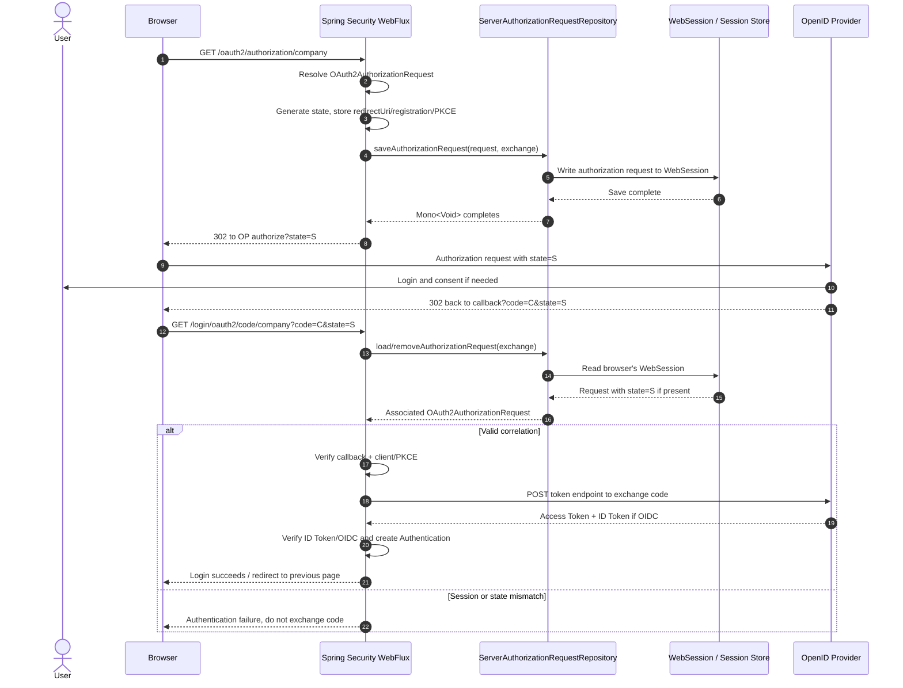

# 20.5. ServerAuthorizationRequestRepository and Storing Correlation in WebSession

In **Spring Security OAuth 2.0 / OIDC Client** running on **Reactive WebFlux**, an OAuth2/OIDC login typically involves two HTTP requests to the application itself, separated by a redirect through the Authorization Server or OpenID Provider (OP):

1. The browser hits the application and initiates login, for example `GET /oauth2/authorization/company`.
2. After the user authenticates at the OP, the browser returns to the callback, for example `GET /login/oauth2/code/company?code=...&state=...`.

These two requests are **not the same HTTP request**. How does Spring Security know which login request a callback belongs to? It must remember the **original `OAuth2AuthorizationRequest`**, locate the matching record using `state`, and verify that the callback genuinely belongs to the transaction initiated earlier. That task is called **correlation**.

On WebFlux, the contract responsible for saving and locating the authorization request is **`ServerAuthorizationRequestRepository<OAuth2AuthorizationRequest>`**. The default implementation is **`WebSessionOAuth2ServerAuthorizationRequestRepository`**, which uses **`WebSession`** to retain the authorization request across HTTP redirects.

> **Core idea:** `state` is sent through the browser to link the two protocol legs; the original authorization request stays on the application side, bound to the browser's `WebSession`. When the callback returns, Spring Security must find both the **right session** and the **right state** before exchanging the authorization code for tokens.

This lesson is part of Chapter **20. Reactive Login**, focusing on OAuth2/OIDC Login in Spring WebFlux, correlation storage, `save/load/remove` ordering, repository configuration, and diagnosing session/cookie/proxy issues. Examples target Spring Boot 3.x / Spring Security 6.x; some customization details may differ across Spring Security versions, so check the corresponding Javadoc when developing in practice.

---

## 1. Why Is Correlation Mandatory?

The OAuth2 Authorization Code Flow starts in the browser, travels to the OP, and returns to the application. From Spring Security's perspective, there are at least two independent HTTP exchanges:

```text
HTTP request A
Browser -> Client:
GET /oauth2/authorization/company

Client -> Browser:
302 Location: https://id.example.test/authorize?...&state=S-123

[Browser goes to OP, user logs in]

HTTP request B
Browser -> Client:
GET /login/oauth2/code/company?code=C-456&state=S-123
```

Looking only at HTTP request B, the application sees a `code` and a `state`. Yet it does not yet know:

- Is this callback from a flow the application just initiated?
- Does `state` match the value originally generated?
- Which `registrationId` was the original authorization request tied to?
- What were the original `redirect_uri` and scopes?
- Is there PKCE `code_verifier` data needed for the token exchange?
- Is there OIDC context such as `nonce` to check in the ID Token?
- Does the callback belong to the original browser/session context?

By saving `OAuth2AuthorizationRequest` and later recovering the exact record, Spring Security maintains the link between the **authorization request** leg and the **authorization response** leg.

### 1.1. What Can Happen Without Correlation?

If a client accepts a callback unrelated to a request it initiated, an attacker may try to inject an authorization response from another transaction into the victim's browser. This creates risks of **login CSRF**, **account/session confusion**, or binding the wrong identity.

A valid authorization code is **not enough** for the client to trust that a callback belongs to the current login session. The client also needs protocol bindings including state/correlation, redirect URI, client registration, and flow-specific PKCE/OIDC checks.

### 1.2. What Is State?

`state` is an unpredictable value generated by the client for an authorization request. It is sent to the authorization endpoint, and the OP returns it in the authorization response.

Illustrative example:

```text
Authorization request:
    response_type=code
    client_id=portal-client
    redirect_uri=https://app.example.test/login/oauth2/code/company
    state=9xG7KpD4w...

Authorization response:
    code=ABCD...
    state=9xG7KpD4w...
```

Spring Security verifies that **the callback's state matches the state of the saved authorization request** within the proper context. `state` must never be treated as an arbitrary browser-supplied key untethered from an existing session or transaction.

**State is not an access token, not a refresh token, and not an OAuth2 authorization code.** It is a transaction-binding parameter, not an API credential.

---

## 2. Full Reactive OAuth2/OIDC Login Diagram



Responsibilities to keep distinct:

- **Authorization request repository** holds information to correlate the two redirect legs.
- **SecurityContext repository** stores user state *after authentication*.
- **Authorized client repository/service** stores issued tokens after authorization succeeds.
- **Request cache** may remember the URL the user tried to visit before being sent to login.

They may share the session as part of persistence, yet **they are neither the same object nor the same responsibility**.

## 3. What Does OAuth2AuthorizationRequest Contain?

`OAuth2AuthorizationRequest` is a model provided by Spring Security in:

```java
import org.springframework.security.oauth2.core.endpoint.OAuth2AuthorizationRequest;
```

An authorization request for the Authorization Code Flow typically contains:

| Field | Meaning |
| --- | --- |
| `authorizationUri` | OP's authorization endpoint URL |
| `authorizationGrantType` | Usually `authorization_code` |
| `responseType` | `code` |
| `clientId` | Client ID at the OP |
| `redirectUri` | Callback URI requested by the client |
| `scopes` | Initial scope set |
| `state` | Correlation value to link the authorization response |
| `additionalParameters` | Extension parameters such as `prompt` or PKCE challenge |
| `attributes` | Internal request metadata used for callback handling, PKCE, and other bindings |

Example of the *logical data model* (not standard JSON serialized to the browser by Spring Security):

```json
{
  "clientRegistrationId": "company",
  "authorizationUri": "https://id.example.test/oauth2/authorize",
  "clientId": "portal-client",
  "responseType": "code",
  "redirectUri": "https://app.example.test/login/oauth2/code/company",
  "scopes": ["openid", "profile", "email"],
  "state": "S-opaque-random",
  "additionalParameters": {
    "code_challenge": "REDACTED",
    "code_challenge_method": "S256"
  },
  "attributes": {
    "registration_context": "company",
    "code_verifier": "REDACTED"
  }
}
```

**Internal attribute names and storage formats depend on the version/flow**; the example above is not a public API schema. Do not directly read or write internal framework keys as a stable contract.

### 3.1. What Belongs to the Browser vs. What Stays on the Server?

```text
Browser/OP may see:
  client_id
  redirect_uri
  scope
  state
  code_challenge
  code_challenge_method

Application must keep secret or retain in context:
  original authorization request
  PKCE code_verifier
  registration/session metadata
  OIDC nonce/correlation data if applied
```

`state` normally appears in the authorize URL and callback URL; therefore, do not treat it as an absolute secret. **Security comes from unpredictability and verification against data saved in the right browser's session.** Even so, avoid logging raw state values or putting them into shared URLs because that can disclose details of ongoing transactions.

## 4. What Contract Is ServerAuthorizationRequestRepository?

On Reactive WebFlux, the interface resides at:

```java
org.springframework.security.oauth2.client.web.server
    .ServerAuthorizationRequestRepository
```

Type declaration:

```java
ServerAuthorizationRequestRepository<OAuth2AuthorizationRequest> repository;
```

Three core methods:

```java
Mono<Void> saveAuthorizationRequest(
    OAuth2AuthorizationRequest authorizationRequest,
    ServerWebExchange exchange);

Mono<OAuth2AuthorizationRequest> loadAuthorizationRequest(
    ServerWebExchange exchange);

Mono<OAuth2AuthorizationRequest> removeAuthorizationRequest(
    ServerWebExchange exchange);
```

### 4.1. saveAuthorizationRequest

`saveAuthorizationRequest` **records the authorization request before redirecting the browser to the OP**. Typically, the repository writes the request into a store accessible again at callback time.

The return type is `Mono<Void>`. In reactive programming, you cannot invoke the method and ignore the publisher:

```java
// Reactive anti-pattern: creates Mono without subscribing/composing.
repository.saveAuthorizationRequest(authRequest, exchange);
// Then immediately redirects without waiting for the result.
```

Correct in principle:

```java
return repository.saveAuthorizationRequest(authRequest, exchange)
    .then(doRedirectToProvider());
```

Here `doRedirectToProvider()` is pseudocode for a `Mono<Void>` producing the HTTP redirect; the framework already sequences save-then-redirect, so applications usually do not write this logic manually.

### 4.2. loadAuthorizationRequest

`loadAuthorizationRequest` receives the callback's `ServerWebExchange` and looks up the matching authorization request.

If the callback lacks `state`, the session is lost, or no matching request exists, the implementation may return **`Mono.empty()`**. In Reactor, never use `null` to represent "no result."

### 4.3. removeAuthorizationRequest

`removeAuthorizationRequest` locates the matching request and **removes it from the store**, returning the retrieved request (if any).

This step is vital for **limiting replay/re-reading of correlation state**. Once the callback is processed, the authorization request should not linger forever as a pending transaction.

```text
Initial login:
  save(state=S, request=R)

Callback with state=S:
  load/remove(state=S) -> R
  store no longer holds pending request S

Repeated callback with state=S:
  R no longer exists -> authentication failure
```

**Authorization codes are also single-use at the OP**, yet removing the authorization request on the client remains a necessary layer of defense.

### 4.4. Javadoc Note About HttpServletRequest

In some Javadoc pages, method descriptions on this interface may still mention `HttpServletRequest` because documentation is shared from the Servlet contract. **The actual WebFlux API signatures take `ServerWebExchange` and return `Mono`**, not `HttpServletRequest` / `HttpServletResponse`.

## 5. Default WebSessionOAuth2ServerAuthorizationRequestRepository

Spring Security provides:

```java
import org.springframework.security.oauth2.client.web.server
    .WebSessionOAuth2ServerAuthorizationRequestRepository;
```

This class implements:

```java
ServerAuthorizationRequestRepository<OAuth2AuthorizationRequest>
```

and **stores the authorization request in `WebSession`**. When login begins, Spring Security saves the request; when the browser returns to the callback with the right session and state, the repo locates and retrieves the matching request.

### 5.1. WebSession Is Not a Cookie Containing the Entire OAuth2AuthorizationRequest

`WebSession` is Spring WebFlux's session abstraction. In typical deployments, the browser holds only a **session identifier cookie**, while the session contents live in memory or a store like Redis.

```text
Browser:
  Cookie: SESSION=<session-id>

Server/WebSession store:
  session-id -> attributes
                 +-- pending OAuth2AuthorizationRequest(s)
                 +-- other session data
```

Do not assume that because the browser holds a `SESSION` cookie it carries the raw `code_verifier` or full authorization request inside the cookie. The cookie is normally an **access identifier for the session**, while the data must be protected on the server/store side.

**A Session ID is a security-sensitive credential.** If an attacker steals the session cookie, session hijacking becomes possible—hence the need for HTTPS, proper cookie attributes, and sound session management.

### 5.2. WebSession Comes from ServerWebExchange

In WebFlux:

```java
Mono<WebSession> sessionMono = exchange.getSession();
```

`getSession()` itself is a reactive API. When using the default repository, you do not need to write `exchange.getSession().flatMap(...)` yourself in an OAuth2 callback controller.

### 5.3. Why Does the Default Repo Fit Most Applications?

It handles error-prone responsibilities cleanly:

- Finding the right `WebSession` via `ServerWebExchange`.
- Saving the authorization request before redirect.
- Binding lookup/removal to the callback `state`.
- Returning Reactor-compliant publishers.
- Separating correlation storage from token validation logic.

**A standard WebFlux OAuth2 Login application does not need to re-implement a repository just to use `WebSession`.** Replace it only when you have specific needs around storage, multi-tab support, TTL, observability, or session architecture.

## 6. Distinguishing WebSession and SecurityContext

A user may **not be logged in yet**, yet already have a `WebSession` holding a pending authorization request:

```text
Before callback:
  WebSession already holds pending OAuth2AuthorizationRequest
  SecurityContext does not yet hold OAuth2 login Authentication

After valid callback:
  Spring Security creates Authentication
  ReactiveSecurityContextHolder/SecurityContext repository manages it
  Authorized client may be stored separately
  Pending authorization request is removed
```

Therefore:

- The **authorization request repository** is not a long-term store for login status.
- **`WebSessionServerSecurityContextRepository`** may persist `Authentication`/`SecurityContext` after login.
- **`ServerOAuth2AuthorizedClientRepository`** stores `OAuth2AuthorizedClient`, containing the access token and potentially a refresh token.
- **`ServerRequestCache`** may record the URL the user wanted to visit after login.

Everything may share the same `WebSession` or backing store, yet **they do not replace one another**.

### 6.1. Do Not Read Access Tokens from the Authorization Request Repository

At the moment `saveAuthorizationRequest` runs, the application **has not yet exchanged the authorization code for an access token**; the authorization request normally contains no access token. Never read this repository expecting to find a refresh token or ID Token.

### 6.2. Do Not Confuse state with SecurityContext

`state` only links the two legs of the Authorization Code Flow. It is **not proof that the user authenticated successfully**, and must never be used to grant `ROLE_ADMIN` or select an internal account.

## 7. Related WebFlux Filters and Processing Components

Key components:

| Component | Responsibility |
| --- | --- |
| **`OAuth2AuthorizationRequestRedirectWebFilter`** | Receives OAuth2 authorization initiation requests, builds and saves the authorization request, redirects browser |
| **`ServerOAuth2AuthorizationRequestResolver`** | Builds `OAuth2AuthorizationRequest` matching the registration/endpoint |
| **`ServerAuthorizationRequestRepository`** | Saves and retrieves correlation across redirects |
| **`WebSessionOAuth2ServerAuthorizationRequestRepository`** | Default repository backed by `WebSession` |
| **`ServerOAuth2AuthorizationCodeAuthenticationTokenConverter`** | Converts WebFlux callback into an authentication token for the code flow, using the repository |
| **`AuthenticationWebFilter` / OAuth2 login flow** | Coordinates authentication when a valid callback arrives |
| **`ReactiveClientRegistrationRepository`** | Supplies registration metadata |
| **`ReactiveOAuth2AccessTokenResponseClient`** | Exchanges the authorization code for tokens at the token endpoint |
| **`ReactiveOAuth2AuthorizedClientService`** | Persists authorized clients by registration/principal outside request sessions when appropriate |

### 7.1. Authorization Initiation Path

Under standard configuration, the endpoint:

```text
GET /oauth2/authorization/{registrationId}
```

is handled by the OAuth2 authorization redirect mechanism. The resolver uses the registration to build the authorize URL, generating `state` and related parameters. The repository saves the original request before the browser leaves the application.

### 7.2. Callback Path

By default:

```text
GET /login/oauth2/code/{registrationId}?code=...&state=...
```

Spring Security uses the callback data and repository to locate the corresponding authorization request, then proceeds with authentication and token exchange.

**Do not write your own controller on the callback path**, as that request belongs to WebFlux Security filters unless you intentionally replace the entire flow with full understanding.

### 7.3. Do Not Use Servlet Classes in a Reactive Flow

Avoid mixing these classes:

| Servlet | Reactive WebFlux |
| --- | --- |
| `HttpSessionOAuth2AuthorizationRequestRepository` | `WebSessionOAuth2ServerAuthorizationRequestRepository` |
| `AuthorizationRequestRepository` | `ServerAuthorizationRequestRepository` |
| `HttpSecurity` | `ServerHttpSecurity` |
| `SecurityFilterChain` | `SecurityWebFilterChain` |
| `HttpServletRequest` | `ServerWebExchange` |
| `ClientRegistrationRepository` | `ReactiveClientRegistrationRepository` |

The names look very similar, yet their signatures and persistence models differ.

## 8. Configuring Spring Boot WebFlux OAuth2/OIDC Login

### 8.1. Maven Dependencies

A pure WebFlux application can use:

```xml
<dependencies>
    <dependency>
        <groupId>org.springframework.boot</groupId>
        <artifactId>spring-boot-starter-webflux</artifactId>
    </dependency>
    <dependency>
        <groupId>org.springframework.boot</groupId>
        <artifactId>spring-boot-starter-security</artifactId>
    </dependency>
    <dependency>
        <groupId>org.springframework.boot</groupId>
        <artifactId>spring-boot-starter-oauth2-client</artifactId>
    </dependency>
</dependencies>
```

This is a **WebFlux application**; do not add `spring-boot-starter-web` just for login. When both starters are present, Spring Boot normally selects an MVC server unless configured otherwise; this lesson assumes requests pass through the **Reactive WebFilter chain**.

### 8.2. application.yml

```yaml
spring:
  security:
    oauth2:
      client:
        registration:
          company:
            provider: company
            client-id: ${OIDC_CLIENT_ID}
            client-secret: ${OIDC_CLIENT_SECRET}
            authorization-grant-type: authorization_code
            redirect-uri: "{baseUrl}/login/oauth2/code/{registrationId}"
            scope:
              - openid
              - profile
              - email

        provider:
          company:
            issuer-uri: https://id.example.test/realms/company
```

This configuration illustrates an OP supporting OIDC Discovery. `issuer-uri` must match the OP's official issuer per contract; never switch it to an arbitrary host.

### 8.3. Default SecurityWebFilterChain

```java
import org.springframework.context.annotation.Bean;
import org.springframework.context.annotation.Configuration;
import org.springframework.security.config.Customizer;
import org.springframework.security.config.annotation.web.reactive.EnableWebFluxSecurity;
import org.springframework.security.config.web.server.ServerHttpSecurity;
import org.springframework.security.web.server.SecurityWebFilterChain;

@Configuration
@EnableWebFluxSecurity
class ReactiveSecurityConfig {

    @Bean
    SecurityWebFilterChain securityWebFilterChain(ServerHttpSecurity http) {
        return http
            .authorizeExchange(exchanges -> exchanges
                .pathMatchers("/", "/error", "/public/**").permitAll()
                .anyExchange().authenticated())
            .oauth2Login(Customizer.withDefaults())
            .build();
    }
}
```

With this setup, Spring Security automatically uses the default repository for OIDC Login correlation. **You do not need to declare a `WebSession` OAuth2 repo bean** unless you want explicit configuration or a custom implementation.

### 8.4. Login and Callback

```text
GET /oauth2/authorization/company

=> 302 to OP
=> OP handles login/consent
=> redirect to /login/oauth2/code/company?code=...&state=...
=> Spring Security looks up saved request in WebSession
=> token exchange + OIDC validation
=> Authentication
```

With the Authorization Code Flow, the cookie/session must exist and be sent back by the browser at callback time. If the session is lost between the two legs, correlation cannot succeed.

## 9. Explicitly Registering the Repository in OAuth2 Login

You can define the bean and wire it into the DSL:

```java
import org.springframework.context.annotation.Bean;
import org.springframework.context.annotation.Configuration;
import org.springframework.security.config.annotation.web.reactive.EnableWebFluxSecurity;
import org.springframework.security.config.web.server.ServerHttpSecurity;
import org.springframework.security.oauth2.client.web.server.ServerAuthorizationRequestRepository;
import org.springframework.security.oauth2.client.web.server.WebSessionOAuth2ServerAuthorizationRequestRepository;
import org.springframework.security.oauth2.core.endpoint.OAuth2AuthorizationRequest;
import org.springframework.security.web.server.SecurityWebFilterChain;

@Configuration
@EnableWebFluxSecurity
class OAuth2CorrelationConfiguration {

    @Bean
    ServerAuthorizationRequestRepository<OAuth2AuthorizationRequest>
            authorizationRequestRepository() {

        return new WebSessionOAuth2ServerAuthorizationRequestRepository();
    }

    @Bean
    SecurityWebFilterChain securityWebFilterChain(
            ServerHttpSecurity http,
            ServerAuthorizationRequestRepository<OAuth2AuthorizationRequest>
                    authorizationRequestRepository) {

        return http
            .authorizeExchange(exchanges -> exchanges
                .pathMatchers("/", "/error").permitAll()
                .anyExchange().authenticated())
            .oauth2Login(login -> login
                .authorizationRequestRepository(authorizationRequestRepository))
            .build();
    }
}
```

This is largely equivalent to default behavior, while highlighting the exact extension point.

**Note:** simply adding a repository `@Bean` may not automatically replace the repository chosen by the DSL across all versions/configurations. When plugging in a custom implementation, **register it explicitly with `.oauth2Login(login -> login.authorizationRequestRepository(repo))`** to avoid inconsistencies.

### 9.1. When an App Uses Both oauth2Login and oauth2Client

An application may use OAuth2 Login **and** a separate OAuth2 Client Authorization Code Flow to connect to another API. Both paths should agree on where authorization requests are stored.

Example:

```java
return http
    .authorizeExchange(exchanges -> exchanges
        .anyExchange().authenticated())
    .oauth2Login(login -> login
        .authorizationRequestRepository(authorizationRequestRepository))
    .oauth2Client(client -> client
        .authorizationRequestRepository(authorizationRequestRepository))
    .build();
```

This is a **deliberate sharing of the same repository** across two extension points. With custom storage, ensure state handling supports both the login flow and the client authorization flow; never store everything under one single key where one flow overwrites the other.

Not every application needs `oauth2Client()` enabled explicitly; this example just clarifies responsibilities when both flows exist.

## 10. How WebSession Links Two Separate Requests

A critical point: at callback time, the server must recognize this as the **`WebSession` of the browser that started the flow**.

### 10.1. Session Cookie Identifying the Browser

A flow can proceed like this:

```text
1. Browser -> App:
   GET /oauth2/authorization/company

2. App -> Browser:
   HTTP/1.1 302 Found
   Set-Cookie: SESSION=<opaque-session-id>; Path=/; Secure; HttpOnly; SameSite=Lax
   Location: https://id.example.test/authorize?...&state=S

3. Browser -> OP:
   GET /authorize?...&state=S

4. OP -> Browser:
   HTTP/1.1 302 Found
   Location: https://app.example.test/login/oauth2/code/company?code=C&state=S

5. Browser -> App:
   GET /login/oauth2/code/company?code=C&state=S
   Cookie: SESSION=<same-opaque-session-id>

6. App:
   WebSession(session-id) -> authorization request state=S
   Correlation succeeds
```

The cookie attributes are **deployment illustrations**, not mandatory identical names/values for every app. Cookie name, `Path`, `SameSite`, `Secure`, and session storage depend on configuration.

### 10.2. Why Must the Session Cookie Be Sent Back?

The authorization request was saved in session **X**. If the callback arrives with a different cookie or no cookie:

```text
Authorization start:
  WebSession X -> state=S

Callback:
  WebSession Y -> no state=S
```

the server cannot correlate the callback with the original request. The typical outcome is an authentication error such as `authorization_request_not_found` or an equivalent state/correlation error, depending on the handler and version.

**Never "fix" this by dropping state checks or searching for the request across all sessions.** Resolve the root cause in session, cookie, or proxy configuration.

### 10.3. The Session Exists Before the User Logs In

Some mistakenly assume `Authentication` must exist before a session is created. In reality, `WebSession` can be created **before login completes** simply to store the authorization request for the callback.

Consequently, a user opening a fresh browser may receive a `SESSION` cookie prior to completing OAuth2 login.

## 11. SameSite and the OAuth2 Callback

The cookie's `SameSite` attribute controls whether the browser sends the session cookie when returning from the OP.

| SameSite | Relevant Behavior | Note for Login |
| --- | --- | --- |
| **Lax** | Usually sends cookie on cross-site top-level navigations using safe methods like GET | Fits GET redirect callbacks in many flows |
| **Strict** | Stricter when navigating from external sites | May prevent cross-site callbacks from sending the session cookie |
| **None** | Permits sending cookie in cross-site contexts | Modern browsers generally require `Secure`; assess CSRF and extra protections |

**Never set `SameSite=None` solely because login fails without investigating the cause.** First check whether the callback is GET or POST, whether cookies are actually sent, domain, path, reverse proxy, and HTTPS.

### 11.1. response_mode=form_post

Some OPs return the authorization response via a **cross-site POST** rather than a GET redirect. Under `SameSite=Lax`, cookies may be withheld on cross-site POSTs, losing `WebSession` and correlation.

If the app requires `form_post` for an OP, configure cookies and callback handling to fit the security model—evaluating `SameSite=None; Secure`, CSRF, and browser constraints. Do not assume default endpoints in every Spring Security version accept every response mode out of the box.

### 11.2. Cookie Secure, HttpOnly, and Path

- **Secure:** sends cookies only over HTTPS; production should use HTTPS from the browser to the public origin.
- **HttpOnly:** reduces the ability of JavaScript to read the session ID.
- **Path:** must cover both the login initiation endpoint and the callback; if `Path` is too narrow, the callback will not receive the cookie.
- **Domain:** must match the origin the browser actually visits; never set a domain broader than necessary.
- **Max-Age/expiry:** avoid letting the session expire between the two login legs.

**`HttpOnly` does not prevent all CSRF**; cookie security is one layer, and state/correlation must still be validated properly.

## 12. Session Timeout and Correlation Timeout

Spring Boot 3.x supports WebFlux session properties. Example:

```yaml
server:
  reactive:
    session:
      timeout: 30m
      cookie:
        secure: true
        http-only: true
        same-site: lax
```

This illustrates a configuration for an HTTPS environment. **Check whether the app uses the default session store or Spring Session**: with Spring Session, timeout may be governed by `spring.session.timeout` via auto-configuration.

### 12.1. Session Timeout Is Not Access Token Lifetime

```text
WebSession timeout:       e.g., 30 minutes
Authorization code TTL:   determined by OP, usually short
Access token TTL:         determined by Authorization Server
Refresh token lifetime:   determined by OP and client policy
```

These durations are **independent**. Losing correlation due to a `WebSession` timeout does not mean an access token expired; at callback time, an access token may not even have been issued yet.

### 12.2. If the User Lingers Too Long on the OP Page

The user opens the OP login page, leaves it idle past the session timeout, and then authenticates. When returning, `WebSession` has expired or been evicted, and the client cannot find the original authorization request.

The proper handling is informing the user that the login session expired and **starting a fresh flow**, rather than accepting stale callbacks by relaxing state validation.

### 12.3. Do Not Store Pending Authorization Requests Indefinitely

If implementing a custom repository with Redis or a database, enforce **appropriate TTLs, single-use semantics, cleanup, and limits on pending requests**. An unbounded state store can be abused to cause memory or storage exhaustion.

## 13. Multi-Tab and Parallel Authorization Requests

A single browser can initiate two login flows in two tabs almost simultaneously:

```text
Tab A: /oauth2/authorization/company
  state = S-A

Tab B: /oauth2/authorization/partner
  state = S-B

Callback B arrives first: ?code=...&state=S-B
Callback A arrives later: ?code=...&state=S-A
```

This is an important case because both tabs may share the **same cookie/session**.

### 13.1. The Repository Should Key Requests by State

A design storing multiple pending requests can use a logical structure like:

```text
WebSession X:
  pendingAuthorizationRequests:
    S-A -> OAuth2AuthorizationRequest(company)
    S-B -> OAuth2AuthorizationRequest(partner)
```

When callback B returns, the repository must retrieve **S-B** without confusing it with A. Once handled, remove only S-B; callback A can still succeed if still valid.

### 13.2. How Does the Default Repo Handle Multiple Requests?

Exact details (such as pending request caps and state mapping) **can vary across Spring Security versions**. Older versions had options for multiple requests, while some configuration APIs were deprecated or removed.

**Never assume `WebSessionOAuth2ServerAuthorizationRequestRepository` behaves identically for all multi-tab scenarios across every version.** If your application requires parallel authorization flows, verify your exact version and design an appropriate storage/correlation policy; do not replace the repo with a single-slot store if the product needs concurrent flows.

### 13.3. Risk of a Single-Key Custom Repo

A naive implementation:

```text
session.setAttribute("AUTH_REQUEST", authorizationRequest)
```

lets request B overwrite request A even though the two flows have distinct states. When callback A returns, only B remains → state mismatch.

A custom repo must explicitly define:
- Does it support multiple pending requests?
- Is it keyed by state or by `(session, state)`?
- What are the TTL and max pending request limits?
- Does `remove` delete only the matching entry?
- Can concurrent requests on one session suffer lost updates?
- Does session serialization via Redis preserve updates accurately?

**Never use those questions as an excuse to skip correlation**; they are the specification your repository must fulfill.

## 14. Configuring Safe Logging for the Repository

When diagnosing a login issue, you often want to know which request was "stored," "found," or "consumed." However, sensitive information must stay out of logs.

One solution is a **decorator** wrapping the default repository that logs only sanitized events:

```java
import org.slf4j.Logger;
import org.slf4j.LoggerFactory;
import org.springframework.security.oauth2.client.web.server
    .ServerAuthorizationRequestRepository;
import org.springframework.security.oauth2.client.web.server
    .WebSessionOAuth2ServerAuthorizationRequestRepository;
import org.springframework.security.oauth2.core.endpoint.OAuth2AuthorizationRequest;
import org.springframework.web.server.ServerWebExchange;
import reactor.core.publisher.Mono;

public final class ObservedAuthorizationRequestRepository
        implements ServerAuthorizationRequestRepository<OAuth2AuthorizationRequest> {

    private static final Logger log =
        LoggerFactory.getLogger(ObservedAuthorizationRequestRepository.class);

    private final ServerAuthorizationRequestRepository<OAuth2AuthorizationRequest>
        delegate = new WebSessionOAuth2ServerAuthorizationRequestRepository();

    @Override
    public Mono<Void> saveAuthorizationRequest(
            OAuth2AuthorizationRequest request,
            ServerWebExchange exchange) {

        return delegate.saveAuthorizationRequest(request, exchange)
            .doOnSuccess(ignored ->
                log.debug("OAuth2 correlation event=stored"));
    }

    @Override
    public Mono<OAuth2AuthorizationRequest> loadAuthorizationRequest(
            ServerWebExchange exchange) {

        return delegate.loadAuthorizationRequest(exchange)
            .doOnNext(ignored ->
                log.debug("OAuth2 correlation event=found"));
    }

    @Override
    public Mono<OAuth2AuthorizationRequest> removeAuthorizationRequest(
            ServerWebExchange exchange) {

        return delegate.removeAuthorizationRequest(exchange)
            .doOnNext(ignored ->
                log.debug("OAuth2 correlation event=consumed"));
    }
}
```

In real Java source files, `import` lines must keep package/class names unbroken:

```java
import org.springframework.security.oauth2.client.web.server.ServerAuthorizationRequestRepository;
import org.springframework.security.oauth2.client.web.server.WebSessionOAuth2ServerAuthorizationRequestRepository;
```

**This decorator only adds observability without altering correlation logic.** Never log `request.getState()`, `code_verifier`, raw authorization URLs, cookies, or tokens.

### 14.1. Registering the Decorator

```java
@Bean
ServerAuthorizationRequestRepository<OAuth2AuthorizationRequest>
        authorizationRequestRepository() {
    return new ObservedAuthorizationRequestRepository();
}
```

Then attach the bean via `oauth2Login(login -> login.authorizationRequestRepository(...))` as shown in Section 9. For `oauth2Client()` as well, consider configuring the same bean if observability is needed on both flows.

### 14.2. Why Must the Decorator Preserve the Mono?

Never call `.block()` inside the repository; never call `subscribe()` inside the method. **Return the publisher** from the delegate so the framework controls subscription timing and guarantees save/load/remove ordering in the reactive pipeline.

## 15. When Should You Write a Custom ServerAuthorizationRequestRepository?

A custom implementation makes sense when there is a clear requirement:

| Requirement | Reason to Consider Customizing |
| --- | --- |
| Distributed shared session | Ensure correlation survives when the callback lands on a different node |
| Cap on pending requests | Prevent storing too many authorization flows in a single session |
| Multi-tab / custom UX | Need state-keyed mapping and concurrency policy |
| Custom TTL | Need expiry shorter than or separate from session timeout |
| Audit / observability | Need step metrics without logging secrets |
| Special sessionless / BFF architecture | Need a different secure correlation store while still binding browser context |
| Multi-tenant / provider policy | Prevent one context from reading another tenant's/provider's authorization request |

**However:** if you simply want to enable OIDC login on WebFlux, the default repository is usually the right starting point. Re-implementing state validation, PKCE, or cookie/session binding yourself can introduce new vulnerabilities.

### 15.1. Custom Repository Contract

A secure implementation must satisfy:

1. `save` accepts only requests with a valid `state` and persists them server-side in a trusted context.
2. `load` uses the **callback's `state`** and browser/session context to locate the matching entry.
3. `remove` deletes **only the matching entry** once matched; never delete another tab's state.
4. When no entry exists: return `Mono.empty()`.
5. TTL, size limits, and cleanup are explicitly designed.
6. Never serialize secrets or correlation internals to the frontend.
7. Never let user input pick someone else's tenant, principal, or session.
8. With distributed stores, handle concurrency and atomicity.
9. Token exchange must use the authorization request belonging to the right registration.
10. Never block the event-loop with blocking database/Redis clients.

### 15.2. Logical Storage Layout by (session, state)

```text
Key:
  sessionId + ":" + state

Value:
  OAuth2AuthorizationRequest (serialized server-side)

Metadata:
  issuedAt
  expiry
  registrationId
  oneTimeUse
```

This is a **pseudomodel**, not a recommendation to print raw session IDs/states in logs or store unencrypted data. Keys should be managed safely with TTLs and access controls; distributed session stores also require concurrency analysis.

### 15.3. Why Not Store Globally by State Alone and Accept Any Request?

If you only use:

```text
correlationStore[state] -> OAuth2AuthorizationRequest
```

and let any browser presenting `state` fetch the entry, you lose **binding to the original browser/session**, especially against login CSRF and account mix-up attacks. An unpredictable state is vital, yet any custom design must analyze the entire threat model—including session binding, expiry, nonce, PKCE, replay, and client mix-up.

**Avoid replacing the `WebSession` repo with a pure stateless cookie just to "avoid Redis"** unless you have proper confidentiality, integrity, expiry, session binding, and anti-replay protections.

## 16. Spring Session and Multi-Instance Deployments

In production, multiple instances may run behind a load balancer:

```text
Browser
  |
  v
Load Balancer
  |
  +--> App Node A
  |
  +--> App Node B
```

A flow:

```text
1. GET /oauth2/authorization/company -> Node A
2. Node A stores authorization request in local WebSession
3. Browser redirects to OP
4. Callback /login/oauth2/code/company -> Node B
5. Node B cannot find session/request saved on A
6. Correlation fails
```

### 16.1. Solutions

- **Shared session store**, such as Spring Session + Redis, so all nodes read the same session.
- **Sticky sessions** can mitigate short-term mismatches but do not fully solve node restarts or failover.
- Never try to synchronize state via query parameters to the backend while dropping session binding.
- Ensure all nodes share consistent security configuration, serialization, encryption, and client registrations.
- Verify session cookies pass through Load Balancers/Ingress with the right domain/path.

In a Spring Boot reactive app, Spring Session integrates with Redis through the corresponding starter. Choose versions and configs matching your Spring Boot/Spring Security versions.

### 16.2. Distributed Sessions Do Not Automatically Persist Every Mutation

A custom repository might read a `Map` from the session and mutate it in place:

```java
// Error-prone idea on some session stores:
Map<String, Object> map = session.getAttribute("pending");
map.put(state, request);
```

If the store tracks only `setAttribute` calls or specific change-detection hooks, in-place mutations may not be persisted as expected. When using Redis/session stores, understand the implementation's update contract and **re-save modified attributes in the supported way**.

Beyond persistence, concurrent writes from two tabs/nodes can cause lost updates if both read/modify a `Map` and overwrite each other.

### 16.3. Sessions Should Not Hold Unbounded Pending Requests

Every time a user starts OAuth2 Login, a new authorization request can be created. If an attacker can start thousands of flows without limits, memory or store usage can grow unchecked. Depending on version and custom store, bound pending counts, TTLs, and payload sizes; never dump all callback headers/parameters into the session arbitrarily.

## 17. Redirect URI, Reverse Proxies, and Forwarded Headers

Even when session and state are intact, OAuth2 Login can still fail because **the redirect URI does not match what is registered at the OP**.

For example, an app behind a reverse proxy:

```text
Public URL:  https://app.example.test
Internal:    http://app-service:8080
```

Spring Security must compute the redirect URI using the true **public origin**:

```text
https://app.example.test/login/oauth2/code/company
```

not:

```text
http://app-service:8080/login/oauth2/code/company
```

In Spring Boot, when needed and behind a trusted proxy, you can configure forwarded headers per deployment model:

```yaml
server:
  forward-headers-strategy: framework
```

However, forwarded headers must be **controlled by a trusted proxy**, never raw `X-Forwarded-Host` headers from external clients building arbitrary redirect URIs.

### 17.1. Redirect Mismatch Is Not State Mismatch

| Symptom | Where Observed | What to Check |
| --- | --- | --- |
| OP reports `redirect_uri_mismatch` | Authorization endpoint/token endpoint | Client registration, public origin, forwarded headers |
| Callback reaches app without session cookie | Browser/app | Cookie, `SameSite`, domain, HTTPS, proxy |
| Session exists but no request matches state | Spring Security repo | Storage, multi-tab, callback state, TTL |
| State matches but token endpoint reports `invalid_grant` | OP token endpoint | Code reuse/expiry, PKCE, redirect URI, client auth |
| ID Token nonce invalid | OIDC validation | Nonce, token/provider, request linkage |

Never "fix" a redirect error by removing state validation; the two issues sit at different boundaries.

## 18. PKCE: An Additional Binding Beyond State

With Authorization Code + PKCE, the app generates:

- **`code_verifier`**: unpredictable value kept strictly by the client;
- **`code_challenge`**: derived from the verifier and sent to the authorization endpoint;
- **`code_challenge_method`**: typically `S256`.

Authorization request logic:

```text
code_verifier = random verifier kept client-side/server-side
code_challenge = BASE64URL(SHA256(code_verifier))
send to OP:
    code_challenge=...
    code_challenge_method=S256
```

At callback time, the client must send the **exact `code_verifier` tied to the original authorization request** in the token request. If the saved authorization request is lost, the client cannot recover the verifier to exchange the code.

### 18.1. State and PKCE Solve Different Problems

| Mechanism | Role |
| --- | --- |
| `state` | Links the authorization response to the original request, mitigating certain CSRF/mix-up attacks |
| PKCE `code_verifier` | Proves the party exchanging the code is the party that initiated the authorization request with the matching challenge |
| OIDC `nonce` | Binds the ID Token to the authentication request when used |
| Session cookie | Helps the client locate the saved correlation data for that browser |

**Never casually replace `state` with PKCE**: OAuth2/OIDC policies and the framework enforce distinct requirements; the implementation must follow the configured flow.

### 18.2. Never Put the Verifier in the Callback Query

`code_verifier` must stay in the proper server/client context to be sent to the token endpoint. Never embed it in `redirect_uri` or let the browser echo it back as an arbitrary query parameter.

## 19. OIDC Nonce and Subject Validation

When the `openid` scope is used, the flow produces an **ID Token**. OIDC adds constraints on issuer, audience, signature, expiry, and optionally **`nonce`**.

- `state` links the authorization response to the authorization request.
- `nonce` (when used) links the ID Token to the authentication request.
- `sub` identifies the user's subject under the issuer.
- When a UserInfo Response is present, UserInfo's `sub` must match the ID Token's `sub`.

**Never treat a state match as proof that the ID Token is valid.** After correlation, Spring Security must still verify the token and OIDC claims through the validation pipeline.

### 19.1. Multiple Logins Can Occur in the Same Session

A user might start login with provider A and then provider B. If a custom repository stores nonce/verifier under one global key, data from the two flows can easily collide.

For OIDC transactions, the nonce and accompanying metadata must stay tied to the exact authorization request and client registration.

## 20. Inspecting WebSession Safely Without Leaking State

In development, you can add an endpoint that returns only session-status metadata (without reading internal Spring Security keys directly):

```java
import java.util.Map;

import org.springframework.web.bind.annotation.GetMapping;
import org.springframework.web.bind.annotation.RestController;
import org.springframework.web.server.ServerWebExchange;
import reactor.core.publisher.Mono;

@RestController
class SessionDiagnosticController {

    @GetMapping("/internal/session/status")
    Mono<Map<String, Object>> sessionStatus(ServerWebExchange exchange) {
        return exchange.getSession()
            .map(session -> Map.of(
                "sessionStarted", session.isStarted(),
                "sessionExpired", session.isExpired(),
                "maxIdleTime", session.getMaxIdleTime().toString()
            ));
    }
}
```

This endpoint **must only be accessible in controlled diagnostic environments**, never exposed publicly to all users. Calling `getSession()` participates in session lifecycle; never use such an endpoint as a login-validity check for business logic.

### 20.1. Never Log Session IDs

Wrong:

```java
// DO NOT:
log.info("Session id = {}", session.getId());
log.info("OAuth state = {}", authorizationRequest.getState());
log.info("Verifier = {}", authorizationRequest.getAttributes());
```

Use sanitized metadata instead, such as events `correlation_stored`, `correlation_missing`, `correlation_consumed`, allowlisted provider registration IDs, and internal trace IDs.

### 20.2. Avoid Logging Full Callback URLs

```text
/login/oauth2/code/company?code=SECRET_CODE&state=S
```

An OAuth2 authorization code is a short-lived credential and `state` is correlation data. Reverse proxy/access logs, exception stack traces, or analytics may capture query strings. Redact `code`, `state`, and sensitive fields.

## 21. Configuring Timeouts and Session Cookies by Environment

An application may run across three environments:

| Environment | Public URL | Session Strategy Considerations |
| --- | --- | --- |
| Local | `http://localhost:8080` | Cookies suitable for local HTTP; avoid mandatory `Secure` if not using HTTPS |
| Staging | `https://staging.example.test` | HTTPS, accurate cookie path/domain, store supporting multiple instances |
| Production | `https://app.example.test` | Mandatory HTTPS, trusted session store, `Secure`/`HttpOnly` cookies, TTL/audit |

### 21.1. Localhost and Secure Cookies

If cookies are configured with `secure: true` while accessing the app over plain HTTP, browsers/configs may not send cookies back as expected. Emulate HTTPS locally or use an appropriate dev profile—never weaken production security to accommodate local dev.

### 21.2. Staging on a Different Domain from the OP Is Normal

The application and the OP usually live on different origins. On the authorization redirect GET, the **application's** session cookie must be returned by the browser to the **application's** callback. It never needs to be sent to the OP's domain.

It is a mistake to widen the cookie's `Domain` so both the OP and the application can read the session. **The OP should never receive the application's session cookie.**

## 22. Common Errors and How to Diagnose Them

| Symptom | Possible Cause | How to Address |
| --- | --- | --- |
| Callback fails with `authorization_request_not_found` | `WebSession` lost or repo cannot find entry by state | Check cookie/session timeout, store, callback state, repo config |
| Callback arrives without `SESSION` cookie | `SameSite`, `Path`, `Secure`, `Domain`, or browser privacy policy | Inspect browser network requests and `Set-Cookie`, without logging cookie values |
| Flow starts on node A, callback fails on node B | In-memory sessions are not shared | Use Spring Session/Redis or appropriate session routing |
| Fails only when opening two login tabs | Repo/custom store overwrites old state or concurrent update | Check multi-request support and state-keyed storage |
| No `state` on callback | OP failed to return it or callback altered | Reject callback; check provider/response mode |
| Callback state differs from saved request | Mixed flows, session issue, tampering, or stale URL | Never normalize state; start fresh flow and investigate |
| Redirect succeeds but token endpoint returns `invalid_grant` | Code reused/expired, wrong PKCE/redirect URI/client auth | Do not blame session if correlation already matched |
| OP reports invalid redirect URI | Proxy base URL wrong or URI unregistered | Align public URI, forwarded headers, client registration |
| OIDC nonce mismatch | ID Token does not belong to authentication request | Keep nonce tied to request; inspect OP/token |
| UserInfo sub mismatch | UserInfo subject differs from ID Token subject | Reject mismatched UserInfo; investigate OP/token |
| Login succeeds but app loses `Authentication` | SecurityContext/session repository misconfigured | Separate post-login persistence from correlation repo |
| Works in-memory but fails on Redis | Spring Session persistence/serialization broken | Use compatible store and confirm session attrs persist |
| User logs in, refreshes page, loops back to OP | Session cookie not retained or `Authentication` not saved | Check cookies, session security context, and proxy |
| Fails only with `form_post` | `SameSite=Lax` withholds cookie on cross-site POST or callback unsupported | Review response mode, cookie settings, and handler |
| No `WebSession` in handler | Mixing Servlet API or unsubscribed publisher | Use `ServerWebExchange`/`Mono` |
| `SecurityFilterChain` never starts flow | Used `HttpSecurity` in WebFlux or mismatched paths | Use `ServerHttpSecurity`/`SecurityWebFilterChain` |
| Custom repo saves fine but callback sees nothing | Two repo instances use different stores/keys or DSL mismatch | Wire the same repo into `oauth2Login`/`oauth2Client` |
| Replayed callback still accepts state | Custom repo lacks `remove`/TTL | Enforce one-time removal and replay resistance |
| Too many pending flows bloat session | No limit/TTL in custom repo | Cap pending entries, enforce expiry and cleanup |
| Session cookie lost behind reverse proxy | Wrong `Secure`/`Domain`/`Path` or forwarded headers | Check public origin and proxy config |

## 23. Analytical Scenarios

### Scenario A — Valid State but Missing Cookie

Initial request stored:

```text
WebSession X:
  state=S1
```

Callback:

```text
GET /login/oauth2/code/company?code=C1&state=S1
(no SESSION cookie)
```

**Question:** Is comparing `S1` from the query sufficient?

> **No.** The callback is no longer bound to `WebSession` X; the server cannot locate the original record inside the browser's session. Never accept a state by looking it up in a global store lacking session binding. Fix cookies/sessions and start a new authorization flow.

### Scenario B — Callback Without State

```text
GET /login/oauth2/code/company?code=C1
```

**Question:** Can we just grab the latest authorization request in the session?

> **No.** If the callback lacks the required correlation token, the client has no sufficient basis to confirm which transaction it belongs to. Reject it and inspect the OP/response mode.

### Scenario C — Two Tabs Sharing a Session

```text
Tab A: state=A1
Tab B: state=B1
Tab B finishes first
Tab A finishes later
```

**Question:** Is a custom repo storing only `session["AUTH_REQ"] = currentRequest` safe?

> Not if the app needs concurrent login flows. Request B can overwrite A. Use state-keyed storage or explicit multi-flow rules with TTLs and atomicity.

### Scenario D — In-Memory Session Behind a Load Balancer

Authorization initiation hits node A; callback hits node B. The two nodes do not share `WebSession`.

**Question:** Is the right fix disabling the state check?

> **No.** You need a shared session store or proper routing/session affinity while preserving consistency. Removing the state check opens login CSRF and callback mix-up risks.

### Scenario E — SameSite=Strict

The OP at `id.example.test` redirects the browser to `app.example.test` via top-level navigation. The app's cookie is configured as `Strict`.

**Question:** Why can the callback lose the session?

> On cross-site navigations, `Strict` may prevent the browser from sending the cookie. Choose a cookie policy suited to the response mode and architecture while keeping HTTPS/CSRF defenses; never switch to `None` carelessly.

### Scenario F — Save Mono Not Subscribed

Custom code:

```java
repository.saveAuthorizationRequest(request, exchange);
return redirectResponse;
```

**Question:** Why does the callback not see the request?

> The reactive publisher may never execute. Compose `saveAuthorizationRequest(...).then(redirectPublisher)` to ensure saving completes before redirecting. With default Spring Security wiring, the framework handles this sequencing.

### Scenario G — Authorization Code Already Used

The first callback is valid and the repo removes the authorization request. A similar callback arrives again with the old code.

**Question:** Should we restore the removed record to let login succeed?

> **No.** Authorization codes are one-time credentials and correlation state must also resist replay. The client must reject repeated callbacks; start a new flow if login is needed.

### Scenario H — PKCE Missing code_verifier

The authorization request included a code challenge, yet the callback token exchange lacks a code verifier after a custom repo stored only `state`.

**Question:** Why might the token endpoint reject it?

> PKCE requires the verifier matching the original authorization request's challenge. Storing just a state string while dropping required metadata is insufficient for Authorization Code + PKCE. Persist the full request/context properly.

### Scenario I — OIDC State Matches but ID Token Is Invalid

State matched, and the token endpoint returns an ID Token with the wrong `iss` or `aud`.

**Question:** Can login be considered successful thanks to correlation?

> **No.** Correlation is only the first check. Spring Security must still verify signature, issuer, audience, expiration, and related OIDC constraints.

### Scenario J — Custom Repository Only for Logging

The app wants to count how many login flows were saved, completed, or missing.

**Question:** Should you rewrite the entire repo/Redis protocol?

> Unnecessary. Wrap `WebSessionOAuth2ServerAuthorizationRequestRepository` with a decorator, emit categorized metrics without logging state/verifiers/cookies, and keep default save/load/remove intact.

### Scenario K — Response Mode form_post

The OP sends a cross-site POST to the callback, and a `SameSite=Lax` cookie is withheld.

**Question:** Should you raise the `WebSession` timeout to one day?

> That does not fix a cookie the browser refuses to send. Check framework-supported response modes and configure `SameSite`/`Secure` cookie attributes appropriately.

### Scenario L — Correlation Fails Only in Production

Local works fine; production behind a proxy reports request not found.

**Question:** What should you check first?

> Public host/scheme, callback URI, cookie `Secure`/`Domain`/`Path`/`SameSite`, trusted forwarded headers, and shared session store if multi-node. Do not jump to blaming the OAuth provider for issuing bad tokens.

## 24. Systematic Workflow for Investigating a Correlation Error

When logs show `authorization_request_not_found` or an equivalent state error:

1. **Confirm the initial route:** did `/oauth2/authorization/{registrationId}` start the flow with the right registration?
2. **Confirm the redirect to the OP:** did the authorize URL include `state` and expected parameters?
3. **Confirm the cookie on login start:** did the server set the session cookie for the right public origin/path?
4. **Confirm callback matching:** does `/login/oauth2/code/{registrationId}` match the `SecurityWebFilterChain`?
5. **Check cookie presence:** did the browser send the session cookie back (without logging the cookie value)?
6. **Check the session store:** does the callback access the saved data; are Redis/session persistence or node routing consistent?
7. **Check state:** does the callback carry `state`, and does the repo hold the unexpired, unconsumed entry?
8. **Check multi-tab/concurrency:** did another flow overwrite or remove this request's entry?
9. **Once correlation succeeds:** move on to inspecting the token endpoint, PKCE, redirect URI, and OIDC ID Token.
10. **Start a fresh flow:** if a transaction failed or expired, never reuse an old authorization code.

This process isolates **which layer failed** instead of weakening policy to skip validation.

## 25. Security and Operations Notes

### 25.1. Preventing Login CSRF and Session Fixation

- Use unpredictable `state` and a repository bound to the session that started the flow.
- Never accept `state` from a callback lacking a valid session/correlation.
- Configure session fixation protection/session renewal per framework mechanisms upon login completion.
- Prevent a callback from flow A from completing inside user B's session.
- Verify `SameSite`/cookie/path settings and session ID security.

### 25.2. Bounding Pending Data and Replay

- Never allow unbounded pending authorization requests.
- Enforce appropriate expiration times.
- Remove entries once successfully used or consumed per contract.
- With custom distributed stores, delete atomically by key to prevent races.
- Never allow lookup by raw `state` without browser binding.

### 25.3. Protecting Storage

If `WebSession` is backed by Redis or a database:
- Restrict network access and require authentication to the store.
- Consider encryption at rest per policy.
- Control serialization and version compatibility.
- Never log raw session attributes.
- Ensure proper cleanup, retention, and locking/concurrent updates.
- Never expose diagnostic endpoints leaking session IDs to users.

### 25.4. Mechanisms Do Not Replace One Another

| Mechanism | Asset Protected |
| --- | --- |
| HTTPS/TLS | Confidentiality/integrity in transit |
| Session cookie security | Links browser to session and reduces cookie exposure |
| OAuth2 `state` | Correlation/anti-CSRF for the authorization response |
| Authorization request repository | Original request data for state/registration/PKCE |
| PKCE | Binds authorization code exchange to the party that initiated the request |
| OIDC `nonce` | Binds ID Token to the authentication request in applicable flows |
| Token validation | Verifies issuer, audience, signature, and token constraints |
| Application authorization | Governs what the user may do after login |

If one safeguard is missing, never use another safeguard as an excuse to skip it.

## 26. Short Learner Exercises

**Exercise 1.** A WebFlux app logs in via `company`. Which class is the default repository storing `OAuth2AuthorizationRequest`?

> `WebSessionOAuth2ServerAuthorizationRequestRepository`, implementing `ServerAuthorizationRequestRepository<OAuth2AuthorizationRequest>` and storing data in `WebSession`.

**Exercise 2.** What are the three main methods of the contract?

> `saveAuthorizationRequest(...) -> Mono<Void>`, `loadAuthorizationRequest(...) -> Mono<OAuth2AuthorizationRequest>`, and `removeAuthorizationRequest(...) -> Mono<OAuth2AuthorizationRequest>`.

**Exercise 3.** Why can't you just forward the authorization code from the callback to the token endpoint and skip `state`?

> Because the client must bind the response to a request it actually created in the matching browser context, prevent login CSRF/mix-up, and recover registration/redirectUri/PKCE metadata.

**Exercise 4.** The browser starts login on node A, returns to node B, and loses correlation. Where should you fix this?

> In session routing/persistence: use a shared `WebSession` store or suitable topology. Never drop the state check.

**Exercise 5.** Once a callback has consumed state `S`, should the repository keep `S` forever?

> No. Remove consumed requests and enforce TTL/cleanup to limit replay and storage bloat.

**Exercise 6.** Is `WebSession` a cookie holding the code verifier?

> Not in a typical server-side session architecture. The browser holds the session ID, while the authorization request and PKCE context live in the application's session store.

**Exercise 7.** Two tabs in the same browser start different logins. Is a custom repo storing a single request in `session["AUTH_REQ"]` safe?

> It risks overwriting. If multiple pending flows are needed, key by state and handle concurrency/TTLs properly.

**Exercise 8.** Should you log `state` or `code` in access logs for debugging?

> No. Redact correlation/credential values and log only safe event categories, registrations, and trace IDs.

**Exercise 9.** Why does `.oauth2Login().authorizationRequestRepository(repo)` differ from `ServerOAuth2AuthorizedClientRepository`?

> The first stores the authorization request *before the callback*; the second stores the authorized client/tokens *after authorization is granted*.

**Exercise 10.** If `state` matched yet the token endpoint returns `invalid_grant`, does that mean correlation is still wrong?

> Not necessarily. The code may be expired/reused, the PKCE verifier wrong, or the redirect URI/client authentication mismatched. Separate the error layers.

---

## Key Takeaways

```text
Browser starts login
    |
    v
OAuth2AuthorizationRequestRedirectWebFilter
    |
    v
Resolver builds OAuth2AuthorizationRequest
    - registration / clientId
    - redirectUri
    - scope
    - state
    - PKCE metadata if needed
    |
    v
ServerAuthorizationRequestRepository.save(...)
    |
    v
WebSession retains authorization request
    |
    v
302 Redirect to OpenID Provider
    |
    v
Browser returns to callback with code + state
    |
    v
WebSession of the right browser
    |
    v
ServerAuthorizationRequestRepository.load/remove(...)
    |
    +-- Not found / state mismatch
    |       -> Reject callback
    |
    +-- Matching request found
            |
            v
       Token exchange (PKCE if present)
            |
            v
       OIDC token validation
            |
            v
       Authentication succeeds
```

**Core points:**

1. **`ServerAuthorizationRequestRepository` maintains correlation across two HTTP requests**: authorization initiation and callback.
2. **The default WebFlux implementation is `WebSessionOAuth2ServerAuthorizationRequestRepository`**; never use Servlet's `HttpSessionOAuth2AuthorizationRequestRepository`.
3. **`state` must match a saved authorization request in the appropriate session**, not merely any string sent by the browser.
4. **`save/load/remove` are reactive `Mono`-based APIs**; never block the event-loop or leave publishers unsubscribed.
5. **Session cookies, `SameSite`, domain/path, reverse proxies, and shared session stores** can all determine whether the callback finds the request.
6. **Correlation does not replace PKCE, OIDC nonce, or ID Token validation**, and the correlation repo is separate from authorized client/token storage.
7. When writing a custom repository, preserve **session binding, state matching, one-time removal, TTL, concurrency safety, and protection of sensitive data**.

### Official References

- [Spring Security — Reactive OAuth2 Client: Storing the Authorization Request](https://docs.spring.io/spring-security/reference/6.5/reactive/oauth2/client/authorization-grants.html)
- [Spring Security — Reactive OAuth2 Login: Advanced Configuration](https://docs.spring.io/spring-security/reference/6.5/reactive/oauth2/login/advanced.html)
- [Spring Security API — ServerAuthorizationRequestRepository](https://docs.spring.io/spring-security/reference/6.5/api/java/org/springframework/security/oauth2/client/web/server/ServerAuthorizationRequestRepository.html)
- [Spring Security API — WebSessionOAuth2ServerAuthorizationRequestRepository](https://docs.spring.io/spring-security/reference/6.5/api/java/org/springframework/security/oauth2/client/web/server/WebSessionOAuth2ServerAuthorizationRequestRepository.html)
- [Spring Security API — OAuth2AuthorizationRequestRedirectWebFilter](https://docs.spring.io/spring-security/reference/6.5/api/java/org/springframework/security/oauth2/client/web/server/OAuth2AuthorizationRequestRedirectWebFilter.html)
- [Spring Session — WebFlux Custom Cookie](https://docs.spring.io/spring-session/reference/guides/boot-webflux-custom-cookie.html)
- [Spring Boot — Common Application Properties: server.reactive.session](https://docs.spring.io/spring-boot/3.5/appendix/application-properties/)
- [RFC 6749 — OAuth 2.0 Authorization Framework, Authorization Code Flow](https://www.rfc-editor.org/rfc/rfc6749#section-4.1)
- [RFC 7636 — Proof Key for Code Exchange by OAuth Public Clients](https://www.rfc-editor.org/rfc/rfc7636)
