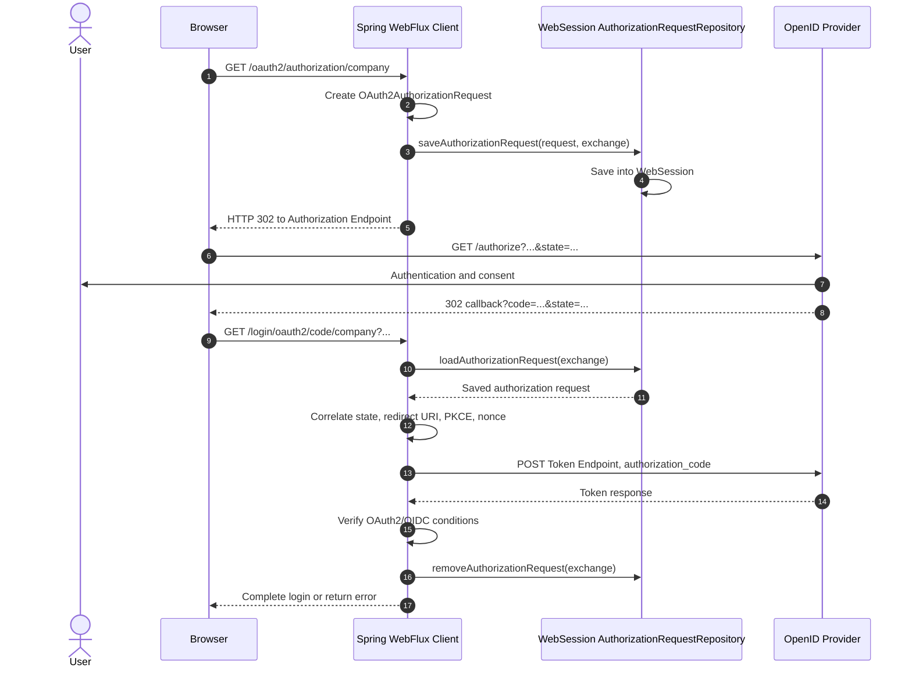
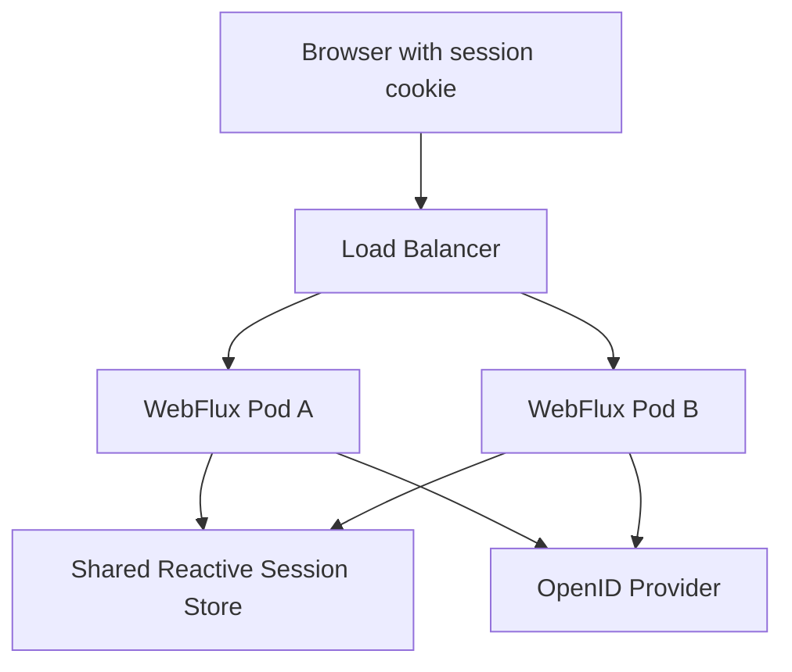

# 20.6. `WebSessionOAuth2ServerAuthorizationRequestRepository`

In **Spring Security OAuth 2.0/OIDC Client** running on the **Reactive stack (Spring WebFlux)**, an OAuth2/OIDC login does not complete within a single HTTP request. The application starts by redirecting the browser to the Authorization Server/OpenID Provider, then receives a callback containing `code` and `state`. Between these two HTTP requests, the application must **retain the initiated authorization request** to correlate the callback and finish the protocol securely.

The default component responsible for storing and restoring that data in **`WebSession`** is **`WebSessionOAuth2ServerAuthorizationRequestRepository`**. It implements the reactive contract `ServerAuthorizationRequestRepository<OAuth2AuthorizationRequest>`, providing three operations—**save, load, and remove**—for authorization requests via `Mono` and `ServerWebExchange`.

The goal of this lesson is to understand exactly what the repository stores, when it is called, how it differs from Servlet's `HttpSessionOAuth2AuthorizationRequestRepository`, why it must tie together `state`, PKCE, and OIDC `nonce`, as well as real-world issues: lost session cookies, callbacks hitting another instance, multi-tab usage, session timeouts, Redis storage, and security.

> **Principle:** This repository is not where post-login access tokens are kept; it holds **temporary authorization request data** needed to complete a single OAuth2/OIDC authorization flow. Without this data, the Client cannot reliably verify whether a callback belongs to a request it actually initiated.

## 1. Position of the Repository in Reactive OAuth2 Login

In the **Authorization Code Flow**, the user goes through:

1. Accessing a page requiring authentication in WebFlux.
2. Spring Security builds an `OAuth2AuthorizationRequest` from `ClientRegistration`: Client ID, Authorization Endpoint, redirect URI, scopes, `state`, and additional parameters such as `nonce` or PKCE when used.
3. Spring **saves this request** into `ServerAuthorizationRequestRepository` bound to the browser context.
4. The browser is redirected to the Authorization Server.
5. The user authenticates and grants consent if required.
6. The Authorization Server redirects the browser back to the callback with authorization `code` and `state`, or with an `error` parameter on failure.
7. Spring **loads** the saved authorization request and correlates it with the callback; `state` and related protocol checks must match.
8. Spring uses the authorization code, redirect URI, and PKCE verifier (when applicable) to call the Token Endpoint.
9. For OIDC, Spring verifies the ID Token, issuer, audience, timestamps, and `nonce` according to context.
10. The temporary authorization request is **removed** per flow to prevent unintended reuse.



This diagram is a **logical flow model**, not a guarantee of the exact internal call order in every Spring Security version; an implementation may remove the request during callback processing prior to the token exchange. What matters is that the saved state is used for verification and **does not persist indefinitely**.

### 1.1. Why Must the Authorization Request Be Saved?

A typical callback carries only values such as:

```http
GET /login/oauth2/code/company?code=EXAMPLE_CODE&state=EXAMPLE_STATE HTTP/1.1
Host: app.example.test
Cookie: SESSION=EXAMPLE_SESSION_COOKIE
```

From this callback alone, the application cannot yet trust that:

- `code` belongs to a login request initiated by this application.
- `state` is a value the application actually generated.
- The callback arrived for the right `ClientRegistration`/redirect URI.
- The original request's PKCE `code_verifier` is still available.
- The OIDC `nonce` matches the ID Token returned after token exchange.

The **saved `OAuth2AuthorizationRequest`** lets Spring reconstruct data the callback itself does not contain. This is a key defense against mixed-up login requests, login CSRF, and OAuth2 flow mismatches.

### 1.2. Does This Repository Authenticate the User?

No. It **does not verify passwords**, issue tokens, decode ID Tokens itself, or replace a Resource Server. It only manages the **authorization request record**. Verifying `state`, code, PKCE, issuer, signature, and OIDC nonce belongs to the overall Spring Security OAuth2/OIDC Login pipeline.

## 2. Distinguishing Types of State in Spring Security Reactive

An OAuth2/OIDC Login application has several kinds of "state" data. They do not replace one another:

| Component | Data Represented | When It Exists |
|---|---|---|
| `OAuth2AuthorizationRequest` | Intended request to the Authorization Endpoint; includes `state`, scopes, redirect URI, and PKCE/nonce per flow | From authorization initiation until callback |
| `WebSessionOAuth2ServerAuthorizationRequestRepository` | Store holding the request above inside `WebSession` | Across the browser's two HTTP requests |
| `SecurityContext` | Verified `Authentication`, principal, and authorities | After login, per security context policy |
| `ServerSecurityContextRepository` | How `SecurityContext` is saved/restored | Supports the authenticated session |
| `OAuth2AuthorizedClient` | `ClientRegistration` + principal + access token and optionally refresh token | After tokens are issued |
| `ServerOAuth2AuthorizedClientRepository` or matching service | Stores authorized clients/tokens in the reactive context | Used for post-login API calls |
| `WebSession` | WebFlux session state store, which may hold multiple attributes | Per session lifecycle |

An easy-to-remember picture:

```text
Before callback:
  WebSession
    └── saved OAuth2AuthorizationRequest
          ├── state
          ├── clientId
          ├── redirectUri
          ├── scopes
          ├── PKCE code_verifier? (per flow)
          └── OIDC nonce? (per flow)

After login:
  SecurityContext -> Authentication/OidcUser
  AuthorizedClient -> access token / refresh token?
```

**Never use the authorization request repository to store long-lived access tokens.** Conversely, do not grab the authorized client repository to replace where authorization request `state` is stored unless an implementation explicitly fulfills that contract.

### 2.1. `state` in the URL Differs from `WebSession`

OAuth2 `state` is **a random value binding the authorization response to the original request**. `WebSession` is the server-side storage mechanism scoped to a browser session. They complement each other:

```text
Browser session A
  -> Spring generates state = s-A
  -> Save OAuth2AuthorizationRequest(state=s-A) in WebSession A
  -> Callback state=s-A and same WebSession A
  -> Can match the exact request

Browser session B
  -> Does not have A's request
  -> Must not retrieve session A's request merely by knowing state=s-A
```

Never treat `state` as a session cookie, store an entire session inside `state`, or use predictable account IDs/emails as `state`.

## 3. The `WebSessionOAuth2ServerAuthorizationRequestRepository` Class

Full class name:

```java
org.springframework.security.oauth2.client.web.server
    .WebSessionOAuth2ServerAuthorizationRequestRepository
```

In Java source files, the import is written on a **single line**:

```java
import org.springframework.security.oauth2.client.web.server.WebSessionOAuth2ServerAuthorizationRequestRepository;
```

This class implements:

```java
ServerAuthorizationRequestRepository<OAuth2AuthorizationRequest>
```

with the type parameter `OAuth2AuthorizationRequest` from Spring Security OAuth2 Core.

### 3.1. Why the `WebSession` Prefix?

In Spring WebFlux, `WebSession` is the session abstraction for the reactive environment. It differs from the Servlet API's `HttpSession`.

- **Servlet:** `HttpServletRequest#getSession()`, `HttpSession`, request-scoped thread context.
- **Reactive:** `ServerWebExchange#getSession()` returns `Mono<WebSession>`; session operations compose into the reactive chain.

`WebSessionOAuth2ServerAuthorizationRequestRepository` uses WebFlux's session to store the request without requiring a Servlet `HttpSession`.

### 3.2. The Interface Provides Three Operations

Core signatures of `ServerAuthorizationRequestRepository<T>`:

```java
Mono<T> loadAuthorizationRequest(ServerWebExchange exchange);

Mono<Void> saveAuthorizationRequest(
    T authorizationRequest,
    ServerWebExchange exchange
);

Mono<T> removeAuthorizationRequest(ServerWebExchange exchange);
```

For this class, `T` is `OAuth2AuthorizationRequest`.

| Method | Purpose | Reactive Return Type |
|---|---|---|
| `saveAuthorizationRequest` | Saves request when initiating redirect | `Mono<Void>` |
| `loadAuthorizationRequest` | Retrieves request when processing callback | `Mono<OAuth2AuthorizationRequest>`, may be empty |
| `removeAuthorizationRequest` | Retrieves and removes saved request per contract | `Mono<OAuth2AuthorizationRequest>`, may be empty |

This is a logical contract, not a requirement that you invoke these methods manually in a controller. With default OAuth2 Login, Spring Security calls them at the appropriate stages.

### 3.3. What Does `Mono.empty()` Mean?

If no valid authorization request is found in the session, `loadAuthorizationRequest(...)` may return a `Mono` that completes without emitting a value. That differs from returning an object with `state=null`.

Similarly, `removeAuthorizationRequest(...)` may complete empty when the request no longer exists or fails implementation matching conditions. When writing a custom repository, obey the reactive contract rather than returning `null` for the `Mono` itself.

### 3.4. Never Use `block()` Inside Repository Methods

Example of **what not to do**:

```java
// DO NOT do this in WebFlux request handling:
WebSession session = exchange.getSession().block();
```

In Reactor/WebFlux, blocking an event-loop thread can throw errors or degrade throughput. Use `flatMap`, `map`, `doOnNext`, `then`, and appropriate operators.

## 4. The `save → load → remove` Lifecycle

### 4.1. `saveAuthorizationRequest` During Authorization Initiation

Suppose Spring creates a request:

```text
authorizationUri = https://login.example.test/oauth2/authorize
clientId         = webflux-client
redirectUri      = https://app.example.test/login/oauth2/code/company
state            = R4nd0m-Example-State
scopes           = [openid, profile, email]
additional       = nonce / code_challenge? / ... (per flow)
attributes       = PKCE verifier / original nonce? / ... (per flow)
```

The repository is called to persist the record, tied to the current browser's `WebSession`. Spring then returns an HTTP redirect to the Authorization Server.

The data must be persisted **before the redirect** because the next request comes from another system via the browser; Spring cannot keep `state` in a local variable from the first request.

### 4.2. `loadAuthorizationRequest` Upon Receiving the Callback

Callback:

```http
GET /login/oauth2/code/company?code=EXAMPLE_CODE&state=R4nd0m-Example-State HTTP/1.1
Host: app.example.test
Cookie: SESSION=EXAMPLE_SESSION
```

Spring must look up the saved request by session/associated state. Only when the request is restored do the OAuth2 Login components have what they need to:

- Bind the callback's `state` to the initiated authorization flow.
- Match the `ClientRegistration` and redirect URI.
- Retrieve the PKCE `code_verifier` when the flow uses PKCE.
- Proceed with code exchange and OIDC ID Token/nonce validation when applicable.

**Without a previously saved request, you must never treat a login as valid based solely on a browser-submitted `code` and `state`.**

### 4.3. `removeAuthorizationRequest` After the Request Is Consumed

Once the callback is processed, the temporary authorization request state must be cleaned up per contract:

```text
Authorization request initiated
  -> saved to WebSession
  -> callback correlates/consumes
  -> remove request from store
```

Clearing state reduces stale pending requests, avoids collisions with subsequent logins, and limits how long sensitive metadata lingers in the session.

Do not rely solely on plain `remove` to enforce "each authorization request completes at most once" if a custom implementation stores data in Redis across multiple instances; strict replay resistance requires **atomic** consumption or equivalent transactional guarantees.

### 4.4. Load Does Not Automatically Mean Delete

Do not write a custom repository implementing only `loadAuthorizationRequest` while assuming reads delete entries. The API defines an **explicit remove method** to make the requirement clear. Spring Security components invoke load/remove according to the flow defined for your version; respect that lifecycle rather than deleting inside an arbitrary hook and causing the callback to miss the request.

## 5. What Does `OAuth2AuthorizationRequest` Contain?

An `OAuth2AuthorizationRequest` describes the Authorization Endpoint request. Common properties include:

| Property | Example | Meaning |
|---|---|---|
| `authorizationUri` | `https://login.example.test/oauth2/authorize` | Authorization endpoint |
| `authorizationGrantType` | `authorization_code` | Active grant flow |
| `clientId` | `webflux-client` | Registered client |
| `redirectUri` | `https://app.example.test/login/oauth2/code/company` | Callback matching client registration |
| `scopes` | `openid, profile, email` | Requested permission scopes |
| `state` | Unpredictable random string | Binds response to request |
| `additionalParameters` | `nonce`, `prompt`, `code_challenge`... per flow | Parameters sent to the Authorization Endpoint |
| `attributes` | PKCE `code_verifier`, initial nonce, or internal flow metadata | Data the Client retains server-side |

Do not assume every provider, version, or configuration uses the exact same attribute keys. What matters is **never dropping required attributes** when storing or customizing a request.

### 5.1. Sensitive Values Inside the Object

The authorization request can contain the PKCE `code_verifier` and related nonce/state data, even though access and refresh tokens do not exist yet.

Therefore:

- Never log `authorizationRequest.toString()` in full.
- Never serialize the object to the frontend or embed it in URLs.
- Protect session stores, backups, and trace logs.
- When designing a distributed store, apply appropriate access controls and retention.
- Clean up stale entries so unconsumed data does not linger indefinitely.

### 5.2. PKCE Challenge and Verifier Are Distinct

In PKCE:

```text
Client generates random code_verifier
    -> compute code_challenge from verifier
    -> send code_challenge on Authorization Request URL
    -> keep code_verifier on Client
    -> send code_verifier to Token Endpoint when exchanging code
```

If a repository or custom authorization resolver drops `code_verifier`, the Token Endpoint may return `invalid_grant` even though the browser callback carried a valid `code`. That is why the authorization request cannot be replaced by a map storing only `state` when the flow requires PKCE.

### 5.3. OIDC Nonce Does Not Replace State

In OIDC, `nonce` binds the ID Token to the authentication request. `state` binds the authorization response/callback to the Client request.

| Value | Where It Usually Appears | Goal |
|---|---|---|
| `state` | Authorization request and callback response | Protects flow binding, prevents login CSRF |
| `nonce` | Authorization request; ID Token carries `nonce` claim per flow | Mitigates OIDC replay/token substitution |
| `code_challenge` | Authorization request | Commits to the PKCE verifier |
| `code_verifier` | Token request, retained earlier on the Client | Proves the Client holds the PKCE secret |
| `authorization code` | Callback, then Token Endpoint | Short-lived code exchanged for tokens |

Never collapse everything into one value. Spring Security has dedicated steps handling each; a custom repository must retain enough data for all of those steps to succeed.

## 6. Configuring Spring Boot WebFlux and OIDC Login

### 6.1. Dependencies

Spring Boot WebFlux example:

```xml
<dependencies>
    <dependency>
        <groupId>org.springframework.boot</groupId>
        <artifactId>spring-boot-starter-webflux</artifactId>
    </dependency>
    <dependency>
        <groupId>org.springframework.boot</groupId>
        <artifactId>spring-boot-starter-oauth2-client</artifactId>
    </dependency>
</dependencies>
```

This example targets the Spring Boot 3.x line; align BOM/dependency versions with your Spring Boot/Spring Security setup.

In a Reactive application, `SecurityWebFilterChain` and `ServerHttpSecurity` replace Servlet's `SecurityFilterChain` / `HttpSecurity`. Never copy a Servlet configuration and expect WebFlux filters to work automatically.

### 6.2. `application.yml`

```yaml
spring:
  security:
    oauth2:
      client:
        registration:
          company:
            provider: company-op
            client-id: ${OIDC_CLIENT_ID}
            client-secret: ${OIDC_CLIENT_SECRET}
            authorization-grant-type: authorization_code
            client-authentication-method: client_secret_basic
            redirect-uri: "{baseUrl}/login/oauth2/code/{registrationId}"
            scope:
              - openid
              - profile
              - email
        provider:
          company-op:
            issuer-uri: https://login.example.test/realms/company
```

Notes:

- `openid` triggers the OIDC flow.
- `issuer-uri` allows Spring to resolve endpoints/JWKS via OIDC metadata discovery.
- `redirect-uri` must match the callback registered at the OP.
- `client-id`/`client-secret` must come from secret configuration, never hardcoded real values.
- `example.test` URLs are placeholders, not live public endpoints.
- PKCE may be applied depending on Client type and Spring Security behavior; do not arbitrarily disable it when required.

### 6.3. Basic WebFlux Security

```java
import org.springframework.context.annotation.Bean;
import org.springframework.context.annotation.Configuration;
import org.springframework.security.config.Customizer;
import org.springframework.security.config.web.server.ServerHttpSecurity;
import org.springframework.security.web.server.SecurityWebFilterChain;

@Configuration
public class ReactiveSecurityConfig {

    @Bean
    SecurityWebFilterChain securityWebFilterChain(ServerHttpSecurity http) {
        http
            .authorizeExchange(exchanges -> exchanges
                .pathMatchers("/", "/error").permitAll()
                .anyExchange().authenticated()
            )
            .oauth2Login(Customizer.withDefaults());

        return http.build();
    }
}
```

When Spring Security Reactive OAuth2 Login is enabled without a custom repository, the framework uses the default `WebSession`-backed authorization request storage for your version.

Here you **do not need to save `state` into `WebSession` yourself** in a controller. The framework already has the repository and WebFilters handling the authorization flow.

## 7. Explicitly Configuring `WebSessionOAuth2ServerAuthorizationRequestRepository`

When you want explicit control over the repository or want to prepare a custom wrapper, declare a bean:

```java
import org.springframework.context.annotation.Bean;
import org.springframework.context.annotation.Configuration;
import org.springframework.security.oauth2.client.web.server.ServerAuthorizationRequestRepository;
import org.springframework.security.oauth2.client.web.server.WebSessionOAuth2ServerAuthorizationRequestRepository;
import org.springframework.security.oauth2.core.endpoint.OAuth2AuthorizationRequest;

@Configuration
public class AuthorizationRequestRepositoryConfig {

    @Bean
    ServerAuthorizationRequestRepository<OAuth2AuthorizationRequest>
    authorizationRequestRepository() {
        return new WebSessionOAuth2ServerAuthorizationRequestRepository();
    }
}
```

Then attach it to Reactive `oauth2Login` per your Spring Security version's supported DSL:

```java
import org.springframework.context.annotation.Bean;
import org.springframework.security.config.web.server.ServerHttpSecurity;
import org.springframework.security.oauth2.client.web.server.ServerAuthorizationRequestRepository;
import org.springframework.security.oauth2.core.endpoint.OAuth2AuthorizationRequest;
import org.springframework.security.web.server.SecurityWebFilterChain;

@Bean
SecurityWebFilterChain securityWebFilterChain(
        ServerHttpSecurity http,
        ServerAuthorizationRequestRepository<OAuth2AuthorizationRequest>
                authorizationRequests) {

    http
        .authorizeExchange(exchanges -> exchanges
            .pathMatchers("/", "/error").permitAll()
            .anyExchange().authenticated()
        )
        .oauth2Login(oauth2 -> oauth2
            .authorizationRequestRepository(authorizationRequests)
        );

    return http.build();
}
```

In a project, declare **only one** `SecurityWebFilterChain` covering the same paths, or manage ordering and filter-chain matchers explicitly. The snippets above are **alternatives**, not meant to all be pasted into one class.

### 7.1. Why Configure Explicitly If the Default Already Uses WebSession?

It can be helpful when you want to:

- Wrap the repository for safe telemetry logging.
- Integrate specific session policies or state cleanup behavior.
- Swap in an implementation supporting multiple concurrent authorization requests in one session, if needed and supported by your version.
- Unit-test the `ServerAuthorizationRequestRepository` interface in isolation.
- Make `oauth2Login`'s repository explicit when the app has multiple reactive security chains.

Absent a concrete requirement, using **Spring Security's defaults** carries lower risk. Replacing the repository touches security-critical OAuth2 flow state.

### 7.2. The Repository Is One Piece of the Login Pipeline

Even if you define the repository as a `@Bean`, it is used only when the relevant configuration picks up that bean or you **attach it explicitly to the OAuth2 Login spec**. Do not assume every custom `@Bean` automatically overrides every internal repository in every Spring Security version.

If customization has no effect, verify that the right `SecurityWebFilterChain` handles `/oauth2/authorization/...` and callback `/login/oauth2/code/...` requests.

## 8. Example: Safe Logging Wrapper Without Altering Storage Logic

Need to observe whether authorization requests are saved, loaded, or removed? A low-risk approach is **delegating** all work to `WebSessionOAuth2ServerAuthorizationRequestRepository` and logging only sanitized events.

```java
import org.slf4j.Logger;
import org.slf4j.LoggerFactory;
import org.springframework.security.oauth2.client.web.server.ServerAuthorizationRequestRepository;
import org.springframework.security.oauth2.client.web.server.WebSessionOAuth2ServerAuthorizationRequestRepository;
import org.springframework.security.oauth2.core.endpoint.OAuth2AuthorizationRequest;
import org.springframework.web.server.ServerWebExchange;
import reactor.core.publisher.Mono;

public final class ObservedAuthorizationRequestRepository
        implements ServerAuthorizationRequestRepository<OAuth2AuthorizationRequest> {

    private static final Logger log =
        LoggerFactory.getLogger(ObservedAuthorizationRequestRepository.class);

    private final ServerAuthorizationRequestRepository<OAuth2AuthorizationRequest>
            delegate = new WebSessionOAuth2ServerAuthorizationRequestRepository();

    @Override
    public Mono<Void> saveAuthorizationRequest(
            OAuth2AuthorizationRequest request,
            ServerWebExchange exchange) {

        return delegate.saveAuthorizationRequest(request, exchange)
            .doOnSuccess(ignored ->
                log.debug("oauth2_authorization_request event=saved")
            );
    }

    @Override
    public Mono<OAuth2AuthorizationRequest> loadAuthorizationRequest(
            ServerWebExchange exchange) {

        return delegate.loadAuthorizationRequest(exchange)
            .doOnNext(request ->
                log.debug("oauth2_authorization_request event=loaded")
            )
            .switchIfEmpty(Mono.defer(() -> {
                log.debug("oauth2_authorization_request event=not_found");
                return Mono.empty();
            }));
    }

    @Override
    public Mono<OAuth2AuthorizationRequest> removeAuthorizationRequest(
            ServerWebExchange exchange) {

        return delegate.removeAuthorizationRequest(exchange)
            .doOnNext(request ->
                log.debug("oauth2_authorization_request event=removed")
            );
    }
}
```

The example demonstrates **delegating cleanly per contract**, without mocking HTTP sessions or reading callback bodies. In a real application, ensure `debug` logging is appropriate for the environment and avoids excessive log volume.

### 8.1. Why Not Print `request` or `state`?

Do not do:

```java
// DO NOT:
log.info("OAuth2 request: {}", request);
log.info("state={}", request.getState());
log.info("attributes={}", request.getAttributes());
```

Because `OAuth2AuthorizationRequest` and its attributes can contain flow-protection secrets, including the PKCE verifier. Even though `state` is not an access token, it remains a sensitive value for tying requests to callbacks.

Log structured metadata instead, such as:

```text
event=oauth2_authorization_request_saved
registrationCategory=enterprise-oidc
exchangeCorrelationId=random-internal-id
result=success
```

Never use raw session IDs, states, nonces, codes, or tokens as correlation IDs. When tracing a flow, generate an independent random ID and restrict log access.

### 8.2. Never Manually Subscribe Inside the Repository

The following is **wrong**:

```java
// DO NOT do this in a reactive implementation:
delegate.saveAuthorizationRequest(request, exchange).subscribe();
return Mono.empty();
```

Calling `subscribe()` manually breaks sequencing, exception propagation, and context; the redirect response might be sent before the session state is persisted. In WebFlux, **return the `Mono` of the save operation** so the filter framework orchestrates execution.

### 8.3. Never Block the Event Loop with Synchronous Persistence

If you replace the repository with direct database/Redis calls:

- Prefer appropriate reactive APIs.
- Never run JDBC or blocking Redis clients on the Netty event-loop.
- If a blocking client is unavoidable, manage threading carefully per WebFlux architecture.
- Never turn authorization callbacks into unbounded persistence retry loops.
- Protect state and TTLs regardless of where data is stored.

## 9. How Is `WebSession` Preserved Across Redirects?

A WebFlux session has an identifier that browsers normally send back via a cookie per the session resolver configuration. When the Client saves the authorization request into `WebSession` and sends a 302 to the OP, the browser must preserve the ability to link back to the **same session** when returning to the callback.

Conceptually:

```text
Request 1:
GET /oauth2/authorization/company
    -> Server creates/finds WebSession S1
    -> Save OAuth2AuthorizationRequest in S1
    -> Response sets session cookie when needed
    -> 302 to OP

Browser goes to OP:
    -> May pass through multiple redirects

Request 2:
GET /login/oauth2/code/company?code=...&state=...
Cookie: <cookie bound to WebSession S1>
    -> Server looks up S1 again
    -> Load saved OAuth2AuthorizationRequest
    -> Continue authentication
```

If the browser **fails to send the cookie tied to the prior session**, Spring cannot locate the matching authorization request even if the callback `state` looks valid.

### 9.1. How Does `WebSession` Differ from `HttpSession`?

| Aspect | WebFlux `WebSession` | Servlet `HttpSession` |
|---|---|---|
| Access API | `ServerWebExchange#getSession()` returns `Mono<WebSession>` | `HttpServletRequest#getSession()` returns directly |
| Security stack | `SecurityWebFilterChain` / `ServerHttpSecurity` | `SecurityFilterChain` / `HttpSecurity` |
| Authorization request repository | `WebSessionOAuth2ServerAuthorizationRequestRepository` | `HttpSessionOAuth2AuthorizationRequestRepository` |
| I/O model | Reactive `Mono`/`Flux` | Servlet request API |
| SecurityContext repository | Reactive interfaces | Servlet interfaces |
| Session store | Per `WebSessionManager`/Spring Session Reactive integration | Per Servlet container/Spring Session integration |

**Never import Servlet classes into WebFlux** or wire `HttpSessionOAuth2AuthorizationRequestRepository` into Reactive `oauth2Login`. Both serve the same conceptual need, yet belong to different contracts and frameworks.

### 9.2. WebSession Is Not the Entire Login Session

`WebSession` can be used by Spring Security both before and after login, yet the **authorization request** only needs to exist temporarily until the callback. Post-login, `SecurityContext` has its own lifecycle; the authorization request repository does not need to keep old requests in the session forever.

## 10. Cookies, `SameSite`, `Secure`, and the Callback

The cookie linking `WebSession` is a critical link in the login redirect chain. Cookie attributes must be configured for your environment:

| Attribute | Role | Considerations |
|---|---|---|
| `Secure` | Sends cookie only over HTTPS | Required in production web deployments with TLS |
| `HttpOnly` | Restricts JavaScript access to cookie | Recommended for session cookies |
| `SameSite=Lax` | Limits cookie sending on certain cross-site requests | Usually suitable for top-level GET redirect callbacks |
| `SameSite=Strict` | Stricter restriction on cross-site cookies | Can strip the session cookie when returning from the OP |
| `SameSite=None` | Allows cross-site cookies per browser rules | Must include `Secure`; raises CSRF and privacy requirements |
| `Path` | Limits paths where cookie is sent | Must cover both authorization initiation and callback paths |
| `Domain` | Host/subdomain scope of cookie | Avoid overly broad scopes, especially in multi-tenant setups |
| Session expiration | Lifetime of `WebSession` | Must be long enough for users to complete login/consent |

### 10.1. GET Redirects vs. `response_mode=form_post`

Default OIDC Authorization Code Flow typically receives callbacks via **GET** with `code`/`state`. If an OP uses `response_mode=form_post`, the callback can be a **cross-site POST** from the OP's page.

Browsers may withhold `SameSite=Lax` cookies on cross-site POSTs, preventing Spring from finding the saved authorization request. Still, **never blindly switch to `SameSite=None` to fix every error** without reviewing CSRF, response mode, browser support, and session policy.

When `form_post` is required:

1. Verify your WebFlux/OIDC Client version supports that response mode as expected.
2. Configure session cookies to match the real browser flow.
3. Enforce HTTPS, `Secure`, `HttpOnly`, and CSRF protections on required endpoints.
4. Test the callback across target browsers.
5. Never weaken `state` or `nonce` checks just to "get the flow working."

### 10.2. Cookies Blocked by the Browser

Common causes:

- User blocks cookies or uses strict private browsing policies.
- Cookie has wrong `Domain`/`Path`.
- App initiates on `app.example.test` while callback hits `www.example.test` outside the cookie scope.
- Callback from IdP is a cross-site POST incompatible with `SameSite`.
- Reverse proxy changes scheme/host so the browser treats the cookie as belonging to a different context.
- Session expired because the user spent too long on the consent screen.
- A security appliance or intermediate proxy strips `Set-Cookie` or `Cookie`.

During diagnosis, inspect **whether the cookie is present** via redacted dev tools/HTTP traces, without pasting real session cookies into tickets or logs.

## 11. Reverse Proxies, TLS Termination, and Redirect URIs

Many WebFlux apps run behind a load balancer:

```text
Browser
  -> https://app.example.test
  -> Reverse proxy / Load balancer
  -> http://internal-webflux:8080
```

Client registration includes:

```yaml
redirect-uri: "{baseUrl}/login/oauth2/code/{registrationId}"
```

If Spring perceives the wrong `scheme`, `host`, and `port` because proxy headers are misconfigured, it may compute an internal redirect URI like `http://internal-webflux:8080/login/oauth2/code/company`. The Authorization Server rejects it or the callback lands on the wrong host, breaking session cookie matching.

### 11.1. Remediation

- Register the exact public Redirect URI at the OP.
- Configure the reverse proxy to send standard `Forwarded` or `X-Forwarded-*` headers within a trusted boundary.
- Configure Spring Boot's forwarded-header handling to match your infrastructure.
- Never trust `X-Forwarded-Host` from arbitrary Internet clients; trust only controlled proxies.
- Ensure the callback uses the same origin and compatible session cookies.
- Use HTTPS for browser-facing flows and Token Endpoint calls.

### 11.2. Distinguishing Two Common Errors

| Error | Symptom | Where to Investigate |
|---|---|---|
| `redirect_uri_mismatch` at OP | Login cannot start or code is not issued | Public/registered URI, proxy scheme/host |
| `authorization_request_not_found` or `invalid_state` at callback | OP redirected back, but Client lost the original request | Cookie/`WebSession`, multi-node store, timeout, concurrent flows |

Never fix cookie issues by removing `state` checks; and never fix redirect URI mismatches with `*` wildcards disallowed by the provider or spec.

## 12. WebSession Across Multiple Instances

A production WebFlux app might run 3 pods:

```text
                 Load Balancer
                 /     |     \
             Pod A    Pod B   Pod C
               \       |      /
                  Session Store?
```

### 12.1. When Sessions Are Stored Locally

Suppose:

```text
Login initiation request -> Pod A
WebSession S1 lives in Pod A memory
Browser goes to OP then callback -> Pod B
Pod B does not know S1
=> Saved OAuth2AuthorizationRequest not found
```

Errors appear intermittently depending on which pod receives the callback. Single-instance dev works fine, then scaling to multiple pods causes flaky logins.

### 12.2. Two Common Options

**A. Session affinity (sticky sessions):**

- Load balancer tries to route the same session to the same pod.
- Easy to start with, yet fragile during pod restarts, autoscaling, and failovers.
- Does not solve all session data issues, especially when a node disappears.

**B. Shared session store (e.g., Spring Session + Redis):**

- Pods access the same shared session state.
- Callbacks can hit a different pod and still read the right `WebSession` when properly configured.
- Requires securing Redis, designing TTLs, serializers, object versioning, and high availability.
- Does not automatically guarantee custom session attributes serialize cleanly or remain backward-compatible across deploys.

Architecture sketch:



### 12.3. Spring Session and Redis

With Spring Boot WebFlux and compatible session mechanics, you can add Spring Session Data Redis:

```kotlin
dependencies {
    implementation("org.springframework.boot:spring-boot-starter-webflux")
    implementation("org.springframework.boot:spring-boot-starter-oauth2-client")
    implementation("org.springframework.session:spring-session-data-redis")
}
```

You also need Redis connection/host/credentials/TLS and Spring Session Reactive configuration matching your active **Boot/Spring Session versions**. Example:

```yaml
spring:
  data:
    redis:
      host: redis.internal.example.test
      port: 6379
```

This YAML is only a **connection snippet**, insufficient on its own for production: configure Redis authentication, TLS, namespace/session timeouts, serialization, and monitoring. Never use unprotected plaintext Redis connections across low-trust network boundaries.

### 12.4. Serialization Concerns for Authorization Requests

If a custom repository stores `OAuth2AuthorizationRequest` in a shared session store, check:

- Does the chosen serializer support all object/attribute types?
- Do class definitions or serialization formats change across Spring Security versions?
- During blue-green deployments with mixed versions running, can old sessions still deserialize?
- Could tokens or code verifiers leak through serialized payloads or serializer logs?
- Is the session TTL adequate for the authorization flow without being excessive?
- Did a custom resolver insert non-serializable data into `attributes`?

Never serialize requests with `toString()` and attempt to re-parse them; data needed for PKCE and nonce is easily lost. If a custom DTO is required, version it and preserve everything required by the contract.

## 13. Multiple Tabs and Concurrent Authorization Requests

A user might:

1. Open tab A and start logging in with provider X.
2. Before finishing, open tab B and start logging in with provider Y.
3. Return to tab A to finish.
4. Receive an invalid `state` or authorization-request-not-found error.

The reason can be that the default repository keeps **a single pending request** in a session attribute in a given version/implementation; starting a new flow replaces the old entry. Other factors include session rotation, host/cookie shifts, or callback state mismatches.

Do not assume every version's default always supports **multiple** parallel authorization flows merely because `state` is a unique string. Verify the behavior of `WebSessionOAuth2ServerAuthorizationRequestRepository` in your Spring Security version.

### 13.1. Single-Request Storage Model

```text
WebSession S1:
  savedAuthorizationRequest = request(state=A)

Tab A initiates -> save A

Tab B initiates -> save B
WebSession S1:
  savedAuthorizationRequest = request(state=B)

Tab A callback state=A
  -> request in session is state=B
  -> callback mismatches; login A cannot complete
```

This illustrates a **pending-state overwrite** error. Confirm whether your implementation stores one entry or a map of entries, and write multi-tab tests to catch unwanted behavior.

### 13.2. When Do You Need a Custom `state`-Keyed Repository?

If the product must support multiple concurrent OAuth2/OIDC logins within the same `WebSession`, design the store as:

```text
session:
  pendingAuthorizationRequests:
    state-A -> OAuth2AuthorizationRequest A
    state-B -> OAuth2AuthorizationRequest B
```

Security requirements:

- Keep the map strictly inside the **corresponding `WebSession`**, never in a global state lookup anyone presenting a `state` can query.
- `state` must be framework-generated with sufficient entropy, never browser-chosen.
- Enforce a **TTL** and cap on pending requests per session to prevent memory abuse.
- Callback must read/consume only the request matching `state`, never falling back to the latest entry.
- Remove only the entry for the **matched state** once processed.
- Across multiple pods, consumption should use storage-appropriate atomicity/race handling.
- Never write PKCE verifiers or nonces to cookies/URLs.
- Purge stale entries when flows fail or expire.

This is an extension pattern, not a reason to rewrite the default repository if your app has no real multi-tab requirement.

### 13.3. Never Ignore State Mismatches

Wrong:

```java
// Dangerous idea, not an actual Spring Security API:
// If callback state is not found, pick the latest request in the session.
pendingRequests.values().stream().findFirst();
```

Doing that breaks the binding between authorization response and request. On state mismatch, handle the failure cleanly (start a new flow or show a clear message) rather than binding the callback to a different request.

## 14. Security Risks and Threat Model

### 14.1. Login CSRF and Authorization Response Injection

If the Client fails to verify the saved request and `state`, an attacker could force a victim's browser to complete an OAuth2 flow the victim never initiated, or inject a callback out of context.

The repository lets the Client keep evidence of the original authorization request; yet preventing login CSRF also depends on the entire flow, random `state` generation, callback checks, and session binding.

**Never** use a custom implementation returning a dummy/fixed-state request to "reduce session errors":

```java
// INSECURE DESIGN:
// loadAuthorizationRequest() always returns a request with state="fixed"
```

`state` must remain tied to the initiating request and unpredictable.

### 14.2. PKCE Downgrade and Lost `code_verifier`

If a custom resolver or repository strips attributes needed for PKCE, the Token Endpoint may reject the exchange with `invalid_grant` or weaken flow protection.

Never fix that by turning off PKCE on a public client. Preserve authorization request metadata intact and verify provider compatibility.

### 14.3. OIDC Nonce Mismatch

An OIDC flow using `nonce` can keep initial nonce data on the Client to compare against the ID Token's `nonce` claim. If the session is lost or the request overwritten, nonce verification can fail.

Never use a fixed `nonce`, never skip nonce validation, and never substitute `state` for `nonce` when the framework expects a separate mechanism.

### 14.4. WebSession and Request Attribute Leakage

Session attributes can hold data protecting the OAuth2 flow. Therefore:

- Restrict session store access only to required services.
- Protect Redis/backups with proper permissions, network policies, encryption, and retention.
- Never log full session objects.
- Never troubleshoot by pasting tokens, codes, or verifiers into tickets.
- Set reasonable TTLs and clean up processed requests.
- Review session fixation protection and how Spring Security manages post-login sessions.

### 14.5. Do Not Trust a Callback Just Because a Cookie Is Present

A valid cookie proves the browser sent the right session, yet the OAuth2 callback must still verify `state`, code, redirect URI, issuer, and OIDC checks. A cookie does not make an authorization code valid on its own.

Conversely, a matching `state` when the session has expired is not enough to skip restoring the authorization request.

## 15. When Can the Callback Not Find the Authorization Request?

Errors may surface with different messages across versions:

```text
authorization_request_not_found
authorization_request_not_found / not found
invalid_state
OAuth2AuthenticationException
Unable to resolve the authorization request
OAuth2 Login failed
```

These are **illustrative symptom patterns**, not a guaranteed fixed list of exception strings. Interpretation depends on where the failure occurs.

| Symptom | Possible Cause | How to Check |
|---|---|---|
| Callback carries `code` but saved request is missing | Session cookie not returned, session lost/expired | Inspect requests/cookies, TTL, session store |
| Fails only in multi-pod production | Sessions live in single-pod memory | Shared session store or affinity/failover |
| Fails when opening 2 login tabs | Pending request overwritten or callback state mismatch | Test concurrent flows in same `WebSession` |
| Fails after prolonged consent screen | `WebSession` timed out | Review session TTL, expiration, and UX |
| Fails after proxy deployment | Host/path/cookie/redirect URI changed | Check public URI, forwarded headers, cookie scope |
| `invalid_grant` at Token Endpoint | Wrong PKCE verifier/code/redirect URI | Inspect initially saved request, single-use code, callback |
| OIDC nonce mismatch | Original nonce lost or altered | Inspect OIDC flow and saved request attributes |
| Fails only in specific browsers | `SameSite`/third-party cookie policies | Check cookie behavior and response mode |
| Callback returns 404 | Wrong security chain/matcher/callback path | Check `/login/oauth2/code/{registrationId}` and routing |
| UserInfo API fails after login | Access token/scope/provider error | Do not immediately blame the authorization request repository |

### 15.1. Useful Diagnostic Sequence

1. **Verify the login initiation request hits the right `SecurityWebFilterChain`.**
2. **Verify the browser received the cookie linking `WebSession`.**
3. **Verify redirects go to the right Authorization Endpoint and callback URI.**
4. **Ensure the callback returns to the same origin/cookie scope or compatible session store.**
5. **Compare session presence across both requests without logging raw session IDs.**
6. **Check session TTL, restarts, load balancer, autoscaling, and Redis availability.**
7. **Check whether multiple concurrent authorization flows share one `WebSession`.**
8. **Check whether a custom repository/resolver preserves `state`, PKCE verifier, and `nonce`.**
9. **If the saved request exists yet the Token Endpoint fails, isolate `invalid_grant`, client authentication, redirect URI, and code reuse.**
10. **If callback/token exchange succeed yet login fails, inspect OIDC ID Token/nonce/UserInfo per policy.**

Never raise session TTL indefinitely or disable state validation just to silence an error code.

## 16. OAuth2 Login and OAuth2 Client in the Reactive Stack

A WebFlux application may use both:

- **`oauth2Login`:** authenticates users via an OP and creates `Authentication`.
- **`oauth2Client`:** manages authorized clients to call downstream APIs.

Example:

```java
@Bean
SecurityWebFilterChain securityWebFilterChain(ServerHttpSecurity http) {
    http
        .authorizeExchange(exchanges -> exchanges
            .anyExchange().authenticated()
        )
        .oauth2Login(org.springframework.security.config.Customizer.withDefaults())
        .oauth2Client(org.springframework.security.config.Customizer.withDefaults());

    return http.build();
}
```

Key distinction:

```text
OAuth2AuthorizationRequest repository:
  helps initiate and complete the authorization flow

OAuth2AuthorizedClientRepository / Service:
  helps retrieve/store access token and refresh token once issued

SecurityContext repository:
  helps store authentication inside the application
```

Never replace the pre-login request repository with the post-login token store.

### 16.1. `ServerOAuth2AuthorizedClientExchangeFilterFunction` Differs from This Repository

When a WebFlux app uses `WebClient` to call OAuth2-protected APIs, `ServerOAuth2AuthorizedClientExchangeFilterFunction` can select or re-issue an authorized client and attach the access token.

It is **not** `WebSessionOAuth2ServerAuthorizationRequestRepository`:

- The authorization request repo handles `state`/pre-callback flow correlation.
- The `WebClient` OAuth2 filter uses an existing or manager-obtained access token to call APIs.
- Both can coexist in one application, serving different roles.

### 16.2. For Apps That Are Only Resource Servers

A WebFlux API receiving external Bearer JWTs can use `oauth2ResourceServer().jwt()` without needing `oauth2Login` or an authorization request repository. A Resource Server validates access tokens; it does not redirect browsers to an Authorization Endpoint.

Do not add `WebSessionOAuth2ServerAuthorizationRequestRepository` to every JWT API that does not act as an OAuth2/OIDC Login Client.

## 17. WebFlux Does Not Mean Everything Is Stateless

A common misconception:

> "Reactive is stateless, so there is no need to save the authorization request."

Reactive describes the request-processing and asynchronous I/O model; it does not forbid sessions. The OAuth2 Authorization Code Flow relies on an **initiation request followed later by a callback**; it requires a trusted place to store correlation between those two steps.

You may choose storage other than `WebSession`, provided you preserve these invariants:

- Do not expose `state`, `nonce`, or PKCE verifiers.
- Bind the callback to the right flow and browser.
- Enforce TTLs and one-time consumption.
- Prevent replay and concurrency hazards.
- Conform to the Reactive `Mono`/`ServerWebExchange` contract.
- Keep Spring Security's default OAuth2/OIDC validations intact.

### 17.1. Does `NoOpServerSecurityContextRepository` Change This?

If an app customizes `SecurityContext` storage to avoid persisting long-lived login sessions, that **does not eliminate** the need to store the authorization request between redirect and callback. The two repositories have distinct jobs.

Never infer that a stateless security context configuration automatically protects `state`. Making the authorization request layer completely stateless requires a carefully engineered mechanism covering replay, PKCE, nonce, and cookie/browser binding—an advanced security design problem.

### 17.2. Never Store the Authorization Request in a Static Variable

Wrong:

```java
// INSECURE and incompatible with multiple users:
static OAuth2AuthorizationRequest lastRequest;
```

An application-wide static field allows user sessions to overwrite each other's requests, causing login CSRF, lost states, wrong principals, and irreproducible scale-out bugs.

## 18. Testing the Repository with Reactive APIs

### 18.1. Testing the save/load/remove Contract

A unit test can use Spring's `MockServerWebExchange` and Reactor Test's `StepVerifier`. Illustrative example using common APIs:

```java
import org.junit.jupiter.api.Test;
import org.springframework.mock.http.server.reactive.MockServerHttpRequest;
import org.springframework.mock.web.server.MockServerWebExchange;
import org.springframework.security.oauth2.client.web.server.WebSessionOAuth2ServerAuthorizationRequestRepository;
import org.springframework.security.oauth2.core.endpoint.OAuth2AuthorizationRequest;
import reactor.test.StepVerifier;

import static org.assertj.core.api.Assertions.assertThat;

class WebSessionAuthorizationRequestRepositoryTest {

    @Test
    void saveThenLoadThenRemove() {
        var repository =
            new WebSessionOAuth2ServerAuthorizationRequestRepository();

        var exchange = MockServerWebExchange.from(
            MockServerHttpRequest.get("/login/oauth2/code/company")
                .queryParam("state", "test-state-123")
        );

        var request = OAuth2AuthorizationRequest.authorizationCode()
            .authorizationUri("https://id.example.test/oauth2/authorize")
            .clientId("webflux-client")
            .redirectUri("https://app.example.test/login/oauth2/code/company")
            .state("test-state-123")
            .build();

        StepVerifier.create(
            repository.saveAuthorizationRequest(request, exchange)
        ).verifyComplete();

        StepVerifier.create(
            repository.loadAuthorizationRequest(exchange)
        ).assertNext(saved ->
            assertThat(saved.getState()).isEqualTo("test-state-123")
        ).verifyComplete();

        StepVerifier.create(
            repository.removeAuthorizationRequest(exchange)
        ).assertNext(removed ->
            assertThat(removed.getState()).isEqualTo("test-state-123")
        ).verifyComplete();
    }
}
```

Details of verifying a callback exchange within the same mock session may need adjustment depending on your Spring Security version, especially if the repository filters requests by `state`/query parameter. This snippet illustrates **contract testing** and does not claim a live test run. In production code, never use a fixed `state="test-state-123"`; the framework must generate high-entropy state values.

To verify that `remove` actually cleared the entry, append:

```java
StepVerifier.create(repository.loadAuthorizationRequest(exchange))
    .verifyComplete();
```

### 18.2. Integration Testing with `WebTestClient`

A more thorough end-to-end test validating `WebSession`/cookies:

1. Call `GET /oauth2/authorization/company`.
2. Assert the response redirects to the Authorization Endpoint.
3. Retain the returned session cookie on the same test client.
4. Simulate the callback with `state` matching the original authorization request.
5. Ensure Spring does not bypass `state` validation.
6. Verify that when the cookie is dropped or `state` is wrong, authentication fails.
7. For OIDC, stub Token Endpoint/JWKS and claims enough to complete the flow.
8. Verify that after the callback, the authorization request cannot be accepted a second time.

A `WebTestClient` suite can use a mock Authorization Server rather than calling a real IdP. Never put real client secrets or refresh tokens into test fixtures.

### 18.3. Recommended Test Cases

| Scenario | Expected Outcome |
|---|---|
| Save then callback with same session/state | Loads the right request |
| Callback without the original session | Request not found, no login |
| Callback with a different state | Rejected as invalid flow |
| Replayed callback after request was consumed | Old request cannot be reused |
| Two authorization flows in the same session | Behavior is explicit and tested per product requirements |
| PKCE verifier missing | Token exchange fails per mandatory PKCE flow |
| Wrong OIDC nonce | ID Token validation fails |
| Session expires before callback | Flow rejected safely with path to restart |
| Callback hits another instance with shared store | Locates exact request when store/config match |
| Provider returns error/denied consent | Safe error handling and state cleanup |

These are **suggested test scenarios**, not Content QA for this lesson.

## 19. Customizing the Repository When Truly Needed

If the default `WebSessionOAuth2ServerAuthorizationRequestRepository` does not meet a specific requirement, you can implement:

```java
public final class CustomAuthorizationRequestRepository
        implements ServerAuthorizationRequestRepository<OAuth2AuthorizationRequest> {

    @Override
    public Mono<Void> saveAuthorizationRequest(
            OAuth2AuthorizationRequest request,
            ServerWebExchange exchange) {
        // Save request by session and safe key; return Mono<Void>.
        throw new UnsupportedOperationException("Illustrative contract");
    }

    @Override
    public Mono<OAuth2AuthorizationRequest> loadAuthorizationRequest(
            ServerWebExchange exchange) {
        // Look up exact request by session + callback state.
        throw new UnsupportedOperationException("Illustrative contract");
    }

    @Override
    public Mono<OAuth2AuthorizationRequest> removeAuthorizationRequest(
            ServerWebExchange exchange) {
        // Consume request safely, preventing replay/races.
        throw new UnsupportedOperationException("Illustrative contract");
    }
}
```

This snippet shows only **method signatures** and is intentionally non-functional because state storage is security-sensitive. Do not copy this class into an app with methods throwing exceptions.

### 19.1. Viable Customization Approaches

- Event-observing wrapper delegating to the default repository (preferred if you only need telemetry).
- State-keyed session map with TTLs, entry caps, and atomic removal.
- Shared reactive store keyed by session and state when specialized scale-out is required.
- Integration complying with internal rules on session partitioning or encrypting sensitive data.
- Custom behavior supporting multiple OPs/client registrations when genuinely required.

### 19.2. Approaches to Avoid

- Storing requests in a global static variable.
- Using predictable emails, user IDs, or timestamps as `state`.
- Putting `code_verifier` or `nonce` into unprotected query strings.
- Returning the latest request in the session if callback `state` mismatches.
- Writing `OAuth2AuthorizationRequest` to local disk without TTLs/ownership.
- Saving only `state` and dropping redirect URI, PKCE attributes, and flow metadata.
- Calling `block()` or manual `subscribe()` outside the reactive pipeline.
- Disabling state/nonce validation to hide configuration errors.

## 20. General Comparison with Servlet

| Topic | Reactive WebFlux | Servlet Spring MVC |
|---|---|---|
| Security configuration | `SecurityWebFilterChain` | `SecurityFilterChain` |
| HTTP security DSL | `ServerHttpSecurity` | `HttpSecurity` |
| Request context | `ServerWebExchange` | `HttpServletRequest` |
| Session API | `WebSession` + `Mono` | `HttpSession` |
| Authorization request repo interface | `ServerAuthorizationRequestRepository<OAuth2AuthorizationRequest>` | `AuthorizationRequestRepository<OAuth2AuthorizationRequest>` |
| Default session-based implementation | `WebSessionOAuth2ServerAuthorizationRequestRepository` | `HttpSessionOAuth2AuthorizationRequestRepository` |
| Reactive HTTP client OAuth2 integration | `ServerOAuth2AuthorizedClientExchangeFilterFunction` | `ServletOAuth2AuthorizedClientExchangeFilterFunction` |
| Authorized client repository | `ServerOAuth2AuthorizedClientRepository` | `OAuth2AuthorizedClientRepository` |
| Authentication principal | Reactive security context | Thread/Servlet security context |

Class names are similar, yet **not interchangeable** between the two stacks. Reading about `HttpSessionOAuth2AuthorizationRequestRepository` helps understand the concept, but Reactive code and config must use `WebSession...`.

## 21. Illustrative Scenarios

### Scenario A: Login Works Every Time Locally, Fails Intermittently on Kubernetes

The app runs three pods, each holding sessions in local memory. Authorization initiation hits pod A, callback hits pod C.

**Explanation:** Pod C lacks the saved authorization request. You need a shared `WebSession` store or suitable routing; inspect sticky sessions, Redis, failover, and serialization.

### Scenario B: Login Fails After Changing Domain

The user starts on `app.example.test`, but the callback returns to `login.app.example.test`. The browser withholds the session cookie due to `Domain`/`Path` scope.

**Explanation:** Fix the public redirect URI, cookie scope, and proxy configuration. Never disable state validation.

### Scenario C: Failure After User Waits Too Long on Consent

`WebSession` TTL is 10 minutes; the user waits 20 minutes on the IdP before clicking approve.

**Explanation:** The session or saved request has likely expired. Inform the user that the flow expired and allow restarting. Never retain old requests indefinitely just to avoid an expiration prompt.

### Scenario D: Errors When Opening Multiple Tabs

Tab A and Tab B initiate two OAuth2 flows in the same `WebSession`, and Tab A's callback returns after Tab B's.

**Explanation:** Likely caused by overwriting the pending authorization request; verify version behavior and test multi-flow handling. Introduce a state-keyed map only if the product truly needs it, keeping session binding and one-time removal intact.

### Scenario E: PKCE Reports `invalid_grant`

The browser callback includes `code`/`state`, yet the Token Endpoint rejects it due to an invalid code verifier.

**Explanation:** Check whether a custom resolver or repository dropped `code_verifier` or built a fresh authorization request at callback time. Never turn off PKCE or use a fixed verifier.

### Scenario F: Strict SameSite Cookie

Login starts on the app page, the callback from the provider is a cross-site navigation, and the `Strict` policy blocks the session cookie.

**Explanation:** Review `SameSite`, callback response mode, and browser behavior. `Lax` usually fits top-level GET callbacks; policy must align with security and environment requirements.

### Scenario G: Bearer API Without OAuth2 Login

A WebFlux Resource Server only validates JWTs from headers with no browser redirects.

**Explanation:** `WebSessionOAuth2ServerAuthorizationRequestRepository` is unnecessary because no authorization request needs to be stored between initiation and callback.

### Scenario H: Suspecting the Repository for UserInfo Errors

OIDC code exchange succeeded and the ID Token is valid, yet the UserInfo Endpoint returns 403.

**Explanation:** The problem likely involves the access token, scopes, audience, or provider policy—not a missing saved authorization request. Isolate failures by flow stage.

## 22. Exercises

### Exercise 1: Picking the Right Repository

A project uses `SecurityWebFilterChain` and `ServerHttpSecurity`. A developer wants to store OAuth2 authorization requests in the session and picks `HttpSessionOAuth2AuthorizationRequestRepository`.

**Suggested answer:** Use Reactive `WebSessionOAuth2ServerAuthorizationRequestRepository` or an equivalent `ServerAuthorizationRequestRepository` implementation. The Servlet repository does not match the Reactive contract.

### Exercise 2: State and Session

The browser callback includes `state=abc`, yet the current `WebSession` holds no authorization request.

**Suggested answer:** Never accept the callback solely because `state` is present. The initiated request must be restored; if lost, reject safely and start a new flow after identifying the cause.

### Exercise 3: Distinguishing Authorization Request and Authorized Client

The app has an `OAuth2AuthorizedClient` with an access token in the database, but a new login callback has no saved `OAuth2AuthorizationRequest`.

**Suggested answer:** The two repositories have distinct jobs. A token saved from an earlier session does not prove the current callback belongs to a valid authorization request.

### Exercise 4: Reactive Method

Implement saving inside a custom repository without calling `block()`.

**Hint:**

```java
return exchange.getSession()
    .doOnNext(session ->
        session.getAttributes().put("my.authorization.request", request)
    )
    .then();
```

This only **illustrates manipulating `WebSession`**, not a complete custom repository: keys, types, state validation, removal, TTL, and concurrency all require secure design.

### Exercise 5: Scale-Out

Three WebFlux pods use local in-memory sessions. Users report login fails roughly one-third of the time.

**Suggested answer:** Check load balancer/session affinity and callbacks landing on a pod without the `WebSession`. A shared session store may be required to sustain flows across pods.

### Exercise 6: POST Callback

The provider uses `response_mode=form_post`. Some browsers do not send the session cookie on the callback.

**Suggested answer:** Check response mode support, `SameSite` and `Secure` cookie attributes, CSRF, and browser policies; never disable state verification.

### Exercise 7: Multi-Tab

Tab B starts login before Tab A receives its callback, causing A's pending request in the session to disappear.

**Suggested answer:** Check multi-request storage behavior in your repository/version. If needed, design a state-keyed map in the session with TTL, entry caps, and one-time consumption.

### Exercise 8: Logging

A developer wants to log the entire `OAuth2AuthorizationRequest` for debugging.

**Suggested answer:** Avoid doing so because it may contain `state`, PKCE verifiers, or nonces. Log saved/loaded/removed events, registration category, and an independent correlation ID instead of request contents.

### Exercise 9: Statelessness

A WebFlux app wants to avoid storing `SecurityContext` in sessions, so the team deletes the entire authorization request repository.

**Suggested answer:** Incorrect. The `SecurityContext` repository and authorization request repository serve different purposes; if removing `WebSession`, provide a secure alternative to preserve authorization/callback correlation.

### Exercise 10: Immediate Post-Callback Failure

The callback carries `code` and the URL's `state` looks right, yet the server reports the saved request was not found. What three things do you check first?

**Suggested answer:** Whether the session cookie returned, whether the session store across pods/TTL preserved the session, and whether another flow/tab overwrote the pending authorization request. Only then inspect callback paths, proxies, and custom repositories.

## 23. Implementation Checklist

- [ ] Using **Spring WebFlux / `ServerHttpSecurity`**, without mistakenly importing Servlet repositories.
- [ ] `oauth2Login` configured with the right `ClientRegistration`, issuer, and callback.
- [ ] Authorization request repository preserves `OAuth2AuthorizationRequest` and required metadata intact.
- [ ] `state` is generated with sufficient entropy and callback correlation is never bypassed.
- [ ] PKCE `code_verifier` is stored/restored properly when PKCE is required.
- [ ] OIDC `nonce` is protected and verified when applicable.
- [ ] `WebSession` cookie is returned on callback, with appropriate `Secure`/`HttpOnly` and `SameSite`.
- [ ] Public redirect URI host/path and forwarded headers are configured properly through proxies.
- [ ] Session timeout covers normal login duration without being infinite.
- [ ] When scaling out, session store supports sharing/failover per architecture.
- [ ] If using Redis, TLS/auth/ACLs, TTLs, and serialization are secured.
- [ ] Multi-tab/concurrent callback behavior is tested per product needs.
- [ ] Custom repositories contain no `block()` or arbitrary `subscribe()`.
- [ ] Requests are safely removed/consumed after flow completion.
- [ ] Raw `state`, `nonce`, PKCE verifier, authorization code, and session cookies are never logged.
- [ ] Missing authorization request errors are distinguished from Token Endpoint `invalid_grant` or UserInfo API errors.
- [ ] This repository is never used to store access/refresh tokens or long-term authentication.

## 24. References

1. [Spring Security API — WebSessionOAuth2ServerAuthorizationRequestRepository](https://docs.spring.io/spring-security/reference/api/java/org/springframework/security/oauth2/client/web/server/WebSessionOAuth2ServerAuthorizationRequestRepository.html): `WebSession`-backed repository class.
2. [Spring Security API — ServerAuthorizationRequestRepository](https://docs.spring.io/spring-security/reference/api/java/org/springframework/security/oauth2/client/web/server/ServerAuthorizationRequestRepository.html): reactive `save`, `load`, and `remove` contract.
3. [Spring Security API — OAuth2AuthorizationRequest](https://docs.spring.io/spring-security/reference/api/java/org/springframework/security/oauth2/core/endpoint/OAuth2AuthorizationRequest.html): fields, attributes, and additional parameters.
4. [Spring Security Reference — Reactive OAuth2 Login](https://docs.spring.io/spring-security/reference/reactive/oauth2/login/index.html): OAuth2/OIDC login in WebFlux.
5. [Spring Security Reference — Reactive OAuth2 Client](https://docs.spring.io/spring-security/reference/reactive/oauth2/client/index.html): managing `ClientRegistration`, authorized clients, and reactive OAuth2 Client.
6. [Spring Security API — ServerHttpSecurity.OAuth2LoginSpec](https://docs.spring.io/spring-security/reference/api/java/org/springframework/security/config/web/server/ServerHttpSecurity.OAuth2LoginSpec.html): configuring reactive `oauth2Login`.
7. [Spring Framework Reference — Web Sessions](https://docs.spring.io/spring-framework/reference/web/webflux-websession.html): WebFlux `WebSession` mechanism.
8. [Spring Session Reference](https://docs.spring.io/spring-session/reference/): shared session storage, Redis, and Spring Session integration.
9. [RFC 6749 — OAuth 2.0](https://www.rfc-editor.org/rfc/rfc6749): Authorization Code Flow, `state`, and Token Endpoint.
10. [RFC 7636 — Proof Key for Code Exchange](https://www.rfc-editor.org/rfc/rfc7636): `code_verifier` and `code_challenge`.
11. [OpenID Connect Core 1.0](https://openid.net/specs/openid-connect-core-1_0.html): ID Token, `nonce`, and OIDC authorization flow.
12. [RFC 9700 — OAuth 2.0 Security Best Current Practice](https://www.rfc-editor.org/rfc/rfc9700): securing authorization responses, `state`, and PKCE.

## 25. Summary

**`WebSessionOAuth2ServerAuthorizationRequestRepository` is the standard `WebSession`-based authorization request repository in Reactive OAuth2/OIDC Login.** It does not issue tokens, authenticate users, or retain post-login access tokens; it **stores the initial request so it can be restored when the browser returns to the callback**.

The three methods to remember are **`saveAuthorizationRequest`**, **`loadAuthorizationRequest`**, and **`removeAuthorizationRequest`**, all operating with `ServerWebExchange` and `Mono`. Saved state enables Spring to correlate callbacks with `state`, retain data needed for PKCE and OIDC `nonce`, and clear old requests after consumption.

In production, flow reliability depends heavily on **`WebSession` cookies, session lifetime, reverse proxy/callback URLs, and cross-pod session sharing**. If customizing the repository, preserve session binding, state verification, TTLs, replay resistance, and sensitive metadata intact. Understanding this lifecycle equips you to diagnose why Reactive login fails at the callback even after the Authorization Server issues a code—and avoid dangerous workarounds like disabling state checks or logging sensitive tokens.
