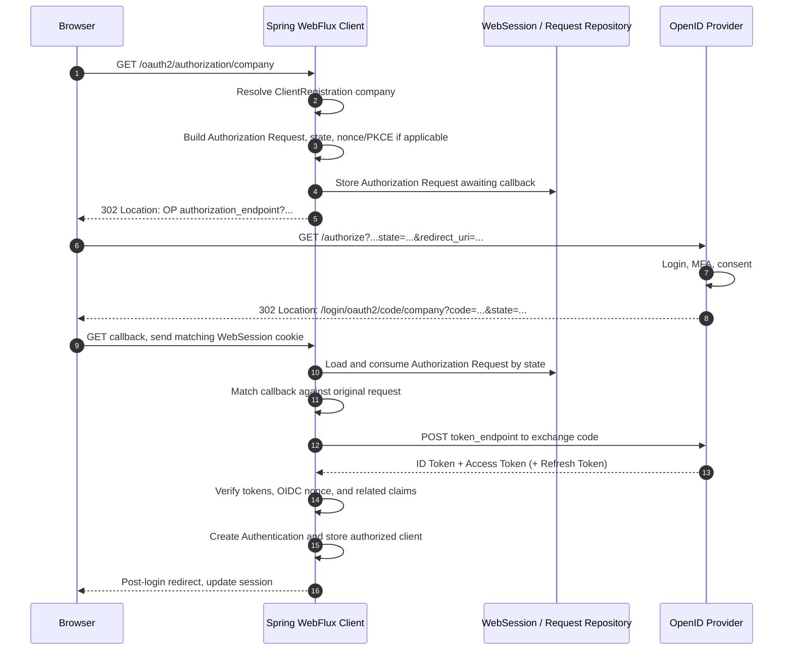
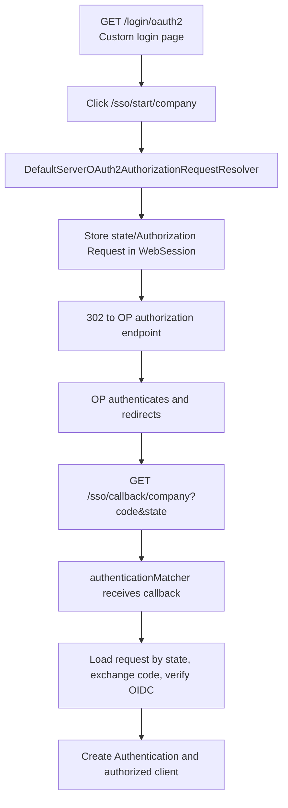
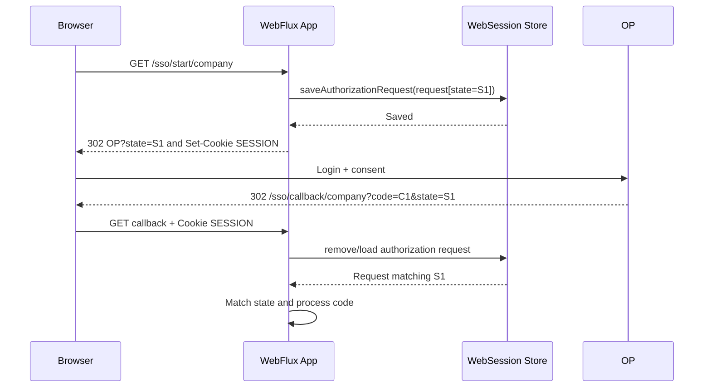

# 20.7. Configuring Login Initiation and Callback Endpoints in WebFlux

In **Spring Security OAuth 2.0 / OpenID Connect (OIDC) Client** using **Spring WebFlux**, logging in via the Authorization Code Flow involves two important endpoints on the **client application side**:

1. **Login initiation endpoint** (*authorization-request initiation endpoint*): the user visits this path so the application builds an Authorization Request and redirects the browser to the Authorization Server/OpenID Provider.
2. **Callback endpoint** (*redirection endpoint / authorization-response endpoint*): the Authorization Server redirects the browser back to the application with `code`, `state`, or error parameters so Spring Security can complete authentication.

By default in WebFlux, these two paths look like:

```text
GET /oauth2/authorization/{registrationId}
GET /login/oauth2/code/{registrationId}?code=...&state=...
```

For example, with registration `company`:

```text
Start:    https://app.example.org/oauth2/authorization/company
Callback: https://app.example.org/login/oauth2/code/company
```

In practice, applications often need to change these paths to fit URL conventions, reverse proxies, gateways, or organizational requirements. A customization that looks like changing a single string directly touches **client registrations, paths matched by WebFilters, URIs allowed by the Authorization Server, `state`/`WebSession`, cookies, callback protection, and the Reactive context**.

This lesson covers everything from defaults to customizing both endpoints on **WebFlux**, including Spring Boot/Java examples, HTTP diagrams, custom login pages, behind-proxy setups, differences from Servlet, and diagnosing common callback errors.

> **Key principle:** **changing the login initiation endpoint** and **changing the callback** are two separate tasks. In particular, when changing the callback, you must align **`authenticationMatcher` in WebFlux**, **`ClientRegistration.redirectUri`**, and **the redirect URI registered at the Authorization Server**.

## 1. Identifying the Role of Each Endpoint Correctly

In OAuth 2.0/OIDC, endpoints belong to different parties. Similar names can easily cause confusion:

| Endpoint | Owned By | Role |
|---|---|---|
| `/oauth2/authorization/{registrationId}` | **WebFlux Client App** | Starts the flow, builds the authorization request, and sends 302 to the Authorization Server. |
| `authorization_endpoint` | **Authorization Server / OpenID Provider** | Receives the user's authorization request through the browser. |
| `token_endpoint` | **Authorization Server** | Backend client exchanges the authorization code for tokens. |
| `/login/oauth2/code/{registrationId}` | **WebFlux Client App** | Receives the authorization response/callback via the browser. |
| `userinfo_endpoint` | **OpenID Provider** | Supplies profile claims given an appropriate Access Token. |
| `jwks_uri` | **OpenID Provider** | Publishes public keys to verify signed tokens per metadata. |

Therefore, the endpoint:

```text
/oauth2/authorization/company
```

is **not** the OP's `authorization_endpoint`. It is an **application-internal path** for Spring Security to start redirecting the user out to the OP.

Likewise:

```text
/login/oauth2/code/company
```

is **not** the token endpoint. The callback receives the **authorization code through the browser**, and Spring Security's backend then calls the token endpoint to exchange the code for tokens.

### 1.1. Meaning of `registrationId`

`registrationId` is the key Spring Security uses to look up a `ClientRegistration`:

```yaml
spring:
  security:
    oauth2:
      client:
        registration:
          company:
            # registrationId = company
            client-id: ${OIDC_CLIENT_ID}
            client-secret: ${OIDC_CLIENT_SECRET}
            authorization-grant-type: authorization_code
            scope: [openid, profile]
```

Here, `company` is an **application-chosen name**, not necessarily equal to the `client_id` at the OP. When the URL is:

```text
/oauth2/authorization/company
```

Spring Security looks up registration `company`. If a user visits `/oauth2/authorization/unknown` without a matching registration, the framework cannot build an Authorization Request from it.

Do not treat `registrationId` as something callers may choose freely in a multi-provider/multi-tenant system. When sensitive registrations exist, control who is permitted to start which flow and how providers/tenants map.

## 2. Authorization Code + OIDC Flow in WebFlux

A single login flow involves these steps:



A valid callback is only an **input to the authentication process**, not proof of login on its own. Spring Security must confirm the original request, `state`, and Authorization Code/OIDC conditions.

### 2.1. What Redirects Does the Browser See?

Example initiation request:

```http
GET /oauth2/authorization/company HTTP/1.1
Host: app.example.org
Cookie: SESSION=<browser-session-id>
```

The WebFlux app responds:

```http
HTTP/1.1 302 Found
Location: https://id.example.org/realms/company/protocol/openid-connect/auth?response_type=code&client_id=orders-web&scope=openid%20profile&state=<random-state>&redirect_uri=https%3A%2F%2Fapp.example.org%2Flogin%2Foauth2%2Fcode%2Fcompany
Set-Cookie: SESSION=<session-id>; Path=/; Secure; HttpOnly
```

Actual responses may vary (for instance including `nonce`, PKCE parameters, and additional headers). The example illustrates request structure; never copy placeholder `state` values into constants.

After authentication, the OP redirects the browser back to:

```http
HTTP/1.1 302 Found
Location: https://app.example.org/login/oauth2/code/company?code=<one-time-code>&state=<same-state>
```

The browser requests the callback URL. Spring Security **needs no custom-written controller** to accept the callback once the WebFlux security filter is configured to handle that path.

### 2.2. When the Authorization Server Denies

Not every callback carries a `code`. The user may cancel consent or the OP may return an error:

```text
/login/oauth2/code/company?error=access_denied&state=<state>
```

The application must still process the authorization response properly and report errors safely. Never assume missing `code` means retrying login endlessly, and never reflect raw unvalidated `error_description` strings into HTML.

## 3. Why Does WebFlux Use a Different Mechanism from Servlet?

A Spring MVC/Servlet project typically uses:

- `HttpSecurity` and `SecurityFilterChain`;
- `HttpServletRequest`/`HttpSession`;
- `ClientRegistrationRepository`;
- `OAuth2AuthorizationRequestRedirectFilter` and `OAuth2LoginAuthenticationFilter`.

In Spring WebFlux/Reactive, distinguish:

- **`ServerHttpSecurity`** and **`SecurityWebFilterChain`**;
- **`ServerWebExchange`** and **`WebSession`**;
- **`ReactiveClientRegistrationRepository`**;
- **`OAuth2AuthorizationRequestRedirectWebFilter`**;
- **`OAuth2LoginAuthenticationWebFilter`**;
- `ServerOAuth2AuthorizationRequestResolver` and `ServerAuthorizationRequestRepository` with reactive APIs.

| Role | Servlet / MVC | WebFlux / Reactive |
|---|---|---|
| Security configuration | `HttpSecurity` | `ServerHttpSecurity` |
| Security chain | `SecurityFilterChain` | `SecurityWebFilterChain` |
| Request context | `HttpServletRequest` | `ServerWebExchange` |
| Session | `HttpSession` | `WebSession` |
| Client registration | `ClientRegistrationRepository` | `ReactiveClientRegistrationRepository` |
| Authorization request resolver | `OAuth2AuthorizationRequestResolver` | `ServerOAuth2AuthorizationRequestResolver` |
| Authorization request storage | `AuthorizationRequestRepository` | `ServerAuthorizationRequestRepository` |
| Callback handling | Servlet filter | Reactive WebFilter |

Specifically, **never use Servlet APIs to customize WebFlux endpoints**. Methods look similar, yet the interfaces and implementations are different.

## 4. Setting Up Spring Boot WebFlux + OAuth2 Client

### 4.1. Dependencies

Illustrative Gradle setup:

```gradle
dependencies {
    implementation("org.springframework.boot:spring-boot-starter-webflux")
    implementation("org.springframework.boot:spring-boot-starter-security")
    implementation("org.springframework.boot:spring-boot-starter-oauth2-client")
}
```

Maven example:

```xml
<dependencies>
    <dependency>
        <groupId>org.springframework.boot</groupId>
        <artifactId>spring-boot-starter-webflux</artifactId>
    </dependency>
    <dependency>
        <groupId>org.springframework.boot</groupId>
        <artifactId>spring-boot-starter-security</artifactId>
    </dependency>
    <dependency>
        <groupId>org.springframework.boot</groupId>
        <artifactId>spring-boot-starter-oauth2-client</artifactId>
    </dependency>
</dependencies>
```

With Spring Boot, the OAuth2 Client starter supplies the components needed to build reactive client registrations and handle login.

**Note:** when an application includes both `spring-boot-starter-web` and `spring-boot-starter-webflux`, Spring Boot may prefer the Servlet application type by default. If your target is a **WebFlux server**, verify the running application type and security stack are truly Reactive. Never conclude an app is WebFlux merely because `WebClient` is present.

### 4.2. Declaring the Client Registration

Example `application.yml`:

```yaml
spring:
  security:
    oauth2:
      client:
        registration:
          company:
            provider: company-oidc
            client-id: ${OIDC_CLIENT_ID}
            client-secret: ${OIDC_CLIENT_SECRET}
            client-authentication-method: client_secret_basic
            authorization-grant-type: authorization_code
            redirect-uri: "{baseUrl}/login/oauth2/code/{registrationId}"
            scope:
              - openid
              - profile
              - email
        provider:
          company-oidc:
            issuer-uri: https://id.example.org/realms/company
```

Key points:

- `registration.company` defines registration ID `company`.
- `redirect-uri` describes the callback **sent in the Authorization Request**.
- `{baseUrl}` uses the base URL perceived by the application from request/proxy settings, typically including scheme, host, port, and base path where applicable.
- `{registrationId}` expands to `company`.
- `scope: openid` marks this as an OIDC login; Spring Security engages OIDC processing components accordingly.
- `issuer-uri` enables metadata discovery when supported by the OP; endpoints and signing keys bind to the configured issuer.

For public URL:

```text
https://app.example.org
```

expected callback:

```text
https://app.example.org/login/oauth2/code/company
```

The OP must list this matching redirect URI in the allowed URIs for client `orders-web`. Never use broad wildcard redirect URIs as a "quick fix" for mismatches.

### 4.3. Default `SecurityWebFilterChain` Configuration

```java
import org.springframework.context.annotation.Bean;
import org.springframework.context.annotation.Configuration;
import org.springframework.security.config.Customizer;
import org.springframework.security.config.annotation.web.reactive.EnableWebFluxSecurity;
import org.springframework.security.config.web.server.ServerHttpSecurity;
import org.springframework.security.web.server.SecurityWebFilterChain;

@Configuration
@EnableWebFluxSecurity
public class ReactiveSecurityConfiguration {

    @Bean
    SecurityWebFilterChain securityWebFilterChain(ServerHttpSecurity http) {
        return http
            .authorizeExchange(exchanges -> exchanges
                .pathMatchers("/", "/public/**", "/assets/**").permitAll()
                .anyExchange().authenticated()
            )
            .oauth2Login(Customizer.withDefaults())
            .build();
    }
}
```

This configuration uses the default endpoints when an appropriate `ReactiveClientRegistrationRepository` is present:

```text
GET /oauth2/authorization/company
GET /login/oauth2/code/company?code=...&state=...
```

You do not need to write controllers at those two paths for Spring Security to handle them. Adding overlapping controllers can cause routing confusion or mask security intent.

## 5. Default Login Initiation Endpoint

When a user accesses:

```text
GET /oauth2/authorization/company
```

Spring Security uses the resolver backed by `ReactiveClientRegistrationRepository` to look up registration `company` and build an `OAuth2AuthorizationRequest`.

An Authorization Request typically needs:

- `client_id`;
- `response_type=code`;
- `scope`;
- `redirect_uri`;
- random `state` linking the flow to the original request;
- OIDC parameters such as `nonce` when applicable;
- PKCE `code_challenge` and `code_challenge_method` when configured/required.

The framework saves the request awaiting callback and returns a redirect to the OP's authorization endpoint.

### 5.1. Which Filter Handles This Step?

In WebFlux, **`OAuth2AuthorizationRequestRedirectWebFilter`** participates in starting the Authorization Code Flow. It delegates to **`ServerOAuth2AuthorizationRequestResolver`**, typically `DefaultServerOAuth2AuthorizationRequestResolver`.

Summary:

```text
Browser GET /oauth2/authorization/company
  |
  v
OAuth2AuthorizationRequestRedirectWebFilter
  |
  v
DefaultServerOAuth2AuthorizationRequestResolver
  |
  +-> ReactiveClientRegistrationRepository.findByRegistrationId("company")
  |
  v
OAuth2AuthorizationRequest
  |
  v
ServerAuthorizationRequestRepository.saveAuthorizationRequest(...)
  |
  v
HTTP 302 to OP authorization endpoint
```

### 5.2. This Path Is Not a JWT-Issuing API

The login initiation path mainly **redirects the browser**; it does not return Access Tokens/ID Tokens to JavaScript. If your application has an SPA frontend, never turn it into an endpoint returning raw client secrets, raw tokens, or authorization codes.

Login must complete via Authorization Code/OIDC with Spring Security's state and token validations intact.

### 5.3. Multiple Registrations

If you also configure:

```text
company
partner
```

you normally have links:

```text
/oauth2/authorization/company
/oauth2/authorization/partner
```

Each registration can have its own issuer, `client_id`, scopes, and callback. When the app separates tenants/providers, ensure the right registration is chosen per policy. The registration name in the URL is only a **lookup key**, not a complete security policy.

## 6. Default Callback Endpoint

Once the user completes authentication at the OP, the browser is redirected to:

```text
GET /login/oauth2/code/company?code=<authorization-code>&state=<state>
```

Spring Security WebFlux processes the authorization response via the authentication WebFilter flow, using **`OAuth2LoginAuthenticationWebFilter`** and the corresponding reactive authentication components.

Essential steps:

1. Check that the request matches the **callback matcher**.
2. Read the authorization response (which may hold `code` or an error).
3. Load the saved authorization request from `WebSession`/repository.
4. Match `state` and bind the response to the initiated request.
5. Use the authorization code to call the **server-side token endpoint**.
6. Validate the token response and OIDC ID Token per configuration.
7. Fetch UserInfo when conditions and configuration apply.
8. Store `Authentication` and `OAuth2AuthorizedClient`.
9. Redirect the user to the post-login destination or handle failure safely.

**The callback is not a place for the app to blindly trust `code`/`state` parameters.** An unexchanged, unverified authorization code proves no identity, and `state` is part of request/response binding.

### 6.1. Do Not Write a Callback Controller to Exchange Codes Manually When Using `oauth2Login()`

Avoid this pattern:

```java
// Not recommended when oauth2Login is already enabled:
@GetMapping("/login/oauth2/code/company")
public Mono<String> callback(@RequestParam String code) {
    // Manually send code, build principal, skip state/nonce...
    return Mono.just("logged in");
}
```

Handling the callback manually in a controller risks bypassing **`state`, PKCE verifier, OIDC nonce, ID Token verification, session correlation**, and framework safeguards.

When choosing `oauth2Login()`, let the WebFilter handle the callback endpoint via the right matcher and configuration.

### 6.2. Is `redirect-uri` the Same as the Listening Callback Path?

Not entirely. Distinguish:

- **`ClientRegistration.redirectUri`**: the URI sent to the OP in the Authorization Request; the OP sends the browser back here if valid.
- **`oauth2Login().authenticationMatcher(...)`**: the matcher Spring Security WebFlux uses to **intercept and handle the callback**.

With defaults, both align. When changing the callback, you must update **both sides** and register that URI at the OP. Changing only YAML or only the matcher will cause the flow to fail.

## 7. Default Login Page and Initiation Links

When a protected page is requested by an unauthenticated user, WebFlux Security can render a **default login page** with links to configured OAuth2 providers.

`LoginPageGeneratingWebFilter` can generate this page. For clients to appear on the default page, `ReactiveClientRegistrationRepository` must also support **iterating registrations**, such as `InMemoryReactiveClientRegistrationRepository`.

A default link:

```html
<a href="/oauth2/authorization/company">
  Log in with company account
</a>
```

Clicking this link starts the authorization flow.

### 7.1. Do Not Confuse the Login Page with Authorization Initiation

`/login` or `/login/oauth2` may be a **UI page** showing login buttons. Meanwhile `/oauth2/authorization/company` is the endpoint that **starts the redirect**.

For example:

```text
GET /login/oauth2
  -> returns HTML with "Company login" button

Click button
  -> GET /oauth2/authorization/company
  -> Spring Security redirects to OP
```

These are two separate URLs and can change independently.

### 7.2. Not Every Repository Auto-Generates Links on the Default Page

If you write a custom `ReactiveClientRegistrationRepository` that does not support enumerating registrations, the default login page may not display the expected links. In that case, provide a custom login page with links to known allowed registrations.

This does not mean the OAuth2 initiation filter is broken; it simply means the **default login page generator cannot enumerate clients**.

## 8. Configuring a Custom Login Page in WebFlux

Suppose the product wants the UI path:

```text
/login/oauth2
```

with "Company login" and "Partner login" buttons.

You can configure an authentication entry point that redirects to the custom login page:

```java
import org.springframework.context.annotation.Bean;
import org.springframework.context.annotation.Configuration;
import org.springframework.security.config.annotation.web.reactive.EnableWebFluxSecurity;
import org.springframework.security.config.web.server.ServerHttpSecurity;
import org.springframework.security.web.server.SecurityWebFilterChain;
import org.springframework.security.web.server.authentication.RedirectServerAuthenticationEntryPoint;

@Configuration
@EnableWebFluxSecurity
public class CustomLoginPageSecurityConfiguration {

    @Bean
    SecurityWebFilterChain securityWebFilterChain(ServerHttpSecurity http) {
        return http
            .authorizeExchange(exchanges -> exchanges
                .pathMatchers(
                    "/", "/login/oauth2", "/assets/**"
                ).permitAll()
                .anyExchange().authenticated()
            )
            .exceptionHandling(exceptions -> exceptions
                .authenticationEntryPoint(
                    new RedirectServerAuthenticationEntryPoint("/login/oauth2")
                )
            )
            .oauth2Login(oauth2 -> { })
            .build();
    }
}
```

This approach keeps the **default authorization initiation** `/oauth2/authorization/{registrationId}`. You do not need to change the resolver just to change the **login UI page**.

### 8.1. Custom Login Page Example

You can provide a controller rendering an HTML template:

```java
import org.springframework.stereotype.Controller;
import org.springframework.web.bind.annotation.GetMapping;

@Controller
public class LoginPageController {

    @GetMapping("/login/oauth2")
    public String loginPage() {
        return "oauth2-login"; // View name in template engine
    }
}
```

Example HTML template:

```html
<!doctype html>
<html lang="en">
<head>
  <meta charset="utf-8">
  <title>Login</title>
</head>
<body>
  <h1>System Login</h1>
  <a href="/oauth2/authorization/company">
    Log in with company account
  </a>
  <a href="/oauth2/authorization/partner">
    Log in with partner account
  </a>
</body>
</html>
```

This snippet assumes a configured template engine (e.g., Thymeleaf) and matching `company`/`partner` registrations. If only `company` exists, render only that link.

### 8.2. Avoiding Redirect Loops to the Login Page

If `/login/oauth2` is protected by `authenticated()`, an unauthenticated browser gets redirected to that same page repeatedly.

Therefore, **the login page must be accessible while unauthenticated**, along with its required assets. Never protect a route that is itself the authentication entry point.

### 8.3. `loginPage(...)` in Newer Versions

Some versions of Spring Security WebFlux offer `oauth2Login(oauth2 -> oauth2.loginPage("/login/oauth2"))`. Using the entry point above directly illustrates the redirect behavior without depending on whether a convenience API is present in your version.

Either way, a controller/view must actually serve the custom page; configuring a URL alone does not generate the HTML for the login page.

## 9. Changing the Login Initiation Endpoint

Suppose a gateway requires:

```text
GET /sso/start/{registrationId}
```

instead of:

```text
GET /oauth2/authorization/{registrationId}
```

In WebFlux, the key extension point is:

```java
oauth2Login(oauth2 -> oauth2
    .authorizationRequestResolver(customResolver)
)
```

The resolver decides **which requests produce an Authorization Request** and which registration to use. For the new path, pass a `ServerWebExchangeMatcher` to `DefaultServerOAuth2AuthorizationRequestResolver`.

### 9.1. Resolver Example with a New Matcher

```java
import org.springframework.context.annotation.Bean;
import org.springframework.context.annotation.Configuration;
import org.springframework.security.config.annotation.web.reactive.EnableWebFluxSecurity;
import org.springframework.security.config.web.server.ServerHttpSecurity;
import org.springframework.security.oauth2.client.registration.ReactiveClientRegistrationRepository;
import org.springframework.security.oauth2.client.web.server.DefaultServerOAuth2AuthorizationRequestResolver;
import org.springframework.security.oauth2.client.web.server.ServerOAuth2AuthorizationRequestResolver;
import org.springframework.security.web.server.SecurityWebFilterChain;
import org.springframework.security.web.server.util.matcher.PathPatternParserServerWebExchangeMatcher;
import org.springframework.security.web.server.util.matcher.ServerWebExchangeMatcher;

@Configuration
@EnableWebFluxSecurity
public class CustomStartEndpointSecurityConfiguration {

    @Bean
    SecurityWebFilterChain securityWebFilterChain(
            ServerHttpSecurity http,
            ReactiveClientRegistrationRepository registrations) {

        ServerWebExchangeMatcher startMatcher =
            new PathPatternParserServerWebExchangeMatcher(
                "/sso/start/{registrationId}"
            );

        ServerOAuth2AuthorizationRequestResolver resolver =
            new DefaultServerOAuth2AuthorizationRequestResolver(
                registrations,
                startMatcher
            );

        return http
            .authorizeExchange(exchanges -> exchanges
                .pathMatchers("/", "/login/oauth2", "/assets/**").permitAll()
                .anyExchange().authenticated()
            )
            .oauth2Login(oauth2 -> oauth2
                .authorizationRequestResolver(resolver)
            )
            .build();
    }
}
```

In this setup:

- `GET /sso/start/company` initiates login.
- The matcher extracts `registrationId=company`.
- The resolver finds `ClientRegistration` `company` in `ReactiveClientRegistrationRepository`.
- Spring Security builds the Authorization Request and redirects to the OP.
- **The callback remains at the default** `/login/oauth2/code/company` unless customized separately.

**Note:** this is a standalone illustrative configuration; do not register multiple `SecurityWebFilterChain` beans with overlapping matchers just because examples in this lesson show multiple classes. In a real app, integrate the resolver into your active chain.

### 9.2. Update the Login Page Links to Match

Once the start matcher changes, links on your custom login page must be:

```html
<a href="/sso/start/company">
  Log in with company account
</a>
```

If the page still points to `/oauth2/authorization/company`, the old endpoint will no longer be matched by the custom resolver, causing 404s or wrong redirects.

**Changing the start endpoint does not require changing `redirect-uri`**, because the callback URI is a separate endpoint.

### 9.3. Why Not Construct the Authorization Request Yourself in a Controller?

Avoid writing:

```java
// Violates protocol principles by bypassing the authorization request repository:
@GetMapping("/sso/start/company")
public Mono<Void> start(ServerWebExchange exchange) {
    // Manually concatenate client_id, state, nonce into a URL
    // and send 302 to OP without saving request properly...
    return Mono.empty();
}
```

A hand-assembled redirect link can omit state/session correlation, OIDC nonce, PKCE, or client registration policies.

Spring Security's resolver keeps protocol handling inside the framework. If you merely want a **URL alias** to start login, you can perform an internal redirect to the default endpoint, ensuring the target URL is fixed and cannot become an open redirect.

## 10. Changing the Callback Endpoint in WebFlux

Suppose the gateway requires the callback:

```text
https://app.example.org/login/oauth2/callback/company
```

instead of:

```text
https://app.example.org/login/oauth2/code/company
```

To make Spring Security WebFlux handle the authorization response at the new path, configure **`oauth2Login().authenticationMatcher(...)`**.

### 10.1. Configuring the Callback Matcher

```java
import org.springframework.context.annotation.Bean;
import org.springframework.context.annotation.Configuration;
import org.springframework.security.config.annotation.web.reactive.EnableWebFluxSecurity;
import org.springframework.security.config.web.server.ServerHttpSecurity;
import org.springframework.security.web.server.SecurityWebFilterChain;
import org.springframework.security.web.server.util.matcher.PathPatternParserServerWebExchangeMatcher;

@Configuration
@EnableWebFluxSecurity
public class CustomCallbackSecurityConfiguration {

    @Bean
    SecurityWebFilterChain securityWebFilterChain(ServerHttpSecurity http) {
        return http
            .authorizeExchange(exchanges -> exchanges
                .pathMatchers("/", "/public/**").permitAll()
                .anyExchange().authenticated()
            )
            .oauth2Login(oauth2 -> oauth2
                .authenticationMatcher(
                    new PathPatternParserServerWebExchangeMatcher(
                        "/login/oauth2/callback/{registrationId}"
                    )
                )
            )
            .build();
    }
}
```

Now Spring Security accepts callbacks at:

```text
GET /login/oauth2/callback/company?code=...&state=...
```

However, **changing the matcher alone is not enough**.

### 10.2. Updating `ClientRegistration.redirectUri`

Update YAML:

```yaml
spring:
  security:
    oauth2:
      client:
        registration:
          company:
            provider: company-oidc
            client-id: ${OIDC_CLIENT_ID}
            client-secret: ${OIDC_CLIENT_SECRET}
            authorization-grant-type: authorization_code
            redirect-uri: "{baseUrl}/login/oauth2/callback/{registrationId}"
            scope: [openid, profile, email]
        provider:
          company-oidc:
            issuer-uri: https://id.example.org/realms/company
```

With public base URL `https://app.example.org`, the URI sent to the OP becomes:

```text
https://app.example.org/login/oauth2/callback/company
```

### 10.3. Registering the New URI at the Authorization Server

In the OP's OAuth2 Client configuration, allow the exact callback:

```text
https://app.example.org/login/oauth2/callback/company
```

If the OP still only permits:

```text
https://app.example.org/login/oauth2/code/company
```

the Authorization Server may return `invalid_redirect_uri` or `redirect_uri_mismatch` when authorization begins.

Three places must match:

| Location | Value |
|---|---|
| Spring Security `authenticationMatcher` | `/login/oauth2/callback/{registrationId}` |
| Spring Boot `redirect-uri` | `{baseUrl}/login/oauth2/callback/{registrationId}` |
| Allowed redirect URI at OP | `https://app.example.org/login/oauth2/callback/company` |

These three components have **different roles**; aligning all three ensures the flow returns from the OP to the right WebFilter.

### 10.4. No Callback Controller Needed

Once the matcher is configured, the **OAuth2 Login Authentication WebFilter** handles the callback. Do not write `@GetMapping("/login/oauth2/callback/company")` to exchange codes yourself.

If a controller at the callback path exists and executes because the security filter missed the request, that masks a matcher configuration error instead of fixing the flow.

## 11. Changing Both Start Endpoint and Callback Together

A realistic requirement:

```text
Login UI page: /login/oauth2
Start endpoint: /sso/start/{registrationId}
Callback:      /sso/callback/{registrationId}
```

**Unified** configuration example:

```java
import org.springframework.context.annotation.Bean;
import org.springframework.context.annotation.Configuration;
import org.springframework.security.config.annotation.web.reactive.EnableWebFluxSecurity;
import org.springframework.security.config.web.server.ServerHttpSecurity;
import org.springframework.security.oauth2.client.registration.ReactiveClientRegistrationRepository;
import org.springframework.security.oauth2.client.web.server.DefaultServerOAuth2AuthorizationRequestResolver;
import org.springframework.security.oauth2.client.web.server.ServerOAuth2AuthorizationRequestResolver;
import org.springframework.security.web.server.SecurityWebFilterChain;
import org.springframework.security.web.server.authentication.RedirectServerAuthenticationEntryPoint;
import org.springframework.security.web.server.util.matcher.PathPatternParserServerWebExchangeMatcher;
import org.springframework.security.web.server.util.matcher.ServerWebExchangeMatcher;

@Configuration
@EnableWebFluxSecurity
public class CompanyReactiveLoginSecurityConfiguration {

    @Bean
    SecurityWebFilterChain securityWebFilterChain(
            ServerHttpSecurity http,
            ReactiveClientRegistrationRepository registrations) {

        ServerWebExchangeMatcher authorizationRequestMatcher =
            new PathPatternParserServerWebExchangeMatcher(
                "/sso/start/{registrationId}"
            );

        ServerOAuth2AuthorizationRequestResolver resolver =
            new DefaultServerOAuth2AuthorizationRequestResolver(
                registrations,
                authorizationRequestMatcher
            );

        return http
            .authorizeExchange(exchanges -> exchanges
                .pathMatchers("/", "/login/oauth2", "/assets/**").permitAll()
                .anyExchange().authenticated()
            )
            .exceptionHandling(exceptions -> exceptions
                .authenticationEntryPoint(
                    new RedirectServerAuthenticationEntryPoint("/login/oauth2")
                )
            )
            .oauth2Login(oauth2 -> oauth2
                .authorizationRequestResolver(resolver)
                .authenticationMatcher(
                    new PathPatternParserServerWebExchangeMatcher(
                        "/sso/callback/{registrationId}"
                    )
                )
            )
            .build();
    }
}
```

Matching YAML:

```yaml
spring:
  security:
    oauth2:
      client:
        registration:
          company:
            provider: company-oidc
            client-id: ${OIDC_CLIENT_ID}
            client-secret: ${OIDC_CLIENT_SECRET}
            client-authentication-method: client_secret_basic
            authorization-grant-type: authorization_code
            redirect-uri: "{baseUrl}/sso/callback/{registrationId}"
            scope: [openid, profile, email]
        provider:
          company-oidc:
            issuer-uri: https://id.example.org/realms/company
```

Login page HTML:

```html
<a href="/sso/start/company">Log in with OIDC</a>
```

URI to register at the OP:

```text
https://app.example.org/sso/callback/company
```

Diagram:



The Java snippets in earlier sections are **not meant to be registered simultaneously**. Pick the pattern that fits and maintain **one unified `SecurityWebFilterChain`** for these routes.

## 12. Custom Resolvers Must Preserve Security Requirements

`DefaultServerOAuth2AuthorizationRequestResolver` can be customized to add authorization parameters required by an OP. Yet any customization must preserve protocol safeguards.

Example where a provider requires `prompt=login`:

```java
import org.springframework.security.oauth2.client.web.server.DefaultServerOAuth2AuthorizationRequestResolver;
import org.springframework.security.oauth2.client.registration.ReactiveClientRegistrationRepository;

DefaultServerOAuth2AuthorizationRequestResolver resolver =
    new DefaultServerOAuth2AuthorizationRequestResolver(registrations);

resolver.setAuthorizationRequestCustomizer(builder ->
    builder.additionalParameters(parameters ->
        parameters.put("prompt", "login")
    )
);
```

This illustrates customizing `OAuth2AuthorizationRequest.Builder` via the reactive resolver's extension point in versions supporting that API. Always check provider requirements before sending custom parameters.

### 12.1. Never Replace `state` with a Constant Value

`state` binds the callback to the authorization request initiated in the browser context.

Wrong:

```text
state=company
state=123456
state=<a constant used for all users>
```

A predictable or widely reused `state` weakens protection against login CSRF and callback injection. Let Spring Security generate and manage `state` rather than replacing it with a client-supplied string.

### 12.2. Never Take the Redirect URI from an Arbitrary Query Parameter

Avoid:

```text
GET /sso/start/company?redirect_uri=https://attacker.example/callback
```

and using that parameter directly as `redirect_uri` in the authorization request. Doing so leads to **redirect URI injection**, breaking callback registration boundaries and risking authorization code leakage.

If the app needs to send users back to an internal page after login, use a **saved request / success handler / local path allowlist** mechanism instead of placing arbitrary external URLs into OAuth2 `redirect_uri`.

### 12.3. Never Disable PKCE/Nonce When Changing Endpoints

Changing the initiation or callback path does not alter the purpose of:

- **`state`**: binds the authorization response to the initiating request.
- **`nonce`** in OIDC: binds the ID Token to the corresponding authentication request when applicable.
- **PKCE**: protects the authorization code in applicable flows using `code_verifier`/`code_challenge`.

Depending on client type/registration and Spring Security version, PKCE may be active by default or by configuration. Never strip these parameters in a custom resolver just to add an OP-specific field.

## 13. `WebSession` and Storing the Authorization Request

Between these two HTTP requests lies a gap in time:

```text
1) GET /oauth2/authorization/company
2) GET /login/oauth2/code/company?code=...&state=...
```

The application must remember the **original request** to verify the callback. In WebFlux, the abstraction is:

```java
ServerAuthorizationRequestRepository<OAuth2AuthorizationRequest>
```

Typical implementation:

```java
WebSessionOAuth2ServerAuthorizationRequestRepository
```

It saves `OAuth2AuthorizationRequest` inside **`WebSession`**. The callback URL contains only `code` and `state`; restoring the authorization request using `state` and session context confirms the callback matches the flow that was started.

### 13.1. Storage Mechanism



If the browser does not send back the right session cookie or the session is lost, the callback cannot locate the authorization request and is rejected.

### 13.2. Customizing the Repository in `oauth2Login()`

WebFlux provides the extension point:

```java
.oauth2Login(oauth2 -> oauth2
    .authorizationRequestRepository(repository)
)
```

where `repository` has type:

```java
ServerAuthorizationRequestRepository<OAuth2AuthorizationRequest>
```

Illustrative `@Bean`:

```java
import org.springframework.context.annotation.Bean;
import org.springframework.context.annotation.Configuration;
import org.springframework.security.oauth2.client.web.server.WebSessionOAuth2ServerAuthorizationRequestRepository;
import org.springframework.security.oauth2.client.web.server.ServerAuthorizationRequestRepository;
import org.springframework.security.oauth2.core.endpoint.OAuth2AuthorizationRequest;

@Configuration
public class AuthorizationRequestStorageConfiguration {

    @Bean
    ServerAuthorizationRequestRepository<OAuth2AuthorizationRequest>
            authorizationRequestRepository() {

        return new WebSessionOAuth2ServerAuthorizationRequestRepository();
    }
}
```

If using this bean for `oauth2Login()`, wire it into your actual `SecurityWebFilterChain` configuration. Defining the bean is unnecessary if default behavior suffices.

### 13.3. Distinguishing Authorization Request and Authorized Client

| Data | Where Stored? | When Needed? |
|---|---|---|
| Pending `OAuth2AuthorizationRequest` awaiting callback | `ServerAuthorizationRequestRepository`, usually `WebSession` | From login start until callback arrival. |
| `OAuth2AuthorizedClient` | `ServerOAuth2AuthorizedClientRepository` or `ReactiveOAuth2AuthorizedClientService` | After receiving an Access Token and completing authorization. |
| `Authentication` / `SecurityContext` | `ServerSecurityContextRepository`/`WebSession` or equivalent | So subsequent requests recognize the logged-in user. |

These three types of data are **not interchangeable**. Saving an Access Token in a database does not help a callback recover `state` if the authorization request in the session is gone.

## 14. Session Cookies, SameSite, and Callbacks from the OP

After the user is sent to the OP, the callback is a request **from the browser back to the application**. The browser decides whether to send the session cookie based on attributes:

- `Secure`;
- `HttpOnly`;
- `SameSite`;
- `Domain`;
- `Path`;
- browser cookie policies;
- top-level navigation origin and HTTP method.

### 14.1. SameSite Lax and GET Callbacks

For callbacks that are **top-level cross-site navigations via GET**, a `SameSite=Lax` cookie normally permits the browser to send the session cookie back to the app. Exact behavior still depends on the browser, domain/site context, and how the cookie is issued.

If a cookie has `SameSite=Strict`, the browser may withhold it on cross-site redirects, preventing `WebSession` from being restored.

### 14.2. Form-Post Callbacks Are a Different Case

If the provider uses `response_mode=form_post`, the callback can be an HTTP POST from another site. That impacts:

- `SameSite` cookie policy;
- application CSRF handling;
- matcher and authentication converter reading the authorization response;
- Spring Security and provider support for that response mode.

Never enable `form_post` simply by adding `response_mode` to the request without designing full callback handling. Default examples in this lesson use **Authorization Code + GET callback**.

### 14.3. `Secure` Cookies and HTTPS

In production, use HTTPS and `Secure`, `HttpOnly` session cookies. Never disable security flags to "fix" callbacks behind a reverse proxy; configure the public scheme, proxy headers, and cookie settings properly instead.

If the app sits under `/app` while cookie `Path` covers a different route, the browser may omit the cookie on the callback. Inspect the full request URL and `Set-Cookie` metadata without exposing session IDs.

### 14.4. Session Lost Between Requests

Common causes:

- Browser blocks cookies.
- Wrong cookie `Domain`/`Path`/`SameSite`.
- Session timed out while the user authenticated at the OP.
- App restarted or load balancer routed the callback to a node lacking the session.
- User opened the callback on a different browser/device.
- Session rotated or invalidated incompatibly with the original request.

Never bypass `state` validation to "fix" a session bug. Restore proper request/browser binding.

## 15. Reverse Proxies, Load Balancers, and `{baseUrl}`

In production, the public frontend may be:

```text
https://portal.example.org
```

while the WebFlux backend actually receives internal traffic at:

```text
http://orders-web:8080
```

If the framework builds `redirect_uri` using the internal scheme/host, the Authorization Server may receive:

```text
http://orders-web:8080/login/oauth2/code/company
```

when it only allows:

```text
https://portal.example.org/login/oauth2/code/company
```

The flow then fails even though the OAuth2/OIDC code would otherwise be valid.

### 15.1. Configuring Forwarded Headers Properly

Spring Boot provides:

```yaml
server:
  forward-headers-strategy: framework
```

In a compatible WebFlux environment, this lets the framework infer scheme/host/port from trusted infrastructure forwarded headers and build the right external base URL.

The proxy may send headers such as:

```http
Forwarded: proto=https;host=portal.example.org
```

or `X-Forwarded-*` headers depending on infrastructure.

**Trust boundary warning:** never trust `Forwarded`/`X-Forwarded-Host` sent directly by Internet clients. Edge proxies must **strip or overwrite** untrusted headers before forwarding to the backend; otherwise attackers can manipulate the host/scheme used to generate URLs, causing host-header poisoning or bad redirects.

### 15.2. Matching the Redirect URI to the Public URL

Suppose configuration has:

```yaml
redirect-uri: "{baseUrl}/sso/callback/{registrationId}"
```

and the public host is `https://portal.example.org`. The URI sent to the OP must be:

```text
https://portal.example.org/sso/callback/company
```

Do not register wildcards across all hosts or all paths just because there are multiple deployment environments. Keep dev/staging/prod redirect URIs distinct and apply separate client policies where needed.

### 15.3. Reverse Proxy Path Rewriting

A gateway might expose:

```text
Public: /identity/sso/callback/company
Internal: /sso/callback/company
```

Both sides must be accounted for:

1. The **public** path browsers/the OP redirect to.
2. The path the Spring Security matcher actually sees after rewriting.

If the gateway strips the `/identity` prefix, the app matcher can stay `/sso/callback/{registrationId}`, whereas the `redirect-uri` seen by the OP needs the public path `/identity/sso/callback/company`. Verify how `{baseUrl}` and forwarded prefixes are computed in your proxy deployment.

Do not blindly change only the matcher to the public path if the gateway strips that prefix; the WebFilter would never see that URL.

### 15.4. Avoid Constructing URIs from Arbitrary Input

A less error-prone approach in complex environments can be configuring a fixed public redirect URI per registration aligned with the OP. When using dynamic `{baseUrl}`, ensure external scheme/host/port/context path originate from a trusted proxy.

Never take `redirect_uri` from a user query string and forward it verbatim to the OP.

## 16. Multiple Instances and Distributed WebSession

Suppose an app runs two nodes:

```text
Browser -> Load Balancer -> WebFlux Node A
                          -> WebFlux Node B
```

The Authorization Request starts on node A and is saved in A's local session store. The callback lands on node B; if B lacks the original state/request, login fails.

Common solutions:

- Use a **distributed `WebSession` store** supported by Spring Session.
- Use sticky sessions where appropriate as an infrastructure measure, recognizing their limits when nodes die.
- Ensure all nodes share identical client registration/provider configurations.
- Verify session serialization and token/cookie encryption properly.
- Keep cluster clocks synchronized and secure connections to the session store.

**Do not confuse** `ReactiveOAuth2AuthorizedClientService` with `ServerAuthorizationRequestRepository`. A database storing post-login Access Tokens does not replace the session/state repository during the callback stage.

### 16.1. Concurrent Login Tabs

A user can open two tabs:

```text
Tab A: /sso/start/company -> state=A
Tab B: /sso/start/company -> state=B
```

Then Tab A's callback arrives after Tab B's. Support for holding multiple concurrent authorization requests depends on the repository implementation/version and configuration.

Never assume every repository supports unlimited concurrent login flows out of the box. When high multi-tab reliability is required, pick a repository with explicit multi-pending-request semantics while preserving `state` verification, expiry, and one-time consumption.

### 16.2. Refreshed or Replayed Callbacks

Authorization codes are typically **single-use**. If a user hits F5 on the callback or replays a URL with the same `code`, the token endpoint may return `invalid_grant` because the code was already redeemed.

The app should not retry exchanging the authorization code; redirect cleanly after login succeeds and handle failures gracefully. Never log full callback URLs containing `code`/`state`.

## 17. Difference Between Custom Callback Matcher and Authorization Matcher

The two matchers operate at **two different times**:

| Component | Runs On Which Request? | Main Output |
|---|---|---|
| `ServerOAuth2AuthorizationRequestResolver` with matcher `/sso/start/{registrationId}` | Login initiation | `OAuth2AuthorizationRequest` and redirect to OP. |
| `oauth2Login().authenticationMatcher(...)` with `/sso/callback/{registrationId}` | Callback from OP | Passes authorization response into authentication processing. |

If you replace only the resolver:

```java
.oauth2Login(oauth2 -> oauth2
    .authorizationRequestResolver(customResolver)
)
```

the callback still uses the default matcher unless changed as well.

If you replace only the callback matcher:

```java
.oauth2Login(oauth2 -> oauth2
    .authenticationMatcher(customCallbackMatcher)
)
```

the start endpoint typically remains `/oauth2/authorization/{registrationId}`.

Configure both together only when the product actually changes **both URLs**.

## 18. When There Are Multiple `SecurityWebFilterChain` Beans

WebFlux can define multiple security chains for distinct route groups, such as:

```text
/api/**        -> Resource Server JWT
/web/**        -> Session + oauth2Login
/actuator/**   -> Management security
```

If the chain containing `oauth2Login()` matches only `/web/**` while the start endpoint is `/oauth2/authorization/company` and the callback is `/login/oauth2/code/company`, **both default endpoints fall outside the login chain's matcher**.

As a result:

- the start URL is not processed by that chain's OAuth2 authorization WebFilter;
- the callback is not received by the login authentication filter;
- the browser may receive 404, 401/403, or fall into another chain.

Ensure the chain declaring `oauth2Login()` **covers both start and callback routes in its matcher**, or move the start/callback paths inside that chain's scope by design.

### 18.1. Do Not Accidentally Bypass Security Filters for the Callback

A callback endpoint must be reachable **before authentication** when the OP redirects back; yet it **must still pass through the Spring Security `WebFilterChain`** so the framework performs state and token validation.

`permitAll` differs from **bypassing Spring Security altogether**. Avoid excluding the callback from security filters via inappropriate path-ignore rules.

### 18.2. Permitting the Start Route Does Not Mean Skipping State

The login initiation endpoint must be reachable before the user logs in, so anonymous access is normally permitted. However, the authorization request must still generate `state` and persist the request in the session repository; `permitAll` never means skipping OAuth2 protections.

## 19. SecurityContext and Post-Login Navigation

After a successful callback, Spring Security creates `Authentication` and persists the `SecurityContext` via the appropriate reactive security context repository.

Applications may want:

```text
Login success -> /dashboard
Login failure -> /login/oauth2?error
```

WebFlux extension points include:

- `authenticationSuccessHandler(...)`;
- `authenticationFailureHandler(...)`;
- `securityContextRepository(...)` depending on version/configuration.

Example success handler redirecting to a fixed page:

```java
import org.springframework.security.web.server.authentication.RedirectServerAuthenticationSuccessHandler;

.oauth2Login(oauth2 -> oauth2
    .authenticationSuccessHandler(
        new RedirectServerAuthenticationSuccessHandler("/dashboard")
    )
)
```

This is a **fragment inside `ServerHttpSecurity` configuration**, not a standalone top-level Java class. A failure handler can be configured similarly using your version's API.

### 19.1. Do Not Use `redirect_uri` to Specify the Post-Login Page

`redirect_uri` is the endpoint **receiving the authorization response from the OP**, not the dashboard page the user wants to view.

Correct:

```text
OP -> /sso/callback/company -> Spring Security verifies code/state
   -> authentication success handler -> /dashboard
```

Design flaw:

```text
redirect_uri=https://app.example.org/dashboard
```

when `/dashboard` is neither configured as the callback matcher nor handles authorization responses. Never route the callback straight to a view merely to skip one redirect.

### 19.2. Protecting Post-Login Redirects

If the success handler honors `returnTo`/`continue`, validate the target against a **local path allowlist** or safe destination policy. Never redirect the browser to arbitrary external URLs after login; that creates an **open redirect** vulnerability that can aid phishing.

Never pass authorization codes, ID Tokens, or Access Tokens in the dashboard's query string.

## 20. Reading the Principal After a Successful Callback

After login, a WebFlux application can read the OIDC principal using reactive APIs.

Controller example:

```java
import java.util.Map;
import org.springframework.security.core.annotation.AuthenticationPrincipal;
import org.springframework.security.oauth2.core.oidc.user.OidcUser;
import org.springframework.web.bind.annotation.GetMapping;
import org.springframework.web.bind.annotation.RestController;
import reactor.core.publisher.Mono;

@RestController
public class CurrentUserController {

    @GetMapping("/me")
    public Mono<Map<String, Object>> me(
            @AuthenticationPrincipal OidcUser user) {

        return Mono.just(Map.of(
            "subject", user.getSubject(),
            "displayName", user.getFullName() == null
                ? user.getSubject()
                : user.getFullName()
        ));
    }
}
```

This example assumes `/me` requires authentication and the registration used includes the `openid` scope, producing an `OidcUser` principal under the OIDC flow. In systems with multiple authentication mechanisms, handle appropriate principal types rather than forcing every user into OIDC.

**Never return ID Tokens, Access Tokens, Refresh Tokens, or unnecessary full claims from `/me`.** Return only data the user is authorized to see.

### 20.1. Reactive Context Is Not Servlet ThreadLocal

In WebFlux, authentication normally propagates through the **Reactor Context**, rather than relying on `SecurityContextHolder` the way MVC/Servlet does.

Never write asynchronous callbacks that read `HttpServletRequest` or `HttpSession` in a reactive WebFlux app. When identity is needed inside a reactive chain, use supported APIs like `ReactiveSecurityContextHolder` or WebFlux controller argument resolution.

### 20.2. OAuth2 Login and OAuth2 Client APIs Serve Two Roles

- `oauth2Login()`: receives callbacks, authenticates users, creates session/principal.
- `oauth2Client()`: supports client capabilities when the app calls protected resource APIs.

An app needing only login can start with `oauth2Login()`. When using `WebClient` to call APIs on behalf of users, add `oauth2Client()` and a suitable `ReactiveOAuth2AuthorizedClientManager`.

Never use Servlet's `ServletOAuth2AuthorizedClientExchangeFilterFunction` in a reactive WebFlux app; that filter is for `WebClient` running **on the Servlet stack**.

## 21. GET Callbacks, POST Callbacks, and HTTP Methods

The usual Authorization Code Flow pattern is the OP issuing a **302 redirect to a GET callback** with `code`/`state` query parameters.

However, some providers or configurations using another authorization response mode (such as `form_post`) may deliver the callback as a POST.

When changing the callback path or HTTP method:

- Confirm which response modes the OP supports.
- Confirm `authenticationMatcher` matches the HTTP method.
- Confirm `ServerAuthenticationConverter` can read that response format.
- Assess impact on `WebSession` cookie `SameSite` and CSRF handling.
- Never simply change the matcher to POST and assume the rest of the flow works automatically.
- Never disable CSRF globally to make a callback work without evaluating the threat model.

This lesson prioritizes **GET** callbacks on default or customized paths; other response modes require additional design.

## 22. `redirect_uri_mismatch` Error: Detailed Breakdown

Suppose the OP reports:

```text
redirect_uri_mismatch
```

Common causes:

| Cause | Example |
|---|---|
| Wrong scheme | Registered `https://...` while request sends `http://...`. |
| Wrong host | OP allows `app.example.org` while request sends `localhost` or internal host. |
| Wrong port | OP allows 443 while request sends 8080. |
| Wrong path | Registered `/login/oauth2/code/company` while request sends `/sso/callback/company`. |
| Wrong registrationId | Callback template expands `company2` while OP permits `company`. |
| Wrong proxy prefix | Public path includes `/portal` while `redirect-uri` omits it. |
| Wrong environment config | Staging uses production URL or vice versa. |
| Uncontrolled dynamic URI | `{baseUrl}` computed from an inaccurate forwarded host. |

Remediation steps:

1. Verify the actual login initiation URL.
2. Inspect the **`redirect_uri` value sent in the authorization request** (in a protected debug environment, without logging full URLs containing `state`/`nonce`).
3. Compare exact scheme/host/port/path against allowed redirect URIs at the OP.
4. Check `redirect-uri` in `ClientRegistration`.
5. Check proxy forwarded headers and path rewrites.
6. Check whether Spring Security's callback matcher matches the URI received after passing through the gateway.

Never fix mismatches with uncontrolled wildcard redirect URIs that expose code interception or unauthorized redirect risks.

## 23. Lost `state` or Authorization Request Not Found

Common errors:

```text
Authorization Request not found
Invalid state parameter
OAuth2 authorization request not found
```

This usually means Spring Security **cannot correlate the callback with a prior request**.

Root-cause categories:

- Callback arrives from a different browser or session cookie was not sent back.
- Cookie `SameSite`, `Secure`, `Path`, or `Domain` is misconfigured.
- Session expired or is not shared across multiple nodes.
- User refreshed the callback or replayed an authorization response.
- Another tab or flow overwrote/consumed the pending authorization request.
- Custom repository failed to save, load, or remove the request properly by state.
- Path mismatch caused the request to hit the wrong filter or chain.
- Proxy rewrite broke the cookie path or session routing.

Safe remediation:

- Keep `state` verification enabled.
- Inspect `WebSession`/session cookies and the load balancer.
- Ensure the callback hits the right security chain and repository.
- If multi-tab support is needed, design the repository appropriately.
- Avoid logging raw `state`, codes, ID Tokens, or session IDs.

**Never** fix this by disabling `state` validation or accepting callbacks without an original authorization request.

## 24. Callback Not Handled by the WebFilter

Typical symptoms:

| Symptom | Likely Cause |
|---|---|
| Callback returns **404** | Path does not match matcher, security chain ignores route, or request falls through to controller routing. |
| Callback returns **401/403** | Chain protects request, yet OAuth2 authentication filter did not intercept callback; wrong order/`securityMatcher`. |
| Browser loops back to **login page** | `Authentication` was not saved, callback failed, or session/cookie was lost. |
| OP reports invalid redirect URI | URI sent to OP differs from allowed redirect URIs. |
| Token endpoint returns `invalid_grant` | Code expired or reused, `redirect_uri`/PKCE mismatch, or provider issue. |
| Token endpoint returns `invalid_client` | Wrong `client_id`/secret/client authentication method. |
| ID Token validation fails | Issuer/audience/nonce/time/signature or provider metadata mismatch. |
| Login succeeds yet `/me` is anonymous | `SecurityContext`/`WebSession` not saved or restored on subsequent requests. |
| Start URL returns 404 | Custom resolver matcher does not match login link, or route sits outside the chain. |

Specifically, if you change links to:

```text
/start/company
```

while the custom resolver still matches:

```text
/sso/start/{registrationId}
```

tweaking `redirect-uri` will have zero effect on the **start endpoint error**. Diagnose the two components independently.

## 25. Security Filter Chain and Public Callbacks

Some developers worry that because the callback must be `permitAll`, security should be disabled entirely on that route. Distinguish:

- **Allowing pre-login access:** the OP redirects to the callback while the browser has no app `Authentication` yet.
- **Bypassing the security chain:** depriving Spring Security WebFilters of the chance to verify `state`, code, session, and authentication.

The callback must **pass through the chain that has `oauth2Login()`**, never bypass it.

Example matcher setup for a WebFlux web app:

```java
return http
    .authorizeExchange(exchanges -> exchanges
        .pathMatchers(
            "/", "/login/oauth2",
            "/sso/start/**",
            "/sso/callback/**",
            "/assets/**"
        ).permitAll()
        .anyExchange().authenticated()
    )
    .oauth2Login(oauth2 -> oauth2
        .authorizationRequestResolver(resolver)
        .authenticationMatcher(
            new PathPatternParserServerWebExchangeMatcher(
                "/sso/callback/{registrationId}"
            )
        )
    )
    .build();
```

This is a fragment inside a configuration method; `permitAll` on these paths does not disable the chain's OAuth2 Login WebFilters. In practice, authorization rules and filter matchers must align with your security chain architecture.

## 26. Observing Errors Without Leaking Secrets

To diagnose auth flows safely, you can log:

- Registration ID and configured provider alias/issuer.
- Stage: start endpoint, redirect built, callback received, state correlation success/failure, token exchange success/failure.
- Name of the matched security chain/matcher.
- HTTP status and sanitized OAuth2 error code.
- Whether a session cookie was present (boolean), without logging the cookie value.
- Normalized public scheme/host/path per configuration, without logging full queries holding code/state.
- Internal correlation ID and callback timing.
- Instance ID in clustered deployments.

Never log:

- Raw authorization codes.
- Raw `state`, `nonce`, or PKCE `code_verifier`.
- ID Tokens, Access Tokens, or Refresh Tokens.
- Client secrets, private keys, or mTLS credentials.
- Full callback URLs containing sensitive query strings.
- Full `SESSION` HTTP cookies.
- Unnecessary UserInfo JSON or PII.

If enabling wiretap or HTTP traffic debugging, enforce redaction rules before emitting logs or traces. Tokens, codes, and session cookies are sensitive credentials; never paste real values into public tickets.

## 27. Environment-Specific Configuration Scenarios

### 27.1. Local Development

```text
App base URL:
  http://localhost:8080

Start:
  http://localhost:8080/oauth2/authorization/company

Callback:
  http://localhost:8080/login/oauth2/code/company
```

If the OP permits localhost redirects in dev, register the exact URI. Never carry HTTP or dev secrets into production; staging and production must use HTTPS and separate client policies.

### 27.2. Staging Behind a Gateway

```text
Public URL:
  https://staging.example.org

Internal upstream:
  http://webflux-app:8080

Start:
  https://staging.example.org/sso/start/company

Callback:
  https://staging.example.org/sso/callback/company
```

Requirements:

- Proxy preserves/forwards accurate scheme/host/path via trusted forwarded headers.
- Authorization Request emits `redirect_uri` using the public URL.
- Actual matcher matches the path received by the app.
- OP registers the staging callback, not production.
- `WebSession` cookie `Secure`/`SameSite`/`Path` settings match.

### 27.3. Multi-Replica Production

```text
https://app.example.org
   -> Load Balancer
       -> WebFlux A
       -> WebFlux B
       -> Shared WebSession Store
```

Beyond callback matching, ensure:

- Explicitly designed shared `WebSession` or sticky routing.
- Consistent client registrations and trust metadata across nodes.
- Session TTL suitable for login/MFA duration.
- Secure store, CSRF state, and cookies.
- Logs never leak callback parameters.
- Rate limiting on the start endpoint to curb abuse/login spam.

## 28. Common Misconceptions to Avoid

### 28.1. "Changing `redirect-uri` makes Spring listen on the new callback automatically"

No. `redirect-uri` is the value sent to the OP. For a custom callback in WebFlux, you must also change **`authenticationMatcher`**.

### 28.2. "Changing the start endpoint requires updating the callback URI"

Not necessarily. The start endpoint and callback are independent; if keeping the old callback, you only need a custom resolver and updated links.

### 28.3. "The callback needs a `@GetMapping` controller"

Not in a standard `oauth2Login()` setup. Spring Security's WebFilter processes the callback.

### 28.4. "WebFlux is like Servlet, just rename the methods"

No. WebFlux uses reactive repositories, `ServerWebExchange`, and `WebSession`; Servlet interfaces are not drop-in replacements.

### 28.5. "Permitting the callback disables security"

`permitAll` in authorization rules does not disable OAuth2 filters. Make sure the callback still passes through the chain.

### 28.6. "Having a `code` means the user is logged in"

An authorization code is data that must be exchanged and verified; it is not authentication yet. State, token validation, nonce, and issuer/audience remain mandatory.

### 28.7. "With the same `client-id`, `registrationId` in the URL can be anything"

`registrationId` extracted from the URL must map to the matching `ClientRegistration`. It is not an arbitrary value.

### 28.8. "If login fails on state, just turn off cookie `SameSite`"

No. Cookie policy must suit HTTPS/HTTP method/site context; errors can also stem from session stores, proxies, or matchers. Weakening protections indiscriminately introduces risk.

### 28.9. "To send users to `/dashboard`, set `redirect_uri` to `/dashboard`"

Wrong if `/dashboard` is not a callback matcher. Use a success handler/saved request after authentication completes.

### 28.10. "Changing the start path changes the OP's endpoint"

No. The start path belongs to the WebFlux application; the OP's `authorization_endpoint` comes from provider metadata.

## 29. Reference Model for Choosing Configuration

```text
                      Browser
                         |
                         | GET /login/oauth2
                         v
                Custom Login Page
                         |
                         | Click /sso/start/company
                         v
            Spring Security WebFlux Filter Chain
                         |
             +-----------+-----------+
             |                       |
             v                       v
  Authorization Request       Reactive Client Registration
  Resolver/Matcher            Repository
             |                       |
             +-----------+-----------+
                         |
                         v
       WebSession Authorization Request Repository
            (state, nonce/PKCE correlation)
                         |
                         v
          Authorization Endpoint at OpenID Provider
                         |
          Login/MFA/Consent + Authorization Code
                         |
                         v
       GET /sso/callback/company?code=...&state=...
                         |
                         v
     oauth2Login.authenticationMatcher(...) receives callback
                         |
              state + session correlation
                         |
                         v
          Backend POST Token Endpoint
                         |
                         v
             OIDC ID Token Validation
                         |
                         v
            SecurityContext + Authorized Client
                         |
                         v
           Success Handler -> /dashboard
```

A solid design keeps responsibilities distinct:

- **Login page**: displays provider choices.
- **Start resolver**: builds the Authorization Request, selects registration, and redirects.
- **Authorization request repository**: stores request/state between the browser's two visits to the app.
- **Callback matcher**: selects requests containing authorization responses.
- **Authentication manager/service**: exchanges the code and validates OIDC.
- **SecurityContext**: preserves the authenticated user.
- **Success/failure handlers**: drive navigation and UX feedback.
- **Proxy/session infrastructure**: ensures the browser returns to the right public URL with a valid session.

## 30. Practical Implementation Sequence

When a project needs customized WebFlux endpoints:

1. **Confirm the app actually runs a WebFlux server** rather than merely using `WebClient` inside Servlet.
2. **Register the client at the OP** with proper issuer, client ID, credentials, and public Redirect URI.
3. **Declare `ClientRegistration`** in Boot properties or `ReactiveClientRegistrationRepository`.
4. **Enable `ServerHttpSecurity.oauth2Login()`** in the `SecurityWebFilterChain` covering both start and callback paths.
5. **Choose the start path**: keep the default or provide a customized `ServerOAuth2AuthorizationRequestResolver`.
6. **Choose the callback path**: keep the default or change `authenticationMatcher`.
7. **Align `redirect-uri`** with the callback path and the OP's allowed redirect URI list.
8. **Create a login page** if needed; links must point to the right start path.
9. **Preserve `state`/`WebSession`** across cross-site redirects; verify `SameSite`, `Secure`, `Domain`/`Path`.
10. **Verify reverse proxies**: forwarded host/proto/prefix from trusted sources and the actual URI sent to the OP.
11. **Plan cluster/session sharing** when running multiple replicas.
12. **Handle errors** per stage: start, redirect mismatch, state, callback, token, OIDC validation.
13. **Never put credentials into logs** and never use arbitrary redirect destinations.
14. **Handle post-login navigation** via success handler/saved request, separate from the OAuth2 callback URI.

These are the architectural implementation steps; automated testing and documentation Content QA belong to separate module workflow stages.

## 31. References

- [Spring Security Reference — Reactive OAuth2 Login](https://docs.spring.io/spring-security/reference/reactive/oauth2/login/index.html)
- [Spring Security Reference — Reactive OAuth2 Login Advanced Configuration](https://docs.spring.io/spring-security/reference/reactive/oauth2/login/advanced.html)
- [Spring Security Reference — Reactive OAuth2 Login Core](https://docs.spring.io/spring-security/reference/reactive/oauth2/login/core.html)
- [Spring Security Reference — Reactive OAuth2 Client](https://docs.spring.io/spring-security/reference/reactive/oauth2/)
- [Spring Security API — ServerHttpSecurity.OAuth2LoginSpec](https://docs.spring.io/spring-security/site/docs/current/api/org/springframework/security/config/web/server/ServerHttpSecurity.OAuth2LoginSpec.html)
- [Spring Security API — DefaultServerOAuth2AuthorizationRequestResolver](https://docs.spring.io/spring-security/reference/api/java/org/springframework/security/oauth2/client/web/server/DefaultServerOAuth2AuthorizationRequestResolver.html)
- [Spring Security API — WebSessionOAuth2ServerAuthorizationRequestRepository](https://docs.spring.io/spring-security/reference/api/java/org/springframework/security/oauth2/client/web/server/WebSessionOAuth2ServerAuthorizationRequestRepository.html)
- [Spring Security API — OAuth2LoginAuthenticationWebFilter](https://docs.spring.io/spring-security/reference/api/java/org/springframework/security/oauth2/client/web/server/authentication/OAuth2LoginAuthenticationWebFilter.html)
- [Spring Framework Reference — Web Sessions](https://docs.spring.io/spring-framework/reference/web/webflux/session-management.html)
- [Spring Framework Reference — Forwarded Headers](https://docs.spring.io/spring-framework/reference/web/webflux/filters.html#webflux-forwarded-headers)
- [OAuth 2.0 RFC 6749 — Authorization Code Grant](https://www.rfc-editor.org/rfc/rfc6749#section-4.1)
- [OAuth 2.0 RFC 7636 — PKCE](https://www.rfc-editor.org/rfc/rfc7636)
- [OAuth 2.0 RFC 9700 — Security Best Current Practice](https://www.rfc-editor.org/rfc/rfc9700)
- [OpenID Connect Core 1.0](https://openid.net/specs/openid-connect-core-1_0.html)

**Conclusion:** On Spring WebFlux, the default endpoint **`/oauth2/authorization/{registrationId}`** starts OIDC login, while **`/login/oauth2/code/{registrationId}`** is the callback receiving the authorization response. Change the start endpoint with **`ServerOAuth2AuthorizationRequestResolver`** and a suitable matcher; change the callback with **`oauth2Login().authenticationMatcher(...)`**, while also updating **`ClientRegistration.redirectUri`** and the URI registered at the OP. Retain requests/`state` in **`WebSession`**, process callbacks via the WebFilter rather than custom controllers, and ensure public URLs, proxies, cookies, and sessions stay consistent. Keeping these responsibilities distinct lets an application tailor URLs to its real architecture while preserving the security of the Authorization Code/OIDC flow.
