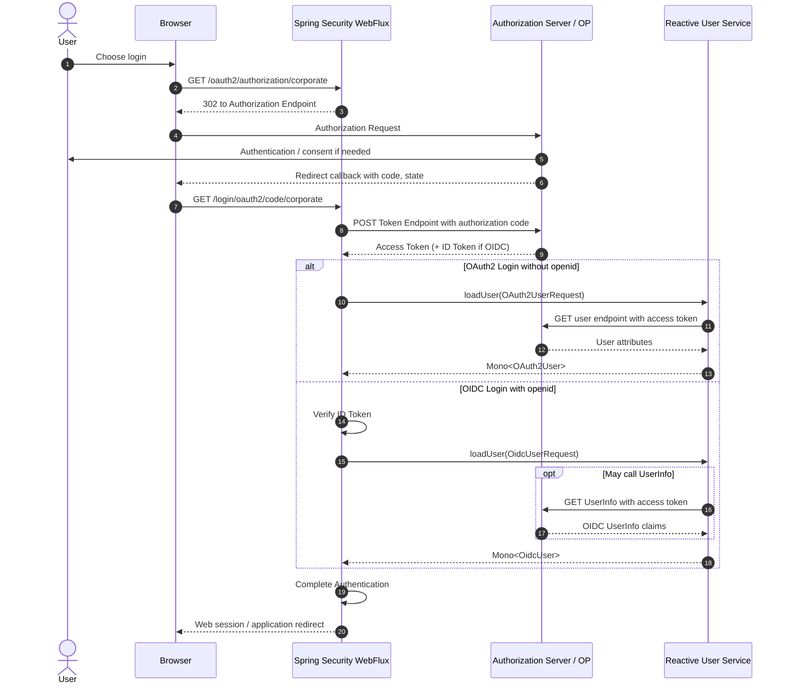

# 20.8. ReactiveOAuth2UserService and OidcReactiveOAuth2UserService

> **Module:** Spring Security OAuth 2.0 OIDC Client  
> **Chapter:** 20. Reactive Login  
> **Focus:** The two user-loading branches in Spring Security WebFlux: `ReactiveOAuth2UserService<OAuth2UserRequest, OAuth2User>` for OAuth 2.0 Login and `OidcReactiveOAuth2UserService` for OpenID Connect 1.0 Login; customizing UserInfo, principals, authorities, and asynchronous flows with Reactor.

In Spring MVC, you commonly encounter `DefaultOAuth2UserService`, `OidcUserService`, and Servlet-based APIs. With **Spring WebFlux**, OAuth 2.0/OIDC login is organized as a **reactive** pipeline: UserInfo lookups can use `WebClient`, results return as `Mono`, and principal construction integrates into authentication without blocking the event-loop.

Two easily confused names:

- `ReactiveOAuth2UserService<R, U>` is the generic **interface** for reactive user retrieval and construction.
- `DefaultReactiveOAuth2UserService` is the default implementation for **non-OIDC OAuth 2.0 Login**, typically fetching attributes from a UserInfo/user endpoint using an access token.
- `OidcReactiveOAuth2UserService` is the implementation for **OIDC Login**; it builds an `OidcUser` from a verified ID Token and can optionally enrich data via the UserInfo Endpoint.

Both run **after the appropriate authorization code and token exchange steps**; they never replace ID Token verification or turn an access token by itself into user identity.

This lesson clarifies how to choose the right service, where to customize, security rules, and how to combine data from an internal authorization system while staying reactive.

---

## 1. Learning Objectives

Upon completing this lesson, you will be able to:

1. Identify where `ReactiveOAuth2UserService` fits in the WebFlux login flow.
2. Distinguish `DefaultReactiveOAuth2UserService` and `OidcReactiveOAuth2UserService` by protocol, request type, and returned principal.
3. Understand the generic signature `ReactiveOAuth2UserService<R extends OAuth2UserRequest, U extends OAuth2User>` and `Mono<U> loadUser(R request)`.
4. Explain the roles of `OAuth2UserRequest`, `OidcUserRequest`, `OAuth2User`, `OidcUser`, the ID Token, and UserInfo.
5. Know when the `openid` scope routes login into the OIDC branch.
6. Customize the reactive OAuth2 user service to map attributes and authorities.
7. Customize the OIDC user service via delegation, `setOauth2UserService(...)`, or version-appropriate extension points.
8. Write code using `Mono.map`, `flatMap`, and `WebClient` instead of `block()` in the login pipeline.
9. Protect the binding between ID Token and UserInfo `sub`, issuer, and audience.
10. Avoid confusing claims, scopes, and authorities when building authorization policies.
11. Avoid common pitfalls such as missing principal names, HTTP 401 at UserInfo, timeouts, mappers dropping authorities, or custom services not being wired.
12. Plan unit tests, WebFlux security tests, and integration tests against a test OpenID Provider.

## 2. How WebFlux OAuth2 Login Differs from Servlet OAuth2 Login

Spring Security supports two primary web runtimes:

| Aspect | Servlet / Spring MVC | Reactive / Spring WebFlux |
|---|---|---|
| Filter chain | `SecurityFilterChain` | `SecurityWebFilterChain` |
| Security configuration | `HttpSecurity` | `ServerHttpSecurity` |
| OAuth2 login DSL | `http.oauth2Login(...)` | `http.oauth2Login(...)` on `ServerHttpSecurity` |
| Default OAuth2 user loader | `DefaultOAuth2UserService` | `DefaultReactiveOAuth2UserService` |
| OIDC user loader | `OidcUserService` | `OidcReactiveOAuth2UserService` |
| User service contract | `OAuth2UserService<R,U>` | `ReactiveOAuth2UserService<R,U>` |
| Return type of `loadUser` | Synchronous `U` | `Mono<U>` |
| Typical HTTP client | Servlet/`RestClient` depending on version | `WebClient` |
| Security context | Primarily via Servlet/request mechanisms | Reactor Context and reactive security infrastructure |
| Client registration repository | `ClientRegistrationRepository` | `ReactiveClientRegistrationRepository` |

**The word "reactive" is not just a class rename.** It determines return types, subscription timing, asynchronous HTTP calls, error handling, and the rule against blocking event-loop threads.

Never copy a Servlet `OAuth2UserService<...>` verbatim and treat it as a `ReactiveOAuth2UserService<...>`; the two interfaces have different contracts.

### 2.1. Reactive Does Not Mean Sessionless

WebFlux OAuth2 Login can still use web sessions, cookies, and `SecurityContext` for browser logins. "Reactive" describes how the request pipeline executes, not turning the application into a stateless Resource Server.

If an application uses bearer JWTs to protect APIs and has **no browser login**, it typically uses `oauth2ResourceServer()`; that is a different flow from `oauth2Login()` and does not normally invoke the two user services covered here.

## 3. High-Level Login Flow

An OIDC/OAuth2 Login in WebFlux typically begins at:

```text
GET /oauth2/authorization/{registrationId}
```

After the user authenticates at the Authorization Server/OpenID Provider, the browser returns to the callback:

```text
GET /login/oauth2/code/{registrationId}?code=...&state=...
```

In the processing chain:

1. Spring Security looks up `ClientRegistration` from `ReactiveClientRegistrationRepository`.
2. Builds the authorization request and redirects the browser to the provider.
3. Receives the authorization code at the callback and verifies transaction correlation.
4. Exchanges the code for an access token, and for OIDC, receives an ID Token.
5. Chooses how to build the principal based on the configured protocol.
6. Invokes the matching reactive user service when needed to fetch/map user details.
7. Completes `Authentication` and persists the security context per the web session/repository strategy.
8. Subsequent requests are evaluated against authorization rules.

Illustrative diagram:



The diagram shows the core logic rather than attempting to depict every filter/manager across all Spring Security versions. Notably, **the service may issue its own HTTP call to UserInfo**, yet ID Token verification belongs to the OIDC authentication pipeline and must never be skipped to "fetch the user faster."

## 4. ReactiveOAuth2UserService: Shared Interface

The interface is declared in:

```java
org.springframework.security.oauth2.client.userinfo.ReactiveOAuth2UserService
```

Core contract:

```java
@FunctionalInterface
public interface ReactiveOAuth2UserService<
        R extends OAuth2UserRequest,
        U extends OAuth2User> {

    Mono<U> loadUser(R userRequest) throws OAuth2AuthenticationException;
}
```

Explanation of parts:

| Element | Explanation |
|---|---|
| `R extends OAuth2UserRequest` | Request type carrying client registration details and the access token |
| `U extends OAuth2User` | Desired principal type |
| `loadUser(R)` | Retrieves/maps user info according to the provider contract |
| `Mono<U>` | Asynchronous result emitting at most one principal or an error |
| `OAuth2AuthenticationException` | Exception type raised on authentication errors |

In a reactive pipeline, calling `loadUser(...)` returns a `Mono`. Never call `subscribe()` yourself to trigger side effects without returning the result signal to Spring Security.

### 4.1. Two Important Specializations

**Plain OAuth 2.0 Login:**

```java
ReactiveOAuth2UserService<OAuth2UserRequest, OAuth2User>
```

**OpenID Connect Login:**

```java
ReactiveOAuth2UserService<OidcUserRequest, OidcUser>
```

`OidcUserRequest` extends the request context and includes the ID Token. `OidcUser` extends principal information with access to OIDC claims, the ID Token, and UserInfo.

Do not force:

```java
ReactiveOAuth2UserService<OAuth2UserRequest, OAuth2User> service =
    new OidcReactiveOAuth2UserService(); // Incompatible generic types.
```

because the OIDC request/principal types differ from the plain OAuth2 branch.

## 5. What Does DefaultReactiveOAuth2UserService Do?

`DefaultReactiveOAuth2UserService` resides in package:

```java
org.springframework.security.oauth2.client.userinfo.DefaultReactiveOAuth2UserService
```

It implements:

```java
ReactiveOAuth2UserService<OAuth2UserRequest, OAuth2User>
```

and supports OAuth2 providers that expose a **UserInfo/user endpoint** returning attributes. After the OAuth2 Authorization Code Flow issues an access token, the service uses that token to fetch user data and construct an `OAuth2User`.

Example provider endpoint:

```http
GET /api/user HTTP/1.1
Host: provider.example.test
Authorization: Bearer <redacted-access-token>
Accept: application/json
```

Illustrative response:

```json
{
  "id": 8342,
  "login": "demo-user",
  "name": "Example Person",
  "avatar_url": "https://cdn.example.test/avatars/8342.png"
}
```

Here `id` or `login` may be the identifier attribute declared in the registration, depending on the provider contract. OAuth 2.0 does not standardize all UserInfo response field names the way OIDC does.

### 5.1. Role of userNameAttributeName

To build `DefaultOAuth2User`, Spring Security needs to know which attribute serves as the principal name.

Example non-OIDC provider returning `id`:

```yaml
spring:
  security:
    oauth2:
      client:
        registration:
          code-host:
            provider: code-host
            client-id: ${CODE_HOST_CLIENT_ID}
            client-secret: ${CODE_HOST_CLIENT_SECRET}
            authorization-grant-type: authorization_code
            scope: [read:user]
        provider:
          code-host:
            authorization-uri: https://provider.example.test/oauth/authorize
            token-uri: https://provider.example.test/oauth/token
            user-info-uri: https://provider.example.test/api/user
            user-name-attribute: id
```

These URLs represent a **hypothetical lab provider**. Token Endpoint, scopes, authentication method, and redirect URI must match your real provider's registration.

If the service cannot find the configured name attribute, principal construction fails. Never fix that by picking an unstable field or letting the user supply their own ID.

### 5.2. Reactive HTTP Mechanism

`DefaultReactiveOAuth2UserService` uses `WebClient` when calling the UserInfo endpoint. It provides extension points such as:

- `setWebClient(WebClient)`: customizes the HTTP client for UserInfo requests, e.g., timeouts, network connectors, or controlled filters.
- `setAttributesConverter(...)`: adjusts the returned attribute structure before building the principal, in supported API versions.

Even when customizing the HTTP client, the Client must preserve Bearer token and request semantics per contract, sending the access token only to the **trusted provider's UserInfo endpoint**.

## 6. What Does OidcReactiveOAuth2UserService Do?

`OidcReactiveOAuth2UserService` resides in package:

```java
org.springframework.security.oauth2.client.oidc.userinfo.OidcReactiveOAuth2UserService
```

It implements:

```java
ReactiveOAuth2UserService<OidcUserRequest, OidcUser>
```

In OpenID Connect, the ID Token is the core artifact proving user authentication. `OidcReactiveOAuth2UserService` uses the processed OIDC context to build an `OidcUser` and **can optionally** retrieve extra claims from the UserInfo Endpoint.

### 6.1. ID Token vs. UserInfo

| Component | Source | Role |
|---|---|---|
| `OidcIdToken` | Token Endpoint/OP, verified per OIDC | Asserts identity; claims like `iss`, `sub`, `aud`, `exp` |
| `OidcUserInfo` | UserInfo Endpoint, using access token | Enriches user claims per scopes/policy |
| `OidcUser` | Principal in Spring Security | Combines ID Token, UserInfo when present, and authorities |
| `OAuth2AccessToken` | Token Endpoint | Accesses Resource Servers/UserInfo |
| `OidcUserRequest` | Spring Security OIDC login pipeline | Carries access token, client registration, and ID Token |

A valid ID Token **is not required to contain every profile attribute** such as `email`, `name`, or `picture`. The OP may return them from UserInfo when permitted; when UserInfo is absent or skipped, an OIDC principal can still be constructed from a valid ID Token per the flow/framework.

### 6.2. Is UserInfo Always Called?

No. Calling UserInfo depends on:

- Whether the provider publishes a UserInfo Endpoint.
- Whether the authorization grant/registration is eligible.
- Default policy and conditions in the Spring Security version.
- Whether `setRetrieveUserInfo(...)` is configured in supported versions.
- The access token and granted claim scopes.

Never assume seeing `scope=openid` guarantees an HTTP GET to UserInfo. OIDC login can complete solely from a valid ID Token; UserInfo is supplementary under appropriate conditions.

### 6.3. Subject Verification Is a Mandatory Boundary

Per OIDC Core, when the Client calls UserInfo, the `sub` claim in the response **must match** the `sub` claim in the ID Token. If they do not match, the result must not be used to establish or modify identity.

Example:

```json
// Verified ID Token payload
{
  "iss": "https://login.example.test/realms/company",
  "sub": "user-734",
  "aud": "portal-web"
}
```

```json
// UserInfo response
{
  "sub": "user-999",
  "email": "someone@example.test"
}
```

These **do not represent the same subject**. Never accept UserInfo data as belonging to `user-734`; never "work around" it by taking the email and ignoring the `sub` mismatch.

### 6.4. OIDC UserService Does Not Replace ID Token Validation

ID Token signature, issuer, audience/client ID, expiry, nonce, and OIDC rules must be verified by the dedicated component in the authentication pipeline, such as Spring Security's reactive ID token decoder.

A custom `OidcReactiveOAuth2UserService` must never replace that verification with:

```java
// ANTI-PATTERN — never treat a raw payload as a valid user.
String subject = decodeWithoutSignatureVerification(idToken).get("sub");
return Mono.just(buildUserFrom(subject));
```

The user service must construct principals solely from **verified authentication results and data**.

## 7. When to Use Which Service?

The decision rests on the **protocol contract**, not the provider's brand name.

| Login Type | Typical Signal | User Service | Principal |
|---|---|---|---|
| Plain OAuth 2.0 Login | Registration does not request `openid` scope | `DefaultReactiveOAuth2UserService` or a `ReactiveOAuth2UserService<OAuth2UserRequest, OAuth2User>` | `OAuth2User` |
| OpenID Connect 1.0 Login | Registration includes `openid` scope and OP supports OIDC | `OidcReactiveOAuth2UserService` or `ReactiveOAuth2UserService<OidcUserRequest, OidcUser>` | `OidcUser` |
| OAuth 2.0 Resource Server JWT | API receives Bearer JWT | Reactive JWT authentication/decoder | Usually `JwtAuthenticationToken`; neither service applies |
| Client Credentials service-to-service | Backend requests machine token | `AuthorizedClientManager` / grant provider | Not an OIDC end-user principal |
| Form login | Username/password per configuration | Reactive authentication manager/user details | Neither OAuth2 service applies |

For providers supporting both OAuth 2.0 and OIDC, the same vendor may have multiple registrations—one with `openid` and one without. Never write `if (providerName.equals("google"))` to decide which user service class to run.

## 8. Minimal WebFlux OAuth2/OIDC Login Configuration

The project uses the appropriate Spring Boot starters:

```xml
<dependencies>
    <dependency>
        <groupId>org.springframework.boot</groupId>
        <artifactId>spring-boot-starter-webflux</artifactId>
    </dependency>
    <dependency>
        <groupId>org.springframework.boot</groupId>
        <artifactId>spring-boot-starter-security</artifactId>
    </dependency>
    <dependency>
        <groupId>org.springframework.boot</groupId>
        <artifactId>spring-boot-starter-oauth2-client</artifactId>
    </dependency>
</dependencies>
```

Example `application.yml` with an OIDC Client:

```yaml
server:
  port: 8080

spring:
  security:
    oauth2:
      client:
        registration:
          corporate:
            provider: corporate-op
            client-id: portal-web
            client-secret: ${CORPORATE_OIDC_CLIENT_SECRET}
            authorization-grant-type: authorization_code
            redirect-uri: "{baseUrl}/login/oauth2/code/{registrationId}"
            scope:
              - openid
              - profile
              - email
        provider:
          corporate-op:
            issuer-uri: https://login.example.test/realms/company
```

The example uses an illustrative issuer. In a real environment, the issuer must match the OP's metadata and the redirect URI must be registered accurately; credentials must come from a secret manager or environment variables.

### 8.1. SecurityWebFilterChain

```java
package example.webflux;

import org.springframework.context.annotation.Bean;
import org.springframework.context.annotation.Configuration;
import org.springframework.security.config.annotation.web.reactive.EnableWebFluxSecurity;
import org.springframework.security.config.web.server.ServerHttpSecurity;
import org.springframework.security.web.server.SecurityWebFilterChain;

@Configuration
@EnableWebFluxSecurity
public class ReactiveSecurityConfig {

    @Bean
    SecurityWebFilterChain springSecurityFilterChain(ServerHttpSecurity http) {
        return http
            .authorizeExchange(exchanges -> exchanges
                .pathMatchers("/", "/error").permitAll()
                .anyExchange().authenticated()
            )
            .oauth2Login(oauth2 -> {})
            .build();
    }
}
```

With registration `corporate`, users initiate login at:

```text
http://localhost:8080/oauth2/authorization/corporate
```

With the `openid` scope, Spring Security engages the OIDC components automatically. You do not need a custom user service if default behavior already meets your needs.

### 8.2. Do Not Use Servlet Configuration in WebFlux

Wrong context example:

```java
// Servlet APIs - not WebFlux configuration:
HttpSecurity http;
SecurityFilterChain chain;
DefaultOAuth2UserService userService;
OidcUserService oidcUserService;
```

To configure Reactive Login, use `ServerHttpSecurity`, `SecurityWebFilterChain`, and `ReactiveOAuth2UserService` with matching types. Having both MVC and WebFlux dependencies can cause Boot to choose an unexpected web application type; verify which runtime Boot actually initializes.

## 9. Registering a Custom ReactiveOAuth2UserService Bean

A direct way to customize non-OIDC OAuth2 Login is declaring:

```java
import org.springframework.context.annotation.Bean;
import org.springframework.context.annotation.Configuration;
import org.springframework.security.oauth2.client.userinfo.DefaultReactiveOAuth2UserService;
import org.springframework.security.oauth2.client.userinfo.OAuth2UserRequest;
import org.springframework.security.oauth2.client.userinfo.ReactiveOAuth2UserService;
import org.springframework.security.oauth2.core.user.OAuth2User;

@Configuration
class OAuth2UserServiceConfig {

    @Bean
    ReactiveOAuth2UserService<OAuth2UserRequest, OAuth2User>
            oauth2UserService() {

        DefaultReactiveOAuth2UserService delegate =
            new DefaultReactiveOAuth2UserService();

        return request -> delegate.loadUser(request)
            .doOnNext(user -> {
                // Observe only non-sensitive metadata.
                // Never log full attributes or access tokens.
            });
    }
}
```

This uses **delegation**, preserving the underlying HTTP/UserInfo logic. Spring Security WebFlux can auto-detect a `ReactiveOAuth2UserService<OAuth2UserRequest,OAuth2User>` bean under default configuration. If your app configures a custom authentication manager/converter, ensure the custom service is wired into that path.

The snippet above does not modify the principal yet; its goal is showing `Mono<OAuth2User>` being returned to Spring Security without calling `subscribe()`.

### 9.1. Why Not Call subscribe() Yourself?

Avoid:

```java
// ANTI-PATTERN:
return request -> {
    delegate.loadUser(request).subscribe(user -> audit(user));
    return Mono.empty();
};
```

This detaches work from the authentication pipeline, returns `Mono.empty()` to the framework, and spawns a side effect with an uncontrolled lifetime. Instead, use `map`, `flatMap`, and `doOnNext` inside the **returned** pipeline.

### 9.2. Where to Transform Attributes Cleanly

If you need to reshape UserInfo profile data, there are two main options:

1. Use `DefaultReactiveOAuth2UserService.setAttributesConverter(...)` in Spring Security versions that support it.
2. Wrap with a `ReactiveOAuth2UserService` that builds a new `OAuth2User` from normalized attributes, preserving the principal ID and authorities.

Some APIs appear in specific releases; when upgrading Spring Security, check the exact API in your project's dependencies rather than copying method calls from another version's docs.

## 10. Example: Normalizing Attributes for OAuth2User

Suppose a non-OIDC OAuth2 provider returns a nested profile:

```json
{
  "user": {
    "id": "acct-583",
    "display_name": "Example User"
  },
  "plan": "team"
}
```

Spring Security needs the identifier attribute at the top level. An option in Spring Security 6.3+ is `setAttributesConverter(...)`:

```java
import java.util.LinkedHashMap;
import java.util.Map;

import org.springframework.context.annotation.Bean;
import org.springframework.security.oauth2.client.userinfo.DefaultReactiveOAuth2UserService;
import org.springframework.security.oauth2.client.userinfo.OAuth2UserRequest;
import org.springframework.security.oauth2.client.userinfo.ReactiveOAuth2UserService;
import org.springframework.security.oauth2.core.user.OAuth2User;

@Bean
ReactiveOAuth2UserService<OAuth2UserRequest, OAuth2User>
        oauth2UserService() {

    DefaultReactiveOAuth2UserService service =
        new DefaultReactiveOAuth2UserService();

    service.setAttributesConverter(request -> attributes -> {
        Map<String, Object> result = new LinkedHashMap<>(attributes);

        Object rawUser = attributes.get("user");
        if (rawUser instanceof Map<?, ?> nested) {
            Object id = nested.get("id");
            if (id != null) {
                result.put("account_id", id.toString());
            }
        }

        return result;
    });

    return service;
}
```

In `ClientRegistration` configuration, set `user-name-attribute: account_id` **when** the provider's real API returns nested data like this and the converter populates that field reliably. If `user`/`id` is missing, handle it as missing data per policy; never generate a random ID that gives the same user a different identity on every login.

**Never substitute arbitrary browser-submitted profile data** for the response from the UserInfo endpoint queried with the right client registration's access token.

### 10.1. An Attributes Converter Is Not an Authorization Policy

Normalizing `account_id` helps identify the user within that provider, yet it does not grant `ROLE_ADMIN` or determine tenant membership.

If the app needs internal roles, use a dedicated source of truth and policy—for example via a reactive service after obtaining the principal.

## 11. Registering OidcReactiveOAuth2UserService as a Bean

For OIDC Login, the bean has a different generic signature:

```java
import org.springframework.context.annotation.Bean;
import org.springframework.context.annotation.Configuration;
import org.springframework.security.oauth2.client.oidc.userinfo.OidcReactiveOAuth2UserService;
import org.springframework.security.oauth2.client.userinfo.ReactiveOAuth2UserService;
import org.springframework.security.oauth2.client.oidc.userinfo.OidcUserRequest;
import org.springframework.security.oauth2.core.oidc.user.OidcUser;

@Configuration
class OidcUserServiceConfig {

    @Bean
    ReactiveOAuth2UserService<OidcUserRequest, OidcUser> oidcUserService() {
        OidcReactiveOAuth2UserService delegate =
            new OidcReactiveOAuth2UserService();

        return request -> delegate.loadUser(request)
            .doOnNext(user -> {
                // Here user is an OidcUser within a verified flow.
                // Never log ID tokens, access tokens, or full claims.
            });
    }
}
```

In WebFlux documentation, providing a `ReactiveOAuth2UserService<OidcUserRequest,OidcUser>` bean is a supported customization hook picked up by `oauth2Login()`.

### 11.1. Role of OidcUserRequest

`OidcUserRequest` supplies:

- The associated `ClientRegistration`;
- The issued `OAuth2AccessToken`;
- The `OidcIdToken` that passed OIDC processing;
- Context required to construct `OidcUser`.

Inside a custom OIDC service:

```java
String registrationId = request.getClientRegistration().getRegistrationId();
String subject = request.getIdToken().getSubject();
String issuer = request.getIdToken().getIssuer().toString();
```

Never log `request.getAccessToken().getTokenValue()` or forward the token to an untrusted service to "check the user."

### 11.2. Return Mono<OidcUser>, Not a Plain OAuth2User

The OIDC bean contract requires `Mono<OidcUser>`. Returning only a `DefaultOAuth2User` drops ID Token/OIDC claim context and breaks type expectations.

When modifying authorities, construct a `DefaultOidcUser` with the ID token, UserInfo, and appropriate authorities; **never replace the principal with an `OAuth2User` lacking OIDC context**.

## 12. Customizing OIDC via Delegation: Keeping Verification, Adding Roles

A common requirement: the OP authenticates the user, and the app looks up internal roles from a separate service. We want to:

- preserve default OIDC authorities;
- look up internal identity by `(issuer, subject)`;
- add `ROLE_REPORT_VIEWER` if the trusted authorization store confirms it;
- never make blocking database calls directly on the event-loop.

### 12.1. Contract for the Reactive Role Service

Example application interface:

```java
package example.security;

import java.util.Set;
import reactor.core.publisher.Mono;

public interface ReactiveRoleLookup {

    // Result is verified/mapped app roles from an internal system.
    Mono<Set<String>> findRoles(String issuer, String subject);
}
```

The implementation can use an R2DBC repository or `WebClient` calling an internal API with proper machine-to-machine auth. It neither takes raw ID tokens from the browser nor infers roles from unverified email addresses.

### 12.2. Custom OIDC User Service Using flatMap

```java
package example.security;

import java.util.HashSet;
import java.util.Set;

import org.springframework.context.annotation.Bean;
import org.springframework.context.annotation.Configuration;
import org.springframework.security.core.GrantedAuthority;
import org.springframework.security.core.authority.SimpleGrantedAuthority;
import org.springframework.security.oauth2.client.oidc.userinfo.OidcReactiveOAuth2UserService;
import org.springframework.security.oauth2.client.oidc.userinfo.OidcUserRequest;
import org.springframework.security.oauth2.client.userinfo.ReactiveOAuth2UserService;
import org.springframework.security.oauth2.core.oidc.user.DefaultOidcUser;
import org.springframework.security.oauth2.core.oidc.user.OidcUser;

@Configuration
class OidcRoleMappingConfig {

    @Bean
    ReactiveOAuth2UserService<OidcUserRequest, OidcUser> oidcUserService(
            ReactiveRoleLookup roles) {

        OidcReactiveOAuth2UserService delegate =
            new OidcReactiveOAuth2UserService();

        return request -> delegate.loadUser(request)
            .flatMap(oidc -> roles.findRoles(
                    oidc.getIdToken().getIssuer().toString(),
                    oidc.getSubject()
                )
                .defaultIfEmpty(Set.of())
                .map(appRoles -> {
                    Set<GrantedAuthority> authorities =
                        new HashSet<>(oidc.getAuthorities());

                    if (appRoles.contains("REPORT_VIEWER")) {
                        authorities.add(new SimpleGrantedAuthority(
                            "ROLE_REPORT_VIEWER"
                        ));
                    }

                    return (OidcUser) new DefaultOidcUser(
                        authorities,
                        oidc.getIdToken(),
                        oidc.getUserInfo()
                    );
                })
            );
    }
}
```

**Why `flatMap`?** Because `roles.findRoles(...)` is an asynchronous call returning `Mono<Set<String>>`. Using `map` around an inner call that returns a `Mono` produces an unwanted `Mono<Mono<...>>` or risks leaving the inner publisher unsubscribed.

### 12.3. Why Preserve Original Authorities?

`oidc.getAuthorities()` can contain `OIDC_USER`/`OidcUserAuthority` and `SCOPE_...`. Replacing all of them with a single new authority can strip scope info or principal markers, unintentionally altering security policies.

If your design genuinely intends to replace all authorities, document the policy explicitly and test it. The example above **adds** a verified app role rather than automatically assigning admin privileges to every OIDC user.

### 12.4. Why Not Grant ROLE_ADMIN Just Because of a groups Claim?

A claim from an OP may be trusted for identity yet not represent application administrative authority. Before mapping `groups`/`roles` from an ID Token or UserInfo to `ROLE_ADMIN`, establish the trusted issuer, tenant, claim-issuance rules, membership governance, freshness, and source-of-truth policy.

A custom user service is a **technical extension point**, not automatic justification to trust arbitrary claims.

### 12.5. How Should Role Service Errors Be Handled?

If `ReactiveRoleLookup` fails or times out, the pipeline emits `onError` and login may fail. For systems that require internal roles to permit login, failing closed is often the right policy.

If policy allows logging in with minimal privileges when the role lookup fails, use a controlled `Set.of()` fallback; **never fall back to elevated permissions** or silently grant full access.

## 13. Customizing OAuth2User with Delegation and Authorities

For non-OIDC OAuth2 providers, reactive mapping works similarly:

```java
import java.util.HashSet;
import java.util.Set;

import org.springframework.context.annotation.Bean;
import org.springframework.security.core.GrantedAuthority;
import org.springframework.security.core.authority.SimpleGrantedAuthority;
import org.springframework.security.oauth2.client.userinfo.DefaultReactiveOAuth2UserService;
import org.springframework.security.oauth2.client.userinfo.OAuth2UserRequest;
import org.springframework.security.oauth2.client.userinfo.ReactiveOAuth2UserService;
import org.springframework.security.oauth2.core.user.DefaultOAuth2User;
import org.springframework.security.oauth2.core.user.OAuth2User;

@Bean
ReactiveOAuth2UserService<OAuth2UserRequest, OAuth2User> oauth2UserService() {

    DefaultReactiveOAuth2UserService delegate =
        new DefaultReactiveOAuth2UserService();

    return request -> delegate.loadUser(request)
        .map(user -> {
            Set<GrantedAuthority> granted =
                new HashSet<>(user.getAuthorities());

            // Only when this is a trusted configured internal provider
            // and account_status is a provider-verified attribute.
            if ("corporate-oauth".equals(
                    request.getClientRegistration().getRegistrationId())
                && "active".equals(user.getAttribute("account_status"))) {
                granted.add(new SimpleGrantedAuthority("ROLE_MEMBER"));
            }

            String nameAttribute = request.getClientRegistration()
                .getProviderDetails()
                .getUserInfoEndpoint()
                .getUserNameAttributeName();

            return new DefaultOAuth2User(
                granted,
                user.getAttributes(),
                nameAttribute
            );
        });
}
```

Requirements for this to work properly:

- Registration `corporate-oauth` has a configured user endpoint.
- The provider actually returns `account_status` with trusted semantics.
- `user-name-attribute` exists in the attributes (e.g., `id`).
- Client ID, secret, endpoints, and scopes match the provider.

Do not assume from this snippet that external providers automatically return `account_status`. It illustrates where **mapping** occurs when such a contract exists.

## 14. setOauth2UserService: Customizing OIDC UserInfo HTTP Calls

`OidcReactiveOAuth2UserService` exposes the extension point:

```java
setOauth2UserService(
    ReactiveOAuth2UserService<OAuth2UserRequest, OAuth2User>
)
```

This lets the OIDC service use a separately configured reactive OAuth2 user service when querying UserInfo.

Example:

```java
import org.springframework.context.annotation.Bean;
import org.springframework.security.oauth2.client.oidc.userinfo.OidcReactiveOAuth2UserService;
import org.springframework.security.oauth2.client.oidc.userinfo.OidcUserRequest;
import org.springframework.security.oauth2.client.userinfo.DefaultReactiveOAuth2UserService;
import org.springframework.security.oauth2.client.userinfo.ReactiveOAuth2UserService;
import org.springframework.security.oauth2.core.oidc.user.OidcUser;

@Bean
ReactiveOAuth2UserService<OidcUserRequest, OidcUser> oidcUserService() {

    DefaultReactiveOAuth2UserService userInfoClient =
        new DefaultReactiveOAuth2UserService();

    // Optionally customize userInfoClient's WebClient
    // per provider HTTP contract, timeouts, and security.

    OidcReactiveOAuth2UserService oidcService =
        new OidcReactiveOAuth2UserService();

    oidcService.setOauth2UserService(userInfoClient);

    return oidcService;
}
```

This relies on delegation, avoiding rewriting HTTP Bearer requests and OIDC UserInfo mapping from scratch.

### 14.1. setWebClient on DefaultReactiveOAuth2UserService

If you need a custom HTTP client:

```java
import org.springframework.web.reactive.function.client.WebClient;
import org.springframework.security.oauth2.client.userinfo.DefaultReactiveOAuth2UserService;

DefaultReactiveOAuth2UserService service =
    new DefaultReactiveOAuth2UserService();

WebClient userInfoWebClient = WebClient.builder()
    // Configure connector, timeout, proxy per environment.
    .build();

service.setWebClient(userInfoWebClient);
```

Your customization must ensure:

- Only endpoints from trusted `ClientRegistration`s are called.
- Bearer access tokens are never logged or sent to unrelated hostnames.
- Request timeouts are bounded.
- No filter inadvertently prints `Authorization` headers.
- 401/403 errors are never converted into dummy profiles marking login as successful.

### 14.2. Converting UserInfo Claims Does Not Alter the ID Token

The OIDC service provides claim type conversion mechanisms for `OidcUserInfo` depending on version, such as `setClaimTypeConverterFactory(...)`. That maps UserInfo data; it **never** grants permission to alter `iss`, `sub`, `aud`, or ID Token signature verification results.

## 15. setRetrieveUserInfo: Controlling Whether UserInfo Is Called

Spring Security versions support `OidcReactiveOAuth2UserService.setRetrieveUserInfo(...)` to customize when the UserInfo Endpoint is queried:

```java
// Conceptual API signature:
void setRetrieveUserInfo(Predicate<OidcUserRequest> retrieveUserInfo);
```

This extension point helps when a provider exposes a UserInfo endpoint, yet the app intentionally reads claims solely from the ID Token in certain scenarios or under specific conditions.

However:

1. Never force UserInfo calls if the provider does not publish an endpoint.
2. Never call UserInfo with an access token lacking the required permissions.
3. Never skip the `sub` check when a UserInfo response is present.
4. Never use `retrieveUserInfo` customization to skip ID Token validation.
5. Never assume default behavior is identical across every Spring Security version.

In several versions, default rules check for the presence of a UserInfo Endpoint, Authorization Code grant, and appropriate scopes. Check the API docs for your exact version before changing it.

## 16. setOidcUserMapper / setOidcUserConverter by Version

In some Spring Security 6.x releases, `OidcReactiveOAuth2UserService` provides:

```java
setOidcUserMapper(
    BiFunction<OidcUserRequest, OidcUserInfo, Mono<OidcUser>>
)
```

This API supports building a custom `OidcUser` from the request and UserInfo. In newer Spring Security branches, the API may use `setOidcUserConverter(...)` with `OidcUserSource`.

**Do not mix snippets across versions.** When deeply customizing `OidcUser` construction, inspect the exact classes/methods provided by your project's dependencies.

When you only need to add roles or simple mapping, **`delegate.loadUser(request).map/flatMap(...)`** is usually clearer and less coupled to version-specific APIs.

### 16.1. Never Rebuild OidcUser Missing Required Data

When constructing `DefaultOidcUser` yourself, preserve:

- Verified ID Token;
- UserInfo if present;
- Authorities per policy;
- Appropriate principal name attribute resolution;
- OIDC invariants (especially issuer/subject and UserInfo `sub` binding).

Never build a principal from an arbitrary `Map<String,Object>` without OIDC context.

## 17. map, flatMap, and onErrorResume in the User Service

This is the heart of reactive programming.

### 17.1. map: Fast, Synchronous Data Transformation

```java
return delegate.loadUser(request)
    .map(user -> {
        // In-memory transformation, no blocking I/O.
        return user;
    });
```

Use `map` when the transformation makes no asynchronous network/DB calls.

### 17.2. flatMap: Composing Reactive Work

```java
return delegate.loadUser(request)
    .flatMap(user ->
        reactiveRoleStore.findRoles(user.getName())
            .map(roles -> rebuildUser(user, roles))
    );
```

`rebuildUser(...)` is an illustrative application helper. The key is that `flatMap` composes the role lookup `Mono` into the active authentication `Mono`.

### 17.3. onErrorResume: Intentional Error Policies

```java
return delegate.loadUser(request)
    .onErrorResume(error -> {
        // Fall back only when policy allows.
        // Never turn ID Token/UserInfo errors into ADMIN privileges.
        return Mono.error(error);
    });
```

Avoid:

```java
// ANTI-PATTERN: swallows all authentication errors and returns an admin user.
return delegate.loadUser(request)
    .onErrorReturn(untrustedAdminUser);
```

A UserInfo 401, invalid subject, or network failure must follow an explicit policy. When UserInfo is required for authentication/authorization, the safe default is **fail closed**.

### 17.4. Mono.empty() Usually Does Not Mean Successful Login

A `ReactiveOAuth2UserService` returning `Mono.empty()` supplies no principal to complete authentication. Never use empty to mean "user has no roles but can still log in" unless you have an explicit contract for that branch; normally return a principal with appropriate authorities or signal a clear error.

## 18. Do Not Block the Event Loop

A common anti-pattern:

```java
// DO NOT do this in a reactive authentication pipeline:
return delegate.loadUser(request)
    .map(user -> {
        var roles = blockingJdbcRepository.findRolesByUserId(user.getName());
        return rebuildUser(user, roles);
    });
```

If `findRolesByUserId(...)` is a blocking JDBC call, it ties up the Reactor Netty event-loop thread, raising latency and hurting throughput under load.

Recommended approaches:

- Use R2DBC / reactive repositories.
- Use `WebClient` to call internal APIs.
- If a blocking library is unavoidable, isolate it via `Mono.fromCallable(...).subscribeOn(Schedulers.boundedElastic())` with bounds and observability.
- Never call `block()` or `blockOptional()` inside the user service.

Technique for isolating legacy blocking code:

```java
import reactor.core.publisher.Mono;
import reactor.core.scheduler.Schedulers;

Mono<Set<String>> roles = Mono.fromCallable(
        () -> blockingRoleRepository.loadRolesFor(subject)
    )
    .subscribeOn(Schedulers.boundedElastic());
```

This applies only when the blocking data source cannot yet be replaced; evaluate thread pools, timeouts, cancellation, circuit breakers, and real traffic. End-to-end non-blocking remains the preferred solution.

## 19. UserInfo Endpoint and Protecting Access Tokens

`ReactiveOAuth2UserService` typically uses an access token to call the configured UserInfo/user endpoint. That token is a bearer credential.

### 19.1. Invariants to Uphold

- Send tokens only to trusted provider endpoints.
- Use HTTPS in production.
- Never put `accessToken.getTokenValue()` into URLs or logs.
- Never take the UserInfo URI from untrusted browser input.
- Control HTTP redirects followed by `WebClient`; prevent bearer tokens from leaking to other hosts on redirect.
- Scope tokens and lifetimes appropriately for their purpose.
- Configure bounded timeouts and retries for the UserInfo API.
- Distinguish UserInfo errors from Token Endpoint errors and callback errors.

### 19.2. UserInfo Is Not an Authorization Decision

UserInfo returns claims about the user. Seeing `department=finance` or `email=...` does not automatically authorize application admin actions.

If an app derives authorities from claims, establish:

1. Which provider/issuer is trusted for that claim.
2. Whether the claim is bound to the right subject.
3. How claim updates and revocations propagate.
4. Whether an internal service is the authoritative source of permissions.
5. Whether permissions must be checked per request or only at login.

### 19.3. UserInfo Can Differ from the ID Token

Never assume every claim from UserInfo safely overwrites the ID Token. Per OIDC, UserInfo's `sub` must match the ID Token; merging remaining claims must follow the OP contract and application policy.

## 20. Principal Name and Durable OIDC Identity

For non-OIDC OAuth2 providers, the app relies on a name attribute guaranteed by the provider to be present and stable. For OIDC, durable identity normally rests on:

```text
(issuer, subject)
```

Example:

```text
issuer  = https://login.example.test/realms/company
subject = account-583
```

A user may change their `email` or `preferred_username`, whereas the `(issuer, subject)` pair remains the proper identifier key under OP policy.

### 20.1. Why Not Use Email as the Default Identity Key?

An email address may:

- Be absent from the ID Token or UserInfo;
- Be unverified;
- Change over time;
- Be reassigned to someone else;
- Collide across multiple providers/tenants.

Email works fine as a UI hint, but secure account linking requires verified linking policies to prevent account takeover/mix-up.

### 20.2. getName() Is Not the Registration ID

In WebFlux after OAuth2/OIDC Login, `OAuth2AuthenticationToken` holds the registration ID of the Client used. `OAuth2User.getName()` or `OidcUser.getName()` is the principal name, not the registration ID.

When you need to identify the login source, read it from the framework-created `Authentication` rather than guessing from issuer or username.

## 21. Authority Mapping: Picking the Right Extension Level

Spring Security can map authorities via `GrantedAuthoritiesMapper` or a delegation-based reactive user service.

| Need | Appropriate Approach |
|---|---|
| Map `SCOPE_x` to internal authorities using simple rules | `GrantedAuthoritiesMapper` or explicit mapping |
| Enrich roles from a reactive internal API | `ReactiveOAuth2UserService` wrapper + `flatMap` |
| Normalize nested attributes from OAuth2 UserInfo | `DefaultReactiveOAuth2UserService.setAttributesConverter` when supported by version |
| Customize HTTP client calling UserInfo | `setWebClient` on default reactive OAuth2 user service |
| Customize OIDC UserInfo loading | `OidcReactiveOAuth2UserService.setOauth2UserService` |
| Control whether OIDC UserInfo is called | `setRetrieveUserInfo` when supported by version |
| Rebuild `OidcUser` under specialized policy | Delegate wrapper or version-specific mapper/converter |
| Enforce per-request roles with immediate revocation | Authorization layer/business policy; not just login-time mapping |

A `GrantedAuthoritiesMapper` is unsuitable for long-running reactive I/O because its contract maps authorities synchronously. When calling external services, use a reactive user service or a dedicated reactive authorization component.

### 21.1. Map ROLE_ and SCOPE_ Distinctly

Spring Security typically distinguishes:

- `ROLE_ADMIN`: role-prefixed authority;
- `SCOPE_reports.read`: authority derived from a granted OAuth2 scope;
- `OIDC_USER`/`OAUTH2_USER`: marker/authority of user login.

`hasRole("ADMIN")` normally checks for `ROLE_ADMIN`, not `reports.read` or `OIDC_USER`.

When instantiating `new SimpleGrantedAuthority("ROLE_MEMBER")`, do so only when an authoritative policy actually authorizes it.

## 22. WebFlux Controller: Reading the Principal After Login

Example REST endpoint returning minimal principal metadata without exposing tokens:

```java
package example.webflux;

import java.util.Map;

import org.springframework.security.core.annotation.AuthenticationPrincipal;
import org.springframework.security.oauth2.core.oidc.user.OidcUser;
import org.springframework.web.bind.annotation.GetMapping;
import org.springframework.web.bind.annotation.RestController;

@RestController
class OidcProfileController {

    @GetMapping("/me")
    Map<String, String> currentUser(
            @AuthenticationPrincipal OidcUser user) {

        return Map.of(
            "subject", user.getSubject(),
            "issuer", user.getIdToken().getIssuer().toString()
        );
    }
}
```

This endpoint targets a WebFlux route protected by OIDC Login and assumes the principal is `OidcUser`. In apps also supporting plain OAuth2 Login, form login, or bearer JWTs, accept general `Authentication` or check types before calling OIDC-only methods.

**Never return the full `OidcUser` or ID Token to the frontend** just for debugging: that can expose unnecessary personal data or credentials.

### 22.1. Using ReactiveSecurityContextHolder Inside Services

When a service needs the current `Authentication` inside a reactive pipeline:

```java
import reactor.core.publisher.Mono;
import org.springframework.security.core.Authentication;
import org.springframework.security.core.context.ReactiveSecurityContextHolder;

Mono<Authentication> current =
    ReactiveSecurityContextHolder.getContext()
        .map(context -> context.getAuthentication());
```

This uses the Reactor Context, not a Servlet `ThreadLocal`. Never rely on `SecurityContextHolder.getContext()` across reactive threads as if it holds the current request's session.

Note that `ReactiveOAuth2UserService.loadUser(request)` already receives `OAuth2UserRequest` carrying the required context; do not try to read the security context before the new principal has even been created.

## 23. When UserInfo Returns HTTP Errors

Common errors:

| Symptom | Likely Cause | How to Address |
|---|---|---|
| 401 from UserInfo | Access token rejected by endpoint, wrong audience/scope, or revoked | Check token, endpoint, and AS policy |
| 403 from UserInfo | Lacks permission for UserInfo or endpoint policy | Check scopes, grant, and provider |
| 404 UserInfo | Misconfigured URI or endpoint missing | Check `user-info-uri`/issuer discovery metadata |
| JSON decode error | Provider returns payload deviating from contract | Check content type and response schema in lab |
| Missing `user-name` attribute | Wrong `user-name-attribute` or nested response | Configure right name attribute or attributes converter |
| `Mono` timeout | Slow network/OP or custom `WebClient` lacks timeout | Tune network, timeouts, and bounded retries |
| OIDC `sub` mismatch | UserInfo belongs to a different subject than the ID Token | Reject; never merge claims from another user |
| Invalid OIDC signature/issuer/audience | ID Token verification failure during authentication | Never remove validators; check OP metadata and `ClientRegistration` |
| Internal role lookup fails | Authorization service unavailable | Fail closed or fall back to minimal permissions per policy |
| Custom service bean has no effect | Wrong generic type or custom authentication wiring | Check bean types and WebFlux security configuration |
| `ClassCastException` | Casting `OAuth2User` to `OidcUser` on wrong flow | Distinguish `openid` scope and principal types |
| App reports blocking | Running JDBC/`block()` on event-loop | Switch to R2DBC/`WebClient` or `boundedElastic` where required |

### 23.1. Never Fix HTTP 401 by Dropping Bearer Auth

UserInfo is normally a protected resource. If the endpoint requires a token and returns 401, never strip the header or borrow another Client's token to "get it past."

### 23.2. Never Swallow Errors and Create a Default User

Anti-pattern:

```java
// INSECURE:
return delegate.loadUser(request)
    .onErrorReturn(new DefaultOAuth2User(
        Set.of(new SimpleGrantedAuthority("ROLE_ADMIN")),
        Map.of("id", "fallback"),
        "id"
    ));
```

An OP/UserInfo error does not prove an admin user exists. Authentication failures must propagate to the authentication failure handler and produce appropriate UX feedback.

## 24. Interacting with Reactive OAuth2 Client and Authorized Clients

OAuth2 Login and OAuth2 Client are related yet distinct:

- `ReactiveClientRegistrationRepository` stores Client registrations.
- `ServerOAuth2AuthorizedClientRepository` saves/reads authorized clients in web exchange context.
- `ReactiveOAuth2AuthorizedClientService` saves/reads authorized clients in reactive apps by principal.
- `ReactiveOAuth2AuthorizedClientManager` handles authorization/reauthorization and access/refresh tokens as needed.
- `ReactiveOAuth2UserService` builds the user principal in the **login pipeline**.

Never use `ReactiveOAuth2UserService` to execute the refresh token grant. Refreshing belongs to the OAuth2 Client manager/providers, not `loadUser`.

### 24.1. UserInfo Access Token Is Not the ID Token

In OIDC, the ID Token proves identity to the Client; the access token calls UserInfo or Resource Servers. Never send the ID Token in `Authorization: Bearer` to the UserInfo endpoint instead of the access token unless a provider has a separately vetted contract (which is non-standard OIDC UserInfo).

### 24.2. When Is UserInfo Called Again?

Calling `loadUser` in the login pipeline does not mean UserInfo is queried on every WebFlux HTTP request. After login, the principal is normally stored and restored via the security context/session per configuration.

If profile data or authorities must stay fresh over time, design explicit refresh or revalidation. Refreshing an access token **does not automatically re-sync** UserInfo or update the principal/authorities in the security context.

## 25. Unit Testing Reactive User Services

The goal is verifying publishers and mapping logic without needing a live OP.

### 25.1. Testing Delegation

A wrapper should:

1. Call the delegate with the right `OAuth2UserRequest` or `OidcUserRequest`.
2. Return `Mono<OAuth2User>` or `Mono<OidcUser>` accordingly.
3. Preserve essential attributes/claims.
4. Add authorities per policy.
5. Propagate errors when the delegate or role lookup fails per policy.
6. Never call `block()` in the implementation.

A test can use Reactor Test `StepVerifier`:

```java
import reactor.test.StepVerifier;

// testRequest is a valid OidcUserRequest fixture for the test;
// service is ReactiveOAuth2UserService<OidcUserRequest, OidcUser>.

StepVerifier.create(service.loadUser(testRequest))
    .assertNext(user -> {
        assert user.getSubject().equals("test-subject");
    })
    .verifyComplete();
```

This illustrates the testing style; real test classes need proper fixtures and JUnit/AssertJ assertions. Never call a real OP in a unit test just to verify `map/flatMap`.

### 25.2. Testing UserInfo Errors

Create a stub:

```java
ReactiveOAuth2UserService<OAuth2UserRequest, OAuth2User> failing =
    request -> Mono.error(
        new IllegalStateException("UserInfo unavailable in test")
    );
```

Then assert the wrapper pipeline does not unexpectedly turn the error into a privileged principal. For integration tests, use Spring Security's real exception types and response behaviors.

### 25.3. Testing Policy Roles

When role lookup returns `Set.of("REPORT_VIEWER")`, the principal should hold `ROLE_REPORT_VIEWER`. When role lookup returns empty, the principal must **not** hold that role. When role lookup fails, behavior must follow the defined policy.

## 26. WebTestClient and Mock Login

Spring Security Test supports WebFlux security testing with `WebTestClient` and configurers that mock OAuth2/OIDC Login.

Conceptual example:

```java
import static org.springframework.security.test.web.reactive.server
    .SecurityMockServerConfigurers.mockOidcLogin;

// Illustrative formatting; in a real Java file,
// the import must be on a single continuous line.

webTestClient.mutateWith(mockOidcLogin())
    .get()
    .uri("/me")
    .exchange()
    .expectStatus().isOk();
```

Exact import in real code:

```java
import static org.springframework.security.test.web.reactive.server.SecurityMockServerConfigurers.mockOidcLogin;
```

Mocking login like this tests authorization rules and controllers, **not** that `OidcReactiveOAuth2UserService` actually called UserInfo or that an ID Token was verified against an OP.

### 26.1. Integration Tests Are Still Needed for the UserInfo Pipeline

To test the user service:

- Use `MockWebServer`/WireMock or an approved test OP.
- Return a UserInfo response with a valid `sub`.
- Verify the access token is sent only to the expected endpoint.
- Test 401 errors, malformed JSON, timeouts, and UserInfo `sub` mismatches.
- Test OIDC login with both valid and invalid ID Tokens against a test OP.
- Verify custom authority mapping does not drop baseline authorities/claims.
- Use test fixtures only and never write raw tokens to logs.

A unit test with a pre-built mock `OidcUser` **does not replace** real OIDC verification tests.

## 27. Lab A — OAuth2 Login Without openid

**Goal:** work with `DefaultReactiveOAuth2UserService`.

**Setup:** a test OAuth2 provider supporting Authorization Code and a user endpoint without OIDC; WebFlux app with registration ID `code-host` and matching scopes.

**Steps:**

1. Configure `spring-boot-starter-webflux`, Spring Security OAuth2 Client, and `SecurityWebFilterChain`.
2. Set `user-info-uri` and `user-name-attribute` matching the provider contract.
3. Declare a `ReactiveOAuth2UserService<OAuth2UserRequest,OAuth2User>` bean delegating to `DefaultReactiveOAuth2UserService`.
4. Start `/oauth2/authorization/code-host`.
5. Complete authorization code login on the test provider.
6. Verify the principal is `OAuth2User` with the expected attributes.
7. Change `user-name-attribute` to a non-existent field in the test environment to observe the failure.
8. Restore the valid configuration.

**Expected outcome:** the reactive service uses the access token to load user attributes and produce `Mono<OAuth2User>`. Missing the configured name attribute causes principal construction to fail.

## 28. Lab B — OIDC Login with openid

**Goal:** work with `OidcReactiveOAuth2UserService`.

**Setup:** a test OP supporting OIDC discovery, Authorization Code, ID Token, and UserInfo where applicable.

**Steps:**

1. Configure `issuer-uri` and `scope: [openid, profile]`.
2. Declare a `ReactiveOAuth2UserService<OidcUserRequest,OidcUser>` bean using `OidcReactiveOAuth2UserService`.
3. Complete OIDC Login via `/oauth2/authorization/corporate`.
4. On `/me`, return only the verified `issuer` and `subject`.
5. Observe whether UserInfo is called under your configuration and conditions.
6. Disable UserInfo on the test OP where applicable; distinguish verified ID Token claims from optional profile claims.
7. Have the test OP return a mismatched `sub` from UserInfo; observe that login is rejected.

**Expected outcome:** the principal is `OidcUser` with ID Token context, without requiring UserInfo to always return `email` or `name`.

## 29. Lab C — Mapping ROLE_REPORT_VIEWER with a Reactive Lookup

**Goal:** perform reactive I/O to enrich authorities without blocking.

**Steps:**

1. Use `ReactiveRoleLookup` returning `Mono<Set<String>>`.
2. For test user A, return `REPORT_VIEWER`; for user B, return an empty set.
3. Wrap `OidcReactiveOAuth2UserService` as in Section 12.
4. Verify A receives `ROLE_REPORT_VIEWER` and B does not.
5. Simulate a role lookup error; confirm fail-closed or minimal fallback matches policy.
6. Temporarily introduce a blocking call in the lab, observe the anti-pattern, and convert it back to reactive.
7. Ensure sensitive tokens and claims are never logged.

**Expected outcome:** `flatMap` composes the role lookup into the authentication pipeline; roles come from a controlled source rather than blindly trusting every group claim.

## 30. Lab D — Customizing the UserInfo HTTP Client

**Goal:** adjust the HTTP behavior of `DefaultReactiveOAuth2UserService` in a controlled manner.

**Steps:**

1. Build a `WebClient` configured with timeouts and a lab mock server endpoint.
2. Attach it using `setWebClient(...)`.
3. Verify the UserInfo request sends the required auth header and never puts the token in the query string.
4. Return `200` with user attributes.
5. Test `401` and `500` responses; observe error propagation in the reactive pipeline.
6. Test timeouts; confirm the event-loop is never blocked.
7. For OIDC, attach this service via `OidcReactiveOAuth2UserService.setOauth2UserService(...)`.

**Expected outcome:** the custom `WebClient` adjusts transport without weakening UserInfo security or ID Token validation.

## 31. Lab E — Two Providers Using Two Generic Types

**Goal:** clearly separate the OAuth2 service and the OIDC service.

**Steps:**

1. Create registration `code-host` without `openid`.
2. Create registration `corporate` with `openid`.
3. Register both beans:
   - `ReactiveOAuth2UserService<OAuth2UserRequest, OAuth2User>`;
   - `ReactiveOAuth2UserService<OidcUserRequest, OidcUser>`.
4. Initiate login for each registration in separate sessions.
5. Verify non-OIDC uses UserInfo attributes and OIDC produces `OidcUser`.
6. Attempt an invalid cast in a test to see why `instanceof` checks matter.
7. Confirm no service-selection logic depends solely on provider vendor names.

**Expected outcome:** WebFlux selects the processing path by protocol/registration, not by the name of the company hosting the OP.

## 32. Misconceptions to Avoid

| Misconception | Accurate Understanding |
|---|---|
| "`ReactiveOAuth2UserService` and `OidcReactiveOAuth2UserService` are the same class." | One is the generic interface; the other is the OIDC-specific implementation. |
| "`DefaultReactiveOAuth2UserService` always handles every OIDC Login." | OIDC has a dedicated service using the ID Token and delegating UserInfo loading when needed. |
| "The user service is where ID Token signatures are verified." | ID Token verification belongs to the OIDC authentication pipeline/decoder. |
| "The `openid` scope guarantees UserInfo is always called." | Calling UserInfo also depends on metadata, flow, and implementation rules. |
| "`OAuth2User` and `OidcUser` are interchangeable everywhere." | `OidcUser` carries dedicated ID Token/UserInfo semantics. |
| "`Mono` means you can call `block()` to get the user right away." | Blocking in WebFlux risks event-loop starvation; compose publishers instead. |
| "Calling `subscribe()` in `loadUser` makes it run faster." | It detaches work from the authentication pipeline and risks races/side effects. |
| "Having an ID Token means you can skip checking UserInfo's `sub`." | Whenever UserInfo is called, its `sub` must match the ID Token. |
| "UserInfo email is the user's unique ID." | Use `issuer + subject` for OIDC; email can change or be unverified. |
| "Having `SCOPE_read` means having `ROLE_ADMIN`." | Scopes and domain roles are distinct; enforce explicit mapping policies. |
| "A rebuilt `DefaultOidcUser` can omit the ID Token." | No; preserve the verified OIDC context. |
| "A custom `WebClient` can send the access token to any URL." | Call only trusted UserInfo endpoints; prevent SSRF and token leaks. |
| "A Servlet `OAuth2UserService` bean works in WebFlux." | You need the reactive interface with matching generic types. |
| "After login succeeds, roles refresh automatically on every request." | Login-time mapping does not revalidate permissions continuously; use runtime policies where needed. |
| "Mock OIDC login tests UserInfo HTTP calls." | Mock authentication tests do not replace protocol integration tests. |

## 33. Self-Check Questions

**Question 1.** What type does the main method of `ReactiveOAuth2UserService<R,U>` return?

*Hint:* `Mono<U>`.

**Question 2.** When do you use `ReactiveOAuth2UserService<OidcUserRequest,OidcUser>`?

*Hint:* OpenID Connect Login with an ID Token.

**Question 3.** Why can't Servlet's `DefaultOAuth2UserService` be dropped into the reactive interface?

*Hint:* Different synchronous vs. reactive contracts and request pipelines.

**Question 4.** Which credential does `DefaultReactiveOAuth2UserService` use to fetch user data?

*Hint:* The access token issued to the Client, sent to the registered UserInfo endpoint.

**Question 5.** Why is OIDC not required to always call UserInfo?

*Hint:* The ID Token is the foundation of authentication, while UserInfo supplies supplemental claims under specific conditions.

**Question 6.** If UserInfo's `sub` differs from the ID Token's `sub`, what must happen?

*Hint:* Reject it; never merge data across two subjects.

**Question 7.** To enrich roles from an R2DBC repository, should you use `map` or `flatMap`?

*Hint:* Use `flatMap` to compose the external lookup's `Mono`.

**Question 8.** Why should you never call `block()` inside a user service?

*Hint:* It can stall the event-loop, reduce throughput, and cause timeouts.

**Question 9.** When customizing the OIDC user service, why keep `oidc.getAuthorities()` in the new `DefaultOidcUser`?

*Hint:* To avoid accidentally dropping default authorities, roles, or scopes.

**Question 10.** What does `setOauth2UserService(...)` on `OidcReactiveOAuth2UserService` do?

*Hint:* Supplies the delegate used when querying the UserInfo endpoint.

**Question 11.** If the user ID attribute sits at `user.id` instead of top-level, which extension point can help?

*Hint:* `setAttributesConverter(...)` in supported versions.

**Question 12.** If a login/API request produces a `JwtAuthenticationToken`, was `ReactiveOAuth2UserService` definitely invoked?

*Hint:* No; that can be Resource Server bearer authentication rather than OAuth2 Login.

## 34. References

- [Spring Security Reference — OAuth2 WebFlux](https://docs.spring.io/spring-security/reference/reactive/oauth2/index.html): overview of OAuth2 Client and reactive login.
- [Spring Security Reference — Reactive OAuth2 Login](https://docs.spring.io/spring-security/reference/reactive/oauth2/login/index.html): reactive login flow and Client configuration.
- [Spring Security Reference — Advanced Reactive OAuth2 Login](https://docs.spring.io/spring-security/reference/reactive/oauth2/login/advanced.html): UserInfo, reactive user services, authority mapping, and OIDC.
- [Spring Security API — ReactiveOAuth2UserService](https://docs.spring.io/spring-security/reference/api/java/org/springframework/security/oauth2/client/userinfo/ReactiveOAuth2UserService.html): `Mono<U> loadUser(R)` interface.
- [Spring Security API — DefaultReactiveOAuth2UserService](https://docs.spring.io/spring-security/reference/api/java/org/springframework/security/oauth2/client/userinfo/DefaultReactiveOAuth2UserService.html): default for OAuth2 providers, `setWebClient`, and `setAttributesConverter`.
- [Spring Security API — OidcReactiveOAuth2UserService](https://docs.spring.io/spring-security/reference/api/java/org/springframework/security/oauth2/client/oidc/userinfo/OidcReactiveOAuth2UserService.html): OIDC user service and version-specific extension points.
- [Spring Security API — OAuth2UserRequest](https://docs.spring.io/spring-security/reference/api/java/org/springframework/security/oauth2/client/userinfo/OAuth2UserRequest.html): request context for OAuth2 user services.
- [Spring Security API — OidcUserRequest](https://docs.spring.io/spring-security/reference/api/java/org/springframework/security/oauth2/client/oidc/userinfo/OidcUserRequest.html): request context for OIDC user services.
- [Spring Security API — OidcUser](https://docs.spring.io/spring-security/reference/api/java/org/springframework/security/oauth2/core/oidc/user/OidcUser.html): OIDC principal, ID Token, and UserInfo.
- [Spring Security API — DefaultOidcUser](https://docs.spring.io/spring-security/reference/api/java/org/springframework/security/oauth2/core/oidc/user/DefaultOidcUser.html): principal implementation and authorities.
- [Spring Security Reference — WebFlux Security](https://docs.spring.io/spring-security/reference/reactive/configuration/webflux.html): `ServerHttpSecurity` and `SecurityWebFilterChain`.
- [Spring Security Reference — Testing WebFlux](https://docs.spring.io/spring-security/reference/reactive/test/web/setup.html): `WebTestClient` and testing reactive security.
- [OpenID Connect Core 1.0](https://openid.net/specs/openid-connect-core-1_0.html): ID Token, UserInfo, and subject verification.
- [RFC 6749 — OAuth 2.0](https://www.rfc-editor.org/rfc/rfc6749): Authorization Code, Token Endpoint, and access tokens.
- [Project Reactor Reference Guide](https://projectreactor.io/docs/core/release/reference/): semantics of `Mono`, `map`, `flatMap`, threading, and schedulers.

**Remember:** `ReactiveOAuth2UserService` is the reactive contract for building principals after OAuth2/OIDC Login. `DefaultReactiveOAuth2UserService` serves non-OIDC OAuth2 UserInfo; `OidcReactiveOAuth2UserService` serves OIDC with the ID Token and optional UserInfo queries. Use delegation when customizing, **never bypass ID Token validation**, enforce UserInfo `sub` binding, preserve authorities, and compose I/O with `Mono`/`flatMap` instead of blocking. Pick the exact generic type and WebFlux bean so Spring Security constructs a trustworthy principal before applying authorization rules.
