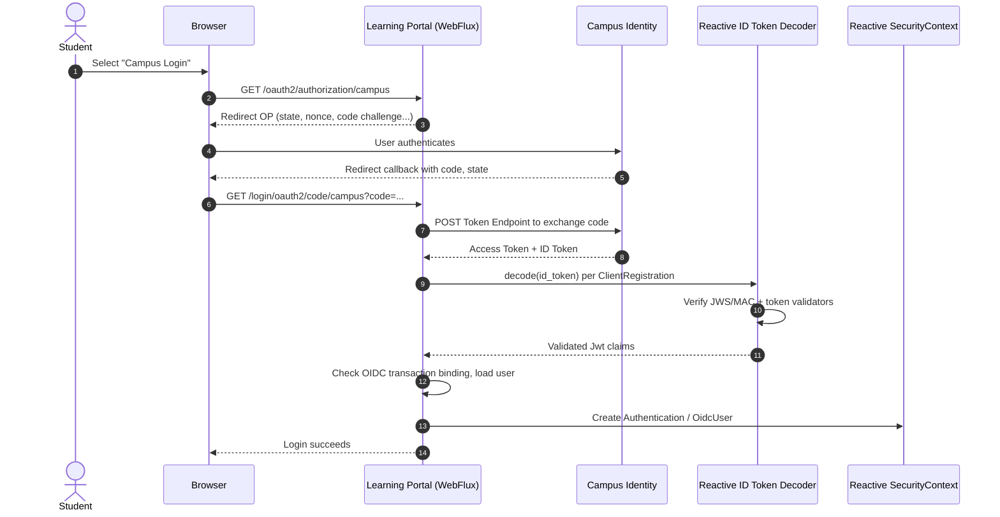
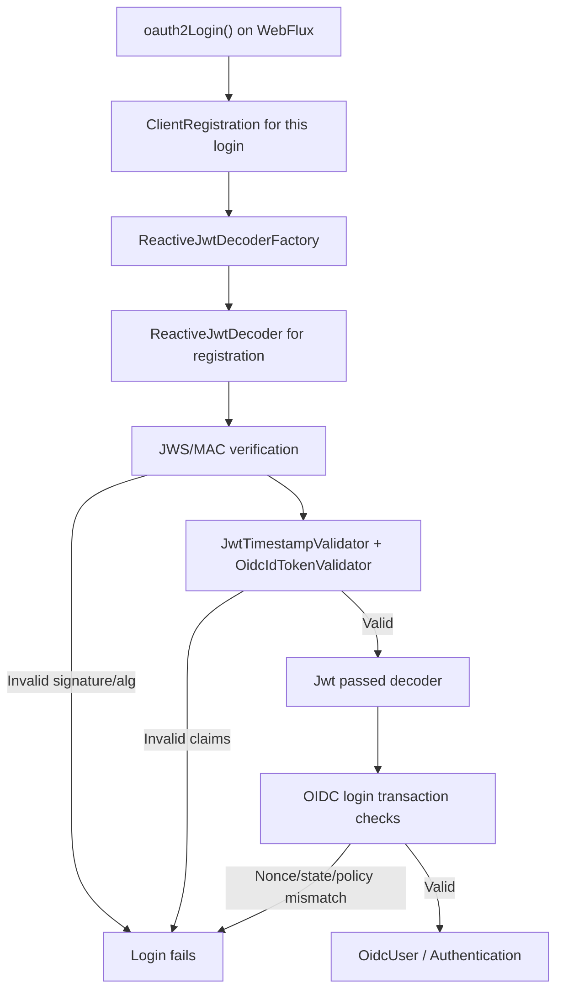

# 20.9. Validating ID Tokens with the Reactive Decoder

## Lesson Objectives

Upon completing this lesson, you will be able to:

- Explain why an **ID Token** is issued in OpenID Connect (OIDC), and why a **Spring WebFlux OAuth2 Login** application must validate this token before creating a user session.
- Distinguish **`ReactiveJwtDecoder`**, **`ReactiveJwtDecoderFactory<ClientRegistration>`**, **`ReactiveOidcIdTokenDecoderFactory`**, **`OidcIdTokenValidator`**, and the component verifying login transaction bindings.
- Understand the verification steps for **JWS signature/MAC**, `alg` algorithm, trusted keys, `iss`, `aud`, `exp`, `iat`, `sub`, `azp`, and `nonce`.
- Configure Spring Boot with `spring.security.oauth2.client.registration` and `provider.issuer-uri` for OIDC Login on WebFlux.
- Customize the **JWS algorithm resolver** for one or more OIDC `ClientRegistration`s without trusting the algorithm declared inside the token itself.
- Add **custom claim validators** to the decoder factory while preserving the default timestamp, issuer, and audience checks.
- Distinguish the OIDC Client ID Token decoder from the **Reactive Resource Server** Access Token decoder.
- Design tests with `WebTestClient`, `SecurityMockServerConfigurers.mockOidcLogin()`, and dedicated tests for actual validation.
- Identify issuer/audience errors, JWKS issues, clock skew, wrong `kid`, wrong algorithm, nonce mismatches, and Reactive/Servlet configuration mistakes.

## 1. Context: WebFlux OIDC Login Receiving an ID Token

Suppose a Spring Boot WebFlux application named **Learning Portal** lets students log in with **Campus Identity**. Campus Identity acts as the **OpenID Provider (OP)**, while Learning Portal is the **OIDC Client/Relying Party (RP)**.

Authorization Code + OIDC login flow:



**Key point:** The ID Token is the signed assertion from the OP reporting **End-User authentication to the exact Relying Party**. An unverified ID Token payload is **untrusted data**. The application must create the principal only after every required validation step in the flow passes.

An illustrative ID Token has **JWT/JWS** format:

```text
base64url(header).base64url(payload).base64url(signature)
```

Header:

```json
{
  "alg": "RS256",
  "typ": "JWT",
  "kid": "campus-rsa-key-2026"
}
```

Payload:

```json
{
  "iss": "https://login.example.org/realms/campus",
  "sub": "student-7e04",
  "aud": "learning-portal-web",
  "exp": 1893457200,
  "iat": 1893456900,
  "nonce": "example-request-nonce",
  "auth_time": 1893456800
}
```

All values are illustrative; this is not a usable live token.

For Learning Portal:

```text
expected issuer = https://login.example.org/realms/campus
expected audience/client_id = learning-portal-web
```

The application must know those expected values from a **trusted registration/provider**, rather than picking an issuer/Client ID arbitrarily from whatever the sender places in the payload.

> **Never** split a JWT string yourself, Base64URL-decode it, and read `sub` or `email` to treat the user as logged in. Decoding contents merely reads JSON; it proves nothing about the signature, issuer, audience, or nonce.

## 2. Role of the ID Token in Reactive OAuth2 Login

In OIDC, the RP requests the `openid` scope; the OP issues an ID Token carrying claims describing the user authentication event.

Comparison:

| Artifact | Primary Recipient | Purpose |
| --- | --- | --- |
| **ID Token** | OIDC Client/Relying Party | Authenticates the End-User and supplies OIDC claims |
| **Access Token** | Resource Server/API | Grants access to resources within granted scopes |
| **Refresh Token** | OAuth2 Client at Token Endpoint | Requests new Access Tokens per AS policy |
| **Authorization Code** | OAuth2 Client | Exchanged for tokens in the Authorization Code Flow |
| **Session cookie** | Browser ↔ Learning Portal | Maintains the web session per app configuration |

Example:

```text
ID Token aud     = learning-portal-web
Access Token aud = course-api
```

The two audiences differ because their purposes differ. Never copy audience rules meant for **Course API Access Tokens** to replace validation rules for **Learning Portal's ID Token**.

### 2.1. When Does Spring Security Engage OIDC Components?

A registration with:

```yaml
scope:
  - openid
  - profile
  - email
```

activates OIDC handling in OAuth2 Login when the provider and flow match. If the registration **omits `openid`**, Spring Security may use the regular OAuth2 Login user service instead of OIDC-specific processing.

Consequently, an "OIDC ID Token not found" error sometimes stems from misconfigured scopes or grants rather than the decoder itself.

### 2.2. Do Not Confuse with Resource Server JWTs

An application can both receive API tokens and let browsers log in:

```text
OIDC Client Login:
    ServerHttpSecurity.oauth2Login()
    ID Token decoder tied to ClientRegistration

Reactive Resource Server:
    ServerHttpSecurity.oauth2ResourceServer().jwt()
    JWT decoder verifying Access Tokens on inbound Bearer requests
```

Both use the `ReactiveJwtDecoder` term, yet **how the decoder is created, its audience/validators, and the token's role are different**.

## 3. Map of Key Classes to Recognize

Important components in Spring Security Reactive OIDC Client:

| Component | Responsibility | Notes |
| --- | --- | --- |
| `ReactiveClientRegistrationRepository` | Stores/retrieves registration configs | Can be `InMemoryReactiveClientRegistrationRepository` |
| `ClientRegistration` | Client ID, provider metadata, scopes, grant, endpoints | Context passed to the decoder factory |
| `ReactiveJwtDecoderFactory<ClientRegistration>` | Builds `ReactiveJwtDecoder` per registration | Extension point for OIDC Login |
| **`ReactiveOidcIdTokenDecoderFactory`** | Decoder factory for OIDC ID Tokens | Defaults to `RS256`, includes JWS resolver and validator factory |
| `ReactiveJwtDecoder` | Takes encoded token, returns `Mono<Jwt>` after decode/verify/validate | Does not by itself complete all login transaction checks |
| `OidcIdTokenValidator` | Validates ID Token claims per `ClientRegistration` | Binds expected issuer/client ID to the token |
| `JwtTimestampValidator` | Checks JWT time claims | Rejects expired or not-yet-valid tokens |
| `OidcReactiveOAuth2UserService` | Loads/maps the OIDC user after verification | May call UserInfo |
| `SecurityWebFilterChain` | Protects WebFlux HTTP requests | Declared via `ServerHttpSecurity` |
| `ReactiveSecurityContextHolder` | Accesses `SecurityContext` inside Reactor context | Not a Servlet `ThreadLocal` |

### 3.1. Where the Decoder Factory Sits



This diagram illustrates **layered responsibilities**; exact internal validation ordering and extra steps depend on the framework version. Crucially, **never create an `OidcUser` when a required check fails**.

### 3.2. Why a Factory Instead of One Shared Decoder?

A WebFlux application may support login via:

```text
campus:
    issuer = https://login.example.org/realms/campus
    clientId = learning-portal-web

partner:
    issuer = https://accounts.partner.example.net
    clientId = partner-portal-web
```

Each registration can have:

- A different issuer.
- Different JWKS URI and public keys.
- A different Client ID and expected audience.
- A different registered ID Token signing algorithm.
- Different supplemental validation policies.

`ReactiveOidcIdTokenDecoderFactory` builds a decoder per **transaction's `ClientRegistration`**; you do not want a single global decoder trusting every issuer and key set on the Internet.

## 4. What Is the Reactive OIDC ID Token Decoder Factory?

Class name:

```java
org.springframework.security.oauth2.client.oidc.authentication
    .ReactiveOidcIdTokenDecoderFactory
```

In a Java file, the import must sit on one line:

```java
import org.springframework.security.oauth2.client.oidc.authentication.ReactiveOidcIdTokenDecoderFactory;
```

This class implements:

```java
ReactiveJwtDecoderFactory<ClientRegistration>
```

Conceptually:

```java
ReactiveJwtDecoder decoder =
    factory.createDecoder(clientRegistration);
```

Then:

```java
Mono<Jwt> result = decoder.decode(rawIdToken);
```

`createDecoder(...)` returns a decoder bound to that registration. `decode(...)` uses the **reactive API** (`Mono<Jwt>`) to verify the encoded token, including configured checks and validators.

### 4.1. Key Configuration Methods

```java
ReactiveOidcIdTokenDecoderFactory factory =
    new ReactiveOidcIdTokenDecoderFactory();

factory.setJwsAlgorithmResolver(...);
factory.setJwtValidatorFactory(...);
factory.setClaimTypeConverterFactory(...);
```

Meaning:

| Method | Role |
| --- | --- |
| `createDecoder(ClientRegistration)` | Creates a reactive decoder for the OP/client config |
| `setJwsAlgorithmResolver(...)` | Determines the **expected** JWS algorithm per registration |
| `setJwtValidatorFactory(...)` | Supplies `OAuth2TokenValidator<Jwt>` per registration |
| `setClaimTypeConverterFactory(...)` | Controls type conversion of ID Token claims when needed |

**Security note:** If you replace the default validator factory, you must explicitly preserve mandatory validators (timestamps and OIDC claims). Checking only a custom `department` claim while dropping issuer/audience checks is a severe vulnerability.

### 4.2. `ReactiveJwtDecoder` Does Not Guess the Right Client on Its Own

Proper trust order:

```text
OAuth2 Login transaction
   -> select right ClientRegistration
      -> select issuer, client ID, JWS policy, and key source
         -> create/retrieve matching decoder
            -> decode ID Token
```

Wrong:

```text
Read iss from unverified JWT
   -> trust any issuer
      -> fetch arbitrary JWKS named by JWT
         -> accept token if signature matches
```

An attacker-controlled issuer can publish its own JWTs and JWKS. A valid signature against some key **does not mean that key belongs to an OP the application trusts**.

## 5. Basic Spring Boot WebFlux OIDC Login Configuration

### 5.1. Maven Dependencies

Example Spring Boot application using WebFlux and OAuth2 Client:

```xml
<dependencies>
    <dependency>
        <groupId>org.springframework.boot</groupId>
        <artifactId>spring-boot-starter-webflux</artifactId>
    </dependency>

    <dependency>
        <groupId>org.springframework.boot</groupId>
        <artifactId>spring-boot-starter-oauth2-client</artifactId>
    </dependency>

    <dependency>
        <groupId>org.springframework.boot</groupId>
        <artifactId>spring-boot-starter-security</artifactId>
    </dependency>
</dependencies>
```

Depending on your dependency graph and Spring Boot version, the Security starter may already be pulled in transitively by the OAuth2 Client starter; omit duplicates if already present.

**Never** add `spring-boot-starter-web` just to fix a reactive decoder issue. For WebFlux, use the true reactive runtime and `ServerHttpSecurity` APIs.

### 5.2. `application.yml`

Example:

```yaml
spring:
  security:
    oauth2:
      client:
        registration:
          campus:
            provider: campus
            client-id: ${CAMPUS_CLIENT_ID}
            client-secret: ${CAMPUS_CLIENT_SECRET}
            client-authentication-method: client_secret_basic
            authorization-grant-type: authorization_code
            redirect-uri: "{baseUrl}/login/oauth2/code/{registrationId}"
            scope:
              - openid
              - profile
              - email

        provider:
          campus:
            issuer-uri: https://login.example.org/realms/campus
```

Environment assumption:

```text
CAMPUS_CLIENT_ID = learning-portal-web
```

Trusted values:

```text
Registration ID    = campus
OAuth Client ID    = learning-portal-web
Expected issuer    = https://login.example.org/realms/campus
```

`registrationId` is Spring's configuration key; the ID Token `aud` must contain the **Client ID**, not the string `campus`.

### 5.3. `SecurityWebFilterChain`

```java
@Configuration
@EnableWebFluxSecurity
class WebFluxSecurityConfiguration {

    @Bean
    SecurityWebFilterChain securityWebFilterChain(
            ServerHttpSecurity http) {

        http
            .authorizeExchange(exchanges -> exchanges
                .pathMatchers("/", "/error", "/assets/**")
                    .permitAll()
                .anyExchange()
                    .authenticated()
            )
            .oauth2Login(Customizer.withDefaults());

        return http.build();
    }
}
```

Typical imports:

```java
import org.springframework.context.annotation.Bean;
import org.springframework.context.annotation.Configuration;
import org.springframework.security.config.Customizer;
import org.springframework.security.config.annotation.web.reactive.EnableWebFluxSecurity;
import org.springframework.security.config.web.server.ServerHttpSecurity;
import org.springframework.security.web.server.SecurityWebFilterChain;
```

In a Spring Boot project with auto-configuration, `@EnableWebFluxSecurity` is not always strictly required; the example makes clear the app uses a **Reactive `SecurityWebFilterChain`**.

Key distinction:

```text
WebFlux:
    SecurityWebFilterChain + ServerHttpSecurity

Servlet:
    SecurityFilterChain + HttpSecurity
```

**Do not** copy Servlet's `OidcIdTokenDecoderFactory` bean into WebFlux; use **`ReactiveOidcIdTokenDecoderFactory`** and the `ReactiveJwtDecoderFactory<ClientRegistration>` interface.

### 5.4. Standard Login URLs

With Spring Security's default configuration:

```text
Start login:
GET /oauth2/authorization/campus

Callback:
GET /login/oauth2/code/campus
```

In practice, the callback must match the redirect URI registered at the OP. When the ID Token arrives, reactive OIDC login components use the matching registration to validate the token.

## 6. How JWS Signature Verification Works

An ID Token is typically a signed JWS:

```text
HEADER.PAYLOAD.SIGNATURE
```

Example header:

```json
{
  "alg": "RS256",
  "kid": "campus-rsa-01"
}
```

To verify it, the decoder must:

1. **Select permitted algorithms** per client/provider configuration.
2. **Obtain trusted keys** belonging to the registered OP.
3. **Verify the signature/MAC** using the key and algorithm.
4. **Validate claims** against configured validators and the login transaction.
5. **Reject** if any mandatory requirement fails.

### 6.1. `alg` Is Not a Trust Instruction from the JWT

A JWT header might claim:

```json
{
  "alg": "none"
}
```

or:

```json
{
  "alg": "HS256"
}
```

An attacker can edit the header of a forged JWT. The decoder must obey the **configured algorithm allowlist/expected algorithm**, never blindly accepting whatever algorithm the token asks for.

There is no security rule permitting "if signature verification is hard, disable signature checking and trust the payload."

### 6.2. RS256 and the OP's Public JWKS

When the ID Token uses an asymmetric signature such as `RS256`:

```text
OP signs with private key
Client verifies with OP-published public key
```

The OP typically publishes a JWKS URI via OIDC Discovery:

```json
{
  "issuer": "https://login.example.org/realms/campus",
  "jwks_uri": "https://login.example.org/realms/campus/protocol/openid-connect/certs"
}
```

`kid` in the JWT selects the matching public key **within the trusted issuer's key set**; it is never a URL from which to fetch arbitrary keys.

### 6.3. HS256 and Client Secret

An OP may be configured to issue ID Tokens signed with HMAC, such as `HS256`. In that case, the Client uses the matching shared secret to verify the MAC.

This behaves very differently from `RS256`:

| Property | `RS256` | `HS256` |
| --- | --- | --- |
| Key type | Asymmetric RSA | Symmetric HMAC |
| Who signs? | OP holding the private key | Anyone holding the shared secret |
| Client verifies with | Public key from trusted source | Client secret / shared key |
| Client protection need | Trust relationship / public key cache | Highly sensitive **client secret** |
| Configuration scenario | OP uses JWKS with RSA signatures | OP and Client registered to use MAC |

Never enable `HS256` merely because a token arrives with an `HS256` header. Use it only when **the OIDC client registration and OP policy explicitly specify that algorithm**, while ensuring strong secret entropy and key management.

### 6.4. Key Rotation

The OP can rotate signing keys:

```text
Day 1: kid = campus-rsa-01
Day 2: kid = campus-rsa-02
```

A JWKS endpoint may publish both old and new keys during a transition window. The decoder should fetch keys from the trusted issuer's JWKS with proper caching/refresh and reject unverifiable signatures.

If you encounter an unknown `kid` error, never fetch JWKs from a URL embedded inside the JWT header without an allowlist policy. Check `jwks_uri` in provider metadata, JWKS caching/refresh, and the OP's key rotation schedule.

## 7. Customizing the JWS Algorithm for the Reactive ID Token Decoder

By default, `ReactiveOidcIdTokenDecoderFactory` chooses **`RS256`**. If an OP is registered with a different signing algorithm, configure `setJwsAlgorithmResolver`.

Example where the OP and Client agreed on **`HS256`**:

```java
@Configuration
class ReactiveOidcDecoderConfiguration {

    @Bean
    ReactiveJwtDecoderFactory<ClientRegistration> idTokenDecoderFactory() {

        ReactiveOidcIdTokenDecoderFactory factory =
            new ReactiveOidcIdTokenDecoderFactory();

        factory.setJwsAlgorithmResolver(
            clientRegistration -> MacAlgorithm.HS256
        );

        return factory;
    }
}
```

Illustrative imports:

```java
import org.springframework.context.annotation.Bean;
import org.springframework.context.annotation.Configuration;
import org.springframework.security.oauth2.client.registration.ClientRegistration;
import org.springframework.security.oauth2.client.oidc.authentication.ReactiveOidcIdTokenDecoderFactory;
import org.springframework.security.oauth2.jwt.ReactiveJwtDecoderFactory;
import org.springframework.security.oauth2.jose.jws.MacAlgorithm;
```

**Warning:** The bean above applies `HS256` to **every** `ClientRegistration` using this factory. That is valid only if all configured OIDC providers truly share that policy. In multi-provider apps, choose algorithms **per registration**.

### 7.1. Choosing Different Algorithms per Registration

Suppose:

```text
campus:
    issuer = https://login.example.org/realms/campus
    idTokenJwsAlg = RS256

partner:
    issuer = https://accounts.partner.example.net
    idTokenJwsAlg = HS256
```

You can configure:

```java
@Bean
ReactiveJwtDecoderFactory<ClientRegistration> idTokenDecoderFactory() {

    ReactiveOidcIdTokenDecoderFactory factory =
        new ReactiveOidcIdTokenDecoderFactory();

    factory.setJwsAlgorithmResolver(registration -> {
        if ("partner".equals(registration.getRegistrationId())) {
            return MacAlgorithm.HS256;
        }

        return SignatureAlgorithm.RS256;
    });

    return factory;
}
```

Additional import:

```java
import org.springframework.security.oauth2.jose.jws.SignatureAlgorithm;
```

Mental model:

```text
ClientRegistration selected for OIDC flow
    -> JWS algorithm policy for that registration
    -> factory creates matching decoder
```

In real systems, prefer a **governed allowlist config tied to the registration inventory** over ad-hoc `if` branches; when onboarding a new provider, verify its supported signing algorithms, secrets, JWKS, and security policy.

### 7.2. Never Return an Algorithm Parsed Directly from the ID Token Header

Flawed model:

```java
factory.setJwsAlgorithmResolver(registration ->
    algorithmParsedFromUntrustedJwtHeader
);
```

A token sender must never expand the set of algorithms the RP accepts just by sending a different JWT header. The expected algorithm must come from **trusted client registration/policy**.

### 7.3. Difference Between JWS Algorithm and Client Authentication Method

Configuration like:

```yaml
client-authentication-method: client_secret_basic
```

does not imply the ID Token must use `HS256`. These are two separate concepts:

- **Client authentication method**: how Learning Portal authenticates to the **Token Endpoint**, e.g., HTTP Basic.
- **ID Token JWS algorithm**: how the OP **signs the ID Token** for the Relying Party to verify, e.g., `RS256`.

A client can authenticate with `client_secret_basic` at the Token Endpoint and receive an **`RS256` ID Token**; that is completely normal.

## 8. Claim Validation After Signature Verification

A valid signature is **necessary**, not sufficient. A token might be signed by a trusted OP yet intended for a **different client**, expired, or mismatched with the active transaction.

Key claims:

| Claim | Meaning | Validation Policy |
| --- | --- | --- |
| `iss` | OP's Issuer Identifier | Must match the registration's trusted issuer |
| `sub` | End-User Subject Identifier | Must be valid and scoped to that issuer |
| `aud` | ID Token Audience | Must include the RP's **Client ID** |
| `azp` | Authorized Party | Check when multiple audiences exist; when present, must match client policy |
| `exp` | Expiration time | Token rejected after expiration plus allowed clock skew |
| `iat` | Issued-at time | Checked per OIDC/JWT and time policy |
| `nonce` | Binds authentication request to ID Token | Compared against the transaction's nonce when applicable |
| `auth_time` | Time OP authenticated the End-User | Important for `max_age` or fresh authentication requirements |
| `acr`, `amr` | Authentication context/method | Checked when the system requires an assurance level |
| `at_hash` | Hash checking access token in certain response types | Checked per applicable flow/spec |
| `c_hash` | Hash checking authorization code in certain response types | Checked per applicable flow/spec |

### 8.1. Issuer `iss` Must Match Exactly

Example:

```text
Expected:
https://login.example.org/realms/campus

Actual:
https://login.example.org/realms/partners
```

**Reject**, even though the hostname is identical. Two realms/tenants can share a domain yet represent distinct issuers.

Never use:

```java
actualIssuer.startsWith("https://login.example.org")
```

in place of exact matching. Never strip slashes or drop paths just to "fix" an issuer mismatch.

### 8.2. Audience `aud` Must Contain the Client ID

Suppose:

```text
registrationId = campus
clientId = learning-portal-web
```

ID Token:

```json
{
  "aud": "learning-portal-web"
}
```

passes the audience check.

ID Token:

```json
{
  "aud": ["learning-portal-web", "secondary-audience"]
}
```

can pass the audience check if remaining conditions—including `azp`—are satisfied.

ID Token:

```json
{
  "aud": "teacher-console-web"
}
```

must be **rejected** by Learning Portal. Do not confuse `aud` with the registration ID `"campus"` or API audience `"course-api"`.

### 8.3. `azp` When Multiple Audiences Are Present

Example:

```json
{
  "aud": ["learning-portal-web", "secondary-audience"],
  "azp": "learning-portal-web"
}
```

OIDC Core specifies:

1. `aud` **MUST** contain the Relying Party's Client ID.
2. When multiple audiences are present, the client **SHOULD** verify `azp` is present.
3. When `azp` is present, the client **SHOULD** verify it equals its Client ID.

Do not ignore a mismatched `azp` merely because `aud` already includes your Client ID. Stricter policies may require `azp` to match in multi-audience tokens.

### 8.4. Expiration `exp` and Issued-At `iat`

Example:

```text
iat = 2026-11-16T02:00:00Z
exp = 2026-11-16T02:10:00Z
Now = 2026-11-16T02:12:00Z
```

The token is expired and must be rejected per time/clock-skew policy.

Clock skew exists only to absorb minor clock drift between client and OP. **Never** set clock skew to several hours just to accept expired ID Tokens.

### 8.5. Nonce Must Bind to the Transaction, Not Merely Be Present

Suppose the browser starts an authorization request with:

```text
nonce = N-7bcf
```

The ID Token returns:

```json
{
  "nonce": "N-other"
}
```

The token must be rejected when the flow requires nonce verification, even if signature, issuer, and audience are all valid.

**Layering note:** the decoder factory mainly runs cryptographic JWT checks and configured token validators. Comparing `nonce` against **the value stored from the authorization request** happens in an **OIDC authentication flow** component (not simply a stateless validator inspecting `Jwt` alone). Never assume calling `decoder.decode(raw)` alone enforces browser transaction nonce/state binding.

### 8.6. `state` Is Not a Required Claim in the ID Token

OAuth2 `state` travels on the Authorization Request and Authorization Response to bind the callback to the request and prevent CSRF/login CSRF.

Meanwhile, `nonce` is an OIDC value that can appear inside the ID Token and must match the request when applicable.

```text
state:
  Authorization Response ↔ Authorization Request

nonce:
  ID Token ↔ OIDC Authentication Request
```

Do not treat these two checks as interchangeable.

## 9. Default Validators of `ReactiveOidcIdTokenDecoderFactory`

Per Spring Security's API, the default validator factory combines:

```java
JwtTimestampValidator
OidcIdTokenValidator
```

Roles:

- `JwtTimestampValidator` validates JWT timestamps.
- `OidcIdTokenValidator(ClientRegistration)` validates ID Token claim constraints tied to the registration.

Therefore, absent special requirements, the safest approach is **keeping the defaults** of `ReactiveOidcIdTokenDecoderFactory`.

### 9.1. Why Can a Custom Validator Be Dangerous?

Suppose an application also wants to verify:

```text
Claim "tenant" must equal "campus"
```

A flawed configuration:

```java
factory.setJwtValidatorFactory(
    registration -> jwt -> {
        if ("campus".equals(jwt.getClaimAsString("tenant"))) {
            return OAuth2TokenValidatorResult.success();
        }
        return OAuth2TokenValidatorResult.failure(
            new OAuth2Error("invalid_token", "Wrong tenant", null)
        );
    }
);
```

Problem: the factory replaced the **entire validator chain**. Keeping only the `tenant` check drops the default `JwtTimestampValidator` and `OidcIdTokenValidator` checks.

### 9.2. How to Add a Validator While Preserving Defaults

Example illustrating a policy requiring claim `tenant=campus` for registration `campus`, while keeping default validation intact:

```java
@Bean
ReactiveJwtDecoderFactory<ClientRegistration> idTokenDecoderFactory() {

    ReactiveOidcIdTokenDecoderFactory factory =
        new ReactiveOidcIdTokenDecoderFactory();

    factory.setJwtValidatorFactory(registration -> {

        OAuth2TokenValidator<Jwt> timestampValidator =
            new JwtTimestampValidator();

        OAuth2TokenValidator<Jwt> oidcValidator =
            new OidcIdTokenValidator(registration);

        OAuth2TokenValidator<Jwt> tenantValidator = jwt -> {
            if (!"campus".equals(registration.getRegistrationId())) {
                return OAuth2TokenValidatorResult.success();
            }

            if ("campus".equals(jwt.getClaimAsString("tenant"))) {
                return OAuth2TokenValidatorResult.success();
            }

            OAuth2Error error = new OAuth2Error(
                "invalid_token",
                "ID Token is not authorized for this tenant",
                null
            );

            return OAuth2TokenValidatorResult.failure(error);
        };

        return new DelegatingOAuth2TokenValidator<>(
            timestampValidator,
            oidcValidator,
            tenantValidator
        );
    });

    return factory;
}
```

Illustrative imports:

```java
import org.springframework.security.oauth2.client.registration.ClientRegistration;
import org.springframework.security.oauth2.client.oidc.authentication.OidcIdTokenValidator;
import org.springframework.security.oauth2.client.oidc.authentication.ReactiveOidcIdTokenDecoderFactory;
import org.springframework.security.oauth2.core.DelegatingOAuth2TokenValidator;
import org.springframework.security.oauth2.core.OAuth2Error;
import org.springframework.security.oauth2.core.OAuth2TokenValidator;
import org.springframework.security.oauth2.core.OAuth2TokenValidatorResult;
import org.springframework.security.oauth2.jwt.Jwt;
import org.springframework.security.oauth2.jwt.JwtTimestampValidator;
import org.springframework.security.oauth2.jwt.ReactiveJwtDecoderFactory;
```

Key takeaway:

```text
timestamp check
    +
OIDC claim check per ClientRegistration
    +
specific tenant check
    =
More complete policy
```

**Never use a self-asserted `tenant` claim to pick the trusted issuer or registration.** It is strictly an extra condition checked after the token is already verified against the right OP and client.

### 9.3. Do Not Blindly Attach an Access Token Scope Validator to ID Tokens

A custom `Jwt` validator from a Resource Server might require:

```text
scope = courses.read
aud = course-api
```

Those rules belong to **Access Tokens**, not ID Tokens. Attaching that validator to an ID Token decoder will either reject valid ID Tokens or, worse, replace the checks that actually belong on ID Tokens.

### 9.4. `azp` and Additional Organizational Conditions

When application policy requires `azp` to equal Client ID whenever multiple audiences are present, you can add a validator like this per the **rules agreed upon with the OP**:

```java
OAuth2TokenValidator<Jwt> authorizedPartyValidator = jwt -> {

    List<String> audiences = jwt.getAudience();
    String clientId = registration.getClientId();
    String authorizedParty = jwt.getClaimAsString("azp");

    boolean multiple = audiences != null && audiences.size() > 1;

    if (multiple && !clientId.equals(authorizedParty)) {
        OAuth2Error error = new OAuth2Error(
            "invalid_token", "Unexpected authorized party", null
        );
        return OAuth2TokenValidatorResult.failure(error);
    }

    if (authorizedParty != null && !clientId.equals(authorizedParty)) {
        OAuth2Error error = new OAuth2Error(
            "invalid_token", "Unexpected authorized party", null
        );
        return OAuth2TokenValidatorResult.failure(error);
    }

    return OAuth2TokenValidatorResult.success();
};
```

This should be **appended** to the validator chain, never used instead of signature/issuer/audience validation. Pay attention to OIDC's "SHOULD" recommendations, interoperability, and your organization's security requirements.

## 10. `setClaimTypeConverterFactory`: Meaning and Risks

ID Token claims arrive in various JSON types:

```json
{
  "iss": "https://login.example.org/realms/campus",
  "aud": ["learning-portal-web"],
  "exp": 1893457200,
  "iat": 1893456900,
  "auth_time": 1893456800,
  "email_verified": true,
  "amr": ["pwd", "otp"]
}
```

To support Java APIs, the library converts data types—such as `exp` to `Instant`, audiences to a list of strings, and other standard types.

`ReactiveOidcIdTokenDecoderFactory` provides:

```java
setClaimTypeConverterFactory(
    Function<ClientRegistration, Converter<Map<String,Object>, Map<String,Object>>>
);
```

Its goal is customizing claim conversion logic **per registration**.

### 10.1. Why Not Replace the Entire Converter?

If a custom converter returns the raw unconverted `Map`:

```java
registration -> claims -> claims
```

timestamp fields may not be converted to the types expected by validators or the `Jwt` API. That can break `Jwt.getExpiresAt()` calls or cause incorrect validation behavior.

Prefer the default converter, or add **controlled** transformations within the official hook without changing the types of standard OIDC claims such as `iss`, `aud`, `iat`, `exp`, and `auth_time`.

### 10.2. Profile Claims Are Optional

An OP may omit `name` or `email` from the ID Token; profile data can come from the UserInfo Endpoint instead. `email_verified` is likewise not guaranteed on every token.

Do not install a converter that requires every ID Token to contain email and name unless the OP and business contract explicitly guarantee them.

### 10.3. Type Conversion Is Not Signature Verification

Claim conversion affects only **in-JVM representation**. It does not prove the JWT came from the OP and cannot repair an invalid signature.

The pipeline remains:

```text
Trusted registration
  -> decoder
  -> signature verification + validators
  -> claims normalized
  -> OIDC login principal
```

## 11. Testing an ID Token Manually in an Isolated Check

In certain integration/unit tests, you may want to invoke the factory to create a decoder for a specific registration:

```java
ClientRegistration registration =
    // A ClientRegistration built from a trusted test fixture.

ReactiveOidcIdTokenDecoderFactory factory =
    new ReactiveOidcIdTokenDecoderFactory();

ReactiveJwtDecoder decoder =
    factory.createDecoder(registration);

Mono<Jwt> decoded =
    decoder.decode(encodedIdToken);
```

With Project Reactor, verify asynchronously:

```java
StepVerifier.create(decoded)
    .assertNext(jwt -> {
        assertThat(jwt.getIssuer().toString())
            .isEqualTo(
                "https://login.example.org/realms/campus"
            );

        assertThat(jwt.getAudience())
            .contains("learning-portal-web");
    })
    .verifyComplete();
```

Assumptions for the test:

- The fixture ID Token is **validly signed** with the test OP's key.
- Fixture issuer/audience/expiry are valid.
- Test provider metadata/JWKS are configured and reachable appropriately.
- `reactor-test` and assertion libraries are present.
- `ClientRegistration` matches the test OP configuration.

**This is a decoder test**, not a substitute for testing the browser Authorization Code Flow, `state`, PKCE, and `nonce`.

### 11.1. A JWT Decode Test Can "Pass" Yet OIDC Login Must Still Reject

Example encoded token:

```text
iss = expected issuer
aud = expected client ID
signature = valid
exp = valid
nonce = N-other
```

`decoder.decode(...)` can pass cryptographic and stateless validator-factory checks, yet a **nonce transaction mismatch** requires checking against the actual nonce sent in the authorization request.

So separate your tests:

```text
Decoder test:
  signature + claims per registration

OIDC flow test:
  authorization request ↔ callback ↔ ID Token
  state/nonce/PKCE + user authentication
```

### 11.2. Never Call `.block()` Inside a Production WebFlux Request

Offline tools or tests may call `.block()`:

```java
Jwt jwt = decoder.decode(rawIdToken).block();
```

In a live WebFlux controller or filter, however, that blocks the event-loop, hurts throughput, or throws errors for blocking on a non-blocking thread.

In production use:

```java
return decoder.decode(rawIdToken)
    .map(jwt -> ...);
```

or let Spring Security's `oauth2Login()` handle decoding entirely. **Never re-decode the ID Token inside a controller after login** unless you have a distinct verified use case and security policy.

## 12. How Does the Reactive Decoder Differ from the Servlet Decoder?

Comparison table:

| Aspect | Servlet | Reactive / WebFlux |
| --- | --- | --- |
| Security config | `HttpSecurity` + `SecurityFilterChain` | `ServerHttpSecurity` + `SecurityWebFilterChain` |
| ID Token factory | `OidcIdTokenDecoderFactory` | **`ReactiveOidcIdTokenDecoderFactory`** |
| Decoder interface | `JwtDecoder` | **`ReactiveJwtDecoder`** |
| Factory interface | `JwtDecoderFactory<ClientRegistration>` | **`ReactiveJwtDecoderFactory<ClientRegistration>`** |
| Decode result | `Jwt` | `Mono<Jwt>` |
| Client registration store | `ClientRegistrationRepository` | `ReactiveClientRegistrationRepository` |
| Authorized client repository | `OAuth2AuthorizedClientRepository` | `ServerOAuth2AuthorizedClientRepository` |
| `SecurityContext` | Usually via `SecurityContextHolder` and Servlet filters | `ReactiveSecurityContextHolder` in Reactor context |
| User service | `OidcUserService` | `OidcReactiveOAuth2UserService` |
| Request runtime | Servlet | WebFlux |

### 12.1. Two Factories with Similar Names

Wrong in WebFlux config:

```java
@Bean
JwtDecoderFactory<ClientRegistration> idTokenDecoderFactory() {
    return new OidcIdTokenDecoderFactory();
}
```

That is the **Servlet-oriented** decoder factory.

Right for Reactive:

```java
@Bean
ReactiveJwtDecoderFactory<ClientRegistration> idTokenDecoderFactory() {
    return new ReactiveOidcIdTokenDecoderFactory();
}
```

Ensure your Spring Security version supports the bean extension point. The Reactive factory has existed since Spring Security 5.2, though detailed options and auto-wiring can evolve across versions.

### 12.2. A Resource Server's `ReactiveJwtDecoder` Is Not the OIDC ID Token Factory

Reactive Resource Server example:

```java
@Bean
ReactiveJwtDecoder apiJwtDecoder() {
    return ReactiveJwtDecoders.fromIssuerLocation(
        "https://api-issuer.example.org"
    );
}
```

That serves **Bearer Access Tokens** when a WebFlux API is configured as a Resource Server. Exposing this bean does not make OAuth2 Login use that decoder for ID Tokens across multiple providers.

By contrast, the bean:

```java
ReactiveJwtDecoderFactory<ClientRegistration>
```

is the extension point bound to **OIDC login `ClientRegistration`s**.

### 12.3. One Application Can Run Both

Example:

```text
GET /portal/**:
  Browser session / OIDC Login

GET /api/**:
  Bearer access token / Resource Server
```

A Reactive application can configure multiple `SecurityWebFilterChain` beans and appropriate security matchers. Keep in mind:

- `Authentication` and principal types differ.
- ID Token audience and Access Token audience usually differ.
- The OIDC decoder factory does not authorize API calls on its own.
- The JWT Resource Server decoder does not create browser OIDC sessions.

Never pass a JWT in an `Authorization` header to pretend an OIDC Login occurred.

## 13. ID Token Signing Algorithm Errors and How to Resolve Them

Some OPs issue ID Tokens using a registered algorithm other than `RS256`:

```text
Expected algorithm: HS256
Default factory: RS256
```

This causes a decode/verify error, yet you must never turn off algorithm checking.

How to handle it:

1. Identify the actual `ClientRegistration` and issuer.
2. Check Discovery metadata, registration policy, or authoritative OP documentation.
3. Confirm the algorithm registered for ID Tokens.
4. Configure `setJwsAlgorithmResolver` per registration.
5. Ensure the matching key material is configured (JWKS for RSA/EC, shared secret for HMAC).
6. Keep token validators enabled and test forged signatures/headers.

### 13.1. Never Allow `alg=none`

ID Tokens must be protected per OIDC requirements; never accept raw unsigned JWTs as login proof unless the flow/profile explicitly permits it. In standard Spring Security OIDC login, let the framework enforce JWS verification.

### 13.2. HS256 Requires a Strong Secret

A weak shared secret undermines HMAC token integrity. If an OP requires `HS256`, verify generation, storage, rotation, and access control for the client secret. Never paste secrets directly into source code or logs.

### 13.3. Algorithm Confusion

Never take an RSA public key and use it manually as an HMAC shared secret to verify an `HS256` JWT. That is the classic "algorithm confusion" vulnerability in JWT validation.

`setJwsAlgorithmResolver` must express the **trust policy** of the `ClientRegistration`, never a reactive switch driven by an unverified JWT header.

## 14. Issuer, JWKS URI, and Multi-Tenancy

Issuer and JWKS URI are not the same URL.

Metadata example:

```json
{
  "issuer": "https://login.example.org/realms/campus",
  "authorization_endpoint":
    "https://login.example.org/realms/campus/protocol/openid-connect/auth",
  "token_endpoint":
    "https://login.example.org/realms/campus/protocol/openid-connect/token",
  "jwks_uri":
    "https://login.example.org/realms/campus/protocol/openid-connect/certs"
}
```

The issuer here is:

```text
https://login.example.org/realms/campus
```

not:

```text
https://login.example.org/realms/campus/protocol/openid-connect/token
```

### 14.1. Same Hostname, Different Realm Means Different Issuer

```text
https://login.example.org/realms/campus
https://login.example.org/realms/partners
```

A token from `partners` must never be accepted for registration `campus` simply because they share a hostname. `OidcIdTokenValidator(registration)` binds claim validation to the selected registration.

### 14.2. Proxies Corrupting the Issuer

A common issue:

```text
Client expected issuer:
https://login.example.org/realms/campus

Actual ID Token:
http://identity-internal:8080/realms/campus
```

The OP may be emitting an internal URL due to misconfigured proxy/hostname settings. The right fix is aligning the public issuer/metadata at the OP and reverse proxy.

Never loosen exact issuer matching in a production client to accept every URL sharing the same path.

### 14.3. Realm A's Keys Must Not Verify Realm B

Even when two realms run on the same identity platform, JWKS, Client IDs, and signing policies can differ. Never merge keys from every realm into one resolver that "accepts any signature."

In multi-tenant environments, establish the **permitted tenant/registration at the start of the transaction**, then use its corresponding decoder.

## 15. Testing the Decoder and OIDC Login

A sound testing strategy has multiple layers; one layer does not replace another.

| Test Type | Goal | What It Does Not Prove |
| --- | --- | --- |
| Unit test JWS/claims decoder | Verifies algorithm, signature, issuer/audience/timestamps | Does not fully cover callback `state`/`nonce` |
| Converter/validator tests | Checks custom claim policies | Does not prove real provider JWKS/TLS works |
| WebFlux controller test | Checks principal and response DTOs | Mock OIDC login bypasses real token exchange |
| WebFlux OAuth2 Login integration test | Verifies browser redirect, callback, token response, nonce, and principal | Needs a suitable test OP environment |
| Resource Server security test | Verifies Bearer Access Tokens | Does not prove OIDC ID Token validation |
| Multi-provider integration test | Guards against issuer/key/registration mix-ups | Does not replace operational key-rotation tests |

### 15.1. Mocking the OIDC Principal for WebTestClient

Spring Security Test provides configurers to mock OIDC Login in WebFlux tests.

Conceptual example:

```java
webTestClient
    .mutateWith(
        SecurityMockServerConfigurers.mockOidcLogin()
            .idToken(token -> token
                .claim("sub", "student-7e04")
                .claim("name", "Nguyen Anh")
            )
    )
    .get()
    .uri("/api/me")
    .exchange()
    .expectStatus()
    .isOk();
```

Assumptions:

- `WebTestClient` is configured with Spring Security Test.
- Controller `/api/me` is protected and returns an appropriate response.
- `spring-security-test` dependency is included.
- Imports/fixtures exist in the project.

**`mockOidcLogin()` creates a mocked authentication directly**; it does not prove that a raw ID Token from a real OP passes signature, issuer, audience, or nonce validation. Never treat this test as proof that Token Endpoint/JWKS integration is secure.

### 15.2. Decode Cases to Test

An ID Token test suite (signed/built with test keys) can cover:

| Case | Scenario | Expected Result |
| --- | --- | --- |
| 1 | Valid issuer, client ID, signature, timestamps | Succeeds when all applicable checks pass |
| 2 | Tampered signature | Rejected |
| 3 | Disallowed `alg` | Rejected |
| 4 | `kid` not in trusted JWKS | Rejected |
| 5 | Issuer from wrong realm | Rejected |
| 6 | Audience missing Client ID | Rejected |
| 7 | `azp` violates policy | Rejected |
| 8 | `exp` in the past | Rejected |
| 9 | Unreasonable `iat` per policy | Rejected |
| 10 | Multiple audiences with valid `azp` | Succeeds if all other checks pass |
| 11 | `nonce` differs from authorization request | Rejected by **login flow** |
| 12 | OP rotates key; JWKS contains new key | Succeeds if signed with new trusted key |
| 13 | JWKS endpoint returns 503 | Never skips signature check; fails safely |

### 15.3. Testing a Factory with Multiple Registrations

Suppose `campus` uses `RS256` and `partner` uses `HS256`. Test:

```text
Factory.createDecoder(campus)
  -> accepts valid Campus RS256 token
  -> rejects mismatched HS256 token

Factory.createDecoder(partner)
  -> accepts valid Partner HS256 token
  -> rejects token signed with a different secret
```

All tests must use **fake keys/secrets** distinct from production credentials. Never store raw production ID Tokens in test fixtures or snapshots.

### 15.4. Using `StepVerifier` for Asynchronous Results

For a successful `Mono`:

```java
StepVerifier.create(decoder.decode(validIdToken))
    .assertNext(jwt -> {
        assertThat(jwt.getAudience())
            .contains("learning-portal-web");
    })
    .verifyComplete();
```

For a decode error:

```java
StepVerifier.create(decoder.decode(invalidIdToken))
    .expectError()
    .verify();
```

This tests **reactive signals** cleanly without needing `.block()` in a WebFlux request handler.

### 15.5. Do Not Use `mockJwt()` to Prove OIDC Login

`mockJwt()` in WebFlux Resource Server tests simulates **Bearer JWT authentication**, not an OIDC Authorization Code callback.

Distinction:

```text
mockOidcLogin() -> simulates logged-in OIDC user
mockJwt()       -> simulates inbound Bearer JWT
```

Therefore:

- Testing a controller requiring `OidcUser` → `mockOidcLogin()`.
- Testing a Resource Server API with `JwtAuthenticationToken` → `mockJwt()`.
- Testing real decoder/JWKS → validly signed test fixtures and dedicated integration tests.

## 16. Debugging ID Token Errors in WebFlux

### 16.1. Diagnostic Matrix

| Symptom | Possible Cause | How to Address |
| --- | --- | --- |
| No `OidcUser` created after callback | ID Token validation or login transaction failed | Inspect underlying cause in reactive authentication error |
| `Invalid signature` | Wrong key/JWKS, tampered token, or algorithm mismatch | Check exact issuer, JWKS, and signing policy |
| `kid` not found | OP rotated keys or stale JWKS cache | Check JWKS URI/key rotation; never fetch keys from arbitrary JWT URLs |
| `HS256` `alg` rejected | Factory defaults to `RS256` | Configure `HS256` only when OP registers it and secret is strong |
| Issuer mismatch | Configured issuer differs from `iss` | Compare exact issuer, realm/tenant, and proxy config |
| Audience mismatch | `aud` lacks `client_id` | Check exact registration and Client ID |
| `azp` mismatch | Authorized party differs from client | Reject per OIDC policy and verify provider registration |
| ID Token expired | `exp` elapsed | Sync clocks and inspect flow; never set huge clock skew |
| `nonce` mismatch | Callback does not match authorization request | Inspect nonce storage/retrieval in reactive login flow |
| `state` mismatch | Authorization response does not match initiated request | Check request repository, cookies/session, and CSRF |
| Token Endpoint returns `invalid_client` | Client authentication failed | Check secret/private key and auth method |
| `spring.security.oauth2.client` ignored | Missing dependency/config or wrong stack running | Verify starters and WebFlux runtime |
| Factory bean ignored | Wrong generic type, duplicate bean, or version/API mismatch | Check reactive OAuth2 login config and bean wiring |
| `ClassCastException` between `JwtDecoder` and `ReactiveJwtDecoder` | Mixed Servlet and Reactive APIs | Use matching factory interface and `Mono<Jwt>` |
| `block()` throws error / hangs requests | Blocking call on Reactor event-loop | Keep flow reactive; offload blocking work to an appropriate scheduler if required |
| JWKS unreachable | DNS/TLS/proxy issue or OP down | Fix trust/connectivity; never disable signature verification |
| 401 on API even though OIDC Login succeeded | Sent ID Token instead of access token, or access token has wrong audience | Inspect outbound client / Resource Server |
| No email on principal | OP didn't release claim or UserInfo differs from ID Token | Check scopes/consent/UserInfo; never weaken ID Token validation |

### 16.2. Diagnosing Along Responsibility Boundaries

Follow this sequence:

1. **Registration:** Are Client ID, issuer, `openid` scope, and redirect URI accurate?
2. **Authorization Response:** Does `state` match the initiated request?
3. **Token Endpoint:** Did the authorization code exchange succeed?
4. **ID Token Decoder:** Are JWS algorithm, `kid`, keys/JWKS, and signature valid?
5. **Claims:** Are `iss`, `aud`, `exp`, `iat`, and `azp` valid?
6. **Transaction checks:** Are `nonce`, `auth_time`, PKCE, and required conditions satisfied?
7. **UserService:** Did UserInfo/`OidcUser` load properly?
8. **SecurityContext:** Was reactive authentication stored/propagated in the Reactor context?
9. **Authorization:** Is the authenticated user permitted to access the endpoint?

Never fix a failure at step 4 by adding `.permitAll()` at step 9 or disabling JWT signature verification.

### 16.3. Safe Logging

You may log controlled metadata:

```text
correlationId = 4d8f...
registrationId = campus
expectedIssuer = https://login.example.org/realms/campus
expectedClientId = learning-portal-web
validationStage = jwt_signature
failureClass = invalid_signature
```

However, **never** log:

```text
raw id_token
access_token
refresh_token
client_secret
authorization code
raw nonce
session cookie
client_assertion
```

Attributes such as `subject` or `email` can also be personal data; log them only with a clear purpose, authorization, and retention policy.

### 16.4. Never Use Logs to Dump Unverified JWTs

A malformed ID Token may hold an attacker-crafted payload. Logging that entire payload exposes the app to log injection, data exposure, or monitoring overload.

Log **error categories and selected registration** instead of raw tokens.

## 17. Asynchronous Execution and Performance Considerations

`ReactiveJwtDecoder.decode(...)` returns:

```java
Mono<Jwt>
```

When public keys/JWKS are needed, an implementation may query metadata/keys over the network or from cache. Therefore:

- Never call `.block()` inside WebFlux filters or controllers.
- Avoid creating a new decoder on **every HTTP request** when the factory/decoder can be reused per registration.
- Configure timeouts and truststore/network policies for the JWKS Endpoint.
- Key caches safely by issuer/registration and key rotation.
- Never turn a transient JWKS failure into signature-check bypass.
- Track decode latency, cache hits, and validation failure metrics without logging tokens.

### 17.1. What Does `createDecoder(...)` Mean for Lifecycle?

The factory creates a decoder per `ClientRegistration`. Within the app flow, the framework manages appropriate lifecycle/caching. If implementing a custom factory, cache decoders per registration/issuer/policy so metadata is not fetched repeatedly.

**Never cache globally by `kid` alone** without binding to the issuer, because identical `kid` strings can appear across different providers.

### 17.2. Clocks and Clock Skew

OP and Client clocks should stay reasonably synchronized (NTP). Tokens can be rejected if clock drift grows large relative to `iat`/`exp`.

Setting a huge clock skew just to "make login work" widens the window for accepting expired ID Tokens. Fixing system clocks or token TTLs at the OP is the right fix.

### 17.3. Beware of JWKS Stampedes

If the OP is degraded while thousands of concurrent requests decode fresh tokens, the application could generate heavy network load or mass login failures. Use proper caching, timeouts, and policy-compliant circuit breakers, while always failing **closed** when signatures/claims cannot be verified.

## 18. Security Design Principles When Customizing the Decoder

Core rules:

### 18.1. Trust ClientRegistration, Not the Raw JWT

Everything determining issuer, audience, algorithm, and JWKS must come from trusted provider/client configuration. Pre-validation claims are merely untrusted input.

### 18.2. Never Drop Default Checks

When calling:

```java
setJwtValidatorFactory(...)
```

ensure the default validators for **timestamps** and **registration-scoped OIDC claims** remain active.

### 18.3. Never Widen Algorithms Unnecessarily

If the OP only uses `RS256`, never allow `HS256`/`none` as well just to "accept all tokens."

### 18.4. Never Treat Email as an Immutable Identity Key

Even in a valid ID Token, `email` can change or be absent. To map internal users, use the pair:

```text
(issuer, subject)
```

Example:

```text
(https://login.example.org/realms/campus, student-7e04)
```

Two OPs issuing the same `sub` string do not inherently identify the same person.

### 18.5. Never Grant Business Permissions from Uncontrolled Claims

A valid ID Token proves End-User authentication to the RP; it **does not mean** the user holds admin privileges or access to all resources. If mapping `groups`, `roles`, or `acr` to authorities, enforce an explicit trust contract, freshness, and mapping policy.

### 18.6. Never Forward the ID Token to a Resource Server

APIs require an appropriate **Access Token**. An ID Token's audience is the RP's Client ID, not the API's audience. Sending an ID Token as a Bearer token to an API should be rejected or represents a design flaw if the API accepts it by mistake.

## 19. Layered End-to-End Example

Basic WebFlux OIDC Login config:

```yaml
spring:
  security:
    oauth2:
      client:
        registration:
          campus:
            provider: campus
            client-id: ${CAMPUS_CLIENT_ID}
            client-secret: ${CAMPUS_CLIENT_SECRET}
            authorization-grant-type: authorization_code
            client-authentication-method: client_secret_basic
            redirect-uri: "{baseUrl}/login/oauth2/code/{registrationId}"
            scope: [openid, profile, email]
        provider:
          campus:
            issuer-uri: https://login.example.org/realms/campus
```

Security:

```java
@Bean
SecurityWebFilterChain webFluxSecurity(ServerHttpSecurity http) {
    return http
        .authorizeExchange(exchanges -> exchanges
            .pathMatchers("/", "/health").permitAll()
            .anyExchange().authenticated()
        )
        .oauth2Login(Customizer.withDefaults())
        .build();
}
```

Per-registration decoder policy:

```java
@Bean
ReactiveJwtDecoderFactory<ClientRegistration> idTokenDecoderFactory() {
    ReactiveOidcIdTokenDecoderFactory factory =
        new ReactiveOidcIdTokenDecoderFactory();

    factory.setJwsAlgorithmResolver(reg -> {
        if ("partner".equals(reg.getRegistrationId())) {
            return MacAlgorithm.HS256;
        }
        return SignatureAlgorithm.RS256;
    });

    return factory;
}
```

Endpoint reading the principal **after successful login**:

```java
@RestController
class CurrentUserController {

    @GetMapping("/api/me")
    Mono<Map<String, Object>> me(
            @AuthenticationPrincipal OidcUser oidcUser) {

        Map<String, Object> result = new LinkedHashMap<>();

        result.put("issuer",
            oidcUser.getIdToken().getIssuer().toString());
        result.put("subject", oidcUser.getSubject());

        String name = oidcUser.getClaimAsString("name");
        if (name != null) {
            result.put("displayName", name);
        }

        return Mono.just(result);
    }
}
```

This example focuses on the flow, omitting detailed imports/dependencies. The endpoint assumes the request is authenticated via **OIDC Login**, not a Resource Server JWT. In production, return a minimal DTO omitting `issuer` if unnecessary, restrict profile access to the user's own record, and avoid logging sensitive tokens/claims.

### 19.1. What Happens Where?

```text
OIDC provider metadata:
    issuer, jwks_uri, supported signing algorithms

ClientRegistration:
    client_id, issuer-uri, endpoints, scopes

ReactiveOidcIdTokenDecoderFactory:
    creates decoder per registration, JWS policy, validators

ReactiveJwtDecoder:
    verifies encoded ID Token, returns Mono<Jwt>

Reactive OIDC Login components:
    correlates authorization request, nonce/state, and user service

SecurityWebFilterChain:
    enforces which requests need authentication/authorization

Controller:
    reads authenticated principal, never trusts raw ID Tokens directly
```

### 19.2. What If No Custom Algorithm Is Needed?

Do not declare a custom factory. Configuring `issuer-uri`, client ID, scopes, and `oauth2Login()` is sufficient for standard integrations with OPs issuing `RS256` ID Tokens. Less custom code lowers the risk of accidentally dropping a security check.

## 20. Real-World Scenarios

### Scenario A — Provider Issues RS256 by Default

Campus Identity publishes JWKS and issues `RS256` ID Tokens. Learning Portal configures `issuer-uri`, `client-id`, `openid`, and `oauth2Login()`.

**How to handle:** leave the default factory alone. No need to write a custom decoder or fetch JWKs via HTTP in a controller.

### Scenario B — Provider Uses HS256 in Registration

Partner Identity issues `HS256` ID Tokens per agreement. The default factory only accepts `RS256`.

**How to handle:** configure `setJwsAlgorithmResolver` to return `MacAlgorithm.HS256` specifically for the `partner` registration, protect the client secret, and leave other providers' defaults untouched.

### Scenario C — Issuer Mismatch Across Two Realms

Client trusts issuer:

```text
https://login.example.org/realms/campus
```

but the token carries:

```text
https://login.example.org/realms/partner
```

**How to handle:** reject. Check registration, realm, and redirect flow; never accept just because the hostname matches.

### Scenario D — An ID Token Issued for Another Application

The OP validly signs a token:

```json
{
  "iss": "https://login.example.org/realms/campus",
  "aud": "teacher-console-web"
}
```

Learning Portal has `client_id = learning-portal-web`.

**How to handle:** reject on audience mismatch. A valid signature does not prove the token was issued for this RP.

### Scenario E — JWKS Key Rotation

The OP adds a new `kid`, and the client has not refreshed its cache yet. The decoder sees an unknown key.

**How to handle:** verify `jwks_uri` and caching for the trusted issuer, plus the rollover plan. Never accept unsigned tokens to avoid login disruption.

### Scenario F — Multiple Registrations, Same Algorithm

Both Campus and Partner use `RS256`. A developer builds one global JWKS resolver combining keys from both OPs.

**Warning:** a token signed by Partner's key must never validate for Campus just because they share the algorithm. Bind the decoder to the issuer, client ID, and key set of the selected registration.

### Scenario G — Login Still Fails Even When Decoder Succeeds

The decoder returns `Mono<Jwt>` successfully, yet the ID Token's `nonce` does not match the authorization request's `nonce`.

**How to handle:** OIDC Login must reject it. Decoder validation does not replace transaction-binding checks.

### Scenario H — Application Acts as Both WebFlux Login and Resource Server

Users access pages via OIDC cookies; external APIs send Bearer access tokens.

**How to handle:** separate `OidcUser` and `Jwt` principals, and separate ID Token decoders from Access Token decoders. Configure `SecurityWebFilterChain`/authorization explicitly; never treat one token type as proof of the other.

## 21. Practice Exercises

### Exercise 1 — Choosing the Right Factory

A WebFlux app enables OAuth2 Login and needs to verify ID Tokens.

**Question:** Which class should be used?

**Answer:**

```java
ReactiveOidcIdTokenDecoderFactory
```

with interface:

```java
ReactiveJwtDecoderFactory<ClientRegistration>
```

Never pick Servlet's `OidcIdTokenDecoderFactory`.

### Exercise 2 — Finding Expected Issuer and Audience from YAML

```yaml
registration:
  university:
    provider: university-op
    client-id: student-portal-prod
    scope: [openid, profile]
provider:
  university-op:
    issuer-uri: https://identity.example.edu/realms/students
```

**Answer:**

```text
Expected iss = https://identity.example.edu/realms/students
Expected aud contains student-portal-prod
```

`university` is the registration ID; `university-op` is the config alias, not the audience.

### Exercise 3 — Algorithm Mismatch

An OP is registered to use `HS256`, while the factory defaults to `RS256`.

**Question:** How do you fix that registration without weakening the remaining providers?

**Suggested answer:**

```java
factory.setJwsAlgorithmResolver(reg ->
    "partner".equals(reg.getRegistrationId())
        ? MacAlgorithm.HS256
        : SignatureAlgorithm.RS256
);
```

Use only when those algorithms are genuinely registered with trusted key material.

### Exercise 4 — What Is the Risk of a Custom Validator?

A developer sets only the validator:

```java
jwt -> checkDepartmentClaim(jwt)
```

via `setJwtValidatorFactory`.

**Answer:** It risks dropping the default validators. Combine `JwtTimestampValidator`, `OidcIdTokenValidator(registration)`, and business validators failing closed.

### Exercise 5 — Decoder Succeeds but Nonce Fails

The ID Token has a valid signature, `iss`, `aud`, and `exp`, yet `nonce` differs from the request.

**Answer:** OIDC Login must reject it; a standalone decoder does not replace transaction validation.

### Exercise 6 — JWT Resource Server Using the Wrong Decoder

An API receives `Authorization: Bearer ...` and a developer tries to verify `aud` against the OIDC web Client ID.

**Answer:** Access Tokens need the Resource Server's audience, not the ID Token's audience. Use appropriate Reactive Resource Server decoders/validators.

### Exercise 7 — `Mono<Jwt>` and Blocking

Inside a WebFlux filter:

```java
Jwt jwt = decoder.decode(rawToken).block();
```

**Question:** Is this advisable?

**Answer:** No. Compose the reactive pipeline with `map`/`flatMap` or let the OIDC Login framework handle it. Blocking on the event-loop introduces performance risks.

### Exercise 8 — Testing Mocked OIDC Login

```java
webTestClient.mutateWith(mockOidcLogin()) ...
```

**Question:** Does this test prove that JWT signatures are actually verified?

**Answer:** No. It creates a mock authentication for app tests; write separate decoder and OIDC integration tests.

### Exercise 9 — OP Same Host, Different Path

```text
Expected = https://identity.example.org/tenant/A
Actual   = https://identity.example.org/tenant/B
```

**Answer:** Reject; issuer must match exactly.

### Exercise 10 — UserInfo Missing Email

OIDC Login succeeds, yet `OidcUser.getClaimAsString("email")` returns null.

**Answer:** Not necessarily a decoder bug. Email is an optional claim; check scopes/consent/UserInfo and design fallbacks/DTOs. Never require email solely because the ID Token contains `sub`.

## 22. Review Questions

**1. What is `ReactiveOidcIdTokenDecoderFactory` used for?**

> Creating a `ReactiveJwtDecoder` to verify ID Tokens per `ClientRegistration` in Reactive OIDC Client Login.

**2. What does the decoder return?**

> `ReactiveJwtDecoder.decode(encodedToken)` returns `Mono<Jwt>` when the token passes the decoder/validators; errors emit as reactive error signals.

**3. What is the factory's default algorithm?**

> `RS256` per Spring Security documentation, configurable per client registration when the OP uses another registered algorithm.

**4. How is HS256 verified?**

> With the appropriate shared secret—typically the client secret matching the Client ID when the OP uses HMAC ID Token signing. Never enable it arbitrarily from a JWT header alone.

**5. Do ID Tokens and Access Tokens share the same audience?**

> Not necessarily. The ID Token must contain the RP's OAuth Client ID; the Access Token normally targets the corresponding Resource Server.

**6. If the ID Token signature is valid, can issuer/audience validation be skipped?**

> No. A signature does not prove the token was issued for this transaction's issuer and client.

**7. Does `setJwtValidatorFactory` preserve default validators automatically?**

> Do not assume so. When overriding the factory, preserve `JwtTimestampValidator` and `OidcIdTokenValidator(ClientRegistration)` alongside other OIDC checks.

**8. Can a decoder alone validate `nonce`?**

> It can read the `nonce` claim, yet verifying that `nonce` **matches the authorization request** requires the login flow to retain and compare the transaction's nonce. Do not treat successful decoding as completing all OIDC checks.

**9. When do you use `OidcIdTokenDecoderFactory` instead of `ReactiveOidcIdTokenDecoderFactory`?**

> For Servlet OAuth2 Login, use the non-reactive factory; for WebFlux Reactive OIDC Login, use the reactive factory.

**10. Should you `.block()` a decoder result inside a WebFlux controller?**

> No. Keep the pipeline reactive or let the OIDC Login framework handle it.

**11. Why must you never trust a JWKS URL specified inside an unverified JWT?**

> Because an attacker can point to their own issuer/key endpoint. Keys must come from a trusted OP/`ClientRegistration`.

**12. With multiple providers, can a single factory handle all of them?**

> Yes. The factory can construct distinct decoders per `ClientRegistration`, including each provider's issuer, keys, and JWS algorithm policy.

**13. What does a `mockOidcLogin()` test verify?**

> Primarily controller/security behavior under a simulated OIDC principal—not Token Endpoint calls or live JWS verification.

**14. Does a user with a valid OIDC ID Token have permission to call every API?**

> No. APIs require an Access Token plus dedicated issuer/audience/scope/resource permission checks.

---

## Key Takeaways

In **Spring Security Reactive/WebFlux OIDC Login**, `ReactiveOidcIdTokenDecoderFactory` creates a **`ReactiveJwtDecoder` per `ClientRegistration`** to validate ID Tokens. The decoder must verify **JWS/MAC with trusted keys and algorithms**, then enforce timestamp and OIDC claim checks such as **issuer/audience**. When an OP registers an algorithm other than the `RS256` default, use `setJwsAlgorithmResolver` **per registration** rather than trusting arbitrary JWT headers. When adding custom validators, preserve the default `JwtTimestampValidator` and `OidcIdTokenValidator`, and let OIDC Login complete authorization-request bindings such as **state/nonce**. Never mix OAuth2 Login ID Token decoders with Resource Server JWT decoders, never call `.block()` in WebFlux requests, and never use an ID Token as an Access Token to call APIs.

## References

- [Spring Security — Reactive OAuth2 Login, Advanced Configuration](https://docs.spring.io/spring-security/reference/reactive/oauth2/login/advanced.html): configuring ID Token signature verification and JWS algorithms per registration.
- [Spring Security API — ReactiveOidcIdTokenDecoderFactory](https://docs.spring.io/spring-security/reference/api/java/org/springframework/security/oauth2/client/oidc/authentication/ReactiveOidcIdTokenDecoderFactory.html): factory, algorithm resolver, validator factory, and claim conversion.
- [Spring Security API — OidcIdTokenValidator](https://docs.spring.io/spring-security/reference/api/java/org/springframework/security/oauth2/client/oidc/authentication/OidcIdTokenValidator.html): OIDC ID Token claim validation per `ClientRegistration`.
- [Spring Security — OAuth2 WebFlux](https://docs.spring.io/spring-security/reference/reactive/oauth2/): OIDC Login flow, registration config, and WebFlux security.
- [Spring Security — Reactive Resource Server JWT](https://docs.spring.io/spring-security/reference/reactive/oauth2/resource-server/jwt.html): distinguishing Resource Server Access Token decoders.
- [OpenID Connect Core 1.0](https://openid.net/specs/openid-connect-core-1_0.html): ID Tokens, validation, and meaning of issuer/audience/nonce.
- [RFC 7519 — JSON Web Token](https://www.rfc-editor.org/rfc/rfc7519): JWT claims and interpretation.
- [RFC 7515 — JSON Web Signature](https://www.rfc-editor.org/rfc/rfc7515): JWS signature structure.
