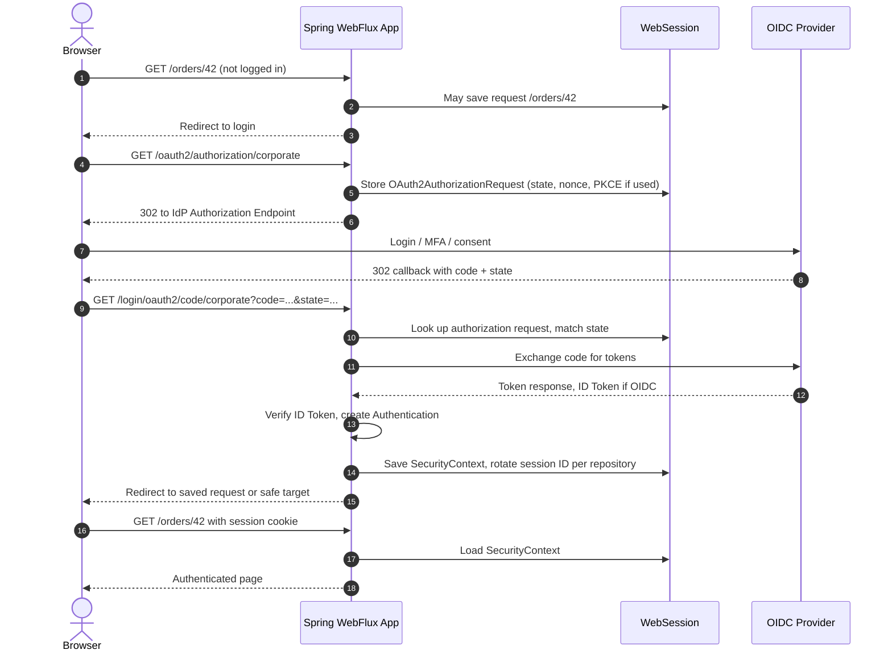

# 20.12. Managing WebSession, CSRF, and Post-Login Navigation

## 1. Context: Successful Reactive Login Is Not the Whole Story

In a **Spring Security OAuth 2.0/OIDC Client** application running on **Spring WebFlux**, the OAuth2 Login flow typically begins when the browser visits `/oauth2/authorization/{registrationId}` and finishes when the OpenID Provider (OP) or Authorization Server redirects back to `/login/oauth2/code/{registrationId}` with an authorization code.

After exchanging the code for tokens, verifying the ID Token (when using OIDC), and creating `Authentication`, the application still needs to answer several important questions:

- **Where is the authenticated identity stored?** Will the next request require logging in again?
- **What does `WebSession` hold?** Is the pending OAuth2 authorization request awaiting callback different from the post-login `SecurityContext`?
- **Is CSRF protection** still needed when login happens via an IdP redirect?
- **Does a GET callback need a CSRF token?** Can `state` replace CSRF protection on data-mutating forms?
- After login, does the app return to the **original URL**, `/dashboard`, or another route?
- If `returnTo`/`redirect` comes from the browser, how do you prevent **open redirects** and URL token leakage?
- **Logout** clears `WebSession`, authorized-client tokens, the IdP session, and cookies at which scopes?
- If the app runs **multiple pods**, is shared session storage required?

This lesson explains three interrelated areas that must each be designed explicitly: **WebSession, CSRF, and post-login navigation**. Examples use **Spring Security WebFlux (Reactive)**—do not confuse them with Spring MVC/Servlet.

> **Core idea:** Spring Security performs OIDC Login and persists `SecurityContext`, yet the application must still choose appropriate session, CSRF, saved-request, redirect, cookie, and logout policies. Never disable CSRF or accept arbitrary redirect URLs just to make login "work."

### 1.1. Learning Outcomes

Upon completing this lesson, learners will be able to:

1. Distinguish `WebSession`, `SecurityContext`, OAuth2 authorization requests, authorized clients, and CSRF tokens.
2. Explain why the OIDC callback requires **session continuity** and `state` correlation.
3. Configure `SecurityWebFilterChain` with `oauth2Login`, CSRF, and success/failure handlers.
4. Use `WebSessionServerSecurityContextRepository`, `WebSessionServerRequestCache`, and `RedirectServerAuthenticationSuccessHandler` in their proper roles.
5. Choose between **returning to a saved request** and **fixed navigation**.
6. Handle `Secure`, `HttpOnly`, and `SameSite` cookies behind reverse proxies, load balancers, or cross-site logins.
7. Understand differences among local logout, OIDC logout, and OAuth2 token revocation.
8. Diagnose login loops, `state` mismatches, `403` CSRF failures, and wrong post-callback redirects.

## 2. Overview of OAuth2/OIDC Login in WebFlux

A typical OIDC Authorization Code flow:



In this diagram, **`WebSession` is used both before and after the callback**, yet the data at each step serves a distinct purpose:

- **Before callback:** stores the authorization request to guard against mixed-up or forged responses.
- **After successful authentication:** stores `SecurityContext` so subsequent HTTP requests recognize the principal.
- **When a user starts at a protected page:** can store the requested URL to resume after login.
- **When submitting forms or calling cookie-authenticated APIs:** CSRF tokens protect state-changing requests.

**Not all of these items are the same object or stored in the same place in every configuration.** Separately configured repositories may use `WebSession`, a shared session store, or a different backing store.

## 3. Objects to Distinguish

| Object | Function | Critical Moment | Typical WebFlux Default |
| --- | --- | --- | --- |
| `WebSession` | Session data container tied to a browser cookie | Before and after login | `org.springframework.web.server.WebSession` |
| `SecurityContext` | Holds `Authentication` for an authenticated request | After login | `WebSessionServerSecurityContextRepository` |
| `OAuth2AuthorizationRequest` | Holds authorization parameters like `state`, scopes, redirect URI, PKCE | Before callback | `WebSessionOAuth2ServerAuthorizationRequestRepository` |
| `ServerAuthorizationRequestRepository` | Saves/loads/removes pending authorization requests | Redirect and callback | `WebSession`-backed implementation |
| `ServerRequestCache` | Remembers the URL the user wanted before being sent to login | When authentication interrupts navigation | `WebSessionServerRequestCache` |
| `ServerCsrfTokenRepository` | Generates/saves/loads the app's CSRF token | Forms/APIs with session cookies | `WebSessionServerCsrfTokenRepository` |
| `OAuth2AuthorizedClient` | Client registration + issued access/refresh tokens | When backend calls downstream APIs | Stored via authorized-client service/repository |
| `OidcUser` | OIDC principal holding verified ID Token/claims | After OIDC login | Inside `Authentication` |
| HTTP session cookie | Identifies `WebSession` on the browser | Every request per cookie policy | Usually `SESSION` in default WebFlux |

**`WebSession` is not `HttpSession`.** `HttpSession` belongs to Servlet; WebFlux uses `WebSession`/`ServerWebExchange` and reactive APIs. Never copy `HttpServletRequest.getSession()` into a reactive handler.

**`OAuth2AuthorizedClient` is not `SecurityContext`.** When the backend needs an access token to call an API, look up the right authorized client. Keeping the user logged in via `WebSession` does not guarantee the access token is still valid or that a refresh token lives in that session.

### 3.1. Three Frequently Confused Kinds of "State"

| State | What Is It For? | When Used? |
| --- | --- | --- |
| OAuth2 `state` parameter | Binds the authorization response to the original authorization request | OAuth2 redirect/callback |
| CSRF token | Prevents forged requests relying on ambient cookie authority | State-changing forms/APIs |
| `WebSession` ID | Lets the browser reference its server-side session | All requests in the session |

Never mechanically substitute one for another. OAuth2 `state` cannot serve as a CSRF token on `POST /orders`, and a form CSRF token does not replace `state` validation on the OAuth2 callback.

## 4. How Does `WebSession` Store `SecurityContext`?

In Spring Security WebFlux, `ServerSecurityContextRepository` defines the contract to save/load `SecurityContext` per `ServerWebExchange`.

A common/default implementation for OAuth2 Login is:

```java
org.springframework.security.web.server.context
    .WebSessionServerSecurityContextRepository
```

It stores `SecurityContext` inside `WebSession`, enabling the browser to stay recognized across subsequent requests via its session cookie.

### 4.1. Basic Lifecycle

```text
Browser GET /private
  -> unauthenticated
  -> start OAuth2 Login

Browser OAuth2 callback
  -> Spring Security authentication succeeds
  -> SecurityContext(Authentication) saved in WebSession
  -> response carries matching session cookie

Browser GET /private next time
  -> cookie is sent along
  -> WebSession is restored
  -> SecurityContext is loaded
  -> authorization policy evaluates principal/authorities
```

Per `WebSessionServerSecurityContextRepository`'s API, **when `SecurityContext` is saved, the repository rotates the session ID to protect against session fixation**. This is important: the browser may receive a new session cookie after login. Do not treat a changed cookie as a bug when it is valid session ID rotation.

### 4.2. Why Prevent Session Fixation?

**Session fixation** occurs when an attacker forces a victim's browser to use a session identifier known to the attacker; once the victim logs in, the attacker hijacks that ID.

A defense is **changing the session ID upon saving a successful authentication**, preventing reuse of a pre-login session ID. Even so, you must still:

- Require HTTPS whenever session cookies are used.
- Set `Secure`, `HttpOnly`, `SameSite`, and proper cookie path/domain.
- Never log cookies or session IDs.
- Never pass session IDs in URLs or query parameters.
- Bound idle and absolute timeouts per risk policy.
- Invalidate the session on logout per Spring Security's mechanism.

Session ID rotation **does not replace** verifying OAuth2 `state`, OIDC `nonce`, or CSRF tokens on state-changing forms/requests.

### 4.3. Should You Build a Custom `ServerSecurityContextRepository`?

Most WebFlux apps using OAuth2 Login **do not need** a custom repository just to get session login. `WebSessionServerSecurityContextRepository` is already wired under OAuth2 login defaults.

When specialized behavior is required, configure it explicitly:

```java
@Configuration
@EnableWebFluxSecurity
class WebFluxSecurityConfiguration {

    @Bean
    SecurityWebFilterChain securityWebFilterChain(ServerHttpSecurity http) {
        var securityContexts =
            new WebSessionServerSecurityContextRepository();

        return http
            .authorizeExchange(exchanges -> exchanges
                .pathMatchers("/", "/assets/**", "/login").permitAll()
                .anyExchange().authenticated())
            .oauth2Login(oauth2 -> oauth2
                .securityContextRepository(securityContexts))
            .build();
    }
}
```

This highlights `oauth2Login().securityContextRepository(...)`. If an app has multiple `SecurityWebFilterChain`s or other authentication flows, align the security context repositories used by related filters; avoid creating conflicting context stores just to "turn on sessions."

**Never use `NoOpServerSecurityContextRepository` for interactive session login** if you expect the browser to stay authenticated on later requests. A no-op repository suits fully designed stateless architectures, not fixing `WebSession` login bugs.

## 5. Minimal Spring Boot/WebFlux OIDC Login

### 5.1. Dependencies

Gradle example:

```gradle
dependencies {
    implementation 'org.springframework.boot:spring-boot-starter-webflux'
    implementation 'org.springframework.boot:spring-boot-starter-security'
    implementation 'org.springframework.boot:spring-boot-starter-oauth2-client'
}
```

`spring-boot-starter-webflux` establishes the WebFlux stack. Never mix Servlet's `HttpSecurity` and WebFlux's `ServerHttpSecurity` in the same configuration expecting them to share a filter chain.

### 5.2. `application.yml`

```yaml
spring:
  security:
    oauth2:
      client:
        registration:
          corporate:
            provider: corporate-oidc
            client-id: ${CORPORATE_CLIENT_ID}
            client-secret: ${CORPORATE_CLIENT_SECRET}
            authorization-grant-type: authorization_code
            redirect-uri: "{baseUrl}/login/oauth2/code/{registrationId}"
            scope:
              - openid
              - profile
              - email
        provider:
          corporate-oidc:
            issuer-uri: https://idp.example.com/realms/staff
```

Key details:

- `registrationId` is `corporate`.
- Login initiation URL is typically `/oauth2/authorization/corporate`.
- Default callback is typically `/login/oauth2/code/corporate`.
- `openid` scope marks an OIDC flow, enabling ID Token validation and OIDC principal creation.
- `issuer-uri` must match the provider's official issuer and uses discovery when supported.
- Client secrets must come from a secret store or environment variables, never hardcoded in Git.

The callback URL must be registered accurately in the provider's redirect URI settings. Behind a proxy or context path, configure external scheme/host/path handling carefully so Spring builds the exact URL.

### 5.3. SecurityWebFilterChain with Default CSRF

```java
@Configuration
@EnableWebFluxSecurity
class ReactiveLoginSecurity {

    @Bean
    SecurityWebFilterChain securityWebFilterChain(ServerHttpSecurity http) {
        return http
            .authorizeExchange(exchanges -> exchanges
                .pathMatchers("/", "/assets/**", "/login", "/login-error")
                    .permitAll()
                .anyExchange().authenticated())
            .oauth2Login(Customizer.withDefaults())
            .csrf(Customizer.withDefaults())
            .build();
    }
}
```

In WebFlux, `ServerHttpSecurity` and `SecurityWebFilterChain` are the core APIs. `csrf` is normally **enabled by default**; calling `.csrf(Customizer.withDefaults())` here makes the intent to keep CSRF protection explicit.

For custom routes like `/login-error`, the application must actually define a corresponding handler/route. `permitAll` only allows access to the route; it does not generate HTML on its own.

## 6. WebSession in Authorization Code Flow: Storing `state` Before Callback

When Spring Security builds an OAuth2 Authorization Request, it must retain data to validate the response returning from the IdP. In WebFlux, the default request repository is typically:

```java
org.springframework.security.oauth2.client.web.server
    .WebSessionOAuth2ServerAuthorizationRequestRepository
```

This class implements:

```java
ServerAuthorizationRequestRepository<OAuth2AuthorizationRequest>
```

and supports:

```java
Mono<Void> saveAuthorizationRequest(
    OAuth2AuthorizationRequest authorizationRequest,
    ServerWebExchange exchange);

Mono<OAuth2AuthorizationRequest> loadAuthorizationRequest(
    ServerWebExchange exchange);

Mono<OAuth2AuthorizationRequest> removeAuthorizationRequest(
    ServerWebExchange exchange);
```

### 6.1. Why Must the Callback Return to the Same Session?

Simplified view:

```text
GET /oauth2/authorization/corporate
    WebSession S1 stores authorizationRequest(state=abc123)
    Browser receives cookie SESSION=S1
    Browser redirects to IdP

IdP redirect:
    GET /login/oauth2/code/corporate?code=xyz&state=abc123
    Browser sends cookie SESSION=S1
    App finds authorizationRequest in S1
    App compares callback state with saved state
```

If the browser omits the matching cookie at callback time, or the session expired/lost data, the app **cannot find the authorization request** or verify `state`. The usual result is **login failure**, even though the IdP authenticated the user successfully.

Common causes:

- Session cookie blocked by the browser due to `SameSite`/`Secure`/domain/path.
- Callback hits a different hostname from where login started.
- In-memory session store on pod A while the load balancer routes callback to pod B.
- `WebSession` expired while the user completed MFA or consent.
- Logout or cookie clearing occurred between the authorization request and callback.
- A second login flow overwrote the pending authorization request/session per repository behavior.
- Reverse proxy misconfigured scheme/host/path.
- Authorization code or `state` was tampered with or replayed.

**Never "fix" this by disabling `state` checks.** Fix session continuity and callback URLs instead. `state` is an essential mandatory protection in the OAuth2 Authorization Code flow.

### 6.2. `state` Is Not a Form CSRF Token

`state` binds the authorization response to the initiated session/request, preventing OAuth2 login CSRF and response injection. However, `state`:

- Is not sent with `POST /api/orders` as a CSRF token.
- Does not protect arbitrary state-mutating endpoints.
- Does not replace OIDC `nonce` verification when `nonce` is used.
- Does not itself guarantee the IdP issued the ID Token for the right issuer/audience.

In OIDC, the client must also verify ID Token signatures and claims, including issuer, audience, expiry, and nonce when applicable.

### 6.3. Session-Scoped Authorization Request vs. Saved Request

The **authorization request repository** stores `OAuth2AuthorizationRequest` to validate the **callback**.

The **saved request cache** stores the URL the user tried to open before login to handle **post-login navigation**.

Example:

```text
Saved Request:
    /orders/42

OAuth2 Authorization Request:
    redirect_uri=https://portal.example.com/login/oauth2/code/corporate
    state=abc123
    scope=openid profile email
    PKCE challenge/verifier metadata (if used)
```

These are two distinct pieces of data even when both sit inside `WebSession`. Never look for the saved request in OAuth2 `state`, and never use the request cache to store authorization codes.

## 7. What Is CSRF When an App Authenticates via Cookies?

**Cross-Site Request Forgery** happens when a malicious website tricks a logged-in user's browser into sending a request to another app along with **cookies attached automatically by the browser**. If the backend trusts the cookie alone without verifying request origin or an anti-forgery token, unintended state-changing actions can execute.

Example:

```text
Browser already logged into portal.example.com
  cookie SESSION=...

Attacker lures browser to attacker.example
  site tries to trigger POST to portal.example.com/api/bank-transfer
  browser may automatically attach cookie per cookie policy

If backend trusts session cookie without CSRF protection,
  forged request can act on the victim's account.
```

In a WebFlux app using browser session cookies, **CSRF remains vital even when login happens via OIDC**.

### 7.1. Why Does OAuth2 Login Not Eliminate the Need for CSRF?

OIDC Login ensures the user authenticated according to the protocol. Yet after login, the browser still uses the session cookie to call APIs and submit forms.

- OIDC `state` protects binding of the authorization request/response.
- The session cookie identifies the browser session.
- The CSRF token protects state-changing requests inside that session.

All three address distinct attack surfaces. You cannot argue "the IdP protected login" to disable CSRF on all POST/PUT/PATCH/DELETE endpoints in the portal.

### 7.2. CSRF Differs from CORS

**CORS** is a browser policy governing whether JavaScript may read HTTP responses across origins; it **does not** prevent all cross-site requests from being sent.

Even when CORS blocks scripts from reading responses, a cross-site form POST can still be submitted in situations allowed by browsers.

Therefore:

- Keep CSRF protection enabled for requests relying on ambient session credentials.
- Configure CORS with exact allowed origins and credentials when an SPA calls APIs from another origin.
- Use `SameSite` cookies as defense-in-depth.
- Never assume `cors()` or `SameSite=Strict` alone replaces CSRF protection.

## 8. CSRF in Spring Security WebFlux

Spring Security WebFlux uses:

```java
org.springframework.security.web.server.csrf.CsrfWebFilter
org.springframework.security.web.server.csrf.ServerCsrfTokenRepository
org.springframework.security.web.server.csrf.WebSessionServerCsrfTokenRepository
```

Under standard defaults, CSRF protection **is enabled automatically** and uses `WebSessionServerCsrfTokenRepository` to store the expected token in `WebSession`.

### 8.1. Which HTTP Methods Require CSRF?

CSRF typically checks **state-changing** methods—POST, PUT, PATCH, and DELETE—per the configured `ServerWebExchangeMatcher`. Safe methods such as GET/HEAD/OPTIONS/TRACE normally do not require a token under default policy.

**Security prerequisite:** GET/HEAD must never perform sensitive state changes. Creating an endpoint like `GET /delete-account` skips the default CSRF matcher and makes that action trivially exploitable.

### 8.2. `WebSessionServerCsrfTokenRepository`

The `WebSession` CSRF store holds the expected CSRF token, requiring requests to supply that token in a form field or HTTP header that a browser will not attach automatically for an attacker.

Explicit configuration example:

```java
@Bean
SecurityWebFilterChain securityWebFilterChain(ServerHttpSecurity http) {
    return http
        .authorizeExchange(exchanges -> exchanges
            .pathMatchers("/", "/assets/**").permitAll()
            .anyExchange().authenticated())
        .oauth2Login(Customizer.withDefaults())
        .csrf(csrf -> csrf
            .csrfTokenRepository(new WebSessionServerCsrfTokenRepository()))
        .build();
}
```

Since this is already the default CSRF store in common WebFlux versions, the snippet mainly illustrates the extension point.

**Do not confuse `WebSessionServerCsrfTokenRepository` with `WebSessionOAuth2ServerAuthorizationRequestRepository`.** One stores expected CSRF tokens for app requests; the other stores OAuth2 authorization requests to validate callbacks.

### 8.3. How Does the CSRF Token Appear in Requests?

Traditional HTML form:

```html
<form method="post" action="/api/profile">
  <input type="text" name="displayName" value="Linh">
  <input type="hidden" name="_csrf" value="${CSRF_TOKEN_FROM_SERVER}">
  <button type="submit">Save</button>
</form>
```

`"${CSRF_TOKEN_FROM_SERVER}"` here is an **illustrative placeholder**, not an expression rendered automatically by Spring Security. Your template engine must read the token provided by Spring Security and inject the real value.

With AJAX/JSON:

```http
POST /api/profile HTTP/1.1
Cookie: SESSION=<session-id>
Content-Type: application/json
X-CSRF-TOKEN: <csrf-token>

{"displayName":"Linh"}
```

The header name depends on the `CsrfToken`/repository configuration, such as `X-CSRF-TOKEN` or `X-XSRF-TOKEN`. The frontend must use the server-supplied header name and token value rather than hardcoding stale values.

### 8.4. In WebFlux, the Token Is Exposed via a Mono

A key difference from Servlet: in the Reactive stack, requests receive **`Mono<CsrfToken>`** via an exchange attribute rather than always having a synchronous `CsrfToken`.

Illustrative example:

```java
@GetMapping("/csrf")
Mono<Map<String, String>> csrf(ServerWebExchange exchange) {
    Mono<CsrfToken> csrfToken =
        exchange.getAttribute(CsrfToken.class.getName());

    if (csrfToken == null) {
        return Mono.error(new IllegalStateException(
            "CSRF protection is not configured for this request"));
    }

    return csrfToken.map(token -> Map.of(
        "headerName", token.getHeaderName(),
        "parameterName", token.getParameterName(),
        "token", token.getToken()
    ));
}
```

`CsrfToken` is `org.springframework.security.web.server.csrf.CsrfToken`. This illustrates **resolving the `Mono` inside a Reactive handler**, not a recommendation to expose tokens to arbitrary origins. In production:

- Restrict CORS and origins strictly.
- Set `Cache-Control: no-store` when issuing sensitive tokens.
- Return tokens only for the same browser/session or an explicitly designed SPA flow.
- Never put CSRF tokens into URLs/query strings or logs.
- Never expose a public endpoint exploitable by untrusted origins.

In modern WebFlux setups, `XorServerCsrfTokenRequestAttributeHandler` may be enabled by default to help defend against BREACH. When building an SPA that fetches tokens itself, understand how exposed/masked tokens work and how the handler decodes incoming tokens.

## 9. Cookie-Based CSRF for SPAs: When Is It Needed?

Some SPA frontends read the CSRF token from an `XSRF-TOKEN` cookie and echo it back in an `X-XSRF-TOKEN` header.

Spring Security WebFlux provides:

```java
org.springframework.security.web.server.csrf.CookieServerCsrfTokenRepository
```

Configuration example:

```java
@Bean
SecurityWebFilterChain securityWebFilterChain(ServerHttpSecurity http) {
    return http
        .authorizeExchange(exchanges -> exchanges
            .pathMatchers("/", "/assets/**").permitAll()
            .anyExchange().authenticated())
        .oauth2Login(Customizer.withDefaults())
        .csrf(csrf -> csrf
            .csrfTokenRepository(
                CookieServerCsrfTokenRepository.withHttpOnlyFalse()))
        .build();
}
```

### 9.1. What Does `withHttpOnlyFalse()` Mean?

It lets browser-side JavaScript **read the CSRF token cookie** so it can send it back in a header. That can be necessary for a same-origin SPA.

Keep clear distinctions:

- The **CSRF cookie** may need to be JavaScript-readable for an SPA design.
- The **session cookie** and refresh tokens **must not** be made JavaScript-readable casually.
- Cookie CSRF must pair with the right CSRF request handler, especially when XOR/masked tokens are active against BREACH.
- If XSS exists, an attacker can read the CSRF cookie; **CSRF protection does not replace XSS defense**.
- Never set `HttpOnly=false` on **all** cookies just to help the frontend send CSRF headers.

Many systems can use **server-rendered forms or token meta tags** instead of cookie-based CSRF. Pick the strategy matching your frontend architecture rather than switching to a cookie repository blindly to silence 403 errors.

### 9.2. Why Can an SPA Send the Cookie Yet Still Get 403?

Common causes:

1. Frontend forgets to send the CSRF header.
2. Wrong header name (`X-CSRF-TOKEN` vs. `X-XSRF-TOKEN`).
3. Cookie/token belongs to an expired `WebSession`.
4. Mismatch between the XOR/masked token handler and the token read by the SPA.
5. Frontend did not trigger CSRF token generation/resolution after login.
6. Browser withheld the session cookie due to `SameSite`, CORS credentials, or domain/path.
7. Frontend calls a different host from what the backend expects.
8. Another security chain uses a different CSRF repository/matcher.

Never "fix" these cases by calling `.csrf(csrf -> csrf.disable())` for the entire browser-session app.

## 10. OAuth2 GET Callback and CSRF: What Validates It?

In the standard **Authorization Code query response mode**, the provider redirects the browser back to a GET callback:

```http
GET /login/oauth2/code/corporate?code=...&state=...
```

GET requests by default **do not require a CSRF form token**, as GET is treated as an HTTP safe method. Still, OAuth2 Login enforces:

- Matching response `state` against the saved request.
- Validating the authorization response and redeeming the code per spec.
- Enforcing exact redirect URI and client registration binding.
- Verifying the OIDC ID Token (issuer, audience, signature, `nonce` when present, timestamps).
- Rejecting codes unrelated to an initiated flow.

**The app's CSRF token is not something the IdP attaches to the GET callback.** Never add a global filter requiring `_csrf` on the GET callback from the IdP.

### 10.1. Login CSRF and `state`

A **login CSRF** attack attempts to log a victim into an unintended identity or inject an attacker's authorization response into the victim's session.

OAuth2 `state`, generated and bound to the authorization request/session, is a primary defense against this confusion. If the session is lost, state cannot be verified, so the app must **reject the callback** rather than skipping validation.

With OIDC, `nonce` (when used) adds binding inside the ID Token; it does not replace the application's CSRF token.

### 10.2. What If the IdP Uses `response_mode=form_post`?

Some OIDC Providers support delivering the Authorization Response via HTTP POST instead of GET. Consequences include:

- The callback arrives as a **POST**, which `CsrfWebFilter` may block because the IdP lacks the app's CSRF token.
- Default Spring Security OAuth2 Login may require configuration or custom converters to handle that response mode properly.
- Browsers sending session cookies on a **cross-site POST** may be blocked by `SameSite=Lax`/`Strict`.
- If `SameSite=None` is needed, the cookie must carry `Secure` over HTTPS and faces stricter privacy/security requirements.

**Never disable CSRF globally to support `form_post`.** Once you verify provider/flow support, configure **a narrow CSRF exception strictly for that callback** while keeping **OAuth2 `state`/nonce/authorization-response validation** intact. Any such exception needs a threat model, exact path/method matching, and zero spillover to business POST endpoints.

Absent a strict requirement, the **default Authorization Code GET callback** is far simpler for WebFlux browser login.

## 11. WebSession Cookies: `Secure`, `HttpOnly`, `SameSite`, Domain, and Path

A browser-based OIDC login flow relies heavily on the session cookie because the authorization request is saved before the browser leaves the app and must be retrieved upon callback.

### 11.1. When Does the Browser Send the Cookie?

Suppose the application is hosted at:

```text
https://portal.example.com
```

Once OAuth2 Login starts, the browser stores a session cookie from `portal.example.com`. When the IdP redirects back to:

```text
https://portal.example.com/login/oauth2/code/corporate
```

the browser must send that cookie back so the server can load the `WebSession` holding the authorization request.

The cookie will not be sent if domain/path mismatch, `Secure` mismatches HTTPS, `SameSite` policy blocks that navigation type, the cookie expired, or browser restrictions interfere.

### 11.2. Cookie Attribute Reference

| Attribute | Role | Recommendation |
| --- | --- | --- |
| `Secure` | Sends cookie only over HTTPS | Enable in production |
| `HttpOnly` | Prevents JavaScript from reading cookie | Enable for session cookies |
| `SameSite=Lax` | Limits cross-site cookies while allowing top-level GET navigations | Usually fits GET callbacks |
| `SameSite=Strict` | Strictly blocks cookies on cross-site navigations | May strip session cookies on OIDC callbacks from the IdP |
| `SameSite=None` | Permits cookies in cross-site contexts | Requires `Secure`; assess with `form_post`/embedding |
| `Domain` | Which hostnames receive the cookie | Prefer host-only unless sharing is required |
| `Path` | Which paths receive the cookie | Must cover both login initiation and callback |
| `Max-Age`/session expiration | Limits cookie/session lifetime | Align with security policy and MFA duration |

**Never set `SameSite=None` for every deployment just because OAuth2 Login is present.** Top-level cross-site GET callbacks typically work with `Lax`; `None` exposes the cookie to more cross-site requests and demands tighter threat modeling and CSRF defenses.

### 11.3. Example Configuring Session Cookies in WebFlux

In some WebFlux/Spring Session setups, `CookieWebSessionIdResolver` allows customizing session cookies:

```java
@Configuration
class WebSessionCookieConfiguration {

    @Bean
    WebSessionIdResolver webSessionIdResolver() {
        CookieWebSessionIdResolver resolver =
            new CookieWebSessionIdResolver();

        resolver.setCookieName("SESSION");

        resolver.addCookieInitializer(cookie -> cookie
            .httpOnly(true)
            .secure(true)
            .sameSite("Lax")
            .path("/"));

        return resolver;
    }
}
```

These classes live in `org.springframework.web.server.session`. Spring Framework and Spring Session versions vary in cookie configuration hooks; verify against your exact version and auto-configuration.

When running behind a TLS-terminating reverse proxy, the proxy must forward—and the app must honor—the **external HTTPS scheme/host**; otherwise cookies or redirects may be emitted with the wrong scheme or host.

**Note:** Cookie resolvers depend on deployment topology. Never declare conflicting cookie attributes in ingress/proxy configs and Java code expecting every browser to behave identically. Never set `Domain=.example.com` without a concrete need to share sessions across trusted subdomains.

### 11.4. Browsers Do Not Send Cookies to Other APIs Automatically Just Because CORS Is Enabled

If frontend and backend live on separate origins—such as `https://app.example.com` calling `https://api.example.com`—check:

- `fetch`/XHR `credentials: "include"` when cross-origin requests need cookies.
- Backend CORS `allowCredentials` with an **exact origin allowlist**.
- Cookie `Domain`/`Path`/`SameSite`/`Secure`.
- CSRF token/header sent alongside the session.
- Never combine `Access-Control-Allow-Origin: *` with credentials.
- Never rely on CORS as the sole protection for state-changing requests.

This is separate from top-level OIDC redirects, yet commonly appears alongside SPA login setups.

## 12. Where Does the User Redirect After Login?

Spring Security WebFlux provides:

```java
org.springframework.security.web.server.authentication
    .RedirectServerAuthenticationSuccessHandler
```

The default handler **prioritizes a saved request if present** and falls back to `/` when no saved target exists.

Example:

```text
Unauthenticated user opens /orders/42
    -> request is intercepted and may be saved
    -> user completes OIDC login
    -> success handler returns to /orders/42

User clicks Login directly on public home page /
    -> no saved request
    -> success handler falls back to /
```

With OAuth2 Login, the handler receives **`WebFilterExchange` and the verified `Authentication`**:

```java
Mono<Void> onAuthenticationSuccess(
    WebFilterExchange webFilterExchange,
    Authentication authentication);
```

Keep in mind that **saved requests influence the final destination**. If you set `/dashboard` as fallback while leaving the request cache active, the handler may send the user back to their pre-login URL instead of `/dashboard`.

### 12.1. `WebSessionServerRequestCache`

Common default request cache:

```java
org.springframework.security.web.server.savedrequest
    .WebSessionServerRequestCache
```

It stores request info **in `WebSession`** for post-login redirection. Per the API, this implementation saves the requested **URL** rather than buffering arbitrary POST bodies to replay transactions.

The default request cache targets GET requests. Never expect it to replay `POST /payments` after login; automatically replaying side-effecting requests would be dangerous.

### 12.2. Setting a Fallback Route

Example using `RedirectServerAuthenticationSuccessHandler`:

```java
@Bean
SecurityWebFilterChain securityWebFilterChain(ServerHttpSecurity http) {
    var successHandler =
        new RedirectServerAuthenticationSuccessHandler("/dashboard");

    return http
        .authorizeExchange(exchanges -> exchanges
            .pathMatchers("/", "/login", "/assets/**").permitAll()
            .anyExchange().authenticated())
        .oauth2Login(oauth2 -> oauth2
            .authenticationSuccessHandler(successHandler))
        .build();
}
```

**Meaning:** when no saved request applies, navigate to `/dashboard`.

This does not guarantee `/dashboard` is always chosen. If a saved request exists and the handler uses the default request cache, the saved URL takes precedence.

### 12.3. Always Redirecting to a Fixed Page After Login

If the product requirement is to **always** land on `/dashboard` without restoring prior URLs, use `NoOpServerRequestCache`:

```java
@Bean
SecurityWebFilterChain securityWebFilterChain(ServerHttpSecurity http) {
    var noRequestCache = NoOpServerRequestCache.getInstance();

    var successHandler =
        new RedirectServerAuthenticationSuccessHandler("/dashboard");
    successHandler.setRequestCache(noRequestCache);

    return http
        .authorizeExchange(exchanges -> exchanges
            .pathMatchers("/", "/login", "/assets/**").permitAll()
            .anyExchange().authenticated())
        .requestCache(cache -> cache.requestCache(noRequestCache))
        .oauth2Login(oauth2 -> oauth2
            .authenticationSuccessHandler(successHandler))
        .build();
}
```

`NoOpServerRequestCache` is an implementation that **does not save requests**. Wiring it both into HTTP request caching and onto the success handler makes the "fixed destination" behavior explicit.

**Do not confuse `NoOpServerRequestCache` with `NoOpServerSecurityContextRepository`.** A no-op **request cache** only stops saving pre-login URLs; it does **not** discard `WebSession` or `SecurityContext`.

### 12.4. Saving Requests Only for Specific Web Pages

An app serving both UI and APIs might want:

- GET `/dashboard/**`, `/orders/**` → save to return after login.
- GET `/api/**` from JavaScript → **do not** save, avoiding redirecting the browser to a JSON endpoint.
- GET `/assets/**` → no need to save.
- POST/PUT/PATCH/DELETE → never replay after login.

`WebSessionServerRequestCache` accepts a `ServerWebExchangeMatcher`:

```java
@Bean
ServerRequestCache uiRequestCache() {
    var cache = new WebSessionServerRequestCache();

    cache.setSaveRequestMatcher(
        ServerWebExchangeMatchers.pathMatchers(
            HttpMethod.GET,
            "/dashboard/**",
            "/orders/**",
            "/reports/**"));

    return cache;
}
```

In the security chain:

```java
.requestCache(cache -> cache.requestCache(uiRequestCache))
```

If the success handler is a manually configured bean, you may also need `successHandler.setRequestCache(uiRequestCache)` so **the exact same cache** saves and retrieves URLs.

Note: `ServerWebExchangeMatchers.pathMatchers(HttpMethod.GET, ...)` uses the WebFlux matcher API; import `HttpMethod` and `ServerWebExchangeMatchers` properly. Patterns must match real routes and never save URLs holding secrets in query strings.

## 13. Preventing Open Redirects After OIDC Login

A common request: log in from `/checkout` and return there. Developers are tempted to write:

```text
/login?returnTo=https://evil.example/collect
```

After login, code reads `returnTo` from the query and sets `response.setStatusCode(302)` with `Location` pointing there. That is an **open redirect**.

### 13.1. Why Are Open Redirects Dangerous?

If a trusted portal redirects arbitrarily to external hosts:

- Attackers can abuse the portal's URL to lure users onto phishing sites.
- If code appends authorization codes, tokens, or session identifiers to URLs, credentials leak.
- A legitimate callback/redirect becomes an intermediate hop in an attack chain.
- Redirecting to unexpected schemes such as `javascript:` or `data:` can trigger unsafe behavior across clients.

**Never place raw access tokens, refresh tokens, ID Tokens, or authorization codes in redirect URLs.** Manage tokens server-side in authorized-client storage per design.

### 13.2. Simplest Defense: Allowlist Destination Pages

When only a few post-login pages exist, map a business selection key to **fixed permitted paths**:

```java
static String allowedTarget(String page) {
    if ("orders".equals(page)) {
        return "/orders";
    }
    if ("reports".equals(page)) {
        return "/reports";
    }
    return "/dashboard";
}
```

This is an illustrative helper: `page` is merely a **selection key**, not a raw URL. Because paths are hardcoded, an attacker cannot substitute an external hostname.

If dynamic redirection across a large set of internal routes is required, also verify:

- The URL has no unexpected scheme or authority.
- It does not start with `//` or contain backslash tricks confusing origins.
- Only paths inside the app's allowlist are permitted.
- Decode/normalize once per policy to prevent double-encoding bypasses.
- Never pass unvalidated user input straight into `Location`.
- Never allow query strings containing credentials.
- Enforce a dedicated policy if redirecting to a small set of trusted external domains is ever required.

**The simplest and safest path is usually a properly scoped saved-request cache or fixed post-login target**, rather than inventing a generic `returnTo` mechanism.

### 13.3. Explicit Success Handler and Reactor

A custom `ServerAuthenticationSuccessHandler` can return `Mono<Void>` to complete or redirect an HTTP response:

```java
ServerAuthenticationSuccessHandler successHandler =
    (webFilterExchange, authentication) -> {
        // Never take arbitrary destination URLs from request/query.
        String target = "/dashboard";

        ServerWebExchange exchange = webFilterExchange.getExchange();

        exchange.getResponse().setStatusCode(HttpStatus.SEE_OTHER);
        exchange.getResponse().getHeaders()
            .setLocation(URI.create(target));

        return exchange.getResponse().setComplete();
    };
```

This **illustrates the Reactive contract**, never Servlet's `response.sendRedirect(...)`. In production, prefer `RedirectServerAuthenticationSuccessHandler` or Spring Security's `ServerRedirectStrategy` for consistent redirect semantics; custom handlers must handle saved requests, host checks, and status codes carefully.

If any database or HTTP call occurs inside a custom handler, return a **`Mono` composed with `flatMap`** and never call `.block()` on the event-loop.

## 14. Handling Login Failures and Failure Redirects

Spring Security WebFlux lets you configure:

```java
ServerAuthenticationFailureHandler
```

A common implementation:

```java
RedirectServerAuthenticationFailureHandler
```

Configuration example:

```java
@Bean
SecurityWebFilterChain securityWebFilterChain(ServerHttpSecurity http) {
    var success =
        new RedirectServerAuthenticationSuccessHandler("/dashboard");

    var failure =
        new RedirectServerAuthenticationFailureHandler("/login?error");

    return http
        .authorizeExchange(exchanges -> exchanges
            .pathMatchers("/", "/login", "/assets/**").permitAll()
            .anyExchange().authenticated())
        .oauth2Login(oauth2 -> oauth2
            .authenticationSuccessHandler(success)
            .authenticationFailureHandler(failure))
        .build();
}
```

`/dashboard` and `/login?error` are **in-app relative paths**, never raw browser-supplied URLs.

### 14.1. Never Put Raw Exceptions in the Query String

Never do:

```text
/login?error=<full-exception-message-with-token-or-user-info>
```

Error messages can expose provider details, client configs, or sensitive values. Show a generic message to the user and log sanitized error codes/correlation IDs on the backend.

Example message:

```text
Unable to complete login. Please try again.
If the problem persists, contact support and provide the request reference.
```

On the technical side, separate:

- `state` mismatch / authorization request not found.
- Token Endpoint `invalid_grant` / `invalid_client`.
- ID Token issuer/audience/signature/nonce failure.
- Network/TLS/proxy error.
- Authorization failure because the user lacks permissions.
- CSRF failure on a business POST.

**Do not treat every login failure as a CSRF error**; some are lost session/authorization state and some are ID Token validation failures.

### 14.2. When Login Succeeds Yet Redirects Back to `/login`

Possible causes:

1. An old login URL was saved in the request cache.
2. `/dashboard` or the saved URL requires permissions the user lacks.
3. The session cookie was not sent on the post-redirect request.
4. `SecurityContext` was not saved into the right `ServerSecurityContextRepository`.
5. Reverse proxy misconfigured redirect scheme/host/path.
6. Redirect crossed between two hosts with incompatible cookie domains.
7. Multiple `SecurityWebFilterChain`s have conflicting rules or repositories.

Inspect redacted access logs to confirm **which request started login, which callback ran, which `Set-Cookie` headers were issued, and whether the post-redirect request carried the cookie**. Never disable `SecurityWebFilterChain` just to break a login loop.

## 15. Post-Login Redirects Behind Reverse Proxies and HTTPS Termination

When the app sits behind an ingress/load balancer:

```text
Browser:
    https://portal.example.com

Reverse proxy:
    https://portal.example.com -> http://webflux-service:8080

Spring WebFlux app:
    http://webflux-service:8080
```

If the app constructs redirect URIs from the **internal scheme/host** rather than the external request, the provider sees:

```text
http://webflux-service:8080/login/oauth2/code/corporate
```

instead of:

```text
https://portal.example.com/login/oauth2/code/corporate
```

This causes:

- `redirect_uri_mismatch` at the Authorization Server.
- Browser unable to reach the internal hostname.
- `Secure` cookies failing to set or transmit properly.
- Lost state because the callback lands on another hostname.
- Login succeeding at the IdP while the app loops or redirects to an internal URL.

### 15.1. Forwarded Headers Must Come from a Trusted Proxy

Use matching Spring Boot configuration, such as:

```yaml
server:
  forward-headers-strategy: framework
```

This instructs Spring Framework to process forwarded headers for your environment. **Trust `Forwarded`/`X-Forwarded-*` only from controlled reverse proxies/ingress**; strip or overwrite client-supplied headers at the edge to prevent host/scheme spoofing and malicious redirects.

In complex deployments, verify your exact Spring Boot version, ingress controller, proxy protocol, and effect on `ServerWebExchange.getRequest().getURI()`.

### 15.2. Callback URL Must Match Client Registration

Check all three places:

1. `redirect-uri` in `spring.security.oauth2.client.registration.*`.
2. Redirect URI registered at the IdP.
3. External URL the browser actually calls through the proxy/app.

All three must align per provider policy. Never loosen redirect URI validation on the Authorization Server to "work around" environment issues.

## 16. WebSession in Multi-Instance Deployments

When a WebFlux app runs on a single pod, session state may live in process RAM under the default `WebSessionStore`. When scaling:

```text
Login initiation request -> Pod A
Callback from IdP        -> Pod B
```

If A and B do not share session state and the load balancer lacks affinity, B **cannot find the authorization request** saved on A. That causes state/authorization-request failures.

Architectural solutions include:

- **Shared reactive session store** with Spring Session/Redis or a suitably configured `WebSessionManager`.
- Properly managed session affinity (a partial strategy, limited on pod restarts).
- Ensuring all pods share identical cookie names/paths/domains and encryption/serialization settings.
- Keeping session lifetimes long enough for login/MFA flows without being excessive.
- Managing timeouts, Redis availability, connection pools, and recovery.
- Never disabling OAuth2 state verification to avoid cross-pod callback failures.

### 16.1. Spring Session WebFlux/Redis

Spring Session integrates `WebSession` with **`ReactiveSessionRepository`** and can use Redis to share state across instances.

Directional example:

```java
@Configuration
@EnableRedisWebSession
class ReactiveSessionConfiguration {
    // Needs RedisConnectionFactory and Spring Session Redis
    // dependencies matching your Spring Boot version.
}
```

This is not a complete deployment configuration. You also need Redis connectivity, authentication/TLS, repository setup, session timeouts, and auto-configuration alignment. In multi-node setups, treat the session store as a critical dependency with HA and backup/retention policies.

**Important:** sharing `WebSession` does not automatically make authorized-client storage shared if `ReactiveOAuth2AuthorizedClientService` still uses per-pod in-memory storage. They are separate repositories with distinct responsibilities.

### 16.2. Session Timeout During MFA

Example:

```text
11:00 User starts OAuth2 Login, authorization request saved in session.
11:03 User receives OTP and performs MFA.
11:08 User enters OTP successfully.
11:08 IdP redirects callback back to app.
```

If the session lasts 5 minutes and expires at 11:05, the callback will fail to find the authorization request.

Balance:

- Pre-login session inactivity timeout.
- Reasonable MFA/consent completion window.
- Authorization Code lifetime enforced by the IdP.
- Token/CSRF/session expiration policies.
- Authorization request persistence and cross-pod callbacks.

Never extend session lifetimes indefinitely just because some users complete MFA slowly; provide clean UX for expired logins, restarting the flow, and purging stale state.

## 17. Logout in WebFlux and Impact on Session/CSRF

Safe logout must properly handle **Reactive `SecurityContext`** and `WebSession`. Never write `@GetMapping("/logout")` returning a redirect and treat that as complete logout.

Standard configuration:

```java
@Bean
SecurityWebFilterChain securityWebFilterChain(ServerHttpSecurity http) {
    return http
        .authorizeExchange(exchanges -> exchanges
            .pathMatchers("/", "/login", "/assets/**").permitAll()
            .anyExchange().authenticated())
        .oauth2Login(Customizer.withDefaults())
        .logout(Customizer.withDefaults())
        .csrf(Customizer.withDefaults())
        .build();
}
```

With CSRF enabled, **logout via POST with a CSRF token** is the secure standard. Never turn a GET link into a logout endpoint without a strict threat model.

Illustrative HTML form:

```html
<form method="post" action="/logout">
  <input type="hidden" name="_csrf" value="${CSRF_TOKEN_FROM_SERVER}">
  <button type="submit">Log out</button>
</form>
```

The hidden value must be rendered with the session's real CSRF token, not a literal placeholder string.

### 17.1. Local Logout Is Not SSO Logout

| Action | Effect |
| --- | --- |
| Local Spring Security logout | Ends authentication/session per app config |
| Clearing `WebSession` or `SecurityContext` | User must re-authenticate to the app when policy requires |
| OIDC RP-Initiated Logout | Can ask the IdP to end the SSO session |
| OIDC Back-Channel Logout | Provider notifies clients of logout per supported protocol |
| OAuth2 token revocation | Asks the Authorization Server to revoke access/refresh tokens |
| Deleting local authorized client | Stops holding tokens in the client store; does not revoke at IdP |

If the app logs out locally while the IdP SSO session stays alive, the next login may **re-authenticate immediately** because the IdP still recognizes its SSO cookie. That is not necessarily a `WebSession` bug.

Conversely, OIDC logout at the IdP does not guarantee every app's local `WebSession` and authorized-client records are purged unless federated logout mechanisms are configured.

### 17.2. CSRF Tokens and Sessions After Logout

When a session is invalidated or the expected CSRF token rotates/clears per policy, an SPA may still hold the stale token in memory/cookies. Its next POST will fail with `403`.

The frontend must refresh the CSRF token or re-run its login/session bootstrap flow after logout/re-authentication. **Never disable CSRF** simply because users must fetch a fresh token after a session change.

## 18. `ReactiveSecurityContextHolder` and Principals in Reactive Code

In the Reactive stack, `SecurityContext` propagates via the **Reactor Context**, not Servlet-style `ThreadLocal`s.

Example reading the current user:

```java
@Service
class CurrentUserService {

    Mono<String> currentPrincipalName() {
        return ReactiveSecurityContextHolder.getContext()
            .map(SecurityContext::getAuthentication)
            .map(Authentication::getName);
    }
}
```

When no authenticated context exists, the `Mono` completes empty. Callers/security rules must return `401`, redirect to login, or deny access per policy.

**Never call `SecurityContextHolder.getContext()` inside a reactive operator assuming the user is always there**, as Reactor can switch threads. When propagating identity from controller to service/gateway, use reactive context or pass the verified account ID explicitly.

### 18.1. Reading WebSession Is Not Reading SecurityContext

A reactive handler can accept:

```java
@GetMapping("/session-info")
Mono<Map<String, Object>> sessionInfo(
        ServerWebExchange exchange) {

    return exchange.getSession()
        .map(session -> Map.of(
            "sessionIdPresent", session.getId() != null,
            "started", session.isStarted()
        ));
}
```

This shows how to inspect **`WebSession`**. It does not prove the user is logged in, must never return raw session IDs, and does not replace authorization rules.

`SecurityContext` is managed by Spring Security; reading an arbitrary session attribute does not prove `Authentication` is valid.

### 18.2. Never Block WebSession or SecurityContext Reactive APIs

Avoid:

```java
WebSession session = exchange.getSession().block();
```

on the WebFlux event-loop. Use `map`/`flatMap` or handler parameters accepting reactive types. Calling `.block()` in reactive requests risks exceptions, deadlocks, and degraded throughput.

## 19. When Should You Split Security Chains?

One application may act as both:

- **A browser-facing WebFlux portal** using session cookies, OIDC Login, and CSRF.
- **A REST API for machine clients** using bearer tokens via OAuth2 Resource Server with no browser sessions.

Combining everything into one chain with `.csrf(csrf -> csrf.disable())` strips CSRF protection from the browser portal.

The solution is **splitting security policies by route/chain** when architecture demands it. Conceptual layout:

```text
Web UI:
    paths=/app/**, /login/**, /oauth2/**, /logout
    authentication=oauth2Login + WebSession
    csrf=enabled
    redirect=saved request / safe target

Machine API:
    paths=/api/m2m/**
    authentication=bearer token
    state=stateless per architecture
    csrf=evaluate per actual credential type
    response=JSON 401/403, no browser redirect
```

Configuring multiple `SecurityWebFilterChain` beans requires accurate `securityMatcher`s, chain ordering, and authorization rules; this is an advanced pattern. **Never assume `/api/**` is safe to disable CSRF** if browsers still invoke that API using session cookies.

## 20. Practical Config Pattern: WebFlux UI with Safe Redirects and CSRF

Combined Spring Security WebFlux example, with two options adaptable to product requirements:

```java
@Configuration
@EnableWebFluxSecurity
class PortalSecurityConfiguration {

    @Bean
    ServerRequestCache portalRequestCache() {
        var cache = new WebSessionServerRequestCache();
        cache.setSaveRequestMatcher(
            ServerWebExchangeMatchers.pathMatchers(
                HttpMethod.GET,
                "/app/**",
                "/orders/**",
                "/reports/**"));
        return cache;
    }

    @Bean
    SecurityWebFilterChain securityWebFilterChain(
            ServerHttpSecurity http,
            ServerRequestCache portalRequestCache) {

        var success =
            new RedirectServerAuthenticationSuccessHandler("/app");

        success.setRequestCache(portalRequestCache);

        var failure =
            new RedirectServerAuthenticationFailureHandler("/login?error");

        return http
            .authorizeExchange(exchanges -> exchanges
                .pathMatchers(
                    "/", "/login", "/assets/**", "/favicon.ico")
                    .permitAll()
                .anyExchange()
                    .authenticated())
            .requestCache(cache ->
                cache.requestCache(portalRequestCache))
            .oauth2Login(oauth2 -> oauth2
                .authenticationSuccessHandler(success)
                .authenticationFailureHandler(failure))
            .csrf(Customizer.withDefaults())
            .logout(Customizer.withDefaults())
            .build();
    }
}
```

This example demonstrates:

1. Caching URLs only for **GET** UI pages.
2. Success → returns to saved URL if present, falling back to `/app`.
3. Failure → `/login?error`, leaking no exception details.
4. CSRF remains enabled for browser sessions.
5. Logout handled by Spring Security rather than a custom GET logout.
6. OAuth2 Login retains default `SecurityContext`/`WebSession` mechanics.
7. Explicit `SecurityWebFilterChain` for Spring WebFlux.

Import the corresponding classes from Spring Security WebFlux, Spring Web, and Java; imports are omitted above to focus on configuration. `/login` and `/app` must be defined by the app unless relying on generated defaults; grant `permitAll` properly for error pages and assets.

### 20.1. If You Always Want `/app`

Replace the request cache and handler with:

```java
var noRequestCache = NoOpServerRequestCache.getInstance();

var success =
    new RedirectServerAuthenticationSuccessHandler("/app");

success.setRequestCache(noRequestCache);

// On ServerHttpSecurity:
.requestCache(cache -> cache.requestCache(noRequestCache))
.oauth2Login(oauth2 -> oauth2
    .authenticationSuccessHandler(success))
```

This is an **alternative** to the UI cache setup above; never configure both request-cache strategies at once. Be explicit about your requirement: **restore original URL** or **always land on a fixed page**.

### 20.2. If You Need Different Error Pages per Registration

Never redirect based on untrusted query params like:

```text
/login?error=...&next=https://untrusted.example
```

Use a fixed landing page `/login?error` displaying a generic notice. If distinguishing providers is genuinely required, use an application-controlled registration ID (allowlisted) and normalized error codes, never raw OAuth2 error descriptions or tokens in the URL.

## 21. Practical Troubleshooting Table

| Symptom | Common Cause | What to Check |
| --- | --- | --- |
| IdP login completes, app reports invalid `state` | Lost session cookie, authorization request missing | Cookie Path/Domain/SameSite, callback host, `WebSession` store |
| Fails only across multiple pods | Session in Pod A RAM, callback hits Pod B | Shared session/affinity, ingress routing |
| Callback redirects to `http://localhost:8080` | Wrong proxy forwarded headers or `redirect-uri` | External scheme/host, proxy allowlist |
| Browser does not store session cookie | `Secure`, `SameSite`, domain/path, or browser policy | DevTools cookie/storage and `Set-Cookie` |
| `POST /api/profile` returns `403` after login | Missing CSRF token, stale token, or wrong header | CSRF repository, request handler, frontend header |
| GET callback fails even with CSRF enabled | Usually not form CSRF; likely `state`/token exchange error | Redacted server logs, OAuth flow |
| Form POST from IdP gets `403` | `response_mode=form_post` hits CSRF matcher | Flow support, callback method, cookie `SameSite` |
| Login succeeds then loops back to `/login` | Saved URL/redirect handler or session not restored | Request cache, success handler, `SecurityContext` repo |
| Login always goes to `/` instead of `/app` | Default fallback or unwired handler bean | `authenticationSuccessHandler`, request cache |
| Want `/app` yet returns to `/orders/42` | Saved request took priority | Success handler request cache; use NoOp if required |
| API returns JSON after login instead of page | Saved request was unauthenticated GET `/api/...` | Restrict `SaveRequestMatcher` to UI paths |
| User logs out then SSO logs back in automatically | IdP session is still active | Distinguish local logout vs. OIDC RP-initiated logout |
| Logout POST returns `403` | Missing CSRF token | CSRF form/header matching active session |
| CSRF 403 appears only after timeout | Expected token/session expired | Bootstrap fresh token, expired-session UX |
| SPA sends `X-XSRF-TOKEN` yet backend rejects | Cookie repository and XOR/SPA handler mismatch | CSRF token request handler and cookie/header mapping |
| 302 redirects to unexpected hostname | Untrusted `Forwarded` header or raw return URL | Proxy trust boundary and redirect allowlist |
| `WebSession` exists yet `Authentication` is empty | `SecurityContext` repo not saving or wrong chain | `WebSessionServerSecurityContextRepository`, authorization flow |
| Session ID changes upon login | Session fixation protection | Usually expected behavior |
| WebFlux service sees no principal | Used `ThreadLocal` in reactive context | `ReactiveSecurityContextHolder` |
| Downstream API fails with token yet portal stays logged in | Token lifecycle differs from session | Authorized client store/manager |
| `GET /logout` triggers unintended logouts | Allowed logout over GET | Use POST + CSRF |

### 21.1. Timeline-Based Diagnosis

A useful observation trace without leaking credentials:

```text
10:00:01 GET /oauth2/authorization/corporate
         sessionCookiePresent=true
         registrationId=corporate

10:00:02 redirect to IdP
         stateCreated=true (do not log state value)

10:00:29 GET /login/oauth2/code/corporate
         sessionCookiePresent=true
         authorizationRequestFound=true
         stateMatched=true

10:00:30 authenticationSuccess=true
         securityContextSaved=true
         redirectTarget=/orders/42

10:00:31 GET /orders/42
         authenticationPresent=true
```

Never log `authorization code`, ID Token, access token, refresh token, CSRF token, cookie values, or raw `state`. Use non-sensitive correlation IDs and boolean/status flags for investigation.

### 21.2. If Errors Happen After Redirect, Check the Target First

Do not look solely at a successful Token Endpoint response. Check:

- Which pod handled the login callback?
- Was `SecurityContext` actually saved?
- Did the response include `Set-Cookie`, and with what attributes?
- Did the browser's next request carry the new cookie?
- Did the success handler choose a saved request or fallback?
- Does the target URL require roles the user lacks?
- Is there a redirect loop across ingress/app/provider?

In OAuth2 Login, a cookie or session bug can look like an "invalid token" error even when the ID Token passed validation cleanly.

## 22. Operational and Design Scenarios

### Scenario A — User Opens `/orders/42` Before Login

**Problem:** After OIDC login, the user should return to that exact order.

**Solution:** Use `WebSessionServerRequestCache` matching only GET UI routes; `RedirectServerAuthenticationSuccessHandler` prioritizes the saved URL. Never replay POSTs or cache URLs containing secrets in query strings.

### Scenario B — App Must Always Land on `/dashboard`

**Problem:** Product requires one consistent post-login landing page, even when entering via a deep link.

**Solution:** Pair `RedirectServerAuthenticationSuccessHandler("/dashboard")` with `NoOpServerRequestCache` consistently. Do not change only the fallback and forget saved requests.

### Scenario C — Callback Hits a Different Domain Due to Proxy

**Problem:** Login starts on `portal.example.com`, callback returns to `internal.portal.example.net`.

**Likely cause:** reverse proxy `Forwarded`/`X-Forwarded-*` or `redirect-uri` misconfigured. The browser withholds the session cookie, causing the authorization request lookup to fail.

**Solution:** standardize the public URL, forwarded-header trust, and cookie domain/path, and update the IdP redirect URI per approved config. Never remove `state` validation.

### Scenario D — Long MFA Causes Session Expiration

**Problem:** User spends several minutes completing MFA, and the callback cannot find the authorization request.

**Solution:** review session TTL, network/cookie behavior, and policy, providing safe UX to restart login. Never extend sessions indefinitely or accept callbacks without `state`.

### Scenario E — SPA Logs In Fine Yet POST Gets 403

**Problem:** UI from WebFlux receives the session cookie and `GET /me` succeeds, while `POST /api/profile` is blocked by CSRF.

**Solution:** have the frontend fetch the CSRF token from an authorized source and send the right header/form field; inspect `CookieServerCsrfTokenRepository`/`WebSessionServerCsrfTokenRepository`, the XOR handler, and session changes.

### Scenario F — Using `response_mode=form_post`

**Problem:** IdP sends a POST callback; browser omits the session cookie and `CsrfWebFilter` rejects it.

**Solution:** evaluate Spring Security/IdP response-mode support, `SameSite` cookies, `Secure`/HTTPS, and if a CSRF exemption is required, scope it strictly to the exact callback POST while keeping OAuth2 `state`/`nonce` checks intact; never disable CSRF across all endpoints.

### Scenario G — A GET API Request Was Saved and Browser Redirects to JSON

**Problem:** Unauthenticated SPA calls `fetch("/api/orders")`, that GET is saved, and after login the browser redirects to the raw JSON endpoint.

**Solution:** restrict `ServerRequestCache` to **UI pages**. For AJAX APIs, return 401/JSON per policy and let the frontend navigate to login explicitly.

### Scenario H — Local Logout Followed by Immediate SSO Auto-Login

**Problem:** User logs out of the portal, hits `/oauth2/authorization/corporate`, and is logged straight back in.

**Explanation:** the browser still holds an active IdP session, so SSO does not re-prompt for a password. Use an OIDC logout flow if business requirements call for ending the IdP session, while still clearing local `WebSession` separately.

### Scenario I — Session Cookie Set to `SameSite=Strict`

**Problem:** Top-level GET callback from the IdP drops the session cookie per browser policy, causing a state mismatch.

**Solution:** consider `SameSite=Lax` for `WebSession` cookies in standard OIDC GET redirect flows, keeping `Secure`/`HttpOnly` and CSRF protection.

### Scenario J — Multi-Instance with Shared Spring Session

**Problem:** Callback can land on any pod.

**Solution:** configure Spring Session WebFlux with a version-compatible shared reactive store, verifying TTLs, serialization, and HA. Also review the authorized-client service if the app calls APIs using user tokens.

### Scenario K — User-Supplied Redirect URL Saved as Return Target

**Problem:** After login, the app redirects the browser to an untrusted domain.

**Solution:** discard raw return URLs; use a saved-request cache or allowlist/fixed targets. Never place tokens or codes in redirect URLs.

### Scenario L — Session Cookie Withheld When SPA Calls Backend Cross-Origin

**Problem:** Top-level OIDC login succeeds, yet cross-origin `fetch` calls from the SPA always fail with 401.

**Solution:** inspect `credentials`, CORS, cookie `Domain`/`SameSite`/`Secure`, avoid wildcard origins, and send matching CSRF headers for the session. Never disable protections to work around frontend issues.

## 23. Review Questions

**1. What Servlet role does `WebSession` correspond to in Spring WebFlux?**

It is WebFlux's session abstraction for storing browser-bound data; it is not Servlet's `HttpSession` and does not use `HttpServletRequest.getSession()`.

**2. What does `WebSessionServerSecurityContextRepository` store?**

The `SecurityContext` containing the user's `Authentication`; when saving context, it rotates the session ID to defend against session fixation.

**3. Where is the authorization request with `state` stored by default in WebFlux OAuth2 Client?**

Via `WebSessionOAuth2ServerAuthorizationRequestRepository`, bound to `WebSession` for verification when the callback returns.

**4. Does OAuth2 `state` replace CSRF tokens on POST APIs?**

No. `state` protects the Authorization Code flow binding; CSRF tokens protect state-changing requests inside the browser session.

**5. Why does the default GET callback usually not need `_csrf`?**

Because GET is a safe method under the default CSRF matcher; the callback still requires OAuth2 `state`, code/redirect binding, and OIDC ID Token/nonce checks where applicable.

**6. What if the IdP uses a POST callback?**

Assess `response_mode=form_post` support, CSRF matchers, session cookie `SameSite`, and OAuth2 `state` validation. Never disable CSRF across the entire app.

**7. How does `WebSessionServerRequestCache` differ from the OAuth2 authorization request repository?**

The request cache saves the URL the user wanted to visit for post-login redirect; the authorization request repository saves OAuth2 flow metadata for callback/state validation.

**8. Does `RedirectServerAuthenticationSuccessHandler("/dashboard")` always land on `/dashboard`?**

Not necessarily. When a saved request exists and the handler uses a cache, it prioritizes the saved URL. Use `NoOpServerRequestCache` if a fixed target is required.

**9. Does `NoOpServerRequestCache` discard `WebSession` authentication?**

No. It only disables saving pre-login URLs; the `SecurityContext` repository is independent.

**10. Why should `GET /api/orders` from an SPA not always be saved as a saved request?**

After login, the browser could be redirected to a raw JSON endpoint instead of a UI page. Scope the request cache matcher accordingly.

**11. When should you use `CookieServerCsrfTokenRepository.withHttpOnlyFalse()`?**

When an SPA genuinely needs JavaScript to read the CSRF cookie to attach a header, paired with the right CSRF request handler/XOR handling. Never apply this to session cookies.

**12. How does `SameSite=Lax` help with OIDC GET callbacks?**

It normally permits cookies on top-level cross-site GET navigations while restricting many other cross-site request contexts.

**13. Why can `SameSite=Strict` break login?**

A top-level navigation from the IdP back to the app may withhold the session cookie, leaving the app unable to find the authorization request/`state`.

**14. When should the session cookie `Secure` flag be enabled?**

In HTTPS production, so browsers transmit the session cookie only over encrypted channels. Proxy configuration must preserve the external scheme accurately.

**15. Why can multiple pods suffer `state` mismatches?**

The authorization request was saved in Pod A's session, while the callback hits Pod B without that state if sessions/affinity are not shared.

**16. How does Spring Session WebFlux help?**

It enables a shared reactive session repository (such as Redis) to manage `WebSession` across multiple nodes instead of single-process RAM.

**17. Does local logout automatically end the IdP session and revoke refresh tokens?**

Not by default. Those are separate lifecycles and protocols.

**18. Where can CSRF 403 errors after logout come from?**

The session's expected token changed or disappeared while the frontend kept sending a stale token, or cookies/headers fell out of sync.

**19. Can you use `SecurityContextHolder` `ThreadLocal` to read the user in a reactive chain?**

Do not rely on it. Use `ReactiveSecurityContextHolder` or pass verified identities along the Reactor flow.

**20. What is an open redirect after login?**

Sending the browser to an arbitrary URL controlled by an untrusted party. Prevent it with fixed targets, a safe saved-request cache, or an allowlist of internal paths.

**21. Why shouldn't an intercepted POST be replayed automatically after login?**

POSTs can trigger side effects; automatic replay is risky, and `WebSessionServerRequestCache` primarily stores the URL rather than full request bodies for replay.

**22. Can CSRF be disabled on `/api/**` when an app uses OAuth2 Login?**

Never based on path alone. If browsers call that API using session cookies, CSRF remains a threat. Distinguish stateless bearer-auth APIs from session-auth APIs by security architecture.

**23. What does it mean when login succeeds yet the browser keeps redirecting back to the IdP?**

`SecurityContext` may not be persisting, the session cookie may be lost, the proxy/callback host may be wrong, or a saved request/authorization rule causes a loop. Trace the timeline, cookies, and context.

**24. Why must `issuer-uri`, `redirect-uri`, and the external proxy URL align?**

So the app and IdP agree on the Authorization Code flow; a wrong callback host or scheme causes `redirect_uri_mismatch`, lost cookies/state, or redirect loops.

## 24. Official References

- [Spring Security Reference — OAuth2 Login (Reactive)](https://docs.spring.io/spring-security/reference/reactive/oauth2/login/index.html)
- [Spring Security Reference — OAuth2 Login Core Configuration](https://docs.spring.io/spring-security/reference/reactive/oauth2/login/core.html)
- [Spring Security Reference — OAuth2 Login Advanced Configuration](https://docs.spring.io/spring-security/reference/reactive/oauth2/login/advanced.html)
- [Spring Security Reference — Reactive OAuth2 Client Authorization Grants](https://docs.spring.io/spring-security/reference/reactive/oauth2/client/authorization-grants.html)
- [Spring Security Reference — CSRF for WebFlux](https://docs.spring.io/spring-security/reference/reactive/exploits/csrf.html)
- [Spring Security API — OAuth2LoginSpec](https://docs.spring.io/spring-security/reference/api/java/org/springframework/security/config/web/server/ServerHttpSecurity.OAuth2LoginSpec.html)
- [Spring Security API — WebSessionServerSecurityContextRepository](https://docs.spring.io/spring-security/reference/api/java/org/springframework/security/web/server/context/WebSessionServerSecurityContextRepository.html)
- [Spring Security API — WebSessionOAuth2ServerAuthorizationRequestRepository](https://docs.spring.io/spring-security/reference/api/java/org/springframework/security/oauth2/client/web/server/WebSessionOAuth2ServerAuthorizationRequestRepository.html)
- [Spring Security API — WebSessionServerRequestCache](https://docs.spring.io/spring-security/reference/api/java/org/springframework/security/web/server/savedrequest/WebSessionServerRequestCache.html)
- [Spring Security API — RedirectServerAuthenticationSuccessHandler](https://docs.spring.io/spring-security/reference/api/java/org/springframework/security/web/server/authentication/RedirectServerAuthenticationSuccessHandler.html)
- [Spring Security API — RedirectServerAuthenticationFailureHandler](https://docs.spring.io/spring-security/reference/api/java/org/springframework/security/web/server/authentication/RedirectServerAuthenticationFailureHandler.html)
- [Spring Security API — CookieServerCsrfTokenRepository](https://docs.spring.io/spring-security/reference/api/java/org/springframework/security/web/server/csrf/CookieServerCsrfTokenRepository.html)
- [Spring Session Reference — WebSession Integration](https://docs.spring.io/spring-session/reference/web-session.html)
- [Spring Session Reference — Cookie/WebSession Configuration](https://docs.spring.io/spring-session/reference/configuration/common.html)
- [OpenID Connect Core 1.0](https://openid.net/specs/openid-connect-core-1_0.html)
- [RFC 6749 — OAuth 2.0 Authorization Framework](https://www.rfc-editor.org/rfc/rfc6749)
- [RFC 9700 — Best Current Practice for OAuth 2.0 Security](https://www.rfc-editor.org/rfc/rfc9700)

**Remember:** In Spring Security Reactive Login, **`WebSession`** can store the pre-callback authorization request, post-login `SecurityContext`, CSRF token, and saved requested URL—yet these are **distinct pieces of data with distinct repositories and lifecycles**. Preserve OAuth2 `state`/OIDC validation, keep CSRF enabled for browser requests using session cookies, configure `SameSite`/`Secure`/proxies so callbacks retain the right session, and explicitly choose **saved request vs. fixed redirect** in your success handler. Prevent open redirects, never replay POSTs, never confuse local logout with SSO logout, and use shared sessions when multiple pods handle the same login flow.
