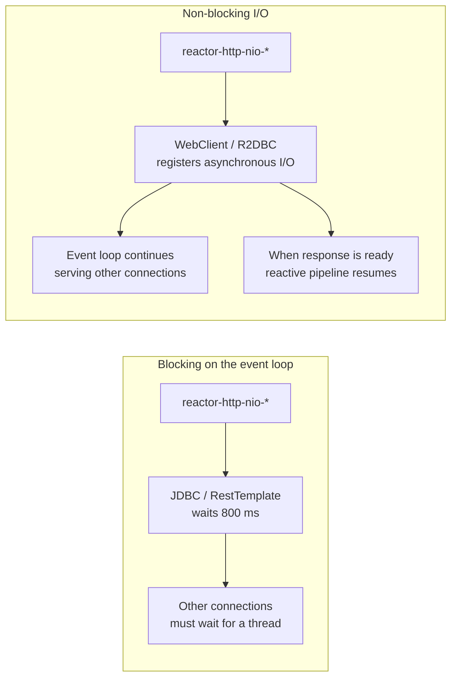
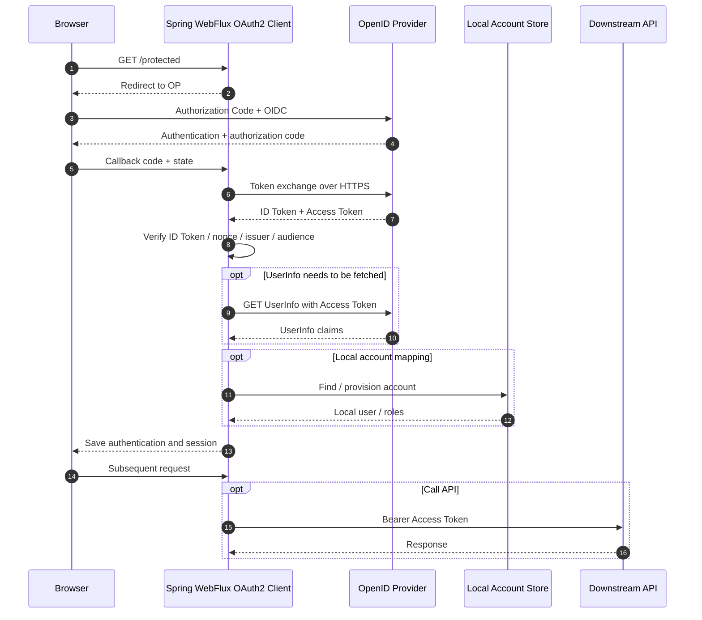

# 20.13. Avoiding Blocking I/O in Reactive Authentication Flows

In **Spring Security OAuth 2.0/OIDC Client** on **Spring WebFlux**, a login flow involves more than redirecting to the OpenID Provider (OP). The application also performs steps such as exchanging the authorization code for tokens, verifying the ID Token, calling UserInfo when needed, mapping the user into the internal system, and building an `Authentication` for use in subsequent requests.

If any step in that chain **blocks the thread running on the Reactor Netty event loop**, the entire application can become abnormally slow even when request volume is not particularly high. A misplaced JDBC call, `RestTemplate`, synchronous HTTP client, or `Mono.block()` can tie up an event-loop thread for hundreds of milliseconds or several seconds. During that time, that thread cannot serve any of the other connections it manages.

Therefore, in reactive security, **implementing the OAuth2/OIDC protocol correctly is not enough; how I/O is executed must also fit the reactive model**.

This lesson explains how to detect blocking I/O, distinguish blocking I/O from CPU-heavy operations, choose non-blocking APIs such as `WebClient` and R2DBC, isolate legacy dependencies on `Schedulers.boundedElastic()` when they cannot be replaced, preserve the reactive `SecurityContext`, and implement OAuth2/OIDC Login without turning the authentication step into a performance bottleneck.

## 1. Learning Outcomes

After this lesson, you should be able to distinguish:

1. How the **event loop** differs from the Servlet thread-per-request model.
2. Which activities in **Authorization Code/OIDC Login** can perform I/O.
3. Why `block()`, `RestTemplate`, JDBC, or synchronous HTTP calls inside `map`/`flatMap` are dangerous.
4. How to use `Mono`/`Flux`, `WebClient`, and reactive repositories to keep the flow non-blocking.
5. When to use `Mono.fromCallable(...).subscribeOn(Schedulers.boundedElastic())` for an unavoidable blocking operation.
6. How to work with `ReactiveSecurityContextHolder` without mistakenly relying on ThreadLocal.
7. How to handle timeouts, cancellation, retries, token refresh, and authentication errors in a **fail-closed** manner.
8. How to detect blocking I/O during development and monitor authentication latency in operations.

## 2. What Does Reactive Mean for I/O?

### 2.1. Thread-per-request and event loop

In the traditional Servlet model, a request is typically processed on one worker thread. When code calls the database synchronously and waits for a response, that thread can remain occupied until the operation completes.

In WebFlux deployed on Reactor Netty, the number of event-loop threads is usually much smaller than the number of concurrently processed requests. One event-loop thread serves **many connections**; the goal is not to hold threads waiting on I/O.



**Non-blocking does not mean I/O has no wait time.** The network still has latency, and the database still has to execute the query. The difference is that while waiting, the event-loop thread is not locked just waiting for the result.

### 2.2. A simple example

Suppose a custom authentication service reads user roles from the database and the query takes 500 ms.

If it calls synchronous JDBC on the event loop:

```java
// Anti-pattern inside a reactive operator.
return Mono.just(oidcUser)
    .map(user -> jdbcRepository.findBySubject(user.getSubject()))
    .map(this::buildPrincipal);
```

`map` **does not create a new thread automatically**. When the lambda runs on the event loop, `findBySubject(...)` blocks that exact event-loop thread until the database returns a result.

If replaced with a genuinely reactive API:

```java
return reactiveRepository.findBySubject(oidcUser.getSubject())
    .map(this::buildPrincipal);
```

I/O modeled with publishers and a non-blocking driver can yield the thread while waiting for the response.

### 2.3. Reactor does not fix blocking code automatically

A `Mono<T>` return type does not guarantee that every computation inside it is non-blocking.

For example:

```java
Mono<User> user = Mono.just(blockingRepository.findUser(id));
```

The call `blockingRepository.findUser(id)` executes **immediately when constructing the Mono**, before subscription even happens. If this line runs inside a handler/event loop, the thread is still blocked.

Even:

```java
Mono<User> user = Mono.fromCallable(
    () -> blockingRepository.findUser(id));
```

is **still not guaranteed to be safe**, because `fromCallable` runs on the subscriber's thread if no other scheduler is chosen. You need to know **where blocking code actually executes**, not just look at the return type.

## 3. Distinguishing Blocking I/O, CPU-Bound Work, and Asynchronous I/O

Three categories of operations are often lumped together by mistake.

| Work type | Examples | Does it block the event loop? | How to handle |
|---|---|---|---|
| **Blocking I/O** | JDBC, `RestTemplate`, `HttpURLConnection`, synchronous file read | Can block the thread while waiting | Use reactive drivers/clients; if unavoidable, offload |
| **Non-blocking I/O** | `WebClient`, R2DBC, reactive Redis client | Does not hold an event-loop thread just waiting for I/O | Compose publishers; do not call `block()` |
| **Short CPU-bound** | Parsing a few claims, null checks, small DTO mapping | Does not wait on I/O, uses CPU briefly | Usually handle directly if lightweight |
| **Heavy CPU-bound** | BCrypt/Argon2, specialized crypto, large data processing | Can make the event loop unresponsive quickly enough | Evaluate a dedicated thread pool/scheduler and load limits |
| **Fake asynchronous API** | API returning `CompletableFuture` that blocks internally on a tiny pool | May not block the event loop, but saturates another pool | Inspect the implementation and resource limits |

**Blocking I/O** is the primary concern, but you should not treat moving every JWT signature verification or small mapping step onto `boundedElastic` as the default optimization. Short CPU operations can execute quickly on the event loop; heavy CPU operations need to be measured and isolated under a dedicated policy.

## 4. Where Does I/O Occur in OAuth 2.0/OIDC Login?

A typical OIDC login flow:



In the steps above:

| Task | Is it I/O? | Risk when customizing |
|---|---|---|
| Redirect browser to OP | Builds HTTP response | Usually lightweight, no need to call OP manually from a handler |
| Exchange code for token | **HTTP network I/O** | Using a synchronous client in a reactive extension point |
| Fetch discovery/JWK metadata | **HTTP network I/O**, cacheable | Custom client that blocks or causes a request storm |
| Verify ID Token signature/claims | Primarily **CPU/crypto** | Heavy CPU or a custom validator calling the DB |
| UserInfo retrieval | **HTTP network I/O** | Using `RestTemplate` or `.block()` |
| Link OIDC user to local account | Usually **database I/O** | Using a JDBC/JPA repository inside a reactive callback |
| Load roles/permissions | DB or network service | Multiple blocking queries per login |
| Create/save web session | Possible I/O to distributed session store | Blocking session backend implementation |
| Refresh access token | **HTTP network I/O** | Custom synchronous refresh code, unbounded retries |
| Call downstream API | **HTTP network I/O** | Using synchronous `RestClient` in the WebFlux request path |

When using Spring Security's default reactive components appropriate for your version and configuration, most networking in the OAuth2 flow already has reactive integration. **The risk usually comes from custom code**, especially profile-mapping services, authority mappers, account provisioning, auditing, legacy system calls, or additional HTTP clients.

## 5. A Properly Stacked WebFlux OAuth2 Login Configuration

### 5.1. Dependencies

Gradle Groovy DSL example:

```groovy
dependencies {
    implementation 'org.springframework.boot:spring-boot-starter-webflux'
    implementation 'org.springframework.boot:spring-boot-starter-security'
    implementation 'org.springframework.boot:spring-boot-starter-oauth2-client'
}
```

If reactive database access is needed:

```groovy
dependencies {
    implementation 'org.springframework.boot:spring-boot-starter-data-r2dbc'
    runtimeOnly 'org.postgresql:r2dbc-postgresql'
}
```

The R2DBC portion is only an illustrative choice for PostgreSQL and needs versions compatibly managed by Spring Boot dependency management.

**Do not confuse `spring-boot-starter-data-jpa` or JDBC drivers with R2DBC**: traditional JDBC/JPA repositories perform blocking I/O even when called from methods returning `Mono`.

### 5.2. application.yml

```yaml
spring:
  security:
    oauth2:
      client:
        registration:
          company:
            provider: company
            client-id: ${OIDC_CLIENT_ID}
            client-secret: ${OIDC_CLIENT_SECRET}
            client-authentication-method: client_secret_basic
            authorization-grant-type: authorization_code
            redirect-uri: "{baseUrl}/login/oauth2/code/{registrationId}"
            scope:
              - openid
              - profile
              - email
        provider:
          company:
            issuer-uri: https://login.example.org
```

In WebFlux, Spring uses the corresponding `ReactiveClientRegistrationRepository`. `issuer-uri` supports OIDC discovery; never dynamically fetch issuer/JWKS from an arbitrary user-supplied URL.

### 5.3. SecurityWebFilterChain

```java
import org.springframework.context.annotation.Bean;
import org.springframework.context.annotation.Configuration;
import org.springframework.security.config.Customizer;
import org.springframework.security.config.annotation.web.reactive.EnableWebFluxSecurity;
import org.springframework.security.config.web.server.ServerHttpSecurity;
import org.springframework.security.web.server.SecurityWebFilterChain;

@Configuration
@EnableWebFluxSecurity
public class ReactiveSecurityConfig {

    @Bean
    SecurityWebFilterChain securityWebFilterChain(ServerHttpSecurity http) {
        return http
            .authorizeExchange(exchanges -> exchanges
                .pathMatchers("/", "/login", "/error", "/css/**").permitAll()
                .anyExchange().authenticated())
            .oauth2Login(Customizer.withDefaults())
            .build();
    }
}
```

`ServerHttpSecurity` and `SecurityWebFilterChain` are **Reactive/WebFlux** APIs, distinct from `HttpSecurity`/`SecurityFilterChain` in Servlet.

Calling `oauth2Login()` by itself does not make every custom business service non-blocking. Whenever you add database processing, UserInfo handling, or auditing, you must control I/O at each extension point.

## 6. Anti-Pattern #1: Calling block() Inside a Reactive Pipeline

### 6.1. Wrong example in a post-login controller

```java
@GetMapping("/me")
public Mono<UserView> me(
        @AuthenticationPrincipal OidcUser principal) {

    UserRecord user = userRepository
        .findByIssuerAndSubject(
            principal.getIdToken().getIssuer().toString(),
            principal.getSubject())
        .block(); // DO NOT use on the reactive request path.

    return Mono.just(new UserView(user.getDisplayName()));
}
```

Assume `userRepository` returns `Mono<UserRecord>` and `UserView` is an application DTO. Even though the database client looks reactive, calling `block()` forces the current thread to **wait until the Mono completes**.

In Reactor Netty, `block()` on an event-loop/non-blocking thread can throw a runtime error such as:

```text
IllegalStateException:
block()/blockFirst()/blockLast() are blocking,
which is not supported in thread reactor-http-nio-*
```

or create performance problems in other contexts where it is not immediately checked.

### 6.2. The right way: return Mono and compose

```java
@GetMapping("/me")
public Mono<UserView> me(
        @AuthenticationPrincipal OidcUser principal) {

    return userRepository
        .findByIssuerAndSubject(
            principal.getIdToken().getIssuer().toString(),
            principal.getSubject())
        .map(user -> new UserView(user.getDisplayName()));
}
```

Here the controller **does not wait** for the result by blocking. It returns the publisher for Spring WebFlux to subscribe to and write the response when data becomes available.

### 6.3. Other wrong variations

Do not write:

```java
Mono<UserRecord> userMono = repository.findBySubject(subject);

// Still blocks:
UserRecord user = userMono.toFuture().get();
```

or:

```java
// Usually also blocks if running on the event loop.
UserRecord user = userMono.blockOptional().orElseThrow();
```

Instead, use `map`, `flatMap`, `zipWhen`, `switchIfEmpty`, and other operators as needed.

## 7. Anti-Pattern #2: Calling JDBC/JPA Inside Mono.map()

Suppose the application performs OIDC login and needs to look up user roles from a JPA repository.

```java
Mono<OidcUser> process(OidcUser user) {
    return Mono.just(user)
        .map(oidc -> {
            // Blocking I/O runs on the thread executing map().
            return jpaRepository.findBySubject(oidc.getSubject());
        })
        .map(this::createUserView);
}
```

`Mono.just(...)` does not create a new thread pool. `map(...)` does not "automatically switch to a background thread" either. If the subscriber is running on the event loop, JDBC/JPA will block the event-loop thread.

### 7.1. Why Mono.just(blockingCall()) does not fix it

For example:

```java
Mono<UserRecord> load(String subject) {
    // blockingCall runs immediately when the method is called.
    return Mono.just(jpaRepository.findBySubject(subject));
}
```

It merely wraps an **already synchronously computed result**. It does not make I/O asynchronous at all.

### 7.2. When possible, migrate to R2DBC

With a real R2DBC driver and reactive repository:

```java
public interface LocalAccountRepository
        extends org.springframework.data.repository.reactive
            .ReactiveCrudRepository<LocalAccount, Long> {

    Mono<LocalAccount> findByIssuerAndSubject(
        String issuer,
        String subject
    );
}
```

This example assumes the `LocalAccount` entity is properly mapped by Spring Data R2DBC and `reactor.core.publisher.Mono` is imported.

Service:

```java
import reactor.core.publisher.Mono;

public final class LocalProfileService {

    private final LocalAccountRepository accounts;

    public LocalProfileService(LocalAccountRepository accounts) {
        this.accounts = accounts;
    }

    public Mono<LocalAccount> findAccount(
            String issuer,
            String subject) {

        return accounts.findByIssuerAndSubject(issuer, subject);
    }
}
```

R2DBC does not mean queries will always be fast, but while waiting on I/O, the pipeline can avoid holding an event-loop thread like a synchronous JDBC call does.

### 7.3. What if R2DBC cannot be used yet?

A system may depend on JPA lazy-loading, specialized stored procedures, or a legacy library that only offers a synchronous API. In that case, **do not pretend the dependency is non-blocking**. Isolate it on the proper thread pool as shown in the next section and maintain a long-term evaluation/migration plan.

## 8. Isolating Legacy Blocking I/O with boundedElastic()

When synchronous JDBC/SDKs cannot be replaced immediately, Reactor provides a way to **move potentially blocking work off the event loop**:

```java
Mono.fromCallable(() -> blockingCall())
    .subscribeOn(Schedulers.boundedElastic());
```

### 8.1. Standard pattern for blocking repositories

```java
import reactor.core.publisher.Mono;
import reactor.core.scheduler.Schedulers;

public final class LegacyAccountAdapter {

    private final LegacyJdbcRepository jdbc;

    public LegacyAccountAdapter(LegacyJdbcRepository jdbc) {
        this.jdbc = jdbc;
    }

    public Mono<LocalAccount> loadByExternalIdentity(
            String issuer,
            String subject) {

        return Mono.fromCallable(
                () -> jdbc.findByIssuerAndSubject(issuer, subject))
            .subscribeOn(Schedulers.boundedElastic());
    }
}
```

For example, `LegacyJdbcRepository` is a synchronous repository defined by the application:

```java
public interface LegacyJdbcRepository {
    LocalAccount findByIssuerAndSubject(
        String issuer,
        String subject);
}
```

**Key points to remember:**

1. `Mono.fromCallable(...)` defers executing the operation until subscription.
2. `subscribeOn(Schedulers.boundedElastic())` directs where the source `Callable` is executed.
3. The event loop is not held just waiting for the JDBC call to complete.
4. `boundedElastic` has resource bounds; it **does not magically turn blocking I/O into non-blocking I/O**.
5. The database connection pool and JDBC driver remain blocking components requiring their own timeouts and sizing.

### 8.2. Why is boundedElastic different from parallel?

Reactor provides `Schedulers.parallel()` for short CPU-bound tasks. Do not default to `parallel()` for JDBC/network blocking because blocking will occupy threads of the CPU pool, starving other computations.

`boundedElastic()` is more suitable for isolating **blocking I/O**, though it is not an unbounded thread pool. When traffic exceeds capacity, queued jobs can grow and latency will still rise. Concurrency, pool size, and queues must be controlled.

### 8.3. What not to do

```java
// Wrong: the blocking operation already happened before constructing the publisher.
LocalAccount account = jdbc.findBySubject(subject);

return Mono.just(account)
    .subscribeOn(Schedulers.boundedElastic());
```

`subscribeOn` cannot travel back in time to move the JDBC statement that already ran onto another thread.

The right way:

```java
return Mono.fromCallable(() -> jdbc.findBySubject(subject))
    .subscribeOn(Schedulers.boundedElastic());
```

### 8.4. Placing the blocking boundary at the adapter

Do not scatter `subscribeOn(boundedElastic())` across every controller. Better:

```text
OAuth2 Login / Reactive Security
        |
        v
AccountService (Mono<LocalAccount>)
        |
        v
LegacyAccountAdapter
  -> Mono.fromCallable(JDBC)
  -> boundedElastic
        |
        v
Blocking JDBC Library
```

Controllers and the authentication pipeline only see `Mono`. The adapter takes responsibility for isolating synchronous operations, timeouts, and error mapping tailored to the library's behavior.

### 8.5. Do not try to wrap the entire request in boundedElastic

For example:

```java
// Not a default design approach.
return Mono.fromCallable(() -> {
    // An entire complex chain of HTTP, DB, and logic can block.
    return doEverythingSynchronously();
}).subscribeOn(Schedulers.boundedElastic());
```

This approach may work as a transitional step, but it sacrifices many benefits of the reactive stack, makes cancellation harder to track, and complicates thread pool management. Isolate **only the genuinely blocking segments**, keeping the rest reactive.

## 9. How Do subscribeOn and publishOn Differ?

These two operators are easily confused when dealing with legacy code.

### 9.1. subscribeOn

`subscribeOn` affects the thread where subscription and the upstream source execute. Typical pattern:

```java
Mono.fromCallable(() -> legacyDb.load(id))
    .subscribeOn(Schedulers.boundedElastic())
    .map(this::toProfile);
```

The blocking source runs on boundedElastic. Subsequent operators may continue running on that scheduler depending on the pipeline and asynchronous boundaries; do not assume they automatically jump back to the event loop.

### 9.2. publishOn

`publishOn` switches the scheduler for **subsequent downstream operators**:

```java
return Mono.just(id)
    .publishOn(Schedulers.boundedElastic())
    .map(legacyDb::load)
    .map(this::toProfile);
```

This pattern can offload `legacyDb.load` but is easy to misplace as chains grow longer or get refactored. For **a clear blocking call**, `Mono.fromCallable(...).subscribeOn(boundedElastic())` is usually easier to read and prevents premature execution.

### 9.3. Do not use schedulers as a security access control

A scheduler only decides where code runs, not which user is allowed to access data. When switching threads, understand **Reactor Context** and how `SecurityContext` propagates; never copy `Authentication` into static fields or homemade thread-locals.

## 10. Reactive WebClient Instead of RestTemplate in Authentication

When code needs to call the OP UserInfo Endpoint, a directory API, or an internal service during the login flow, use **`WebClient`** instead of synchronous HTTP clients whenever possible.

### 10.1. Anti-pattern: RestTemplate inside Mono.map()

```java
Mono<UserProfile> loadProfile(String accessToken) {
    return Mono.just(accessToken)
        .map(token -> restTemplate.getForObject(
            "https://userinfo.example.org/profile",
            UserProfile.class
        ));
}
```

`RestTemplate.getForObject(...)` is synchronous and can hold the event-loop thread waiting on the network. Moreover, this example does not even send the Bearer token, so it is also incomplete with respect to OAuth.

### 10.2. Non-blocking WebClient

```java
import org.springframework.http.HttpHeaders;
import org.springframework.web.reactive.function.client.WebClient;
import reactor.core.publisher.Mono;

public final class ProfileHttpClient {

    private final WebClient webClient;

    public ProfileHttpClient(WebClient.Builder builder) {
        this.webClient = builder
            .baseUrl("https://profiles.example.org")
            .build();
    }

    public Mono<ExternalProfile> load(String accessToken) {
        return webClient.get()
            .uri("/api/me")
            .headers(headers -> headers.setBearerAuth(accessToken))
            .retrieve()
            .bodyToMono(ExternalProfile.class);
    }

    public record ExternalProfile(
        String id,
        String name,
        String email
    ) {}
}
```

Example notes:

- `WebClient` returns `Mono<ExternalProfile>` without calling `block()`.
- The access token is attached only to a fixed API host.
- `setBearerAuth(...)` takes the **token value**, without needing a pre-attached `"Bearer "` prefix.
- The DTO includes only necessary fields; the actual response type must match the provider contract.
- Timeouts, retry policies, and body size limits are required based on real-world needs.

**Do not send the ID Token instead of the access token** simply because both are JWTs. For OIDC UserInfo, UserInfo's `sub` must match the verified ID Token and must allow Spring/extension code to validate it according to the specification.

### 10.3. Do not call WebClient.block()

For example:

```java
// Even though WebClient is reactive, this line is blocking.
ExternalProfile profile = webClient.get()
    .uri("/api/me")
    .retrieve()
    .bodyToMono(ExternalProfile.class)
    .block();
```

To stay reactive, return the `Mono` and compose:

```java
return webClient.get()
    .uri("/api/me")
    .retrieve()
    .bodyToMono(ExternalProfile.class)
    .map(this::toLocalView);
```

### 10.4. UserInfo URL must not come from arbitrary input

Never accept a browser-supplied `userinfoUrl` and attach an access token to that URL. That creates **credential exfiltration and SSRF** risks.

The OP/UserInfo URL must come from a trusted `ClientRegistration`/discovery configuration or an allowlisted server-side configuration. The HTTP client must also protect redirects, TLS verification, and outbound host policies.

## 11. A Non-Blocking Internal Profile Flow After OIDC Login

Suppose the RP has completed OIDC authentication and obtained an `OidcUser`. The application needs to look up the local account by `iss` and `sub`, then return information to the UI.

### 11.1. Why not use email as the key?

Email addresses can be missing, changed, unverified, or reassigned. With OIDC, a common external identity key is:

```text
(issuer, subject) = (iss, sub)
```

For example:

```text
(https://login.example.org, user-725)
```

Do not use display name or `preferred_username` as the account key merely because it is human-readable.

### 11.2. Reactive repository contract

```java
import reactor.core.publisher.Mono;

public interface AccountLookup {
    Mono<LocalAccount> findByIssuerAndSubject(
        String issuer,
        String subject
    );
}

public record LocalAccount(
    String id,
    String displayName,
    String tenantId
) {}
```

The implementation can use R2DBC or a non-blocking service client.

### 11.3. Controller returns Mono without blocking

```java
import org.springframework.security.core.annotation.AuthenticationPrincipal;
import org.springframework.security.oauth2.core.oidc.user.OidcUser;
import org.springframework.web.bind.annotation.GetMapping;
import org.springframework.web.bind.annotation.RestController;
import org.springframework.security.access.AccessDeniedException;

import reactor.core.publisher.Mono;

@RestController
public class MyProfileController {

    private final AccountLookup accounts;

    public MyProfileController(AccountLookup accounts) {
        this.accounts = accounts;
    }

    @GetMapping("/me")
    public Mono<ProfileView> me(
            @AuthenticationPrincipal OidcUser oidcUser) {

        String issuer =
            oidcUser.getIdToken().getIssuer().toString();
        String subject = oidcUser.getSubject();

        return accounts.findByIssuerAndSubject(issuer, subject)
            .switchIfEmpty(Mono.error(
                new AccessDeniedException(
                    "No local account mapped to this identity")))
            .map(account -> new ProfileView(
                account.id(),
                account.displayName(),
                account.tenantId()
            ));
    }

    public record ProfileView(
        String id,
        String displayName,
        String tenantId
    ) {}
}
```

Benefits:

- Obtains the `OidcUser` already verified by Spring.
- Avoids manually parsing the ID Token from query parameters or headers.
- `AccountLookup` returns a non-blocking publisher.
- If the local account does not exist, it **does not** silently pick another account sharing the same email.
- Does not return the access token, refresh token, or raw ID Token to the browser.
- Output tenant data is controlled through internal mapping.

### 11.4. When first-time local account provisioning is needed

A reactive provisioning flow might look like:

```java
public Mono<LocalAccount> findOrProvision(
        String issuer,
        String subject) {

    return accounts.findByIssuerAndSubject(issuer, subject)
        .switchIfEmpty(
            accountProvisioner.createForIdentity(issuer, subject));
}
```

However, you must analyze:

- Should user roles be auto-provisioned?
- Who is allowed to self-create a tenant/account?
- Is there a unique constraint on the external identity key?
- If two concurrent requests provision at the same time, is there a race condition?
- Has user data from the OP been verified and authorized to drive role assignment?

`switchIfEmpty(...)` is not a substitute for a database unique constraint. When provisioning involves roles/tenants, appropriate policies and transactions are mandatory—**never grant `ROLE_ADMIN` automatically when a new user logs in**.

## 12. Custom Reactive User Service: Where Blocking Easily Leaks

Spring Security supports extension points to load an OAuth2/OIDC user and transform tokens/claims into an `OAuth2User` or `OidcUser`. Exact class names and DSL configuration may vary by version, but the reactive contract generally takes the form:

```java
ReactiveOAuth2UserService<OAuth2UserRequest, OAuth2User>
```

and for OIDC:

```java
ReactiveOAuth2UserService<OidcUserRequest, OidcUser>
```

A reactive implementation returns **`Mono<...>`** and must not turn user loading into a blocking call.

### 12.1. Anti-pattern: loading roles via JDBC directly inside a lambda

```java
// Illustrates a design mistake; do not use on the WebFlux event loop.
Mono<OidcUser> enrich(OidcUser user) {
    return Mono.just(user)
        .map(u -> {
            var roles = jdbcRoleRepository.findRoles(
                u.getIdToken().getIssuer().toString(),
                u.getSubject()
            ); // Blocking JDBC.
            return addAuthorities(u, roles);
        });
}
```

Returning `Mono<OidcUser>` from the method does not make JDBC I/O asynchronous.

### 12.2. The right way with a reactive role repository

```java
public Mono<OidcUser> enrich(OidcUser user) {

    String issuer = user.getIdToken().getIssuer().toString();
    String subject = user.getSubject();

    return reactiveRoleRepository.findRoleNames(issuer, subject)
        .collectList()
        .map(roleNames -> addAuthorities(user, roleNames));
}
```

Assumptions:

- `reactiveRoleRepository.findRoleNames(...)` returns `Flux<String>` from a non-blocking source.
- `addAuthorities(...)` only performs lightweight CPU mapping, with no DB queries.
- Roles come from trusted sources and application policies, not arbitrary strings from unverified claims.
- When enhancing `OidcUser`, the code must **preserve the ID Token/UserInfo and all validations**; never construct a principal missing `subject` or `issuer`.

### 12.3. When JDBC must be used in a custom user service

```java
public Mono<OidcUser> enrichWithLegacyRoles(OidcUser user) {

    String issuer = user.getIdToken().getIssuer().toString();
    String subject = user.getSubject();

    return Mono.fromCallable(() ->
            jdbcRoleRepository.findRoles(issuer, subject))
        .subscribeOn(Schedulers.boundedElastic())
        .map(roleNames -> addAuthorities(user, roleNames));
}
```

This is a reasonable transitional step when JDBC cannot yet be eliminated. Limit concurrency, set timeouts, and ensure the operation does not rely on unpropagated ThreadLocal request security assumptions.

### 12.4. Be careful when integrating into the Login DSL

Do not build a custom `AuthenticationWebFilter` that bypasses OIDC ID Token processing just to add roles. Use the extension points, user services, or authorized client handling **supported by your Spring Security version**, keep the delegate that validates OIDC intact, and attach enrichment steps via reactive composition.

If the goal is only to display `displayName` or a local profile, many applications stay simpler by **keeping the default OIDC principal** and loading internal data in an application service after login. Inserting DB I/O into the critical authentication path is not always necessary.

## 13. Not All Profile Data Must Be Loaded Before Login Completes

An important architectural decision: **what truly must finish before the user is considered authenticated?**

For example:

| Data | Needed immediately during login? | Guidance |
|---|---|---|
| ID Token validation, subject/issuer | **Yes** | Always verify OIDC properly |
| Checking whether the account is locked in the system | Possibly **yes**, per policy | Query a trusted source and fail closed when required |
| Required tenant membership proof | Possibly **yes** | Check before granting sensitive access |
| Display name | Usually no | Can be loaded lazily on `/me` |
| Avatar | Usually no | Do not make login depend on a thumbnail service |
| Preferences/theme | Usually no | Load after entering the app |
| Non-blocking-decision audit events | Depends on requirements | Outbox/queue or controlled pipeline |
| Rapidly changing permissions | Should not rely solely on login-time cache | Can be evaluated dynamically at authorization time |

If an external profile/avatar service is slow, you should not prevent every user from logging in unless the business truly requires that data. Conversely, if the application must verify that a user is not locked out, **do not skip that check when the DB times out** just to keep login fast.

### 13.1. Critical authentication path

```text
OIDC protocol validation
   + Required account status/tenant checks
   + Authentication creation
= Critical path
```

Data such as avatars, UI themes, or notifications can be fetched in separate UI steps.

Eliminating unnecessary I/O on the critical path typically improves login latency more effectively than throwing thread pools at every operation.

## 14. Reactive SecurityContext and Reactor Context

When code switches threads or crosses asynchronous boundaries, accessing the current user must not rely on an arbitrary ThreadLocal.

### 14.1. In WebFlux use ReactiveSecurityContextHolder

```java
import org.springframework.security.core.context.ReactiveSecurityContextHolder;
import reactor.core.publisher.Mono;

public Mono<String> currentPrincipalName() {
    return ReactiveSecurityContextHolder.getContext()
        .map(context -> context.getAuthentication().getName());
}
```

`ReactiveSecurityContextHolder` reads from the **Reactor Context** bound to the subscription. This differs from using traditional `SecurityContextHolder` in Servlet applications.

### 14.2. ThreadLocal anti-pattern

```java
// Should not be used by default for WebFlux requests.
Authentication auth =
    SecurityContextHolder.getContext().getAuthentication();
```

A reactive pipeline can switch threads; ThreadLocal is not guaranteed to hold the right context at every step.

Do not copy the principal into a static variable:

```java
static Authentication currentAuthentication;
```

because that risks mixing identities across concurrent requests.

### 14.3. Do not call subscribe() manually inside a user service

```java
// Anti-pattern: detaches the task from the login pipeline.
roles.findRoles(subject).subscribe(roles -> updateAuthorities(roles));

return Mono.just(currentUser);
```

That `subscribe()` call can execute at a different time, errors are disconnected from the pipeline, cancellation becomes unclear, and `Authentication` may be returned **before** roles are updated.

The right way:

```java
return roles.findRoles(subject)
    .map(roleNames -> buildUser(currentUser, roleNames));
```

Assume `findRoles` returns `Mono<List<String>>`. If it returns `Flux<String>`, use `collectList()` before mapping.

### 14.4. Pass identity explicitly across trust boundaries

If a background job is triggered from a user request and runs after the request finishes, do not rely on the Reactor Context still being present. The job needs a **verified, least-privilege identity/context payload** governed by a delegation/authorization policy.

Do not put an `OidcUser` containing raw tokens onto a queue just for a worker to "continue logging in."

## 15. Integrating Blocking SDKs Outside the Authentication Pipeline

An application may need to call an HR system SDK, legacy LDAP, file store, or audit service that only provides a synchronous API.

### 15.1. Separate adapter layer

```java
import reactor.core.publisher.Mono;
import reactor.core.scheduler.Schedulers;

public final class LegacyDirectoryAdapter {

    private final LegacyDirectoryClient client;

    public LegacyDirectoryAdapter(LegacyDirectoryClient client) {
        this.client = client;
    }

    public Mono<DirectoryStatus> lookup(String employeeId) {
        return Mono.fromCallable(() -> client.lookup(employeeId))
            .subscribeOn(Schedulers.boundedElastic());
    }

    public interface LegacyDirectoryClient {
        DirectoryStatus lookup(String employeeId);
    }

    public record DirectoryStatus(
        boolean active,
        String organization
    ) {}
}
```

Then in the service:

```java
return directory.lookup(employeeId)
    .flatMap(status -> {
        if (!status.active()) {
            return Mono.error(
                new AccessDeniedException("Account is disabled"));
        }
        return Mono.just(status);
    });
```

The blocking SDK is isolated from the event loop and the result flows back into the pipeline for the authorization decision.

### 15.2. BoundedElastic does not replace I/O client timeouts

If `client.lookup(...)` hangs because no socket timeout was configured, a boundedElastic thread can still be held for a very long time. Even if you call:

```java
.timeout(Duration.ofSeconds(3))
```

on the Mono, timeout cancellation **does not guarantee** immediate interruption of an in-flight blocking library call if the client does not support interruption/timeouts.

Therefore, you need:

- HTTP/connect/read timeouts on the SDK/client itself.
- Bounded connection pools and executors.
- Reactive timeouts in the pipeline to cap request wait time.
- Circuit breakers, bulkheads, or load shedding as needed.
- Metrics on thread saturation and queued task counts.

### 15.3. Do not scale boundedElastic unboundedly

If each login request makes 4 blocking calls × 3 seconds, it can put heavy pressure on pools, DBs, and downstream targets. Increasing thread counts arbitrarily does not solve a database connection bottleneck and can worsen load and latency.

Prefer **reducing the number of blocking calls**, batching queries where appropriate, caching non-sensitive metadata with an invalidation policy, and migrating to non-blocking APIs where feasible.

## 16. Timeouts in Authentication Flows

An authentication flow can encounter slow networks or temporary OP/DB unavailability.

### 16.1. Use intentional timeouts

```java
import java.time.Duration;
import reactor.core.publisher.Mono;

public Mono<LocalAccount> resolveAccount(
        String issuer,
        String subject) {

    return accounts.findByIssuerAndSubject(issuer, subject)
        .timeout(Duration.ofSeconds(2));
}
```

This is an example. Actual thresholds must reflect SLOs, network behavior, database capacity, and UX.

**Timeout does not mean "allow login."** If local account status is mandatory, query timeouts must be handled by a deny/retry policy rather than falling back to privileged default roles.

### 16.2. Distinguish optional fields from security-critical checks

Wrong:

```java
return accountService.checkAdminPermission(subject)
    .onErrorReturn(true); // Fail open: very dangerous.
```

If admin privileges cannot be verified, never assume the user has them:

```java
return accountService.checkAdminPermission(subject)
    .onErrorReturn(false);
```

Returning `onErrorReturn(false)` may be suitable for a **permission check**. On an authentication critical path, it is sometimes better to propagate a clear error code so the user knows the service is temporarily unavailable, rather than assuming the account is permanently disabled.

For non-critical display fields, a fallback is reasonable:

```java
return avatarService.fetchAvatar(subject)
    .timeout(Duration.ofMillis(500))
    .onErrorReturn("/images/default-avatar.png");
```

Distinguish **identity/authorization** data from **cosmetic** data so you choose fail-open vs. fail-closed properly.

### 16.3. Retries are not safe by default

`retryWhen(...)` can help with transient timeouts, but you must not retry unconditionally:

- `invalid_grant` when exchanging an authorization code: codes are single-use, so retries will likely fail.
- Refresh token rotation/reuse errors: retrying an old token can trigger replay detection.
- HTTP 401/403: usually requires handling authentication/authorization, not network retries.
- User creation/provisioning: retries can create duplicates if the operation is not idempotent.
- Database connection outages: many concurrent retries can amplify load.

Only retry **classified transient errors**, cap attempt counts, add appropriate backoff/jitter, and ensure operations are idempotent or properly locked.

## 17. Controlling Concurrency, Connection Pools, and Backpressure

Reactive programming does not give Resource Servers or databases infinite capacity.

### 17.1. Limit concurrent external calls

If 1,000 users log in concurrently and each flow calls 3 microservices, downstream systems could receive 3,000 requests. Even though `WebClient` is non-blocking, target services still need capacity.

You must manage:

- HTTP client connection pools.
- Active requests and pending acquire limits.
- Timeouts.
- Rate limits.
- Per-endpoint/provider concurrency.
- Circuit breakers for non-essential dependencies.
- Protection against race conditions during local account provisioning.

### 17.2. flatMap can fan out concurrent I/O

For example:

```java
return Flux.fromIterable(userIds)
    .flatMap(id -> accountService.load(id))
    .collectList();
```

`flatMap` can execute many asynchronous requests simultaneously. When processing large batches, limit concurrency:

```java
return Flux.fromIterable(userIds)
    .flatMap(id -> accountService.load(id), 8)
    .collectList();
```

The number `8` is illustrative. Choose limits based on real DB/AS/API capacity and latency rather than an arbitrary constant.

A standard login flow involves a single user, but enrichment steps like loading memberships/permissions from multiple services can create fan-out that needs to be bounded.

### 17.3. Backpressure is not magic for HTTP login

Reactive Streams support backpressure within many pipelines, yet:

- Browsers can still open many connections.
- OPs/ASes enforce rate limits.
- DB pools remain finite.
- A blocking SDK can still exhaust the boundedElastic pool.

Therefore, traffic control, timeouts, and appropriate resource sizing remain necessary beyond merely returning `Mono`.

## 18. Crypto and Password Hashing: CPU-Heavy Is Not Always I/O Blocking

Not every slow task during authentication is blocking I/O.

### 18.1. OIDC ID Token signature validation

Verifying JWT signatures and claims is primarily CPU-bound, though fetching JWKS can require HTTP network I/O (usually cached).

- Never skip JWT validation just to cut latency.
- Do not write a synchronous custom decoder that blocks on the network on the event loop.
- Leverage reactive integrations and cache keys under controlled policies.
- Restrict issuer/JWK endpoints in trust policies to prevent SSRF.
- Never allow attackers to control arbitrary `jku`/`x5u` headers leading to key fetches from untrusted hosts.

### 18.2. BCrypt/Argon2

If an application combines form login with password verification, BCrypt/Argon2 are deliberately CPU-intensive to resist brute force. They are not database I/O, yet they can hold a thread for a noticeable duration.

If a custom reactive authentication manager directly performs blocking/CPU-heavy hash verification on the event loop, evaluate offloading to a suitable worker pool.

However, when using default authentication implementations that already manage their own execution strategy, do not blindly wrap every step in `boundedElastic` without understanding the pipeline. The goal is **not hogging the event loop**, not randomly altering the validation flow.

### 18.3. Keep small CPU tasks simple

Tasks like reading `sub`, creating DTOs, picking a fallback display name, or validating a small set of claims do not warrant a separate scheduler. Excessive thread switching adds unnecessary overhead.

## 19. Do Not Use Blocking HTTP Clients for the Token Endpoint

In a standard OIDC flow, Spring Security handles token exchange. If you customize it to add parameters or swap the token response client, preserve the reactive model.

### 19.1. Anti-pattern

```java
Mono<TokenResponse> exchange(AuthorizationCode code) {
    return Mono.just(
        restTemplate.postForObject(
            tokenUri,
            makeRequest(code),
            TokenResponse.class
        )
    );
}
```

Problems:

- `RestTemplate` is synchronous.
- `Mono.just(...)` invokes `postForObject(...)` **immediately**.
- If the flow runs on the event loop, the thread blocks.
- Incorrectly retrying code exchange can violate the single-use code requirement.
- Hand-rolling Token Endpoint exchange risks omitting client authentication or PKCE checks.

### 19.2. Prefer reactive extension points

If custom token parameters or provider behavior are needed, use the reactive token response client APIs supported by your Spring Security version. Keep these steps intact:

1. Authorization code correlation with `state`.
2. PKCE `code_verifier` where applicable.
3. Client authentication per `ClientRegistration`.
4. Token Endpoint HTTPS and response validation.
5. OIDC ID Token validation.
6. Authorized client persistence.

Never "fix performance" by removing security checks.

## 20. Refresh Tokens and API Calls in Reactive Applications

When the RP needs to call downstream APIs, `ReactiveOAuth2AuthorizedClientManager` coordinates authorized clients and the reactive token lifecycle.

Related types:

| Reactive type | Role |
|---|---|
| `ReactiveClientRegistrationRepository` | OAuth registration configuration |
| `ServerOAuth2AuthorizedClientRepository` | Load/save authorized clients per web exchange |
| `ReactiveOAuth2AuthorizedClientService` | Load/save authorized clients outside a web exchange |
| `ReactiveOAuth2AuthorizedClientManager` | Authorize/reauthorize and refresh per provider |
| `DefaultReactiveOAuth2AuthorizedClientManager` | Manager for requests with a `ServerWebExchange` |
| `AuthorizedClientServiceReactiveOAuth2AuthorizedClientManager` | Manager outside web requests |

Do not use Servlet's `DefaultOAuth2AuthorizedClientManager` inside WebFlux handlers.

### 20.1. WebClient OAuth2 integration

For WebFlux, Spring Security provides `ServerOAuth2AuthorizedClientExchangeFilterFunction` to attach access tokens managed by the authorized client manager.

Model:

```text
WebFlux Controller
    |
    v
Reactive Service
    |
    v
WebClient + OAuth2 Exchange Filter
    |
    v
ReactiveOAuth2AuthorizedClientManager
    |
    +-- Load authorized client
    +-- Refresh token if needed
    |
    v
Authorization: Bearer access_token
    |
    v
Resource Server
```

Do not configure a single global `WebClient` that automatically attaches user access tokens to **every URL** supplied by callers. Scope clients to trusted API origins and explicitly select registrations to avoid credential leakage.

### 20.2. Client Credentials in reactive workers

A scheduled worker has no browser `ServerWebExchange`. When using the Client Credentials Grant, use a service-based reactive manager and an appropriate technical principal rather than reusing an arbitrary user session.

Never fabricate a fake `OidcUser` from a client ID. A client credentials token represents a workload/client, not a logged-in End-User.

## 21. Reactive SecurityContext When Using boundedElastic

### 21.1. Reactor Context generally propagates across operators

In a properly composed pipeline, Reactor Context travels with the subscription even when the execution thread changes.

For example:

```java
return ReactiveSecurityContextHolder.getContext()
    .map(ctx -> ctx.getAuthentication().getName())
    .flatMap(name ->
        legacyDirectoryAdapter.lookup(name));
```

The adapter itself uses `boundedElastic` for the blocking call. Here the principal name is read from the reactive security context **before** invoking the adapter.

### 21.2. ThreadLocal-based legacy SDKs

Some older SDKs read the user ID from `ThreadLocal` or Servlet's `SecurityContextHolder`. They may receive `null` or stale data if invoked inside a reactive environment.

Safer solutions:

- Pass **identity or correlation context explicitly** into the adapter.
- Do not expect the SDK to read `Authentication` from thread-local storage.
- For logging MDC, use an appropriate context propagation mechanism and sanitize sensitive data.
- Never use static variables for the current user.
- Never cache `Authentication` inside a singleton service for reuse on subsequent requests.

### 21.3. Do not call subscribe() inside a service

Wrong:

```java
public Mono<UserView> me(String subject) {
    accounts.findBySubject(subject)
        .subscribe(user -> auditSomething(user));

    return Mono.just(new UserView("done"));
}
```

The audit task runs detached from the pipeline, losing clear error handling and context. If auditing is a business condition that must complete, compose it:

```java
return accounts.findBySubject(subject)
    .flatMap(user ->
        auditService.writeEvent(user)
            .thenReturn(new UserView(user.displayName())));
```

If auditing is a secondary event that does not need to complete synchronously with the request, use an event/outbox/queue with its own policy rather than ad-hoc fire-and-forget inside the authentication pipeline.

## 22. BlockHound and Identifying Blocking Calls

**BlockHound** is a tool capable of detecting certain blocking operations occurring on threads marked as non-blocking in a Reactor environment.

### 22.1. Using it in development/testing environments

Conceptual example:

```java
import reactor.blockhound.BlockHound;

public class ReactiveTestBootstrap {
    public static void installBlockHound() {
        BlockHound.install();
    }
}
```

BlockHound has Java/JVM instrumentation and library version compatibility requirements; on some JDKs extra JVM flags or configuration may be needed. **Do not enable it casually in production** without evaluating performance and compatibility impact.

When a blocking operation is detected on a non-blocking thread, the tool can throw an error similar to:

```text
reactor.blockhound.BlockingOperationError:
  Blocking call! java.lang.Thread.sleep
```

This example illustrates detection principles; not every blocking SDK call will be caught in every environment.

### 22.2. Clues from logs and thread names

Thread names such as:

```text
reactor-http-nio-1
reactor-http-nio-2
```

are typically associated with the Netty event loop. If a stack trace on such a thread shows:

```text
java.net.SocketInputStream.read
java.sql.PreparedStatement.executeQuery
org.springframework.web.client.RestTemplate.exchange
Thread.sleep
Mono.block
```

you should investigate whether a blocking call exists on the reactive request path. Do not draw conclusions from thread names alone; examine the full stack trace and actual call site.

### 22.3. BlockHound does not replace load testing

BlockHound is useful for pinpointing specific blocking calls; it does not prove production latency or throughput meets requirements. You still need performance testing and observability covering:

- P50/P95/P99 login latency.
- Event-loop utilization.
- Reactive HTTP client connection pool saturation.
- DB pool wait time.
- BoundedElastic queued tasks and active threads.
- Token Endpoint latency/error rate.
- UserInfo/identity service latency.
- Login failures caused by timeouts.
- CPU/GC pressure.

## 23. A Step-by-Step Plan for Controlling Login Latency

You can break an OIDC login flow down into latency segments:

```text
Browser authorization redirect / OP interactive login
  -> not entirely within server processing time

Callback to RP
  -> state verification
  -> token exchange HTTP
  -> ID Token validation
  -> optional UserInfo HTTP
  -> local identity/role lookup
  -> Authentication/session persistence
  -> redirect response
```

If callbacks are slow, identify **which step takes time** instead of reflexively increasing Netty event-loop threads.

For example:

| Step | Symptom | Remediation |
|---|---|---|
| Token exchange | Slow due to network/OP | Timeouts/TLS/connection pools; never auto-retry single-use codes |
| JWKS retrieval | Slow on cache miss | Reasonable key/discovery caching, trusted issuers |
| UserInfo | Consistently slow | Request only needed claims, non-blocking HTTP, timeouts |
| Local account lookup | Slow or blocking | R2DBC; if legacy JDBC, isolate on `boundedElastic` |
| Groups/roles enrichment | Many fan-out calls | Batching, concurrency limits, separate critical vs. optional |
| Session store | Slow in Redis/DB | Reactive driver, persistence performance tuning |
| Login success audit | Non-essential yet blocking | Queue/outbox or policy-governed non-blocking audit |
| Crypto | High CPU | Measure cost and select suitable worker scheduling |

### 23.1. Optimize in the right order

1. Remove unnecessary I/O from the critical path.
2. Replace blocking clients with non-blocking drivers.
3. Explicitly offload any remaining legacy blocking parts.
4. Add timeouts, circuit breakers, and concurrency limits.
5. Measure performance; only then tune thread pool and connection pool sizing.

Increasing the number of event-loop threads does not fix the underlying problem of a slow blocking call. It may merely hide the bug while inflating resource consumption.

## 24. Distinguishing Timeouts, Cancellation, and Interruption

A reactive timeout can **cancel the subscription** when the wait expires, but actual I/O cancellation behavior depends on the upstream/client implementation.

With `WebClient` and non-blocking drivers, cancellation can usually release network resources according to the library's design.

With legacy JDBC wrapped in `fromCallable`, the thread executing the query may keep waiting on the socket even after the subscription is canceled. Do not assume `timeout(Duration.ofSeconds(2))` will immediately abort an already-dispatched JDBC query.

Therefore:

- Configure connect/read/query timeouts at the driver level.
- Enforce reactive deadlines/timeouts on the request path.
- Cap concurrent blocking calls.
- Check SDK interruptibility.
- Ensure resource cleanup in `try/finally` blocks or safe APIs.
- Do not spawn threads manually without lifecycle management.

## 25. A Complete Solution for Legacy Account Lookup

Example requirements:

- The user has signed in via OIDC and holds a valid `issuer` and `subject`.
- The application still uses legacy JDBC to look up local accounts.
- The event loop must not be blocked.
- If the account does not exist or the lookup errors out, **access must not be granted**.

### 25.1. Legacy repository

```java
public interface LegacyAccountRepository {
    LocalAccount findByExternalIdentity(
        String issuer, String subject);
}

public record LocalAccount(
    long localId,
    String displayName,
    boolean active
) {}
```

### 25.2. Adapter isolating blocking I/O

```java
import java.time.Duration;
import reactor.core.publisher.Mono;
import reactor.core.scheduler.Schedulers;

public final class ReactiveAccountAdapter {

    private final LegacyAccountRepository legacyRepository;

    public ReactiveAccountAdapter(
            LegacyAccountRepository legacyRepository) {
        this.legacyRepository = legacyRepository;
    }

    public Mono<LocalAccount> findByExternalIdentity(
            String issuer,
            String subject) {

        return Mono.fromCallable(() ->
                legacyRepository.findByExternalIdentity(
                    issuer, subject))
            .subscribeOn(Schedulers.boundedElastic())
            .timeout(Duration.ofSeconds(3));
    }
}
```

If the repository returns `null`, `Mono.fromCallable` completes empty rather than emitting a `null` value. The application service must handle empty results.

### 25.3. Policy-enforcing service

```java
import org.springframework.security.access.AccessDeniedException;
import reactor.core.publisher.Mono;

public final class LocalIdentityService {

    private final ReactiveAccountAdapter accounts;

    public LocalIdentityService(ReactiveAccountAdapter accounts) {
        this.accounts = accounts;
    }

    public Mono<LocalAccount> requireActiveAccount(
            String issuer,
            String subject) {

        return accounts.findByExternalIdentity(issuer, subject)
            .switchIfEmpty(Mono.error(
                new AccessDeniedException(
                    "Local identity not provisioned")))
            .flatMap(account -> {
                if (!account.active()) {
                    return Mono.error(new AccessDeniedException(
                        "Local account is disabled"));
                }
                return Mono.just(account);
            });
    }
}
```

**Security point:** a valid OIDC ID Token proves authentication at the OP, yet if business policy requires an active local account, the code must not grant access when account lookup fails.

### 25.4. Controller using the reactive service

```java
import org.springframework.security.core.annotation.AuthenticationPrincipal;
import org.springframework.security.oauth2.core.oidc.user.OidcUser;
import org.springframework.web.bind.annotation.GetMapping;
import org.springframework.web.bind.annotation.RestController;
import reactor.core.publisher.Mono;

@RestController
public class HomeController {

    private final LocalIdentityService identities;

    public HomeController(LocalIdentityService identities) {
        this.identities = identities;
    }

    @GetMapping("/home")
    public Mono<HomeView> home(
            @AuthenticationPrincipal OidcUser user) {

        String issuer = user.getIdToken().getIssuer().toString();
        String subject = user.getSubject();

        return identities.requireActiveAccount(issuer, subject)
            .map(account -> new HomeView(
                account.localId(),
                account.displayName()
            ));
    }

    public record HomeView(long userId, String displayName) {}
}
```

This is a post-login example and does not replace OIDC authentication filters. A real application may want to check the local account **during `Authentication` creation** if policy requires it at login time; in that case, integrate this service into a supported reactive extension point rather than relying on the `/home` controller.

## 26. Anti-Patterns to Avoid

### 26.1. Mono.just wrapping a synchronous I/O call

```java
Mono.just(jdbcRepository.findById(id));
```

The blocking call has already run immediately.

### 26.2. block() after WebClient

```java
webClient.get()
    .retrieve()
    .bodyToMono(UserInfo.class)
    .block();
```

A non-blocking `WebClient` call is turned into a synchronous wait.

### 26.3. Manual subscribe() to update Authentication

```java
roleService.loadRoles(userId)
    .subscribe(roles -> mutateCurrentPrincipal(roles));
```

Introduces race conditions and loses error propagation and context.

### 26.4. Using parallel() for JDBC

```java
Mono.fromCallable(() -> jdbc.query())
    .subscribeOn(Schedulers.parallel());
```

`parallel()` is intended for CPU tasks; blocking JDBC should use an appropriate pool such as `boundedElastic` along with load control.

### 26.5. Offloading after already blocking

```java
var result = restTemplate.getForObject(url, Foo.class);
return Mono.just(result).subscribeOn(Schedulers.boundedElastic());
```

The current thread was already blocked before the `Mono` was created.

### 26.6. Allowing access when the permission database fails

```java
permissionService.canAdmin(user)
    .onErrorReturn(true);
```

Failing open can create authorization vulnerabilities.

### 26.7. Unlimited retries on OAuth authorization codes

Authorization codes are single-use. When the Token Endpoint returns `invalid_grant`, retrying the same code will likely be invalid.

### 26.8. Treating boundedElastic as infinite

If thousands of slow JDBC calls are offloaded, both the pool and the DB still hit limits. Bulkheads, concurrency caps, and timeouts are needed.

### 26.9. Relying on ThreadLocal to get the current user

In WebFlux, use reactive context or explicit identity passing; do not rely on servlet-style `SecurityContextHolder` across arbitrary thread switches.

### 26.10. Fetching UserInfo from a request-supplied URL

Never send an access token to an arbitrary endpoint, even when using non-blocking `WebClient`. Speed does not replace trust boundaries.

### 26.11. Disabling OIDC validation to reduce latency

Never drop signature, issuer, audience, nonce, state, or PKCE checks just because authentication feels slow. Optimize I/O at the right layer.

### 26.12. Making login depend on avatar/preference services

If such data is not required for authentication, load it after login or use a safe fallback instead of blocking the critical path.

## 27. Checklist When Integrating Reactive OAuth2/OIDC Login

Before deploying an authentication extension into WebFlux, check:

1. **Is the right web stack in use?** `SecurityWebFilterChain` and `ServerHttpSecurity` instead of Servlet DSLs.
2. **Does the login flow use Spring's reactive integration?** No manual synchronous HTTP or token exchange calls.
3. **Are there any `block()`, `blockOptional()`, `toFuture().get()`, or `Thread.sleep()` calls on the request path?**
4. **Are JDBC/JPA/`RestTemplate`/legacy SDKs called inside `map`/`flatMap` lambdas?**
5. **Is a genuinely non-blocking driver in use?** A method returning `Mono` can still wrap a blocking operation.
6. **Are unavoidable blocking dependencies properly offloaded via `boundedElastic`?**
7. **Do calls have both client-level timeouts and reactive deadlines?**
8. **Are concurrency limits and connection pools appropriately sized?**
9. **Are there manual `subscribe()`/fire-and-forget calls breaking error propagation?**
10. **Is identity retrieved via Reactor Context or passed explicitly?**
11. **Does login policy fail closed when account status or roles cannot be verified?**
12. **Is optional profile data separated from security-critical data?**
13. **Are `invalid_grant`, user provisioning, or non-idempotent tasks mistakenly retried?**
14. **Are OIDC issuer/audience/signature/nonce/state validations preserved?**
15. **Are the right access token and resource origin used when calling UserInfo/downstream APIs?**
16. **Are event-loop, `boundedElastic`, DB pool metrics, and P95/P99 login latency observed?**
17. **Have session stores, Redis, and HTTP clients been verified as truly non-blocking?**
18. **Do blocking-detection and performance tests match the target runtime/JDK?**

**Takeaway:** In **Reactive OAuth2/OIDC Login**, the goal is not "making everything return `Mono`," but **preventing synchronous I/O from holding event-loop threads**. Prefer `WebClient`, R2DBC, and Spring Security's reactive abstractions; when synchronous JDBC/SDKs are unavoidable, isolate them with `Mono.fromCallable(...).subscribeOn(Schedulers.boundedElastic())` alongside timeouts and resource limits. Keep the security context in Reactor Context, compose publishers rather than calling `block()` or `subscribe()` arbitrarily, and never trade OIDC or access-control checks for speed.

## 28. References

- [Spring Security — Reactive OAuth 2.0 Login](https://docs.spring.io/spring-security/reference/reactive/oauth2/login/index.html): configuring OIDC/OAuth2 Login on WebFlux and extension points.
- [Spring Security — Reactive OAuth 2.0 Client](https://docs.spring.io/spring-security/reference/reactive/oauth2/client/index.html): reactive authorized clients and WebClient integrations.
- [Spring Security — WebFlux Security](https://docs.spring.io/spring-security/reference/reactive/configuration/webflux.html): `SecurityWebFilterChain`, `ServerHttpSecurity`, and reactive web filters.
- [Spring Security — Reactive Authentication](https://docs.spring.io/spring-security/reference/reactive/authentication/index.html): reactive authentication and security context.
- [Spring Framework — WebFlux](https://docs.spring.io/spring-framework/reference/web/webflux.html): event-loop processing and non-blocking I/O.
- [Spring Framework — WebClient](https://docs.spring.io/spring-framework/reference/web/webflux-webclient.html): asynchronous HTTP client, requests/responses, and operators.
- [Project Reactor Reference Guide](https://projectreactor.io/docs/core/release/reference/): `Mono`, `Flux`, schedulers, context, and backpressure.
- [Project Reactor — FAQ: Wrapping a Synchronous, Blocking Call](https://projectreactor.io/docs/core/release/reference/faq.html#faq.wrap-blocking): `fromCallable` and `boundedElastic`.
- [R2DBC Specification](https://r2dbc.io/spec/1.0.0.RELEASE/spec/html/): reactive database connectivity and non-blocking database interactions.
- [BlockHound](https://github.com/reactor/BlockHound): detecting blocking calls on non-blocking threads.
- [OpenID Connect Core 1.0](https://openid.net/specs/openid-connect-core-1_0.html): ID Token, nonce, UserInfo, and OIDC validation.
- [RFC 6749 — OAuth 2.0 Authorization Framework](https://www.rfc-editor.org/rfc/rfc6749): Authorization Code Flow and token exchange.
- [RFC 7636 — Proof Key for Code Exchange](https://www.rfc-editor.org/rfc/rfc7636): PKCE.
- [RFC 9700 — Best Current Practice for OAuth 2.0 Security](https://www.rfc-editor.org/rfc/rfc9700): protecting OAuth clients/tokens and security principles.
