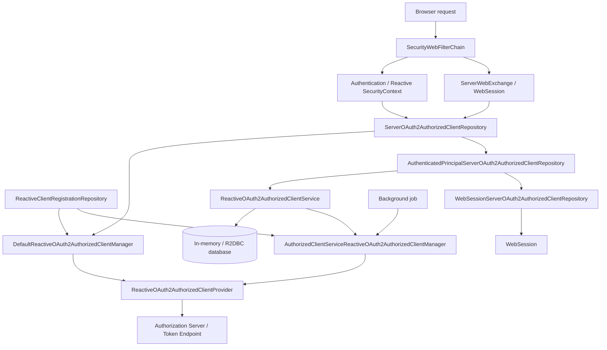
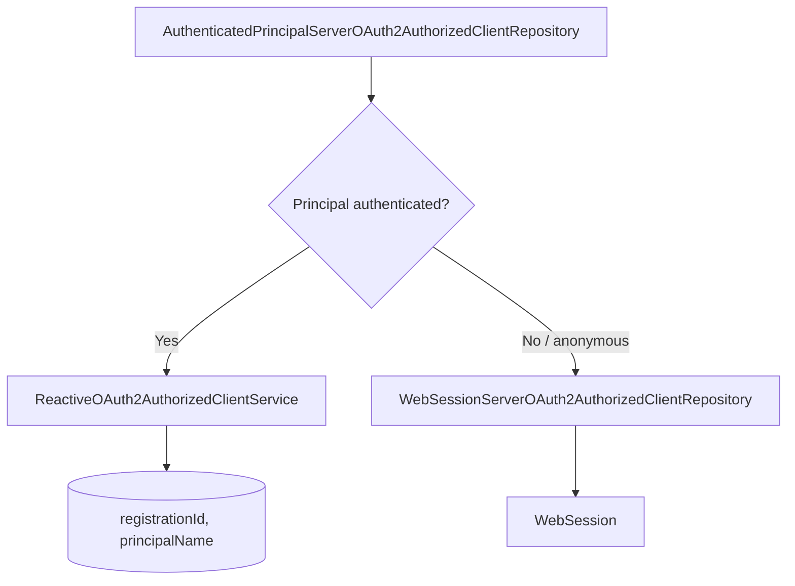
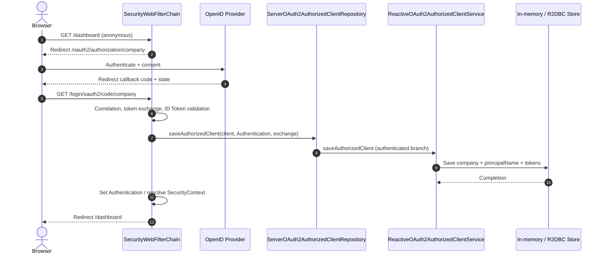
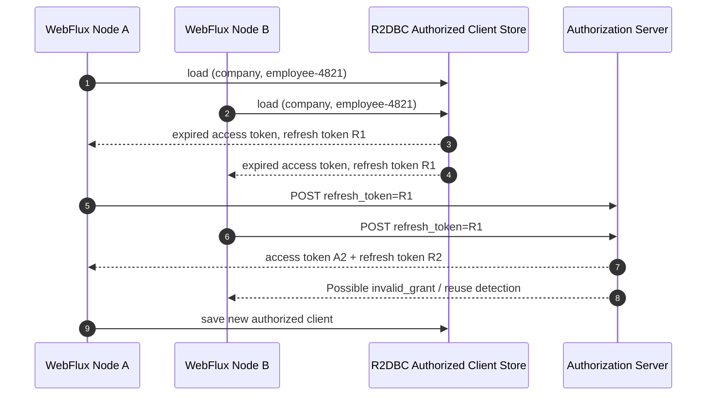

# 21.4. ReactiveOAuth2AuthorizedClientService and ServerOAuth2AuthorizedClientRepository

## 1. Context: OIDC Login in WebFlux — Where Are Tokens Stored?

Suppose the **Employee Portal** uses **Spring Boot WebFlux** and **Spring Security OAuth 2.0 / OIDC Client**:

- A user visits `/dashboard` and logs in via OIDC using the `company` registration.
- The backend receives an **access token** and possibly a **refresh token** to call the Employee API.
- Another request needs to reuse the issued token without forcing the user to log in from scratch.
- In addition, a background task calls the Reports API using `client_credentials`, without a browser session.

In Servlet/MVC there are `OAuth2AuthorizedClientService` and `OAuth2AuthorizedClientRepository`. For **Reactive WebFlux**, Spring Security provides two corresponding contracts with easily confused names:

1. **`ReactiveOAuth2AuthorizedClientService`** — manages **`OAuth2AuthorizedClient` state at the application level**, looking up by **registration ID + principal name** without needing an HTTP request.
2. **`ServerOAuth2AuthorizedClientRepository`** — reads/writes/removes authorized clients **within a WebFlux request context**, accepting **`Authentication` + `ServerWebExchange`**.

Both can relate to the same access token, yet **they are not directly interchangeable interfaces**.

> **Key takeaway:** `ReactiveOAuth2AuthorizedClientService` answers "which token does this client registration currently hold for this principal in the application store?", whereas `ServerOAuth2AuthorizedClientRepository` answers "which authorized client belongs to the current request, principal, and WebFlux exchange?". A repository may **delegate data persistence to a service**, but the repository itself is not necessarily a database.

This lesson belongs to chapter **21. OAuth2 Client Reactive**, focusing on structure, lifecycle, implementations, WebFlux configuration, and common pitfalls when persisting and using tokens.

### Learning Objectives

After this lesson, you will be able to:

1. Distinguish `ClientRegistration`, `OAuth2AuthorizedClient`, `Authentication`, `WebSession`, and the two authorized-client persistence abstractions.
2. Understand `Mono<T>` method signatures and what the absence of an authorized client means.
3. Know when to use `InMemoryReactiveOAuth2AuthorizedClientService`, `R2dbcReactiveOAuth2AuthorizedClientService`, and `WebSessionServerOAuth2AuthorizedClientRepository`.
4. Build `AuthenticatedPrincipalServerOAuth2AuthorizedClientRepository` over a reactive service and understand its authenticated/anonymous routing.
5. Wire these components with `ServerHttpSecurity.oauth2Login()`, `oauth2Client()`, and `ReactiveOAuth2AuthorizedClientManager`.
6. Separate **request-bound user authorization** from **service-tier Client Credentials**.
7. Avoid `block()` on the event loop, mismatched principal keys, token leaks, refresh races, and inconsistent session configuration.
8. Design safe token persistence across multiple instances.

The examples below target **Spring Boot 3.x, Spring Security 6.x, Java 17+, and WebFlux**. Use compatible dependency versions per the BOM. Some APIs also appear in Spring Security 7.x documentation, but the examples **do not require upgrading to 7.x**.

## 2. What Does `OAuth2AuthorizedClient` Represent?

An `OAuth2AuthorizedClient` stores information about **a client registration that has been granted tokens within a principal context**:

```text
OAuth2AuthorizedClient
├── ClientRegistration
│   ├── registrationId
│   ├── clientId
│   ├── authorizationGrantType
│   └── providerDetails (tokenUri, issuer, ...)
├── principalName
├── OAuth2AccessToken
│   ├── tokenType
│   ├── tokenValue  [SECRET]
│   ├── issuedAt
│   ├── expiresAt
│   └── scopes
└── OAuth2RefreshToken (may be absent)
    └── tokenValue  [SECRET]
```

Examples of authorized clients:

| `clientRegistrationId` | `principalName` | Context |
| --- | --- | --- |
| `company` | `employee-4821` | Token issued to a user after OIDC Login |
| `company` | `employee-9274` | Another user's token, same registration |
| `partner` | `partner-user-31` | Token from a different registration/provider |
| `reports-api` | `reports-batch` | Token for a workload using Client Credentials |

**Registration ID is not the client ID assigned by the Authorization Server.** It is Spring's internal key for looking up the `ClientRegistration` configuration.

**Principal name does not have to be an email**, nor does `.principal("reports-batch")` create a logged-in user. In multi-issuer/multi-tenant platforms, ensure identifier namespaces do not collide.

### 2.1. What Does Not Belong in the Authorized-Client Store

| Data | Owning component |
| --- | --- |
| Client ID/secret, token URI, default scopes config | `ReactiveClientRegistrationRepository` and secret/config store |
| Currently logged-in user state | `Authentication` / `SecurityContext` |
| Browser HTTP session | `WebSession` and session store |
| Temporary request holding OAuth `state`/PKCE/nonce | `ServerAuthorizationRequestRepository<OAuth2AuthorizationRequest>` |
| Access/refresh tokens of an authorized client | `ReactiveOAuth2AuthorizedClientService` or `ServerOAuth2AuthorizedClientRepository` |
| Token an API must verify on an inbound request | Resource Server authentication/authorization |
| Business profile, internal roles | Application user/profile/authorization data |

Never treat the existence of an authorized-client row as proof that **the current request came from that principal**. Only a verified session/authentication and proper authorization policy establish who is allowed to act.

## 3. Where Do Both Persistence Layers Sit in Reactive Architecture?

### 3.1. Overall Diagram



This is a responsibility diagram, not an exact method-call trace. `DefaultReactiveOAuth2AuthorizedClientManager` serves flows with a `ServerWebExchange`; `AuthorizedClientServiceReactiveOAuth2AuthorizedClientManager` uses the service directly at the service tier.

### 3.2. Key Comparison Table

| Criterion | `ReactiveOAuth2AuthorizedClientService` | `ServerOAuth2AuthorizedClientRepository` |
| --- | --- | --- |
| Abstraction layer | Application-level authorized-client persistence | WebFlux request-level authorized-client persistence |
| Depends on `ServerWebExchange`? | **No** | **Yes** |
| Needs `Authentication` on save? | Yes | Yes |
| Loads by | `registrationId` + `principalName` | `registrationId` + `Authentication` + `ServerWebExchange` |
| Returns | `Mono<OAuth2AuthorizedClient>` or `Mono.empty()` | `Mono<OAuth2AuthorizedClient>` or `Mono.empty()` |
| Save/remove returns | `Mono<Void>` | `Mono<Void>` |
| Implementations | `InMemoryReactiveOAuth2AuthorizedClientService`, `R2dbcReactiveOAuth2AuthorizedClientService` | `AuthenticatedPrincipalServerOAuth2AuthorizedClientRepository`, `WebSessionServerOAuth2AuthorizedClientRepository` |
| Typical manager | `AuthorizedClientServiceReactiveOAuth2AuthorizedClientManager` | `DefaultReactiveOAuth2AuthorizedClientManager` |
| Environment | Service tier, background jobs, app token store | WebFlux login/client requests |
| Actual storage area | JVM Map or R2DBC DB | May be WebSession **or** delegated to a service |
| Servlet equivalent | `OAuth2AuthorizedClientService` | `OAuth2AuthorizedClientRepository` |

Common misconception: the word *Server* in **`ServerOAuth2AuthorizedClientRepository`** refers to the WebFlux `ServerWebExchange` stack; **it does not mean it automatically stores tokens in a server-side Redis/database**.

## 4. `ReactiveOAuth2AuthorizedClientService` — Contract and Semantics

### 4.1. Three Core Operations

The interface defines three main operations; below is a simplified signature per the Spring Security contract:

```java
public interface ReactiveOAuth2AuthorizedClientService {

    <T extends OAuth2AuthorizedClient> Mono<T> loadAuthorizedClient(
            String clientRegistrationId, String principalName);

    Mono<Void> saveAuthorizedClient(
            OAuth2AuthorizedClient authorizedClient,
            Authentication principal);

    Mono<Void> removeAuthorizedClient(
            String clientRegistrationId, String principalName);
}
```

The types `OAuth2AuthorizedClient`, `Authentication`, and `Mono` come from Spring Security OAuth2 Client, Spring Security Core, and Reactor respectively.

**Load** takes two String keys with no HTTP request dependency. **Save** takes an Authentication to determine `principal.getName()`. **Remove** requires the exact same key pair used when saving.

### 4.2. What Does `Mono.empty()` Mean?

In Reactor, a missing record is represented as a Publisher that **completes without emitting a value**. Thus:

```java
Mono<OAuth2AuthorizedClient> lookup =
        authorizedClientService.loadAuthorizedClient(
                "company", "employee-4821");
```

If no authorized client exists yet, `lookup` normally completes empty. **The method does not directly return Java `null`** to reactive callers; never call `lookup.getAccessToken()` because `lookup` is a `Mono`.

You can express fallback behavior as:

```java
return authorizedClientService
        .loadAuthorizedClient("company", principalName)
        .map(client -> client.getAccessToken().getExpiresAt().toString())
        .defaultIfEmpty("NO_AUTHORIZED_CLIENT");
```

In this example, `defaultIfEmpty` only supplies metadata/a status value. **Never fabricate a fake access token when no authorized client is found**, nor substitute another user's token.

### 4.3. Reactor Publishers Are Lazy

Save/remove return `Mono<Void>`:

```java
Mono<Void> write =
        authorizedClientService.saveAuthorizedClient(
                authorizedClient, authentication);
```

This line **does not guarantee the write has executed** unless the Publisher is subscribed to in an active pipeline.

In WebFlux, **compose** it:

```java
return authorizedClientService
        .saveAuthorizedClient(authorizedClient, authentication)
        .thenReturn("SAVED");
```

Do not do:

```java
// ANTI-PATTERN: side effect detached from request lifecycle.
authorizedClientService
        .saveAuthorizedClient(authorizedClient, authentication)
        .subscribe();

return Mono.just("SAVED");
```

Manual `subscribe()` loses ordering guarantees, error/cancellation propagation, and request-scoped tracking. Inside a WebFlux handler, **return the Publisher to the framework or compose operators**.

### 4.4. When to Use the Service Directly?

- A background job needs to load tokens by `registrationId + servicePrincipalName`.
- An infrastructure layer managing client token lifecycles.
- A disconnect operation needing to remove a local authorized client by a trusted key.
- An operational tool authorized to audit token metadata without reading raw values.
- Integrating a shared R2DBC database across multiple nodes.

When acquiring or refreshing tokens is needed, **prefer `ReactiveOAuth2AuthorizedClientManager`** over calling `loadAuthorizedClient` and implementing token refresh logic manually. The service only handles persistence.

## 5. `ServerOAuth2AuthorizedClientRepository` — Contract in WebFlux Requests

### 5.1. Method Signatures

```java
public interface ServerOAuth2AuthorizedClientRepository {

    <T extends OAuth2AuthorizedClient> Mono<T> loadAuthorizedClient(
            String clientRegistrationId,
            Authentication principal,
            ServerWebExchange exchange);

    Mono<Void> saveAuthorizedClient(
            OAuth2AuthorizedClient authorizedClient,
            Authentication principal,
            ServerWebExchange exchange);

    Mono<Void> removeAuthorizedClient(
            String clientRegistrationId,
            Authentication principal,
            ServerWebExchange exchange);
}
```

The biggest difference is **`ServerWebExchange`**. It is WebFlux's abstraction for the current HTTP request and response, providing reactive access to sessions and attributes.

### 5.2. `ServerWebExchange` Is Not `HttpServletRequest`

| Servlet/MVC | WebFlux/Reactive |
| --- | --- |
| `HttpServletRequest` | `ServerWebExchange` |
| `HttpSession` | `WebSession` |
| `SecurityFilterChain` | `SecurityWebFilterChain` |
| `HttpSecurity` | `ServerHttpSecurity` |
| `SecurityContextHolder` typically thread-bound | `ReactiveSecurityContextHolder` bound to Reactor Context |
| `OAuth2AuthorizedClientRepository` | `ServerOAuth2AuthorizedClientRepository` |
| `OAuth2AuthorizedClientService` | `ReactiveOAuth2AuthorizedClientService` |

Never rely on `ThreadLocal SecurityContextHolder` as a reliable principal source in a reactive chain that hops across schedulers/threads. In WebFlux, obtain `Authentication` from reactive mechanisms such as `exchange.getPrincipal()`, argument resolution, or `ReactiveSecurityContextHolder.getContext()`.

### 5.3. Example: Reading via WebFlux Exchange

A minimal controller illustrating **reading metadata** without exposing tokens:

```java
package com.example.portal.web;

import java.util.Map;

import org.springframework.security.core.Authentication;
import org.springframework.security.oauth2.client.OAuth2AuthorizedClient;
import org.springframework.security.oauth2.client.web.server.ServerOAuth2AuthorizedClientRepository;
import org.springframework.web.bind.annotation.GetMapping;
import org.springframework.web.bind.annotation.RestController;
import org.springframework.web.server.ServerWebExchange;

import reactor.core.publisher.Mono;

@RestController
public class AuthorizedClientMetadataController {

    private final ServerOAuth2AuthorizedClientRepository repository;

    public AuthorizedClientMetadataController(
            ServerOAuth2AuthorizedClientRepository repository) {
        this.repository = repository;
    }

    @GetMapping("/me/authorized-client")
    public Mono<Map<String, Object>> status(ServerWebExchange exchange) {
        return exchange.getPrincipal()
                .cast(Authentication.class)
                .flatMap(authentication ->
                        repository.loadAuthorizedClient(
                                "company", authentication, exchange))
                .map(client -> Map.<String, Object>of(
                        "registrationId",
                        client.getClientRegistration().getRegistrationId(),
                        "expiresAt",
                        client.getAccessToken().getExpiresAt().toString()))
                .switchIfEmpty(Mono.just(Map.of(
                        "status", "NO_AUTHORIZED_CLIENT")));
    }
}
```

This assumes the endpoint is protected by `SecurityWebFilterChain` and `company` is indeed an authorized registration for the user. The snippet intentionally avoids returning `accessToken.getTokenValue()` or the refresh token to the browser.

If you need to **acquire or refresh tokens**, the controller should use **`ReactiveOAuth2AuthorizedClientManager`** / an argument resolver rather than calling `repository.loadAuthorizedClient` alone.

### 5.4. Do Not Confuse the Repository with Authentication/Session Stores

`ServerOAuth2AuthorizedClientRepository` may store tokens in WebSession, yet it is **not** the sole holder of `Authentication`. `ServerSecurityContextRepository` manages how `SecurityContext` is saved/restored; OAuth authorization request correlation has its own repository.

A user who has an authorized client in the database **without a valid session/authentication** must still be authenticated by the system before calling user-bound endpoints.

## 6. `InMemoryReactiveOAuth2AuthorizedClientService`

### 6.1. When Is It Appropriate?

This is the common default implementation of the reactive service, storing authorized clients in **JVM memory**:

- Demos, local development, and tutorials.
- Workloads with minimal persistence needs.
- Applications where users can simply re-authorize after a restart.
- M2M Client Credentials tokens that are easily re-acquired after a restart.

Advantages: simple configuration and no database required. Disadvantages: **state is not shared across nodes**, data is lost on process restart, and in-memory token lifecycles must be bounded.

### 6.2. Defining the Service Bean

```java
package com.example.portal.security;

import org.springframework.context.annotation.Bean;
import org.springframework.context.annotation.Configuration;
import org.springframework.security.oauth2.client.InMemoryReactiveOAuth2AuthorizedClientService;
import org.springframework.security.oauth2.client.ReactiveOAuth2AuthorizedClientService;
import org.springframework.security.oauth2.client.registration.ReactiveClientRegistrationRepository;

@Configuration
public class AuthorizedClientStorageConfig {

    @Bean
    ReactiveOAuth2AuthorizedClientService authorizedClientService(
            ReactiveClientRegistrationRepository registrations) {

        return new InMemoryReactiveOAuth2AuthorizedClientService(registrations);
    }
}
```

In an application using Spring Boot auto-configuration, a suitable reactive service bean may already exist. Declare an explicit bean only when you need to control wiring/behavior. When moving to a persistent store, **replace** the implementation rather than declaring two beans of the same type without disambiguating which one the manager/repository uses.

### 6.3. Why Not Store JWT/Refresh Tokens in a Custom Map?

A homegrown Map typically misses:

- Proper `registrationId + principalName` composite keys.
- Compatibility with `ReactiveOAuth2AuthorizedClientManager`.
- Expiration/scopes/refresh token metadata tracking.
- Token update semantics after refresh.
- Cleanup, revocation, concurrency, and credential security.
- Integration with OAuth2 Login and `WebClient`.

Use Spring Security's abstractions, customizing only when concrete requirements like tenant-aware keys or encryption arise.

## 7. `AuthenticatedPrincipalServerOAuth2AuthorizedClientRepository`: Bridging Repository → Service

### 7.1. How It Works

A very important implementation is:

```java
new AuthenticatedPrincipalServerOAuth2AuthorizedClientRepository(
        authorizedClientService);
```

This repository **branches based on principal state**:

- For an **authenticated principal**, it delegates load/save/remove to `ReactiveOAuth2AuthorizedClientService`.
- For an **unauthenticated or anonymous request**, it delegates to another `ServerOAuth2AuthorizedClientRepository`, defaulting to **`WebSessionServerOAuth2AuthorizedClientRepository`**.
- The anonymous repository can be customized via `setAnonymousAuthorizedClientRepository(...)` when needed.

### 7.2. Routing Diagram



Key takeaway: **authenticated does not mean tokens are stored in WebSession**. With this adapter, the authenticated branch typically uses the service. Conversely, the anonymous branch may rely on WebSession instead of the service.

### 7.3. Defining the Repository Bean Over a Service

```java
package com.example.portal.security;

import org.springframework.context.annotation.Bean;
import org.springframework.context.annotation.Configuration;
import org.springframework.security.oauth2.client.ReactiveOAuth2AuthorizedClientService;
import org.springframework.security.oauth2.client.web.server.AuthenticatedPrincipalServerOAuth2AuthorizedClientRepository;
import org.springframework.security.oauth2.client.web.server.ServerOAuth2AuthorizedClientRepository;

@Configuration
public class AuthorizedClientRepositoryConfig {

    @Bean
    ServerOAuth2AuthorizedClientRepository authorizedClientRepository(
            ReactiveOAuth2AuthorizedClientService service) {

        return new AuthenticatedPrincipalServerOAuth2AuthorizedClientRepository(
                service);
    }
}
```

Combined with the `authorizedClientService` bean from section 6.2, the application has **an HTTP-request-friendly repository** backed by **a token storage service**.

### 7.4. Why Does the Anonymous Repository Still Matter?

In some OAuth2 flows, request/authorized-client state may exist before Spring marks the user as authenticated. WebSession helps tie that state across a browser's HTTP requests.

Still, distinguish clearly:

- `WebSessionServerOAuth2AuthorizedClientRepository` stores **authorized clients** per session.
- `WebSessionOAuth2ServerAuthorizationRequestRepository` stores **authorization requests** before callback, including `state` and correlation data.
- Both differ from `ServerSecurityContextRepository`, which manages `SecurityContext` after login.

Do not arbitrarily strip or discard WebSession from the OAuth2 flow and conclude "token persistence is broken".

## 8. `WebSessionServerOAuth2AuthorizedClientRepository`

### 8.1. Nature

`WebSessionServerOAuth2AuthorizedClientRepository` stores `OAuth2AuthorizedClient` inside **WebFlux `WebSession`**, without requiring an application-level reactive service.

```java
ServerOAuth2AuthorizedClientRepository repository =
        new WebSessionServerOAuth2AuthorizedClientRepository();
```

It fits cases where token state only needs to live for the browser session and does not need independent application-level persistence.

### 8.2. Is It Identical to Servlet HTTP Session?

Not entirely:

- WebFlux uses **`WebSession`**, not `HttpSession`.
- `WebSession` data may reside in memory or be managed via Spring Session or an equivalent store.
- Browser cookies typically hold a **session identifier**, not raw access/refresh tokens.
- When a session expires or is invalidated, authorized-client data stored solely in the session disappears.
- With shared Spring Session, authorized clients inside `WebSession` can be stored in the shared session store if serialization and session setup are configured properly.

### 8.3. Do Not Treat WebSession as a Persistent Database Token Store

| Scenario | WebSession repository | Application-level reactive service |
| --- | --- | --- |
| Browser session active | Can load authorized client | Can load by principal name |
| Browser logout / session invalidated | Session data may be lost | Token may remain until removed per policy |
| No HTTP exchange | Unsuitable for direct calls | Suitable |
| Scheduled job | Should not depend on browser session | Use reactive service-tier manager |
| Multi-node | Depends on session store and config | Depends on implementation (in-memory/R2DBC) |
| User changes principal name | Does not resolve permissions itself | Service key may change/miss |
| Token lifecycle independent of session | Not the primary choice | Better suited for designed lifecycle |

**Storing tokens in WebSession does not automatically revoke tokens at the Authorization Server on logout.** Removing a local copy and revoking credentials at the OP are two separate operations.

## 9. End-to-End Example: Reactive Service and Request Repository

### 9.1. Dependencies

Maven with WebFlux and Spring Security OAuth2 Client:

```xml
<dependencies>
    <dependency>
        <groupId>org.springframework.boot</groupId>
        <artifactId>spring-boot-starter-webflux</artifactId>
    </dependency>
    <dependency>
        <groupId>org.springframework.boot</groupId>
        <artifactId>spring-boot-starter-security</artifactId>
    </dependency>
    <dependency>
        <groupId>org.springframework.boot</groupId>
        <artifactId>spring-boot-starter-oauth2-client</artifactId>
    </dependency>
</dependencies>
```

Gradle Kotlin DSL:

```kotlin
dependencies {
    implementation("org.springframework.boot:spring-boot-starter-webflux")
    implementation("org.springframework.boot:spring-boot-starter-security")
    implementation("org.springframework.boot:spring-boot-starter-oauth2-client")
}
```

This example is **WebFlux**. If a project also includes `spring-boot-starter-web`, Spring Boot may default to the Servlet stack under auto-configuration rules. Confirm the intended application type; do not assume merely importing `Mono` makes the entire security stack reactive.

### 9.2. Client Registrations

```yaml
spring:
  security:
    oauth2:
      client:
        registration:
          company:
            provider: company-oidc
            client-id: ${OIDC_CLIENT_ID}
            client-secret: ${OIDC_CLIENT_SECRET}
            client-authentication-method: client_secret_basic
            authorization-grant-type: authorization_code
            redirect-uri: "{baseUrl}/login/oauth2/code/{registrationId}"
            scope:
              - openid
              - profile
              - employee.read

          reports-api:
            provider: reports-as
            client-id: ${REPORTS_CLIENT_ID}
            client-secret: ${REPORTS_CLIENT_SECRET}
            client-authentication-method: client_secret_basic
            authorization-grant-type: client_credentials
            scope:
              - reports.read

        provider:
          company-oidc:
            issuer-uri: https://identity.example.com/realms/company
          reports-as:
            token-uri: https://auth.example.com/oauth2/token
```

All URLs and credentials are illustrative. In real environments, use trusted Authorization Servers/OPs, secret managers, and scopes/audiences validated by the Resource Server.

`company` uses **browser OIDC Login**. `reports-api` uses a **service identity** without a browser. Having two registrations does not mean every principal is allowed to use tokens from both.

### 9.3. SecurityWebFilterChain and Repository

```java
package com.example.portal.security;

import org.springframework.context.annotation.Bean;
import org.springframework.context.annotation.Configuration;
import org.springframework.security.config.annotation.web.reactive.EnableWebFluxSecurity;
import org.springframework.security.config.web.server.ServerHttpSecurity;
import org.springframework.security.oauth2.client.web.server.ServerOAuth2AuthorizedClientRepository;
import org.springframework.security.web.server.SecurityWebFilterChain;

@Configuration
@EnableWebFluxSecurity
public class ReactiveSecurityConfig {

    @Bean
    SecurityWebFilterChain securityWebFilterChain(
            ServerHttpSecurity http,
            ServerOAuth2AuthorizedClientRepository authorizedClients) {

        return http
                .authorizeExchange(exchanges -> exchanges
                        .pathMatchers("/", "/css/**", "/error").permitAll()
                        .anyExchange().authenticated())
                .oauth2Login(oauth2 -> oauth2
                        .authorizedClientRepository(authorizedClients))
                .oauth2Client(oauth2 -> oauth2
                        .authorizedClientRepository(authorizedClients))
                .build();
    }
}
```

Combined with the service/repository beans from sections 6.2 and 7.3, the application uses this request repository to manage authorized clients in reactive flows.

Notes:

- `SecurityWebFilterChain` is WebFlux, not Servlet's `SecurityFilterChain`.
- `oauth2Login` handles user login; `oauth2Client` supports OAuth2 Client authorization interactions.
- Never write a custom controller to intercept `code` in place of Spring Security's callback web filter.
- Callback, state, PKCE/nonce, and ID Token validation must still run via OIDC mechanisms; the authorized client repository **does not replace** those steps.
- Depending on application setup, Spring Boot/Security may provide default repository/service beans. Once explicit beans are declared, use them consistently in `SecurityWebFilterChain` and managers.
- For browser login, cookies, sessions, proxies, and redirect URIs still affect request continuity.

### 9.4. Login and Authorized Client Persistence Flow



This is a **conceptual** diagram. Authenticated/anonymous branching depends on `Authentication` at the exact moment. If the framework also uses WebSession for pre-authentication state, that does not contradict the architecture. Do not use this diagram to infer exact implementation order across Spring Security versions.

### 9.5. Reusing Tokens on Subsequent Requests

```text
Browser GET /employee/me
      |
      v
WebFlux restores Authentication from SecurityContext/session
      |
      v
Repository loadAuthorizedClient("company", authentication, exchange)
      |
      +-- AuthenticatedPrincipal adapter
                |
                v
          ReactiveOAuth2AuthorizedClientService
                |
                v
          (company, employee-4821) -> OAuth2AuthorizedClient
      |
      v
ReactiveAuthorizedClientManager / WebClient
      |
      +-- Token still valid -> call Employee API
      +-- Needs refresh -> Token Endpoint -> save new authorized client
```

**`loadAuthorizedClient` only reads.** It does not send a refresh token to the Token Endpoint on its own. Authorize/re-authorize logic belongs to the manager and reactive authorized client providers.

## 10. `ReactiveOAuth2AuthorizedClientManager` Decides Token Issuance/Refresh

### 10.1. Both Storage Abstractions Do Not Refresh Tokens Themselves

When code calls:

```java
authorizedClientService.loadAuthorizedClient(
        "company", "employee-4821");
```

or:

```java
authorizedClientRepository.loadAuthorizedClient(
        "company", authentication, exchange);
```

the goal is to **look up an existing authorized client**. Those methods do not decide whether a token must be refreshed or whether the client needs new authorization.

The coordinator is **`ReactiveOAuth2AuthorizedClientManager`**:

- Looks up the client registration.
- Loads the authorized client by principal/request.
- Selects a `ReactiveOAuth2AuthorizedClientProvider` capable of handling the grant.
- If necessary, contacts the Authorization Server to acquire/refresh a token.
- Persists success via repository/service or handles invalid authorized clients.
- Returns `Mono<OAuth2AuthorizedClient>` to the caller.

### 10.2. Default Manager in HTTP Requests

`DefaultReactiveOAuth2AuthorizedClientManager` works with:

- `ReactiveClientRegistrationRepository`.
- `ServerOAuth2AuthorizedClientRepository`.
- Context containing `ServerWebExchange`.

Configuration example:

```java
package com.example.portal.security;

import org.springframework.context.annotation.Bean;
import org.springframework.context.annotation.Configuration;
import org.springframework.security.oauth2.client.DefaultReactiveOAuth2AuthorizedClientManager;
import org.springframework.security.oauth2.client.ReactiveOAuth2AuthorizedClientManager;
import org.springframework.security.oauth2.client.ReactiveOAuth2AuthorizedClientProvider;
import org.springframework.security.oauth2.client.ReactiveOAuth2AuthorizedClientProviderBuilder;
import org.springframework.security.oauth2.client.registration.ReactiveClientRegistrationRepository;
import org.springframework.security.oauth2.client.web.server.ServerOAuth2AuthorizedClientRepository;

@Configuration
public class ReactiveRequestManagerConfig {

    @Bean("requestAuthorizedClientManager")
    ReactiveOAuth2AuthorizedClientManager requestAuthorizedClientManager(
            ReactiveClientRegistrationRepository registrations,
            ServerOAuth2AuthorizedClientRepository authorizedClients) {

        ReactiveOAuth2AuthorizedClientProvider provider =
                ReactiveOAuth2AuthorizedClientProviderBuilder.builder()
                        .authorizationCode()
                        .refreshToken()
                        .build();

        var manager = new DefaultReactiveOAuth2AuthorizedClientManager(
                registrations, authorizedClients);

        manager.setAuthorizedClientProvider(provider);
        return manager;
    }
}
```

This example enables only the grants needed by the user-based flow here. If the system also uses Client Credentials inside an **appropriate HTTP context**, the provider can also include `clientCredentials()` as needed. However, scheduled jobs lack a `ServerWebExchange` and should normally use the **service-tier manager** in the next section.

**Note:** Spring Security may auto-configure a `ReactiveOAuth2AuthorizedClientManager` in some versions/scenarios. Declare an explicit manager only when customizing providers or handlers, and ensure code injects the intended bean.

### 10.3. Service-Tier Manager for Background/Reactive Pipelines

The right class name for the reactive stack is:

```text
AuthorizedClientServiceReactiveOAuth2AuthorizedClientManager
```

**Not** `AuthorizedClientServiceOAuth2AuthorizedClientManager`, which belongs to the Servlet/imperative stack.

Creating the bean:

```java
package com.example.portal.security;

import org.springframework.context.annotation.Bean;
import org.springframework.context.annotation.Configuration;
import org.springframework.security.oauth2.client.AuthorizedClientServiceReactiveOAuth2AuthorizedClientManager;
import org.springframework.security.oauth2.client.ReactiveOAuth2AuthorizedClientManager;
import org.springframework.security.oauth2.client.ReactiveOAuth2AuthorizedClientProvider;
import org.springframework.security.oauth2.client.ReactiveOAuth2AuthorizedClientProviderBuilder;
import org.springframework.security.oauth2.client.ReactiveOAuth2AuthorizedClientService;
import org.springframework.security.oauth2.client.registration.ReactiveClientRegistrationRepository;

@Configuration
public class ReactiveServiceManagerConfig {

    @Bean("serviceAuthorizedClientManager")
    ReactiveOAuth2AuthorizedClientManager serviceAuthorizedClientManager(
            ReactiveClientRegistrationRepository registrations,
            ReactiveOAuth2AuthorizedClientService authorizedClients) {

        ReactiveOAuth2AuthorizedClientProvider provider =
                ReactiveOAuth2AuthorizedClientProviderBuilder.builder()
                        .clientCredentials()
                        .build();

        var manager =
                new AuthorizedClientServiceReactiveOAuth2AuthorizedClientManager(
                        registrations,
                        authorizedClients);

        manager.setAuthorizedClientProvider(provider);
        return manager;
    }
}
```

This manager **does not require `ServerWebExchange`**. It is well suited for:

- `@Scheduled` jobs.
- Message consumers.
- Backend integrations needing Client Credentials.
- Service-tier logic not tied to a specific HTTP request.

It stores authorized clients via `ReactiveOAuth2AuthorizedClientService`, allowing an in-memory or R2DBC store to be reused across job runs per policy.

### 10.4. Manager Selection Table

| Criterion | `DefaultReactiveOAuth2AuthorizedClientManager` | `AuthorizedClientServiceReactiveOAuth2AuthorizedClientManager` |
| --- | --- | --- |
| Primary context | WebFlux HTTP request | Background/service tier |
| Token store | `ServerOAuth2AuthorizedClientRepository` | `ReactiveOAuth2AuthorizedClientService` |
| Needs `ServerWebExchange` | **Yes**, per contract/usage context | **No** |
| Suitable for | Reactive web user requests, browser OAuth2 Client | M2M jobs, queue consumers, services |
| Example grants | `authorization_code`, `refresh_token` | `client_credentials`; other grants if configured with proper context |
| Return type | `Mono<OAuth2AuthorizedClient>` | `Mono<OAuth2AuthorizedClient>` |
| No matching client/provider | May emit `Mono.empty()` or error depending on case | Same |
| Manages business permissions itself | No | No |

Never pick a manager just because its class name is shorter; base the choice on **whether a WebFlux exchange exists** and which grant must run.

## 11. WebFlux WebClient Using the Repository Inside a Request

### 11.1. Filter for WebFlux, Not Servlet

In WebFlux, Spring Security provides:

```java
ServerOAuth2AuthorizedClientExchangeFilterFunction
```

to connect `WebClient` with a reactive authorized client manager or client repository.

**Never use `ServletOAuth2AuthorizedClientExchangeFilterFunction`** from Spring MVC, as it is tied to Servlet requests and imperative managers.

### 11.2. Configuring WebClient with a Reactive Manager

```java
package com.example.portal.http;

import org.springframework.beans.factory.annotation.Qualifier;
import org.springframework.context.annotation.Bean;
import org.springframework.context.annotation.Configuration;
import org.springframework.security.oauth2.client.ReactiveOAuth2AuthorizedClientManager;
import org.springframework.security.oauth2.client.web.reactive.function.client.ServerOAuth2AuthorizedClientExchangeFilterFunction;
import org.springframework.web.reactive.function.client.WebClient;

@Configuration
public class EmployeeWebClientConfig {

    @Bean("employeeApiWebClient")
    WebClient employeeApiWebClient(
            WebClient.Builder builder,
            @Qualifier("requestAuthorizedClientManager")
            ReactiveOAuth2AuthorizedClientManager manager) {

        var oauth2 =
                new ServerOAuth2AuthorizedClientExchangeFilterFunction(manager);

        // Select the OAuth2 registration per request rather than attaching
        // a user token by default to every outbound HTTP call.
        return builder.clone()
                .baseUrl("https://employee-api.example.com")
                .filter(oauth2)
                .build();
    }
}
```

With the default manager, the filter can coordinate with the request/exchange context provided by the framework during a reactive HTTP request. Verify specific deployment behavior if code runs outside a WebFlux request context.

### 11.3. Service Calling Employee API with an Explicit Registration

```java
package com.example.portal.employee;

import static org.springframework.security.oauth2.client.web.reactive.function.client
        .ServerOAuth2AuthorizedClientExchangeFilterFunction.clientRegistrationId;

import org.springframework.beans.factory.annotation.Qualifier;
import org.springframework.stereotype.Service;
import org.springframework.web.reactive.function.client.WebClient;

import reactor.core.publisher.Mono;

@Service
public class EmployeeApiClient {

    private final WebClient webClient;

    public EmployeeApiClient(
            @Qualifier("employeeApiWebClient") WebClient webClient) {
        this.webClient = webClient;
    }

    public Mono<String> myProfile() {
        return webClient.get()
                .uri("/v1/employees/me")
                .attributes(clientRegistrationId("company"))
                .retrieve()
                .bodyToMono(String.class);
    }
}
```

`clientRegistrationId("company")` is the configuration key. If the user already has an authorized client for this registration, the manager can load and use that token; if needed, it can refresh via the provider. **A successful OIDC Login does not guarantee the access token has the right audience/scope for every API** — the Employee API must still validate the token and authorization.

### 11.4. `@RegisteredOAuth2AuthorizedClient` in a Reactive Controller

A convenient option is the argument resolver:

```java
package com.example.portal.web;

import java.util.Map;

import org.springframework.security.oauth2.client.OAuth2AuthorizedClient;
import org.springframework.security.oauth2.client.annotation.RegisteredOAuth2AuthorizedClient;
import org.springframework.web.bind.annotation.GetMapping;
import org.springframework.web.bind.annotation.RestController;

import reactor.core.publisher.Mono;

@RestController
public class AuthorizedClientController {

    @GetMapping("/me/token-metadata")
    public Mono<Map<String, Object>> tokenMetadata(
            @RegisteredOAuth2AuthorizedClient("company")
            OAuth2AuthorizedClient authorizedClient) {

        return Mono.just(Map.of(
                "registrationId",
                authorizedClient.getClientRegistration().getRegistrationId(),
                "expiresAt",
                authorizedClient.getAccessToken().getExpiresAt().toString()));
    }
}
```

`@RegisteredOAuth2AuthorizedClient` can be resolved by the OAuth2 authorized client argument resolver using the configured reactive manager. This avoids calling the service/repository manually in every controller.

**Never return raw access tokens or refresh tokens** to the browser. This example only shows metadata for learning; in production you may not even want to expose token expiration timestamps to the client UI.

### 11.5. Warning About Default Access Tokens

`ServerOAuth2AuthorizedClientExchangeFilterFunction` has the option:

```java
oauth2.setDefaultOAuth2AuthorizedClient(true);
```

When enabled, WebClient may by default grab the access token bound to the authenticated user and attach it to every HTTP call made with that client. If the WebClient is used across multiple destinations or browser-supplied URLs, this creates a **token leakage** risk.

Therefore, prefer:

- A dedicated WebClient for each trusted Resource Server.
- Selecting `clientRegistrationId(...)` or an explicit authorized client.
- Never enabling a default user token on a general-purpose WebClient.
- Restricting host/path, redirects, and TLS; never send Bearer tokens to arbitrary destinations.
- Keeping user Authentication/authorization aligned with the API operation.

**Storing tokens in the right repository is not enough if an outbound WebClient sends them to the wrong place.**

## 12. Service-Tier Client Credentials on the Reactive Stack

### 12.1. Stable Technical Principal

The Reports API task runs without a browser session:

```java
OAuth2AuthorizeRequest request =
        OAuth2AuthorizeRequest.withClientRegistrationId("reports-api")
                .principal("reports-batch")
                .build();
```

Meaning:

- `reports-api` selects the OAuth2 client credentials configuration.
- `reports-batch` is an **internal principal key**, stable across job runs.
- Does not create a browser-user `Authentication`.
- Does not require `ServerWebExchange`.

### 12.2. Service Returning a Mono from the Manager

```java
package com.example.portal.reports;

import org.springframework.beans.factory.annotation.Qualifier;
import org.springframework.security.oauth2.client.OAuth2AuthorizeRequest;
import org.springframework.security.oauth2.client.ReactiveOAuth2AuthorizedClientManager;
import org.springframework.stereotype.Service;
import org.springframework.web.reactive.function.client.WebClient;

import reactor.core.publisher.Mono;

@Service
public class ReportsApiClient {

    private final ReactiveOAuth2AuthorizedClientManager manager;
    private final WebClient reportsHttp;

    public ReportsApiClient(
            @Qualifier("serviceAuthorizedClientManager")
            ReactiveOAuth2AuthorizedClientManager manager,
            WebClient.Builder builder) {

        this.manager = manager;

        // Dedicated client calling only the trusted Reports API host.
        this.reportsHttp = builder.clone()
                .baseUrl("https://reports-api.example.com")
                .build();
    }

    public Mono<String> dailySummary() {
        OAuth2AuthorizeRequest request =
                OAuth2AuthorizeRequest
                        .withClientRegistrationId("reports-api")
                        .principal("reports-batch")
                        .build();

        return manager.authorize(request)
                .switchIfEmpty(Mono.error(
                        new IllegalStateException(
                                "Reports client is not authorized")))
                .flatMap(authorized ->
                        reportsHttp.get()
                                .uri("/v1/reports/daily")
                                .headers(headers -> headers.setBearerAuth(
                                        authorized.getAccessToken()
                                                .getTokenValue()))
                                .retrieve()
                                .bodyToMono(String.class));
    }
}
```

Key points:

- **Never call `block()`** to obtain a token and call the API.
- **Never call `subscribe()` manually** inside the service.
- Both authorization and the HTTP request live in the **same reactive pipeline**; errors propagate via Reactor.
- The HTTP destination is decided by the backend, not a URL supplied by a browser.
- An M2M token does not represent a specific user; before using this API to serve a user request, the backend must still verify user permissions.
- Never return tokens in HTTP responses; use the token only in the Bearer header sent to the Resource Server.

### 12.3. Using in a Scheduled Workflow

You can write a job reactively and decide explicitly where to subscribe at the **scheduling framework boundary**. For example, a scheduled method that does not return a Publisher needs an orchestrator responsible for execution/subscription, error handling, and shutdown; never scatter `subscribe()` calls inside business services and immediately report the job as succeeded.

Another option is using a scheduler/reactive scheduling mechanism that supports Publishers based on your Spring Framework version and configuration. Either way, **the service API still returns `Mono` and never blocks the event loop**.

### 12.4. Is a Refresh Token Needed in Client Credentials?

Under OAuth 2.0, Authorization Servers normally **do not issue a refresh token** with `client_credentials`. When the access token expires, the manager/provider can execute a **new Client Credentials Grant** using the application's credentials.

Keep them distinct:

- User authorization code: refresh tokens may exist and rotate.
- App client credentials: normally requests a new access token; no user session needed.

## 13. Persisting with R2DBC: `R2dbcReactiveOAuth2AuthorizedClientService`

### 13.1. Why Not Use JDBC on the Event Loop?

Traditional JDBC uses **blocking I/O**. If you invoke `JdbcOAuth2AuthorizedClientService` (the Servlet service) inside a WebFlux reactive chain and call `block()` to get the result, you can stall the event loop and spike latency whenever the database slows down.

For persistent authorized clients on the reactive stack, Spring Security provides:

```text
R2dbcReactiveOAuth2AuthorizedClientService
```

This implementation uses Spring R2DBC's **`DatabaseClient`**, returns `Mono`, and implements `ReactiveOAuth2AuthorizedClientService`.

### 13.2. Dependencies for R2DBC

Maven example with PostgreSQL (adjust for your database):

```xml
<dependencies>
    <dependency>
        <groupId>org.springframework.boot</groupId>
        <artifactId>spring-boot-starter-webflux</artifactId>
    </dependency>
    <dependency>
        <groupId>org.springframework.boot</groupId>
        <artifactId>spring-boot-starter-security</artifactId>
    </dependency>
    <dependency>
        <groupId>org.springframework.boot</groupId>
        <artifactId>spring-boot-starter-oauth2-client</artifactId>
    </dependency>
    <dependency>
        <groupId>org.springframework.boot</groupId>
        <artifactId>spring-boot-starter-data-r2dbc</artifactId>
    </dependency>
    <dependency>
        <groupId>org.postgresql</groupId>
        <artifactId>r2dbc-postgresql</artifactId>
        <scope>runtime</scope>
    </dependency>
</dependencies>
```

With Gradle:

```kotlin
dependencies {
    implementation("org.springframework.boot:spring-boot-starter-webflux")
    implementation("org.springframework.boot:spring-boot-starter-security")
    implementation("org.springframework.boot:spring-boot-starter-oauth2-client")
    implementation("org.springframework.boot:spring-boot-starter-data-r2dbc")
    runtimeOnly("org.postgresql:r2dbc-postgresql")
}
```

`spring-boot-starter-data-r2dbc` sets up the connection factory, `DatabaseClient`, and reactive database access. Configure the appropriate driver/DB/SSL/credentials.

### 13.3. Configuring Reactive DataSource

```yaml
spring:
  r2dbc:
    url: r2dbc:postgresql://db.example.internal:5432/portal
    username: ${PORTAL_DB_USERNAME}
    password: ${PORTAL_DB_PASSWORD}
```

These values are illustrative; for production:

- Use TLS/SSL per database and driver requirements.
- Source secrets from a secret manager.
- Grant the DB account least-privilege access to the authorized-client table.
- Keep connections within private networking/egress policies.
- Never mix uncontrolled automatic SQL migrations with an existing schema.

### 13.4. Configuring the R2DBC Service Bean

```java
package com.example.portal.security;

import org.springframework.context.annotation.Bean;
import org.springframework.context.annotation.Configuration;
import org.springframework.r2dbc.core.DatabaseClient;
import org.springframework.security.oauth2.client.R2dbcReactiveOAuth2AuthorizedClientService;
import org.springframework.security.oauth2.client.ReactiveOAuth2AuthorizedClientService;
import org.springframework.security.oauth2.client.registration.ReactiveClientRegistrationRepository;

@Configuration
public class R2dbcTokenPersistenceConfig {

    @Bean
    ReactiveOAuth2AuthorizedClientService authorizedClientService(
            DatabaseClient databaseClient,
            ReactiveClientRegistrationRepository registrations) {

        return new R2dbcReactiveOAuth2AuthorizedClientService(
                databaseClient, registrations);
    }
}
```

This is a **replacement** for `InMemoryReactiveOAuth2AuthorizedClientService` in section 6.2; do not define two `authorizedClientService` beans with the same name in one application context.

The R2DBC service **does not create tables automatically**. It expects an `oauth2_authorized_client` table compatible with the schema and SQL/row mapping for your Spring Security version. The API docs specify the schema resource:

```text
classpath:org/springframework/security/oauth2/client/oauth2-client-schema.sql
```

Use managed migrations (Flyway/Liquibase or a controlled tool) to prepare the schema for your exact dialect/driver before running.

### 13.5. Important Table Columns

A typical schema includes:

| Column | Meaning |
| --- | --- |
| `client_registration_id` | Registration key |
| `principal_name` | Identity/context key of the authorized client |
| `access_token_type` | Access token type such as Bearer |
| `access_token_value` | **Sensitive access token**, in a binary format suited to the mapper |
| `access_token_issued_at` | Access token issuance timestamp |
| `access_token_expires_at` | Expiration timestamp |
| `access_token_scopes` | Set of scopes |
| `refresh_token_value` | Sensitive refresh token, nullable |
| `refresh_token_issued_at` | Refresh token issuance timestamp, if present |
| `created_at` | Row creation metadata per schema |
| Primary key `(client_registration_id, principal_name)` | Lookup/write key for the authorized client |

Never copy an H2 `BLOB` DDL directly to PostgreSQL and assume R2DBC will work. PostgreSQL uses `BYTEA`, and drivers have specific binary mapping rules. Cross-check **Spring Security version + R2DBC driver + SQL schema** and apply controlled migrations.

### 13.6. Storing Tokens in Binary Does Not Mean Encryption

`access_token_value` and `refresh_token_value` hold credentials. **BLOB/BYTEA is not encryption.** Database admins, backup exports, or any DB account with SELECT privileges can still read the tokens without additional safeguards.

Production systems require:

- Least privilege for DB users and admin tools.
- TLS between the app and DB.
- Encryption at rest and backup protection.
- Application-layer encryption/envelope encryption when the threat model demands it.
- KMS/secret rotation, access auditing, and retention.
- SQL/HTTP log masking; never log tokens in parameters/traces.
- Token deletion/revocation policies and handling on user disconnect/logout.
- Fail-closed handling on token decryption failures; never fabricate fake tokens.

If applying application-layer encryption, customize the mapper/serialization per your version's API and ensure tokens remain decryptable across key rotations and updates without corrupting older records.

## 14. What Happens When a Node Restarts or a Browser Logs Out?

### 14.1. Differences Among the Three Storage Approaches

| Event | InMemory service | R2DBC service | WebSession repository |
| --- | --- | --- | --- |
| JVM restart | Instance loses authorized clients | Tokens survive if DB survives | Depends on session store |
| Browser session invalidated | Service is not automatically cleared by session expiry | DB rows may remain | Authorized clients in the session may be lost |
| Multiple nodes | Each node has isolated state | Can share one DB | Needs shared WebSession store or affinity |
| Client Credentials job | Can request new token as needed | Can reuse shared token | Should not depend on browser session |
| User changes principal name | Old data not found under new key | Same | Session may hold separate state |
| OP revokes token | Does not auto-sync revocation | Does not auto-sync revocation | Does not auto-sync revocation |
| Database down | Does not use DB | Load/save may error | May still work if a separate session store is healthy |

### 14.2. User Logout vs Removing an Authorized Client

Logout may clear the browser's `Authentication` and `SecurityContext`, yet **does not guarantee that tokens stored in an application-level service were deleted or revoked at the OP**.

If product requirements call for disconnecting tokens, define:

1. Obtain the exact `registrationId` and `principalName` from a trusted authentication before removing.
2. Call `removeAuthorizedClient` on the store/repository actually in use.
3. If revocation is required, call the Authorization Server's token revocation endpoint when supported.
4. Account for refresh tokens, OP session/logout, and retention policies.
5. Never delete another principal's token from query input.

Example removing a local authorized client via the service:

```java
public Mono<Void> disconnect(
        ReactiveOAuth2AuthorizedClientService service,
        String principalName) {

    return service.removeAuthorizedClient(
            "company", principalName);
}
```

This assumes **`principalName` came from a trusted `Authentication` or an authorized workflow**. Never expose an endpoint accepting an arbitrary `principalName` and calling remove without authorization.

### 14.3. Shared R2DBC Tokens Do Not Replace Shared WebSessions

If Node A handles the login callback and saves the token to the R2DBC DB, yet Node B cannot restore the browser's `Authentication`/session, the user will still appear anonymous.

Sharing tokens and sharing web sessions are **two distinct requirements**:

- `ReactiveOAuth2AuthorizedClientService` handles authorized-client persistence.
- `WebSession`/Spring Session handles browser session state.
- `ServerSecurityContextRepository` handles saving/restoring `SecurityContext`.
- OAuth2 request correlation needs consistent session/authorization request repositories across callbacks.

Thus, an R2DBC authorized-client store **does not automatically turn a WebFlux app into a clustered SSO session system**.

## 15. Classic Reactive Pitfalls: `block()`, `subscribe()`, and Context Propagation

### 15.1. Avoid `block()` on the Event Loop

Anti-pattern:

```java
// ANTI-PATTERN inside a WebFlux request handler:
OAuth2AuthorizedClient client =
        authorizedClientService
                .loadAuthorizedClient("company", principalName)
                .block();

return Mono.just(client.getAccessToken().getExpiresAt().toString());
```

Problems:

- Blocks the reactive I/O thread.
- Causes severe slowdowns when the store or OP has latency.
- Can throw exceptions forbidding blocking on Reactor event-loop threads.
- Breaks cancellation/backpressure and timeout propagation.

Replace with composition:

```java
return authorizedClientService
        .loadAuthorizedClient("company", principalName)
        .map(client ->
                client.getAccessToken().getExpiresAt().toString())
        .switchIfEmpty(Mono.error(
                new IllegalStateException("No authorized client")));
```

### 15.2. Avoid Manual `subscribe()` on Save/Remove Operations

Wrong:

```java
authorizedClientService.saveAuthorizedClient(client, principal)
        .subscribe();
return Mono.just("OK");
```

There is no guarantee the save succeeded before returning "OK", and exceptions may not propagate properly. Prefer:

```java
return authorizedClientService
        .saveAuthorizedClient(client, principal)
        .thenReturn("OK");
```

If downstream callers need to read the newly saved row, chain:

```java
return authorizedClientService
        .saveAuthorizedClient(client, principal)
        .then(authorizedClientService.loadAuthorizedClient(
                client.getClientRegistration().getRegistrationId(),
                principal.getName()));
```

This illustrates **reactive ordering**; if the database has replication lag or concurrent writes, appropriate consistency guarantees are still required.

### 15.3. Reactive SecurityContext Is Not a Regular ThreadLocal

In WebFlux, `SecurityContext` flows via Reactor Context. When using:

```java
ReactiveSecurityContextHolder.getContext()
```

the result is a reactive Publisher containing the `SecurityContext` for the current subscription if present.

Never call `SecurityContextHolder.getContext().getAuthentication()` assuming the same principal stays attached across scheduler switches or async callbacks. In reactive apps, retrieve the principal/`Authentication` via controller parameters, `ServerWebExchange.getPrincipal()`, or reactive security context APIs.

### 15.4. Never Leak Principals Across Users

A singleton service can serve concurrent HTTP requests:

```text
Request A: principal employee-4821
Request B: principal employee-9274
```

If a service stores `lastAuthentication` or `lastToken` in a shared mutable field and requests read from it, B can accidentally receive A's token.

Correct approach:

- Resolve the principal **per subscription/request**.
- Use repository/manager keyed by `(registrationId, principalName)`.
- Never cache raw access tokens on a singleton bean as "last authenticated user".
- For user-bound WebClients, never enable a default token on an HTTP client calling multiple hosts or unrelated operations.

### 15.5. Legacy Blocking SDKs or JDBC in a Reactive Pipeline

If a library strictly requires blocking JDBC/SDK calls, never invoke it on the event loop. For a deliberate transitional bridge, offload the blocking operation onto `Schedulers.boundedElastic()`:

```java
Mono<String> blockingBoundary = Mono.fromCallable(() -> {
            // Example synchronous legacy call; never run on the event loop.
            return blockingLegacyIntegration();
        })
        .subscribeOn(Schedulers.boundedElastic());
```

This is a **blocking-work offload pattern**, not a recommendation to replace R2DBC when an official reactive service exists. Bound thread pools, timeouts, and cancellation, and keep secrets out of logs.

## 16. How the Reactive Repository Handles Anonymous vs Authenticated Users

### 16.1. The Anonymous Branch Does Not Mean Auto-Login

`AuthenticatedPrincipalServerOAuth2AuthorizedClientRepository` uses an anonymous repository when the principal is not yet authenticated.

This **does not let a client store an authorized client in session and automatically become authenticated**. `Authentication` must still be verified by Spring Security during OIDC Login or an equivalent mechanism.

Diagram:

```text
Request arrives at WebFlux
       |
       v
Valid Authentication present?
       |
       +-- Yes:
       |     AuthenticatedPrincipalServerOAuth2AuthorizedClientRepository
       |        -> ReactiveOAuth2AuthorizedClientService
       |        -> load/save by registration + principalName
       |
       +-- No / anonymous:
             -> WebSessionServerOAuth2AuthorizedClientRepository
             -> bind authorized client to WebSession per policy
```

If you customize the anonymous repository to store nothing, understand its impact on flows and pre-authentication steps. Never alter it arbitrarily just to "reduce session storage".

### 16.2. Login Callbacks and State Correlation Remain Distinct

Do not confuse the repositories:

| Repository | Data | Phase |
| --- | --- | --- |
| `ServerAuthorizationRequestRepository<OAuth2AuthorizationRequest>` | OAuth authorization request, `state`, redirect URI, PKCE attributes | Before and during callback |
| `ServerOAuth2AuthorizedClientRepository` | OAuth2 authorized client and access/refresh tokens | After tokens are issued, on reuse |
| `ServerSecurityContextRepository` | SecurityContext / Authentication | Maintaining user identity across requests/sessions |
| `ReactiveOAuth2AuthorizedClientService` | Application-level token persistence | Across requests or background jobs |

An "authorization request not found" or state mismatch error occurs **before an authorized client is ever created**, so it usually involves sessions/cookies/callbacks/correlation rather than the R2DBC authorized-client table.

### 16.3. Never Use the WebSession Token Store to Substitute for User Authorization

If a session holds an authorized client for the `partner` registration, a subsequent browser request carrying the same session ID does not mean every operation is allowed. The backend must still:

- Verify `Authentication`.
- Check tenant/API operation permissions.
- Pick the right registration.
- Ensure tokens are never used across the wrong principals.
- Send tokens only to authorized Resource Servers.

**The `AuthenticatedPrincipal` repository** selects storage based on principal type; it does not enforce application-level object authorization.

## 17. Token Security Across Services, Repositories, and WebSession

### 17.1. Access Tokens and Refresh Tokens Are Credentials

With Bearer tokens, anyone holding a valid token can attempt to use it at the corresponding Resource Server. A refresh token can further mint new tokens while valid under client policy.

Both must be protected:

- Never log raw tokens.
- Never place tokens in URL query strings.
- Never return raw tokens to the frontend without an explicit, authorized design contract.
- Never serialize whole authorized clients into monitoring/traces.
- Never allow SQL/HTTP debug logs to print token values.
- Never include refresh tokens in regular API requests; refresh tokens belong only at the Token Endpoint per protocol flow.

### 17.2. Protecting WebSession

If authorized clients reside in `WebSession`:

1. Set session cookies as `Secure` over HTTPS and `HttpOnly` per policy.
2. Configure `SameSite` compatibly with OIDC redirect flows; do not change arbitrarily and break session/state.
3. Guard against session fixation, session hijacking, and session ID leakage.
4. Bound TTL/idle timeouts and enforce logout/session invalidation.
5. When using Spring Session/Redis, secure Redis networking, authentication, encryption, and access logs.
6. Protect session serialization and backups because they may hold `OAuth2AuthorizedClient` objects with sensitive tokens.

**Cookies usually carry a session ID rather than raw tokens sent to the browser**, yet XSS, session hijacking, or a compromised session store can expose authorized-client capabilities.

### 17.3. Protecting Service Storage in a Database

For an R2DBC database:

| Layer | Requirement |
| --- | --- |
| Transport | TLS to the database as required by policy |
| Database account | Least privilege scoped to schema/table |
| Storage | Encryption at rest / backup encryption |
| Application encryption | Consider AEAD/envelope encryption when required by threat model |
| Key management | Secrets/KMS/HSM, rotation, separation of duties |
| Audit | Visibility into who accesses/restores token records |
| Logging | Never log SQL bind parameters containing tokens |
| Retention | Purge tokens when no longer needed per policy |
| Recovery | Plan for DB restores reintroducing already-rotated refresh tokens |
| Multi-tenant | Isolate principals/registrations/tenants appropriately |

**A binary column is not encryption.** If someone with SELECT access can read plaintext access/refresh tokens, database-level encryption at rest alone does not prevent that threat.

### 17.4. Difference Between Logout and Revocation

- **Local logout:** ends the user's `SecurityContext`/`WebSession` per configuration.
- **Remove authorized client:** deletes tokens from the local store, whether service or session repository.
- **Token revocation:** asks the Authorization Server to revoke the token when supported.
- **OIDC RP-Initiated Logout:** handles ending the login session at the OpenID Provider if used by the app.

Do not conflate these four actions. In particular, an R2DBC service can retain tokens after a user logs out; whether that is a bug or an intended product feature must be decided explicitly.

### 17.5. Multi-Tenancy and Principal Collisions

`principalName` is a string. In OIDC, `sub` is only guaranteed unique per issuer; mixing users from multiple issuers without distinct registrations or namespaces can cause key collisions.

Risk example:

```text
(oidc-shared, subject-123) from issuer A
(oidc-shared, subject-123) from issuer B
```

If both are saved under the same key pair, they can overwrite or expose each other's tokens. Solutions:

- Separate registrations per issuer/tenant when appropriate.
- Use a namespaced principal name managed consistently across the entire flow.
- Use a custom tenant-aware repository/service when dynamic multi-tenancy requires it.
- Never use an unverified email as the sole identity key.
- Independently verify token issuer/audience and business permissions.

**Never pass an unverified `principalName` from a query parameter into `loadAuthorizedClient` to read another user's token.** An API that says "give me a registration and username to fetch a token" is a critical vulnerability without strict authorization.

## 18. Refresh Token Lifecycle, Concurrency, and Multi-Node Deployments

### 18.1. Having a Token in the Store Does Not Mean It Is Still Valid

A database row or WebSession entry may contain:

- An expired access token.
- An access token revoked before expiry.
- An invalid or expired refresh token.
- A token with the wrong audience/scope for an API.
- A token from an old issuer/registration after a configuration change.

`ReactiveOAuth2AuthorizedClientService.loadAuthorizedClient` **does not validate all of these conditions**. Lifecycle management belongs primarily to the manager/provider and to the Resource Server validating inbound tokens.

### 18.2. Refresh Token Rotation Races

Suppose two WebFlux requests share the same principal and registration and both observe an expired access token.



If the OP enforces strict refresh token rotation, reusing R1 can trigger `invalid_grant` or compromise the token family. **Shared R2DBC persistence does not automatically provide a distributed refresh lock.**

### 18.3. Concurrency Mitigations to Consider

- Lock / single-flight keyed by `(registrationId, principalName)`.
- Re-read the authorized client after acquiring the lock to skip refreshing if another node already updated it.
- Optimistic concurrency/versioning or compare-and-set in custom stores.
- Never retry a rotated refresh token like an idempotent HTTP request.
- Bound retries/timeouts, especially when the OP returns 429 or 5xx.
- Handle the case where the OP issues new tokens successfully but the database save fails.
- Monitor `invalid_grant`, re-authorization attempts, and token save conflicts.

### 18.4. DB Transactions Do Not Span the Token Endpoint

A refresh operation executes across external boundaries:

```text
(1) App calls Token Endpoint
(2) OP issues new access + refresh tokens
(3) App saves authorized client to R2DBC DB
```

No automatic ACID transaction spans both the OP and the DB. If step 3 fails, the DB may still hold an unusable old refresh token. Recovery/reauthorization policies are required; a DB rollback cannot roll back the OP.

### 18.5. Cleaning Up Expired Tokens

Do not immediately delete every row whose `access_token_expires_at` has passed, because rows may still hold a **valid refresh token** capable of obtaining a new access token. The standard schema does not necessarily include `refresh_token_expires_at`.

Base cleanup on:

- User disconnect/revocation.
- Retention and privacy policies.
- Provider refresh token lifetime/rotation rules.
- Tokens no longer needed by application design.
- Consistency across sessions, stores, and tenants.
- Impact on background integrations relying on those tokens.

**Never run an unconditional cron `DELETE WHERE access_token_expires_at < NOW()`** and then wonder why users keep getting forced to re-authorize.

## 19. Database, Session, and Identity Errors: Classify Properly

### 19.1. Misconfigured Stores

| Symptom | Likely reason |
| --- | --- |
| `ReactiveOAuth2AuthorizedClientService` bean exists yet repository still stores in session | Repository is configured as `WebSessionServerOAuth2AuthorizedClientRepository` instead of the adapter |
| R2DBC bean exists yet WebClient cannot find token | Manager/repository uses a different bean or principal/registration keys mismatch |
| R2DBC table not found | Migration not run or wrong database/schema |
| R2DBC binary mapping error | Incompatible schema/token type/driver |
| Tokens vanish after restart | Still using in-memory service or in-memory session store |
| DB has token yet user is anonymous | `SecurityContext`/`WebSession` not restored |
| Job lacks `ServerWebExchange` | Using `DefaultReactiveOAuth2AuthorizedClientManager` instead of service-tier manager |
| `block()` not allowed | Imperative blocking call inside reactive event loop |
| `Mono<Void>` save skipped | Publisher not composed/subscribed into pipeline |
| Token does not refresh despite DB row | Not using suitable manager/provider, no refresh token, or wrong key |
| User B sees User A's token | Shared mutable state or untrusted principal input |
| Refresh `invalid_grant` across multiple nodes | Rotation race or expired/revoked token |

### 19.2. WebSession Loss Is Not DB Loss

If the OAuth2 callback reports missing state/correlation:

- Inspect browser cookies/session.
- Check SameSite/Secure, reverse proxy, domain, HTTPS, and session affinity/shared store.
- Check session timeout duration.
- Check the OAuth flow's authorization request repository.

Do not blindly increase DB connection pools or R2DBC timeouts, because this error occurs before any authorized client is saved.

If the browser stays anonymous right after login:

- Check `ServerSecurityContextRepository`.
- Check security/session persistence.
- Check cookies/path/domain/CSRF and reverse proxies.
- Separate login callback failures from authorized-client persistence failures.

### 19.3. Token Endpoint Failures Differ from Token Persistence Failures

| Phase | Typical errors | Where to fix |
| --- | --- | --- |
| Browser authorization | `invalid_request`, wrong redirect URI | Client registration / OP settings |
| Callback | State mismatch, session lost | Authorization request repository / cookies |
| Token exchange | `invalid_client`, `invalid_grant` | Secret, PKCE, redirect URI, OP |
| ID Token validation | Invalid signature/issuer/audience/nonce | OIDC configuration / security |
| Authorized client save | DB down, serializer error | Reactive service / repository |
| Authorized client load | Wrong principal key, missing row | Service / repository / Authentication |
| Refresh | Expired/rotated refresh token | Reactive manager/provider, concurrency |
| Resource Server | 401/403 | Token issuer/audience/scopes/permissions |
| WebSession persistence | Session invalidated/not shared | Session store and WebFlux security |

Increasing timeouts on `R2dbcReactiveOAuth2AuthorizedClientService` will not fix Token Endpoint timeouts; swapping repositories will not fix an invalid ID Token signature.

## 20. Observability: Measuring Without Leaking Credentials

### 20.1. Recommended Metrics

| Suggested metric | Meaning |
| --- | --- |
| `oauth2.reactive.authorized_client.load` | Token load count by registration |
| `oauth2.reactive.authorized_client.save` | Authorized client save/update count |
| `oauth2.reactive.authorized_client.remove` | Authorized client removal count |
| `oauth2.reactive.authorized_client.load.duration` | Store latency |
| `oauth2.reactive.authorized_client.save.errors` | Persistence errors by type |
| `oauth2.reactive.authorize.requests` | Number of authorize calls to manager |
| `oauth2.reactive.refresh.success` / `failure` | Refresh token status |
| `oauth2.reactive.db.pool.wait` | Database connection wait time |
| `oauth2.reactive.websession.expired` | Signals of expired sessions |
| `oauth2.reactive.api.401` / `403` | Bearer token / API permission errors |

These are **illustrative metric names**, not claims that Spring Security emits them automatically. Instrument via Micrometer/OpenTelemetry or equivalent tools.

### 20.2. Safe Logging

Log controlled fields:

```text
event=authorized_client_loaded
registration_id=company
principal_type=interactive_user
store=r2dbc
result=hit
duration_ms=12

event=authorized_client_refresh_failed
registration_id=company
reason=invalid_grant

event=authorized_client_saved
registration_id=reports-api
principal_type=service
result=success
```

Never log:

- `accessToken.getTokenValue()`.
- `refreshToken.getTokenValue()`.
- ID Tokens, client secrets, Authorization headers, PKCE code verifiers.
- SQL bind parameters containing raw tokens.
- Full serialized `WebSession` or `OAuth2AuthorizedClient`.
- Specific emails/subjects in public metric labels.
- Full callback URLs containing `code` or `state`.

### 20.3. Measure Latency Separately for Manager, Store, and API

```text
WebFlux handler
    |
    +-- ReactiveOAuth2AuthorizedClientManager
    |       |
    |       +-- Reactive service/repository load
    |       +-- Token Endpoint, if refreshing/acquiring
    |       +-- Reactive service/repository save
    |
    +-- WebClient outbound Resource Server
            |
            +-- API latency, 401/403, timeout
```

A slow request may stem from the DB, Token Endpoint, or Resource Server. Measuring each phase separately pinpoints the real root cause instead of blaming everything on "OAuth login is slow".

## 21. Practice Scenarios and Expected Outcomes

The following scenarios describe **expected behavior**, not tests executed against a live OP or database.

### 21.1. Case A — Save and Load in Reactive Service

```text
Input:
  registrationId=company
  principalName=employee-4821

Action:
  saveAuthorizedClient(client, authentication)
  -> Mono<Void> completes
  loadAuthorizedClient(company, employee-4821)

Expected:
  Mono emits the exact saved authorized client.
  Never return raw tokens to the browser.
```

### 21.2. Case B — Load Finds No Row

```text
Store:
  No (company, employee-4821) entry exists.

Action:
  loadAuthorizedClient("company", "employee-4821")

Expected:
  Mono.empty() or equivalent per contract;
  never fabricate a token or borrow another principal's token.
```

### 21.3. Case C — Request Authentication vs Service Tier

```text
HTTP WebFlux request:
  Authentication=employee-4821
  ServerWebExchange present

Expected:
  DefaultReactiveOAuth2AuthorizedClientManager
  + ServerOAuth2AuthorizedClientRepository.

Scheduled job:
  No ServerWebExchange
  principal=reports-batch

Expected:
  AuthorizedClientServiceReactiveOAuth2AuthorizedClientManager
  + ReactiveOAuth2AuthorizedClientService.
```

### 21.4. Case D — Anonymous Flow Using WebSession Repository

```text
Principal:
  Unauthenticated or anonymous.

Repository:
  AuthenticatedPrincipalServerOAuth2AuthorizedClientRepository.

Expected:
  Repository may delegate to
  WebSessionServerOAuth2AuthorizedClientRepository
  per default anonymous policy.
```

Do not misinterpret an anonymous session as granting user permissions.

### 21.5. Case E — InMemory Service and Restart

```text
Before:
  Node A holds (company, employee-4821) in memory.

Action:
  Node A restarts.

Expected:
  In-memory state is lost.
  App needs reauthorization/refresh/reacquisition flow
  depending on grant and policy; tokens do not auto-recover.
```

### 21.6. Case F — R2DBC Persistence with Lost Session

```text
Database:
  (company, employee-4821) still holds tokens.

Browser:
  WebSession expired; request is anonymous.

Expected:
  User needs valid Authentication per web security.
  Never treat a DB row as proof of login.
```

### 21.7. Case G — Mismatched Principal Naming Strategy

```text
Before:
  token stored under (company, employee-4821).

After:
  code loads under (company, employee@example.com).

Expected:
  Cannot find the same row unless keys match.
  Requires migration or controlled user reauthorization.
```

### 21.8. Case H — Two Nodes Refresh Simultaneously

```text
Nodes A and B:
  Both read stored refresh token R1.

OP:
  Refresh token rotation enabled.

Expected:
  May encounter invalid_grant/reuse detection.
  Shared R2DBC storage does not automatically lock refresh by key.
```

### 21.9. Case I — Client Credentials Job Without User Session

```text
Job:
  registrationId=reports-api
  principalName=reports-batch

Expected:
  Reactive service-tier manager can acquire/reuse tokens.
  No WebSession or browser login required.
```

### 21.10. Case J — Resource Server Returns 401

```text
Store:
  Has an access token according to expiresAt.

API:
  Token was revoked or audience mismatches, returns 401.

Expected:
  Handle Resource Server error and token lifecycle per policy.
  Never fall back to another user's or service's token.
```

### 21.11. Case K — User Logout

```text
User:
  Invalidates WebSession.

Store:
  R2DBC service still has token row for principal.

Expected:
  Do not assume tokens were revoked at the OP.
  Deleting local rows or revoking requires explicit policy.
```

### 21.12. Case L — Bug Using `block()`

```text
WebFlux handler:
  authorizedClientService.loadAuthorizedClient(...).block()

Expected:
  May block event loop or be rejected by Reactor.
  Must compose with flatMap/map/then.
```

### 21.13. Case M — OAuth2 WebClient Sending Token to Wrong Host

```text
WebClient:
  setDefaultOAuth2AuthorizedClient(true).

Call:
  User-supplied URL on an untrusted host.

Expected design:
  Never enable default tokens on a general-purpose HTTP client;
  separate WebClients and restrict outbound destinations.
```

### 21.14. Case N — Database Fails to Save Token After Refresh

```text
OP:
  Issues access token A2 + refresh token R2.

R2DBC:
  Save fails.

Expected:
  Authorization workflow signals error/recovery appropriately.
  Do not assume the OP rolls back refresh token rotation.
```

## 22. Quick Diagnostic Table

| Symptom | Common cause | Resolution |
| --- | --- | --- |
| `NoSuchBeanDefinitionException: ReactiveOAuth2AuthorizedClientService` | Bean not created / auto-config inactive | Check WebFlux OAuth2 Client dependency/beans |
| `ServerOAuth2AuthorizedClientRepository` uses wrong store | Inconsistent adapter/session repo wiring | Wire the right repo and reactive service |
| User login succeeds yet API lacks authorized client | Principal ID/registration/repository mismatch | Align `oauth2Login`, `oauth2Client`, and manager |
| Tokens lost on restart | In-memory service | Switch to R2DBC when durability is needed |
| DB has tokens yet browser is anonymous | Session/SecurityContext lost | Check Spring Session/cookies/security context |
| `Table oauth2_authorized_client does not exist` | R2DBC schema not migrated | Apply official schema for the target dialect |
| PostgreSQL binary mapping error | BYTEA/driver/mapper mismatch | Align Spring Security, R2DBC driver, and schema |
| `Mono.empty()` leads to NPE | Treating reactive result as direct value | Use `switchIfEmpty`/`flatMap` |
| Save/remove never executes | Created Mono without composing/subscribing | Return Publisher / compose with `then` |
| `block() not supported` | Imperative call on event loop | Remove `block()` from reactive chain |
| Job missing `ServerWebExchange` | Using default request manager | Use service-tier manager |
| User A's request gets User B's token | Mutable shared cache or untrusted principal | Bind Authentication per request + proper store key |
| Refresh `invalid_grant` | Expired refresh token / rotation race | Add coordination and reauthorization policy |
| API returns 401 | Wrong issuer/audience/expired/revoked token | Check Resource Server contract |
| API returns 403 | Insufficient scope/permissions | Check authorized scopes and business policy |
| Only one node misses tokens | In-memory store or session affinity | Use shared persistence when required |
| Tokens leaked in logs | SQL/HTTP header debug logging | Mask and restrict credential logging |
| Logout does not remove R2DBC tokens | Policy only clears session | Run remove/revoke as required |
| Session callback loses state | Cookie/proxy/session correlation | Check authorization request repository |

### 22.1. Stage-by-Stage Troubleshooting Diagram

```text
WebFlux user/login or background client needs an access token
         |
         v
Does ClientRegistration exist for registrationId?
         |
         +-- No -> configure ReactiveClientRegistrationRepository
         |
         v
Is context HTTP ServerWebExchange or service tier?
         |
         +-- HTTP -> ServerOAuth2AuthorizedClientRepository
         |           + DefaultReactiveOAuth2AuthorizedClientManager
         |
         +-- Background -> ReactiveOAuth2AuthorizedClientService
                          + AuthorizedClientServiceReactiveOAuth2AuthorizedClientManager
         |
         v
Is principalName consistent with the key used on save?
         |
         +-- No -> wrong token store key
         |
         v
Load authorized client
         |
         +-- Mono.empty? -> run grant/consent/token acquisition flow
         |
         +-- Error? -> database/session/mapper permissions
         |
         v
Manager checks token and providers
         |
         +-- Refresh/token endpoint error -> OP/grant/secret
         |
         +-- Save error -> reactive persistence/store
         |
         v
OAuth2AuthorizedClient holds a usable access token
         |
         v
WebClient calls permitted Resource Server
         |
         +-- 401 -> token validity/issuer/audience
         +-- 403 -> scope/authorization policy
         +-- timeout -> network/API
         |
         v
Return authorized data to caller
```

## 23. Frequently Asked Questions

### 23.1. Both service and repository store tokens; must I create both?

Not every architecture requires declaring both beans manually. Spring Boot/Security can auto-configure them; you can also use `WebSessionServerOAuth2AuthorizedClientRepository` without an application-level service for that flow.

However, when using `AuthenticatedPrincipalServerOAuth2AuthorizedClientRepository`, **the reactive service is what the adapter delegates to for authenticated principals**. For background jobs, the service-tier manager uses the reactive service directly.

### 23.2. Does `ReactiveOAuth2AuthorizedClientService` accept `ServerWebExchange`?

**No.** Load/remove take registration ID + principal name; save takes authorized client and `Authentication`. That is the main difference from `ServerOAuth2AuthorizedClientRepository`.

### 23.3. Does `ServerOAuth2AuthorizedClientRepository` always store tokens in a database?

**No.** `WebSessionServerOAuth2AuthorizedClientRepository` stores in `WebSession`; `AuthenticatedPrincipalServerOAuth2AuthorizedClientRepository` can delegate to a service for authenticated principals. That service itself may use memory or R2DBC.

### 23.4. Does `WebSessionServerOAuth2AuthorizedClientRepository` store in HttpSession?

In **WebFlux**, the proper abstraction is `WebSession`. This is a different environment from Servlet's `HttpSession`, even though some historical API documentation uses inconsistent phrasing.

### 23.5. Why doesn't calling `loadAuthorizedClient` automatically refresh the access token?

Because the service/repository only handles storage/lookup. `ReactiveOAuth2AuthorizedClientManager` and `ReactiveOAuth2AuthorizedClientProvider` coordinate reauthorization per grant.

### 23.6. Why doesn't `saveAuthorizedClient` write any data?

You likely created the `Mono<Void>` without composing it into a subscribed pipeline. In WebFlux, return/compose the Publisher instead of calling detached `subscribe()` arbitrarily.

### 23.7. Can `block()` be called in a WebFlux handler?

Avoid it. It can throw errors or block the event loop. Use `flatMap`, `map`, `then`, and Reactor operators instead.

### 23.8. Does `R2dbcReactiveOAuth2AuthorizedClientService` create the table automatically?

No. You must provision the table using the Spring Security schema matching your dialect/driver via managed migrations.

### 23.9. Why does the browser still have to log in when R2DBC already has token rows?

An authorized-client token store **is not a SecurityContext/session store**. The browser must have a valid `Authentication`; a token row in the DB does not prove who sent the current HTTP request.

### 23.10. Should all tokens be deleted when a user logs out?

Depends on product policy, privacy requirements, and token lifecycle. Local logout does not automatically revoke tokens at the Authorization Server; if disconnect is needed, remove the right authorized client and optionally call token revocation separately.

### 23.11. Does using Client Credentials in a job require a WebSession repository?

No. The service-tier reactive manager can use `ReactiveOAuth2AuthorizedClientService` with a stable technical principal and needs no `ServerWebExchange`.

### 23.12. Does the user principal always equal the OIDC `sub`?

Not necessarily; it depends on how `Authentication.getName()` is configured. `sub` also needs issuer namespacing in multi-provider systems. Changing principal naming strategies later can prevent finding existing token rows under the new key.

### 23.13. Why doesn't a shared R2DBC store prevent refresh token races?

R2DBC provides persistence, not a distributed single-flight refresh coordinator. Two nodes can load the same refresh token concurrently and both call the OP. If the provider rotates refresh tokens, add locking/re-read/optimistic concurrency per key.

### 23.14. If the R2DBC token column is binary, is it already encrypted?

No. Binary is just a data storage type; you still need least privilege, TLS, encryption at rest, backup protection, and potentially application-level encryption per your threat model.

### 23.15. Does a WebClient using the repository automatically pick only the right API host?

No. The OAuth2 filter only acquires/attaches tokens. Destination allowlists, HTTP redirects, TLS, and business permissions must be controlled by the application/infrastructure.

### 23.16. Does `Mono.empty()` from the manager mean the OP definitely failed?

No. It can simply mean the manager/provider does not support authorization in that context. OP/token failures typically surface as error signals. Distinguish **empty**, **error**, and **Resource Server HTTP 401/403**.

### 23.17. Can a background job read tokens directly from the service?

You can load an authorized client by registration/principal, yet if the token is expired, loading alone performs no reauthorization. Prefer `AuthorizedClientServiceReactiveOAuth2AuthorizedClientManager` to manage the lifecycle.

### 23.18. Should email be used as the principal key?

Not by default, since email can change, collide, or be unverified. Use a stable identifier from a trusted source, namespaced by issuer/tenant when needed, and aligned with the application's `Authentication`.

### 23.19. If the Token Endpoint times out, is that a repository error?

No. The Token Endpoint is part of acquiring/refreshing tokens. The repository only saves/loads; measure Token Endpoint, store, and Resource Server latencies separately.

### 23.20. If using Spring Session Redis, do I still need an R2DBC token store?

It depends on requirements. Shared WebSession can cover browser-session token persistence; an R2DBC service is useful for session-independent or service-tier persistence. That is an architectural choice, not a mandatory rule to use both.

## 24. Summary

**Both `ReactiveOAuth2AuthorizedClientService` and `ServerOAuth2AuthorizedClientRepository` manage `OAuth2AuthorizedClient` in Spring Security Reactive, yet differ in scope and context:**

- **`ReactiveOAuth2AuthorizedClientService`** is the application-level storage contract; loads/removes by **`registrationId + principalName`**, saves by `OAuth2AuthorizedClient + Authentication`. Implementations include `InMemoryReactiveOAuth2AuthorizedClientService` and `R2dbcReactiveOAuth2AuthorizedClientService`.
- **`ServerOAuth2AuthorizedClientRepository`** is the contract bound to **`ServerWebExchange`** and `Authentication` in WebFlux HTTP requests. It can use `WebSessionServerOAuth2AuthorizedClientRepository` or the `AuthenticatedPrincipalServerOAuth2AuthorizedClientRepository` adapter.
- **`AuthenticatedPrincipalServerOAuth2AuthorizedClientRepository`** commonly acts as the bridge: authenticated principals → reactive service; anonymous principals → WebSession repository by default.
- **`DefaultReactiveOAuth2AuthorizedClientManager`** coordinates the repository inside an HTTP exchange; **`AuthorizedClientServiceReactiveOAuth2AuthorizedClientManager`** coordinates the service outside an HTTP exchange.
- **`ServerOAuth2AuthorizedClientExchangeFilterFunction`** helps `WebClient` attach access tokens, without replacing API authorization or destination validation.
- **Reactive composition** is mandatory: never call `block()` on the event loop or arbitrary `subscribe()` for saves/removals.
- **Persisting tokens differs from persisting logins:** an R2DBC authorized-client store does not replace WebSession/SecurityContext, and browser logout does not automatically revoke tokens at the OP.
- **Production requires security and consistency:** protect access/refresh tokens, handle refresh rotation races, multi-node setups, schema migrations, and data access controls.

If you remember just one diagram, remember:

```text
WebFlux HTTP request
  -> ServerWebExchange + Authentication
  -> ServerOAuth2AuthorizedClientRepository
  -> (optionally) ReactiveOAuth2AuthorizedClientService
  -> WebClient/API token

Background reactive service
  -> OAuth2AuthorizeRequest(registrationId, service principal)
  -> AuthorizedClientServiceReactiveOAuth2AuthorizedClientManager
  -> ReactiveOAuth2AuthorizedClientService
  -> Token Endpoint/API
```

This separation lets you configure token persistence cleanly, avoid coupling background jobs to WebSession, prevent cross-user token mix-ups, and manage OAuth2 Client Reactive consistently.

### References

- [Spring Security — OAuth2 Client Reactive: Core Interfaces / Classes](https://docs.spring.io/spring-security/reference/reactive/oauth2/client/core.html)
- [Spring Security — OAuth2 Client Reactive: Authorized Client Features](https://docs.spring.io/spring-security/reference/reactive/oauth2/client/authorized-clients.html)
- [Spring Security — OAuth2 Client Reactive](https://docs.spring.io/spring-security/reference/reactive/oauth2/client/index.html)
- [Spring Security — OAuth2 Login Reactive Core](https://docs.spring.io/spring-security/reference/reactive/oauth2/login/core.html)
- [Spring Security API — ReactiveOAuth2AuthorizedClientService](https://docs.spring.io/spring-security/reference/api/java/org/springframework/security/oauth2/client/ReactiveOAuth2AuthorizedClientService.html)
- [Spring Security API — ServerOAuth2AuthorizedClientRepository](https://docs.spring.io/spring-security/reference/api/java/org/springframework/security/oauth2/client/web/server/ServerOAuth2AuthorizedClientRepository.html)
- [Spring Security API — AuthenticatedPrincipalServerOAuth2AuthorizedClientRepository](https://docs.spring.io/spring-security/reference/api/java/org/springframework/security/oauth2/client/web/server/AuthenticatedPrincipalServerOAuth2AuthorizedClientRepository.html)
- [Spring Security API — WebSessionServerOAuth2AuthorizedClientRepository](https://docs.spring.io/spring-security/reference/api/java/org/springframework/security/oauth2/client/web/server/WebSessionServerOAuth2AuthorizedClientRepository.html)
- [Spring Security API — R2dbcReactiveOAuth2AuthorizedClientService](https://docs.spring.io/spring-security/reference/api/java/org/springframework/security/oauth2/client/R2dbcReactiveOAuth2AuthorizedClientService.html)
- [Spring Security API — AuthorizedClientServiceReactiveOAuth2AuthorizedClientManager](https://docs.spring.io/spring-security/reference/api/java/org/springframework/security/oauth2/client/AuthorizedClientServiceReactiveOAuth2AuthorizedClientManager.html)
- [Spring Security — OAuth2 Client JDBC/R2DBC Database Schema](https://docs.spring.io/spring-security/reference/reactive/appendix/database-schema.html)
- [Spring Framework — WebClient](https://docs.spring.io/spring-framework/reference/web/webflux-webclient.html)
- [Spring Project Reactor — Reactive Programming](https://projectreactor.io/docs/core/release/reference/)
- [OAuth 2.0 Authorization Framework — RFC 6749](https://www.rfc-editor.org/rfc/rfc6749)
- [OAuth 2.0 Bearer Token Usage — RFC 6750](https://www.rfc-editor.org/rfc/rfc6750)
- [OAuth 2.0 Token Revocation — RFC 7009](https://www.rfc-editor.org/rfc/rfc7009)
- [OAuth 2.0 Security Best Current Practice — RFC 9700](https://www.rfc-editor.org/rfc/rfc9700)
