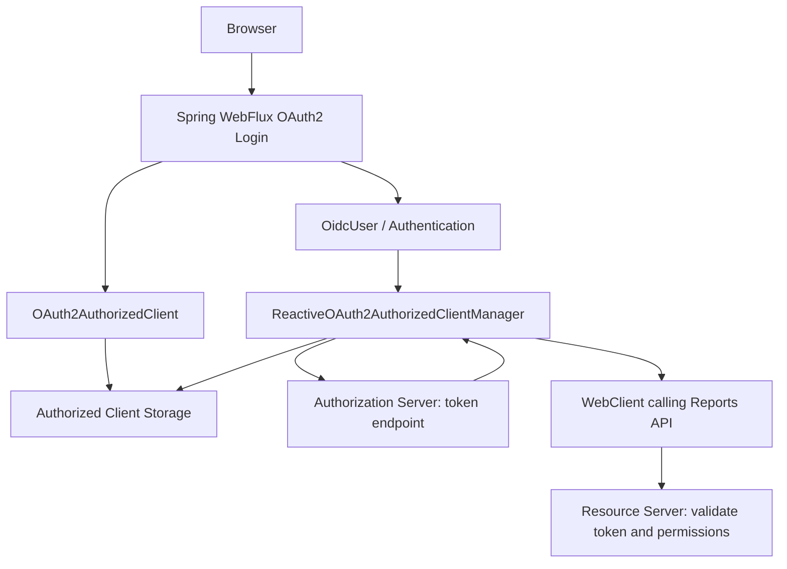
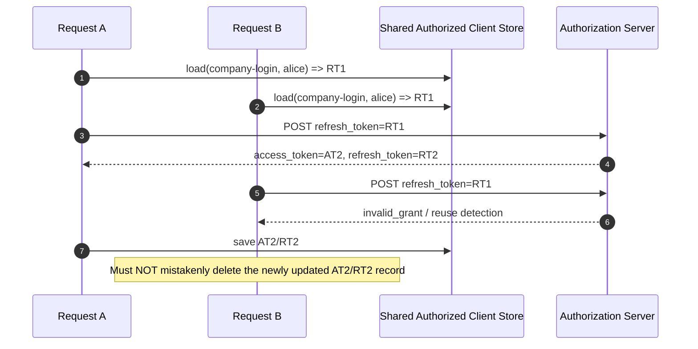
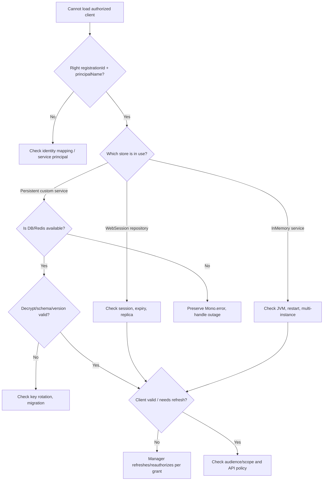

# 21.5. InMemoryReactiveOAuth2AuthorizedClientService and Custom Stores

In **Spring Security OAuth 2.0 / OpenID Connect (OIDC) Client** running on **Spring WebFlux**, an application does not just log in or acquire an access token once. It must also **store, retrieve, refresh, and remove OAuth2 authorized clients** throughout the lifecycle of a user or background process. A Reactive application can use in-process memory for testing environments, whereas multi-instance systems, strict token-protection requirements, or state survival across restarts typically call for a persistent store.

The centerpiece of this lesson is **`InMemoryReactiveOAuth2AuthorizedClientService`**, an implementation of `ReactiveOAuth2AuthorizedClientService`. From there, we design a custom store adhering to Spring Security's contract—such as with R2DBC, Reactive Redis, or a storage service offering a non-blocking API.

Key points to keep in mind from the start:

- `OAuth2AuthorizedClient` holds the **client registration**, **principal name**, **access token**, and **refresh token if issued**. It is not an `Authentication`/`OidcUser` object.
- `ReactiveOAuth2AuthorizedClientService` uses the logical lookup key **`(clientRegistrationId, principalName)`**. It does not automatically partition by tenant, session, audience, or scope.
- `InMemoryReactiveOAuth2AuthorizedClientService` keeps data **in one JVM's memory**, does not automatically share state across replicas, and does not survive restarts.
- `ServerOAuth2AuthorizedClientRepository` carries `ServerWebExchange`/user session context; **it is not the same** as the storage-tier service.
- A custom store must protect tokens as **secret credentials**, preserve refresh token rotation, prevent concurrent overwrites, and never block the Reactor event loop.

## 1. Learning Objectives

After completing this lesson, you will be able to:

1. Explain the role of `ReactiveOAuth2AuthorizedClientService` in Spring Security Reactive OAuth2 Client.
2. Distinguish `InMemoryReactiveOAuth2AuthorizedClientService` from `WebSessionServerOAuth2AuthorizedClientRepository` and `AuthenticatedPrincipalServerOAuth2AuthorizedClientRepository`.
3. Use `loadAuthorizedClient`, `saveAuthorizedClient`, and `removeAuthorizedClient` properly.
4. Understand why `Mono.empty()`, `Mono<Void>`, lazy execution, and non-blocking IO matter for a token store.
5. Build an `AuthorizedClientServiceReactiveOAuth2AuthorizedClientManager` for background tasks.
6. Design safe relational schemas / Redis keys based on `registrationId` and `principalName`.
7. Write a skeleton for a custom `ReactiveOAuth2AuthorizedClientService` using a repository and token encryption.
8. Handle token expiration, refresh token rotation, concurrent refreshes, and multi-instance deployments.
9. Distinguish **local token deletion** from **token revocation at the Authorization Server**.
10. Test a Reactive service using `StepVerifier` and mock storage without real credentials.

## 2. Placing the Authorized Client in Architecture

Suppose a reporting portal uses OIDC Login and calls the Reports API:



There are **three distinct objects**:

| Object | What does it hold? | Purpose |
|---|---|---|
| `Authentication` / `OidcUser` | Logged-in identity, authorities, ID Token/UserInfo for OIDC | Authenticates the user in the web application |
| `ClientRegistration` | `registrationId`, `clientId`, grant type, scopes, token endpoint, provider | Configures an OAuth2 client |
| `OAuth2AuthorizedClient` | `ClientRegistration`, `principalName`, access/refresh tokens | Represents a client **that has been granted authorization** |

An OIDC user may log in successfully yet **not yet have an authorized client for a second API**. Conversely, a `client_credentials` job can have an authorized client with **no `OidcUser` at all**.

### 2.1. Example Stored Data

```text
registrationId = "company-login"
principalName  = "employee-42"
accessToken    = <SECRET>
accessExpires  = 2026-11-16T04:00:00Z
refreshToken   = <SECRET, if issued by provider>

registrationId = "inventory-service"
principalName  = "service:nightly-import"
accessToken    = <SECRET>
accessExpires  = 2026-11-16T03:45:00Z
refreshToken   = null (common with client_credentials)
```

Two records can share the same principal across different registrations; likewise, one registration can have many principals. The service key must reflect **both dimensions**.

## 3. ReactiveOAuth2AuthorizedClientService Contract

The interface resides in package:

```java
org.springframework.security.oauth2.client
        .ReactiveOAuth2AuthorizedClientService
```

The service's three core operations:

```java
<T extends OAuth2AuthorizedClient> Mono<T> loadAuthorizedClient(
        String clientRegistrationId,
        String principalName);

Mono<Void> saveAuthorizedClient(
        OAuth2AuthorizedClient authorizedClient,
        Authentication principal);

Mono<Void> removeAuthorizedClient(
        String clientRegistrationId,
        String principalName);
```

These are abbreviated signatures to clarify the contract; in implementation, import the corresponding Spring Security and Reactor types.

### 3.1. loadAuthorizedClient

`loadAuthorizedClient(registrationId, principalName)` looks up an authorized client by the composite key. Example:

```java
Mono<OAuth2AuthorizedClient> authorizedClient =
        service.<OAuth2AuthorizedClient>loadAuthorizedClient(
                "company-login", authentication.getName());
```

When nothing is found, a Reactive implementation should complete with `Mono.empty()`, **not** return `null` instead of a `Mono`. Real storage failures, such as database unavailability, should be emitted via `onError` so callers can distinguish "no token" from "token store unreachable".

### 3.2. saveAuthorizedClient

`saveAuthorizedClient(authorizedClient, principal)` saves the tokens for the principal provided by authentication:

```java
Mono<Void> saved = service.saveAuthorizedClient(
        authorizedClient, authenticatedPrincipal);
```

`Mono<Void>` is a completion signal, not a Boolean. Success normally emits `onComplete`; errors emit `onError`. With custom storage, ensure the principal name used to save is **consistent** with `OAuth2AuthorizedClient.getPrincipalName()` and the application's identity policy. A custom store may reject inconsistent state rather than writing tokens under the wrong owner.

### 3.3. removeAuthorizedClient

```java
Mono<Void> removed = service.removeAuthorizedClient(
        "company-login", authentication.getName());
```

Removal only affects the **local store managed by this service**. It **does not automatically revoke tokens at the Authorization Server**, does not delete `WebSession`, and does not guarantee the user logged out of the OpenID Provider.

### 3.4. Without a Subscribe, Nothing Executes

Reactor publishers are usually **lazy**. Merely creating:

```java
Mono<Void> operation = service.removeAuthorizedClient("company-login", "alice");
```

does not ensure the delete has run. In WebFlux, **return or compose the publisher**:

```java
return service.removeAuthorizedClient("company-login", "alice")
        .then(Mono.just("Authorized client was removed"));
```

Never call `subscribe()` arbitrarily in a controller/service just to trigger a fire-and-forget side effect: errors can be lost, lifecycle becomes hard to control, and the HTTP response may be sent before storage updates.

### 3.5. Servlet vs Reactive Comparison

| Servlet / Synchronous | Reactive / WebFlux |
|---|---|
| `OAuth2AuthorizedClientService` | `ReactiveOAuth2AuthorizedClientService` |
| `InMemoryOAuth2AuthorizedClientService` | `InMemoryReactiveOAuth2AuthorizedClientService` |
| `OAuth2AuthorizedClientRepository` | `ServerOAuth2AuthorizedClientRepository` |
| `OAuth2AuthorizedClientManager` | `ReactiveOAuth2AuthorizedClientManager` |
| `AuthorizedClientServiceOAuth2AuthorizedClientManager` | `AuthorizedClientServiceReactiveOAuth2AuthorizedClientManager` |
| Returns `OAuth2AuthorizedClient` or `null` | Returns `Mono<OAuth2AuthorizedClient>` or `Mono.empty()` |
| Storage operations may block | Does not block event loop; uses Reactive IO |

Never wrap a blocking JDBC service with `Mono.just(service.loadAuthorizedClient(...))` and treat it as non-blocking: the JDBC call already ran eagerly when constructing the `Mono`. If a blocking driver must be used during a migration phase, isolate it on an appropriate scheduler and bound resources; in a true Reactive architecture, prefer R2DBC or non-blocking storage clients.

## 4. What Is InMemoryReactiveOAuth2AuthorizedClientService?

`InMemoryReactiveOAuth2AuthorizedClientService` is an implementation storing authorized clients **in the memory of a single application instance**. It is suited for:

- Learning Reactive OAuth2 Client APIs.
- Running integration tests with fake tokens.
- Prototyping single-instance apps that do not need tokens preserved across restarts.
- Rapid development before introducing persistent storage.

Keep expectations bounded:

| Property | InMemoryReactiveOAuth2AuthorizedClientService |
|---|---|
| Storage location | Application JVM heap |
| Survives restart | No |
| Shared across containers/replicas | No |
| Auto-encrypts tokens with KMS | Not a default feature of the in-memory store |
| Lookup by `registrationId` and `principalName` | Yes |
| Acquires or refreshes access tokens automatically | No; that is the manager/provider's job |
| Revokes tokens at provider on remove | No |
| Synchronizes refreshes across instances | No |
| Auto-evicts by token lifetime and business retention | Should not be assumed; needs explicit policy |

A service may hold tokens in memory, yet **whether a token is still valid or needs refreshing** is decided by `ReactiveOAuth2AuthorizedClientManager`/providers and the Authorization Server. Never read a token from memory and reuse it indefinitely without checking expiration.

### 4.1. Initializing the In-Memory Bean

With `ReactiveClientRegistrationRepository` already configured by Spring Boot:

```java
import org.springframework.context.annotation.Bean;
import org.springframework.context.annotation.Configuration;
import org.springframework.security.oauth2.client
        .InMemoryReactiveOAuth2AuthorizedClientService;
import org.springframework.security.oauth2.client
        .ReactiveOAuth2AuthorizedClientService;
import org.springframework.security.oauth2.client.registration
        .ReactiveClientRegistrationRepository;

@Configuration
class AuthorizedClientStorageConfig {

    @Bean
    ReactiveOAuth2AuthorizedClientService authorizedClientService(
            ReactiveClientRegistrationRepository registrations) {

        return new InMemoryReactiveOAuth2AuthorizedClientService(
                registrations);
    }
}
```

This is an illustrative configuration for when an application **wants to declare the service explicitly**. A Spring Boot project may already have a bean supplied by auto-configuration; in that case avoid declaring an extra bean for the same purpose without checking bean selection/injection.

### 4.2. Sample Registration Configuration

```yaml
spring:
  security:
    oauth2:
      client:
        registration:
          company-login:
            provider: company
            client-id: "${OIDC_CLIENT_ID}"
            client-secret: "${OIDC_CLIENT_SECRET}"
            authorization-grant-type: authorization_code
            client-authentication-method: client_secret_basic
            redirect-uri: "{baseUrl}/login/oauth2/code/{registrationId}"
            scope: [openid, profile, email]
          inventory-service:
            provider: company
            client-id: "${INVENTORY_CLIENT_ID}"
            client-secret: "${INVENTORY_CLIENT_SECRET}"
            authorization-grant-type: client_credentials
            client-authentication-method: client_secret_basic
            scope: [inventory.read]
        provider:
          company:
            issuer-uri: "https://idp.example.org/realms/company"
```

`company-login` serves the OIDC Authorization Code Flow, while `inventory-service` uses service-to-service authorization. Both can coexist in an application, yet **not every client needs to be stored the same way or have the same lifecycle**.

### 4.3. Example Loading a Client and Handling Mono.empty

```java
import org.springframework.security.oauth2.client.OAuth2AuthorizedClient;
import org.springframework.security.oauth2.client
        .ReactiveOAuth2AuthorizedClientService;
import reactor.core.publisher.Mono;

final class ClientLookup {

    private final ReactiveOAuth2AuthorizedClientService service;

    ClientLookup(ReactiveOAuth2AuthorizedClientService service) {
        this.service = service;
    }

    Mono<OAuth2AuthorizedClient> find(
            String registrationId, String principalName) {

        return service.<OAuth2AuthorizedClient>loadAuthorizedClient(
                registrationId, principalName);
    }
}
```

This class only **looks up an authorized client**. It does not send requests to the token endpoint, refresh tokens, or verify token permissions for an API. If the goal is "obtain a usable token to call an API", use `ReactiveOAuth2AuthorizedClientManager` rather than `loadAuthorizedClient` alone.

### 4.4. Mono.empty Differs from Storage Errors

Example distinguishing the two:

```java
return service.<OAuth2AuthorizedClient>loadAuthorizedClient(
                registrationId, principalName)
        .switchIfEmpty(Mono.error(
                new IllegalStateException("No authorized client found")));
```

`switchIfEmpty` applies only when **no record exists**. If the underlying repository emits `onError` due to a lost DB connection, the error continues propagating through the pipeline; **never use unconditional `onErrorResume(error -> Mono.empty())`** to disguise storage failures as "never logged in".

## 5. Why In-Memory Is Not Suitable for Every Environment

### 5.1. Restarts or Rolling Deployments

Suppose a user logs in and their token lives only in instance A's heap. When instance A restarts:

```text
Before restart:
  JVM A memory -> (company-login, employee-42) -> AT1/RT1

After restart:
  JVM A memory -> authorized client is gone
```

The HTTP session might still exist in another store, yet the authorized client in the in-memory service **does not recover itself**. Depending on repository configuration, the user may have to re-authorize or downstream API calls will fail to find a token.

### 5.2. Horizontal Scaling

```text
Load balancer
   |
   +--> Pod A: InMemory store A
   |       company-login, employee-42 -> AT1/RT1
   |
   +--> Pod B: InMemory store B
           no such record
```

If the next request hits Pod B, the authorized client will not appear just because Pod A holds the token. Sticky sessions can mask part of the symptom, but do not replace a real storage/recovery strategy during pod crashes, autoscaling, or failover.

### 5.3. Growing Numbers of Principals and Registrations

An in-memory store keyed by the pair can accumulate many records:

```text
(company-login, user-a)
(company-login, user-b)
(partner-login, user-a)
(inventory-service, service:import)
...
```

If an application uses a random principal name like `job-<UUID>` on each execution, entry counts can grow unnecessarily. Before choosing in-memory or persistent storage, establish stable principal naming, retention, and cleanup rules.

### 5.4. In-Memory Still Holds Sensitive Credentials

"Never written to disk" does not mean access/refresh tokens are completely safe. Tokens can appear in heap dumps, diagnostic tooling, crash reports, or logs if developers print objects. Restrict access to JVM diagnostics, protect dumps, and never serialize tokens into HTTP responses.

## 6. Distinguishing Service from ServerOAuth2AuthorizedClientRepository

In WebFlux, there are **two related but distinct abstractions**.

`ReactiveOAuth2AuthorizedClientService`:

```java
loadAuthorizedClient(registrationId, principalName);
saveAuthorizedClient(authorizedClient, authentication);
removeAuthorizedClient(registrationId, principalName);
```

`ServerOAuth2AuthorizedClientRepository`:

```java
loadAuthorizedClient(registrationId, authentication, serverWebExchange);
saveAuthorizedClient(authorizedClient, authentication, serverWebExchange);
removeAuthorizedClient(registrationId, authentication, serverWebExchange);
```

The repository takes **`ServerWebExchange`**, enabling storage in `WebSession` or per current-request policy. The service can be called from business/service layers without an HTTP request.

| Property | ReactiveOAuth2AuthorizedClientService | ServerOAuth2AuthorizedClientRepository |
|---|---|---|
| Load inputs | `registrationId` + `principalName` | `registrationId` + `Authentication` + `ServerWebExchange` |
| Suitable for background jobs | Yes | Awkward without a web exchange |
| Can use persistence | Yes, via a custom service | Yes, if repository delegates to a matching service |
| Can store in WebSession | Not the service's default semantics | Yes, depending on implementation |
| Can look up a user's client across sessions | Per store and principal | Depends on principal/session and repository |

### 6.1. WebSessionServerOAuth2AuthorizedClientRepository

`WebSessionServerOAuth2AuthorizedClientRepository` stores authorized clients inside WebFlux's **`WebSession`**. It fits when state should remain tightly tied to the session. If a session is lost, expired, or not shared across nodes, records in the session repository may no longer be available.

**Do not assume** that reading an injected `ReactiveOAuth2AuthorizedClientService` will see tokens stored inside a standalone `WebSessionServerOAuth2AuthorizedClientRepository`.

### 6.2. AuthenticatedPrincipalServerOAuth2AuthorizedClientRepository

`AuthenticatedPrincipalServerOAuth2AuthorizedClientRepository` uses the authenticated principal and delegates to `ReactiveOAuth2AuthorizedClientService`. When configured for anonymous principals, it can also fall back to a WebSession repository per API/policy.

When replacing `ReactiveOAuth2AuthorizedClientService` with a persistent implementation, **verify that the active repository actually delegates to that service**. Simply declaring a custom service bean does not guarantee the entire OAuth2 Login/WebClient flow uses the new bean.

### 6.3. Authorization Request Repository Is Not the Authorized Client Repository

A third store often appears:

`WebSessionOAuth2ServerAuthorizationRequestRepository` stores the initial **`OAuth2AuthorizationRequest`**, including `state` and correlation/PKCE data needed for the Authorization Code Flow callback.

```text
Before callback:
  ServerAuthorizationRequestRepository
     -> OAuth2AuthorizationRequest, state, PKCE context

After token issuance:
  ServerOAuth2AuthorizedClientRepository or
  ReactiveOAuth2AuthorizedClientService
     -> OAuth2AuthorizedClient, access/refresh token
```

Losing `state` during callback is a different failure from "authorized client not found after login". Never fix it wrong by merging both data types into one unpolicied map.

## 7. Choosing a Store: InMemory, R2DBC, Reactive Redis

| Criterion | InMemory service | R2DBC database | Reactive Redis / KV Store |
|---|---|---|---|
| Survives JVM restart | No | Yes if DB is durable | Possible, per Redis persistence/TTL |
| Shared across replicas | No | Yes | Yes |
| Composite key lookup | Yes | Yes via primary key/index | Yes via encoded/namespaced key |
| CAS/optimistic locking | Must design if needed | Can use version/transaction | Can use CAS/Lua/transaction depending on setup |
| Token encryption | Depends on heap protection | Should encrypt ciphertext before storing / encryption-at-rest | Should encrypt ciphertext and protect network/ACL |
| Retention/TTL | Needs separate policy | Cleanup job / lifecycle policy | Built-in TTL, but must account for refresh token lifetime |
| Non-blocking | No external IO | Requires reactive R2DBC driver | Uses ReactiveRedisTemplate or reactive client |
| Operational complexity | Low | Schema, migrations, backups, HA | TTL, clustering, eviction, persistence, keyspace |

No single option is universally best. For user-delegated refresh tokens, persistence preserves sessions across restarts while also creating a **sensitive credential store to protect**. For `client_credentials`, you can sometimes simply request a new token after restart without long-term storage; the choice also depends on quotas and token endpoint latency.

### 7.1. Do Not Mechanically Set TTL Equal to Access Token Expiration

A record may hold:

```text
access token expires in 20 minutes
refresh token remains valid for hours/days
```

If a Redis key self-deletes when the access token expires, the application loses a still-usable refresh token. TTL/retention must reflect the **authorized client and refresh token lifecycle** per policy, not merely `accessToken.expiresAt`.

Conversely, keeping refresh tokens forever is also wrong. Tokens may be revoked or user sessions terminated; retention must be bounded and cleaned up for privacy and operations.

### 7.2. Separate Database Cache from Lifecycle Manager

A custom store only needs to implement **read/write/delete** per contract. It should not POST to the token endpoint itself when a caller invokes `load`:

```text
loadAuthorizedClient(...) -> read storage
saveAuthorizedClient(...) -> save authorized client
removeAuthorizedClient(...) -> delete from storage

ReactiveOAuth2AuthorizedClientManager
   -> decides grant, reauthorization, refresh
   -> calls provider/token endpoint if needed
   -> updates store via service/repository
```

If a custom store refreshes tokens inside `load`, you risk unexpected side effects, nested retries, race conditions, and hard-to-control `invalid_grant` errors.

## 8. Designing an R2DBC Schema

With a relational database, the model typically uses a composite primary key:

```sql
-- Illustrative PostgreSQL DDL, NOT Spring's default schema.
CREATE TABLE reactive_oauth2_authorized_client (
    client_registration_id   varchar(150) NOT NULL,
    principal_name           varchar(300) NOT NULL,
    access_token_type        varchar(40) NOT NULL,
    access_token_ciphertext  bytea NOT NULL,
    access_issued_at         timestamptz NOT NULL,
    access_expires_at        timestamptz NOT NULL,
    access_scopes_json       text NOT NULL,
    refresh_token_ciphertext bytea,
    refresh_issued_at        timestamptz,
    record_version           bigint NOT NULL DEFAULT 0,
    updated_at               timestamptz NOT NULL DEFAULT now(),
    PRIMARY KEY (client_registration_id, principal_name)
);
```

Token fields store **ciphertext**, not plaintext values. Schema and column sizes should be designed around your provider, encryption requirements, database, and retention needs.

### 8.1. Why a Composite Key?

```text
registrationId = company-login, principal = alice -> token A
registrationId = company-login, principal = bob   -> token B
registrationId = partner-login, principal = alice -> token C
```

Keying only by `registrationId` lets Alice and Bob overwrite each other's tokens. Keying only by `principalName` mixes tokens from Corporate OP and Partner OP.

In multi-tenant projects, this key pair **does not inherently include tenant**. If two tenants share the same registration and principal string, design partitioning/namespacing or controlled local identity mapping.

### 8.2. What Must Be Stored to Reconstruct OAuth2AuthorizedClient?

At minimum, the application needs:

- `client_registration_id` to look up the current `ClientRegistration`.
- `principal_name` to identify the subject.
- `access_token_type`, access token value, `issuedAt`, `expiresAt`, and scopes.
- Refresh token value/`issuedAt` if present.
- `version`/`updatedAt` if concurrent update protection is needed.

`ClientRegistration` is usually re-resolved from `ReactiveClientRegistrationRepository`; you do not need to serialize the entire Java object into the database. Storing raw Java serialized objects creates class-version coupling, security risks, and difficult migrations.

### 8.3. Never Store Refresh Tokens as Readable Plaintext

Refresh tokens often have long lifetimes and allow minting new access tokens. Ensure:

1. Encrypt tokens before writing to the DB using a trusted mechanism, such as KMS-managed envelope encryption.
2. Separate encryption key management privileges from DB query privileges.
3. Restrict storage read permissions and audit access.
4. Protect snapshots, replicas, backups, crash dumps, and logs.
5. Support key rotation, token revocation, and cleanup.

Never log token values or secrets into metric labels, exception messages, HTTP responses, or debug traces.

## 9. Example Custom ReactiveOAuth2AuthorizedClientService

In this section, we illustrate **implementing the contract** without locking the lesson to one specific database. One adapter could use Spring Data R2DBC, another Reactive Redis. Both implement an interface storing encrypted records.

### 9.1. Storage Layer Data Types

```java
import java.time.Instant;
import java.util.Set;
import reactor.core.publisher.Mono;

// Application record, not a Spring Security class.
record StoredAuthorizedClient(
        String registrationId,
        String principalName,
        String accessTokenType,
        byte[] encryptedAccessToken,
        Instant accessIssuedAt,
        Instant accessExpiresAt,
        Set<String> accessScopes,
        byte[] encryptedRefreshToken,
        Instant refreshIssuedAt,
        long version) {}

interface AuthorizedClientRecordStore {
    Mono<StoredAuthorizedClient> find(
            String registrationId, String principalName);

    Mono<Void> upsert(StoredAuthorizedClient value);

    Mono<Void> delete(
            String registrationId, String principalName);
}

interface TokenProtector {
    Mono<byte[]> encrypt(String clearTextToken);
    Mono<String> decrypt(byte[] ciphertext);
}
```

`AuthorizedClientRecordStore` and `TokenProtector` are **application-defined abstractions**. A real implementation must manage encryption keys, error handling, versioning, and safe deletion; this code does not perform cryptography by itself.

### 9.2. Skeleton of the Custom Service

```java
import java.util.Set;
import org.springframework.security.core.Authentication;
import org.springframework.security.oauth2.client.OAuth2AuthorizedClient;
import org.springframework.security.oauth2.client
        .ReactiveOAuth2AuthorizedClientService;
import org.springframework.security.oauth2.client.registration.ClientRegistration;
import org.springframework.security.oauth2.client.registration
        .ReactiveClientRegistrationRepository;
import org.springframework.security.oauth2.core.OAuth2AccessToken;
import org.springframework.security.oauth2.core.OAuth2RefreshToken;
import reactor.core.publisher.Mono;

final class EncryptedReactiveAuthorizedClientService
        implements ReactiveOAuth2AuthorizedClientService {

    private final ReactiveClientRegistrationRepository registrations;
    private final AuthorizedClientRecordStore records;
    private final TokenProtector tokens;

    EncryptedReactiveAuthorizedClientService(
            ReactiveClientRegistrationRepository registrations,
            AuthorizedClientRecordStore records,
            TokenProtector tokens) {
        this.registrations = registrations;
        this.records = records;
        this.tokens = tokens;
    }

    @Override
    @SuppressWarnings("unchecked")
    public <T extends OAuth2AuthorizedClient> Mono<T> loadAuthorizedClient(
            String registrationId, String principalName) {

        return records.find(registrationId, principalName)
                .flatMap(row -> {
                    Mono<ClientRegistration> registration =
                            registrations.findByRegistrationId(registrationId)
                                    .switchIfEmpty(Mono.error(
                                            new IllegalStateException(
                                                    "Unknown client registration")));

                    Mono<String> access =
                            tokens.decrypt(row.encryptedAccessToken());

                    Mono<String> refresh =
                            row.encryptedRefreshToken() == null
                                    ? Mono.just("")
                                    : tokens.decrypt(row.encryptedRefreshToken());

                    return Mono.zip(registration, access, refresh)
                            .map(tuple -> {
                                if (!"Bearer".equalsIgnoreCase(
                                        row.accessTokenType())) {
                                    throw new IllegalStateException(
                                            "Unsupported access token type");
                                }

                                OAuth2AccessToken accessToken =
                                        new OAuth2AccessToken(
                                                OAuth2AccessToken.TokenType.BEARER,
                                                tuple.getT2(),
                                                row.accessIssuedAt(),
                                                row.accessExpiresAt(),
                                                row.accessScopes());

                                OAuth2RefreshToken refreshToken =
                                        row.encryptedRefreshToken() == null
                                                ? null
                                                : new OAuth2RefreshToken(
                                                        tuple.getT3(),
                                                        row.refreshIssuedAt());

                                OAuth2AuthorizedClient client =
                                        new OAuth2AuthorizedClient(
                                                tuple.getT1(),
                                                row.principalName(),
                                                accessToken,
                                                refreshToken);
                                return (T) client;
                            });
                });
    }

    @Override
    public Mono<Void> saveAuthorizedClient(
            OAuth2AuthorizedClient client, Authentication principal) {

        String registrationId =
                client.getClientRegistration().getRegistrationId();
        String principalName = principal.getName();

        if (!principalName.equals(client.getPrincipalName())) {
            return Mono.error(new IllegalArgumentException(
                    "Principal differs from authorized client owner"));
        }

        OAuth2AccessToken accessToken = client.getAccessToken();
        OAuth2RefreshToken refreshToken = client.getRefreshToken();

        Mono<byte[]> accessEncrypted =
                tokens.encrypt(accessToken.getTokenValue());
        Mono<byte[]> refreshEncrypted =
                refreshToken == null
                        ? Mono.just(new byte[0])
                        : tokens.encrypt(refreshToken.getTokenValue());

        return Mono.zip(accessEncrypted, refreshEncrypted)
                .flatMap(ciphertexts ->
                        records.upsert(new StoredAuthorizedClient(
                                registrationId,
                                principalName,
                                accessToken.getTokenType().getValue(),
                                ciphertexts.getT1(),
                                accessToken.getIssuedAt(),
                                accessToken.getExpiresAt(),
                                Set.copyOf(accessToken.getScopes()),
                                refreshToken == null
                                        ? null
                                        : ciphertexts.getT2(),
                                refreshToken == null
                                        ? null
                                        : refreshToken.getIssuedAt(),
                                0L)));
    }

    @Override
    public Mono<Void> removeAuthorizedClient(
            String registrationId, String principalName) {
        return records.delete(registrationId, principalName);
    }
}
```

This is an **educational skeleton showing the data flow**, not production-ready storage: `records.upsert(...)` must implement transaction/optimistic concurrency policies, `TokenProtector` needs real encryption with managed keys, and `version` cannot simply remain `0L` if the database already holds a record. A real implementation must read the current version and handle conflicts when refresh tokens change. When using `Mono.zip`, every component `Mono` must emit a value when data exists; an empty `Mono` will unexpectedly turn the entire zipped result empty.

**Boundary to preserve:** this service only reconstructs or saves `OAuth2AuthorizedClient`. It does not call the token endpoint, decide new scopes, or authorize users to use tokens.

### 9.3. Why Can Load Return Mono.empty?

`records.find(...)` should return `Mono.empty()` when no row exists. Then `flatMap` also completes empty. This behavior is essential so the manager can distinguish "no authorized client yet" from a stored client.

If a row exists yet `ClientRegistration` was removed or the ciphertext cannot be decrypted, that is not "never had an authorized client": raise a controlled error, clean up data, or require reauthorization per policy—**never swallow the error and return a different token**.

### 9.4. Atomicity and Record Versioning

Example during refresh token rotation:

```text
DB: (company-login, alice) has AT1/RT1, version=5
Instance A reads version 5, refreshes RT1 -> AT2/RT2
Instance B still reads version 5, refreshes RT1 -> invalid_grant
Instance A writes version 6
Instance B must NOT delete/overwrite version 6 with stale data
```

Therefore, a production `upsert` must define one of these mechanisms:

- Transactions with appropriate row locks if the database and workload allow.
- Optimistic concurrency: `UPDATE ... WHERE version=:expectedVersion`, succeeding only if unchanged.
- Cluster-wide distributed single-flight/lock keyed by `(registrationId, principalName)`.
- Re-checking the current version before a failure handler deletes a record due to `invalid_grant` from an older request.

Do not assume "Reactive" automatically provides atomic updates or prevents races. Reactor is an asynchronous execution model; data consistency still belongs to store design.

## 10. Registering the Custom Store in a Spring Application

Once the application implements `AuthorizedClientRecordStore` and `TokenProtector`, register:

```java
import org.springframework.context.annotation.Bean;
import org.springframework.context.annotation.Configuration;
import org.springframework.security.oauth2.client
        .ReactiveOAuth2AuthorizedClientService;
import org.springframework.security.oauth2.client.registration
        .ReactiveClientRegistrationRepository;

@Configuration
class PersistentOAuth2ClientConfig {

    @Bean
    ReactiveOAuth2AuthorizedClientService authorizedClientService(
            ReactiveClientRegistrationRepository registrations,
            AuthorizedClientRecordStore records,
            TokenProtector protector) {

        return new EncryptedReactiveAuthorizedClientService(
                registrations, records, protector);
    }
}
```

This **replaces** the `InMemoryReactiveOAuth2AuthorizedClientService` bean from section 4.1. Do not keep two beans with the same name/type expecting Spring to guess the right one. If you have multiple storage purposes, use `@Qualifier` or configure managers/repositories explicitly.

### 10.1. Saving During WebFlux Login

During web login, when using a `ServerOAuth2AuthorizedClientRepository` capable of delegating to a service, verify the repository actually uses the persistent store bean:

```java
import org.springframework.context.annotation.Bean;
import org.springframework.security.oauth2.client
        .ReactiveOAuth2AuthorizedClientService;
import org.springframework.security.oauth2.client.web.server
        .AuthenticatedPrincipalServerOAuth2AuthorizedClientRepository;
import org.springframework.security.oauth2.client.web.server
        .ServerOAuth2AuthorizedClientRepository;

@Bean
ServerOAuth2AuthorizedClientRepository authorizedClientRepository(
        ReactiveOAuth2AuthorizedClientService service) {

    return new AuthenticatedPrincipalServerOAuth2AuthorizedClientRepository(
            service);
}
```

`AuthenticatedPrincipalServerOAuth2AuthorizedClientRepository` delegates authenticated principals' authorized clients to the service and uses a separate strategy for anonymous users per configuration/implementation. If the application deliberately uses `WebSessionServerOAuth2AuthorizedClientRepository`, that is a different storage strategy; creating a custom service will not automatically move session data into the DB.

### 10.2. Do Not Replace the Request Repository to Persist Tokens

OIDC Login also uses `ServerAuthorizationRequestRepository` to hold authorization requests/`state`/PKCE between redirect and callback. Never replace it with `ReactiveOAuth2AuthorizedClientService` to store tokens. They have different lifecycles and may need different storage backends.

## 11. AuthorizedClientServiceReactiveOAuth2AuthorizedClientManager

When an application has background jobs or service clients independent of HTTP requests, Spring Security Reactive provides `AuthorizedClientServiceReactiveOAuth2AuthorizedClientManager`.

This manager uses:

- `ReactiveClientRegistrationRepository` to look up registrations.
- `ReactiveOAuth2AuthorizedClientService` to load/save/remove authorized clients.
- `ReactiveOAuth2AuthorizedClientProvider` to handle grants.

### 11.1. Service-Tier Manager Bean

```java
import org.springframework.context.annotation.Bean;
import org.springframework.context.annotation.Configuration;
import org.springframework.security.oauth2.client
        .AuthorizedClientServiceReactiveOAuth2AuthorizedClientManager;
import org.springframework.security.oauth2.client
        .ReactiveOAuth2AuthorizedClientManager;
import org.springframework.security.oauth2.client
        .ReactiveOAuth2AuthorizedClientProvider;
import org.springframework.security.oauth2.client
        .ReactiveOAuth2AuthorizedClientProviderBuilder;
import org.springframework.security.oauth2.client
        .ReactiveOAuth2AuthorizedClientService;
import org.springframework.security.oauth2.client.registration
        .ReactiveClientRegistrationRepository;

@Configuration
class ReactiveServiceClientManagerConfig {

    @Bean
    ReactiveOAuth2AuthorizedClientManager serviceClientManager(
            ReactiveClientRegistrationRepository registrations,
            ReactiveOAuth2AuthorizedClientService authorizedClients) {

        ReactiveOAuth2AuthorizedClientProvider provider =
                ReactiveOAuth2AuthorizedClientProviderBuilder.builder()
                        .clientCredentials()
                        .refreshToken()
                        .build();

        var manager =
                new AuthorizedClientServiceReactiveOAuth2AuthorizedClientManager(
                        registrations, authorizedClients);
        manager.setAuthorizedClientProvider(provider);
        return manager;
    }
}
```

This snippet illustrates a manager supporting `client_credentials` and `refresh_token`. Only enable grants you actually need. With `authorization_code`, users still need a browser flow to grant initial authorization; the service manager cannot generate an authorization code on its own from a background job.

### 11.2. Requesting a Token for a Non-Blocking Job

```java
import org.springframework.security.oauth2.client
        .OAuth2AuthorizeRequest;
import org.springframework.security.oauth2.client.OAuth2AuthorizedClient;
import org.springframework.security.oauth2.client
        .ReactiveOAuth2AuthorizedClientManager;
import reactor.core.publisher.Mono;

final class InventoryTokenProvider {

    private final ReactiveOAuth2AuthorizedClientManager manager;

    InventoryTokenProvider(ReactiveOAuth2AuthorizedClientManager manager) {
        this.manager = manager;
    }

    Mono<OAuth2AuthorizedClient> authorizedClient() {
        OAuth2AuthorizeRequest request =
                OAuth2AuthorizeRequest
                        .withClientRegistrationId("inventory-service")
                        .principal("service:nightly-import")
                        .build();

        return manager.authorize(request)
                .switchIfEmpty(Mono.error(
                        new IllegalStateException(
                                "Could not authorize inventory-service")));
    }
}
```

`principal("service:nightly-import")` is a logical principal name on the Spring side used to key storage for `client_credentials`. It is not an OIDC user and does not replace client authentication at the Authorization Server.

Keep the principal name stable; generating `job-<UUID>` on each run causes the manager to store many separate authorized clients and unnecessarily increases requests to the token endpoint.

### 11.3. Combining the Manager and WebClient

```java
import org.springframework.web.reactive.function.client.WebClient;
import reactor.core.publisher.Mono;

final class InventoryApi {

    private final InventoryTokenProvider tokenProvider;
    private final WebClient client = WebClient.builder()
            .baseUrl("https://inventory-api.example.org")
            .build();

    InventoryApi(InventoryTokenProvider tokenProvider) {
        this.tokenProvider = tokenProvider;
    }

    Mono<String> listItems() {
        return tokenProvider.authorizedClient()
                .flatMap(authorized -> client.get()
                        .uri("/v1/items")
                        .headers(headers -> headers.setBearerAuth(
                                authorized.getAccessToken().getTokenValue()))
                        .retrieve()
                        .bodyToMono(String.class));
    }
}
```

The example fixes the API base URL to avoid sending bearer tokens to hosts outside the allowlist. In production applications you can configure an OAuth2-aware WebClient filter to resolve the authorized client automatically, while **never logging tokens**, never calling arbitrary user-supplied hosts, and never confusing a `client_credentials` token with a user token.

The manager is responsible for retrieving or requesting new tokens per grant; `ReactiveOAuth2AuthorizedClientService` is purely the storage backend.

## 12. WebFlux Manager vs Service Manager: Choose the Right Context

When an application has an HTTP request/`ServerWebExchange`, the alternative is `DefaultReactiveOAuth2AuthorizedClientManager` working with `ServerOAuth2AuthorizedClientRepository`.

| Criterion | DefaultReactiveOAuth2AuthorizedClientManager | AuthorizedClientServiceReactiveOAuth2AuthorizedClientManager |
|---|---|---|
| Context | WebFlux server request | Service/background, no web exchange needed |
| Store | `ServerOAuth2AuthorizedClientRepository` | `ReactiveOAuth2AuthorizedClientService` |
| Principal | Authentication from reactive web context or validly supplied | Logical principal of the authorize call |
| Typical use cases | BFF, web login, user-scoped outbound API calls | Schedulers, service sync, batch jobs |
| Needs request/response context | Usually yes | No |

Do not use the service manager outside a request expecting it to find tokens stored exclusively in `WebSessionServerOAuth2AuthorizedClientRepository`. If your architecture needs to share authorized clients with a service, align repository delegation and strategies consistently.

### 12.1. When Both Web Login and Background Jobs Exist

An application can use both:

```text
WebFlux Login
  -> ServerOAuth2AuthorizedClientRepository
  -> user/session-scoped authorized client

Background Worker
  -> AuthorizedClientServiceReactiveOAuth2AuthorizedClientManager
  -> ReactiveOAuth2AuthorizedClientService
  -> service-principal-scoped authorized client
```

They may share the same database yet require separate permissions, key partitioning, and retention if credentials belong to different trust boundaries. Never let a background job read a user's token simply by accepting a principal name from a query string.

### 12.2. When Not to Use JDBC in a Reactive Pipeline

`JdbcOAuth2AuthorizedClientService` belongs to the synchronous Servlet stack; calling it directly inside a WebFlux handler can block the event loop. `R2dbcEntityTemplate`, `DatabaseClient`, or Reactive repositories are better fits for relational databases.

If an organization forces a synchronous DAO, isolate blocking IO on a controlled scheduler with bounded thread pools and treat it as a deliberate transitional step—do not label a blocking JDBC method "Reactive" merely because it returns `Mono`.

## 13. Concurrent Refreshes and Custom Stores

One of the major reasons to design storage carefully is **refresh token rotation**. Suppose user Alice has AT1/RT1, and two concurrent requests both see AT1 nearing expiration:



Consequences can include:

- One request fails even though another request already refreshed successfully.
- The provider detects RT1 reuse and revokes the token family depending on policy.
- Request B's failure handler deletes the newly saved authorized client if versioning is ignored.
- Two instances overwrite each other in storage.

### 13.1. Single-Flight by Key Pair

One strategy is allowing only **one active refresh** per `(registrationId, principalName)`. Requests sharing that key await the result with a deadline, then re-read the authorized client from the store. This can be implemented via:

- Within one JVM: caching the in-flight `Mono` / async mutex keyed properly, with cleanup and memory bounds.
- Across multiple JVMs: a distributed lock, optimistic versioning, or a dedicated token broker service.
- In a DB: transactions/locks or version-guarded CAS to prevent lost updates.

Never use a global `synchronized` block that stalls the Reactor event loop, and never use a single coarse lock across all users/registrations that serializes the entire system.

### 13.2. Never Blindly Retry Refresh Tokens

If a refresh request with RT1 is processed by the OP yet the response containing RT2 is lost, re-POSTing RT1 can look like replay. A durable custom store **cannot make that POST request idempotent**.

Design must classify `invalid_grant`, unknown outcomes, token endpoint 5xx/timeouts, and provider contracts. Never slap a generic HTTP retry onto every token POST just because the store uses optimistic locking.

### 13.3. Failures When Saving AT2/RT2 Need Separate Handling

```text
Authorization Server: RT1 -> RT2 (already succeeded)
Client receives AT2 + RT2
Database write for AT2/RT2 fails
Database still holds RT1
```

In this situation, replaying RT1 will not fix the cause. You need a recovery/reconciliation policy, controlled error reporting, and potentially reauthorization; never dump RT2 into logs as a "temporary backup".

### 13.4. Version-Checked Deletion on invalid_grant

An `invalid_grant` error coming from a refresh using an older record must not be allowed to delete a **newer record** just saved by another request. A versioned store can offer a "remove if version unchanged" operation, and business failure handlers must understand that semantics.

`removeAuthorizedClient(registrationId, principalName)` in the standard interface has no version parameter. If your custom concurrency policy requires CAS, add that logic at the appropriate repository/manager/failure-handling layer; changing only the `remove` implementation cannot know which version the caller held without passing trusted context.

## 14. Token Retention, Revocation, and Logout

`removeAuthorizedClient(...)` only deletes from the corresponding storage. The following actions **are distinct**:

| Action | Result |
|---|---|
| Remove authorized client from service | Record gone from service; issued tokens may still be active |
| Clear WebSession | Browser session may end; tokens stored elsewhere are not necessarily deleted |
| OIDC Logout at OP | Alters the login session at the OP depending on logout flow; does not implicitly revoke every refresh token |
| Revocation endpoint | Asks the Authorization Server to revoke tokens when supported by endpoint and policy |
| Disable user/client | May block new token issuance; existing access tokens can remain valid until expiration |

On logout or when a user revokes consent:

1. Identify which storage actually holds the authorized client.
2. Clean up the exact user/registration record without deleting other users' tokens.
3. Execute provider-appropriate revocation/logout flows if required.
4. Never expose refresh tokens in responses or logs.
5. Check session cookies and OIDC state separately.

### 14.1. Retention Is Not Access Token expiresAt

An access token may live only 15 minutes while a refresh token stays valid for hours. Deleting the entire authorized client the instant the access token expires destroys the ability to refresh.

Conversely, keeping refresh tokens indefinitely increases exposure. Base TTL/retention on token policy, last activity, consent/user lifecycle, and compliance requirements. Never alter `expiresAt` manually to "extend" a token once an API has rejected it.

### 14.2. Encryption Key Rotation vs Token Rotation

In an encrypted store, rotating the key that protects ciphertext **differs** from OAuth2 refresh token rotation:

- **Encryption key rotation**: replacing the key used to encrypt stored tokens.
- **Refresh token rotation**: the Authorization Server consumes the old refresh token and issues a new one.

The design must support decrypting ciphertext encrypted under prior keys during transition windows—for example via key version/key ID or envelope encryption. Never let an encryption key rotation render all stored authorized clients unreadable and force mass unplanned user re-logins.

## 15. Multi-Tenancy and Security Boundaries

A multi-tenant application might encounter:

```text
company-login, user-42 (tenant A)
company-login, user-42 (tenant B)
```

If **registration and principal strings are identical**, the default service has no third tenant key dimension. A custom store must determine:

- Does each tenant have its own registration?
- Is the principal name a stable local identity unique across tenants?
- Are tables/schemas/databases/namespaces separated per tenant?
- Are tokens issued by the Authorization Server genuinely bound to the tenant/audience?
- Is the user/job permitted to read that tenant's token?

**Never take `tenantId` from an HTTP query parameter and concatenate it into a key to look up tokens** without verifying tenant membership. Storage keys never replace authorization.

### 15.1. Avoid Using Email as Principal Name

Email addresses or display usernames can change or collide across issuers. In OIDC, external subject identification should usually rely on **`(iss, sub)`**, mapped to a local user ID when appropriate.

If an application switches principal names from `sub` to email after tokens were already stored:

```text
Before: (company-login, employee-42)
After:  (company-login, alice@example.org)
```

The store will miss old records and create new ones. Have a migration/cleanup plan and never let two different people share the same key after a rename.

### 15.2. Client Credentials and Service Principals

With `client_credentials`, the principal name is an application-side logical name:

```text
(inventory-service, service:nightly-import)
```

It is not sent to the OP as a user identity. If two tenants genuinely require distinct client IDs/credentials or permissions, configure separate registrations or corresponding token policies; changing only the service principal creates multiple cache entries rather than distinct OAuth2 identities at the provider.

## 16. Reactive Redis: Key Schema and TTL

If using Redis, you can design keys with a dedicated namespace:

```text
oauth2:authorized-client:v1:<encoded-registration-id>:<encoded-principal-id>
```

**Do not** naively join with a delimiter if principals can contain `:`. Use an internal identifier hash or unambiguous encoding. Avoid placing plaintext emails/subjects into Redis keys when keys may be logged or observed by external tooling.

A Redis record can be an encrypted binary blob representing:

```json
{
  "schemaVersion": 1,
  "registrationId": "inventory-service",
  "principalName": "service:nightly-import",
  "encryptedAccessToken": "<BINARY_OR_BASE64_CIPHERTEXT>",
  "accessExpiresAt": "2026-11-16T04:00:00Z",
  "encryptedRefreshToken": null,
  "recordVersion": 8
}
```

This is a **conceptual** structure; never store cleartext tokens in JSON. Fields such as `issuedAt`, `scopes`, and `tokenType` must also be preserved to reconstruct `OAuth2AuthorizedClient`.

### 16.1. ReactiveRedisTemplate

With Spring Data Redis Reactive:

```java
// Illustrative: ReactiveRedisTemplate is a non-blocking API.
Mono<Boolean> written =
        reactiveRedisTemplate.opsForValue()
                .set(redisKey, encryptedPayload, ttl);

Mono<byte[]> read =
        reactiveRedisTemplate.opsForValue().get(redisKey);
```

This assumes `redisKey`, `encryptedPayload`, `ttl`, and `reactiveRedisTemplate` are configured. Serializers must match the actual value types, and the `Boolean` returned by `set` should be checked if policy requires write confirmation.

**Never use `ReactiveRedisTemplate` to dump `OAuth2AuthorizedClient` directly via default Java object serialization.** Define an explicit versioned schema, encrypt tokens, and control TTL and migrations.

### 16.2. Races and Eviction

A Redis cluster can evict keys under memory pressure or fail over. If Redis is the **sole source of truth** for refresh tokens, eviction can force users to log in again. If Redis is just a cache in front of a DB, design cache invalidation/versioning so stale refresh tokens are never served after the DB stores a new RT.

During token-rotation updates, a plain `GET` followed by `SET` does not prevent lost updates. Use CAS/Lua/transactions or proper locking, plus explicit handling when a compare fails.

## 17. R2DBC: Non-Blocking Does Not Mean Automatically Transactional

Spring Data R2DBC supports reactive database access via APIs like `DatabaseClient` and `R2dbcEntityTemplate`. A custom `AuthorizedClientRecordStore` can use them for:

```sql
SELECT *
FROM reactive_oauth2_authorized_client
WHERE client_registration_id = :registrationId
  AND principal_name = :principalName;
```

and:

```sql
UPDATE reactive_oauth2_authorized_client
SET access_token_ciphertext = :encryptedAccess,
    refresh_token_ciphertext = :encryptedRefresh,
    record_version = record_version + 1,
    updated_at = now()
WHERE client_registration_id = :registrationId
  AND principal_name = :principalName
  AND record_version = :expectedVersion;
```

If `UPDATE` affects 0 rows, either the record was deleted or another request updated the version. Do not **retry the HTTP refresh-token grant** just because CAS failed; re-read the current authorized client and decide based on the fresh state.

### 17.1. R2dbcTransactionManager

When grouping multiple database operations, use `R2dbcTransactionManager`/`TransactionalOperator` to maintain a Reactive transaction:

```java
Mono<Void> operation =
        updateAuthorizedClientRecord(record)
                .then(writeAuditEvent(event))
                .as(transactionalOperator::transactional);
```

`updateAuthorizedClientRecord` and `writeAuditEvent` are **application-implemented** methods; `transactionalOperator` is a bean backed by a reactive transaction manager. Never wrap an HTTP token endpoint call inside a long-running network-spanning database transaction trying to make the OP and DB "atomic": they are separate systems, and long locks cause contention.

### 17.2. Database Outage Means Something Different from "Token Missing"

```text
SELECT finds no row -> Mono.empty() (when contract means absent)
DB timeout / connection refused -> Mono.error(...)
Ciphertext invalid -> Mono.error(...)
ClientRegistration deleted -> controlled error / cleanup policy
```

If every database exception is turned into `Mono.empty()`, the manager may assume no authorized client exists and unnecessarily mint new tokens. Storage errors must be observed and handled under dedicated retry/deadline policies.

## 18. Testing InMemoryReactiveOAuth2AuthorizedClientService

Because the in-memory implementation needs no database or token endpoint, you can test its contract with `StepVerifier`.

### 18.1. Test Fixtures

```java
import java.time.Instant;
import java.util.Set;
import org.springframework.security.authentication
        .UsernamePasswordAuthenticationToken;
import org.springframework.security.oauth2.client.OAuth2AuthorizedClient;
import org.springframework.security.oauth2.client
        .InMemoryReactiveOAuth2AuthorizedClientService;
import org.springframework.security.oauth2.client.registration
        .InMemoryReactiveClientRegistrationRepository;
import org.springframework.security.oauth2.client.registration.ClientRegistration;
import org.springframework.security.oauth2.core.AuthorizationGrantType;
import org.springframework.security.oauth2.core.OAuth2AccessToken;
import reactor.test.StepVerifier;

ClientRegistration registration =
        ClientRegistration.withRegistrationId("inventory-service")
                .clientId("test-client")
                .clientSecret("test-secret-not-real")
                .authorizationGrantType(AuthorizationGrantType.CLIENT_CREDENTIALS)
                .tokenUri("https://idp.example.org/oauth2/token")
                .build();

var registrations = new InMemoryReactiveClientRegistrationRepository(
        registration);

var service = new InMemoryReactiveOAuth2AuthorizedClientService(
        registrations);

var principal = new UsernamePasswordAuthenticationToken(
        "service:nightly-import", "not-used", java.util.List.of());

var accessToken = new OAuth2AccessToken(
        OAuth2AccessToken.TokenType.BEARER,
        "fake-test-access-token",
        Instant.now(),
        Instant.now().plusSeconds(600),
        Set.of("inventory.read"));

var authorizedClient = new OAuth2AuthorizedClient(
        registration, principal.getName(), accessToken);
```

These `var` snippets belong inside a test method or fixture; use only fake tokens/secrets. Never write tests with production tokens. The three-argument `UsernamePasswordAuthenticationToken` creates a **fake test authentication**, not a real user authentication method.

### 18.2. Testing Save Then Load

```java
StepVerifier.create(
        service.saveAuthorizedClient(authorizedClient, principal)
                .then(service.<OAuth2AuthorizedClient>loadAuthorizedClient(
                        "inventory-service",
                        "service:nightly-import")))
        .assertNext(loaded -> {
            org.assertj.core.api.Assertions
                    .assertThat(loaded.getPrincipalName())
                    .isEqualTo("service:nightly-import");
            org.assertj.core.api.Assertions
                    .assertThat(loaded.getAccessToken().getTokenValue())
                    .isEqualTo("fake-test-access-token");
        })
        .verifyComplete();
```

If you call `saveAuthorizedClient(...)` without subscribing/composing, the test might read before the save runs. `then(...)` enforces ordering in the Reactive pipeline.

### 18.3. Testing Remove and Not Found

```java
StepVerifier.create(
        service.removeAuthorizedClient(
                        "inventory-service",
                        "service:nightly-import")
                .then(service.<OAuth2AuthorizedClient>loadAuthorizedClient(
                        "inventory-service",
                        "service:nightly-import")))
        .verifyComplete();
```

For a nonexistent client, `Mono.empty()` completes cleanly. This test does not prove the token was revoked at the Authorization Server; it only verifies local storage.

### 18.4. Testing Principal Isolation

Another test should populate:

```text
(inventory-service, service:job-a) -> token-a
(inventory-service, service:job-b) -> token-b
```

Then verify loading `service:job-a` **never** returns token B. Likewise, test two registrations for the same principal to ensure the composite key works properly.

## 19. Testing a Custom Persistent Store

For a custom service, you need more than unit tests on `Mono`:

| Test | What to prove |
|---|---|
| Save/load roundtrip | Reconstructs exact registration, token type, value, issued/expires timestamps, scopes, and refresh token |
| Missing record | `Mono.empty()`, never returns `null` |
| Storage outage | Emits `Mono.error()`, never turns into a cache miss |
| Encryption | DB/Redis sees only ciphertext; decrypts properly with authorized key |
| Wrong key/corrupt payload | Controlled error, never returns a fake token |
| Two principals | Never leaks another user's/service's token |
| Two registrations | Never mixes up tokens across APIs/providers |
| Concurrent save | CAS/versioning prevents overwriting a newer RT |
| Concurrent delete | Failure of an older request never deletes a newer-version record |
| Refresh rotation | RT1 is replaced by RT2 in order while preserving state |
| TTL | Never deletes refresh token just because access token expired |
| Restart/multi-instance | Authorized client can be read back from shared storage |
| Security | Never logs tokens/secrets; enforces DB and KMS access controls |
| Logout/revocation | Local deletion and provider-side revocation follow separate policies |

### 19.1. Testing with a Real Database in a Container

When using R2DBC/PostgreSQL, integration tests can run against an isolated test database with the corresponding schema migrations. You do not need a real Authorization Server just to test storage; build an `OAuth2AuthorizedClient` with fake tokens and save/load it.

With Reactive Redis, use a dedicated test instance, test key namespace, and controlled TTL/eviction settings. Never run unit/integration tests against production Redis.

### 19.2. StepVerifier and Non-Blocking Errors

Example testing a fake custom record store signaling an error:

```java
Mono<OAuth2AuthorizedClient> result =
        customService.<OAuth2AuthorizedClient>loadAuthorizedClient(
                "company-login", "employee-42");

StepVerifier.create(result)
        .expectErrorMatches(error ->
                error instanceof StorageUnavailableException)
        .verify();
```

`StorageUnavailableException` is an **illustrative application-defined exception type** used to test error propagation. Never build an implementation that hides storage errors with `onErrorReturn(fakeToken)` or `Mono.empty()`.

### 19.3. Testing Cancellation and Timeouts

With Reactive IO, cancellation can occur when a browser disconnects or a deadline expires. Yet if the provider already processed the refresh-token request before the local pipeline canceled, local cancellation does not mean token rotation did not happen.

Therefore tests should cover:

- Request deadlines and attempt counts to the database/token endpoint.
- Stored state if a refresh response arrives but the database save fails.
- User canceling a request mid-storage-write.
- Storage operation idempotency/CAS and appropriate retry behavior.

Never attach a generic retry to a refresh-token POST just because the database/repository API is Reactive.

## 20. Observability and Troubleshooting

| Symptom | Possible cause | Remediation |
|---|---|---|
| Login succeeds yet `service.load` returns empty | Authorized client lives in WebSession repository, not the injected service | Check `ServerOAuth2AuthorizedClientRepository` config and actual store |
| Restart loses tokens | Still using `InMemoryReactiveOAuth2AuthorizedClientService` | Switch to a persistent store if survival across restarts is needed |
| Pod B cannot find Pod A's token | In-memory store is not shared across replicas | Use shared storage or an appropriate session strategy |
| Manager repeatedly requests new tokens | Principal changes per job run, or store swallows errors into empty | Keep principal stable; never hide database errors |
| Store returns another user's token | Key uses only registration, missing principal or tenant isolation | Enforce composite keys and identity policy |
| Access token is expired even though load succeeded | Service only reads; it does not refresh | Use `ReactiveOAuth2AuthorizedClientManager` to authorize |
| `invalid_grant` after concurrent refresh | Two instances used the same old rotating refresh token | Single-flight/CAS/read-after-refresh and version-aware failure handling |
| Lost RT2 after database outage | Refresh succeeded yet saving the new record failed | Policy-driven reconciliation/reauthorization; do not blindly replay RT1 |
| WebFlux app slows/hangs under load | Blocking JDBC DAO/`block()` on event loop | Use R2DBC/Reactive Redis or isolate blocking work |
| Redis key deleted too soon | TTL set to access token expiration | Base TTL on refresh token and retention policy |
| Tenant A's token appears in Tenant B | Uncontrolled principal/registration or tenant mapping | Enforce isolation/authorization in both storage and API |
| API still accepts token after removing authorized client | Local removal is not revocation | Check provider-side revocation/expiration/introspection |
| Cannot decrypt tokens after KMS key rotation | Missing key version/migration policy | Manage key versioning/envelope encryption and rollover |
| Tokens exposed in logs | Printing full authorized clients, token requests/responses, or exceptions | Redact and restrict logging/diagnostics |
| Multiple `ReactiveOAuth2AuthorizedClientService` beans | Bean ambiguity / wrong implementation selected | Use qualifiers or disambiguate managers/repositories |

### 20.1. Diagnostic Flowchart



Clearly distinguish **missing key**, **wrong store**, **outage**, **expired token**, and **API token rejection**. Each resides at a different layer.

### 20.2. Safe Logging and Metrics

Log low-sensitivity fields:

```text
oauth2.storage=redis-reactive
oauth2.registrationId=inventory-service
oauth2.operation=load
oauth2.result=hit
oauth2.latencyMs=8
correlationId=server-generated
```

Useful metrics:

- Hit/miss/error rates by registration or registration group.
- Latency of `load`, `save`, `remove`.
- Refresh-token exchange count and `invalid_grant` error count.
- Retry / single-flight wait rates by group.
- Expired record count and cleanup duration.
- Token endpoint request rate during redeploys or scale-outs.

Never use `principalName`, email, user ID, refresh token ID, or high-cardinality tenant IDs as unbounded metric labels. **Never** log access tokens, refresh tokens, Authorization headers, client secrets, or ciphertext alongside decryption keys.

## 21. Combined Scenario: Multi-Replica WebFlux Portal and Inventory Job

Suppose the system has:

- **Portal**: OIDC login with `company-login` for employees; calls the Reports API on their behalf.
- **Inventory Job**: uses `inventory-service` with the `client_credentials` grant.
- **Three WebFlux replicas** behind a load balancer.
- **PostgreSQL/R2DBC** as the shared authorized-client store; tokens are encrypted before storage.

Diagram:

```text
Browser / employee
       |
       v
   Load Balancer
     /   |   \
  Pod A Pod B Pod C  (WebFlux)
     \   |   /
      Reactive Authorized Client Store
         |        |
         |        +-- (company-login, employee-42) -> AT/RT
         |        +-- (company-login, employee-99) -> AT/RT
         |
         +-- (inventory-service, service:nightly-import) -> AT
                 |
                 v
              Inventory API
```

Operating rules:

1. The Portal extracts the employee's `Authentication` and looks up the authorized client for the **exact registration + principal**.
2. The backend decrypts tokens only as needed and never returns refresh tokens to the browser.
3. The manager checks access-token lifetime, uses the refresh token when permitted, and persists new tokens.
4. When multiple pods refresh the same user concurrently, storage/versioning or single-flight prevents reusing old RTs.
5. The Inventory Job uses a stable service principal rather than creating entries per web user.
6. The Reports and Inventory Resource Servers still verify issuer/audience/scope and object-level permissions.
7. Logout/revocation have dedicated flows; `removeAuthorizedClient` does not revoke tokens at the provider.
8. During a PostgreSQL outage, the system emits a storage error instead of pretending the user "has not logged in"; UX/retries follow policy.

### 21.1. Storage Selection Checklist

Before going to production, the engineering team should agree on:

| Question | Decision required |
|---|---|
| How many pods exist and how often do they restart? | Can in-memory satisfy the lifecycle? |
| Does the token belong to a user or a service? | Which principal name and access policy apply? |
| Which repository does login use? | WebSession or delegated to a Reactive service? |
| Must refresh tokens survive restarts? | Balance UX, security, and retention |
| Use R2DBC or Reactive Redis? | Durability, TTL, HA, backups, consistency |
| Must tokens be encrypted before saving? | KMS/envelope encryption, key rotation |
| Is tenant isolation required? | Registrations, principals, namespace/schema, and policy |
| Do refresh tokens rotate? | Single-flight, versioning, unknown-outcome handling |
| What happens on `invalid_grant`? | Version-checked delete/flagging and reauthorization |
| Are audit/logout/revocation needed? | Owner of each workflow, token retention |
| Is everything genuinely non-blocking? | Reactive drivers, avoid `block()` on event loop |
| How is it tested? | StepVerifier, storage integration, concurrency, security |

## 22. Design Mistakes to Avoid

1. **Treating `InMemoryReactiveOAuth2AuthorizedClientService` as a shared store** across multiple replicas.
2. **Using `WebSessionServerOAuth2AuthorizedClientRepository` while querying a separate service** and concluding no token was issued.
3. **Keying only by `registrationId`**, causing different principals' tokens to overwrite each other.
4. **Using mutable emails/usernames as principal keys** without a migration plan.
5. **Writing `Mono.just(blockingDaoCall())`** and assuming you have non-blocking IO.
6. **Calling fire-and-forget `subscribe()` in a handler** and ignoring token save failures.
7. **Mixing authorization request state/PKCE and authorized client tokens into one store** without lifecycle separation.
8. **Storing cleartext access/refresh tokens in DB, Redis, or logs** without protection.
9. **Setting Redis TTL equal to access-token expiration**, deleting still-usable refresh tokens.
10. **Ignoring refresh token rotation and races**, letting one request wipe another request's fresh token.
11. **Retrying `invalid_grant` with the same refresh token** or replaying token endpoint POSTs when outcomes are unknown.
12. **Turning every exception into `Mono.empty()`**, hiding database outages as cache misses.
13. **Letting users pick arbitrary `principalName` or tenant values** to look up someone else's authorized client.
14. **Using `removeAuthorizedClient` as a substitute for token revocation at the OP**.
15. **Storing raw Java serialized objects**, without schema versioning or deserialization security.
16. **Deleting the entire authorized client when the access token expires**, discarding the refresh token.
17. **Treating a `client_credentials` service token as an OIDC user's token**.
18. **Skipping audience/scope checks at downstream APIs**, assuming any token from the store grants access.
19. **Declaring multiple beans of the same type without specifying which one managers/repositories use**, routing tokens to an unexpected store.
20. **Skipping tests for save/load across restarts, multi-instance races, and key rotation**, leaving failures for production deployment.

## 23. Review Questions

1. Which Spring Security contract does `InMemoryReactiveOAuth2AuthorizedClientService` implement?
2. Why is an authorized client not the same as `OidcUser` or `Authentication`?
3. Which fields make up the lookup key of `ReactiveOAuth2AuthorizedClientService`?
4. How does `Mono.empty()` differ from `Mono.error()` when loading an authorized client?
5. Why might calling `saveAuthorizedClient(...)` without subscribing/composing fail to persist data?
6. In what parameters and lifecycle semantics does `ServerOAuth2AuthorizedClientRepository` differ from `ReactiveOAuth2AuthorizedClientService`?
7. When is `WebSessionServerOAuth2AuthorizedClientRepository` suitable, and what are its limitations in multi-instance setups?
8. When switching the service to R2DBC, how do you verify the login flow actually uses the new store?
9. In which context do `AuthorizedClientServiceReactiveOAuth2AuthorizedClientManager` and `DefaultReactiveOAuth2AuthorizedClientManager` differ?
10. Why should a custom store not refresh tokens inside `loadAuthorizedClient(...)`?
11. Which access/refresh token fields must be preserved when persisting `OAuth2AuthorizedClient`?
12. With refresh token rotation, why are CAS/versioning or single-flight helpful?
13. When request B uses RT1 and receives `invalid_grant` after A already saved RT2, what must the store avoid doing?
14. Why should Redis TTL not default to access-token expiration?
15. If a user logs out, is calling `removeAuthorizedClient` enough to revoke tokens at the provider?
16. In multi-tenant apps, why might simply adding the tenant to the principal name be insufficient?
17. Why do encrypted tokens need an encryption key rotation policy separate from refresh token rotation?
18. What kind of principal name should a `client_credentials` background job use?
19. How do you test save/load/delete on a Reactive service without a real Authorization Server?
20. When migrating from InMemory to persistent storage, what data, concurrency, and access-control risks must be reviewed?

## References

- [Spring Security Reference — Reactive OAuth2 Client](https://docs.spring.io/spring-security/reference/reactive/oauth2/client/index.html)
- [Spring Security Reference — Reactive OAuth2 Client: Core](https://docs.spring.io/spring-security/reference/reactive/oauth2/client/core.html)
- [Spring Security Reference — Reactive OAuth2 Login](https://docs.spring.io/spring-security/reference/reactive/oauth2/login/index.html)
- [Spring Security API — ReactiveOAuth2AuthorizedClientService](https://docs.spring.io/spring-security/reference/api/java/org/springframework/security/oauth2/client/ReactiveOAuth2AuthorizedClientService.html)
- [Spring Security API — InMemoryReactiveOAuth2AuthorizedClientService](https://docs.spring.io/spring-security/reference/api/java/org/springframework/security/oauth2/client/InMemoryReactiveOAuth2AuthorizedClientService.html)
- [Spring Security API — ServerOAuth2AuthorizedClientRepository](https://docs.spring.io/spring-security/reference/api/java/org/springframework/security/oauth2/client/web/server/ServerOAuth2AuthorizedClientRepository.html)
- [Spring Security API — WebSessionServerOAuth2AuthorizedClientRepository](https://docs.spring.io/spring-security/reference/api/java/org/springframework/security/oauth2/client/web/server/WebSessionServerOAuth2AuthorizedClientRepository.html)
- [Spring Security API — AuthenticatedPrincipalServerOAuth2AuthorizedClientRepository](https://docs.spring.io/spring-security/reference/api/java/org/springframework/security/oauth2/client/web/server/AuthenticatedPrincipalServerOAuth2AuthorizedClientRepository.html)
- [Spring Security API — AuthorizedClientServiceReactiveOAuth2AuthorizedClientManager](https://docs.spring.io/spring-security/reference/api/java/org/springframework/security/oauth2/client/AuthorizedClientServiceReactiveOAuth2AuthorizedClientManager.html)
- [Spring Security API — DefaultReactiveOAuth2AuthorizedClientManager](https://docs.spring.io/spring-security/reference/api/java/org/springframework/security/oauth2/client/web/DefaultReactiveOAuth2AuthorizedClientManager.html)
- [Spring Data R2DBC Reference](https://docs.spring.io/spring-data/relational/reference/r2dbc.html)
- [Spring Data Redis Reference — Reactive API](https://docs.spring.io/spring-data/redis/reference/redis/redis-repositories.html)
- [Project Reactor Reference](https://projectreactor.io/docs/core/release/reference/)
- [RFC 6749 — OAuth 2.0 Authorization Framework](https://datatracker.ietf.org/doc/html/rfc6749)
- [RFC 9700 — OAuth 2.0 Security Best Current Practice](https://www.rfc-editor.org/rfc/rfc9700.html)
