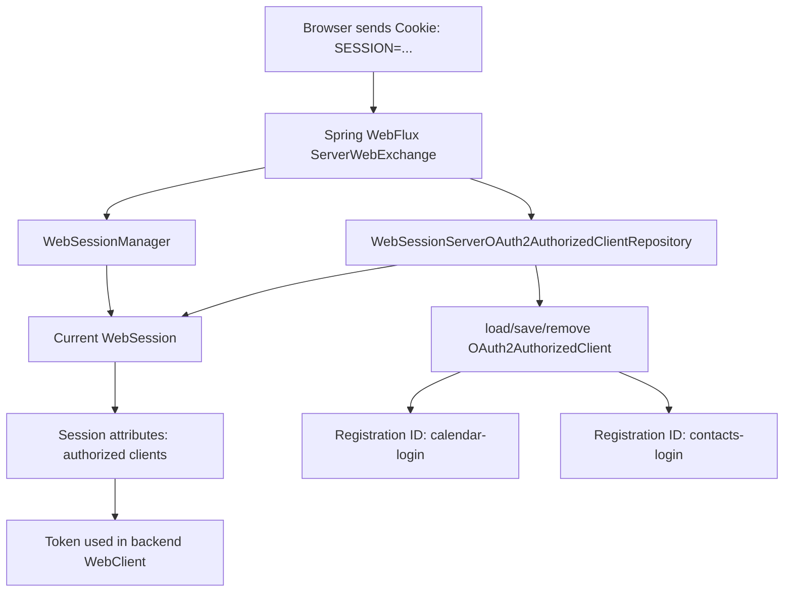
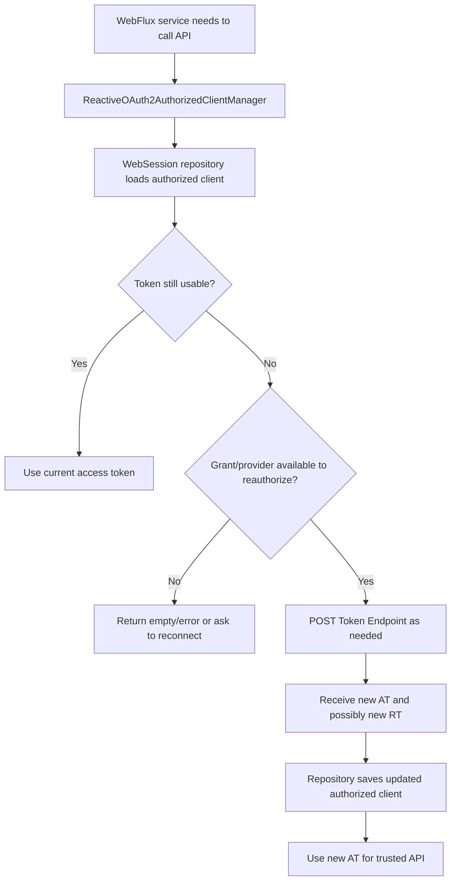
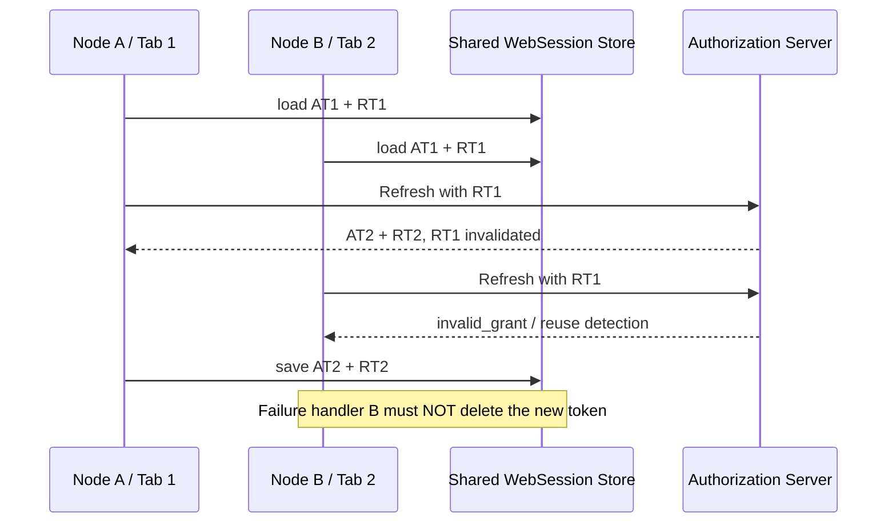

# 21.6. WebSessionServerOAuth2AuthorizedClientRepository

In **Spring Security OAuth 2.0 / OpenID Connect (OIDC) Client** running on **Spring WebFlux**, a backend can sign a user in via OIDC and then use an OAuth2 access token to call a REST API on the user's behalf. To reuse tokens across subsequent HTTP requests, Spring Security needs a component that **saves and loads `OAuth2AuthorizedClient`**.

A key implementation for reactive applications with web sessions is **`WebSessionServerOAuth2AuthorizedClientRepository`**. Rather than requiring a separate database or standalone token service, this implementation stores authorized clients inside the **`WebSession`** bound to the current browser/session.

The class name is long, yet every part is meaningful:

- **WebSession**: Spring WebFlux's session state.
- **Server**: used in reactive HTTP server contexts where `ServerWebExchange` exists.
- **OAuth2AuthorizedClient**: the object holding the registration and issued tokens.
- **Repository**: provides load, save, and remove operations per the Spring Security API.

This lesson explains the mechanism, configuration examples for **Spring Boot 3.x / Spring Security 6.x / Reactor / WebFlux**, security boundaries of session-scoped token storage, differences from authorized client services, `WebClient` integration, refresh tokens, logout, multi-instance scaling, testing, and operational pitfalls.

> **Core point:** This repository is *WebSession-scoped token storage*, not an independent multi-user identity store. Storing access/refresh tokens in the session is convenient for web login, but you must understand session scope, logout behavior, and concurrent reads/writes across requests.

All tokens, client IDs, URLs, and secrets in the examples are simulated. Never put real credentials into source code, logs, or documentation.

## 1. Three Concepts to Distinguish from the Start

When building an OAuth2 Client in WebFlux, you encounter three distinct data types:

| Component | What does it describe? | Example |
| --- | --- | --- |
| `ClientRegistration` | Configuration of an OAuth2/OIDC client: ID, secret, provider, redirect URI, scopes | `calendar-login` registered at the OP |
| `Authentication` | Identity and authorities of the user logged into the application | `OAuth2AuthenticationToken` with `OidcUser` |
| `OAuth2AuthorizedClient` | Authorized OAuth2 Client state holding tokens for a registration/principal | Access token `AT1`, refresh token `RT1` |

A `ClientRegistration` can exist as soon as the application boots, before any user logs in or any token is issued. Only after a user completes the Authorization Code Flow can the application create an `OAuth2AuthorizedClient`.

### 1.1. Why Not Read the Access Token from `Authentication.getCredentials()`?

`Authentication` is for **in-application authentication and authorization**. An OIDC user typically has an `OidcUser` principal, whereas the access token used to call downstream APIs is managed via the **authorized client**. Assuming `Authentication.getCredentials()` holds the access token crosses abstraction boundaries.

In WebFlux:

```text
ReactiveSecurityContextHolder / SecurityContext
    |
    +-- Authentication (OidcUser, authorities)
         Used to check logged-in user and internal roles

ServerOAuth2AuthorizedClientRepository
    |
    +-- OAuth2AuthorizedClient (ClientRegistration, access/refresh token)
         Used to call downstream APIs
```

Both structures may relate to a browser session, yet they are **not the same object** and do not share the same retention policy.

### 1.2. Registration Repository vs Authorized Client Repository

| Question | Answering component |
| --- | --- |
| "Which client is `calendar-login`?" | `ReactiveClientRegistrationRepository` |
| "Is the user logged in yet?" | `SecurityContext`/`Authentication` |
| "Does this session have a `calendar-login` access token?" | `ServerOAuth2AuthorizedClientRepository` |
| "Do we need to refresh or acquire a new token?" | `ReactiveOAuth2AuthorizedClientManager` and providers |
| "Does the API allow access to this resource?" | Resource Server and the API's authorization policy |

Never call `ReactiveClientRegistrationRepository.findByRegistrationId(...)` looking for a user's access token. Its result is only client metadata.

## 2. Where Does `WebSessionServerOAuth2AuthorizedClientRepository` Live?

Spring Security defines the interface:

```java
package org.springframework.security.oauth2.client.web.server;

public interface ServerOAuth2AuthorizedClientRepository {
    // loadAuthorizedClient(...)
    // saveAuthorizedClient(...)
    // removeAuthorizedClient(...)
}
```

`WebSessionServerOAuth2AuthorizedClientRepository` is an implementation of that interface. It relies on **`ServerWebExchange.getSession()`** to access the request's `WebSession` and manages authorized clients in session attributes.



Whenever the application handles a request needing a token, the repository can load the saved authorized client. When a manager acquires or refreshes a token, the repository can save the updated state. When a token is invalidated or a user disconnects an integration, the repository can remove the corresponding authorized client.

### 2.1. What Is `WebSession`?

`WebSession` is Spring WebFlux's session abstraction, not `jakarta.servlet.http.HttpSession`. Related APIs include:

```java
Mono<WebSession> sessionMono = exchange.getSession();

// Example manipulating session data (not advice to store raw tokens):
sessionMono.flatMap(session -> {
    session.getAttributes().put("uiTheme", "dark");
    return Mono.empty();
});
```

`WebSession` has a session ID, attributes, and timeout/invalidation mechanisms. In applications using Spring Session, data can be backed by Redis or another shared store; exact behavior depends on `WebSessionStore` and Spring Session configuration.

**The browser cookie normally carries only a session ID, not the refresh token** in typical server-side `WebSession` setups. Sensitive tokens stay server-side or in the server-managed session store. Still, protecting the cookie remains critical because possession of the cookie grants access to the session.

### 2.2. This Is Not a Standalone Persistent Token Store

Storing tokens in `WebSession` fits **short-lived web-session workflows**:

- Browser signs in via OIDC.
- Controllers within the same session call a provider's API.
- When the user logs out or the session expires, session data is destroyed per its defined lifecycle.

It is poorly suited when:

- A `@Scheduled` job needs tokens after the browser closes or the session expires.
- A worker without `ServerWebExchange` needs to read authorized clients.
- The app must store long-lived delegated access tokens while the user is offline.
- You want to manage tokens per internal account independently of individual browsers/devices.

Those cases usually require **`ReactiveOAuth2AuthorizedClientService`** or another token store design with explicit lifecycle and security controls.

## 3. API of `ServerOAuth2AuthorizedClientRepository`

The interface's three primary operations:

```java
import org.springframework.security.core.Authentication;
import org.springframework.security.oauth2.client.OAuth2AuthorizedClient;
import org.springframework.security.oauth2.client.web.server.ServerOAuth2AuthorizedClientRepository;
import org.springframework.web.server.ServerWebExchange;
import reactor.core.publisher.Mono;

// Conceptual interface signatures in Spring Security 6:
<T extends OAuth2AuthorizedClient> Mono<T> loadAuthorizedClient(
        String clientRegistrationId,
        Authentication principal,
        ServerWebExchange exchange);

Mono<Void> saveAuthorizedClient(
        OAuth2AuthorizedClient authorizedClient,
        Authentication principal,
        ServerWebExchange exchange);

Mono<Void> removeAuthorizedClient(
        String clientRegistrationId,
        Authentication principal,
        ServerWebExchange exchange);
```

This illustrates the **contract**, not an interface you redefine. Verify exact signatures against the Javadoc of your application's Spring Security version.

### 3.1. `loadAuthorizedClient`

```java
Mono<OAuth2AuthorizedClient> clientMono =
        repository.loadAuthorizedClient(
                "calendar-login", authentication, exchange);
```

Possible outcomes:

- Emits an `OAuth2AuthorizedClient` if present in the session.
- Completes empty if not found.
- Emits an error if session/store operations fail.

**An empty `Mono` does not prove the user revoked consent at the OP.** It may be a new session, an expired session, the user never authorized that registration, or the client was already removed from the session.

### 3.2. `saveAuthorizedClient`

```java
Mono<Void> save = repository.saveAuthorizedClient(
        authorizedClient, authentication, exchange);
```

This operation stores the issued or updated authorized client state in the session. When the manager refreshes a token and receives a new authorized client, the repository can **store the new access/refresh tokens**.

Do not manually split the two tokens across ad-hoc `session.setAttribute` entries, which easily causes token generation mismatches and complicates logout.

### 3.3. `removeAuthorizedClient`

```java
Mono<Void> removal = repository.removeAuthorizedClient(
        "calendar-login", authentication, exchange);
```

This **removes the authorized client state from the session**, without calling the OP Token Revocation Endpoint, without performing SSO logout, and without deleting tokens stored in other stores.

If the app wants to "Disconnect Calendar", you usually also need token revocation at the OP if supported, cleanup of business data, or stopping related background jobs.

### 3.4. `Mono<Void>` Must Be Composed into the Pipeline

Wrong:

```java
// AVOID: creating a publisher nobody subscribes to.
repository.removeAuthorizedClient(
        "calendar-login", authentication, exchange);

return Mono.just("Disconnected");
```

The removal publisher is discarded; there is no guarantee the deletion executed.

Right:

```java
return repository.removeAuthorizedClient(
                "calendar-login", authentication, exchange)
        .thenReturn("Disconnected");
```

Spring WebFlux subscribes to the publisher returned from the handler. Never call `subscribe()` manually to trigger side effects detached from the transaction/response.

## 4. Key Detail: Tokens Are Partitioned by WebSession

A session-scoped `WebSession` implementation typically stores authorized clients keyed by **registration ID inside the current session**.

Example **logical model** (not a guaranteed public session attribute name):

```text
WebSession S-101 (Browser A)
  authorizedClients:
    calendar-login -> OAuth2AuthorizedClient(AT_A, RT_A)
    contacts-login -> OAuth2AuthorizedClient(AT_C, RT_C)

WebSession S-202 (Browser B)
  authorizedClients:
    calendar-login -> OAuth2AuthorizedClient(AT_B, RT_B)
```

This has an important consequence:

> **Do not assume the `Authentication principal` parameter turns the WebSession implementation into a per-principal partitioned token store across all users.** The primary boundary of this implementation is the `WebSession`, while authorized-client entries are typically looked up by registration ID within that session. Check the exact implementation in your version if you plan to rely on keying details.

One browser can open multiple tabs sharing the same session, and a `WebSession` can also survive across account switches/logins if the application does not clean it up properly. Never use a session-scoped repository as a shared multi-user token database.

### 4.1. Why Do Multiple Tabs See the Same Authorized Client?

Two tabs in the same browser profile normally send the same session cookie. If both call APIs with `calendar-login`:

```text
Tab 1 ----+
          +----> WebSession S-101 ---> calendar-login token
Tab 2 ----+
```

This behavior usually matches expected user login ergonomics. However, both tabs can simultaneously detect that the access token is about to expire and both attempt to refresh, racing against refresh token rotation. The concurrency section below explains this.

### 4.2. Switching Users Within the Same Session

Suppose:

1. User A signs in; `calendar-login` authorized client stores A's token.
2. The application allows switching accounts without invalidating/cleaning up the session.
3. User B signs in within the same `WebSession`.
4. Code queries the repository for `calendar-login` without verifying the session was reset or belongs to the right user.

This is a **critical area to protect**. If the implementation keys entries by registration ID in `WebSession`, merely having a new `Authentication principal` may not automatically evict A's token.

Safe practices:

- Enforce explicit session lifecycle / account-switching policies.
- Invalidate the session or clear old authorized clients on user logout/account switch, matching your architecture.
- Never carry over the previous user's tokens to a new user.
- If the application supports multiple delegated identities within a single browser session, **use identity-partitioned storage** rather than relying on one entry per registration.
- Include a "login A → logout → login B" test to catch token mix-ups.

### 4.3. Registration ID Does Not Represent a User

`calendar-login` is an **OAuth2 client configuration** identifier. It is not a user ID, tenant ID, or `sub`. Multiple users share the same registration yet must receive tokens bound to their own context.

If you need persistent records keyed by **(registration, principal)** across sessions, prefer an authorized client service rather than a pure session repository.

## 5. Flow for Saving Tokens After OIDC Login

Suppose the app defines a `calendar-login` registration using Authorization Code + OIDC.

```mermaid
sequenceDiagram
    autonumber
    actor U as Browser
    participant APP as WebFlux Application
    participant OP as OpenID Provider
    participant REPO as WebSession AuthorizedClientRepository
    U->>APP: GET /oauth2/authorization/calendar-login
    APP-->>U: Redirect to OP /authorize
    U->>OP: Login, consent
    OP-->>U: Redirect ?code=...&state=...
    U->>APP: GET /login/oauth2/code/calendar-login
    Note over APP: Validate state, exchange code for tokens,
OIDC validation and Authentication
    APP->>REPO: saveAuthorizedClient(AT1, RT1 if present)
    REPO->>REPO: Store in WebSession
    APP-->>U: Login succeeds with session cookie
    U->>APP: GET /api/calendar
    APP->>REPO: loadAuthorizedClient("calendar-login", ...)
    REPO-->>APP: OAuth2AuthorizedClient
    APP-->>U: Business response
```

This is a conceptual flow; different filters, handlers, and managers may participate depending on Spring Security configuration. Crucially, **the registration is selected before authentication**, while **the authorized client is saved after tokens are issued**.

### 5.1. Storing a Token in WebSession Does Not Make It a "Session Token"

The access token remains an **OAuth2 credential issued by the Authorization Server**, governed by external scopes/audience/expiry contracts. `WebSession` is merely where the backend holds that credential for reuse.

Therefore:

- Clearing the session does not revoke the token at the Authorization Server.
- Revoking the token at the OP does not automatically delete the entry in the session.
- Session timeout differs from access token expiry.
- A user with a valid session can still be rejected by an API for insufficient scope.
- An ID Token meant for OIDC login cannot by default be used as an API Bearer token.

## 6. Configuring Spring Boot WebFlux + OAuth2 Client

### 6.1. Maven Dependencies

```xml
<dependencies>
    <dependency>
        <groupId>org.springframework.boot</groupId>
        <artifactId>spring-boot-starter-webflux</artifactId>
    </dependency>
    <dependency>
        <groupId>org.springframework.boot</groupId>
        <artifactId>spring-boot-starter-oauth2-client</artifactId>
    </dependency>
</dependencies>
```

### 6.2. Gradle Dependencies

```groovy
dependencies {
    implementation 'org.springframework.boot:spring-boot-starter-webflux'
    implementation 'org.springframework.boot:spring-boot-starter-oauth2-client'
}
```

If a project accidentally also includes `spring-boot-starter-web`, Spring Boot may select the Servlet application type. Confirm the app is genuinely running WebFlux before registering a `ServerOAuth2AuthorizedClientRepository`.

### 6.3. `application.yml`

```yaml
spring:
  security:
    oauth2:
      client:
        registration:
          calendar-login:
            provider: calendar-op
            client-id: ${CALENDAR_CLIENT_ID}
            client-secret: ${CALENDAR_CLIENT_SECRET}
            client-authentication-method: client_secret_basic
            authorization-grant-type: authorization_code
            redirect-uri: "{baseUrl}/login/oauth2/code/{registrationId}"
            scope:
              - openid
              - profile
              - calendar.read

        provider:
          calendar-op:
            issuer-uri: ${CALENDAR_ISSUER_URI}
```

In a real application, `calendar.read` is only valid if the OP/API supports and grants that scope. `openid` triggers the OIDC context. A refresh token is **not guaranteed** solely because the user logged in; issuance depends on OP policy, client type, and consent.

### 6.4. Equivalent `application.properties`

```properties
spring.security.oauth2.client.registration.calendar-login.provider=calendar-op
spring.security.oauth2.client.registration.calendar-login.client-id=${CALENDAR_CLIENT_ID}
spring.security.oauth2.client.registration.calendar-login.client-secret=${CALENDAR_CLIENT_SECRET}
spring.security.oauth2.client.registration.calendar-login.client-authentication-method=client_secret_basic
spring.security.oauth2.client.registration.calendar-login.authorization-grant-type=authorization_code
spring.security.oauth2.client.registration.calendar-login.redirect-uri={baseUrl}/login/oauth2/code/{registrationId}
spring.security.oauth2.client.registration.calendar-login.scope=openid,profile,calendar.read
spring.security.oauth2.client.provider.calendar-op.issuer-uri=${CALENDAR_ISSUER_URI}
```

Use YAML or properties per your project convention, and never commit real client secrets. The OP must allow the redirect URI Spring builds from the public base URL; behind a reverse proxy, accept forwarded headers only from trusted proxies.

## 7. Explicitly Declaring the `WebSessionServerOAuth2AuthorizedClientRepository` Bean

If you want to **explicitly choose session-based authorized client storage** for a WebFlux app:

```java
import org.springframework.context.annotation.Bean;
import org.springframework.context.annotation.Configuration;
import org.springframework.security.oauth2.client.web.server.ServerOAuth2AuthorizedClientRepository;
import org.springframework.security.oauth2.client.web.server.WebSessionServerOAuth2AuthorizedClientRepository;

@Configuration
public class ReactiveAuthorizedClientStorageConfig {

    @Bean
    ServerOAuth2AuthorizedClientRepository
            authorizedClientRepository() {

        return new WebSessionServerOAuth2AuthorizedClientRepository();
    }
}
```

This class operates on the current `WebSession`. Normally you do not need an access-token database schema to get started.

**Auto-configuration warning:** depending on your Spring Boot/Security version and other beans, the framework may already provide a suitable repository. Declaring your own bean can override the active token storage policy, especially if the app previously used `AuthenticatedPrincipalServerOAuth2AuthorizedClientRepository` or a custom service. Override only when you **specifically want session-based semantics** and understand the impact on multi-user behavior, logout, and background jobs.

### 7.1. A Repository Does Not Trigger Login on Its Own

This bean does not replace:

- `ReactiveClientRegistrationRepository` for finding clients.
- `SecurityWebFilterChain`/`oauth2Login()` for logging in.
- The OP Token Endpoint for issuing tokens.
- `ReactiveOAuth2AuthorizedClientManager` when the backend needs to issue/refresh tokens to call APIs.
- The Resource Server for validating inbound Bearer tokens.

The repository only provides **how authorized clients are saved/loaded/removed**.

### 7.2. Why Not Create Your Own `"access_token"` Session Attribute?

Anti-pattern:

```java
// Avoid: duplicating tokens directly into an app session attribute.
exchange.getSession().doOnNext(session -> {
    session.getAttributes().put(
            "access_token",
            authorizedClient.getAccessToken().getTokenValue());
});
```

Doing so:

- Places the token in an extra unmanaged location outside the abstraction.
- Leaves stale access tokens behind even after the manager refreshes.
- Lacks corresponding refresh token handling.
- Makes logout/cleanup harder.
- Exposes another avenue for session readers to grab credentials.

Let the authorized-client repository/manager coordinate tokens; for UI state, store only minimal non-sensitive data.

## 8. Using the Repository with `ReactiveOAuth2AuthorizedClientManager`

A common pattern is pairing the repository with **`DefaultReactiveOAuth2AuthorizedClientManager`** in a `ServerWebExchange` context.

```java
import org.springframework.context.annotation.Bean;
import org.springframework.context.annotation.Configuration;
import org.springframework.security.oauth2.client.DefaultReactiveOAuth2AuthorizedClientManager;
import org.springframework.security.oauth2.client.ReactiveOAuth2AuthorizedClientManager;
import org.springframework.security.oauth2.client.ReactiveOAuth2AuthorizedClientProvider;
import org.springframework.security.oauth2.client.ReactiveOAuth2AuthorizedClientProviderBuilder;
import org.springframework.security.oauth2.client.registration.ReactiveClientRegistrationRepository;
import org.springframework.security.oauth2.client.web.server.ServerOAuth2AuthorizedClientRepository;

@Configuration
public class ReactiveOAuth2ManagerConfig {

    @Bean
    ReactiveOAuth2AuthorizedClientManager
            reactiveAuthorizedClientManager(
                    ReactiveClientRegistrationRepository registrations,
                    ServerOAuth2AuthorizedClientRepository authorizedClients) {

        ReactiveOAuth2AuthorizedClientProvider provider =
                ReactiveOAuth2AuthorizedClientProviderBuilder.builder()
                        .authorizationCode()
                        .refreshToken()
                        .build();

        DefaultReactiveOAuth2AuthorizedClientManager manager =
                new DefaultReactiveOAuth2AuthorizedClientManager(
                        registrations, authorizedClients);

        manager.setAuthorizedClientProvider(provider);
        return manager;
    }
}
```

Key points:

1. `DefaultReactiveOAuth2AuthorizedClientManager` uses the **reactive repository meant for HTTP servers**.
2. The `refreshToken()` provider can perform reauthorization if a refresh token exists and the access token needs renewal.
3. `authorizationCode()` does not launch a browser login from a background job; browser flows and callbacks must be handled separately.
4. The manager can **reuse an existing token**, acquire a new token, or return empty/error depending on context.
5. The manager needs proper `ServerWebExchange` context when working with a session-based repository. If invoked directly from a service, pass context/request attributes per your Spring Security version's API; integrating via `WebClient` inside a request is often simpler.

### 8.1. `OAuth2AuthorizedClient` Does Not Mean the Token Is Forever Valid

An access token stored in `WebSession` still has `expiresAt`. The manager/provider can refresh when needed, yet the session repository itself **never calls the Token Endpoint** and never validates audience/scope against downstream APIs.

The repository only holds state; **lifecycle** belongs to the manager/provider and **API authorization** belongs to the Resource Server.

### 8.2. Token Lifecycle When the Access Token Expires



There is no guarantee that **every manager call triggers a refresh**. It may simply load and return the current token when reauthorization is unnecessary.

## 9. Integrating `WebClient` with Session-Stored Authorized Clients

In WebFlux, the outbound HTTP client is typically **`WebClient`**. Spring Security provides **`ServerOAuth2AuthorizedClientExchangeFilterFunction`** to integrate token acquisition/attachment into requests.

### 9.1. Configuring WebClient

A configuration using the manager built in section 8:

```java
import org.springframework.context.annotation.Bean;
import org.springframework.context.annotation.Configuration;
import org.springframework.security.oauth2.client.ReactiveOAuth2AuthorizedClientManager;
import org.springframework.security.oauth2.client.web.reactive.function.client.ServerOAuth2AuthorizedClientExchangeFilterFunction;
import org.springframework.web.reactive.function.client.WebClient;

@Configuration
public class CalendarWebClientConfig {

    @Bean("calendarWebClient")
    WebClient calendarWebClient(
            ReactiveOAuth2AuthorizedClientManager manager) {

        ServerOAuth2AuthorizedClientExchangeFilterFunction oauth2 =
                new ServerOAuth2AuthorizedClientExchangeFilterFunction(
                        manager);

        return WebClient.builder()
                .baseUrl("https://calendar-api.example.com")
                .filter(oauth2)
                .build();
    }
}
```

At the call site:

```java
import static org.springframework.security.oauth2.client.web.reactive.function.client.ServerOAuth2AuthorizedClientExchangeFilterFunction.clientRegistrationId;

// Used within a WebFlux request having the appropriate principal/context.
Mono<String> events = calendarWebClient.get()
        .uri("/v1/events")
        .attributes(clientRegistrationId("calendar-login"))
        .retrieve()
        .bodyToMono(String.class);
```

Here `clientRegistrationId(...)` is a **request attribute telling the OAuth2 filter which registration to select**, not an HTTP header sent to the Calendar API.

### 9.2. Tokens Are Not Automatically Attached to Every HTTP Request

Simply creating a `WebSessionServerOAuth2AuthorizedClientRepository` **does not make every `WebClient` attach Bearer tokens**. You need either:

- A `WebClient` configured with the appropriate OAuth2 exchange filter, or
- Explicitly obtaining `OAuth2AuthorizedClient` and attaching the token inside a controlled adapter.

Avoid combining multiple mechanisms that set the `Authorization` header on the same request without clear reason, as it can select the wrong registration/principal and become difficult to debug.

### 9.3. Be Careful with Default Client Registration

Some OAuth2 WebClient filter configurations can automatically pick a default authorized client or resolve from the current `Authentication`. While convenient, this is dangerous if the same `WebClient` calls **multiple API hosts**: an access token could be sent on a request that has no valid OAuth2 purpose.

Prefer selecting the registration explicitly per feature and setting a **fixed base URL for a trusted API**. Never accept an API destination from a query parameter and attach a token to it. On cross-host redirects, do not forward the Bearer header unless the destination is explicitly allowed.

### 9.4. WebSession Repository Does Not Replace a `WebClient` Retry Policy

If a downstream API returns `401 invalid_token`, having an authorized client stored in the repository does not automatically replay the API request. Invalidation/failure handling and business HTTP retries are separate policies; especially for POST/PATCH/streaming calls, never retry blindly to avoid duplicate side effects.

## 10. Other Repository/Service Implementations: Choosing the Right Semantics

In reactive OAuth2 Client, you may encounter:

| Component | Storage/lookup basis | Best suited for |
| --- | --- | --- |
| **`WebSessionServerOAuth2AuthorizedClientRepository`** | Current `WebSession` | Tokens tied to a browser session |
| **`AuthenticatedPrincipalServerOAuth2AuthorizedClientRepository`** | Uses `ReactiveOAuth2AuthorizedClientService` for authenticated principals and may use another repository for anonymous | Principal/service-bound tokens per config |
| **`ReactiveOAuth2AuthorizedClientService`** | Token service keyed by registration/principal, no WebSession needed | Backend jobs, tokens surviving outside sessions |
| **`InMemoryReactiveOAuth2AuthorizedClientService`** | In-memory service by principal/registration | Demos/single-instance or short-lived models |
| **Custom reactive service/repository** | Database/distributed store with custom policy | Retention, multi-instance, and consistency needs |

### 10.1. How Does `AuthenticatedPrincipalServerOAuth2AuthorizedClientRepository` Differ?

This implementation pairs **`Authentication`** with `ReactiveOAuth2AuthorizedClientService` to manage authorized clients for **authenticated principals**. For anonymous principals, it can use a separate repository (usually session-based) per configuration.

Crucially, its **keying and lifecycle semantics differ** from a pure `WebSessionServerOAuth2AuthorizedClientRepository`:

- A session repository scopes around **one browser `WebSession`**.
- A service-based repository can key tokens by **principal name and registration** independently of individual sessions.
- If a user logs out while the authorized client service retains the token, the token can persist **outside the session** per retention policy.

Never swap one implementation for another without reviewing business and security requirements.

### 10.2. Example Service-Backed Repository

An application can explicitly register:

```java
import org.springframework.context.annotation.Bean;
import org.springframework.context.annotation.Configuration;
import org.springframework.security.oauth2.client.ReactiveOAuth2AuthorizedClientService;
import org.springframework.security.oauth2.client.web.server.AuthenticatedPrincipalServerOAuth2AuthorizedClientRepository;
import org.springframework.security.oauth2.client.web.server.ServerOAuth2AuthorizedClientRepository;
import org.springframework.security.oauth2.client.web.server.WebSessionServerOAuth2AuthorizedClientRepository;

@Configuration
class PrincipalAwareAuthorizedClientConfig {

    @Bean
    ServerOAuth2AuthorizedClientRepository authorizedClientRepository(
            ReactiveOAuth2AuthorizedClientService service) {

        AuthenticatedPrincipalServerOAuth2AuthorizedClientRepository repository =
                new AuthenticatedPrincipalServerOAuth2AuthorizedClientRepository(
                        service);

        repository.setAnonymousAuthorizedClientRepository(
                new WebSessionServerOAuth2AuthorizedClientRepository());

        return repository;
    }
}
```

**This is an alternative**, not a second bean to declare alongside the pure-WebSession `authorizedClientRepository()` bean in section 7. Organize method and bean names in your project configuration without conflicts.

Verify the `setAnonymousAuthorizedClientRepository` API in your Spring Security version. This example illustrates choosing **service-backed for authenticated vs session-backed for anonymous**, not a requirement that every app must use this model.

### 10.3. When Should a Session Repository Not Be Used?

Do not rely solely on `WebSession` when:

- A user authorizes calendar sync to run overnight after browser logout.
- Workers continue executing after the session expires.
- Long-lived consent must be managed per internal account.
- The system must recover tokens from a database after a restart without a browser session.
- Multiple devices of the same user need to share delegated authorization per product policy.

Those cases require dedicated service/token storage with explicit access controls, encryption, retention, logout/revocation, and auditing. Switching to a service does not automatically make tokens safer if storage or identity mapping is flawed.

## 11. WebSession and Reactor Context Are Not the Same Thing

In WebFlux:

- `WebSession` is **session state** spanning multiple HTTP requests.
- **Reactor Context** travels with the reactive processing chain, where Spring Security can propagate `SecurityContext`/`Authentication`.
- `ServerWebExchange` represents the **current request's HTTP exchange**.

A single request typically involves all three, yet each has a distinct lifecycle.

```text
Browser session (multiple requests)
    +-- WebSession S-101: authorized clients / session state

Request #1 reactive pipeline
    +-- ServerWebExchange #1
    +-- Reactor Context: Authentication

Request #2 reactive pipeline
    +-- ServerWebExchange #2
    +-- Reactor Context: Authentication

Background job
    +-- No browser ServerWebExchange
    +-- No default user Authentication
```

### 11.1. Do Not Request `HttpSession` in WebFlux

Wrong in pure WebFlux:

```java
import jakarta.servlet.http.HttpSession;

// Not WebFlux's session API:
void useSession(HttpSession session) { ... }
```

Right in WebFlux:

```java
import org.springframework.web.server.ServerWebExchange;
import reactor.core.publisher.Mono;

Mono<String> currentSessionId(ServerWebExchange exchange) {
    return exchange.getSession()
            .map(session -> session.getId());
}
```

**Never expose session IDs in API responses or production logs.** This snippet only shows navigating from `ServerWebExchange` to `WebSession`. Session IDs are sensitive credentials that can enable session hijacking if leaked.

### 11.2. Do Not Read Authentication from a Servlet Thread-Local

In reactive code, use:

```java
ReactiveSecurityContextHolder.getContext()
        .map(SecurityContext::getAuthentication)
```

within the reactive pipeline. Never assume `SecurityContextHolder.getContext()` returns the current user on every Reactor thread. Never store `Authentication` in a static mutable field to read from a scheduler.

### 11.3. Never `block()` to Load an Authorized Client

Wrong:

```java
OAuth2AuthorizedClient client =
        repository.<OAuth2AuthorizedClient>loadAuthorizedClient(
                "calendar-login", authentication, exchange)
                .block();
```

On a WebFlux event loop, `block()` can throw errors or stall threads. Compose instead:

```java
return repository.<OAuth2AuthorizedClient>loadAuthorizedClient(
                "calendar-login", authentication, exchange)
        .flatMap(client -> callTrustedApi(client));
```

Here `callTrustedApi` is a hypothetical reactive service returning `Mono<T>`, not a built-in Spring Security API.

## 12. Controller Displaying Authorized Client Metadata

An internal endpoint showing "Calendar connected" status **does not need to return tokens**. It can query the repository and map to a minimal DTO:

```java
import java.time.Instant;

import org.springframework.security.core.Authentication;
import org.springframework.security.oauth2.client.OAuth2AuthorizedClient;
import org.springframework.security.oauth2.client.web.server.ServerOAuth2AuthorizedClientRepository;
import org.springframework.web.bind.annotation.GetMapping;
import org.springframework.web.bind.annotation.RestController;
import org.springframework.web.server.ServerWebExchange;

import reactor.core.publisher.Mono;

@RestController
public class CalendarConnectionController {

    record CalendarConnection(boolean connected,
                              Instant accessTokenExpiresAt) {}

    private final ServerOAuth2AuthorizedClientRepository repository;

    public CalendarConnectionController(
            ServerOAuth2AuthorizedClientRepository repository) {
        this.repository = repository;
    }

    @GetMapping("/api/calendar/connection")
    Mono<CalendarConnection> connection(
            Authentication authentication,
            ServerWebExchange exchange) {

        return repository.<OAuth2AuthorizedClient>loadAuthorizedClient(
                    "calendar-login", authentication, exchange)
                .map(client -> new CalendarConnection(
                        true,
                        client.getAccessToken().getExpiresAt()))
                .defaultIfEmpty(
                        new CalendarConnection(false, null));
    }
}
```

**Assumptions:** the endpoint is protected by Spring Security, `Authentication` belongs to the current request, and the user is authorized to view connection status. This is an illustrative endpoint; production apps may only need a `connected` boolean, omitting expiry if the UI has no need for it.

**Never treat `connected=true` as proof the access token will be accepted by the API.** The token may be revoked or lack required scopes/audience even while sitting in the session.

### 12.1. Why Not Return the Entire `OAuth2AuthorizedClient`?

Avoid:

```java
@GetMapping("/debug/authorized-client")
Mono<OAuth2AuthorizedClient> debug(...) {
    return repository.loadAuthorizedClient(...);
}
```

JSON serialization can expose the access token, refresh token, or client secrets/metadata. If diagnostics are needed, return only **explicitly safe fields**, never the raw object to the browser.

## 13. Removing the Authorized Client from WebSession When a User Disconnects

Suppose a user wants to "Disconnect Calendar". An internal endpoint can remove the authorized client from the session:

```java
import org.springframework.http.ResponseEntity;
import org.springframework.security.core.Authentication;
import org.springframework.security.oauth2.client.web.server.ServerOAuth2AuthorizedClientRepository;
import org.springframework.web.bind.annotation.DeleteMapping;
import org.springframework.web.bind.annotation.RestController;
import org.springframework.web.server.ServerWebExchange;

import reactor.core.publisher.Mono;

@RestController
class CalendarDisconnectController {

    private final ServerOAuth2AuthorizedClientRepository repository;

    CalendarDisconnectController(
            ServerOAuth2AuthorizedClientRepository repository) {
        this.repository = repository;
    }

    @DeleteMapping("/api/calendar/connection")
    Mono<ResponseEntity<Void>> disconnect(
            Authentication authentication,
            ServerWebExchange exchange) {

        return repository.removeAuthorizedClient(
                    "calendar-login", authentication, exchange)
                .thenReturn(ResponseEntity.noContent().build());
    }
}
```

**Warning:** this only removes **local WebSession** state. If business requirements demand revoking consent or invalidating refresh tokens at the OP, implement a dedicated workflow calling a supported revocation endpoint, cleaning other token stores, and auditing. `removeAuthorizedClient` does not send a revocation request on its own.

For cookie-authenticated browser `DELETE` requests, maintain proper **CSRF protection**. Never disable CSRF application-wide just because a test hit 403.

### 13.1. Should Ownership Be Checked?

With a session-based repository, the request is authenticated and scoped to the current session as a starting point. Still, multi-account or multi-OP apps must verify **this link genuinely belongs to the current user** across account/session lifecycles, especially when switching accounts without destroying the session.

Never accept a `principalName` from the URL and trust it for deleting/reading tokens. Disconnect authority must be bound to the authenticated principal and matching integration.

### 13.2. Does Clearing the Entire Session Replace Per-Client Removal?

On logout, the session may be invalidated and session attributes wiped; all authorized clients stored solely in that session disappear. However:

- Authorized clients may still exist in another service/database.
- Issued access/refresh tokens may remain valid at the OP.
- Another browser with its own session is unaffected.
- Backup systems may still retain session snapshots.

"Clearing the local session" and "revoking all OAuth2 grants at the OP" are two different operations.

## 14. Logout, Session Fixation, and Account Switching

A session-based website normally handles:

- Logging out of the application.
- Logging out at the OP if OIDC logout is supported.
- Switching users within the same browser.
- Session timeouts.
- Session invalidation when a user/account is locked.
- Token revocation when an integration is disconnected.
- Managing multiple browsers/devices.

### 14.1. Reactive Logout Configuration

```java
import org.springframework.context.annotation.Bean;
import org.springframework.context.annotation.Configuration;
import org.springframework.security.config.Customizer;
import org.springframework.security.config.web.server.ServerHttpSecurity;
import org.springframework.security.web.server.SecurityWebFilterChain;

@Configuration
public class ReactiveSecurityConfig {

    @Bean
    SecurityWebFilterChain securityWebFilterChain(
            ServerHttpSecurity http) {

        return http
                .authorizeExchange(exchanges -> exchanges
                        .pathMatchers("/", "/login", "/error",
                                      "/css/**", "/js/**")
                            .permitAll()
                        .anyExchange()
                            .authenticated())
                .oauth2Login(Customizer.withDefaults())
                .logout(Customizer.withDefaults())
                .build();
    }
}
```

This configuration is a **starting skeleton**, not a guarantee that default logout performs every cleanup or OIDC RP-Initiated Logout. Verify actual logout/session invalidation logic, CSRF, and authorized client repositories configured in your app.

If using only the WebSession repository for tokens, proper session invalidation is essential so tokens are not carried over into another user's login. If using a service-backed repository, implement dedicated **per-principal/registration removal/revocation**.

### 14.2. Session Fixation

Never carry User A's session/token state forward after User B logs in. Spring Security provides session management and authentication integration depending on version, yet **custom authentication, account switching, or session migrations** can leave the app responsible for clearing state.

A minimal test sequence:

```text
Login A -> authorize Calendar A
Logout A -> session invalidated / authorized client cleared
Login B -> Calendar A token must NOT be visible
Login B -> authorize Calendar B
```

If your app supports "switch account" without logging out, redesign the token store to partition identities explicitly and test it separately.

## 15. `WebSession` Is a Sensitive Token Store

`OAuth2AuthorizedClient` can hold:

- `OAuth2AccessToken` with raw `tokenValue`.
- `OAuth2RefreshToken` if issued by the OP.
- `ClientRegistration` with client/provider details, potentially referencing client secrets in related objects.
- `principalName` tied to an identity.
- Expiry/scope metadata.

All of these must be protected. Never treat session data as harmless just because the browser cannot read it directly.

### 15.1. Surfaces to Protect

| Surface | Risk | Mitigation |
| --- | --- | --- |
| Session cookie | Theft leads to session hijacking | HTTPS, `Secure`, `HttpOnly`, appropriate `SameSite`, XSS/CSRF defense |
| In-memory WebSession | Memory dumps/debug logs | Restrict diagnostic tooling, never dump tokens |
| Spring Session Redis/JDBC | Operators/service accounts may read tokens | Network isolation, ACLs, TLS, encryption, backup policy |
| Application logs/APM | Raw `Authorization` headers / token responses logged | Redaction and data minimization |
| Session replication/backups | Tokens outlive actual session TTL | Clear retention and cleanup |
| Multiple browser tabs | Concurrent refresh of old RT | Coordination / optimistic locking when needed |
| Login User A → B | Stale authorized client in same session | Session invalidation or identity-aware storage |
| Removing authorized client | Tokens may still be valid at OP | Revocation/disconnect policy |

### 15.2. Does the Cookie Need to Contain the Refresh Token?

**No.** In standard server-side `WebSession` architectures, the cookie only needs to hold a session identifier. Access/refresh tokens remain server-side. Never serialize tokens into client-side cookies, `localStorage`, or HTML just to make them convenient for a client.

If an application intentionally adopts a client-side session/token architecture, the threat model changes completely; server-side `WebSession` security assumptions no longer apply as-is.

### 15.3. `SameSite` Must Account for OIDC Callbacks

`SameSite=Lax` usually works for top-level GET Authorization Code Flow callbacks, yet some OIDC deployments use `response_mode=form_post`. With cross-site form POST callbacks, strict cookie policies can prevent sending the session holding `state`, breaking login. Never fix this by disabling all cookie security; select attributes supported by the OP/flow and test in real browsers.

## 16. Spring Session and Multi-Instance Deployments

A WebFlux app running multiple replicas can hit:

```text
Browser -> Node A: Login succeeds, token saved in local session
Browser -> Node B: API called, session/token not found
```

If sessions exist only in Node A's memory, Node B lacks the state. Solutions include:

- Load-balancer session stickiness if its limitations are acceptable.
- A shared reactive session store via **Spring Session** with suitable backing technology.
- A different token store architecture when authorized clients must be decoupled from browser sessions.
- Explicit session migration and failover handling.

### 16.1. Shared Sessions Do Not Automatically Solve Concurrency

Even when multiple nodes share a Redis/session store, two concurrent requests can load the same authorized client and both attempt to refresh. Spring Session shares session access across nodes; **it does not automatically provide atomic refresh-token rotation or distributed locking**.

Example:



If the OP enforces refresh token rotation, reusing RT1 can cause rejection or even revocation of the token family per policy.

### 16.2. Coordinating Refreshes by Session and Registration

When races must be prevented, one strategy is single-flight keyed by:

```text
key = (sessionOrTrustedPrincipalNamespace, registrationId)
```

Inside the coordinated critical section:

1. Acquire a lock/lease or leader role for the key.
2. **Re-read the latest authorized client after acquiring the lock**.
3. Refresh only if the token still needs renewal.
4. Save the new AT/RT as one consistent token generation.
5. Followers read the newly stored result instead of using the old RT.
6. Handle timeouts/crashes per OP policy; never retry an RT that may already have rotated.
7. Use conditional save/delete when storage supports it to prevent stale writes.

**Do not assume `WebSessionServerOAuth2AuthorizedClientRepository` has built-in distributed CAS/locking.** If strong guarantees are required, add coordination at the orchestration/store layer or choose a different architecture.

### 16.3. Never Put Raw Session IDs in Lock Keys or Logs

A session-based lock key must be designed so it never leaks the session identifier. Use a protected internal identifier or an appropriate hash/HMAC, and restrict read access to the lock store. Never put raw session cookies in metric labels.

## 17. Refresh Token Rotation and Safe Session Updates

Suppose the repository currently holds:

```text
WebSession S-101:
  calendar-login:
    accessToken  = AT1
    refreshToken = RT1
```

When the manager refreshes successfully, the OP returns:

```text
accessToken  = AT2
refreshToken = RT2
```

The session must observe **one consistent updated authorized client**, not AT2 paired with stale RT1:

```text
WebSession S-101:
  calendar-login:
    accessToken  = AT2
    refreshToken = RT2
```

**Never keep RT1** once the OP has issued RT2; reusing an old token can trigger OP security policies.

### 17.1. If the Refresh Response Omits a New `refresh_token`

OAuth2 does not require the OP to rotate on every refresh. If the refresh response omits a new token, handle per protocol/provider contract; without rotation, the existing refresh token normally remains usable. Never overwrite the refresh token field with `null` merely because the response omitted a new one.

To avoid semantic bugs, prefer Spring Security's standard providers while verifying storage persists the updated authorized client.

### 17.2. Crash After OP Rotation Before Saving

An unavoidable distributed systems edge case:

```text
Client sends RT1 -> OP
OP invalidates RT1 and issues RT2
Client receives RT2 but node crashes before saving WebSession
Store still holds RT1
```

No shared ACID transaction spans both the application's database/session store and the OP. Blindly retrying RT1 may be treated as reuse. Plan a recovery policy, leverage OP grace windows if any exist, or trigger user reauthorization when unrecoverable.

### 17.3. How Does Session Serialization Affect Things?

When storing `OAuth2AuthorizedClient` in an out-of-process session store, related objects must serialize/deserialize via Spring Session and compatible serializers. If framework versions, serialization modules, or custom principal/configs change, older sessions may become unreadable after deployment.

Never troubleshoot by logging serialized sessions or real tokens. Use test fixtures and verify migration/serialization compatibility across upgrades.

## 18. Does `loadAuthorizedClient` Check Token Expiry?

No. The repository's job is to **retrieve the stored object** for the given context. It is not a Resource Server token validator or OAuth2 provider.

```java
return repository.<OAuth2AuthorizedClient>loadAuthorizedClient(
        "calendar-login", authentication, exchange)
        .map(client -> client.getAccessToken().getExpiresAt());
```

The result is just metadata. Even if `expiresAt` is in the past, the repository can still return the object. The manager/provider decides whether it can be refreshed or requires reauthorization.

Avoid scattering "is token still valid?" checks across every controller and calling the Token Endpoint manually. Centralize token lifecycle in the manager/provider to avoid races and duplicated logic.

### 18.1. Session TTL vs Token TTL

| Lifetime | What it governs |
| --- | --- |
| WebSession max idle time | When the session expires after inactivity per store/config |
| Access token `expiresAt` | Window during which APIs/OP accept the access token |
| Refresh token lifetime | Ability to obtain new tokens, subject to absolute/inactivity limits |
| OIDC ID Token `exp` | Validity window of the authentication assertion when verified |
| OP SSO session | Whether the user remains signed in at the OP |
| Authorized client service retention | How long tokens survive outside browser sessions, if applicable |

Do not extend `WebSession` solely because a refresh token is still valid, nor assume expiring a `WebSession` tears down the entire OP SSO session.

## 19. When Should You Interact with the Repository Directly?

In typical applications, **Spring Security filters, argument resolvers, and authorized client managers** invoke the repository automatically. You do not have to call `load/save/remove` manually in every controller.

Cases where direct calls make sense:

- Displaying whether an integration is connected (minimal metadata).
- Implementing a "disconnect OAuth2 client" action in the session.
- Performing controlled migrations/cleanup.
- Unit-testing a repository implementation.
- Customizing authorized-client persistence for special requirements.

**Do not call the repository directly** to replace Spring Security's built-in refresh, consent, or token-endpoint exchange logic.

### 19.1. Other Session Attributes Besides Authorized Clients

UI data like `theme` or `wizardStep` can live in the session, yet you should not duplicate full UserInfo claims or raw tokens into `WebSession`. Just because an object resides in a session store does not make it non-sensitive.

## 20. Testing the Repository Directly with `MockServerWebExchange`

You can test save/load/remove behavior in tests without a live OP.

### 20.1. Test Dependencies

Gradle:

```groovy
dependencies {
    testImplementation 'org.springframework.boot:spring-boot-starter-test'
    testImplementation 'org.springframework.security:spring-security-test'
    testImplementation 'io.projectreactor:reactor-test'
}
```

Maven:

```xml
<dependency>
    <groupId>org.springframework.boot</groupId>
    <artifactId>spring-boot-starter-test</artifactId>
    <scope>test</scope>
</dependency>
<dependency>
    <groupId>org.springframework.security</groupId>
    <artifactId>spring-security-test</artifactId>
    <scope>test</scope>
</dependency>
<dependency>
    <groupId>io.projectreactor</groupId>
    <artifactId>reactor-test</artifactId>
    <scope>test</scope>
</dependency>
```

### 20.2. Testing Saving and Loading an Authorized Client

```java
import static org.junit.jupiter.api.Assertions.assertEquals;

import java.time.Instant;
import java.util.List;
import java.util.Set;

import org.junit.jupiter.api.Test;
import org.springframework.mock.http.server.reactive.MockServerHttpRequest;
import org.springframework.mock.web.server.MockServerWebExchange;
import org.springframework.security.authentication.UsernamePasswordAuthenticationToken;
import org.springframework.security.core.Authentication;
import org.springframework.security.core.authority.SimpleGrantedAuthority;
import org.springframework.security.oauth2.client.OAuth2AuthorizedClient;
import org.springframework.security.oauth2.client.registration.ClientRegistration;
import org.springframework.security.oauth2.client.web.server.WebSessionServerOAuth2AuthorizedClientRepository;
import org.springframework.security.oauth2.core.AuthorizationGrantType;
import org.springframework.security.oauth2.core.ClientAuthenticationMethod;
import org.springframework.security.oauth2.core.OAuth2AccessToken;

import reactor.test.StepVerifier;

class WebSessionAuthorizedClientRepositoryTest {

    private ClientRegistration registration() {
        return ClientRegistration.withRegistrationId("calendar-login")
                .clientId("test-client")
                .clientSecret("test-secret-only")
                .clientAuthenticationMethod(
                        ClientAuthenticationMethod.CLIENT_SECRET_BASIC)
                .authorizationGrantType(
                        AuthorizationGrantType.AUTHORIZATION_CODE)
                .redirectUri(
                        "{baseUrl}/login/oauth2/code/{registrationId}")
                .authorizationUri("https://idp.test/authorize")
                .tokenUri("https://idp.test/token")
                .jwkSetUri("https://idp.test/jwks")
                .issuerUri("https://idp.test")
                .scope("openid", "calendar.read")
                .clientName("Calendar Test")
                .build();
    }

    private Authentication user() {
        return new UsernamePasswordAuthenticationToken(
                "learner", "not-a-real-password",
                List.of(new SimpleGrantedAuthority("ROLE_USER")));
    }

    @Test
    void savesLoadsAndRemovesWithinSameExchange() {
        var repository =
                new WebSessionServerOAuth2AuthorizedClientRepository();

        var exchange = MockServerWebExchange.from(
                MockServerHttpRequest.get("/"));

        var registration = registration();
        var accessToken = new OAuth2AccessToken(
                OAuth2AccessToken.TokenType.BEARER,
                "TEST_AT1",
                Instant.now(),
                Instant.now().plusSeconds(300),
                Set.of("calendar.read"));

        var authorizedClient = new OAuth2AuthorizedClient(
                registration, "learner", accessToken);

        StepVerifier.create(repository.saveAuthorizedClient(
                authorizedClient, user(), exchange))
                .verifyComplete();

        StepVerifier.create(
                repository.<OAuth2AuthorizedClient>loadAuthorizedClient(
                        "calendar-login", user(), exchange))
                .assertNext(loaded -> assertEquals(
                        "TEST_AT1",
                        loaded.getAccessToken().getTokenValue()))
                .verifyComplete();

        StepVerifier.create(repository.removeAuthorizedClient(
                "calendar-login", user(), exchange))
                .verifyComplete();

        StepVerifier.create(
                repository.<OAuth2AuthorizedClient>loadAuthorizedClient(
                        "calendar-login", user(), exchange))
                .verifyComplete();
    }
}
```

The test fixture uses fake token `TEST_AT1` and OP URL `idp.test`; repository unit tests **do not call a real token endpoint**. This test only verifies the save/load/remove path within a single exchange/session; it does not prove OAuth2 Login or safe refresh token handling.

### 20.3. Testing Isolation Between Two WebSessions

Idea:

```text
Given:
  Exchange A with WebSession A
  Exchange B with WebSession B

When:
  Save authorized client calendar-login only into A

Then:
  Load calendar-login from A -> returns client
  Load calendar-login from B -> empty
```

Use two independent `MockServerWebExchange` instances in tests to represent two sessions. Do not confuse this with two HTTP exchanges configured to share **the same session ID/session store**; in integration tests, also test with a **shared browser cookie** to simulate multiple requests.

### 20.4. Testing Multiple Registrations in the Same Session

```text
Given:
  WebSession S-101
  calendar-login -> AT_CAL
  contacts-login -> AT_CONTACTS

When:
  removeAuthorizedClient("calendar-login", ...)

Then:
  calendar-login -> empty
  contacts-login -> still present
```

Removing one specific authorized client should not wipe the entire session or other integrations. This independence relies on properly managed registration IDs and repository logic.

### 20.5. Testing User Switching Within the Same WebSession

This is an important security regression test:

```text
Login A
  -> save A's Calendar token
Logout A / switch account
Login B in the same browser context
  -> must NOT be able to read A's Calendar token
```

If tokens are stored per session and the session is not reset on user change, proper cleanup or identity-aware storage is required. Tests must exercise **the application's real login/logout/session invalidation**, rather than merely swapping an `Authentication` variable in a unit test and assuming Spring isolated the tokens.

## 21. End-to-End Testing with `WebTestClient`

To verify real OAuth2 Login and session lifecycles, use `WebTestClient` against the Spring WebFlux app and an OP test double or test Authorization Server.

Scenarios to cover:

1. Browser initiates login via `/oauth2/authorization/calendar-login`.
2. Valid OIDC callback establishes the user's session.
3. Backend loads the authorized client within the same session.
4. A separate browser cannot read the first browser's authorized client.
5. Logout/session invalidation clears session-stored tokens.
6. Page reloads or new requests with a valid cookie still load the client before session expiry.
7. Expiring access token + valid refresh token → manager updates the authorized client properly.
8. Concurrent refresh token rotation → does not overwrite the new token or replay the old RT against policy.
9. Downstream API returns `401 invalid_token` → failure policy does not replay unsafe operations.
10. Spring Session distributed store maintains the consistency required by the application.

### 21.1. `WebTestClient` Skeleton

```java
import org.junit.jupiter.api.Test;
import org.springframework.beans.factory.annotation.Autowired;
import org.springframework.boot.test.autoconfigure.web.reactive.AutoConfigureWebTestClient;
import org.springframework.boot.test.context.SpringBootTest;
import org.springframework.test.web.reactive.server.WebTestClient;

@SpringBootTest(
        webEnvironment = SpringBootTest.WebEnvironment.RANDOM_PORT)
@AutoConfigureWebTestClient
class ReactiveOAuth2LoginFlowTest {

    @Autowired
    WebTestClient webTestClient;

    @Test
    void initiatesCalendarOidcAuthorization() {
        webTestClient.get()
                .uri("/oauth2/authorization/calendar-login")
                .exchange()
                .expectStatus()
                .is3xxRedirection();
    }
}
```

This test only proves the application can initiate a redirect in the configured test environment; it is **insufficient to verify ID Tokens, token storage, or logout**. A full integration test should check the `Location` header, callback state/nonce/PKCE, and authorized client state with safe fixtures.

### 21.2. What Does `mockOidcLogin()` Test?

Spring Security Test provides WebFlux helpers to simulate an OIDC principal. They are useful for testing controller authorization, yet they **do not populate a saved `OAuth2AuthorizedClient` in `WebSession`** nor execute real token responses/refreshes.

Therefore separate:

- **Controller tests** with mocked principals.
- **Repository tests** with authorized client fixtures.
- **Login/token integration tests** with an OP test double.

Never claim `WebSessionServerOAuth2AuthorizedClientRepository` was tested simply because an endpoint under `mockOidcLogin()` returned 200.

## 22. Common Issues

| Symptom | Possible cause | Remediation |
| --- | --- | --- |
| Login succeeds, next request misses authorized client | Lost session cookie, different node's session store, wrong registration ID | Verify cookie/session routing, repository, and registration |
| `loadAuthorizedClient` returns empty | Not saved, different WebSession, or already removed | Trace session lifecycle; empty does not mean OP revoked |
| `saveAuthorizedClient` has no effect | Mono discarded without composing/subscribing | Chain publisher into reactive pipeline |
| `removeAuthorizedClient` does not delete | Mono not executed or wrong exchange | Compose with `then(...)` and use current session |
| Background `@Scheduled` fails to obtain token | No `ServerWebExchange` / WebSession | Use service-based manager and authorized client service |
| Two browser tabs refresh the same RT | Race on the same WebSession authorized client | Single-flight/coordination, re-read, and safe persistence |
| Tokens still exist in DB after logout | Service-backed repository or another store in use | Implement cleanup/revocation for each store |
| User B sees Calendar A's token | Account switched without resetting session/authorized client | Invalidate session or use identity-aware store |
| Spring Session Redis misses new token | Serialization/update propagation/concurrency policy | Verify store config and write consistency with fixtures |
| WebClient does not send Bearer header | Missing OAuth2 filter or wrong registration selected | Configure manager/filter and registration |
| WebClient sends token to wrong API | Default authorized client or arbitrary target URL | Explicit registration + fixed trusted API base URL |
| API returns 401 despite token in session | Expired/revoked token or wrong audience/issuer | Use manager and inspect API challenge/contract |
| API returns 403 `insufficient_scope` | Missing permissions/consent | Do not refresh infinitely; check scopes and policy |
| Session expires yet OP token remains valid | Local session lifecycle differs from token lifecycle | Handle revocation/logout per requirements |
| Bean collision when declaring repository | Spring Boot auto-configured another repo | Disambiguate which implementation is injected |
| Method taking `HttpSession` does not work | Confusing Servlet and WebFlux | Use `WebSession`/`ServerWebExchange` |
| Calling `.block()` throws error | Blocking on Reactor event loop | Compose `Mono`/`Flux` |
| Cannot deserialize session after deploy | Class/version/serializer changed | Test migration/serialization compatibility |
| REST controller outputs token JSON | Accidentally serializing `OAuth2AuthorizedClient` | Return only minimal DTOs |
| Multiple providers mix up data | Unclear registration ID / account mapping | Separate issuer, registration, and principal policies |
| Session cookie missing on callback | Wrong `SameSite`/Secure/proxy/base URL | Check cookie attributes, OP response mode, and reverse proxy |

## 23. Anti-Patterns to Avoid

### 23.1. Assuming the Repository Refreshes Tokens Automatically

`WebSessionServerOAuth2AuthorizedClientRepository` only handles save/load/remove. It is not responsible for calling the Token Endpoint or checking token expiry. Use `ReactiveOAuth2AuthorizedClientManager` and appropriate providers.

### 23.2. Using WebSession as a Token Database for All Users

One `WebSession` is the context of a single browser session. If multiple accounts share one session, a single entry per registration is not a multi-account token store model.

### 23.3. Using Session ID as an Audit Identity

A session ID is a credential, not a user ID. Never log it to application logs/metrics or use it as a long-term business account key.

### 23.4. Moving Access Tokens to the Frontend to "Slim Down Sessions"

Never move raw access/refresh tokens into `localStorage` or JSON responses. Doing so exposes credentials in the browser and introduces a completely different threat model from backend token storage.

### 23.5. Logging the Entire `OAuth2AuthorizedClient`

The object can carry raw access/refresh tokens and client metadata. Log only the registration ID and minimal metadata—never `getTokenValue()`.

### 23.6. Obtaining Tokens with `.block()` in WebFlux

Blocking defeats reactive benefits and risks stalls or exceptions. Compose publishers and let the framework subscribe.

### 23.7. Reusing User A's Token After Switching to User B

Never rely on the `principal` parameter assuming a session repository partitions across multiple users by itself. Session/authentication lifecycles must handle account switching.

### 23.8. Deleting a Local Authorized Client and Assuming the Token Is Revoked

Clearing state in `WebSession` does not cancel tokens at the OP. If business policy requires revocation, call the revocation endpoint and handle failures/states explicitly.

### 23.9. Assuming Spring Session Solves All Concurrency Races

Shared sessions make data accessible across nodes, yet refresh token rotation, atomic updates, and stale deletes still require dedicated consistency mechanisms.

### 23.10. Swapping Repository Implementations Without Checking Logout

A service-based repository may keep tokens alive across multiple sessions. A session-based repository typically loses tokens on session invalidation. Changing implementations changes **security and data lifecycles**, not merely where bytes sit.

## 24. Self-Check Practice Exercises

**Exercise 1 — Distinguishing registration from authorized client.** What does `ReactiveClientRegistrationRepository.findByRegistrationId("calendar-login")` return?

> `Mono<ClientRegistration>`, containing OAuth2 Client configuration. It does not return a user's access token.

**Exercise 2 — Session-scoped repository.** Two tabs in the same browser share a session. Can both read the same authorized client?

> Yes, if both tabs share the same `WebSession`/cookie. This is convenient but creates a concurrent-refresh risk.

**Exercise 3 — Principal parameter.** Can passing `principal` to `WebSessionServerOAuth2AuthorizedClientRepository.loadAuthorizedClient` be relied upon to partition the token store across all users?

> No. This implementation is `WebSession`-based and typically looks up by registration ID within the session. Do not treat it as a multi-principal database without additional policy/identity-aware storage.

**Exercise 4 — `Mono<Void>`.** A controller calls `repository.removeAuthorizedClient(...)`, ignores the return value, and returns `Mono.just("OK")`. What is wrong?

> The removal publisher is never composed, so execution is not guaranteed. Chain with `.then(...)` / `.thenReturn(...)`.

**Exercise 5 — Background job.** A nightly job runs without a browser `ServerWebExchange`. Is the WebSession repository suitable?

> It is awkward and unsuitable. Use `ReactiveOAuth2AuthorizedClientService` and a background manager with an explicitly defined principal and grant.

**Exercise 6 — OIDC logout.** A user logs out of the app and session tokens are cleared. Does that mean the refresh token was revoked at the OP?

> No. Local session invalidation differs from revocation at the Authorization Server.

**Exercise 7 — API 401.** The repository loads an access token, yet the API returns 401. Is that necessarily a repository load bug?

> Not necessarily. The token may be expired, have the wrong issuer/audience, or be revoked. Use a manager/provider and classify the response.

**Exercise 8 — Multiple registrations.** A session holds `calendar-login` and `contacts-login`. Does removing `calendar-login` necessarily delete `contacts-login`?

> No. `removeAuthorizedClient` targets the specific registration ID entry, unlike invalidating the entire `WebSession`.

**Exercise 9 — Refresh rotation.** Two nodes both use RT1, and one receives RT2. Why isn't shared Redis alone enough for safety?

> Both can read RT1 before the new token is saved. Coordination and protection against stale updates/deletes are required.

**Exercise 10 — Account switching.** A logs out and B logs in within the same browser. How do you guarantee B never uses A's token?

> Proper session lifecycle / authorized client cleanup on logout, or an identity-partitioned token store. Test with login A → logout → login B.

**Exercise 11 — Token storage security.** The browser cookie only holds a session ID. Can the server-side session store be considered non-sensitive?

> No. It can hold access/refresh tokens, principals, and client metadata; enforce ACLs, encryption/transport protection, and retention limits.

**Exercise 12 — WebClient.** You have a `WebSessionServerOAuth2AuthorizedClientRepository` bean, yet WebClient does not attach a Bearer header. Why?

> The repository does not configure outbound HTTP. You need an OAuth2 exchange filter/manager or an adapter that acquires/attaches tokens properly.

**Exercise 13 — Testing.** `mockOidcLogin()` makes the controller return 200. Does that prove the authorized client was saved in WebSession?

> Not yet. A mocked principal does not simulate token issuance/persistence; add repository and login/token integration tests.

**Exercise 14 — SameSite.** The session cookie is withheld when the OP posts a `form_post` callback. What failure can result?

> `state`/session correlation can be lost, causing the OIDC callback to fail. Configure a cookie policy compatible with the response mode and browser.

**Exercise 15 — Multi-instance.** With local in-memory `WebSession` on Node A, a callback or next request lands on Node B. What can go wrong?

> Node B may fail to find the session, correlation data, or authorized client. Use appropriate routing or a shared session architecture.

## 25. Storage Selection Decision Flow

```text
Need to store OAuth2AuthorizedClient after token issuance
                        |
                        v
Is the token only for the current browser session?
                +-------+-------+
                |               |
               Yes              No
                |               |
                v               v
       WebSession repository   Must token outlive the session?
                |               |
                |           +---+-----------------+
                |           |                     |
                |          Yes                  No / Other
                |           |                     |
                |           v                     v
                |     Appropriate           Evaluate business
                |     ReactiveOAuth2        lifecycle / persistence
                |     AuthorizedClient
                |     Service
                |
                v
       Can multiple users/accounts share
       the same session?
                |
          +-----+-----+
          |           |
         No          Yes
          |           |
          v           v
     Session-scoped  Design identity-aware
     may fit         token store / cleanup
          |
          v
       Multiple app instances?
          |
       +--+--+
       |     |
      No    Yes
       |     |
       v     v
    Review  Shared session / distributed store,
   lifecycle concurrency, and failover
       |
       v
     Security, logout, testing,
     rotation, retention, and observability
```

**Key points to remember:**

1. **`WebSessionServerOAuth2AuthorizedClientRepository` implements `ServerOAuth2AuthorizedClientRepository`** to store/load/remove `OAuth2AuthorizedClient` in WebFlux `WebSession`.
2. **Storing tokens in `WebSession` differs from storing tokens by principal in a standalone service.** Do not assume `principal` guarantees multi-account isolation when using the session repository.
3. **`load`, `save`, and `remove` return `Mono`**; compose them into the reactive pipeline—never drop publishers or `block()` on the event loop.
4. **`ReactiveClientRegistrationRepository` holds only client metadata**, `Authentication` holds the principal, and the authorized-client repository holds issued credentials.
5. **`DefaultReactiveOAuth2AuthorizedClientManager`** can use the repository and providers to reuse/refresh tokens in a WebFlux request context.
6. **`WebClient` needs an OAuth2 filter/manager or suitable adapter**; merely having a repository does not attach Bearer tokens to requests.
7. **Logout, account switching, session timeout, and OP token revocation are distinct lifecycles.** Clearing the local session does not revoke external tokens.
8. **Refresh token rotation, multiple tabs, and multiple instances** can race; shared sessions do not replace distributed coordination when strong guarantees are needed.
9. **A server-side session store holds sensitive credentials:** protect cookies, ACLs/TLS/encryption, backups, logging, and retention.
10. **Separate tests for repository behavior, WebSession isolation, and OIDC protocol flows**; testing with a mocked principal does not prove tokens were saved properly.

### References

- [Spring Security Reference — Reactive OAuth 2.0 Client](https://docs.spring.io/spring-security/reference/reactive/oauth2/client/index.html).
- [Spring Security Reference — Reactive OAuth 2.0 Login](https://docs.spring.io/spring-security/reference/reactive/oauth2/login/index.html).
- [Spring Security API — WebSessionServerOAuth2AuthorizedClientRepository](https://docs.spring.io/spring-security/site/docs/current/api/org/springframework/security/oauth2/client/web/server/WebSessionServerOAuth2AuthorizedClientRepository.html).
- [Spring Security API — ServerOAuth2AuthorizedClientRepository](https://docs.spring.io/spring-security/site/docs/current/api/org/springframework/security/oauth2/client/web/server/ServerOAuth2AuthorizedClientRepository.html).
- [Spring Security API — AuthenticatedPrincipalServerOAuth2AuthorizedClientRepository](https://docs.spring.io/spring-security/site/docs/current/api/org/springframework/security/oauth2/client/web/server/AuthenticatedPrincipalServerOAuth2AuthorizedClientRepository.html).
- [Spring Security API — DefaultReactiveOAuth2AuthorizedClientManager](https://docs.spring.io/spring-security/site/docs/current/api/org/springframework/security/oauth2/client/DefaultReactiveOAuth2AuthorizedClientManager.html).
- [Spring Security API — ServerOAuth2AuthorizedClientExchangeFilterFunction](https://docs.spring.io/spring-security/site/docs/current/api/org/springframework/security/oauth2/client/web/reactive/function/client/ServerOAuth2AuthorizedClientExchangeFilterFunction.html).
- [Spring Framework Reference — Web Sessions](https://docs.spring.io/spring-framework/reference/web/webflux/controller/ann-methods/sessionattributes.html).
- [Spring Session Reference](https://docs.spring.io/spring-session/reference/).
- [Project Reactor Reference](https://projectreactor.io/docs/core/release/reference/).
- [OpenID Connect Core 1.0](https://openid.net/specs/openid-connect-core-1_0.html).
- [RFC 6749 — OAuth 2.0 Authorization Framework](https://www.rfc-editor.org/rfc/rfc6749).
- [RFC 6750 — OAuth 2.0 Bearer Token Usage](https://www.rfc-editor.org/rfc/rfc6750).
- [RFC 7009 — OAuth 2.0 Token Revocation](https://www.rfc-editor.org/rfc/rfc7009).
- [RFC 9700 — OAuth 2.0 Security Best Current Practice](https://www.rfc-editor.org/rfc/rfc9700).
