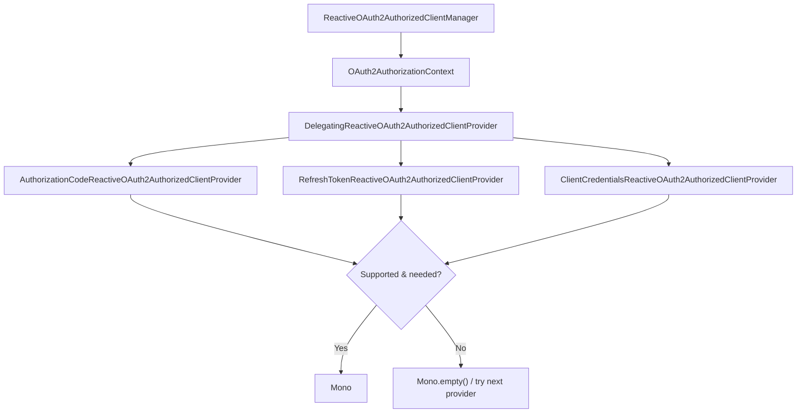
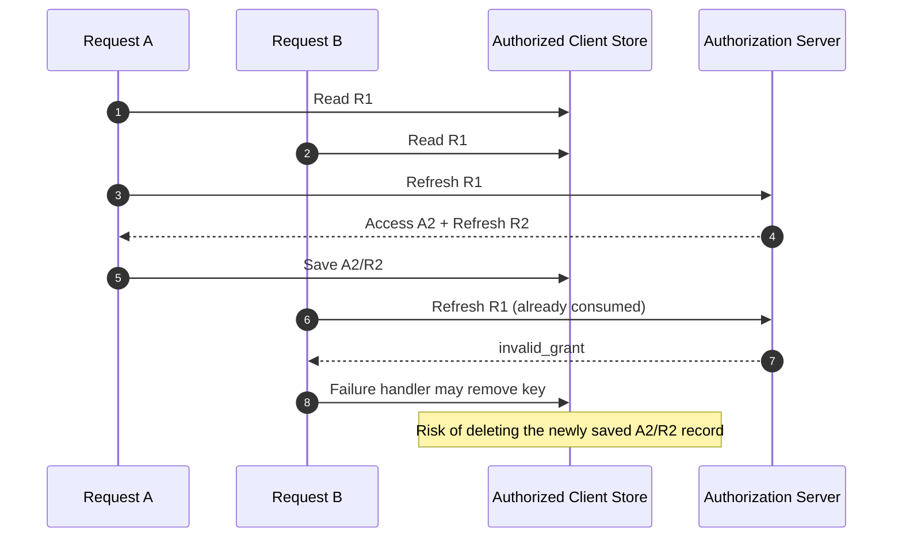
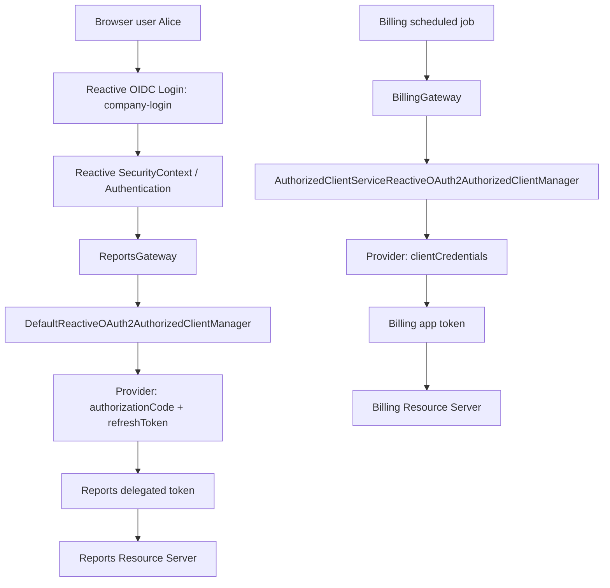

# 21.7. ReactiveOAuth2AuthorizedClientProviderBuilder and Grant Selection

In a **Spring Security OAuth 2.0 / OpenID Connect (OIDC) Client** application running on **Spring WebFlux**, a single application may log users in with OIDC, call APIs on behalf of users, and execute machine-to-machine tasks. These scenarios use different **OAuth 2.0 authorization grants**, such as `authorization_code`, `refresh_token`, and `client_credentials`.

A key question is: **when Spring Security needs to issue or renew an access token, which component decides which grant to use?**

On the Reactive stack, we typically combine:

- **`ReactiveOAuth2AuthorizedClientProviderBuilder`** to choose which grants the application wants to support.
- **`ReactiveOAuth2AuthorizedClientProvider`** to execute—or decide whether it can execute—each grant.
- **`ReactiveOAuth2AuthorizedClientManager`** to coordinate authorization, authorized clients, and persistence.
- **`ClientRegistration`** to describe the registered grant, scopes, client ID, and provider.
- **`ServerOAuth2AuthorizedClientExchangeFilterFunction`** to attach the appropriate access token to outbound `WebClient` requests.

Example configuring a composite provider:

```java
ReactiveOAuth2AuthorizedClientProvider provider =
    ReactiveOAuth2AuthorizedClientProviderBuilder.builder()
        .authorizationCode()
        .refreshToken()
        .clientCredentials()
        .build();
```

The three calls `authorizationCode()`, `refreshToken()`, and `clientCredentials()` **do not mean every HTTP request runs all three grants sequentially**. The builder constructs a chain of strategies; when the manager needs to authorize/re-authorize a client, each strategy acts only if the **grant, token, and authorization context** match.

This lesson explains that mechanism in depth, provides a complete WebFlux example, and clarifies grant selection across browser login, API delegation, background jobs, token refresh, client credentials, and failure scenarios.

> **Scope:** Java 17+, Spring Boot 3.x, and Spring Security 6.x on **Reactive WebFlux**. Code snippets target Spring Security 6.5 APIs. Some classes or grant policies may differ across versions; consult the official documentation for your version. Domains like `example.test`, client IDs, and scopes are illustrative data.

---

## 1. Problem: One Application, Multiple Ways to Acquire Tokens

Suppose we have an **Operations Portal** application:

1. Employees open a browser and sign in via Company OIDC.
2. Users view a dashboard, and the portal calls the **Reports API** under the user's identity.
3. A background job syncs data with the **Billing API** using the application's own identity.
4. When the Reports API access token expires, if a refresh token is present, the portal requests a new access token.

We might have three client registrations:

| Client registration | Purpose | Typical grant |
| --- | --- | --- |
| `company-login` | User OIDC sign-in | `authorization_code`, optionally followed by `refresh_token` |
| `reports-api` | Reading reports under user permissions | `authorization_code`, optionally followed by `refresh_token` |
| `billing-service` | Worker calling Billing API under application authority | `client_credentials` |

For this application, a composite builder supporting all three grants makes sense. Still, each registration has only **one registered `authorization-grant-type`**, while refresh token is a **supporting grant to renew an existing authorized client**.

### 1.1. Placing Three Decisions at the Right Layer

```text
ClientRegistration
  "Which grant was registered for the app with the Authorization Server?"
                        |
                        v
ReactiveOAuth2AuthorizedClientProvider
  "Given this registration + authorization context,
   which grant can I use to issue/reissue a token?"
                        |
                        v
ReactiveOAuth2AuthorizedClientManager
  "Which authorized client do I load/save, for which principal,
   and how do I handle success/failure?"
                        |
                        v
WebClient / Application
  "Which Resource Server do I call with that access token?"
```

**The builder defines client-side authorization infrastructure capabilities; it does not grant permissions on the Authorization Server.** Even if the builder enables `clientCredentials()`, the registration must still be configured with `client_credentials` and the Authorization Server must accept the client's authentication.

## 2. Distinguishing Grant, Scope, Role, and Authorized Client

Several concepts sound similar yet serve distinct purposes:

| Concept | Question it answers | Example |
| --- | --- | --- |
| **Authorization grant** | Which mechanism does the client use to obtain a token? | `authorization_code`, `client_credentials` |
| **Scope** | Which access permissions are requested/granted to the client? | `reports.read`, `openid` |
| **Business role** | What is the user allowed to do in business logic? | `ROLE_EDITOR`, `ROLE_ADMIN` |
| **`ClientRegistration`** | How is the client registered with the provider? | ID `reports-api` and grant `authorization_code` |
| **`OAuth2AuthorizedClient`** | Which token is managed for this registration + principal? | `reports-api / alice / access token` |
| **`OAuth2AuthorizationContext`** | What data does the provider need when authorizing? | Registration, principal, existing client, context attributes |

For example, a `ClientRegistration` listing scope `reports.read` does not prove the current user consented to that scope. **Scopes in configuration are a request**, whereas the token response and Resource Server policy determine what is actually usable.

Likewise, `ROLE_ADMIN` in the login session does not automatically turn an access token for another API into one carrying `billing.write`.

## 3. Reactive OAuth2 Client Objects and Interfaces

### 3.1. Core Interfaces

```java
import org.springframework.security.oauth2.client.ReactiveOAuth2AuthorizedClientManager;
import org.springframework.security.oauth2.client.ReactiveOAuth2AuthorizedClientProvider;
import org.springframework.security.oauth2.client.ReactiveOAuth2AuthorizedClientProviderBuilder;
```

Responsibilities:

- **`ReactiveOAuth2AuthorizedClientProvider`**: authorization/re-authorization strategy. Emits a `Mono<OAuth2AuthorizedClient>` when it can produce an authorized client; completes empty when unsupported or no renewal is needed per provider contract.
- **`ReactiveOAuth2AuthorizedClientManager`**: application-level token coordination point; loads/saves state and invokes the composite provider.
- **`ReactiveOAuth2AuthorizedClientProviderBuilder`**: builds a **`DelegatingReactiveOAuth2AuthorizedClientProvider`** composed of multiple child providers.

### 3.2. Why the Reactive Prefix?

In WebFlux, operations are expressed as Reactor publishers:

```java
Mono<OAuth2AuthorizedClient> result =
    authorizedClientManager.authorize(authorizeRequest);
```

A publisher usually **does not execute merely by being constructed**. The subscriber/Reactor chain determines when it actually runs:

```java
return authorizedClientManager.authorize(authorizeRequest)
    .flatMap(client -> callResourceServer(client));
```

In this example, `callResourceServer(client)` is a business method returning `Mono<?>`, not a built-in Spring Security API.

Never call `.block()` inside WebFlux request handling just to extract the token, as blocking occupies an event-loop thread and degrades throughput.

### 3.3. Reactive vs Servlet

| Servlet OAuth2 Client | Reactive WebFlux OAuth2 Client |
| --- | --- |
| `OAuth2AuthorizedClientManager` | `ReactiveOAuth2AuthorizedClientManager` |
| `OAuth2AuthorizedClientProviderBuilder` | `ReactiveOAuth2AuthorizedClientProviderBuilder` |
| `DefaultOAuth2AuthorizedClientManager` | `DefaultReactiveOAuth2AuthorizedClientManager` |
| `AuthorizedClientServiceOAuth2AuthorizedClientManager` | `AuthorizedClientServiceReactiveOAuth2AuthorizedClientManager` |
| `ClientRegistrationRepository` | `ReactiveClientRegistrationRepository` |
| `OAuth2AuthorizedClientService` | `ReactiveOAuth2AuthorizedClientService` |
| `OAuth2ClientHttpRequestInterceptor` for RestClient | `ServerOAuth2AuthorizedClientExchangeFilterFunction` for WebClient |
| `HttpSecurity` | `ServerHttpSecurity` |

It is not just class renaming: **Servlet uses blocking interfaces/request contexts; WebFlux uses `Mono`/`ServerWebExchange`** and reactive security contexts.

## 4. How ReactiveOAuth2AuthorizedClientProviderBuilder Works

The builder creates a composite provider from the selected strategies:

```java
ReactiveOAuth2AuthorizedClientProvider provider =
    ReactiveOAuth2AuthorizedClientProviderBuilder.builder()
        .authorizationCode()
        .refreshToken()
        .clientCredentials()
        .build();
```

Conceptually:



Essentially, the builder places a set of strategies into a **composite**. Each strategy evaluates the authorization context:

- Which grant does the registration use?
- Does an authorized client already exist?
- Is the access token still valid?
- Is there a refresh token?
- Are required attributes present?
- Does obtaining a token require browser interaction?

Not every strategy calls the token endpoint, and **an empty publisher does not automatically mean an exception or missing permission**. Depending on the manager and existing authorized client, "no re-authorization needed" can allow the manager to keep the usable token.

### 4.1. Common Builder Methods

| Builder method | Added provider | Purpose |
| --- | --- | --- |
| `authorizationCode()` | `AuthorizationCodeReactiveOAuth2AuthorizedClientProvider` | Authorization Code Flow / reusing code-flow authorized clients |
| `refreshToken()` | `RefreshTokenReactiveOAuth2AuthorizedClientProvider` | Using an issued refresh token to obtain a new access token |
| `clientCredentials()` | `ClientCredentialsReactiveOAuth2AuthorizedClientProvider` | Acquiring an access token with client identity |
| `password()` | `PasswordReactiveOAuth2AuthorizedClientProvider` | Legacy grant; **deprecated and not for new integrations** |
| `provider(custom)` | Extension provider | Extension grant or special logic with an explicit contract |
| `build()` | `DelegatingReactiveOAuth2AuthorizedClientProvider` | Produces the composite provider |

In Spring Security 6.5, `password()` is marked **deprecated, for removal**. OAuth 2.0 Security Best Current Practice (RFC 9700) forbids using the Resource Owner Password Credentials grant in modern security designs.

### 4.2. A Composite Is Not a "Credential Fallback"

Never interpret this as:

```text
authorization_code fails
    => automatically fall back to client_credentials
    => use application token instead of user token
```

That would be a severe authorization bug. If the Reports API requires delegated user consent, a `client_credentials` token does not represent that user. **Provider selection must strictly respect the registered grant, principal, and authorization policy.**

## 5. The authorization_code Grant: When an Interactive User Is Involved

**Authorization Code** is normally used when a user signs in or authorizes an API via a browser:

```text
Browser -> Spring WebFlux app
        -> Authorization Server authorization endpoint
        -> User login / consent
        -> Callback to app with code + state
        -> Backend exchanges code for tokens
        -> Authorized client is saved
```

With OIDC Login, the `openid` scope requests an ID Token and triggers corresponding OIDC identity checks; it does not change the underlying authorization code mechanism.

### 5.1. Why Doesn't authorizationCode() Run the Entire Browser Flow in the Background?

`AuthorizationCodeReactiveOAuth2AuthorizedClientProvider` supports the `authorization_code` grant at the client-infrastructure level, whereas **browser redirects** are coordinated by appropriate WebFlux filters/resolvers such as `OAuth2AuthorizationRequestRedirectWebFilter`. The manager cannot turn a browserless scheduled job into a consenting user.

A typical web flow involves:

- `DefaultServerOAuth2AuthorizationRequestResolver` building the authorization request.
- `ServerAuthorizationRequestRepository` storing correlation state.
- Browser visiting the OP and returning via callback.
- Spring Security completing the token exchange and authentication.
- `OAuth2AuthorizedClient` being saved for reuse.

**Enabling `authorizationCode()` in the builder does not create user consent**, nor does it guarantee an authorized client exists if the registration has not yet been authorized.

### 5.2. OIDC Login and API Registrations May Differ

A user may log in using `company-login` while needing to call `reports-api`:

```text
Login:
  registration=company-login
  scopes=openid profile

Reports:
  registration=reports-api
  scopes=reports.read
```

Logging in via Company SSO **does not automatically issue a token for `reports-api`**. If the user has not yet authorized Reports, the application needs a proper authorization/consent flow instead of silently forwarding the login token to Reports.

### 5.3. When to Choose This Grant?

Suitable for:

- Browser login via OIDC.
- Web apps calling APIs on behalf of consenting users.
- Connecting third-party accounts such as Calendar or CRM integrations.
- Flows requiring OP-managed MFA/SSO/consent.

Unsuitable for standalone workers without a browser or delegated user context.

## 6. The refresh_token Grant: Renewing an Existing Authorized Client

The **Refresh Token grant** applies when:

1. An `OAuth2AuthorizedClient` already exists.
2. The Authorization Server previously issued an `OAuth2RefreshToken`.
3. The access token is expired or nearing expiration per provider/clock skew.
4. The manager is configured with `refreshToken()`.
5. The Authorization Server accepts the refresh token and client authentication.

Example:

```text
T0: Authorization code exchanged for:
    access_token=A1, refresh_token=R1

T1: Access token A1 is nearing expiration
    manager -> RefreshTokenReactiveOAuth2AuthorizedClientProvider

T2: Token endpoint:
    grant_type=refresh_token
    refresh_token=R1

T3: Token response:
    access_token=A2
    refresh_token=R2 (if rotated)

T4: Updated authorized client saved with A2/R2
```

### 6.1. refreshToken() Does Not Ask the OP to Issue a Refresh Token

```java
ReactiveOAuth2AuthorizedClientProvider provider =
    ReactiveOAuth2AuthorizedClientProviderBuilder.builder()
        .refreshToken()
        .build();
```

This configuration **only enables using a refresh token that was already issued**; it does not make the Authorization Server return a `refresh_token` during initial login. Refresh token issuance depends on client type, scopes/consent, `offline_access` or provider-specific parameters, and AS policy.

If the authorized client has `getRefreshToken() == null`, the refresh-token provider cannot derive a refresh token from an access token.

### 6.2. Refresh Tokens Do Not Elevate Scopes

If the user only granted `reports.read`, the refresh grant is not a way to gain `reports.write` without additional authorization/consent.

**OAuth scopes, business roles, and grants are completely distinct.**

### 6.3. The `invalid_grant` Outcome

The token endpoint may return:

```json
{
  "error": "invalid_grant",
  "error_description": "Refresh token is expired or revoked"
}
```

This is an **authorization failure**. The manager uses a failure handler to react, typically removing the stale authorized client for errors like `invalid_grant`. Subsequent calls may need a new authorization via the appropriate grant/flow.

Never retry infinitely with a broken refresh token, never manually bump `expiresAt`, and never fall back to another user's token.

## 7. The client_credentials Grant: Application Self-Authentication

`client_credentials` fits **machine-to-machine** calls: the application or service worker authenticates directly with the Authorization Server and receives an access token for its configured permissions.

```text
Billing worker
    |
    v
Token Endpoint
  grant_type=client_credentials
  client authentication (secret/private key/...)
    |
    v
Access token for billing-service client
    |
    v
Billing Resource Server
```

No user visits a login page or browser consent screen per token issuance. Permissions come from client/app registration and Authorization Server policy.

### 7.1. Why Is No Refresh Token Needed?

Per OAuth 2.0, client credentials grant responses normally **do not include a refresh token** (RFC 6749 specifies `SHOULD NOT`). When the access token expires, the client simply authenticates again with its client credentials to request a new token.

Therefore, for an app-only client:

```java
ReactiveOAuth2AuthorizedClientProvider provider =
    ReactiveOAuth2AuthorizedClientProviderBuilder.builder()
        .clientCredentials()
        .build();
```

is clear and sufficient in many cases.

### 7.2. An App Token Does Not Represent a User

If user Alice is viewing an order, never use a client credentials token and claim the API call carries Alice's authority—unless the API explicitly intends an app-only action with separate business auditing.

| Delegated user authorization | App-only authorization |
| --- | --- |
| Involves a user and user consent/delegation as needed | No user interaction |
| Usually uses authorization code | Usually uses client credentials |
| Token may carry subject/user context | Token represents client/service identity |
| May use refresh token if issued | Typically requests new access tokens via credentials |
| Backend must check resource ownership/tenant | Backend must check service permissions and workload identity |

## 8. Password Grant Is Legacy and Should Not Be in New Designs

The 6.5 builder still includes `password()` for compatibility, yet this API is marked **deprecated for removal**, and OAuth 2.0 Security Best Current Practice forbids using the Resource Owner Password Credentials grant.

An example **not to implement in new code**:

```java
// LEGACY, DEPRECATED, DO NOT USE FOR NEW INTEGRATIONS.
ReactiveOAuth2AuthorizedClientProvider legacy =
    ReactiveOAuth2AuthorizedClientProviderBuilder.builder()
        .password()
        .build();
```

Security drawbacks include:

- The application must handle the user's raw password directly.
- Difficult to support MFA, phishing-resistant authentication, and modern SSO policies.
- Breaks the boundary between client and identity provider.
- Incompatible with consent flows and step-up authentication.

The standard replacement is **Authorization Code + PKCE** for user-interactive cases; for machine-to-machine, use `client_credentials` or another trust-model-appropriate grant. Never confuse OAuth2's password grant with your application's own form login.

## 9. Sample Configuration: Spring Boot WebFlux with Multiple Registrations

### 9.1. Maven Dependencies

```xml
<dependencies>
    <dependency>
        <groupId>org.springframework.boot</groupId>
        <artifactId>spring-boot-starter-webflux</artifactId>
    </dependency>
    <dependency>
        <groupId>org.springframework.boot</groupId>
        <artifactId>spring-boot-starter-security</artifactId>
    </dependency>
    <dependency>
        <groupId>org.springframework.boot</groupId>
        <artifactId>spring-boot-starter-oauth2-client</artifactId>
    </dependency>
</dependencies>
```

This example relies on the Spring Boot BOM for compatible versions. Since this is a **WebFlux server**, do not add `spring-boot-starter-web` merely to get an HTTP client. If both web starters appear on the classpath, verify the running application type because Spring Boot normally prioritizes MVC when both are present.

### 9.2. application.yml

```yaml
spring:
  security:
    oauth2:
      client:
        registration:
          company-login:
            provider: company
            client-id: ${LOGIN_CLIENT_ID}
            client-secret: ${LOGIN_CLIENT_SECRET}
            authorization-grant-type: authorization_code
            redirect-uri: "{baseUrl}/login/oauth2/code/{registrationId}"
            scope:
              - openid
              - profile
              - email

          reports-api:
            provider: company
            client-id: ${REPORTS_CLIENT_ID}
            client-secret: ${REPORTS_CLIENT_SECRET}
            authorization-grant-type: authorization_code
            redirect-uri: "{baseUrl}/login/oauth2/code/{registrationId}"
            scope:
              - reports.read

          billing-service:
            provider: company
            client-id: ${BILLING_CLIENT_ID}
            client-secret: ${BILLING_CLIENT_SECRET}
            authorization-grant-type: client_credentials
            scope:
              - billing.read

        provider:
          company:
            issuer-uri: https://id.example.test/realms/company
```

Scopes `reports.read` and `billing.read` are illustrative; they must be defined by your Authorization Server/Resource Server. Client secrets must be read from a secret store or environment variables, never committed to the repository.

### 9.3. Comparing YAML and the Builder

```text
registration.company-login.authorization-grant-type = authorization_code
registration.reports-api.authorization-grant-type   = authorization_code
registration.billing-service.authorization-grant-type = client_credentials

Builder supports:
    authorizationCode()
    refreshToken()
    clientCredentials()

Result:
    company-login   -> code flow, refreshes if token was issued
    reports-api     -> code flow, refreshes if token was issued
    billing-service -> client_credentials, acquires app token
```

**A registration configured with `client_credentials` does not turn into authorization code just because the builder enables `authorizationCode()`**; the provider checks whether the registration matches.

## 10. Configuring ReactiveAuthorizedClientProvider for Web Requests

For WebFlux requests with `ServerWebExchange`, use `DefaultReactiveOAuth2AuthorizedClientManager`:

```java
import org.springframework.context.annotation.Bean;
import org.springframework.context.annotation.Configuration;
import org.springframework.security.oauth2.client.DefaultReactiveOAuth2AuthorizedClientManager;
import org.springframework.security.oauth2.client.ReactiveOAuth2AuthorizedClientManager;
import org.springframework.security.oauth2.client.ReactiveOAuth2AuthorizedClientProvider;
import org.springframework.security.oauth2.client.ReactiveOAuth2AuthorizedClientProviderBuilder;
import org.springframework.security.oauth2.client.registration.ReactiveClientRegistrationRepository;
import org.springframework.security.oauth2.client.web.server.ServerOAuth2AuthorizedClientRepository;

@Configuration
class WebOAuth2ClientManagerConfig {

    @Bean
    ReactiveOAuth2AuthorizedClientManager webAuthorizedClientManager(
            ReactiveClientRegistrationRepository registrations,
            ServerOAuth2AuthorizedClientRepository authorizedClients) {

        ReactiveOAuth2AuthorizedClientProvider provider =
            ReactiveOAuth2AuthorizedClientProviderBuilder.builder()
                .authorizationCode()
                .refreshToken()
                .clientCredentials()
                .build();

        DefaultReactiveOAuth2AuthorizedClientManager manager =
            new DefaultReactiveOAuth2AuthorizedClientManager(
                registrations, authorizedClients);

        manager.setAuthorizedClientProvider(provider);

        return manager;
    }
}
```

This is a complete example for a **manager used in web exchanges**. The abstractions:

- `ReactiveClientRegistrationRepository`: looks up registrations by ID.
- `ServerOAuth2AuthorizedClientRepository`: stores/loads authorized clients in the server request context.
- `ReactiveOAuth2AuthorizedClientProvider`: composite grant strategies from the builder.
- `DefaultReactiveOAuth2AuthorizedClientManager`: coordinates authorization.

Spring Boot/Spring Security can auto-configure these components for common setups. **Declare a custom manager only when you need explicit control over grants, token clients, handlers, or persistence**; if multiple manager beans exist, disambiguate with `@Qualifier` when injecting.

### 10.1. SecurityWebFilterChain

```java
import org.springframework.context.annotation.Bean;
import org.springframework.context.annotation.Configuration;
import org.springframework.security.config.annotation.web.reactive.EnableWebFluxSecurity;
import org.springframework.security.config.web.server.ServerHttpSecurity;
import org.springframework.security.web.server.SecurityWebFilterChain;

@Configuration
@EnableWebFluxSecurity
class ReactiveWebSecurityConfiguration {

    @Bean
    SecurityWebFilterChain webFilterChain(ServerHttpSecurity http) {
        return http
            .authorizeExchange(exchanges -> exchanges
                .pathMatchers("/", "/error", "/public/**").permitAll()
                .anyExchange().authenticated())
            .oauth2Login(login -> { })
            .oauth2Client(client -> { })
            .build();
    }
}
```

In WebFlux, the right configuration uses **`SecurityWebFilterChain` + `ServerHttpSecurity`**, not Servlet's `HttpSecurity`. `oauth2Login()` handles user login; `oauth2Client()` supports client authorization flows. The manager and provider builder govern using authorized clients to access APIs.

### 10.2. Why Enabling All Three Grants in the Builder Does Not Give Every User All Three Permissions

The builder only informs the framework which grants **may be handled when applicable**; it does not:

- Automatically redirect users to the Authorization Server on every request.
- Grant users `billing.read` permission.
- Turn a user token into an app-only token.
- Add a refresh token when the OP did not issue one.
- Bypass consent, PKCE, or OIDC validation.

## 11. Dedicated Configuration for Background/Service-Level client_credentials

**`DefaultReactiveOAuth2AuthorizedClientManager` is designed to operate in a `ServerWebExchange` context.** When running a background job without an HTTP request, use:

**`AuthorizedClientServiceReactiveOAuth2AuthorizedClientManager`**.

It works with **`ReactiveOAuth2AuthorizedClientService`**, without needing a WebFlux session.

```java
import org.springframework.context.annotation.Bean;
import org.springframework.context.annotation.Configuration;
import org.springframework.security.oauth2.client.AuthorizedClientServiceReactiveOAuth2AuthorizedClientManager;
import org.springframework.security.oauth2.client.ReactiveOAuth2AuthorizedClientManager;
import org.springframework.security.oauth2.client.ReactiveOAuth2AuthorizedClientProvider;
import org.springframework.security.oauth2.client.ReactiveOAuth2AuthorizedClientProviderBuilder;
import org.springframework.security.oauth2.client.ReactiveOAuth2AuthorizedClientService;
import org.springframework.security.oauth2.client.registration.ReactiveClientRegistrationRepository;

@Configuration
class MachineClientManagerConfiguration {

    @Bean
    ReactiveOAuth2AuthorizedClientManager machineAuthorizedClientManager(
            ReactiveClientRegistrationRepository registrations,
            ReactiveOAuth2AuthorizedClientService storage) {

        ReactiveOAuth2AuthorizedClientProvider provider =
            ReactiveOAuth2AuthorizedClientProviderBuilder.builder()
                .clientCredentials()
                .build();

        AuthorizedClientServiceReactiveOAuth2AuthorizedClientManager manager =
            new AuthorizedClientServiceReactiveOAuth2AuthorizedClientManager(
                registrations, storage);

        manager.setAuthorizedClientProvider(provider);
        return manager;
    }
}
```

Because the provider includes only `clientCredentials()`, this manager **never handles user authorization codes**. That is a clear way to enforce **least privilege** for workers.

### 11.1. Separating Managers Also Separates Responsibilities

```text
Web app / request:
  DefaultReactiveOAuth2AuthorizedClientManager
  ServerOAuth2AuthorizedClientRepository
  authorizationCode + refreshToken

Background job:
  AuthorizedClientServiceReactiveOAuth2AuthorizedClientManager
  ReactiveOAuth2AuthorizedClientService
  clientCredentials
```

Not every app strictly requires two managers, yet splitting **user-delegated** from **app-only** lowers the risk of invoking the wrong grant or identity.

### 11.2. Choosing the Principal for Machine Tokens

`OAuth2AuthorizedClient` is keyed by registration ID and principal name. With `client_credentials`, the principal is typically a stable backend-managed technical identifier, such as `billing-worker`, not the human user interacting with the UI.

Never take a principal from an HTTP query parameter to look up someone else's token.

## 12. Using the Manager in a Reactive Background Job

We can authorize the machine client via `OAuth2AuthorizeRequest`:

```java
import org.springframework.beans.factory.annotation.Qualifier;
import org.springframework.security.oauth2.client.OAuth2AuthorizeRequest;
import org.springframework.security.oauth2.client.OAuth2AuthorizedClient;
import org.springframework.security.oauth2.client.ReactiveOAuth2AuthorizedClientManager;
import org.springframework.stereotype.Service;
import reactor.core.publisher.Mono;

@Service
class BillingTokenService {

    private final ReactiveOAuth2AuthorizedClientManager manager;

    BillingTokenService(
            @Qualifier("machineAuthorizedClientManager")
            ReactiveOAuth2AuthorizedClientManager manager) {
        this.manager = manager;
    }

    Mono<OAuth2AuthorizedClient> billingAuthorizedClient() {
        OAuth2AuthorizeRequest request =
            OAuth2AuthorizeRequest.withClientRegistrationId("billing-service")
                .principal("billing-worker")
                .build();

        return manager.authorize(request)
            .switchIfEmpty(Mono.error(
                new IllegalStateException(
                    "billing-service authorization was unavailable")));
    }
}
```

Here:

- `withClientRegistrationId("billing-service")` selects the right registration.
- `principal("billing-worker")` provides the service identity used to save/load the authorized client.
- `authorize(request)` returns a reactive publisher without blocking threads.
- `switchIfEmpty` handles the case where the manager emits no client; token endpoint errors can also surface as error signals.

**Never return the token value to a browser merely because the service obtained an `OAuth2AuthorizedClient`.** Tokens are credentials for the backend to call the designated API.

### 12.1. Calling the Billing API with WebClient Using the Authorized Client

```java
import org.springframework.stereotype.Service;
import org.springframework.web.reactive.function.client.WebClient;
import reactor.core.publisher.Mono;

@Service
class BillingGateway {

    private final BillingTokenService tokenService;
    private final WebClient billingWebClient;

    BillingGateway(BillingTokenService tokenService,
                   WebClient.Builder builder) {
        this.tokenService = tokenService;
        this.billingWebClient = builder
            .baseUrl("https://billing.example.test")
            .build();
    }

    Mono<String> loadStatus() {
        return tokenService.billingAuthorizedClient()
            .flatMap(client -> billingWebClient.get()
                .uri("/v1/status")
                .headers(headers -> headers.setBearerAuth(
                    client.getAccessToken().getTokenValue()))
                .retrieve()
                .bodyToMono(String.class));
    }
}
```

The example separates **explicit manager authorization** and **WebClient token attachment** for clarity. In larger applications, `ServerOAuth2AuthorizedClientExchangeFilterFunction` can centralize Bearer header attachment and authorization failure handling, provided the right manager and principal are selected.

**Never accept a destination URI from arbitrary input**, because `setBearerAuth(...)` would send the token to an untrusted host.

## 13. WebClient with ServerOAuth2AuthorizedClientExchangeFilterFunction

On Reactive WebFlux, Spring Security provides:

```java
import org.springframework.security.oauth2.client.web.reactive.function.client
    .ServerOAuth2AuthorizedClientExchangeFilterFunction;
```

In a real Java source file, the import must be on a single line:

```java
import org.springframework.security.oauth2.client.web.reactive.function.client.ServerOAuth2AuthorizedClientExchangeFilterFunction;
```

Bean configuration:

```java
import org.springframework.beans.factory.annotation.Qualifier;
import org.springframework.context.annotation.Bean;
import org.springframework.context.annotation.Configuration;
import org.springframework.security.oauth2.client.ReactiveOAuth2AuthorizedClientManager;
import org.springframework.security.oauth2.client.web.reactive.function.client.ServerOAuth2AuthorizedClientExchangeFilterFunction;
import org.springframework.web.reactive.function.client.WebClient;

@Configuration
class ReportsWebClientConfiguration {

    @Bean
    WebClient reportsWebClient(
            WebClient.Builder builder,
            @Qualifier("webAuthorizedClientManager")
            ReactiveOAuth2AuthorizedClientManager manager) {

        ServerOAuth2AuthorizedClientExchangeFilterFunction oauth2 =
            new ServerOAuth2AuthorizedClientExchangeFilterFunction(manager);

        return builder
            .baseUrl("https://reports.example.test")
            .filter(oauth2)
            .build();
    }
}
```

The filter coordinates with the manager to find/acquire/refresh the authorized client, then attaches the Bearer access token to outbound API requests.

### 13.1. Selecting the Registration per Request

```java
import static org.springframework.security.oauth2.client.web.reactive.function.client.ServerOAuth2AuthorizedClientExchangeFilterFunction.clientRegistrationId;

import org.springframework.stereotype.Service;
import org.springframework.web.reactive.function.client.WebClient;
import reactor.core.publisher.Mono;

@Service
class ReportsGateway {

    private final WebClient reportsWebClient;

    ReportsGateway(WebClient reportsWebClient) {
        this.reportsWebClient = reportsWebClient;
    }

    Mono<String> myReports() {
        return reportsWebClient.get()
            .uri("/v1/reports/mine")
            .attributes(clientRegistrationId("reports-api"))
            .retrieve()
            .bodyToMono(String.class);
    }
}
```

`.attributes(clientRegistrationId("reports-api"))` is a **WebClient request attribute**, not a query parameter or HTTP header. It selects the client registration on each outbound request.

### 13.2. Do Not Use the Login Token for Every API

Suppose a user logs in via `company-login`, and a service calls the Reports API. Without specifying a client, a default-token configuration could pick the login registration's token instead of Reports.

A login token with `openid profile` does not automatically grant `reports.read`. In multi-registration applications, **specify `clientRegistrationId` explicitly** and restrict destinations per API.

### 13.3. Passing an Explicit Authorized Client

```java
import static org.springframework.security.oauth2.client.web.reactive.function.client.ServerOAuth2AuthorizedClientExchangeFilterFunction.oauth2AuthorizedClient;

Mono<String> response = webClient.get()
    .uri("https://reports.example.test/v1/reports")
    .attributes(oauth2AuthorizedClient(authorizedClient))
    .retrieve()
    .bodyToMono(String.class);
```

`authorizedClient` must come from a valid authorization flow for the right principal and registration. When passing the object directly, do not also specify a conflicting `clientRegistrationId` and rely on implicit precedence.

## 14. Choose Grants by ClientRegistration, Not Hostname

A design flaw is inferring the grant from a URL, for example:

```text
URL contains /billing -> use client_credentials
URL contains /reports -> use authorization_code
```

**Hostname/path is not a grant policy.** An API may accept both delegated and app-only tokens, or disallow app-only on certain routes. Grants should be properties of a **controlled `ClientRegistration`** and actual Authorization Server permissions.

### 14.1. Grant Decision Table

| Scenario | Recommended grant | User required? | Refresh token? |
| --- | --- | --- | --- |
| Browser OIDC login | `authorization_code` (+ PKCE as appropriate) | Yes | Optional, decided by OP |
| User authorizes Calendar API | `authorization_code` | Yes, at least at initial authorization | Optional |
| Issued access token expired and refresh token exists | `refresh_token` | Usually no browser interaction on refresh | Uses old token to obtain a new one |
| Cron job calling the app's own API | `client_credentials` | No | Usually unnecessary; requests new token with credentials |
| SPA/native public client | Authorization Code + PKCE | Yes | Strict policy, rotation/sender-constraint when issued |
| Having user enter password directly into client | Legacy `password` | Has password without browser redirect | Discouraged / never for new designs |
| API requires custom delegation | Provider-supported extension grant | Depends on grant | Per AS contract |

### 14.2. Can One Registration Use Two Authorization Methods Together?

`ClientRegistration.getAuthorizationGrantType()` describes the primary grant, such as `authorization_code` or `client_credentials`. Using `refresh_token` is **re-authorization of an existing authorized client**, which does not mean changing the registration's grant type in YAML to `refresh_token`.

Valid example:

```yaml
authorization-grant-type: authorization_code
scope: openid, profile, offline_access
```

When the OP issues a refresh token, the `refreshToken()` provider can use it later for refreshing.

## 15. Configuring Grants with the Builder and Customizing Clock Skew

The builder provides overloads to customize providers:

```java
import java.time.Duration;
import org.springframework.security.oauth2.client.ReactiveOAuth2AuthorizedClientProvider;
import org.springframework.security.oauth2.client.ReactiveOAuth2AuthorizedClientProviderBuilder;

ReactiveOAuth2AuthorizedClientProvider provider =
    ReactiveOAuth2AuthorizedClientProviderBuilder.builder()
        .authorizationCode()
        .refreshToken(config -> config
            .clockSkew(Duration.ofSeconds(90)))
        .clientCredentials(config -> config
            .clockSkew(Duration.ofSeconds(90)))
        .build();
```

**Clock skew** treats an access token as nearing expiration ahead of `expiresAt` to reduce the risk of expiring in transit.

Example:

```text
Access token expiresAt = 10:00:00
Clock skew             = 90 seconds

Starting around 09:58:30:
  provider can treat the token as needing renewal
```

Avoid setting clock skew larger than the entire access token lifetime without careful thought, as the manager may try to refresh/renew overly frequently.

### 15.1. Clock Skew Does Not Extend Token Lifetime

Skew is only a policy for **evaluating when a token is nearing expiration**. It cannot make a revoked access token valid again, does not alter the expiration encoded inside the token, and does not guarantee a Resource Server will accept every request.

### 15.2. Customizing the Token Response Client

When a custom HTTP client is needed for the token endpoint, the builder lets you inject a `ReactiveOAuth2AccessTokenResponseClient<...>`.

Example for refresh token:

```java
import org.springframework.security.oauth2.client.ReactiveOAuth2AuthorizedClientProvider;
import org.springframework.security.oauth2.client.ReactiveOAuth2AuthorizedClientProviderBuilder;
import org.springframework.security.oauth2.client.endpoint.ReactiveOAuth2AccessTokenResponseClient;
import org.springframework.security.oauth2.core.endpoint.OAuth2RefreshTokenGrantRequest;

ReactiveOAuth2AccessTokenResponseClient<OAuth2RefreshTokenGrantRequest>
    refreshResponseClient = /* securely configured implementation */;

ReactiveOAuth2AuthorizedClientProvider provider =
    ReactiveOAuth2AuthorizedClientProviderBuilder.builder()
        .authorizationCode()
        .refreshToken(config ->
            config.accessTokenResponseClient(refreshResponseClient))
        .build();
```

`refreshResponseClient` is an application-configured dependency, not an instance created by the comment. When customizing timeouts, retries, TLS, or request parameters, consult the `WebClientReactiveRefreshTokenTokenResponseClient` documentation for your Spring Security version.

**Never replace the token endpoint with a user-supplied URL**, and never log refresh tokens or client secrets while debugging.

### 15.3. Customizing the client_credentials Response Client

Similarly:

```java
ReactiveOAuth2AccessTokenResponseClient<OAuth2ClientCredentialsGrantRequest>
    credentialsClient = /* implementation for client_credentials */;

ReactiveOAuth2AuthorizedClientProvider provider =
    ReactiveOAuth2AuthorizedClientProviderBuilder.builder()
        .clientCredentials(config ->
            config.accessTokenResponseClient(credentialsClient))
        .build();
```

Generic types must match the grant request. Never pass a refresh-grant response client into the client-credentials builder.

## 16. Writing an Extension Grant Provider with provider(...)

Some systems use extension grants such as:

- JWT bearer token grant;
- Token exchange;
- Custom grants defined by contract with the Authorization Server.

The builder allows:

```java
ReactiveOAuth2AuthorizedClientProvider provider =
    ReactiveOAuth2AuthorizedClientProviderBuilder.builder()
        .authorizationCode()
        .refreshToken()
        .provider(customProvider)
        .build();
```

`customProvider` is an application-implemented `ReactiveOAuth2AuthorizedClientProvider`. It must know:

1. How to detect matching registrations/grants;
2. When it cannot authorize and must return `Mono.empty()`;
3. Which token endpoints or exchange mechanisms are trusted;
4. How to bind principal, audience, and scopes;
5. How to process token responses and errors;
6. Whether refresh/reauthorization is supported;
7. How to avoid blocking the Reactor event loop.

### 16.1. Extension Provider Logic Skeleton

```java
import org.springframework.security.oauth2.client.OAuth2AuthorizationContext;
import org.springframework.security.oauth2.client.ReactiveOAuth2AuthorizedClientProvider;
import org.springframework.security.oauth2.client.OAuth2AuthorizedClient;
import reactor.core.publisher.Mono;

class CustomGrantProvider implements ReactiveOAuth2AuthorizedClientProvider {

    @Override
    public Mono<OAuth2AuthorizedClient> authorize(
            OAuth2AuthorizationContext context) {

        if (!supportsCustomGrant(context)) {
            return Mono.empty();
        }

        // Perform exchange per a grant supported by the AS.
        // Must verify client, principal, scope, and token response.
        return performTrustedTokenExchange(context);
    }

    private boolean supportsCustomGrant(OAuth2AuthorizationContext context) {
        // Policy implemented by the application.
        return false; // Skeleton: no extension grant enabled yet.
    }

    private Mono<OAuth2AuthorizedClient> performTrustedTokenExchange(
            OAuth2AuthorizationContext context) {
        // Integrate token endpoint per custom contract.
        return Mono.empty(); // Skeleton; not a complete implementation.
    }
}
```

This skeleton **does not issue tokens itself**. It only illustrates the API to implement. In production, prefer built-in Spring Security providers or vetted extensions rather than implementing OAuth protocols from scratch.

### 16.2. Why Never Use a Custom Grant to Bypass Consent?

Extension providers must honor the authorization policies of the AS and resource owner. Never use them to bypass scopes, spoof principals, or swap User A's token for User B's privileges.

## 17. Provider Outcomes During Authorization

A provider does not always mint a new token. Key scenarios:

| Context | Conceptual behavior |
| --- | --- |
| Registration uses `client_credentials`, no token yet | `clientCredentials` provider can call the token endpoint |
| Registration uses `client_credentials`, token still valid | No renewal needed; provider may emit empty |
| Registration uses `authorization_code`, token still valid | Existing authorized client can be reused |
| Registration uses `authorization_code`, has refresh token, token expired | `refreshToken` provider can exchange for a new token |
| Registration uses `authorization_code`, no refresh token, token expired | Cannot refresh via refresh grant; may need a new authorization flow |
| Registration uses a grant outside the provider under evaluation | Provider does not handle it, normally returns `Mono.empty()` |
| Token endpoint returns `invalid_grant` | Authorization failure, not empty-as-success |
| Token endpoint returns `invalid_client` | Client authentication/config error; needs operational fix |

### 17.1. Mono.empty() vs Mono.error(...)

```java
Mono.empty();                         // No value to emit.
Mono.error(new IllegalStateException("authorization failed"));
```

Inside a provider, empty can mean **the grant does not apply or no re-authorization is needed**. Error represents an actual failure.

At the manager level:

- May reuse an existing authorized client when renewal is not needed.
- May emit `OAuth2AuthorizationException` if the token endpoint fails.
- May emit empty if authorization cannot proceed for the given grant/context.

Never write logic assuming "`Mono.empty()` means the client was revoked" across all layers.

### 17.2. Be Careful with switchIfEmpty

A service might write:

```java
manager.authorize(request)
    .switchIfEmpty(Mono.error(
        new IllegalStateException("No authorized client available")));
```

This makes sense when downstream strictly requires an authorized client. Yet it **does not replace error handling** for `invalid_grant`, network timeouts, or `invalid_client`, which normally already arrive as error signals.

## 18. Success Handlers and Failure Handlers

`ReactiveOAuth2AuthorizedClientManager` does more than run providers. It also manages persistence and callbacks for authorization outcomes.

### 18.1. On Success

A successful authorization/re-authorization creates a new `OAuth2AuthorizedClient`. The manager typically uses **`ReactiveOAuth2AuthorizationSuccessHandler`** to save the client via the repository/service.

Refresh token rotation example:

```text
Before:
  reports-api + alice -> access=A1, refresh=R1

Refresh R1 succeeds:
  access=A2, refresh=R2

Success handler:
  saves updated authorized client A2/R2
```

Never update only the access token while leaving the old refresh token; reusing R1 after the OP rotated it can trigger `invalid_grant`.

### 18.2. On Failure

A **`ReactiveOAuth2AuthorizationFailureHandler`** handles authorization failures. Default managers include logic to remove stored authorized clients on appropriate errors, notably `invalid_grant`.

Never delete tokens on every exception indiscriminately. An API timeout or 503 does not prove the refresh token was revoked.

### 18.3. Customizing Handlers Can Alter Default Cleanup

If you call:

```java
manager.setAuthorizationFailureHandler(customFailureHandler);
```

you must preserve **default cleanup**. If a custom handler only logs and skips delegation/removal, broken tokens may keep being used in subsequent requests.

Likewise, replacing the success handler and forgetting to persist new tokens can cause the application to lose rotated refresh tokens.

## 19. Resource Server Errors Differ from Token Endpoint Errors

There are two separate error paths:

```text
Authorization Server / token endpoint:
  refresh_token -> invalid_grant
       |
       v
  ReactiveOAuth2AuthorizedClientManager
       |
       v
  ReactiveOAuth2AuthorizationFailureHandler

Resource Server / API:
  GET /reports + Bearer access token
       |
       +--> 401 invalid_token
       +--> 403 insufficient_scope
       |
       v
  WebClient exchange filter
       |
       v
  Authorization failure handler if wired
```

The manager only sees what happens during **authorize/re-authorize**. If a separate HTTP client receives a 401 from an API, do not assume the manager automatically saw that failure.

### 19.1. The ServerOAuth2AuthorizedClientExchangeFilterFunction Constructor Matters

Per Spring Security 6.5 Javadoc:

- When constructed with `ServerOAuth2AuthorizedClientExchangeFilterFunction(manager)`, Resource Server 401/403 errors **are not forwarded by default** to `ReactiveOAuth2AuthorizationFailureHandler`. You must configure a handler if you want failed authorized clients cleaned up.
- When constructed with `(ReactiveClientRegistrationRepository, ServerOAuth2AuthorizedClientRepository)`, Spring Security includes wiring that forwards errors to a removal handler based on error codes.

Therefore, merely enabling `refreshToken()` in the builder **does not guarantee API 401 responses are automatically handled/retried**.

### 19.2. 401 invalid_token and 403 insufficient_scope

| Response | Primary meaning | Handling |
| --- | --- | --- |
| `401` + `invalid_token` | Access token rejected by Resource Server | Check revoked/expired/audience/issuer and clean up per policy |
| `403` + `insufficient_scope` | Token may be valid yet lacks required permissions | Obtain valid scope/consent; do not refresh and retry endlessly |
| `503` / timeout | API/network outage | Bounded retry if idempotent; do not treat token as bad |
| `400` + `invalid_grant` at token endpoint | Invalid refresh/grant | Authorization failure; reauthorize when permitted |
| `401` + `invalid_client` at token endpoint | Wrong/rotated client credentials | Fix secret/cert config; do not re-login users to fix it |

### 19.3. Never Automatically Fall Back to a Higher-Privilege Client

If `reports-api` fails with `insufficient_scope`, trying `billing-service` or `admin-api` is not "smart grant selection"—it is **bypassing authorization policy**.

Use only the registration/grant permitted by business policy for that API.

## 20. Providers Are Strategies; the Manager Coordinates Context

A common misunderstanding is calling directly:

```java
provider.authorize(context);
```

in a controller/service to "grab a token quickly". In standard designs, call:

```java
authorizedClientManager.authorize(request);
```

because the manager is responsible for:

- Looking up the right `ClientRegistration`;
- Binding the right principal;
- Loading the stored authorized client;
- Building context attributes;
- Invoking the composite provider;
- Persisting the authorized client on success;
- Running failure handlers and error handling.

**Calling a provider directly skips or forces you to reimplement all of those responsibilities.** Exercises may test a provider strategy in isolation, while production business code should rely on the manager.

### 20.1. When Are Context Attributes Used?

`OAuth2AuthorizationContext` can hold attributes required by providers. For certain legacy/extension grants, the context may require a username, password, or subject token depending on the grant.

Validate the source of context attributes:

- Never read user credentials from an arbitrary query parameter.
- Never use User B's principal for User A's request.
- Never mix tokens from another session into the context.
- Never log attributes containing secrets.

For standard authorization code and client credentials flows, the framework builds the required context from the registration and principal; no custom mapper is needed unless specifically required.

## 21. Grant Selection Is a Business and Security Policy

Suppose a service exposes three methods:

```text
loadMyReports(user)      -> reports-api / delegated user token
loadBillingStatus(job)   -> billing-service / app token
loginWithCompany(user)   -> company-login / OIDC login
```

Never write a method like:

```java
String grantType = request.getParameter("grant");
String registrationId = request.getParameter("client");
```

letting callers freely pick the grant and registration to fetch tokens. That places security decisions in untrusted input.

A better design:

```java
enum Integration {
    REPORTS,
    BILLING
}

record ClientPolicy(String registrationId, boolean appOnly) {
}

final class ClientPolicies {
    static ClientPolicy forIntegration(Integration integration) {
        return switch (integration) {
            case REPORTS -> new ClientPolicy("reports-api", false);
            case BILLING -> new ClientPolicy("billing-service", true);
        };
    }
}
```

**The mapping must be owned by the backend**, and the service still enforces user/tenant/resource authorization before calling the API. The simple enum above merely illustrates the decision boundary.

### 21.1. Never Use Grants as a Substitute for Role Checks

If a logged-in user lacks permission to view confidential reports, regardless of what scopes the authorization-code token carries, the application must still enforce business policy and the Resource Server must still protect the resource.

### 21.2. API Scopes Are Not the Access Token Audience

A token with scope `reports.read` is not guaranteed to be issued for the Reports API's audience. APIs can also validate issuer/audience/resource indicators. Changing grants in the builder does not manufacture audience claims.

## 22. Sessions, Repositories, and Persistence

An **authorized client** is not an object that lives only inside one token-request method. When the next request arrives, the manager needs to retrieve stored tokens.

On the Reactive stack:

| Component | Role |
| --- | --- |
| `ServerOAuth2AuthorizedClientRepository` | Stores/loads authorized clients tied to WebFlux requests/principals |
| `ReactiveOAuth2AuthorizedClientService` | Stores/loads authorized clients at the service tier without requiring a WebSession request |
| `ReactiveClientRegistrationRepository` | Holds configured `ClientRegistration` definitions |
| `ReactiveOAuth2AuthorizedClientManager` | Connects providers with persistence |
| `ServerAuthorizationRequestRepository` | Stores authorization requests/state across redirects; **not an authorized-client token store** |

Users and services might hold:

```text
(reports-api, alice)              -> access A1, optional refresh R1
(reports-api, bob)                -> access B1, optional refresh R2
(billing-service, billing-worker) -> access S1
```

Mixing entries across registrations or principals causes **cross-user token leakage**.

### 22.1. Login Sessions Differ from Authorized Client Storage

`WebSession` can hold login state, correlation state, or authorized clients depending on the repository. However:

- Authorization requests are saved before the callback;
- `SecurityContext` stores `Authentication`;
- `OAuth2AuthorizedClient` stores issued tokens.

Never read `ServerAuthorizationRequestRepository` looking for a refresh token; at the authorization request stage, tokens do not yet exist.

### 22.2. Multi-Instance Environments

If the application runs multiple WebFlux nodes, session/authorized-client storage must stay consistent. For machine-to-machine workloads, a service-level manager is usually better suited than local `WebSession`. When using Redis/databases, protect token values, manage TTLs, handle session invalidation, and guard concurrent updates.

## 23. Refresh Token Rotation and Concurrency

A real-world difficulty arises when two requests refresh token `R1` concurrently:



The `refreshToken()` builder **does not automatically solve persistence race conditions**. If the OP uses refresh token rotation, consider:

- Single-flight or locking by `(registrationId, principal)`;
- Optimistic locking / version fields;
- Compare-and-delete so an old failure never wipes a fresh token;
- Shared persistence across nodes;
- Reasonable clock skew;
- Never retrying `invalid_grant` indefinitely.

For app-only client credentials, multiple workers requesting access tokens concurrently can load the token endpoint; consider caching and coordination per your security model.

## 24. Step-by-Step Troubleshooting When Selecting Grants

When encountering `401/403` or missing tokens, inspect layer by layer:

### 24.1. Is the Registration Right?

```yaml
registration:
  reports-api:
    authorization-grant-type: authorization_code
```

If code calls `clientRegistrationId("reports-api")` while YAML defines `reports-client`, the lookup will not match.

### 24.2. Is the Grant Enabled in the Builder?

A builder enabling only:

```java
ReactiveOAuth2AuthorizedClientProviderBuilder.builder()
    .clientCredentials()
    .build();
```

cannot drive an authorization code flow for an `authorization_code` registration.

### 24.3. Is the Authorization Context Complete?

- For code flow: did the user authorize/consent?
- For refresh: does the client hold a refresh token?
- For client credentials: are client authentication method and secret/cert valid?
- For extensions: are required attributes present?
- For service-level jobs: is there a stable technical principal?

### 24.4. What Did the Token Endpoint Actually Return?

- `invalid_client`: check client authentication.
- `invalid_grant`: invalid grant or refresh token.
- `invalid_scope`: requested scope rejected.
- Timeout/5xx: Authorization Server/network outage.
- No refresh token: token issuance policy, not necessarily a builder bug.

### 24.5. Does the Resource Server Accept the Token?

Even a successfully acquired token can fail at an API because of:

- Wrong audience/resource;
- Untrusted issuer;
- Missing scope;
- Expired or revoked token;
- User/tenant lacking permission;
- Sending a token from the wrong registration.

Do not try to fix all of these by enabling `clientCredentials()` or `refreshToken()`.

## 25. Common Mistakes

| Symptom | Common mistake | Solution |
| --- | --- | --- |
| OIDC login succeeds yet no refresh token exists | Assuming `.refreshToken()` forces the OP to issue one | Check offline access / consent / provider token policy |
| Manager never refreshes tokens | Refresh provider not enabled or stored client lacks a refresh token | Check builder and `OAuth2AuthorizedClient.getRefreshToken()` |
| Background job fails missing WebExchange | Using `DefaultReactiveOAuth2AuthorizedClientManager` outside web context | Use `AuthorizedClientServiceReactiveOAuth2AuthorizedClientManager` |
| Browser login suddenly uses a machine token | Wrong registration/principal fallback | Separate user-delegated and app-only managers |
| API returns 401 even with a token | Wrong audience/issuer or expired/revoked token | Check API policy and registration |
| API returns 403 `insufficient_scope` | Treating it as a bad access token and refreshing | Request proper scope through valid authorization |
| `client_credentials` lacks a refresh token | Expecting every grant to return a refresh token | Acquire a fresh access token via client credentials |
| Builder enables multiple grants yet fails to authorize | Registration mismatch or missing context/consent | Distinguish capabilities from actual authorization |
| `Mono` sends no requests | Created publisher without subscribing/returning | Compose the Reactor pipeline properly |
| WebFlux requests slow down | `.block()` or blocking HTTP client on event loop | Use reactive token clients and non-blocking WebClient |
| Code uses Servlet builder in WebFlux | Confusing `OAuth2AuthorizedClientProviderBuilder` | Use `ReactiveOAuth2AuthorizedClientProviderBuilder` |
| `invalid_grant` after refresh token rotation | Cache still holds the old refresh token | Persist updated authorized clients and coordinate concurrent refreshes |
| Custom success handler loses tokens | Handler forgets to save the new authorized client | Preserve persistence behavior |
| Custom failure handler leaves broken tokens behind | Handler only logs without delegating cleanup | Ensure removal for the right error codes and store |
| User A uses User B's token | Principal derived from untrusted input or mutated wrongly | Use trusted `Authentication` and principal-keyed token storage |
| Public API receives Bearer tokens | Overly broad default OAuth client on WebClient | Separate WebClients, use explicit registrations and allowlisted destinations |
| Token endpoint gets hammered | Infinite retries on token failures | Add bounded timeouts/retries and circuit breakers |
| Works in dev login, fails with invalid redirect in prod | Wrong reverse proxy / public origin setup | Align redirect URIs and trusted forwarded headers |
| Using password grant for SSO integration | Relying on deprecated legacy API | Use Authorization Code + PKCE / OIDC |
| Token acquired yet app lacks `ROLE_ADMIN` | Confusing OAuth grants/scopes with business roles | Check backend authorization policy and role mapping |

## 26. Practical Example: Combining Web Delegated and App-Only Without Mixing Authority

Recommended architecture:



From a security review perspective:

- **Web side** binds the user principal and delegated tokens.
- **Worker side** uses a service principal, client credentials, and independent persistence.
- Never pull a user's token from a web session so a worker can run after logout unless valid delegated offline access exists.
- Never use a service token to "borrow privileges" on resources restricted to users.
- Restrict API destinations and OAuth2 client registrations per gateway.

### 26.1. A Service Should Never Accept Raw Grant Types Directly

If the UI sends:

```http
POST /api/run-report?grant_type=client_credentials
```

the backend must never let that query parameter switch the authorization method. Users only request **business operations**; the backend decides authorization from policy. Grant type is not an option chosen arbitrarily by the browser.

### 26.2. Safe Logging

Illustrative log event:

```json
{
  "event": "oauth2_reactive_authorization",
  "registration_id": "billing-service",
  "grant_category": "client_credentials",
  "outcome": "authorized",
  "environment": "staging",
  "trace_id": "internal-trace-id"
}
```

This is an application-designed schema. Never log access tokens, refresh tokens, ID Tokens, client secrets, `Authorization` headers, serialized `OAuth2AuthorizedClient` objects, or token endpoint responses containing credentials.

## 27. Self-Check Questions

### Question 1. The builder has `.authorizationCode().refreshToken().clientCredentials()`. Does that mean every request executes all three grants?

> No. The builder produces a **composite provider** with multiple strategies. Providers act based on `ClientRegistration`, token/context state, and grant preconditions. It must not be treated as an automatic privilege-escalation fallback chain.

### Question 2. A registration has `authorization-grant-type: authorization_code`. Must YAML be changed to `refresh_token` to use refresh tokens?

> No. `authorization_code` is the primary grant for initial tokens; the `refreshToken()` provider can use an OP-issued refresh token to re-authorize when the access token expires.

### Question 3. Why doesn't `.refreshToken()` make the login response contain a refresh token?

> **Issuing** a refresh token is decided by the Authorization Server. The builder only enables **using** that credential if it exists and remains valid.

### Question 4. Which manager should a job without an HTTP request use?

> Typically `AuthorizedClientServiceReactiveOAuth2AuthorizedClientManager` with `ReactiveOAuth2AuthorizedClientService`. For app-only workloads, enable `clientCredentials()` and use a stable technical principal.

### Question 5. When is `client_credentials` appropriate?

> When the workload acts as **the application/service itself** and the Resource Server grants matching app permissions. Never use it as a stand-in for a user in workflows requiring delegated user consent.

### Question 6. Should `.password()` be added to a new integration?

> No. It is deprecated for removal in Spring Security 6.5 and disallowed by OAuth Security BCP. Choose Authorization Code + PKCE/OIDC or an appropriate modern grant.

### Question 7. Does a provider returning `Mono.empty()` mean authorization failed?

> No. The provider may simply not support the grant or see no need to renew because the token is still valid. True failures normally arrive as `Mono.error(...)`. The manager and application layer interpret outcomes per API contract.

### Question 8. Why not call `provider.authorize(context)` directly in a controller?

> Because the manager handles `ClientRegistration` lookup, authorized-client persistence, principal/context wiring, success/failure handlers, and multi-grant delegation. Calling the manager avoids bypassing those responsibilities.

### Question 9. The Reports API returns 403 `insufficient_scope`. Should we try a `billing-service` token instead?

> No. Insufficient scope/permission is not a signal to switch to an app-only client with different privileges. Acquire valid consent/permissions for the appropriate registration.

### Question 10. Two requests use refresh token R1 concurrently while the OP rotates tokens. What is the risk?

> One request may save R2 while the other submits R1, receives `invalid_grant`, and mistakenly deletes the fresh record. Design locking/versioning/CAS and consistent storage if concurrency is significant.

### Question 11. Does `clientRegistrationId("reports-api")` automatically enforce business authorization?

> No. It selects the OAuth2 `ClientRegistration` for outbound API calls. The backend and Resource Server must still verify roles, resource ownership, scopes, audience, and tenant.

### Question 12. Why shouldn't a Spring Security WebFlux app use Servlet's `OAuth2AuthorizedClientProviderBuilder`?

> Because that is the blocking/Servlet counterpart. WebFlux requires `ReactiveOAuth2AuthorizedClientProviderBuilder`, Reactive managers, and `Mono` publishers.

### Question 13. Can clock skew be configured on the refresh token provider?

> Yes. The builder supports `refreshToken(config -> config.clockSkew(Duration.ofSeconds(...)))`. It is a threshold for judging when a token is nearing expiration; it does not make revoked tokens valid again.

### Question 14. Why would a Resource Server still return 401 when WebClient sends a Bearer token?

> The token may have the wrong audience or issuer, be expired or revoked, or belong to the wrong registration. The builder only handles acquiring/refreshing tokens; it does not guarantee every API accepts them.

### Question 15. Can users pass `clientRegistrationId` or `principal` in query parameters to choose a token?

> That should never be allowed. The backend must map authorized actions to an allowlisted registration/destination, and the principal must come from a verified `Authentication` or configured service identity.

### Question 16. What is wrong with replacing `AuthorizationFailureHandler` with one that only logs?

> It can disable the manager's default cleanup, leaving broken authorized clients in storage for future requests. Custom handlers must preserve or explicitly run cleanup per error code and store.

### Question 17. Why is having no refresh token normal for `client_credentials`?

> Because the application can re-authenticate with its client credentials to obtain a new access token; per RFC 6749, refresh tokens are not recommended for this grant.

### Question 18. Where do you customize timeouts for the token response client?

> Depending on the grant, pass a `ReactiveOAuth2AccessTokenResponseClient<...>` via the builder's consumer overload—for example `refreshToken(config -> config.accessTokenResponseClient(customClient))`—matching the exact generic request type.

## 28. Takeaways and Decision Flowchart

```text
Does the app need a token to call an API?
       |
       v
Does the resource require USER or APPLICATION authority?
       |
       +-- USER
       |     |
       |     v
       |  Has the user granted authorization?
       |     |
       |     +-- No -> authorization_code
       |     |          (browser + consent + state/PKCE as needed)
       |     |
       |     +-- Existing OAuth2AuthorizedClient
       |             |
       |             +-- Access token still valid -> reuse
       |             |
       |             +-- Expired with refresh token
       |             |      -> refresh_token
       |             |
       |             +-- Cannot refresh
       |                    -> reauthorize per flow/policy
       |
       +-- APPLICATION
              |
              v
         client_credentials
              |
              +-- Token still valid -> reuse
              |
              +-- Token expired -> acquire new token via client credentials
       |
       v
ReactiveOAuth2AuthorizedClientProviderBuilder
   configures allowed grant strategies
       |
       v
ReactiveOAuth2AuthorizedClientManager
   - registration + principal
   - authorized client storage
   - provider delegation
   - success/failure handlers
       |
       v
WebClient sends Bearer access token
       |
       v
Resource Server validates token and checks permissions
```

**Most important points:**

1. **`ReactiveOAuth2AuthorizedClientProviderBuilder` builds a composite provider** from the grants the application chooses to support. Enabling them in the builder does not force the Authorization Server to grant permissions.
2. **`authorizationCode()` is for interactive user flows**, typically coordinated through WebFlux login/authorization filters.
3. **`refreshToken()` applies to authorized clients that already hold a valid refresh token**; it does not ask the OP to issue refresh tokens.
4. **`clientCredentials()` is for app-only access**, never a replacement for delegated user authorization.
5. **The manager coordinates providers within a registration/principal context**, while persisting authorized clients and handling failures.
6. **Separate `DefaultReactiveOAuth2AuthorizedClientManager` and service-level managers by context**; background jobs should not depend on `ServerWebExchange`.
7. **Never use the password grant in new integrations**, never let users pick grants or registrations arbitrarily, and never send tokens to untrusted destinations.
8. **Distinguish token endpoint errors from Resource Server errors**, and maintain sound retry, refresh, cleanup, and concurrency policies.

### References

- [Spring Security 6.5 — Reactive OAuth2 Client Core Interfaces and Classes](https://docs.spring.io/spring-security/reference/6.5/reactive/oauth2/client/core.html)
- [Spring Security 6.5 — Reactive OAuth2 Authorization Grants](https://docs.spring.io/spring-security/reference/6.5/reactive/oauth2/client/authorization-grants.html)
- [Spring Security 6.5 API — ReactiveOAuth2AuthorizedClientProviderBuilder](https://docs.spring.io/spring-security/reference/6.5/api/java/org/springframework/security/oauth2/client/ReactiveOAuth2AuthorizedClientProviderBuilder.html)
- [Spring Security 6.5 API — DefaultReactiveOAuth2AuthorizedClientManager](https://docs.spring.io/spring-security/reference/6.5/api/java/org/springframework/security/oauth2/client/DefaultReactiveOAuth2AuthorizedClientManager.html)
- [Spring Security 6.5 API — AuthorizedClientServiceReactiveOAuth2AuthorizedClientManager](https://docs.spring.io/spring-security/reference/6.5/api/java/org/springframework/security/oauth2/client/AuthorizedClientServiceReactiveOAuth2AuthorizedClientManager.html)
- [Spring Security 6.5 — Reactive Authorized Clients and WebClient Integration](https://docs.spring.io/spring-security/reference/6.5/reactive/oauth2/client/authorized-clients.html)
- [Spring Security 6.5 API — ServerOAuth2AuthorizedClientExchangeFilterFunction](https://docs.spring.io/spring-security/reference/6.5/api/java/org/springframework/security/oauth2/client/web/reactive/function/client/ServerOAuth2AuthorizedClientExchangeFilterFunction.html)
- [RFC 6749 — OAuth 2.0 Authorization Framework](https://www.rfc-editor.org/rfc/rfc6749)
- [RFC 9700 — OAuth 2.0 Security Best Current Practice](https://www.rfc-editor.org/rfc/rfc9700)
