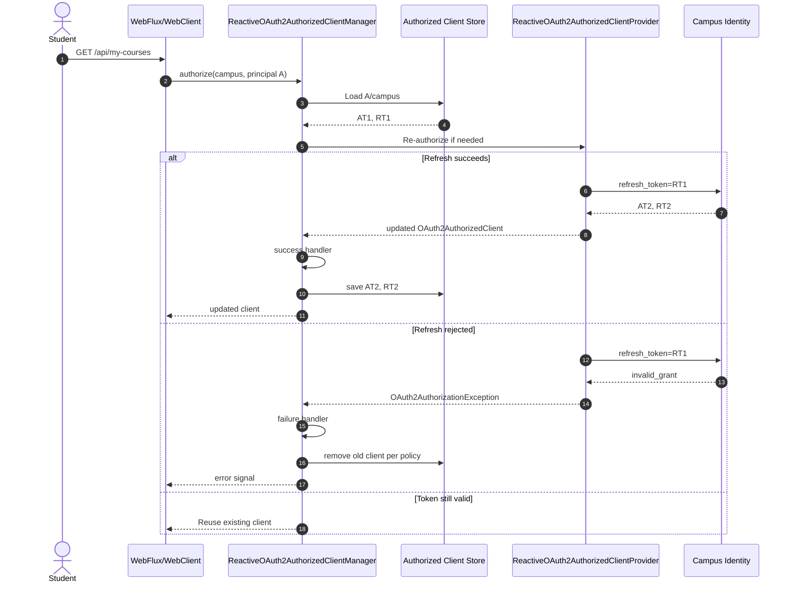
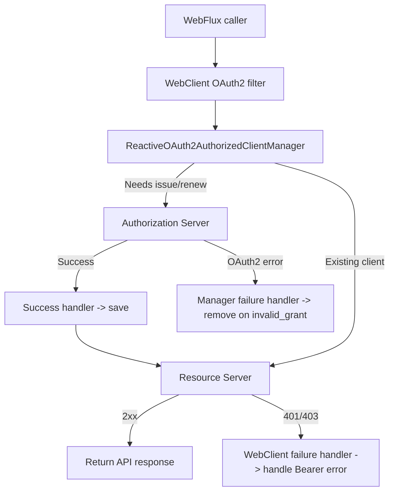
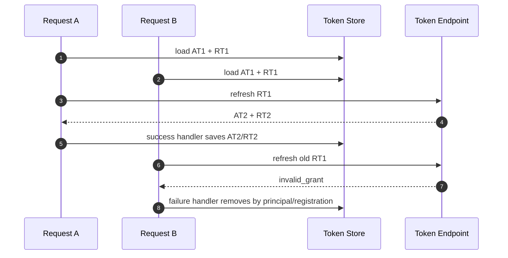

# 21.8. Success Handlers, Failure Handlers, and Updating Authorized Clients

## Lesson Objectives

In this lesson, you will:

- Understand the roles of `ReactiveOAuth2AuthorizationSuccessHandler` and `ReactiveOAuth2AuthorizationFailureHandler` in Spring Security **OAuth2 Client Reactive/WebFlux**.
- Understand how `DefaultReactiveOAuth2AuthorizedClientManager` coordinates authorization, saves new tokens, and removes invalid state.
- Distinguish `ServerOAuth2AuthorizedClientRepository` from `ReactiveOAuth2AuthorizedClientService`.
- Know when to use `DefaultReactiveOAuth2AuthorizedClientManager` vs `AuthorizedClientServiceReactiveOAuth2AuthorizedClientManager`.
- Customize success/failure handlers **without losing default persistence** or accidentally deleting another user's authorized client.
- Distinguish `invalid_grant` from the **Token Endpoint** from HTTP 401/403 from the **Resource Server**, and configure `WebClient` error handling in the right place.
- Understand the risks of refresh-token rotation, concurrent requests, multiple instances, and reactive `Mono<Void>`.
- Write appropriate tests, error handling, observability, and authorization for a real OIDC Client application.

---

## 1. Context: Tokens Change Over Time

Suppose **Learning Portal** is a Spring Boot WebFlux application. Students sign in through **Campus Identity**, an OpenID Provider. After the OAuth2 Authorization Code Flow with OIDC, the Portal holds:

```text
ClientRegistration: campus
Principal: student-7e04
Access Token: AT1
Refresh Token: RT1
Access Token expiresAt: 10:00
```

The Portal calls the **Course API**:

```http
GET /api/me/courses HTTP/1.1
Host: courses.example.org
Authorization: Bearer <AT1>
```

At 10:01, AT1 is no longer valid. The OAuth2 Client can request a new token using RT1. The OP returns:

```text
Access Token: AT2
Refresh Token: RT2 (if using refresh-token rotation)
Access Token expiresAt: 11:00
```

**Problem 1:** If AT2 is only returned to the current request without saving AT2/RT2, the next request will read stale RT1 and may hit `invalid_grant`.

**Problem 2:** If the OP rejects RT1 because it was revoked, the application needs to clean up the invalid state instead of repeatedly reusing the broken grant.

Two Spring Security extension points handle these outcomes:

```java
ReactiveOAuth2AuthorizationSuccessHandler
ReactiveOAuth2AuthorizationFailureHandler
```

They are **asynchronous callbacks within the authorized-client lifecycle**, not generic HTTP status handlers for arbitrary REST APIs.

### 1.1. Authorization Manager Diagram



Not every call to `authorize(...)` requests a new token. When the token is still valid, the manager can return the stored state; **the success handler does not necessarily run when merely reusing an existing token**.

## 2. Classes to Distinguish

| Component | Responsibility |
| --- | --- |
| `ClientRegistration` | OAuth client config: Client ID, issuer/provider, grant, scopes, endpoints |
| `ReactiveClientRegistrationRepository` | Looks up `ClientRegistration` by registration ID |
| `Authentication` | Current principal to which the OAuth2 authorized client is bound |
| `OAuth2AuthorizedClient` | Holds `ClientRegistration`, principal name, access token, and optional refresh token |
| `ReactiveOAuth2AuthorizedClientProvider` | Executes a grant, such as refresh token or client credentials |
| `ReactiveOAuth2AuthorizedClientManager` | Coordinates loading state, providers, and handlers |
| `ReactiveOAuth2AuthorizationSuccessHandler` | Handles post-processing when authorize/re-authorize succeeds |
| `ReactiveOAuth2AuthorizationFailureHandler` | Handles post-processing when authorize/re-authorize fails |
| `ServerOAuth2AuthorizedClientRepository` | Stores state in a WebFlux `ServerWebExchange` context |
| `ReactiveOAuth2AuthorizedClientService` | Stores state by registration ID and principal name, without needing an exchange |
| `ServerOAuth2AuthorizedClientExchangeFilterFunction` | Outbound WebClient OAuth2 filter; can also handle Resource Server error responses |

A record:

```text
AuthorizedClient
    registration = campus
    principalName = student-7e04
    accessToken = AT2
    refreshToken = RT2
```

**Do not confuse:** the ID Token and `OidcUser` prove the user logged into the OIDC Client. The Access Token inside `OAuth2AuthorizedClient` is the credential used to call the corresponding Resource Server. A success handler saving tokens does not automatically create a new `OidcUser`.

### 2.1. One User Can Have Multiple Authorized Clients

```text
student A + campus  -> authorized client A/campus
student A + partner -> authorized client A/partner
student B + campus  -> authorized client B/campus
```

Thus save/remove operations cannot key solely on `"campus"` while ignoring the principal. Never use a static variable like `lastAuthorizedClient` inside a singleton bean.

## 3. Reactive Contract of the Success Handler

Interface in package:

```java
org.springframework.security.oauth2.client.ReactiveOAuth2AuthorizationSuccessHandler
```

Signature:

```java
@FunctionalInterface
public interface ReactiveOAuth2AuthorizationSuccessHandler {

    Mono<Void> onAuthorizationSuccess(
        OAuth2AuthorizedClient authorizedClient,
        Authentication principal,
        Map<String, Object> attributes
    );
}
```

Meaning:

- `authorizedClient` holds the newly issued/renewed state.
- `principal` links the OAuth2 authorization to an identity.
- `attributes` may carry context such as `ServerWebExchange` in WebFlux apps.
- `Mono<Void>` completes when post-processing finishes or emits an error.

**Reactor rule:** let the manager/framework **subscribe** to the `Mono<Void>` returned by the handler. Never call `.subscribe()` freely and return `Mono.empty()` when persistence is actually needed.

### 3.1. Default Success Behavior

`DefaultReactiveOAuth2AuthorizedClientManager` saves the new authorized client by default via `ServerOAuth2AuthorizedClientRepository`.

With the service-based manager, saving goes through `ReactiveOAuth2AuthorizedClientService`.

```text
AT1/RT1 -> Token Endpoint -> AT2/RT2
                                  |
                                  v
                           success handler
                                  |
                                  v
                             save state
```

During refresh token rotation, both **AT2 and RT2** must be saved, not merely replacing the access token.

### 3.2. Not an HTTP 200 Callback

An HTTP `200 OK` from the Course API does not invoke this success handler. The handler runs when **authorization or re-authorization** succeeds. These are two distinct metrics:

```text
OAuth2 Authorization success count
Course API HTTP 200 count
```

Do not use the handler as a counter for every successful API call.

## 4. Reactive Contract of the Failure Handler

Interface:

```java
@FunctionalInterface
public interface ReactiveOAuth2AuthorizationFailureHandler {

    Mono<Void> onAuthorizationFailure(
        OAuth2AuthorizationException authorizationException,
        Authentication principal,
        Map<String, Object> attributes
    );
}
```

`OAuth2AuthorizationException` contains an `OAuth2Error`, for example:

```java
String errorCode = authorizationException
    .getError()
    .getErrorCode();
```

OAuth2 Token Endpoint error codes include:

```text
invalid_grant
invalid_client
invalid_scope
unauthorized_client
server_error
temporarily_unavailable
```

**Not every error means the token should be deleted.**

### 4.1. `invalid_grant`

A refresh request may be rejected:

```http
HTTP/1.1 400 Bad Request
Content-Type: application/json

{
  "error": "invalid_grant",
  "error_description": "Refresh token is no longer valid"
}
```

Causes may include a revoked grant, an expired refresh token, or token rotation/reuse.

The manager's default failure handler is typically built with:

```java
RemoveAuthorizedClientReactiveOAuth2AuthorizationFailureHandler
```

and removes the stored authorized client when `invalid_grant` occurs during re-authorization. The goal is to stop reusing a grant known to be invalid.

### 4.2. Do Not Delete on Every Error

| Error | Meaning | Handling |
| --- | --- | --- |
| `invalid_grant` | Grant/refresh token rejected | Remove/re-authorize per policy |
| `invalid_client` | Wrong client ID/secret or client auth method | Fix configuration and credentials |
| `invalid_scope` | Requested scope not permitted | Fix config/scope/consent |
| HTTP 5xx at Token Endpoint | AS temporarily unavailable | Bounded retry/backoff |
| Timeout after refresh | OP may have processed rotation even though response was lost | Do not blindly retry RT1 |
| SSL certificate error | Trust/hostname failure | Fix TLS; never disable verification |

If you customize the handler to delete all tokens on every exception, a brief network blip can force large numbers of users to sign in again.

### 4.3. Removing Local State Is Not Token Revocation

```text
repository.removeAuthorizedClient(...)
```

does not mean the Authorization Server revoked the Access Token or Refresh Token. Logout, local state removal, Token Revocation Endpoint calls, and OP SSO logout are separate lifecycles.

## 5. Configuring WebFlux OIDC Client and Manager

### 5.1. Registration Configuration

Example:

```yaml
spring:
  security:
    oauth2:
      client:
        registration:
          campus:
            provider: campus
            client-id: ${CAMPUS_CLIENT_ID}
            client-secret: ${CAMPUS_CLIENT_SECRET}
            authorization-grant-type: authorization_code
            client-authentication-method: client_secret_basic
            redirect-uri: "{baseUrl}/login/oauth2/code/{registrationId}"
            scope:
              - openid
              - profile
              - courses.read
        provider:
          campus:
            issuer-uri: https://login.example.org/realms/campus
```

Values are illustrative; register a real client and protect secrets. `campus` is the `registrationId`, while `${CAMPUS_CLIENT_ID}` is the OAuth Client ID issued by the Authorization Server.

### 5.2. SecurityWebFilterChain

```java
@Configuration
@EnableWebFluxSecurity
class SecurityConfig {

    @Bean
    SecurityWebFilterChain securityWebFilterChain(
            ServerHttpSecurity http) {

        return http
            .authorizeExchange(exchanges -> exchanges
                .pathMatchers("/", "/error", "/assets/**").permitAll()
                .anyExchange().authenticated()
            )
            .oauth2Login(Customizer.withDefaults())
            .oauth2Client(Customizer.withDefaults())
            .build();
    }
}
```

This is WebFlux Reactive, so do not use Servlet's `HttpSecurity` or `SecurityFilterChain`.

### 5.3. DefaultReactiveOAuth2AuthorizedClientManager

```java
@Configuration
class OAuth2ManagerConfig {

    @Bean("webClientManager")
    ReactiveOAuth2AuthorizedClientManager webClientManager(
            ReactiveClientRegistrationRepository registrations,
            ServerOAuth2AuthorizedClientRepository repository) {

        ReactiveOAuth2AuthorizedClientProvider provider =
            ReactiveOAuth2AuthorizedClientProviderBuilder.builder()
                .authorizationCode()
                .refreshToken()
                .build();

        DefaultReactiveOAuth2AuthorizedClientManager manager =
            new DefaultReactiveOAuth2AuthorizedClientManager(
                registrations, repository
            );

        manager.setAuthorizedClientProvider(provider);

        return manager;
    }
}
```

This lets the manager use the request-context repository and refresh-token provider. You do not need custom handlers if default persistence and error policies fit.

**Note:** `authorizationCode()` in the provider chain cannot create an authorization code for a user who has not gone through a browser. OIDC Login must initiate an authorization request and callback before an authorized client exists.

### 5.4. Why Don't Handlers Appear in the Bean Above?

Because the default manager already comes with handlers that save the authorized client on success and handle `invalid_grant` per policy. Unnecessary overrides risk losing default logic.

## 6. State Store: WebFlux Repository

Interface:

```java
public interface ServerOAuth2AuthorizedClientRepository {

    <T extends OAuth2AuthorizedClient> Mono<T> loadAuthorizedClient(
        String clientRegistrationId,
        Authentication principal,
        ServerWebExchange exchange
    );

    Mono<Void> saveAuthorizedClient(
        OAuth2AuthorizedClient authorizedClient,
        Authentication principal,
        ServerWebExchange exchange
    );

    Mono<Void> removeAuthorizedClient(
        String clientRegistrationId,
        Authentication principal,
        ServerWebExchange exchange
    );
}
```

Typical implementations:

- `WebSessionServerOAuth2AuthorizedClientRepository`: stores state in `WebSession`.
- `AuthenticatedPrincipalServerOAuth2AuthorizedClientRepository`: for authenticated principals, normally delegates to `ReactiveOAuth2AuthorizedClientService`, while anonymous requests can fall back to `WebSession`.

These implementations have **different storage lifecycles**. With a persistent service, logging out of the local session does not automatically delete tokens from the database.

### 6.1. Looking Up Does Not Refresh Tokens

```java
Mono<OAuth2AuthorizedClient> saved =
    repository.loadAuthorizedClient(
        "campus",
        authentication,
        exchange
    );
```

This call only loads state. It may return a client with an expired access token; **the manager/provider** is what handles refresh or authorization.

### 6.2. Saving Must Use the Right Principal

```java
Mono<Void> write =
    repository.saveAuthorizedClient(
        updatedClient,
        authentication,
        exchange
    );
```

If `authentication` belongs to User B while `updatedClient` belongs to User A, the app can mix up tokens across users. Always preserve request and registration bindings.

## 7. Passing ServerWebExchange to the Manager

`DefaultReactiveOAuth2AuthorizedClientManager` operates in a WebFlux request context. Callers invoking the manager directly can build:

```java
OAuth2AuthorizeRequest authorizationRequest =
    OAuth2AuthorizeRequest
        .withClientRegistrationId("campus")
        .principal(authentication)
        .attribute(
            ServerWebExchange.class.getName(),
            exchange
        )
        .build();

Mono<OAuth2AuthorizedClient> authorizedClient =
    manager.authorize(authorizationRequest);
```

This supplies the exchange so the repository can access `WebSession` or the appropriate context.

An illustrative controller:

```java
@GetMapping("/internal/oauth2/status")
Mono<Map<String, Object>> status(
        Authentication authentication,
        ServerWebExchange exchange) {

    OAuth2AuthorizeRequest request =
        OAuth2AuthorizeRequest
            .withClientRegistrationId("campus")
            .principal(authentication)
            .attribute(ServerWebExchange.class.getName(), exchange)
            .build();

    return manager.authorize(request)
        .map(client -> Map.<String, Object>of(
            "registrationId",
            client.getClientRegistration().getRegistrationId(),
            "hasRefreshToken",
            client.getRefreshToken() != null
        ))
        .switchIfEmpty(Mono.just(
            Map.<String, Object>of(
                "registrationId", "campus",
                "authorized", false
            )
        ));
}
```

Never return token values or refresh tokens. Protect debug endpoints appropriately, or omit them in production.

**Never fabricate a fake `ServerWebExchange` and store it in a static field for a scheduled job.** For tasks without an HTTP request, use the other manager.

## 8. When Is the Success Handler Called?

Common pattern:

```text
manager.authorize(request)
  |
  +-- Usable token already exists
  |      -> returns existing authorized client
  |
  +-- Refresh Token Grant succeeds
  |      -> builds new client
  |      -> success handler saves new client
  |
  +-- Client Credentials Grant succeeds
  |      -> builds new client
  |      -> success handler saves new client
  |
  +-- Token Endpoint returns error
         -> failure handler runs per OAuth2 error
```

The success handler **is not a background timer** that refreshes tokens without requests. It triggers inside flows where the manager actually authorizes or re-authorizes.

### 8.1. Refresh-Token Rotation

Initial state:

```text
campus/student-A:
    AT1
    RT1
```

OP returns:

```text
AT2
RT2
```

A successful save must result in:

```text
campus/student-A:
    AT2
    RT2
```

Saving only AT2 while keeping RT1 will cause the next refresh to fail.

### 8.2. Save Completes Before Continuing

In the Reactive chain:

```text
provider returns authorizedClient
    -> successHandler.onAuthorizationSuccess(...)
        -> Mono<Void> save completes
            -> manager emits authorizedClient
```

Detaching the save with `.subscribe()` breaks ordering and error propagation.

## 9. Customizing the Success Handler: Preserve Save Logic

A developer wants to add auditing/metrics after issuing a new token. Wrong code:

```java
manager.setAuthorizationSuccessHandler(
    (client, principal, attrs) -> {
        meterRegistry.counter("oauth2.success").increment();
        return Mono.empty();
    }
);
```

This replaced the default handler **without saving the authorized client**. On the next request, the store still holds stale RT1.

### 9.1. Example with ReactiveOAuth2AuthorizedClientService

If the manager uses a service store, a handler can save and then record a metric:

```java
manager.setAuthorizationSuccessHandler(
    (client, principal, attrs) -> {

        String registrationId =
            client.getClientRegistration().getRegistrationId();

        return authorizedClientService
            .saveAuthorizedClient(client, principal)
            .doOnSuccess(ignored -> meterRegistry.counter(
                "oauth2.authorize.success",
                "registration", registrationId
            ).increment());
    }
);
```

Requirements:

- `authorizedClientService` must be the same store used by the manager.
- `saveAuthorizedClient` returns `Mono<Void>`; completion must stay in the chain.
- Tokens/secrets must never appear in metric tags or logs.
- If the save fails, the pipeline propagates the error instead of assuming state persisted.

For a WebFlux repository, the callback needs the `ServerWebExchange` from the context.

### 9.2. Example with ServerOAuth2AuthorizedClientRepository

```java
manager.setAuthorizationSuccessHandler(
    (client, principal, attrs) -> {

        ServerWebExchange exchange =
            (ServerWebExchange) attrs.get(
                ServerWebExchange.class.getName()
            );

        if (exchange == null) {
            return Mono.error(
                new IllegalStateException(
                    "Missing ServerWebExchange in success handler"
                )
            );
        }

        return repository.saveAuthorizedClient(
            client, principal, exchange
        );
    }
);
```

This illustrates the extension point; normally **you do not need** to write this manually because the manager already provides a default save handler. If you want auditing, chain an operator after `saveAuthorizedClient(...)` rather than omitting the save.

### 9.3. Never Subscribe Manually

Wrong:

```java
repository.saveAuthorizedClient(client, principal, exchange)
    .subscribe();

return Mono.empty();
```

Risks:

- Caller receives "complete" before the save finishes.
- Save errors are detached from the flow.
- Reactive context/correlation can be lost.
- The new token may be used while the store still holds the old one.

Right: **return the `Mono<Void>`** from the save operation.

## 10. Default Failure Handler and Removal Policy

`RemoveAuthorizedClientReactiveOAuth2AuthorizationFailureHandler` is an implementation that deletes the authorized client when `OAuth2Error.getErrorCode()` belongs to a configured set of error codes.

By default, the manager focuses on **`invalid_grant`**.

### 10.1. Why Not Remove on Every Error?

A Token Endpoint returning HTTP 503 does not prove RT1 was revoked. Deleting the authorized client in that case forces unnecessary browser re-logins.

For `invalid_client`, check client authentication configuration/secrets. Deleting the token and retrying with the same wrong secret creates a failure loop.

### 10.2. Using the Remover Helper with a Service

A way to write a custom failure handler while keeping standard error-code delegation:

```java
RemoveAuthorizedClientReactiveOAuth2AuthorizationFailureHandler remover =
    new RemoveAuthorizedClientReactiveOAuth2AuthorizationFailureHandler(
        (registrationId, principal, attrs) ->
            authorizedClientService.removeAuthorizedClient(
                registrationId,
                principal.getName()
            )
    );

manager.setAuthorizationFailureHandler(
    (exception, principal, attrs) -> {
        String errorCode = exception.getError().getErrorCode();

        return remover.onAuthorizationFailure(
                exception, principal, attrs
            )
            .doOnSuccess(ignored -> meterRegistry.counter(
                "oauth2.authorize.failure",
                "error", errorCode
            ).increment());
    }
);
```

This snippet reflects the Spring Security API supporting the `OAuth2AuthorizedClientRemover` constructor; verify against your exact version when integrating. Unless a custom policy is needed, keep the default.

**Note:** The failure metric above counts failure events, not necessarily removals: the remover only removes for error codes matching its policy.

### 10.3. The Error Signal Must Still Be Handled

A handler may complete its `Mono<Void>` after removing state. That does not turn `authorize(...)` into a success. Callers still must handle the authorization error or missing authorized client.

Never use `.onErrorResume(...)` to return an old invalid token just to spare the user a 401.

## 11. WebClient Has Its Own Failure Handler for Resource Server Errors

Suppose the Token Endpoint just issued AT2, yet the Course API returns:

```http
HTTP/1.1 401 Unauthorized
WWW-Authenticate: Bearer error="invalid_token"
```

This error comes from the **Resource Server**, not an `invalid_grant` from the Token Endpoint.

Spring Security Reactive uses:

```java
ServerOAuth2AuthorizedClientExchangeFilterFunction
```

to integrate OAuth2 into outbound `WebClient` calls.

### 11.1. Configuring with a Manager

```java
@Bean
WebClient courseApiWebClient(
        ReactiveOAuth2AuthorizedClientManager manager) {

    ServerOAuth2AuthorizedClientExchangeFilterFunction oauth2 =
        new ServerOAuth2AuthorizedClientExchangeFilterFunction(
            manager
        );

    return WebClient.builder()
        .baseUrl("https://courses.example.org")
        .filter(oauth2)
        .build();
}
```

And:

```java
import static org.springframework.security.oauth2.client.web.reactive.function.client.ServerOAuth2AuthorizedClientExchangeFilterFunction.clientRegistrationId;

Mono<CourseDto[]> courses = courseApiWebClient.get()
    .uri("/api/me/courses")
    .attributes(clientRegistrationId("campus"))
    .retrieve()
    .bodyToMono(CourseDto[].class);
```

Add the required imports/DTOs and error handling in your project. Portal endpoints must be protected when calling APIs on behalf of users.

### 11.2. Two Constructors Have Different Behavior

Per Spring Security:

1. `new ServerOAuth2AuthorizedClientExchangeFilterFunction(registrations, repository)` sets up a default failure handler for certain 401/403 Bearer errors from Resource Servers.
2. `new ServerOAuth2AuthorizedClientExchangeFilterFunction(manager)` **does not automatically install a Resource Server error handler**; call `setAuthorizationFailureHandler(...)` if rejected state should be removed.

This **does not replace** the manager's failure handler, which handles errors during authorize/re-authorize.

### 11.3. Attaching a Handler to the WebClient Filter

Example using a WebFlux repository:

```java
ServerOAuth2AuthorizedClientExchangeFilterFunction oauth2 =
    new ServerOAuth2AuthorizedClientExchangeFilterFunction(
        webClientManager
    );

RemoveAuthorizedClientReactiveOAuth2AuthorizationFailureHandler remover =
    new RemoveAuthorizedClientReactiveOAuth2AuthorizationFailureHandler(
        (registrationId, principal, attrs) -> {

            ServerWebExchange exchange =
                (ServerWebExchange) attrs.get(
                    ServerWebExchange.class.getName()
                );

            if (exchange == null) {
                return Mono.error(new IllegalStateException(
                    "Missing exchange when removing authorized client"
                ));
            }

            return repository.removeAuthorizedClient(
                registrationId, principal, exchange
            );
        }
    );

oauth2.setAuthorizationFailureHandler(remover);
```

Ensure `attrs` actually contains the exchange on the active call path. For a service/background manager, use a remover delegating to `ReactiveOAuth2AuthorizedClientService` instead of an exchange-based repository.

### 11.4. 401 Differs from 403

| Resource Server response | Typical meaning | Action to take |
| --- | --- | --- |
| `401 invalid_token` | Token expired, revoked, or invalid | Remove state per error policy; investigate issuer/audience |
| `403 insufficient_scope` | Token lacks required scope | Fix scope/consent/policy; do not refresh infinitely |
| Business 403 | Not allowed to view/edit a specific record | Check ownership and roles |
| 429 | Rate limit | Bounded backoff/retry |
| 500/503 | Transient Resource Server failure | Do not remove OAuth2 grant by default |

**Never assume "HTTP 401/403 = delete every authorized client".** Handlers key off OAuth2 Bearer error codes and configured policies.

### 11.5. Failure Handlers Do Not Automatically Retry the Failed Request

Usually, removal allows the **subsequent request** to acquire a fresh token. Automatically retrying a failed POST can cause duplicate actions if the API already executed the side effect and the response was lost.

Evaluate HTTP method, idempotency keys, retry budgets, and business policy before retrying.

## 12. Token Endpoint Lifecycle vs Resource Server Lifecycle



Both the manager and the filter can use the same `ReactiveOAuth2AuthorizationFailureHandler` interface, yet they **fire at two distinct points**. Never treat an API error as a Token Endpoint error merely because the handler class is the same.

## 13. Service/Background Manager Without an Exchange

A scheduled background job has no WebFlux request or `WebSession`. The right manager is:

```java
AuthorizedClientServiceReactiveOAuth2AuthorizedClientManager
```

Configuration:

```java
@Bean("serviceClientManager")
ReactiveOAuth2AuthorizedClientManager serviceClientManager(
        ReactiveClientRegistrationRepository registrations,
        ReactiveOAuth2AuthorizedClientService service) {

    ReactiveOAuth2AuthorizedClientProvider provider =
        ReactiveOAuth2AuthorizedClientProviderBuilder.builder()
            .clientCredentials()
            .build();

    AuthorizedClientServiceReactiveOAuth2AuthorizedClientManager manager =
        new AuthorizedClientServiceReactiveOAuth2AuthorizedClientManager(
            registrations, service
        );

    manager.setAuthorizedClientProvider(provider);
    return manager;
}
```

Caller:

```java
OAuth2AuthorizeRequest request =
    OAuth2AuthorizeRequest
        .withClientRegistrationId("course-sync")
        .principal("course-sync-service")
        .build();

Mono<OAuth2AuthorizedClient> result =
    serviceClientManager.authorize(request);
```

`"course-sync-service"` is a technical principal name used as a state key, not a logged-in `OidcUser`.

### 13.1. `ReactiveOAuth2AuthorizedClientService`

Interface:

```java
<T extends OAuth2AuthorizedClient> Mono<T> loadAuthorizedClient(
    String registrationId,
    String principalName
);

Mono<Void> saveAuthorizedClient(
    OAuth2AuthorizedClient client,
    Authentication principal
);

Mono<Void> removeAuthorizedClient(
    String registrationId,
    String principalName
);
```

Implementations:

- `InMemoryReactiveOAuth2AuthorizedClientService`: data kept in one JVM's memory.
- `R2dbcReactiveOAuth2AuthorizedClientService`: data persisted via R2DBC/database with matching schema and config.
- Custom service: can use a shared token store with appropriate encryption/access control.

Never assume in-memory state is shared across pods.

### 13.2. Client Credentials Normally Does Not Need a Refresh Token

When an M2M access token expires, the `clientCredentials()` provider can request a new token from the Token Endpoint. Refresh tokens are usually not issued for the Client Credentials Grant per RFC 6749. Do not force refresh-grant logic merely because OIDC web login examples use refresh tokens.

## 14. Refresh-Token Rotation and Multi-Request Races

Two tabs both need to refresh AT1 while RT1 is still usable.



A subtle bug arises: Request B receives `invalid_grant` late and deletes **A's fresh AT2/RT2** if removal keys only on principal/registration without version checks.

Consequences:

- The user must re-login/re-authorize even though A just refreshed successfully.
- The OP may revoke the token family upon detecting reuse.
- Hard to reproduce under sequential single-request testing.
- Multiple pods sharing state make the race much more frequent.

### 14.1. Mitigations

- Use **single-flight refresh** per registration, principal, and tenant.
- Use **optimistic concurrency** or CAS/versioning when saving/deleting state.
- Use a distributed lock if multiple instances refresh the same grant concurrently.
- Never overwrite newer state with RT1 read from a stale cache.
- Before deleting on a late failure, consider checking version if your architecture supports it.
- Bound retries on Token Endpoint timeouts; never retry a rotating refresh token infinitely.

`DefaultReactiveOAuth2AuthorizedClientManager` provides the flow and hooks, **not automatic distributed locking**.

### 14.2. Conditional Remove in Custom Stores

Instead of unconditional deletion:

```text
DELETE authorized_client
WHERE registration_id = campus AND principal = A
```

a custom store may need:

```text
DELETE authorized_client
WHERE registration_id = campus
  AND principal = A
  AND version = expected_version
```

This is a persistence pattern, **not a default method signature** in Spring Security. Its purpose is preventing a stale failing request from wiping newer state.

## 15. WebSession, Logout, and Persistent Storage

Distinguish three lifecycles:

```text
Authentication / WebSession:
    Browser is logged in

Authorized Client Store:
    Access Token / Refresh Token for a registration

Authorization Server:
    Grants / Consent / Token Revocation / SSO session
```

When `WebSession` expires, tokens stored solely in `WebSession` become unavailable. If state lives in an R2DBC service, records may **remain** after browser logout.

Calling `removeAuthorizedClient(...)` on the repository/service **does not automatically call** the Token Revocation Endpoint. If product policy requires revocation, implement it against the Authorization Server.

### 15.1. Long-Lived Storage Means Long-Lived Protection

A token store requires:

- Strict read/write permissions and restricted cross-service access.
- Appropriate encryption at rest with separate key management.
- Purging expired tokens and explicit retention policies.
- Isolation between dev/staging/prod environments.
- Partitioning tokens by principal/registration/tenant.
- Monitoring unusual access without logging raw tokens.

## 16. Reactor Pitfalls to Avoid

### 16.1. `Mono.empty()` Does Not Mean "Token Saved"

Example:

```java
ReactiveOAuth2AuthorizationSuccessHandler wrongHandler =
    (client, principal, attrs) -> {
        service.saveAuthorizedClient(client, principal);
        return Mono.empty();
    };
```

The save publisher is **never subscribed to**, so it may never run.

Right:

```java
ReactiveOAuth2AuthorizationSuccessHandler handler =
    (client, principal, attrs) ->
        service.saveAuthorizedClient(client, principal);
```

### 16.2. Never Call `.block()` in a WebFlux Handler

Wrong:

```java
OAuth2AuthorizedClient client =
    manager.authorize(request).block();
```

on WebFlux's event loop.

Right:

```java
return manager.authorize(request)
    .map(client -> client.getClientRegistration().getRegistrationId());
```

or chain `flatMap` to call outbound APIs.

### 16.3. Reactive SecurityContext Is Not a Servlet ThreadLocal

`ReactiveSecurityContextHolder` relies on **Reactor context**. Never call `SecurityContextHolder.getContext()` assuming `Authentication` stays available across scheduler/thread switches.

When you need the principal, use WebFlux integration, inject `Authentication` in the controller, or read `ReactiveSecurityContextHolder`, then pass it properly into the authorize request.

### 16.4. `Mono.empty()` and `Mono.error()` Differ

`authorize(...)` may return empty when no provider can authorize and no suitable existing client exists. Token Endpoint failures normally produce error signals.

Example:

```java
return manager.authorize(request)
    .switchIfEmpty(Mono.error(
        new IllegalStateException("Authorized client unavailable")
    ));
```

Distinguish "no grant yet" from "existing grant rejected" when designing UX and telemetry.

## 17. Logging and Metrics

Helpful metadata:

```text
registrationId = campus
grant = refresh_token
event = authorization_success
expiresAt = <timestamp>
correlationId = <safe-id>
```

or:

```text
registrationId = campus
event = authorization_failure
errorCode = invalid_grant
```

Never log:

```text
access_token
refresh_token
client_secret
authorization_code
raw ID Token
client_assertion
session cookie
Authorization header
```

### 17.1. Never Use Personal Data as Metric Tags

Do not put emails or individual user `sub` values into metric tags; this risks data exposure and causes high-cardinality explosions.

Better tags:

```text
registrationId
grantType
errorCode
serviceName
environment
```

### 17.2. Count the Right Events

The `success handler` counts authorized client issuances/renewals, **not** total HTTP 200 responses from APIs. The `failure handler` counts authorization failures, which does not automatically equal the number of deleted token records.

## 18. Testing Success Handlers and Token Rotation

### 18.1. Test Scenario

```text
Given:
    Store holds campus/student-A -> expired AT1, RT1
    Mock Token Endpoint returns AT2, RT2

When:
    manager.authorize(campus, student-A)

Then:
    Manager returns AT2
    Store holds AT2 and RT2
    Subsequent request does NOT use RT1
```

Verify both the **manager output** and the **persisted state**, because a handler that skips saving can still let the current request receive AT2.

### 18.2. Testing with StepVerifier

Example assuming fixtures `updatedClient` and `authentication`:

```java
ReactiveOAuth2AuthorizationSuccessHandler handler =
    (client, principal, attrs) ->
        authorizedClientService.saveAuthorizedClient(client, principal);

StepVerifier.create(
        handler.onAuthorizationSuccess(
            updatedClient,
            authentication,
            Map.of()
        )
    )
    .verifyComplete();
```

Then reload the state from the service to confirm the updated values were saved.

### 18.3. Testing That Handlers Do Not Self-Subscribe

Use a fake store returning a `Mono` with controlled completion; the manager should emit the authorized client only after the save completes. This catches code that calls `.subscribe()` internally and returns `Mono.empty()`.

## 19. Testing Failure Handlers

Scenarios:

| Test case | Expected behavior |
| --- | --- |
| Refresh token rejected by OP with `invalid_grant` | Failure handler removes stale state per policy |
| Token Endpoint HTTP 503 | Does not delete grant by default |
| Timeout after refresh | Reports error appropriately without blind retry |
| Course API returns 401 `invalid_token` | WebClient filter catches error if handler is configured |
| Course API returns 403 `insufficient_scope` | Does not elevate privileges or refresh infinitely |
| Two concurrent refreshes | Late failure of older request does not delete newer state when custom store uses CAS |
| Database error saving AT2/RT2 | Request sees save failure; state is not assumed durable |
| Users A and B share registration | Neither can read/delete the other's token |

### 19.1. WebTestClient and mockOidcLogin

`SecurityMockServerConfigurers.mockOidcLogin()` creates a mocked OIDC principal for testing controllers/authorization. It **does not run the full** Authorization Code Flow and does not prove refresh-token persistence.

Test the manager, mocked Token Endpoint, and authorized-client store separately to verify the full lifecycle.

### 19.2. Outbound WebClient Tests

Verify:

- Token belongs to the right principal and registration.
- Requests sent to the Course API carry the expected test Bearer header.
- 401 with an OAuth2 Bearer challenge triggers the filter's failure handler when configured.
- Tokens are never sent to arbitrary hosts or unauthorized redirects.
- Authorization headers are never logged.

## 20. Troubleshooting Common Errors

| Symptom | Possible cause | Remediation |
| --- | --- | --- |
| Refresh succeeds yet store still has AT1 | Custom success handler forgot to save | Preserve persistence |
| `invalid_grant` right after a refresh | RT2 was not saved or was overwritten | Save full client; check rotation |
| Handler does not run while access token is valid | No new authorize event needed | Usually expected behavior |
| Repeated Course API 401s | WebClient filter created with manager constructor lacks RS failure handler | Configure filter failure handler |
| 403 persists after refresh | Missing scope/role/ownership | Fix permissions; stop refreshing |
| Job lacks exchange | Using DefaultReactive manager outside WebFlux request | Switch to service-based manager |
| State lost when request hits another pod | WebSession / in-memory store not shared | Configure shared persistence/session |
| Logout leaves token in R2DBC | Store lifecycle differs from WebSession | Add cleanup/revocation policy |
| Request B deletes A's AT2 | Invalid-grant race | Conditional delete, lock/single-flight |
| Save never executes | Mono discarded without subscribing | Return/chain the Mono |
| Event loop blocked | `.block()` inside handler | Use Reactor operators |
| `NoSuchBeanDefinition` for manager | Missing starter/config or bean conflict | Check beans and `@Qualifier` |
| User A calls API with User B's token | Wrong principal key/store | Isolate users/tenants/registrations |
| Access tokens leaked in logs | HTTP tracing / raw header logging | Redact and restrict access |
| API 401 from sending ID Token | Wrong token purpose/audience | Use the Access Token from the authorized client |
| Local token removed yet OP still accepts it | Remote grant not revoked | Integrate revocation per policy |

### 20.1. Investigation Checklist

1. **Registration:** are `registrationId`, Client ID, issuer, grant, and scopes right?
2. **Principal:** was the token issued to the right End-User or service?
3. **Store:** which repository/service does the manager use? Does it match what OAuth2 Login writes to?
4. **Provider:** are refresh token / client credentials grants enabled properly?
5. **Token Endpoint:** succeeded, `invalid_grant`, or timed out?
6. **Success handler:** did saving AT2/RT2 complete?
7. **Failure handler:** which error codes remove state? Is there a race?
8. **WebClient filter:** does Resource Server 401/403 have its own handler?
9. **Resource Server:** are audience/scope/role/ownership valid?
10. **Security:** are tokens/secrets accidentally logged or Bearer tokens sent to the wrong host?

Never "fix" errors by disabling JWT signature verification on the Resource Server or sharing one account's Access Token across users.

## 21. Real-World Scenarios

### Scenario A — Student Logs In via OIDC and Refreshes Successfully

A completed OIDC Login; the manager loads AT1/RT1. The OP returns AT2/RT2. The success handler saves the updated client. The Course API is called with A's new Access Token.

### Scenario B — User Revokes Consent

The OP revokes the refresh token. The manager receives `invalid_grant`, and the default failure handler removes the invalid state. The Portal triggers re-authorization/login per UX instead of retrying RT1 endlessly.

### Scenario C — Token Revoked at Resource Server

AT1 has not expired by the local clock, yet the Course API returns 401 `invalid_token`. If the WebClient filter has an appropriate handler, it removes the stale state so the **next request** can acquire a fresh token.

### Scenario D — Insufficient Scope

The token is valid with `courses.read`; the grading endpoint requires `grades.write`. The filter should not cause a remove/refresh loop; verify scopes and authorization policies instead.

### Scenario E — Scheduled M2M

A job uses `client_credentials`, the service-based manager, and principal `"course-sync-service"`. The success handler saves the token by registration and service principal; there is no OIDC End-User.

### Scenario F — Two Tabs Competing to Refresh

A saves RT2 while B receives `invalid_grant` using stale RT1. B's failure handler risks deleting the fresh state. Use single-flight or CAS/optimistic versioning.

### Scenario G — Metric-Only Success Handler

A developer overrides the success handler only to record a metric. AT2/RT2 are never saved. After one successful refresh, the next request hits the old grant. Call `saveAuthorizedClient` first and chain the metric after completion.

## 22. Practice Exercises

### Exercise 1 — Identifying the Handler

**Prompt:** The OP returns AT2/RT2 after a successful Refresh Token Grant.

**Answer:** The success handler saves the updated `OAuth2AuthorizedClient` containing the new tokens, typically via the default repository/service.

### Exercise 2 — `invalid_grant`

**Prompt:** Refresh Token RT1 is rejected by the OP.

**Answer:** The failure handler can remove the invalid state per its default error-code policy; the user may need re-authorization.

### Exercise 3 — Which Manager?

| Context | Choice |
| --- | --- |
| WebFlux request with OIDC user | `DefaultReactiveOAuth2AuthorizedClientManager` |
| Scheduled M2M job | `AuthorizedClientServiceReactiveOAuth2AuthorizedClientManager` |
| WebFlux request token store | `ServerOAuth2AuthorizedClientRepository` |
| Service/background token store | `ReactiveOAuth2AuthorizedClientService` |

### Exercise 4 — Fixing the Mono

Wrong:

```java
service.saveAuthorizedClient(client, principal);
return Mono.empty();
```

Right:

```java
return service.saveAuthorizedClient(client, principal);
```

### Exercise 5 — Handling Course API 401

**Question:** If the WebClient filter is created from `ReactiveOAuth2AuthorizedClientManager`, why might a 401 fail to clean up the token?

**Answer:** That filter constructor does not install a Resource Server failure handler by default. Configure `setAuthorizationFailureHandler(...)` on the filter if you want that behavior.

### Exercise 6 — Refresh Race

**Question:** B receives `invalid_grant` after A already saved RT2. Is deleting state by registration + principal completely safe?

**Answer:** No. Without a version guard, B can delete the new record. Use appropriate CAS/locking/single-flight.

### Exercise 7 — Logout

**Question:** Does removing the local authorized client end the OP SSO session?

**Answer:** No. Implement logout/revocation separately per provider capabilities.

### Exercise 8 — What to Log

**Question:** Can you log RT1 to debug?

**Answer:** No. Log error codes, registration, timestamp/correlation ID, and minimal metadata only.

## 23. Self-Check Questions

**1. What return type does a Reactive success handler have?**

> `Mono<Void>`; callers must chain/subscribe properly through the framework.

**2. What exception does a failure handler receive?**

> `OAuth2AuthorizationException`, along with `Authentication` and attributes.

**3. Where does the WebFlux manager store authorized clients by default?**

> Via `ServerOAuth2AuthorizedClientRepository` when authorization succeeds.

**4. What does `invalid_grant` typically trigger?**

> The default failure handler removes the stored invalid authorized client.

**5. Must the success handler run when a token is still valid?**

> No; the manager can simply reuse existing state.

**6. Why is a handler that only records a metric dangerous?**

> It overrides the default save, preventing new tokens from being stored.

**7. Is a Resource Server 401 the same as `invalid_grant`?**

> No. That is an API Bearer token failure; the WebClient filter has its own handler.

**8. Does a WebClient filter built with a manager automatically handle 401/403?**

> That constructor has no automatic Resource Server removal handler; configure one if removal is desired.

**9. Which manager is appropriate for a scheduled job?**

> `AuthorizedClientServiceReactiveOAuth2AuthorizedClientManager`.

**10. What problem can refresh-token rotation cause?**

> Multiple requests submit the same old refresh token, and the failing request's failure handler can delete the newly saved state.

**11. Will a `Mono<Void>` created without returning or subscribing execute?**

> Usually not, because Reactor publishers are lazy.

**12. Does deleting a local token revoke the grant at the Authorization Server?**

> Not by default.

**13. Does having a valid `OidcUser` permit calling any API?**

> No; Resource Servers still validate Access Tokens, scopes, audience, and resource permissions.

**14. Should tokens be logged to debug failures?**

> No; tokens are sensitive credentials.

---

## Key Takeaways

In **Spring Security OAuth2 Client Reactive**, `ReactiveOAuth2AuthorizationSuccessHandler` handles **successful authorization/re-authorization** and by default **persists the new `OAuth2AuthorizedClient`**; `ReactiveOAuth2AuthorizationFailureHandler` handles OAuth2 errors and by default can **remove the authorized client on `invalid_grant`**. `DefaultReactiveOAuth2AuthorizedClientManager` uses `ServerOAuth2AuthorizedClientRepository` within WebFlux requests, while `AuthorizedClientServiceReactiveOAuth2AuthorizedClientManager` uses `ReactiveOAuth2AuthorizedClientService` outside requests. When customizing handlers, **preserve persistence, chain `Mono<Void>`, keep the right principal/registration, and never wipe all tokens on transient errors**. For Resource Server 401/403 responses, pay attention to **`ServerOAuth2AuthorizedClientExchangeFilterFunction`'s dedicated failure handler**. Finally, address refresh-token rotation concurrency, session lifecycles, revocation policies, and API authorization checks independently of whether a token was successfully issued.

## References

- [Spring Security — Reactive OAuth2 Client Core Interfaces](https://docs.spring.io/spring-security/reference/reactive/oauth2/client/core.html): managers, providers, handlers, and persistence.
- [Spring Security — Reactive Authorized Clients](https://docs.spring.io/spring-security/reference/reactive/oauth2/client/authorized-clients.html): WebClient filter and authorized client state.
- [Spring Security API — DefaultReactiveOAuth2AuthorizedClientManager](https://docs.spring.io/spring-security/reference/api/java/org/springframework/security/oauth2/client/web/DefaultReactiveOAuth2AuthorizedClientManager.html): default success/failure behavior.
- [Spring Security API — ReactiveOAuth2AuthorizationSuccessHandler](https://docs.spring.io/spring-security/reference/api/java/org/springframework/security/oauth2/client/ReactiveOAuth2AuthorizationSuccessHandler.html): Reactive callback signature.
- [Spring Security API — RemoveAuthorizedClientReactiveOAuth2AuthorizationFailureHandler](https://docs.spring.io/spring-security/reference/api/java/org/springframework/security/oauth2/client/RemoveAuthorizedClientReactiveOAuth2AuthorizationFailureHandler.html): removing state by OAuth2 error code.
- [Spring Security API — ServerOAuth2AuthorizedClientExchangeFilterFunction](https://docs.spring.io/spring-security/reference/api/java/org/springframework/security/oauth2/client/web/reactive/function/client/ServerOAuth2AuthorizedClientExchangeFilterFunction.html): 401/403 failure handling in outbound WebClient.
- [Spring Security API — ServerOAuth2AuthorizedClientRepository](https://docs.spring.io/spring-security/reference/api/java/org/springframework/security/oauth2/client/web/server/ServerOAuth2AuthorizedClientRepository.html): load/save/remove with `ServerWebExchange`.
- [RFC 6749 — OAuth 2.0](https://www.rfc-editor.org/rfc/rfc6749): Token Endpoint and OAuth2 errors.
- [RFC 6750 — OAuth 2.0 Bearer Token Usage](https://www.rfc-editor.org/rfc/rfc6750): Bearer tokens, `invalid_token`, `insufficient_scope`.
