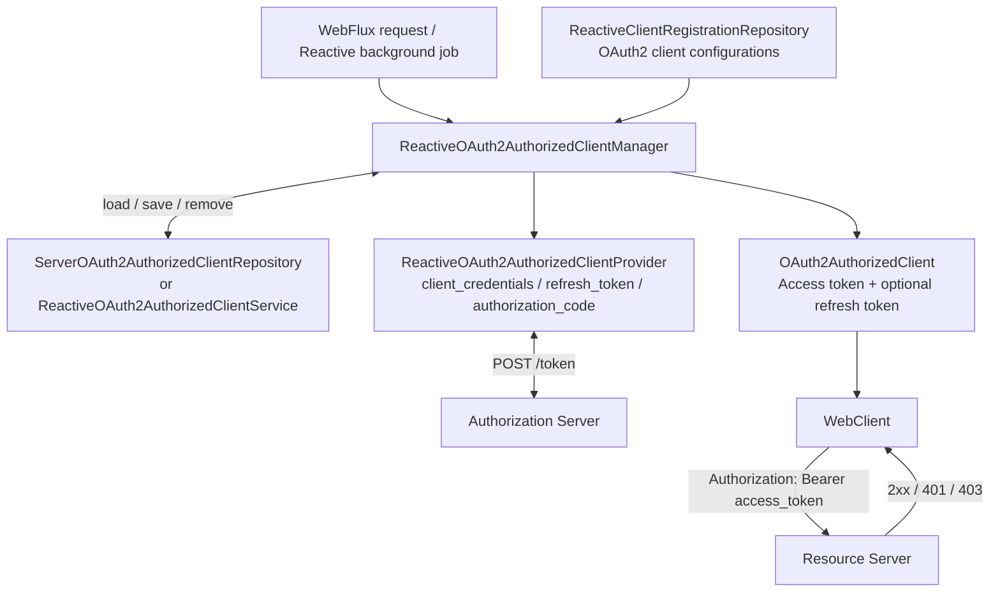
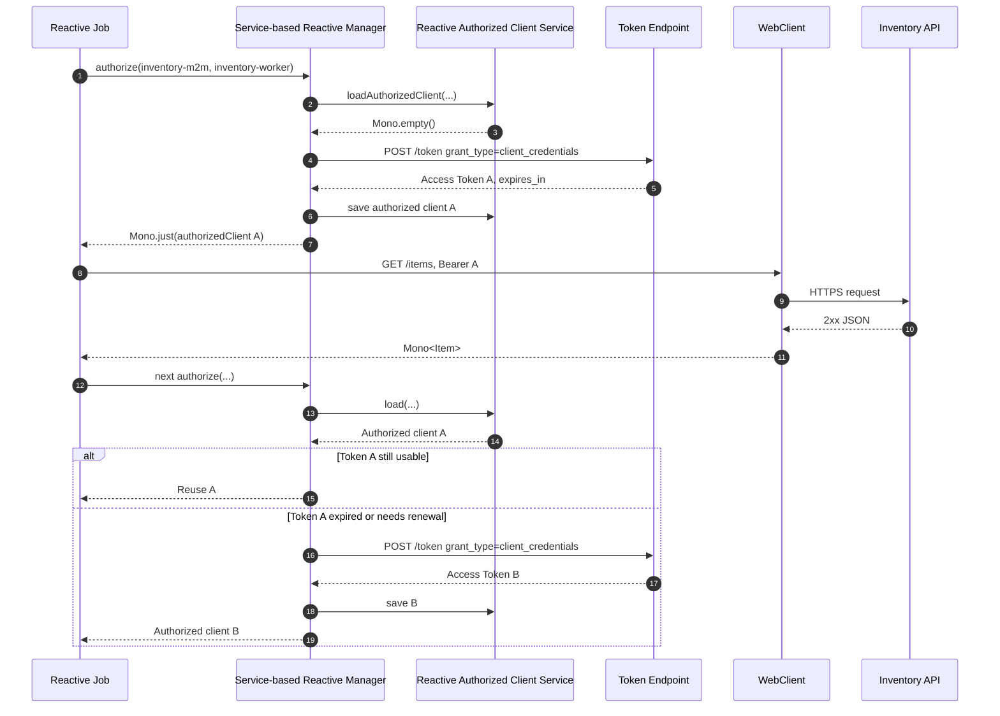

# 21.11. Client Credentials, Refresh Tokens, and Accessing Resources Reactively

## 1. Objective: Acquiring, Maintaining, and Using Access Tokens in Spring Security WebFlux

In **Spring Security OAuth 2.0/OIDC Client**, a WebFlux application can act as an **OAuth2 Client** to acquire access tokens and call protected APIs (*Resource Servers*). Two key scenarios are:

- **Machine-to-machine:** a background worker or backend requests an access token using **`client_credentials`**, under the application's own authority, without a browser or logged-in user.
- **User-delegated access:** a user logs in via **Authorization Code/OIDC Login**; the app holds an `OAuth2AuthorizedClient` containing an access token and possibly a **refresh token**, calling APIs on the user's behalf. When the access token approaches expiration, the client can use the **`refresh_token` grant** to obtain a new token.

In the **Reactive** ecosystem, these operations wire together through:

```java
ReactiveOAuth2AuthorizedClientManager
ReactiveOAuth2AuthorizedClientProvider
ReactiveOAuth2AuthorizedClientService
ServerOAuth2AuthorizedClientRepository
ServerOAuth2AuthorizedClientExchangeFilterFunction
WebClient
```

Data flows through `Mono<OAuth2AuthorizedClient>` and Reactor chains (`map`, `flatMap`, `switchIfEmpty`, `onErrorResume`), rather than calling HTTP/token providers in a thread-blocking manner.

**Core message:** `client_credentials` and `refresh_token` **are not two names for the same operation**. `client_credentials` lets a client prove its own identity to acquire an access token; `refresh_token` only works when the Authorization Server **previously issued a valid refresh token** for an authorized client. The HTTP client sends the access token to the **right downstream Resource Server**, never sending refresh tokens or ID Tokens to APIs.

### 1.1. After This Lesson, You Will Be Able To

1. Read `spring.security.oauth2.client.registration.*` configurations for `client_credentials` and `authorization_code`.
2. Distinguish the manager **for WebFlux requests** from the manager **for background tasks**.
3. Build provider chains for `clientCredentials()` and `refreshToken()`.
4. Obtain `OAuth2AuthorizedClient` via a reactive manager without `.block()`.
5. Call Resource Servers using `WebClient` with the right bearer token.
6. Integrate `ServerOAuth2AuthorizedClientExchangeFilterFunction` to reduce manual token-fetching code.
7. Explain access token expiry, reauthorization, refresh token rotation, and local removal.
8. Distinguish Token Endpoint errors (`invalid_client`, `invalid_grant`) from API errors (`401`, `403`).
9. Design protections for secrets, tokens, sessions, concurrency, timeouts, and retries.
10. Recognize when a persistent `ReactiveOAuth2AuthorizedClientService` is needed instead of in-memory storage.

## 2. Reactive OAuth2 Client Architecture



Division of responsibilities:

| Component | Job | Do not confuse with |
| --- | --- | --- |
| `ClientRegistration` | Client ID, client auth, grant, scopes, endpoints | An issued token |
| `ReactiveClientRegistrationRepository` | Looks up registrations by `registrationId` | Authorized client store |
| `OAuth2AuthorizedClient` | `ClientRegistration` + `principalName` + access token + optional refresh token | `Authentication`/`OidcUser` |
| `ReactiveOAuth2AuthorizedClientService` | Reactive load/save/remove of authorized clients by principal and registration | Token-acquiring manager |
| `ServerOAuth2AuthorizedClientRepository` | Load/save/remove within a `ServerWebExchange` context | Authorization request repository |
| `ReactiveOAuth2AuthorizedClientManager` | Coordinates token issuance/renewal and persistence | API Resource Server |
| `ReactiveOAuth2AuthorizedClientProvider` | Executes one or more authorization grants | Token store |
| `ServerOAuth2AuthorizedClientExchangeFilterFunction` | Integrates manager and bearer tokens into `WebClient` requests | Server authentication filter |
| `WebClient` | Calls HTTP APIs in a Reactor chain | Token Endpoint, unless used as token client transport |

`ClientRegistration` only knows **how to request tokens**; a valid registration does not prove a token has been issued. `OAuth2AuthorizedClient` is created once an access token exists and is tied to a principal used as a storage key.

### 2.1. Where Does OIDC Fit?

When a user signs in via OpenID Connect, `oauth2Login()` can create an `OidcUser` and receive an **ID Token** to verify identity. `OAuth2AuthorizedClient` holds the **access token** for API calls and a refresh token if issued.

- **ID Token:** meant for the OIDC Client to verify the user; not automatically a credential for Resource Servers.
- **Access token:** sent to APIs in `Authorization: Bearer ...`.
- **Refresh token:** sent to the **Authorization Server Token Endpoint**, never to Resource Servers.
- **WebSession cookie:** maintains browser login/session state, not synonymous with a refresh token.

With `client_credentials`, there is no interactive user, so **no `OidcUser` is created in the standard flow**, even if the Authorization Server also supports OIDC.

## 3. Distinguishing `client_credentials`, `authorization_code`, and `refresh_token`

| Criterion | `client_credentials` | `authorization_code` | `refresh_token` |
| --- | --- | --- | --- |
| Scenario | Service-to-service | Browser user login/consent | Renewing an access token from an existing grant |
| Browser redirect? | No | Yes | No |
| What authority does it prove? | OAuth client's identity/permissions | Permissions granted by the user in the flow | Authority tied to a still-valid refresh token |
| Requires a previously issued token? | No | No; needs a valid authorization code | **Yes: a refresh token** |
| Token Endpoint request | `grant_type=client_credentials` | `grant_type=authorization_code` | `grant_type=refresh_token` |
| `principalName` in storage | Stable service name | Verified principal | Linked to the prior authorized client |
| Refresh token in response | Normally no | Possibly | Possibly rotated/reissued |
| ID Token | Not a standard output | Present in OIDC Login | OIDC has specific rules; not always returned |
| Spring Security provider | `.clientCredentials()` | `.authorizationCode()` | `.refreshToken()` |

**Point to remember:** A user's base registration usually stays `authorization_code`. You **do not change** `authorization-grant-type` in YAML to `refresh_token` just to let Spring Security refresh tokens. Instead, the manager uses the `refreshToken()` provider when an authorized client already holds a refresh token.

With client credentials, expired tokens are normally **re-issued using the `client_credentials` grant itself**.

## 4. The Reactive Stack Does Not Behave Like the Servlet Stack

Easily confused pairs:

| Servlet/non-reactive | Reactive WebFlux |
| --- | --- |
| `ClientRegistrationRepository` | `ReactiveClientRegistrationRepository` |
| `OAuth2AuthorizedClientService` | `ReactiveOAuth2AuthorizedClientService` |
| `InMemoryOAuth2AuthorizedClientService` | `InMemoryReactiveOAuth2AuthorizedClientService` |
| `OAuth2AuthorizedClientManager` | `ReactiveOAuth2AuthorizedClientManager` |
| `OAuth2AuthorizedClientProvider` | `ReactiveOAuth2AuthorizedClientProvider` |
| `DefaultOAuth2AuthorizedClientManager` | `DefaultReactiveOAuth2AuthorizedClientManager` |
| `AuthorizedClientServiceOAuth2AuthorizedClientManager` | `AuthorizedClientServiceReactiveOAuth2AuthorizedClientManager` |
| `OAuth2AuthorizedClientRepository` | `ServerOAuth2AuthorizedClientRepository` |
| `ServletOAuth2AuthorizedClientExchangeFilterFunction` | `ServerOAuth2AuthorizedClientExchangeFilterFunction` |
| `HttpSecurity` / `SecurityFilterChain` | `ServerHttpSecurity` / `SecurityWebFilterChain` |
| `SecurityContextHolder` | `ReactiveSecurityContextHolder` |

Never inject a Servlet service or manager into WebFlux expecting `.authorize()` to return a `Mono`. The two APIs have different contracts.

In a Reactive application, avoid:

```java
OAuth2AuthorizedClient client = manager.authorize(request).block();
```

on a request/event loop. The right approach:

```java
Mono<OAuth2AuthorizedClient> clientMono = manager.authorize(request);

return clientMono.flatMap(client -> callApi(client));
```

A `Mono` describes an asynchronous computation. Execution happens when the publisher is subscribed to by WebFlux/Reactor; **compose** pipelines rather than calling `subscribe()` across layers and losing error/cancellation propagation.

## 5. Configuring Spring Boot for Machine-to-Machine Calls

### 5.1. Dependencies

Gradle example for Spring WebFlux:

```gradle
dependencies {
    implementation 'org.springframework.boot:spring-boot-starter-webflux'
    implementation 'org.springframework.boot:spring-boot-starter-security'
    implementation 'org.springframework.boot:spring-boot-starter-oauth2-client'
}
```

Spring Boot/Spring Security manage compatible versions. Never mix incompatible versions of Spring Framework, Reactor, and Spring Security manually.

### 5.2. `client_credentials` Registration

```yaml
spring:
  security:
    oauth2:
      client:
        registration:
          inventory-m2m:
            provider: company-auth
            client-id: ${INVENTORY_CLIENT_ID}
            client-secret: ${INVENTORY_CLIENT_SECRET}
            authorization-grant-type: client_credentials
            client-authentication-method: client_secret_basic
            scope:
              - inventory.read

        provider:
          company-auth:
            token-uri: https://auth.example.com/oauth2/token

downstreams:
  inventory:
    base-url: https://inventory-api.example.com
```

Explanation:

- `inventory-m2m` is the **internal registration ID** Java code passes to the manager.
- `client-id`/`client-secret` are issued by the Authorization Server; protect them via environment/secret manager.
- `authorization-grant-type: client_credentials` is a grant **without a browser or redirect URI**.
- `client-authentication-method` must match what the provider permits; `client_secret_basic` is common.
- `scope` is what the client **requests**, not permissions guaranteed to be granted.
- `provider.token-uri` is the **Token Endpoint** for requesting tokens, not the target API URL.
- `downstreams.inventory.base-url` is an **application-specific property**, not automatically turned into an authorization target by Spring Security.

Do not habitually declare `redirect-uri`, `user-info-uri`, or `scope: openid` on a pure machine-to-machine registration unless the provider requires them.

### 5.3. When the Provider Supports Issuer Metadata

Some Authorization Servers support discovery via `issuer-uri`:

```yaml
provider:
  company-auth:
    issuer-uri: https://login.example.com/realms/workloads
```

With discovery, the framework can read `token_endpoint` from metadata. This depends on provider support and Spring Security version, and can make startup depend on DNS/TLS connectivity to the issuer.

If the provider only supplies `token-uri`, configure it directly. **Never guess Token Endpoint paths** or swap issuer hostnames arbitrarily just to bypass network errors. If the provider requires `audience`/`resource` parameters, use the token response client extension point per contract rather than expecting arbitrary YAML keys to be sent automatically.

## 6. Manager for Background Jobs: `AuthorizedClientServiceReactiveOAuth2AuthorizedClientManager`

A worker or scheduled job **has no `ServerWebExchange` and no user login session**. It needs a manager that operates independently of HTTP requests:

```java
org.springframework.security.oauth2.client
    .AuthorizedClientServiceReactiveOAuth2AuthorizedClientManager
```

This manager uses:

- `ReactiveClientRegistrationRepository` to look up OAuth2 client configurations.
- `ReactiveOAuth2AuthorizedClientService` to save/load tokens by `(registrationId, principalName)`.
- `ReactiveOAuth2AuthorizedClientProvider` to execute grants.

### 6.1. Configuring a Manager Supporting Only `client_credentials`

```java
@Configuration
class MachineOAuth2ClientConfiguration {

    @Bean
    ReactiveOAuth2AuthorizedClientService reactiveAuthorizedClients(
            ReactiveClientRegistrationRepository registrations) {

        return new InMemoryReactiveOAuth2AuthorizedClientService(
            registrations);
    }

    @Bean("machineAuthorizedClientManager")
    ReactiveOAuth2AuthorizedClientManager machineAuthorizedClientManager(
            ReactiveClientRegistrationRepository registrations,
            ReactiveOAuth2AuthorizedClientService authorizedClients) {

        ReactiveOAuth2AuthorizedClientProvider provider =
            ReactiveOAuth2AuthorizedClientProviderBuilder.builder()
                .clientCredentials()
                .build();

        var manager =
            new AuthorizedClientServiceReactiveOAuth2AuthorizedClientManager(
                registrations,
                authorizedClients);

        manager.setAuthorizedClientProvider(provider);
        return manager;
    }
}
```

This is an **explicit configuration to illustrate the mechanics**. Spring Boot/Spring Security may supply default manager/service beans when auto-configuration conditions apply; when defining a custom manager, verify which bean your gateway injects.

`InMemoryReactiveOAuth2AuthorizedClientService` keeps authorized clients in **the JVM's own RAM**; state is lost on restart and not shared across pods. It works when tokens can simply be re-acquired and durability is unnecessary.

### 6.2. Why Not Use the WebFlux Request Manager in a Job?

`DefaultReactiveOAuth2AuthorizedClientManager` is designed to work with `ServerOAuth2AuthorizedClientRepository` in a **`ServerWebExchange` context**. Background jobs lack browser request/response exchanges, so the service-based manager avoids fabricating fake `ServerWebExchange` instances.

Specifically:

```text
User-facing request:
    DefaultReactiveOAuth2AuthorizedClientManager
    + ServerOAuth2AuthorizedClientRepository

Background service:
    AuthorizedClientServiceReactiveOAuth2AuthorizedClientManager
    + ReactiveOAuth2AuthorizedClientService
```

The two managers are not "stronger vs weaker"; they differ in **where authorized clients are stored** and how current context is obtained.

## 7. Acquiring Tokens Asynchronously via the Manager

In a job, choose a stable principal name, such as `inventory-worker`.

```java
OAuth2AuthorizeRequest request =
    OAuth2AuthorizeRequest
        .withClientRegistrationId("inventory-m2m")
        .principal("inventory-worker")
        .build();

Mono<OAuth2AuthorizedClient> authorizedClientMono =
    machineAuthorizedClientManager.authorize(request);
```

`principal("inventory-worker")` **does not prove an employee logged in**. It is a **service principal** identifier used as a key in the authorized-client store.

### 7.1. Reading the Token from Mono and Handling Missing Authorized Clients

```java
Mono<String> accessTokenMono =
    machineAuthorizedClientManager.authorize(request)
        .switchIfEmpty(Mono.error(
            new IllegalStateException(
                "Inventory OAuth2 client authorization unavailable")))
        .map(client ->
            client.getAccessToken().getTokenValue());
```

`switchIfEmpty` is important because the manager can emit empty when it cannot authorize per contract/provider. However, **Token Endpoint errors** propagate via `onError` (such as `OAuth2AuthorizationException`) rather than `Mono.empty()`.

Do not write:

```java
String token = machineAuthorizedClientManager
    .authorize(request)
    .block()
    .getAccessToken()
    .getTokenValue();
```

On a WebFlux event loop, `.block()` is improper and can throw errors or hurt throughput. Combine values using Reactor operators.

### 7.2. Why Must the Principal Name Be Stable?

Authorized clients are normally keyed by:

```text
(registrationId, principalName)
```

For example:

```text
(inventory-m2m, inventory-worker)  -> Access Token A
(billing-m2m, billing-worker)      -> Access Token B
```

If each job execution used:

```java
.principal(UUID.randomUUID().toString())
```

storage would treat each run as a different principal, preventing reuse of authorized clients and generating excessive token requests/entries.

Conversely, for **user-delegated tokens**, never share one fixed principal name across all users. That risks **mixing tokens across users**.

## 8. Calling a Resource Server with `WebClient` and `client_credentials`

You can invoke the manager explicitly and pass the token onto the HTTP request. Because this example uses no exchange filter, each layer is easy to trace.

### 8.1. Configuring WebClient for Downstream Calls

```java
@Configuration
class InventoryHttpConfiguration {

    @Bean("inventoryWebClient")
    WebClient inventoryWebClient(
            WebClient.Builder builder,
            @Value("${downstreams.inventory.base-url}") String baseUrl) {

        return builder.clone()
            .baseUrl(baseUrl)
            .defaultHeader(
                HttpHeaders.ACCEPT, MediaType.APPLICATION_JSON_VALUE)
            .build();
    }
}
```

`RestClient` is a blocking client whereas `WebClient` is reactive. In WebFlux, `WebClient` fits naturally because it returns `Mono`/`Flux`.

`baseUrl` lets gateways use relative paths, yet **is not an absolute security allowlist**; code can still pass an absolute URI. Never take a URL from user input and attach a bearer token to send to that host.

### 8.2. Gateway Fetching the Token and Calling the API via `flatMap`

```java
@Service
class InventoryGateway {

    private final ReactiveOAuth2AuthorizedClientManager manager;
    private final WebClient inventory;

    InventoryGateway(
            @Qualifier("machineAuthorizedClientManager")
            ReactiveOAuth2AuthorizedClientManager manager,
            @Qualifier("inventoryWebClient")
            WebClient inventory) {

        this.manager = manager;
        this.inventory = inventory;
    }

    Mono<Item> findItem(String itemId) {
        OAuth2AuthorizeRequest request =
            OAuth2AuthorizeRequest
                .withClientRegistrationId("inventory-m2m")
                .principal("inventory-worker")
                .build();

        return manager.authorize(request)
            .switchIfEmpty(Mono.error(
                new IllegalStateException(
                    "No inventory authorized client available")))
            .flatMap(client ->
                inventory.get()
                    .uri(builder -> builder
                        .path("/api/items/{itemId}")
                        .build(itemId))
                    .headers(headers -> headers.setBearerAuth(
                        client.getAccessToken().getTokenValue()))
                    .retrieve()
                    .bodyToMono(Item.class));
    }

    record Item(String id, String sku, int availableQuantity) {}
}
```

Key highlights:

- Method returns `Mono<Item>`, no `.block()`.
- Manager selects `inventory-m2m` and principal `inventory-worker`.
- Token is acquired when the publisher is subscribed to.
- The Bearer token is **only** passed to `inventoryWebClient` configured with the Inventory API base URL.
- The URI is built from a **path template**, not concatenated from a user-controlled absolute URL.
- `retrieve()` can emit HTTP errors if the API returns `4xx/5xx`; those differ from token-acquisition errors at the Authorization Server.

In larger projects, you can use an **OAuth2 ExchangeFilterFunction** to attach bearer tokens automatically instead of repeating the logic in every method. Writing it explicitly first clarifies the mechanics and trust boundaries.

### 8.3. Streaming with `Flux`

If the API streams a list:

```java
Flux<Item> findItems() {
    OAuth2AuthorizeRequest request =
        OAuth2AuthorizeRequest
            .withClientRegistrationId("inventory-m2m")
            .principal("inventory-worker")
            .build();

    return manager.authorize(request)
        .switchIfEmpty(Mono.error(
            new IllegalStateException("OAuth2 token unavailable")))
        .flatMapMany(client ->
            inventory.get()
                .uri("/api/items")
                .headers(h -> h.setBearerAuth(
                    client.getAccessToken().getTokenValue()))
                .retrieve()
                .bodyToFlux(Item.class));
}
```

`flatMapMany` turns a `Mono` of an authorized client into a `Flux` of API data.

If the API returns large datasets, plan pagination, streaming memory limits, backpressure, and deadlines; OAuth2 token handling alone does not solve all reactive pipeline concerns.

## 9. Lifecycle Diagram of `client_credentials` in Reactive



With `client_credentials`, Authorization Servers normally **do not issue a refresh token**. When A expires, the `clientCredentials()` provider executes the **client credentials grant again** to acquire a new access token.

Adding `refreshToken()` **does not help** if there is no refresh token to send. Never fabricate fake refresh tokens and never treat a client secret as a refresh token.

## 10. User-Delegated Access: OIDC Login and Refresh Tokens

Another WebFlux application has browser users:

1. Browser starts OAuth2/OIDC Login.
2. Authorization Server authenticates the user and returns an authorization code.
3. OAuth2 Client exchanges the code for an access token, possibly a refresh token, and an ID Token.
4. Spring Security builds `OidcUser`/`Authentication`.
5. `OAuth2AuthorizedClient` is saved so the backend can use the access token for API calls.
6. When the token is nearing or past expiration, the **`refreshToken()` provider** can execute the Refresh Token Grant.

### 10.1. Authorization Code/OIDC Registration Configuration

```yaml
spring:
  security:
    oauth2:
      client:
        registration:
          reports-user:
            provider: company-oidc
            client-id: ${REPORTS_USER_CLIENT_ID}
            client-secret: ${REPORTS_USER_CLIENT_SECRET}
            authorization-grant-type: authorization_code
            client-authentication-method: client_secret_basic
            redirect-uri: "{baseUrl}/login/oauth2/code/{registrationId}"
            scope:
              - openid
              - profile
              - reports.read
              - offline_access

        provider:
          company-oidc:
            issuer-uri: https://login.example.com/realms/staff

downstreams:
  reports:
    base-url: https://reports-api.example.com
```

`offline_access` is an OIDC scope associated with maintaining offline access, yet **it does not guarantee the provider will issue a refresh token**. Providers may require consent, client policies, session policies, or custom parameters, and may withhold refresh tokens even when requested.

**The registration remains `authorization_code`**—do not change `authorization-grant-type` to `refresh_token` after the user logs in.

### 10.2. `SecurityWebFilterChain` for OIDC Login and OAuth2 Client

```java
@Configuration
@EnableWebFluxSecurity
class ReactiveLoginConfiguration {

    @Bean
    SecurityWebFilterChain securityWebFilterChain(
            ServerHttpSecurity http) {

        return http
            .authorizeExchange(exchanges -> exchanges
                .pathMatchers("/", "/assets/**").permitAll()
                .anyExchange().authenticated())
            .oauth2Login(Customizer.withDefaults())
            .oauth2Client(Customizer.withDefaults())
            .build();
    }
}
```

This is an example of a session-based WebFlux OAuth2 Login app. After sign-in, `ReactiveSecurityContextHolder` supplies `Authentication` inside Reactor Context for authenticated requests.

Never confuse `OidcUser.getIdToken()` with the access token for calling the Reports API. The access token lives in `OAuth2AuthorizedClient`.

## 11. When Does `refreshToken()` Operate?

`ReactiveOAuth2AuthorizedClientProviderBuilder.builder().refreshToken().build()` adds the strategy for acquiring a new token via a refresh token.

Conceptual conditions:

```text
Authorized client exists?
    No -> refresh provider has nothing to refresh.

Refresh token present?
    No -> Refresh Token Grant cannot execute.

Access token still valid per policy/clock skew?
    Yes -> normally does not refresh.

Access token needs renewal?
    Yes -> POST /token grant_type=refresh_token.

Token Endpoint succeeds?
    Yes -> build OAuth2AuthorizedClient with new access token,
           update refresh token per response/provider policy,
           manager saves updated tokens.

Token Endpoint fails?
    Yes -> emit error signal; manager/failure handler reacts.
```

**`refreshToken()` is not a background scheduler.** The provider runs only when a `ReactiveOAuth2AuthorizedClientManager` executes `authorize(...)` with a matching authorized client and context.

### 11.1. HTTP Refresh Token Grant

Illustrative Token Endpoint request:

```http
POST /oauth2/token HTTP/1.1
Host: login.example.com
Authorization: Basic <client-credentials-if-required>
Content-Type: application/x-www-form-urlencoded

grant_type=refresh_token&refresh_token=<refresh-token>
```

Illustrative response:

```json
{
  "access_token": "REDACTED_ACCESS_TOKEN_B",
  "token_type": "Bearer",
  "expires_in": 3600,
  "scope": "reports.read",
  "refresh_token": "REDACTED_REFRESH_TOKEN_R2"
}
```

The provider may also **omit a new refresh token**. Spring Security/the token client must handle the response per contract and not accidentally drop the active refresh token when no replacement is returned.

The `refresh_token` grant does not let a client expand privileges beyond the initial scopes/consent. Receiving a fresh access token also **does not mean** the Resource Server will grant extra business permissions.

### 11.2. Access Token Expiry Does Not Automatically Delete Store Entries

Example:

```text
10:00 save Access Token A, expiresAt = 10:30, Refresh Token R1.
10:15 manager can reuse A.
10:31 nobody calls authorize -> entry A/R1 may still sit in store.
11:00 authorize is called -> refresh provider submits R1.
11:01 receives B/R2 -> manager saves updated authorized client.
```

`expiresAt` is metadata used to evaluate token usability, not a TTL that automatically evicts the whole record from `InMemoryReactiveOAuth2AuthorizedClientService`.

A provider can refresh **slightly before actual expiration** via clock skew to avoid tokens expiring mid-flight during API calls. The buffer depends on provider configuration and version, not a universal fixed OAuth2 constant.

## 12. Manager Inside WebFlux Requests: `DefaultReactiveOAuth2AuthorizedClientManager`

When code runs inside a **`ServerWebExchange`** (an HTTP request handled by WebFlux), use the manager paired with `ServerOAuth2AuthorizedClientRepository`:

```java
@Configuration
class WebFluxAuthorizedClientManagerConfiguration {

    @Bean("webAuthorizedClientManager")
    ReactiveOAuth2AuthorizedClientManager webAuthorizedClientManager(
            ReactiveClientRegistrationRepository registrations,
            ServerOAuth2AuthorizedClientRepository authorizedClients) {

        ReactiveOAuth2AuthorizedClientProvider provider =
            ReactiveOAuth2AuthorizedClientProviderBuilder.builder()
                .authorizationCode()
                .refreshToken()
                .clientCredentials()
                .build();

        var manager = new DefaultReactiveOAuth2AuthorizedClientManager(
            registrations,
            authorizedClients);

        manager.setAuthorizedClientProvider(provider);
        return manager;
    }
}
```

Role of the provider chain:

- `.authorizationCode()` for Authorization Code authorized clients when flow conditions apply.
- `.refreshToken()` for authorized clients that hold a refresh token and need renewal.
- `.clientCredentials()` for machine-to-machine registrations if the app also invokes that grant inside a request context.

**Having a provider chain does not mean the manager launches a browser login inside a background task.** Authorization Code / OIDC Login still needs proper browser redirects/callbacks and authorization request state.

`DefaultReactiveOAuth2AuthorizedClientManager` uses a request-scoped repository, so explicit calls to `authorize(...)` must supply or ensure the right WebFlux context. If a batch program has no `ServerWebExchange`, the **service-based manager** is the natural choice.

### 12.1. Default Success/Failure Handlers

Spring Security Reactive managers support:

- **Success handler:** saves the updated authorized client after successful authorization/re-authorization.
- **Failure handler:** can remove the stale authorized client after certain OAuth2 errors, such as `invalid_grant` when a refresh token is no longer valid.

Extension hooks:

```java
manager.setAuthorizationSuccessHandler(...);
manager.setAuthorizationFailureHandler(...);
```

In practice, these methods exist on the concrete manager implementations. If you replace a default handler with a custom handler **that only logs**, you can inadvertently lose persistence/removal behavior. To add telemetry, **delegate to the proper behavior** or write explicit logic—never replace and omit persistence.

## 13. Integrating `WebClient` with the OAuth2 Exchange Filter

Spring Security Reactive provides:

```java
org.springframework.security.oauth2.client.web.reactive.function.client
    .ServerOAuth2AuthorizedClientExchangeFilterFunction
```

This filter can:

1. Identify the registration/authorized client and principal.
2. Call `ReactiveOAuth2AuthorizedClientManager`.
3. Receive the existing or newly issued `OAuth2AuthorizedClient`.
4. Attach `Authorization: Bearer <access-token>` to the outbound request.
5. Handle certain Bearer errors returned by the Resource Server via a failure handler, if configured.

### 13.1. Creating WebClient with a Manager-Backed Filter

```java
@Configuration
class ReportsWebClientConfiguration {

    @Bean("reportsWebClient")
    WebClient reportsWebClient(
            @Qualifier("webAuthorizedClientManager")
            ReactiveOAuth2AuthorizedClientManager manager,
            WebClient.Builder builder,
            @Value("${downstreams.reports.base-url}") String baseUrl) {

        var oauth2 =
            new ServerOAuth2AuthorizedClientExchangeFilterFunction(
                manager);

        return builder.clone()
            .baseUrl(baseUrl)
            .filter(oauth2)
            .build();
    }
}
```

**Note on `401/403`:** with the manager constructor, a `RemoveAuthorizedClientReactiveOAuth2AuthorizationFailureHandler` for Resource Server errors **is not configured automatically**. Attach an appropriate handler if you want rejected tokens removed from the authorized-client store after an API rejects them.

### 13.2. Accessing the Reports API by Registration ID

Example inside a reactive controller/gateway with an authenticated WebFlux context:

```java
@Service
class ReportsGateway {

    private final WebClient reports;

    ReportsGateway(
            @Qualifier("reportsWebClient") WebClient reports) {
        this.reports = reports;
    }

    Mono<Report> myReport() {
        return reports.get()
            .uri("/api/reports/me")
            .attributes(
                ServerOAuth2AuthorizedClientExchangeFilterFunction
                    .clientRegistrationId("reports-user"))
            .retrieve()
            .bodyToMono(Report.class);
    }

    record Report(String id, String title) {}
}
```

The filter reads the `reports-user` registration from the request attribute and uses the active Reactive SecurityContext/`ServerWebExchange` as appropriate. Never fabricate a fixed `Authentication` in place of the user inside a user-delegated flow.

When running in a background task (without a WebFlux request), do not assume the filter can discover a current user from `ReactiveSecurityContextHolder`. Use an explicit service-based manager as in sections 7–8, or pass an authorized client/principal explicitly via supported filter attributes.

### 13.3. Attach Tokens Only to the Intended Downstream

Never configure a **global** `WebClient` for arbitrary URLs with:

```java
oauth2.setDefaultOAuth2AuthorizedClient(true);
```

and let business code pass arbitrary absolute URIs. Per documented behavior, this mode can attach the default authorized client's token **to every HTTP request** made through that WebClient whenever a current authentication exists.

`setDefaultClientRegistrationId("reports-user")` also warrants caution: it can attach that registration's token to every request on that client. Use it only when the WebClient/gateway targets **a fixed trusted downstream** and never accepts arbitrary hosts.

With multiple APIs, prefer:

```text
reportsWebClient   -> reports API + reports-user registration
inventoryWebClient -> inventory API + inventory-m2m registration
billingWebClient   -> billing API + billing-m2m registration
```

`baseUrl` does not block `.uri("https://other-host/...")`; gateways must use relative paths or enforce host allowlists.

## 14. Obtaining the Authorized Client from the Current Request

Another option is resolving the client via `@RegisteredOAuth2AuthorizedClient`, provided the MVC/WebFlux argument resolver is wired properly in your app.

WebFlux controller example:

```java
@RestController
class ReportsController {

    private final WebClient reports;

    ReportsController(
            @Qualifier("reportsWebClient") WebClient reports) {
        this.reports = reports;
    }

    @GetMapping("/my/report")
    Mono<String> myReport(
            @RegisteredOAuth2AuthorizedClient("reports-user")
            OAuth2AuthorizedClient authorizedClient) {

        return reports.get()
            .uri("/api/reports/me")
            .attributes(
                ServerOAuth2AuthorizedClientExchangeFilterFunction
                    .oauth2AuthorizedClient(authorizedClient))
            .retrieve()
            .bodyToMono(String.class);
    }
}
```

`oauth2AuthorizedClient(...)` attaches a **specific authorized client** to request attributes for the filter. The filter/manager can evaluate refreshing when the token is near expiry and a matching refresh token/provider exists.

For the annotation to succeed, the matching registration must already have an issued token and security infrastructure must be wired; do not assume it initiates browser consent automatically if no authorized client exists.

**Never return an intact `OAuth2AuthorizedClient` in an HTTP response** or send refresh tokens to the frontend for debugging.

### 14.1. Passing `ServerWebExchange` When Needed

The filter provides the helper:

```java
ServerOAuth2AuthorizedClientExchangeFilterFunction
    .serverWebExchange(exchange)
```

to put `ServerWebExchange` into request attributes. This is useful when you want to ensure the filter receives the WebFlux HTTP request context.

Example:

```java
Mono<String> fetch(
        ServerWebExchange exchange) {

    return reports.get()
        .uri("/api/reports/me")
        .attributes(
            ServerOAuth2AuthorizedClientExchangeFilterFunction
                .serverWebExchange(exchange))
        .attributes(
            ServerOAuth2AuthorizedClientExchangeFilterFunction
                .clientRegistrationId("reports-user"))
        .retrieve()
        .bodyToMono(String.class);
}
```

`exchange` belongs to the current HTTP request. **Never retain `ServerWebExchange` to use from a scheduler after the request finishes**; background tasks need their own context-appropriate identity and storage.

## 15. Two Kinds of Failure Handlers: Token Endpoint vs Resource Server

Not every OAuth2 failure happens at the same step.

### 15.1. Manager Failure During Authorize/Re-Authorize

For instance, a refresh token is no longer valid:

```text
Reactive manager
    -> refresh token provider
        -> POST Token Endpoint grant_type=refresh_token
            -> OAuth2 error: invalid_grant
```

This is an error **during authorization/reauthorization**. `DefaultReactiveOAuth2AuthorizedClientManager`/service-based managers can use a `ReactiveOAuth2AuthorizationFailureHandler` to remove the old authorized client per error policy.

Other errors:

- `invalid_client`: wrong secret/method/certificate; never retry infinitely.
- `unauthorized_client`: client not permitted to use the grant.
- `invalid_scope`: requested scope not approved.
- TLS/connection timeout: HTTP client issue talking to the token endpoint, not automatically an invalid token.

### 15.2. Exchange Filter Failure After an API Returns 401/403

Example:

```http
HTTP/1.1 401 Unauthorized
WWW-Authenticate: Bearer error="invalid_token"
```

The filter can forward the OAuth2 Bearer failure to a `ReactiveOAuth2AuthorizationFailureHandler`. `RemoveAuthorizedClientReactiveOAuth2AuthorizationFailureHandler` **inspects the OAuth2 error code** and can remove the stale token so the **next** request can request a fresh one.

If the API returns:

```http
HTTP/1.1 403 Forbidden
WWW-Authenticate: Bearer error="insufficient_scope",
                  scope="reports.admin"
```

that indicates **missing permissions**, not simply an expired token. Never repeatedly delete and re-acquire an access token with the same scopes.

### 15.3. Which Constructor Includes a Default Removal Handler?

`ServerOAuth2AuthorizedClientExchangeFilterFunction` supports:

```java
new ServerOAuth2AuthorizedClientExchangeFilterFunction(
    ReactiveClientRegistrationRepository registrations,
    ServerOAuth2AuthorizedClientRepository authorizedClients);
```

With the repositories constructor, Spring Security preconfigures a **`RemoveAuthorizedClientReactiveOAuth2AuthorizationFailureHandler`** for matching Bearer errors.

Meanwhile:

```java
new ServerOAuth2AuthorizedClientExchangeFilterFunction(
    ReactiveOAuth2AuthorizedClientManager manager);
```

**does not automatically configure a removal handler for Resource Server 401/403s**. When using the manager constructor, attach an explicit handler if you want lifecycle cleanup when an API rejects a token.

Never confuse the manager's failure handler (Token Endpoint) with the filter's failure handler (downstream API).

### 15.4. Configuring the Remover with ReactiveAuthorizedClientService

In a **service-based token store** application, you can configure:

```java
var oauth2 =
    new ServerOAuth2AuthorizedClientExchangeFilterFunction(manager);

var failureHandler =
    new RemoveAuthorizedClientReactiveOAuth2AuthorizationFailureHandler(
        (registrationId, principal, attributes) -> {
            if (principal == null) {
                return Mono.empty();
            }

            return authorizedClients.removeAuthorizedClient(
                registrationId,
                principal.getName());
        });

oauth2.setAuthorizationFailureHandler(failureHandler);
```

In this example:

- `manager` is the configured `ReactiveOAuth2AuthorizedClientManager`.
- `authorizedClients` is the **`ReactiveOAuth2AuthorizedClientService` actually used by the manager**.
- The remover callback returns `Mono<Void>`.
- Deletion targets the exact `(registrationId, principalName)` pair.

**Never delete from a service that is not actually storing the tokens.** With a WebFlux request manager backed by `ServerOAuth2AuthorizedClientRepository`, the remover must target **the active repository**, which may need `ServerWebExchange` from attributes/context. If unsure about wiring, the `(registrations, repository)` constructor is the simpler option for standard web use cases.

### 15.5. Removal Does Not Automatically Retry the Current HTTP Request

Example:

```text
Call #1:
    WebClient sends token A
    API returns 401 invalid_token
    Filter removes authorized client A if error policy matches
    Call #1 still returns 401/error

Call #2:
    Manager no longer finds A, acquires/issues token B
    API may accept B, or still reject due to policy/audience
```

Do not assume the exchange filter automatically retries the first request. For side-effecting `POST` calls, any retry requires an explicit idempotency policy.

## 16. Refresh Token Rotation in Reactive Applications

Many providers enable **refresh token rotation**:

```text
Initial authorized client:
    access = A1
    refresh = R1

Refresh request #1:
    submits R1
    receives access A2 and refresh R2
    provider may invalidate R1

Concurrent refresh request #2:
    still submits R1
    may fail with invalid_grant
```

Even when `ReactiveOAuth2AuthorizedClientService` uses a concurrent map, that **does not automatically ensure** a refresh token is used only once when two requests concurrently notice an expiring access token.

### 16.1. Concurrency in Reactor

A `Mono` can be subscribed multiple times or many requests can share an authorized client. Without coordination:

- Two requests both `load` the stale token record.
- Both call the Token Endpoint with R1.
- One gets R2; the other gets `invalid_grant`.
- A failure handler may delete the entry just updated by the other request.
- Multi-pod shared stores require transactions/versioning/CAS if required by the provider.

Never "fix" this with `.block()` or a `synchronized` block around the reactive HTTP setup. A `synchronized` block held while building a publisher **does not stay held while the subscriber actually executes**; blocking threads during HTTP I/O defeats Reactor's benefits.

### 16.2. Strategies to Consider

- **Single-flight** per registration/principal so concurrent callers share one refresh outcome when appropriate.
- **Optimistic concurrency/versioned records**, preventing stale writes from overwriting new tokens.
- **Compare-and-remove** when a failure for token A arrives late after the store already holds token B.
- **Distributed coordination** if multiple pods share a single refresh-token rotation chain.
- **Bounded retries/backoff** on timeouts/5xx; never retry infinitely on `invalid_grant`.
- **Monitoring** token refresh rates, rotation errors, and Token Endpoint latency.
- **Never log raw refresh tokens**, even while debugging concurrency.

The exact policy depends on provider, grant, replica count, and storage. There is no need for heavy distributed locking if your system only uses independent per-pod `client_credentials` tokens without provider rate-limit contention.

## 17. `ReactiveOAuth2AuthorizedClientService` and Data Lifecycle

An example implementation:

```java
new InMemoryReactiveOAuth2AuthorizedClientService(registrations);
```

Used for:

```java
Mono<OAuth2AuthorizedClient> loadAuthorizedClient(
    String clientRegistrationId, String principalName);

Mono<Void> saveAuthorizedClient(
    OAuth2AuthorizedClient authorizedClient, Authentication principal);

Mono<Void> removeAuthorizedClient(
    String clientRegistrationId, String principalName);
```

This abbreviated contract illustrates reactive persistence.

### 17.1. Calling `load` Alone Does Not Refresh

Lifecycle mistake:

```java
return authorizedClients.loadAuthorizedClient(
        "reports-user", principalName)
    .flatMap(client -> callApiWithToken(
        client.getAccessToken().getTokenValue()));
```

This code **only loads the record**. If the access token is expired, it will still be sent blindly. `loadAuthorizedClient` never invokes refresh providers.

Prefer calling the **Reactive manager** with the right registration/principal/context; the manager and providers refresh or reissue tokens before the API request goes out.

### 17.2. Moving from In-Memory to a Persistent/Shared Store

In-memory lives strictly in the JVM heap:

- Restarts/pod replacements wipe authorized clients.
- Pods do not share tokens with each other.
- Expired access tokens can sit in the map without cleanup.
- No distributed locking or token-rotation coordination exists.

If refresh tokens must survive deployments, handle multiple users/tenants, enforce retention/auditing, or share across nodes, choose a persistent implementation matching the **reactive interfaces**.

Never run blocking JDBC on the Reactor event loop and call it reactive persistence. Pick reactive drivers/storage or isolate legacy blocking stores on controlled dedicated schedulers. When building custom services, preserve exact token values, scopes, `issuedAt`, `expiresAt`, refresh tokens, and registration bindings.

### 17.3. SecurityContext and Token Storage Are Separate

In WebFlux OIDC Login:

- `WebSession`/`ServerSecurityContextRepository` may store the browser's `Authentication`.
- `ServerOAuth2AuthorizedClientRepository`/`ReactiveOAuth2AuthorizedClientService` hold authorized clients for downstream calls.
- `ReactiveSecurityContextHolder` accesses the current principal from Reactor Context.

**Browser logout does not automatically revoke every access/refresh token at the Authorization Server.** Deleting a local authorized client is not token revocation. If comprehensive logout is required, coordinate session invalidation, OIDC RP-Initiated Logout, and token revocation per provider policy.

## 18. Common Errors When Acquiring and Using Tokens

| Symptom | Possible cause | Check |
| --- | --- | --- |
| `Mono.empty()` on authorize | Manager/provider cannot authorize in that context | Registration ID, grant provider, principal |
| `invalid_client` | Wrong secret/auth method/certificate | Client registration, provider config, rotation |
| `unauthorized_client` | Client not permitted to use the grant | Allowed grant types at Authorization Server |
| `invalid_scope` | Requested scope not approved | Requested scopes, IdP policy |
| `invalid_grant` on refresh | Refresh token expired/revoked/rotated | Token lifecycle, concurrency |
| `401` from Resource Server | Expired/revoked token, wrong audience/issuer, or missing Authorization header | Bearer challenge, API validator |
| `403` from Resource Server | Missing scopes/roles/permissions | API security rules, token scopes |
| Acquired token yet API still returns 401 | Token not meant for this API or wrong policy | Audience, issuer, JWKS/introspection |
| Requests a new token on every call | Changing principal, mismatched store, or broken manager | `(registrationId, principalName)`, success handler |
| Forced re-login/re-auth after restart | In-memory token store lost state | Storage and WebSession strategy |
| WebFlux `block()` error | Blocking call inside event loop | Reactor composition and non-blocking HTTP client |
| Missing user principal | `ReactiveSecurityContextHolder` lacks context | Reactor context propagation, HTTP auth |
| Scheduled job asks for ServerWebExchange | Using request-based manager in background | Switch to service-based manager |
| Refresh token missing | IdP did not issue one, missing consent/policy | Initial authorization response, scopes/grants |
| API call leaks token to another host | Default bearer interceptor + dynamic URLs | Fixed base URL, allowlist, redirect restrictions |
| `PKIX path building failed` | HTTP client does not trust Token Endpoint/API CA | Truststore, TLS chain, proxy |
| Connect/read timeout | DNS, egress, proxy, remote service | Reactor Netty/WebClient transport, deadlines |
| Multiple pods refresh R1 concurrently | Rotation race | Shared-store concurrency, CAS/single-flight |
| Filter(manager) keeps using stale token after 401 | Missing removal failure handler | Exchange filter `setAuthorizationFailureHandler` |

### 18.1. `invalid_grant` During Refresh

A token request failure:

```json
{
  "error": "invalid_grant"
}
```

may mean the refresh token expired, was revoked, belongs to another client, or was already consumed under rotation policy.

**Never retry the same refresh token infinitely.** If a user token cannot be renewed, guide the user through a fresh Authorization Code/OIDC Login per policy.

### 18.2. Resource Server 401/403 Errors

Distinguish:

```http
HTTP/1.1 401 Unauthorized
WWW-Authenticate: Bearer error="invalid_token"
```

from:

```http
HTTP/1.1 403 Forbidden
WWW-Authenticate: Bearer error="insufficient_scope",
                  scope="reports.admin"
```

`invalid_token` can justify removing the authorized client so the stale token is not sent again. `insufficient_scope` requires fixing permissions/consent/API policy; do not merely refresh with the same scopes.

Do not assume every 401/403 is a standard OAuth2 Bearer error if no matching challenge/error code is present.

## 19. Reactive Error Handling and Controlled Retries

In Reactor, errors travel via `onError`. Example mapping downstream errors:

```java
Mono<Item> item = inventory.get()
    .uri("/api/items/{id}", itemId)
    .retrieve()
    .onStatus(
        status -> status.value() == 404,
        (request, response) ->
            Mono.error(new ItemNotFoundException(itemId)))
    .bodyToMono(Item.class);
```

Here `ItemNotFoundException` is an **application-defined business exception**, not a standard Spring Security class.

### 19.1. Do Not Catch Every Error and Request a New Token

Wrong:

```java
return callApi()
    .onErrorResume(error -> getNewTokenAndRetry());
```

This is wrong because:

- The API may be returning 403 due to missing permissions.
- Downstream may have DNS/TLS/timeout failures.
- The Token Endpoint may be returning `invalid_client`.
- A POST may already have caused a side effect.
- The retry may reuse the exact same old token if the store has not removed it.
- Concurrent requests can cause a token issuance storm.

Instead:

1. Classify **Token Endpoint** errors separately from **Resource Server** errors.
2. Retry only cases permitted by policy.
3. Bound retry counts and total timeouts/deadlines.
4. Ensure the authorized client is actually updated before retrying.
5. Never auto-retry `403 insufficient_scope`.
6. For side-effecting POSTs, require idempotency keys or status-verification mechanisms.

### 19.2. Downstream Timeouts Differ from Token Endpoint Timeouts

An application may need:

- HTTP connector timeout to the API.
- HTTP connector timeout to the Token Endpoint.
- Overall deadline covering authorize + API + retry.
- Separate circuit breakers/rate limiters for the Authorization Server and each downstream.

**Configuring a timeout on an API-calling `WebClient` bean does not automatically apply to the internal WebClient/HTTP client inside the token response client.** If you need custom proxy/TLS/timeouts for OAuth2 token exchanges, configure `ReactiveOAuth2AccessTokenResponseClient` and the matching grant transport per your Spring Security version.

Since Spring Security 6.3+, default configuration flows can auto-wire custom `ReactiveOAuth2AccessTokenResponseClient` beans when provided; when creating managers manually, verify your providers actually use that token client.

### 19.3. Never Call `.subscribe()` Manually in Services

Wrong:

```java
void sendReport() {
    manager.authorize(request)
        .flatMap(this::callApi)
        .subscribe();
}
```

This easily drops error propagation, cancellation, security context, and ties to transaction/request lifecycles. Prefer returning:

```java
Mono<Report> sendReport() {
    return manager.authorize(request)
        .switchIfEmpty(Mono.error(
            new IllegalStateException("Authorization unavailable")))
        .flatMap(this::callApi);
}
```

The framework/scheduler at the **boundary** subscribes in a controlled manner. For scheduled tasks, design proper invocation and error handling rather than careless fire-and-forget.

## 20. Protecting Tokens and Credentials in Reactive Pipelines

Bearer access tokens are credentials; refresh tokens are even more sensitive because they can mint new access tokens.

- **Never log** access tokens, refresh tokens, client secrets, token response bodies, or `Authorization` headers.
- Never call `doOnNext(System.out::println)` on `OAuth2AuthorizedClient` if `toString()` could expose sensitive fields.
- Never store raw tokens in Reactor Context without clear necessity; pass only minimal required data.
- Never put access tokens in URIs/query strings. Use the `Authorization: Bearer` header.
- Never send OIDC ID Tokens instead of access tokens to Resource Servers.
- Never send refresh tokens to Resource Servers/business APIs.
- Never attach bearer tokens on a WebClient using **user-supplied arbitrary URLs**.
- Never auto-follow redirects carrying bearer tokens to untrusted hosts.
- Protect heap dumps, debug endpoints, APM traces, and session/store credentials.
- Enforce HTTPS/TLS to the Authorization Server, Resource Server, and shared storage.
- Across multiple tenants/users, never share principal names in ways that cause **cross-account token leakage**.
- Request minimal scopes/audience and separate registrations for downstreams with different trust boundaries.
- Maintain policies for logout, token revocation, account disabling, and client credential rotation.

### 20.1. Scope and Audience Differ

An access token carrying `inventory.read` is not automatically valid for the Inventory API if the token's audience targets a different API. Resource Servers may check `iss`, `aud`, expiry, signature/introspection, scopes, and business policy.

If a provider requires extra `resource` (RFC 8707) or custom `audience` parameters, use a supported token client extension—do not simply add YAML fields expecting Spring to send them automatically.

### 20.2. Separate WebClients by Downstream

Example:

```text
inventoryWebClient:
    baseUrl = https://inventory-api.example.com
    registrationId = inventory-m2m

reportsWebClient:
    baseUrl = https://reports-api.example.com
    registrationId = reports-user
```

Gateways control API targets and registrations; business services do not pass arbitrary URLs and registrations together.

## 21. Observability and Operations

Emit telemetry **without leaking credentials**:

```text
oauth2_registration=inventory-m2m
principal_kind=service
grant=client_credentials
authorize_outcome=success
token_endpoint_latency_ms=...
downstream=inventory
api_status=200
```

Or:

```text
oauth2_registration=reports-user
principal_kind=user
grant=refresh_token
authorize_outcome=invalid_grant
downstream_request_sent=false
```

These names are **observability suggestions**, not default metrics guaranteed to be emitted by Spring Security.

Recommended signals to track:

| Metric | What it helps detect |
| --- | --- |
| Token request rate by registration/grant | Excessive token acquisition |
| Reauthorize/refresh success and failure | Rotation/secret/provider issues |
| Token Endpoint latency/errors | Distinguishing IdP outages from API outages |
| Downstream HTTP 401/403 | Analyzing access token / API authorization issues |
| API latency, 429, 5xx | Rate limits and availability |
| Authorized-client store misses | Wrong principals, restarts, storage faults |
| TLS/timeout error categories | Diagnosing proxies/CAs/egress |
| Active registration/principal counts | Forecasting storage growth |
| Principal collision / cross-tenant incidents | Investigating improper token binding |

Bound metric label cardinality; **never put raw user subjects, emails, or access tokens** in metric labels.

### 21.1. Debugging Token Lifecycles via a Timeline

A token-free timeline:

```text
09:00 authorize(inventory-m2m, inventory-worker)
      storage=miss
      grant=client_credentials
      token_endpoint=success
      authorized_client_saved=true

09:15 authorize(inventory-m2m, inventory-worker)
      storage=hit
      token_reused=true

10:00 authorize(inventory-m2m, inventory-worker)
      existing_token_needs_reauthorization=true
      token_endpoint=success
      authorized_client_updated=true
```

Never log raw `access_token`, `refresh_token`, client secrets, or Bearer `Authorization` headers.

## 22. Practice Scenarios

### Scenario A — Background Service Calling the Inventory API

**Context:** A scheduled job reads inventory every 5 minutes without a logged-in user.

**Design:** `inventory-m2m` registration with `client_credentials`, `AuthorizedClientServiceReactiveOAuth2AuthorizedClientManager`, fixed principal `inventory-worker`, and a `WebClient` gateway with a fixed base URL. `manager.authorize(...).flatMap(...)` sends the bearer token.

### Scenario B — Access Token Expired While Still Cached in RAM

**Context:** Code calls `ReactiveOAuth2AuthorizedClientService.loadAuthorizedClient` and sends the stale token straight to the API.

**Bug:** The service only reads the record; **it does not re-issue tokens**.

**Solution:** Use the manager/authorized-client provider to reauthorize before calling the Resource Server.

### Scenario C — User Logged In via OIDC, API Needs Per-User Token

**Context:** Users A and B both log in with `reports-user`; each may only read their own reports.

**Design:** Bind tokens to their respective principals using the request-based reactive manager/repository or `@RegisteredOAuth2AuthorizedClient`. Never share `.principal("shared-user")` across all users.

### Scenario D — Provider Did Not Issue a Refresh Token

**Context:** The authorized client has an access token, yet `getRefreshToken()` is `null`.

**Explanation:** The `refreshToken()` provider cannot renew via Refresh Token Grant. Review consent/IdP policies and initiate a new authorization flow when needed. `offline_access` is not a guarantee.

### Scenario E — Refresh Token Rotation with Two Concurrent Requests

**Context:** Two WebFlux requests simultaneously see the access token nearing expiry and both submit R1; the first gets R2, the second gets `invalid_grant`.

**Design:** Evaluate single-flight, atomic versioning/updates, and failure handling. Never use blocking locks on the Reactor event loop.

### Scenario F — Resource Server Returns `401 invalid_token`

**Context:** WebClient sent token A, and the API rejected it.

**Design:** Wire the exchange filter's `ReactiveOAuth2AuthorizationFailureHandler` to the exact store. Remove per OAuth2 error code when appropriate, noting **the current request is not retried automatically**; the next call requests a new token.

### Scenario G — Resource Server Returns `403 insufficient_scope`

**Context:** Token carries `reports.read`, while the endpoint requires `reports.admin`.

**Design:** Never retry infinitely with the same registration. Inspect scopes granted by the Authorization Server and Resource Server policies; update permissions through proper channels.

### Scenario H — Job Scaled to 8 Pods

**Context:** Each pod uses an in-memory authorized-client service.

**Impact:** Each pod requests its own `client_credentials` token. If IdP rate limits or token sharing matter, consider a shared token store/coordination; if per-pod independence is fine, keep the simpler architecture.

### Scenario I — WebClient Request Manager Needs ServerWebExchange, Job Lacks One

**Context:** A developer uses `DefaultReactiveOAuth2AuthorizedClientManager` inside a scheduler without an exchange/context.

**Solution:** Use `AuthorizedClientServiceReactiveOAuth2AuthorizedClientManager` with a stable service principal—never fake an HTTP request.

### Scenario J — Client Secret Rotation Causes `invalid_client`

**Context:** The Token Endpoint rejects requests even though networking is healthy.

**Solution:** Verify the new secret, authentication method, client ID/tenant/realm, and token response client transport. Never retry infinitely with the stale credential.

### Scenario K — Token Still Rejected by API After Refresh

**Context:** Refresh succeeded yet the API returns 401.

**Analysis:** The token may have the wrong audience/issuer, the provider may have rotated keys, the Resource Server policy may be wrong, or the registration targets another API. Refreshing cannot fix a wrong trust boundary.

### Scenario L — WebFlux Pipeline Calls `.block()` Mid-Chain

**Context:** A service obtains a token via the manager and calls `.block()` in the controller.

**Impact:** Blocks the event loop, risking exceptions and poor throughput.

**Solution:** Return `Mono`/`Flux` and compose the entire chain with `flatMap`, letting WebFlux manage subscription.

## 23. Hands-On Exercises

### Exercise 1 — One Downstream, One Client Credentials Registration

Create configuration:

```yaml
spring:
  security:
    oauth2:
      client:
        registration:
          catalog-m2m:
            provider: corp-auth
            client-id: ${CATALOG_CLIENT_ID}
            client-secret: ${CATALOG_CLIENT_SECRET}
            authorization-grant-type: client_credentials
            scope:
              - catalog.read

        provider:
          corp-auth:
            token-uri: https://auth.example.com/oauth2/token
```

Requirements:

1. Create `InMemoryReactiveOAuth2AuthorizedClientService`.
2. Create a service-based manager with only `clientCredentials()`.
3. Create a WebClient with base URL `https://catalog-api.example.com`.
4. Implement `Mono<CatalogItem> findById(String id)` using `manager.authorize(...).flatMap(...)`.
5. Emit an error if the manager produces no authorized client.
6. Never log tokens or secrets.

### Exercise 2 — OIDC User and Refresh Tokens

Requirements:

1. Registration `user-reports` using `authorization_code`, scopes `openid`, `reports.read`.
2. Configure `ServerHttpSecurity.oauth2Login()` and `oauth2Client()`.
3. Request-based manager with `.authorizationCode().refreshToken()`.
4. Reports WebClient using `ServerOAuth2AuthorizedClientExchangeFilterFunction`.
5. Verify the token sent to the Reports API is the user's **access token**, not the ID Token.
6. Handle null refresh tokens or `invalid_grant` from the provider.
7. Scope request caches/sessions/cookies properly for the app.

### Exercise 3 — Simulating Resource Server 401/403

Requirements:

- On `401 + WWW-Authenticate: Bearer error="invalid_token"`: observe the handler removing the token per policy and the next request acquiring a fresh token.
- On `403 + insufficient_scope`: ensure no infinite token-request retry occurs.
- On Token Endpoint `invalid_client`: do not confuse it with an API 401.
- On HTTP 503: apply bounded retries and do not delete tokens needlessly.

### Exercise 4 — Scaling to Multiple Instances

Design how to preserve tokens/refresh tokens across pod replacements when business needs require it, including:

- Reactive shared authorized-client storage.
- Keying by `(registrationId, principalName)` and tenant binding.
- Atomic refresh-token rotation updates.
- Cleanup/TTL aligned with token lifetimes.
- Authorization Server rate limits / circuit breakers.
- Token-free logs.

## 24. Review Questions

**1. How does `client_credentials` differ from the Refresh Token Grant?**  
`client_credentials` uses the client's own identity/credentials to request an access token. The Refresh Token Grant uses a previously issued refresh token to acquire a new access token.

**2. Should `authorization-grant-type: refresh_token` be set on an OIDC registration to enable automatic refreshes?**  
No. User registrations normally stay `authorization_code`; enable `.refreshToken()` in the authorized-client provider chain.

**3. What does `ReactiveOAuth2AuthorizedClientManager.authorize(...)` return?**  
`Mono<OAuth2AuthorizedClient>`, not a synchronous token.

**4. Why shouldn't background jobs routinely use `DefaultReactiveOAuth2AuthorizedClientManager`?**  
That manager is tied to WebFlux requests/repositories; background jobs should use `AuthorizedClientServiceReactiveOAuth2AuthorizedClientManager` and a reactive service.

**5. Is `principal("inventory-worker")` a logged-in user?**  
No. It is a service principal key used to store the `client_credentials` authorized client.

**6. Why must the principal be stable?**  
Storage looks up authorized clients by registration ID and principal name. Changing it on every run causes cache misses and repeated token requests.

**7. Why must you never share one common principal across all user-delegated tokens?**  
It risks mixing up access tokens across users, granting unauthorized access.

**8. What does the `refreshToken()` provider do when there is no refresh token?**  
It cannot execute the Refresh Token Grant; another grant or authorization flow is needed as appropriate.

**9. Can an expiring access token be refreshed before `expiresAt`?**  
Yes, according to the provider's clock skew/policy, to avoid tokens expiring while an API call is in flight.

**10. Does `ReactiveOAuth2AuthorizedClientService.loadAuthorizedClient(...)` refresh automatically?**  
No. It is a storage read; use a manager to reauthorize.

**11. Does `WebClient` automatically carry OAuth2 Bearer tokens just from YAML configuration?**  
Not automatically. Use a manager and attach headers or configure `ServerOAuth2AuthorizedClientExchangeFilterFunction`.

**12. How does the filter know which registration to use?**  
Via the `clientRegistrationId(...)` request attribute, a specific authorized client, or a deliberately configured default registration.

**13. Why avoid enabling `setDefaultOAuth2AuthorizedClient(true)` on a WebClient calling arbitrary URIs?**  
Tokens can attach to every request, including unintended APIs/hosts, leaking credentials.

**14. Does the filter's manager constructor include a default removal failure handler?**  
No. Configure a handler explicitly if you want to react to Bearer 401/403s and evict stale tokens per policy.

**15. What about the filter constructor taking registration repository and authorized-client repository?**  
It configures a default removal handler for matching OAuth2 Bearer error codes.

**16. Does removing an authorized client after `401 invalid_token` automatically retry the current request?**  
Not by default. It prevents reusing the stale token on future requests; retrying is an application decision.

**17. Can an API `403 insufficient_scope` be fixed by refreshing the token?**  
Not automatically. The provider must grant—and the API must accept—the proper scope/permissions.

**18. Why can refresh token rotation trigger `invalid_grant` when two requests run in parallel?**  
Both submit the same old refresh token; the provider may accept only the first and invalidate it afterward.

**19. What is wrong with calling `.block()` on a WebFlux event loop?**  
It blocks the reactive thread, risking exceptions, lower throughput, and breaking the non-blocking design.

**20. Can Token Endpoint timeouts always be fixed by tuning the downstream API's WebClient?**  
Not necessarily. The OAuth2 token response client may use a separate WebClient/HTTP connector.

**21. Is an OIDC ID Token a bearer token to send to APIs?**  
Not by default. ID Tokens are for the client to verify identity; access tokens are for Resource Servers.

**22. Does local logout always revoke refresh tokens at the Authorization Server?**  
No. Session logout, local storage removal, and token revocation are distinct mechanisms.

**23. What happens when multiple pods use an in-memory store?**  
Each pod keeps its own token records; restarts lose entries. If sharing/consistency is required, design shared storage.

**24. When should an API request be retried?**  
Only when the error, operation, idempotency, and time budget allow; never retry every 401/403/POST infinitely.

## 25. References

- [Spring Security Reference — OAuth 2.0 Client (Reactive)](https://docs.spring.io/spring-security/reference/reactive/oauth2/client/index.html)
- [Spring Security Reference — Reactive OAuth2 Client Core Interfaces](https://docs.spring.io/spring-security/reference/reactive/oauth2/client/core.html)
- [Spring Security Reference — Reactive Authorization Grant Support](https://docs.spring.io/spring-security/reference/reactive/oauth2/client/authorization-grants.html)
- [Spring Security Reference — Reactive Authorized Client Features](https://docs.spring.io/spring-security/reference/reactive/oauth2/client/authorized-clients.html)
- [Spring Security Reference — Reactive OAuth2 Login](https://docs.spring.io/spring-security/reference/reactive/oauth2/login/index.html)
- [Spring Security API — ServerOAuth2AuthorizedClientExchangeFilterFunction](https://docs.spring.io/spring-security/reference/api/java/org/springframework/security/oauth2/client/web/reactive/function/client/ServerOAuth2AuthorizedClientExchangeFilterFunction.html)
- [Spring Security API — RemoveAuthorizedClientReactiveOAuth2AuthorizationFailureHandler](https://docs.spring.io/spring-security/reference/api/java/org/springframework/security/oauth2/client/RemoveAuthorizedClientReactiveOAuth2AuthorizationFailureHandler.html)
- [Spring Security API — DefaultReactiveOAuth2AuthorizedClientManager](https://docs.spring.io/spring-security/reference/api/java/org/springframework/security/oauth2/client/web/DefaultReactiveOAuth2AuthorizedClientManager.html)
- [Spring Security API — AuthorizedClientServiceReactiveOAuth2AuthorizedClientManager](https://docs.spring.io/spring-security/reference/api/java/org/springframework/security/oauth2/client/AuthorizedClientServiceReactiveOAuth2AuthorizedClientManager.html)
- [Spring Framework Reference — WebClient](https://docs.spring.io/spring-framework/reference/web/webflux-webclient.html)
- [RFC 6749 — OAuth 2.0 Authorization Framework](https://www.rfc-editor.org/rfc/rfc6749)
- [RFC 6750 — OAuth 2.0 Bearer Token Usage](https://www.rfc-editor.org/rfc/rfc6750)
- [RFC 7009 — OAuth 2.0 Token Revocation](https://www.rfc-editor.org/rfc/rfc7009)
- [RFC 9700 — Best Current Practice for OAuth 2.0 Security](https://www.rfc-editor.org/rfc/rfc9700)

**Key takeaway:** In **Spring Security OAuth2 Client Reactive**, managers and providers handle **acquiring/renewing tokens**, services/repositories store **`OAuth2AuthorizedClient`**, and `WebClient` sends **access tokens** to Resource Servers. With **`client_credentials`**, tokens are usually renewed via client credentials without relying on refresh tokens. With **OIDC/Authorization Code**, `.refreshToken()` can refresh access tokens if the provider issued a valid refresh token. Choose the request-based or service-based reactive manager for the right context, keep principal/registration bindings consistent, compose with `Mono`/`Flux` instead of `.block()`, configure failure handlers and storage accurately, and always protect tokens, scopes/audiences, concurrency, and each downstream's trust boundary.
