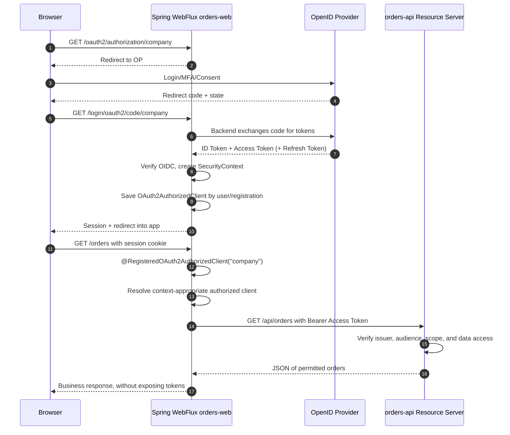
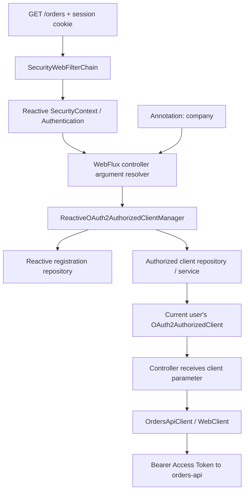
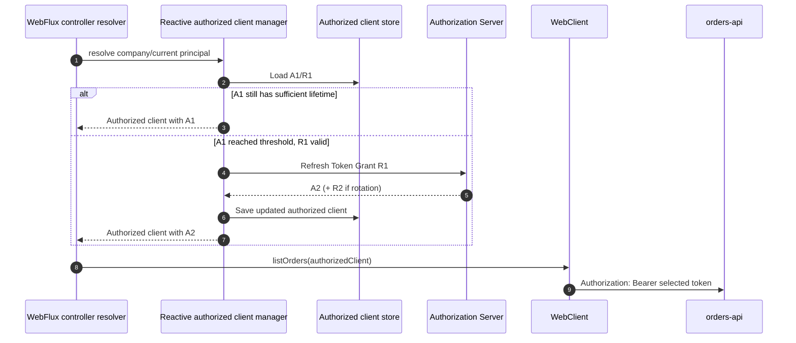
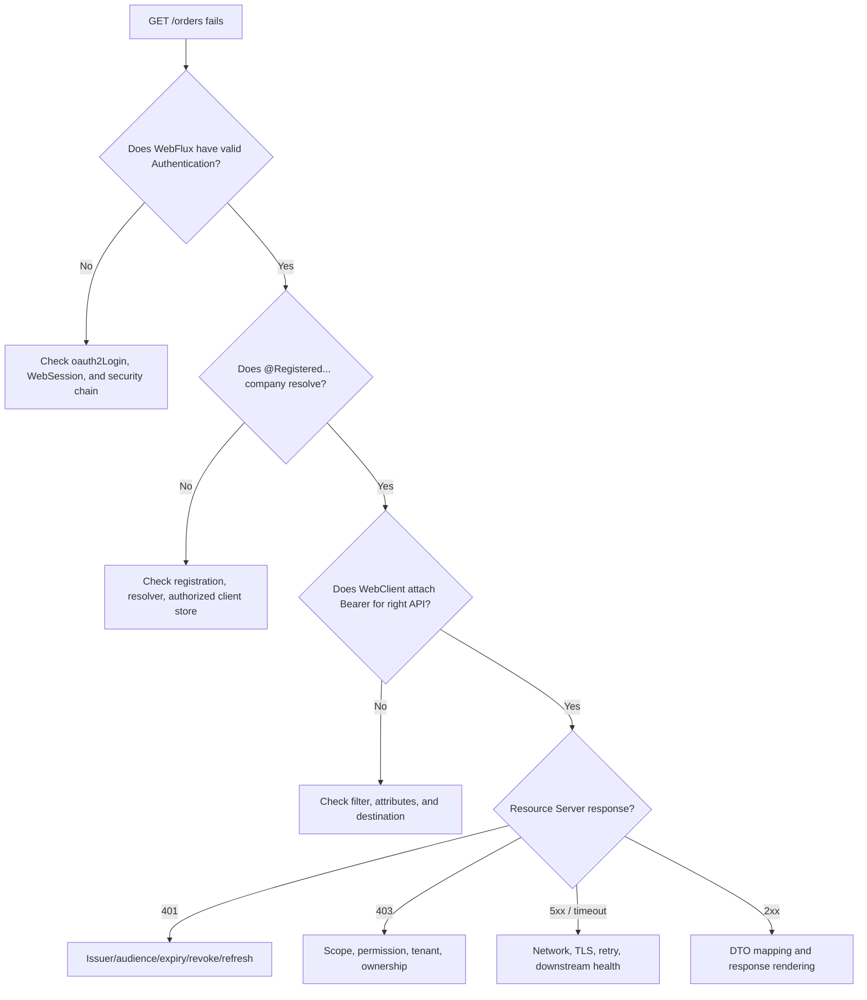

# 21.12. @RegisteredOAuth2AuthorizedClient and WebFlux Controllers

In a **Spring Security OAuth 2.0 / OIDC Client application running on Spring WebFlux**, a successful OIDC login is only the first step. After the user has an `Authentication` in the reactive security context, the application may also need to call another API **on behalf of the user** using an OAuth 2.0 Access Token.

Spring Security provides the **`@RegisteredOAuth2AuthorizedClient`** annotation so that a **Spring WebFlux controller method** receives the `OAuth2AuthorizedClient` instance corresponding to a client registration and the authenticated context. Instead of reading tokens from session attributes, manually querying a token store, or using an ID Token as a Bearer credential, the controller can ask the framework to resolve the authorized client as a parameter:

```java
@GetMapping("/orders")
public Mono<List<OrderSummary>> orders(
        @RegisteredOAuth2AuthorizedClient("company")
        OAuth2AuthorizedClient authorizedClient) {

    return ordersApi.listOrders(authorizedClient);
}
```

What matters is not only how the annotation works, but also **which object is selected, which principal owns the token, whether the token gets refreshed, and where the token is sent**. A small mistake such as using an authorized client for the wrong registration or enabling automatic Bearer token attachment on a shared WebClient can cause a serious security flaw.

This lesson covers the full role of the annotation on WebFlux controllers, the underlying reactive components, Spring Boot configuration, examples of calling APIs with `WebClient`, token lifecycle, reactive context constraints, error handling, and multi-provider/multi-tenant scenarios.

## 1. The Problem to Solve

Suppose a system consists of four components:

| Component | Role |
|---|---|
| **Browser** | The user logs in and accesses the orders page. |
| **`orders-web`** | A Spring Boot WebFlux application acting as an OIDC Client and backend-for-frontend (BFF). |
| **`company-idp`** | The OpenID Provider / Authorization Server, authenticating users and issuing tokens. |
| **`orders-api`** | The Resource Server, accepting Access Tokens and returning order data based on permissions. |

The user opens `/orders` after logging in via OIDC. The browser sends a **session cookie** to `orders-web`. However, when the backend calls `orders-api`, the Resource Server does not understand the `orders-web` session cookie; it requires an **Access Token** issued for that API.



The annotation solves the exact link **from the logged-in user in WebFlux to the authorized client containing the Access Token**. It does not perform authorization checks on behalf of the Resource Server, and it is not an annotation for building an Authorization Server.

### 1.1. Two Independent Credential Layers

The browser typically uses:

```http
GET /orders HTTP/1.1
Host: app.example.org
Cookie: SESSION=<session-id>
```

The WebFlux backend uses when calling an API:

```http
GET /api/orders HTTP/1.1
Host: api.orders.example.org
Authorization: Bearer <access-token>
```

Do not forward the application's WebSession cookie to an external API just to "share login". Conversely, do not return the Access Token in JSON to the browser if the architecture keeps tokens on the backend.

## 2. What Is `OAuth2AuthorizedClient`?

`OAuth2AuthorizedClient` is a Spring Security object representing **an OAuth 2.0 client that has been authorized within a principal context**, typically containing:

- `ClientRegistration`: registration configuration, client ID, provider endpoints, grant type, and related properties.
- `principalName`: the principal/context name used to store and retrieve the authorized client.
- `OAuth2AccessToken`: token value, token type, issued/expiration timestamps, and scopes.
- `OAuth2RefreshToken`: the Refresh Token if issued by the Authorization Server; may be `null`.

Conceptual example:

```text
ClientRegistration:
  registrationId = company
  clientId       = orders-web
  issuerUri      = https://id.example.org/realms/company

OAuth2AuthorizedClient:
  principalName = oidc-sub-9281
  accessToken:
    tokenValue  = <sensitive>
    expiresAt   = 2026-11-16T10:30:00Z
    scopes      = [openid, profile, orders.read]
  refreshToken  = <sensitive or null>
```

`OAuth2AuthorizedClient` is **not synonymous** with `OidcUser`, `Authentication`, or WebSession.

| Object | Question Answered | Where Used |
|---|---|---|
| `OidcUser` | Who is the user authenticated by the OP? | Principal after OIDC login. |
| `OidcIdToken` | OIDC proof of an authentication event intended for which client? | OIDC Client verification. |
| `Authentication` | Under which context is the current request authenticated, and with what authorities? | Spring Security authorization inside the app. |
| `OAuth2AuthorizedClient` | Which Access/Refresh Tokens does this client registration/principal hold to call a resource? | OAuth2 Client and outbound WebClient. |
| `WebSession` | How is browser state maintained across HTTP requests? | Reactive web session. |

**Do not send an ID Token instead of an Access Token.** An ID Token is issued to the OIDC Client to verify identity; a Resource Server needs an OAuth2 Access Token with the appropriate audience, scope, and conditions for the API.

### 2.1. Why Does `principalName` Matter?

Suppose a system has two users logging in through the `company` registration:

```text
(company, user-A) -> Access Token A
(company, user-B) -> Access Token B
```

An authorized client store must not store a single token solely by `registrationId` while ignoring the principal; otherwise, token A could be overwritten by B and the backend would call APIs on behalf of the wrong user.

In service interfaces, the common key pair is:

```text
(clientRegistrationId, principalName)
```

In multi-issuer/multi-tenant applications, design principal keys/registrations/partitions carefully to avoid collisions and protect data boundaries. Email is generally not a durable identity key; in OIDC, a verified `(issuer, sub)` pair is the proper binding point.

## 3. What Is the `@RegisteredOAuth2AuthorizedClient` Annotation Used For?

Spring Security's annotation:

```java
import org.springframework.security.oauth2.client.annotation.RegisteredOAuth2AuthorizedClient;
```

is placed on a **controller method parameter** to tell the framework to resolve an authorized client before invoking the method.

Example:

```java
import org.springframework.security.oauth2.client.OAuth2AuthorizedClient;
import org.springframework.security.oauth2.client.annotation.RegisteredOAuth2AuthorizedClient;
import org.springframework.web.bind.annotation.GetMapping;
import org.springframework.web.bind.annotation.RestController;

@RestController
public class AuthorizedClientInfoController {

    @GetMapping("/client-info")
    public String clientInfo(
            @RegisteredOAuth2AuthorizedClient("company")
            OAuth2AuthorizedClient client) {

        return client.getClientRegistration().getRegistrationId();
    }
}
```

When `GET /client-info` passes through the WebFlux security chain and controller argument resolution, Spring Security looks up the **`company`** authorized client in the current context.

Key points of the annotation:

1. **Selects the `clientRegistrationId`** to use, such as `company`.
2. **Integrates with reactive authorized client resolution**, without requiring the controller to read WebSession manually.
3. **Provides the controller with a specific `OAuth2AuthorizedClient`**.
4. **Keeps the access token on the backend**, when the app only uses the token to call internal/downstream APIs.
5. **Can coordinate authorization/refresh** through the configured manager, depending on grant, version, and conditions.

### 3.1. What Does the Annotation Not Do?

`@RegisteredOAuth2AuthorizedClient` does **not**:

- Automatically log in an unauthenticated user on its own.
- Bypass the Authorization Code Flow, `state`, PKCE, or OIDC ID Token validation.
- Turn an Access Token into permission to access every API.
- Generate a Refresh Token when the OP did not issue one.
- Change the audience or scope issued by the Authorization Server.
- Allow a caller to arbitrarily pick another user's token via an HTTP parameter.
- Automatically synchronize roles or update `SecurityContext` after a Refresh Token is used.
- Create a background scheduler to refresh tokens hourly.

It is a **controller argument integration point**, not an alternative authentication mechanism.

### 3.2. Two Ways to Specify the Registration on the Annotation

Full example:

```java
@RegisteredOAuth2AuthorizedClient("company")
OAuth2AuthorizedClient client
```

An equivalent syntax in meaning is:

```java
@RegisteredOAuth2AuthorizedClient(
    registrationId = "company"
)
OAuth2AuthorizedClient client
```

When the registration ID is omitted, the resolver may infer it from the authentication/registration in context according to framework capabilities. However, in applications with multiple providers or grants, **specify the registration explicitly** to avoid ambiguity.

Do not treat the annotation's value as a `client_id` or issuer URL. It is the **registration ID managed by Spring Boot/`ClientRegistrationRepository`**.

## 4. Underlying Mechanism in WebFlux

In Spring WebFlux, controllers use **reactive argument resolution** and reactive OAuth2 Client abstractions.

| Component | Role |
|---|---|
| `ReactiveClientRegistrationRepository` | Looks up `ClientRegistration` by registration ID. |
| `ServerOAuth2AuthorizedClientRepository` | Saves/loads authorized clients within the `ServerWebExchange`/Authentication context. |
| `ReactiveOAuth2AuthorizedClientService` | Saves/loads authorized clients by registration/principal, without direct WebSession dependency. |
| `ReactiveOAuth2AuthorizedClientManager` | Coordinates finding authorized clients, authorizing, and refreshing via a provider chain. |
| `OAuth2AuthorizedClientArgumentResolver` | Resolves controller parameters annotated with `@RegisteredOAuth2AuthorizedClient` in WebFlux. |
| `SecurityWebFilterChain` | Executes reactive web security, `oauth2Login()`, and `oauth2Client()`. |
| `ServerOAuth2AuthorizedClientExchangeFilterFunction` | Attaches the Access Token to outbound WebClient requests based on the authorized client/registration. |

Conceptual flow:



This diagram illustrates component roles and does not imply that in every version the argument resolver hits the token endpoint on every request. Spring Security may return an existing token, use the provider chain to refresh when needed, or raise an error when authorization is not possible.

### 4.1. Reactive Differs from Servlet

Do not confuse this with an MVC controller using the same annotation on Servlet. The annotation name may be the same, but the argument resolution machinery and stores differ:

| Criterion | Servlet/MVC | Reactive/WebFlux |
|---|---|---|
| HTTP request | `HttpServletRequest` | `ServerWebExchange` |
| Authentication context | Common `SecurityContextHolder` | Reactor Context / `ReactiveSecurityContextHolder` |
| Security DSL | `HttpSecurity` | `ServerHttpSecurity` |
| Security chain | `SecurityFilterChain` | `SecurityWebFilterChain` |
| Registration repository | `ClientRegistrationRepository` | `ReactiveClientRegistrationRepository` |
| Authorized client repository | `OAuth2AuthorizedClientRepository` | `ServerOAuth2AuthorizedClientRepository` |
| Authorized client manager | `OAuth2AuthorizedClientManager` | `ReactiveOAuth2AuthorizedClientManager` |
| WebClient OAuth2 filter | `ServletOAuth2AuthorizedClientExchangeFilterFunction` | `ServerOAuth2AuthorizedClientExchangeFilterFunction` |

An application using `spring-boot-starter-web` alongside `WebClient` **does not automatically become a WebFlux server**. You must identify the active inbound HTTP stack before choosing interfaces.

## 5. Preparing a Spring Boot Reactive Application

### 5.1. Gradle Dependencies

Example Spring Boot setup using WebFlux and OAuth2 Client:

```gradle
dependencies {
    implementation("org.springframework.boot:spring-boot-starter-webflux")
    implementation("org.springframework.boot:spring-boot-starter-security")
    implementation("org.springframework.boot:spring-boot-starter-oauth2-client")
}
```

`spring-boot-starter-webflux` provides the WebFlux server/WebClient; `spring-boot-starter-security` provides Spring Security; `spring-boot-starter-oauth2-client` provides OAuth2/OIDC Client support.

If `spring-boot-starter-web` is also present, verify **Spring Boot's `WebApplicationType`** and the actual security stack. This lesson assumes the application starts in **Reactive** mode.

### 5.2. Declaring `ClientRegistration`

Example `application.yml`:

```yaml
spring:
  security:
    oauth2:
      client:
        registration:
          company:
            provider: company-oidc
            client-id: ${OIDC_CLIENT_ID}
            client-secret: ${OIDC_CLIENT_SECRET}
            client-authentication-method: client_secret_basic
            authorization-grant-type: authorization_code
            redirect-uri: "{baseUrl}/login/oauth2/code/{registrationId}"
            scope:
              - openid
              - profile
              - orders.read
        provider:
          company-oidc:
            issuer-uri: https://id.example.org/realms/company
```

Meaning:

- `company` is the registration ID used in the annotation.
- `client-id` is the OAuth2 Client identity known to the OP/Authorization Server.
- `redirect-uri` is the callback receiving the authorization response at the application, not an API endpoint.
- `scope=openid` requests OIDC login.
- `orders.read` illustrates a scope requested for the API; the OP decides whether to grant it.
- `issuer-uri` enables metadata discovery and OIDC validation constraints per configuration.

**Merely requesting `orders.read` does not guarantee the Access Token has an audience matching `orders-api`.** Some Authorization Servers require separate resource/audience configuration. Follow the provider's token issuance contract; do not disable audience validation on the API to work around a mismatch.

### 5.3. SecurityWebFilterChain

```java
import org.springframework.context.annotation.Bean;
import org.springframework.context.annotation.Configuration;
import org.springframework.security.config.Customizer;
import org.springframework.security.config.annotation.web.reactive.EnableWebFluxSecurity;
import org.springframework.security.config.web.server.ServerHttpSecurity;
import org.springframework.security.web.server.SecurityWebFilterChain;

@Configuration
@EnableWebFluxSecurity
public class ReactiveSecurityConfiguration {

    @Bean
    SecurityWebFilterChain securityWebFilterChain(ServerHttpSecurity http) {
        return http
            .authorizeExchange(exchanges -> exchanges
                .pathMatchers("/", "/public/**").permitAll()
                .anyExchange().authenticated()
            )
            .oauth2Login(Customizer.withDefaults())
            .oauth2Client(Customizer.withDefaults())
            .build();
    }
}
```

- `oauth2Login()` handles OIDC login via the Authorization Code Flow, callback processing, and authentication creation.
- `oauth2Client()` enables client capabilities for managing authorized clients and OAuth2 Client integrations in reactive web apps.
- `anyExchange().authenticated()` requires authentication for business controllers.
- Public and login endpoints are handled through the security filter chain; do not exclude the callback from the chain.

Do not register multiple `SecurityWebFilterChain` beans with overlapping matchers without carefully designing order and boundaries, as controllers could fall into a chain lacking OAuth2 Client support.

## 6. Minimal WebFlux Controller Example

Suppose you only want to inspect which authorized client is resolved, **without returning any token**:

```java
import java.time.Instant;
import java.util.Map;

import org.springframework.security.oauth2.client.OAuth2AuthorizedClient;
import org.springframework.security.oauth2.client.annotation.RegisteredOAuth2AuthorizedClient;
import org.springframework.web.bind.annotation.GetMapping;
import org.springframework.web.bind.annotation.RestController;
import reactor.core.publisher.Mono;

@RestController
public class ClientMetadataController {

    @GetMapping("/oauth2/client-metadata")
    public Mono<Map<String, Object>> clientMetadata(
            @RegisteredOAuth2AuthorizedClient("company")
            OAuth2AuthorizedClient client) {

        Instant expiresAt = client.getAccessToken().getExpiresAt();

        return Mono.just(Map.of(
            "registrationId",
            client.getClientRegistration().getRegistrationId(),
            "tokenExpiresAt",
            expiresAt == null ? "unknown" : expiresAt.toString()
        ));
    }
}
```

This is a **learning example**: the response only displays the registration ID and token expiration. Avoid exposing `principalName`, sensitive scopes, or token expiration details to the frontend unless required by the business use case.

### 6.1. Why Is the Parameter `OAuth2AuthorizedClient` Rather Than `String`?

The annotation is not a mechanism for injecting a raw token string into a method parameter. It resolves the **authorized client object** so the controller has both registration metadata and the Access Token needed.

How to retrieve the Access Token on the backend:

```java
String bearer = client.getAccessToken().getTokenValue();
```

However, in many cases you **do not need** to extract the raw token string manually: you can pass the entire `OAuth2AuthorizedClient` to the `WebClient` OAuth2 filter and let the filter attach the header.

### 6.2. No Need to Write a Callback Controller to Use the Annotation

When `oauth2Login()` is enabled, Spring Security WebFlux handles:

```text
GET /oauth2/authorization/company
GET /login/oauth2/code/company?code=...&state=...
```

The `@RegisteredOAuth2AuthorizedClient` annotation is used **after** the flow has issued tokens or while resolving the authorized client during a business request. It is not a callback controller annotation.

### 6.3. Controllers Remain Reactive Even When the Parameter Is a Plain Object

A WebFlux method can accept `OAuth2AuthorizedClient` as a normal parameter while returning `Mono<T>`. Argument resolution is handled reactively by the framework before invoking the method; inside the service, outbound HTTP calls can remain reactive.

Do not assume that because the parameter is not `Mono<OAuth2AuthorizedClient>`, fetching the authorized client must be blocking. The framework has a reactive argument resolver for this context; however, if you implement a custom repository that makes blocking JDBC calls on the reactive path, that becomes a persistence-layer issue to address.

## 7. Designing a Sample API to Call a Downstream Resource Server

Suppose `orders-api` exposes:

```http
GET /api/orders HTTP/1.1
Host: api.orders.example.org
Authorization: Bearer <access-token>
```

Response:

```json
[
  {
    "id": 101,
    "number": "SO-2026-0101",
    "status": "PENDING"
  },
  {
    "id": 102,
    "number": "SO-2026-0102",
    "status": "APPROVED"
  }
]
```

Goals of the WebFlux controller:

- The user must be logged in.
- Look up the authorized client for registration `company` **for the exact principal**.
- Send the Access Token to `api.orders.example.org` via `WebClient`.
- Return the business data permitted by the API.
- Do not return the token value to the browser.

This is **calling an API with a delegated user token**; do not use Client Credentials to impersonate a user.

## 8. Configuring `ServerOAuth2AuthorizedClientExchangeFilterFunction`

In WebFlux, an appropriate filter is:

```java
org.springframework.security.oauth2.client.web.reactive.function.client
    .ServerOAuth2AuthorizedClientExchangeFilterFunction
```

It enables `WebClient` to attach the OAuth2 Access Token to outbound HTTP requests.

### 8.1. WebClient Bean with Reactive Repositories

```java
import org.springframework.context.annotation.Bean;
import org.springframework.context.annotation.Configuration;
import org.springframework.security.oauth2.client.registration.ReactiveClientRegistrationRepository;
import org.springframework.security.oauth2.client.web.server.ServerOAuth2AuthorizedClientRepository;
import org.springframework.security.oauth2.client.web.reactive.function.client.ServerOAuth2AuthorizedClientExchangeFilterFunction;
import org.springframework.web.reactive.function.client.WebClient;

@Configuration
public class OrdersWebClientConfiguration {

    @Bean
    WebClient ordersWebClient(
            ReactiveClientRegistrationRepository registrations,
            ServerOAuth2AuthorizedClientRepository authorizedClients) {

        ServerOAuth2AuthorizedClientExchangeFilterFunction oauth2 =
            new ServerOAuth2AuthorizedClientExchangeFilterFunction(
                registrations,
                authorizedClients
            );

        // Do not attach a token to every request by default.
        return WebClient.builder()
            .baseUrl("https://api.orders.example.org")
            .filter(oauth2)
            .build();
    }
}
```

This code uses the constructor taking `ReactiveClientRegistrationRepository` and `ServerOAuth2AuthorizedClientRepository` from the **Reactive stack**. `WebClient` is only configured with the filter; it does not force every request to carry an Access Token.

When you need control over token refresh, failure handlers, or multiple provider chains, the application can use the constructor taking a configured `ReactiveOAuth2AuthorizedClientManager` (covered later).

### 8.2. Why Not Put `Authorization` in a Default Header?

A common mistake:

```java
// WRONG in a WebClient Bean shared across users:
return WebClient.builder()
    .defaultHeader("Authorization", "Bearer " + userAccessToken)
    .build();
```

`WebClient` is typically a singleton/shared Bean. If `userAccessToken` belongs to a specific user, that token could be used by another user's request.

The right approach is to pass the **authorized client per request**, never storing a user token in global WebClient configuration.

## 9. Explicitly Passing the Authorized Client via WebClient Attributes

The filter provides a helper:

```java
ServerOAuth2AuthorizedClientExchangeFilterFunction
    .oauth2AuthorizedClient(authorizedClient)
```

to place the authorized client into a WebClient request's attributes.

Example service:

```java
import java.util.List;

import org.springframework.core.ParameterizedTypeReference;
import org.springframework.security.oauth2.client.OAuth2AuthorizedClient;
import org.springframework.security.oauth2.client.web.reactive.function.client.ServerOAuth2AuthorizedClientExchangeFilterFunction;
import org.springframework.stereotype.Service;
import org.springframework.web.reactive.function.client.WebClient;
import reactor.core.publisher.Mono;

@Service
public class OrdersApiClient {

    private final WebClient ordersWebClient;

    public OrdersApiClient(WebClient ordersWebClient) {
        this.ordersWebClient = ordersWebClient;
    }

    public Mono<List<OrderSummary>> listOrders(
            OAuth2AuthorizedClient authorizedClient) {

        return ordersWebClient.get()
            .uri("/api/orders")
            .attributes(
                ServerOAuth2AuthorizedClientExchangeFilterFunction
                    .oauth2AuthorizedClient(authorizedClient)
            )
            .retrieve()
            .bodyToMono(
                new ParameterizedTypeReference<List<OrderSummary>>() { }
            );
    }
}
```

DTO:

```java
public record OrderSummary(
    long id,
    String number,
    String status
) { }
```

In a real implementation, `OrderSummary` and other public top-level types belong in their own Java files per standard conventions.

**The key point** is `oauth2AuthorizedClient(authorizedClient)`: it specifies that the selected token applies **only to this outbound request**, not to all requests on the WebClient.

### 9.1. Why Pass the Object Instead of the Raw Token?

Controllers and services can pass the `OAuth2AuthorizedClient` object along with registration metadata and lifecycle information. The filter can use it to set the Bearer header and integrate with the configured manager/failure handling.

If you manually pass a `tokenValue` string across multiple layers, code can easily:

- Accidentally log the token.
- Send the token to a different host.
- Hold a stale token after a refresh.
- Lose track of which principal or registration the token belongs to.

Passing the authorized client does not eliminate every risk on its own, but it **preserves context much better** than passing raw credentials.

### 9.2. Do Not Turn WebClient into an Arbitrary HTTP Proxy

Avoid:

```java
// Unsafe if the URI can come from an untrusted user:
ordersWebClient.get()
    .uri(request.getQueryParam("target"))
    .attributes(
        ServerOAuth2AuthorizedClientExchangeFilterFunction
            .oauth2AuthorizedClient(authorizedClient)
    )
    .retrieve();
```

If a caller can choose a URL pointing to an attacker-controlled host, the backend could send the **Bearer credential** to the attacker. This combines **SSRF + token exfiltration** risks.

Use a fixed configured base URL, relative URIs from validated data, and restrict redirects to allowed origins.

## 10. Complete WebFlux Controller Using the Annotation

Putting the example together:

```java
import java.util.List;

import org.springframework.security.oauth2.client.OAuth2AuthorizedClient;
import org.springframework.security.oauth2.client.annotation.RegisteredOAuth2AuthorizedClient;
import org.springframework.web.bind.annotation.GetMapping;
import org.springframework.web.bind.annotation.RestController;
import reactor.core.publisher.Mono;

@RestController
public class OrdersController {

    private final OrdersApiClient ordersApi;

    public OrdersController(OrdersApiClient ordersApi) {
        this.ordersApi = ordersApi;
    }

    @GetMapping("/orders")
    public Mono<List<OrderSummary>> orders(
            @RegisteredOAuth2AuthorizedClient("company")
            OAuth2AuthorizedClient authorizedClient) {

        return ordersApi.listOrders(authorizedClient);
    }
}
```

Execution flow of this method:

1. The security filter authenticates the browser request via session/security context.
2. The WebFlux argument resolver sees `@RegisteredOAuth2AuthorizedClient("company")`.
3. The resolver/authorized client machinery looks up or authorizes the client for registration `company` and the corresponding principal.
4. The controller receives `OAuth2AuthorizedClient`.
5. The controller invokes `OrdersApiClient` with the resolved object.
6. The `WebClient` OAuth2 filter attaches the Access Token to the outbound API request.
7. The Resource Server validates the token, scopes, and data permissions.
8. The controller returns `Mono<List<OrderSummary>>`, containing no credentials.

### 10.1. Endpoint Authorization Checks in the Controller

`.anyExchange().authenticated()` only requires the user to be logged in; it does not prove they have permission to view orders. If business rules require internal role/permission checks before calling the API, add authorization at the WebFlux app layer; the Resource Server must still enforce its own policies.

Example with reactive method security under an appropriate configuration:

```java
import org.springframework.security.access.prepost.PreAuthorize;

@PreAuthorize("hasAuthority('orders:read')")
@GetMapping("/orders")
public Mono<List<OrderSummary>> orders(
        @RegisteredOAuth2AuthorizedClient("company")
        OAuth2AuthorizedClient client) {

    return ordersApi.listOrders(client);
}
```

This snippet is an illustrative controller fragment; to use method security in WebFlux, configure reactive method security according to your Spring Security version, and ensure the `orders:read` authority comes from a trusted internal source.

Even when this method check passes, the API still needs to validate token scope/audience and tenant/ownership. An **application role** does not automatically become an **OAuth2 scope**.

### 10.2. The Annotation Does Not Replace the Principal Object

If the service needs to know which user is logged in:

```java
import org.springframework.security.core.annotation.AuthenticationPrincipal;
import org.springframework.security.oauth2.core.oidc.user.OidcUser;

@GetMapping("/orders/me")
public Mono<List<OrderSummary>> myOrders(
        @AuthenticationPrincipal OidcUser user,
        @RegisteredOAuth2AuthorizedClient("company")
        OAuth2AuthorizedClient client) {

    // user.getSubject() can be used for internal logic/auditing as appropriate.
    // The downstream API receives the Access Token from client.
    return ordersApi.listOrders(client);
}
```

The two parameters serve different purposes:

- `OidcUser`: the profile/identity authenticated by the OP.
- `OAuth2AuthorizedClient`: the Access Token/Refresh Token for the client to call APIs.

Do not extract `user.getIdToken().getTokenValue()` as a Bearer token in place of the Access Token.

## 11. Comparing With Using the Annotation Without a Registration ID

In short examples, you may see:

```java
@RegisteredOAuth2AuthorizedClient
OAuth2AuthorizedClient authorizedClient
```

When no registration ID is specified, the resolver may attempt to infer it from the current `Authentication` or supported context. This should only be used if the application genuinely has **a single unambiguous authorization context**.

In a project with:

```text
registrationId = company
registrationId = partner
registrationId = analytics-service
```

specify the registration explicitly to avoid:

- Using the `company` token when `partner` is needed.
- Confusing a delegated user token with a Client Credentials token.
- Calling an API with the wrong audience or scope.
- Misdiagnosing why an authorized client could not be found.

**Recommendation:** on business endpoints, use `@RegisteredOAuth2AuthorizedClient("company")` or the appropriate registration; do not rely on a bare annotation as a default across all APIs in a multi-provider system.

## 12. How the Reactive Authorized Client Manager Works

A `ReactiveOAuth2AuthorizedClientManager` coordinates authorization and re-authorization:

```text
Controller resolver or WebClient OAuth2 filter
       |
       v
ReactiveOAuth2AuthorizedClientManager
       |
       +-- ClientRegistration by registrationId
       +-- Authorized client by principal/context
       +-- OAuth2AuthorizedClientProvider chain
       |
       v
Is the authorized client still usable?
       |
       +-- Yes: reuse existing token
       |
       +-- Expiring soon + has Refresh Token: refresh
       |
       +-- No valid authorization yet: handle via grant/provider
       |
       v
Save new authorized client when appropriate
```

In a typical Servlet-free WebFlux request flow:

- `DefaultReactiveOAuth2AuthorizedClientManager` works with `ReactiveClientRegistrationRepository` and `ServerOAuth2AuthorizedClientRepository`.
- `ReactiveOAuth2AuthorizedClientProvider` handles the configured grants.
- The manager can use success/failure handlers to update the store.

Do not assume that **every time the resolver is invoked** it requests a new token. If the Access Token is still valid and sufficiently far from expiration, the manager can normally reuse it.

### 12.1. Illustrative Manager Configuration for HTTP WebFlux

```java
import org.springframework.context.annotation.Bean;
import org.springframework.context.annotation.Configuration;
import org.springframework.security.oauth2.client.DefaultReactiveOAuth2AuthorizedClientManager;
import org.springframework.security.oauth2.client.ReactiveOAuth2AuthorizedClientManager;
import org.springframework.security.oauth2.client.ReactiveOAuth2AuthorizedClientProvider;
import org.springframework.security.oauth2.client.ReactiveOAuth2AuthorizedClientProviderBuilder;
import org.springframework.security.oauth2.client.registration.ReactiveClientRegistrationRepository;
import org.springframework.security.oauth2.client.web.server.ServerOAuth2AuthorizedClientRepository;

@Configuration
public class ReactiveAuthorizedClientManagerConfiguration {

    @Bean
    ReactiveOAuth2AuthorizedClientManager authorizedClientManager(
            ReactiveClientRegistrationRepository registrations,
            ServerOAuth2AuthorizedClientRepository authorizedClients) {

        ReactiveOAuth2AuthorizedClientProvider provider =
            ReactiveOAuth2AuthorizedClientProviderBuilder.builder()
                .authorizationCode()
                .refreshToken()
                .build();

        DefaultReactiveOAuth2AuthorizedClientManager manager =
            new DefaultReactiveOAuth2AuthorizedClientManager(
                registrations,
                authorizedClients
            );

        manager.setAuthorizedClientProvider(provider);
        return manager;
    }
}
```

This configuration demonstrates a provider chain for Authorization Code and Refresh Token. In a real application, ensure **the manager used by the controller argument resolver and WebClient** is consistently wired to the same authorized client store populated by `oauth2Login()`. Defining an isolated manager Bean without wiring it into consumers will not automatically change every component's behavior.

### 12.2. Passing the Manager to the WebClient Filter

```java
import org.springframework.context.annotation.Bean;
import org.springframework.context.annotation.Configuration;
import org.springframework.security.oauth2.client.ReactiveOAuth2AuthorizedClientManager;
import org.springframework.security.oauth2.client.web.reactive.function.client.ServerOAuth2AuthorizedClientExchangeFilterFunction;
import org.springframework.web.reactive.function.client.WebClient;

@Configuration
public class ManagedOrdersWebClientConfiguration {

    @Bean
    WebClient ordersWebClient(
            ReactiveOAuth2AuthorizedClientManager manager) {

        ServerOAuth2AuthorizedClientExchangeFilterFunction oauth2 =
            new ServerOAuth2AuthorizedClientExchangeFilterFunction(
                manager
            );

        // With the manager constructor, consider a failure handler
        // for tokens rejected by the Resource Server.
        return WebClient.builder()
            .baseUrl("https://api.orders.example.org")
            .filter(oauth2)
            .build();
    }
}
```

If the project already defined a WebClient Bean in section 8, this is an **alternative configuration pattern**, not a second Bean to register under the same name. Choose one clear configuration and use `@Qualifier` if multiple WebClients/managers exist.

### 12.3. Authorization Codes Cannot Be Obtained Automatically in Background Requests

The Authorization Code Flow manager/provider requires browser interaction when no valid authorization exists yet. A background job without a user/session cannot simply call `authorize(...)` to synthesize a delegated user token.

If a token already existed but the Refresh Token has expired, the flow may need to send the user back through browser authorization. Never fall back to another user's token or a higher-privilege machine token just to keep an API call succeeding.

## 13. Refresh Token: When Does the Annotation Receive a Refreshed Token?

An authorized client may be saved after login:

```text
Access Token A1: expiresAt = 10:05
Refresh Token R1: present
```

At 10:04:30, a `GET /orders` request can trigger the authorized client manager. If the provider considers the Access Token within its refresh threshold and the OP accepts R1:

```text
R1 -> token endpoint -> Access Token A2 (+ Refresh Token R2 if rotated)
```

Then the manager/service/repository saves the new token under the exact principal and registration.



Whether the refresh is performed by the controller resolver or the WebClient OAuth2 filter/manager depends on where the manager is invoked and how it is configured. Therefore, do not assume that **only the annotation always refreshes**, or that **the filter will always refresh** under every way of constructing WebClient.

### 13.1. `clockSkew` and Access Token Expiry

OAuth2 Client providers typically apply a buffer before `AccessToken.expiresAt`:

\[
\text{refreshThreshold} \approx \text{expiresAt} - \text{clockSkew}
\]

For example, with `expiresAt=10:05:00` and `skew=60s`: the manager/provider may consider the token expiring soon around 10:04. Skew is not a scheduler; tokens are only evaluated when an authorization flow runs.

Do not set the skew larger than or close to the token's TTL, as that could mark newly issued tokens for immediate refresh, causing extra token requests and races.

### 13.2. A Refresh Token Is Not Guaranteed to Be Present

If the Authorization Server does not issue a Refresh Token or the token has been revoked, Spring Security cannot fabricate a new R1 from just the Access Token or ID Token. When an API call is needed, the application must handle reauthorization or notify the user appropriately.

An `invalid_grant` error from the token endpoint can stem from an expired Refresh Token, revoked consent, provider rotation, or concurrent refreshes across multiple nodes. Do not retry indefinitely with the same Refresh Token.

### 13.3. ID Token and Authorities Do Not Refresh Automatically

Refreshing an Access Token does not mean the WebFlux `Authentication`/`OidcUser` in the session gets updated claims or internal permissions. If a user is locked or group memberships change, the application needs its own account/authorization policy.

## 14. The Annotation and `ReactiveSecurityContextHolder`

In WebFlux, Spring Security places authentication in the **Reactor Context**. Do not rely on the Servlet ThreadLocal `SecurityContextHolder` as in MVC.

A controller can accept `Authentication`:

```java
import org.springframework.security.core.Authentication;

@GetMapping("/who-am-i")
public Mono<String> whoAmI(Authentication authentication) {
    return Mono.just(authentication.getName());
}
```

Or a reactive service can access the context via:

```java
import org.springframework.security.core.context.ReactiveSecurityContextHolder;
import reactor.core.publisher.Mono;

public Mono<String> currentPrincipalName() {
    return ReactiveSecurityContextHolder.getContext()
        .map(context -> context.getAuthentication().getName());
}
```

However, once the controller **already receives the authorized client via the annotation**, passing it explicitly down to the service avoids **having to look up `Authentication` again across reactive operators and callbacks**.

### 14.1. Why Avoid ThreadLocal in a Reactive Pipeline?

A reactive request may execute across multiple threads due to I/O scheduling, event loops, or `publishOn`/`subscribeOn`.

Unsuitable pattern:

```java
// May be null or fail to reflect the reactive authentication context:
Authentication auth =
    SecurityContextHolder.getContext().getAuthentication();
```

Do not read this value inside a callback running on another thread and assume it represents the request's user. Use WebFlux/reactive context APIs or pass parameters explicitly.

### 14.2. `Mono.defer` Does Not Restore Servlet Data

`Mono.defer(...)` defers building a publisher until subscription time, but it does not fabricate an `HttpServletRequest` or populate a thread-local security context. If code inside needs an authorized client, supply the proper context via a reactive manager/annotation or use a value already resolved during the request.

### 14.3. Do Not Manually `subscribe()` in a Controller

Wrong:

```java
@GetMapping("/orders")
public Mono<String> orders(
        @RegisteredOAuth2AuthorizedClient("company")
        OAuth2AuthorizedClient client) {

    ordersApi.listOrders(client)
        .subscribe(); // Fire-and-forget, loses error and lifecycle control

    return Mono.just("started");
}
```

The controller returns success before the downstream API actually finishes. Errors may not be mapped properly, and an independent subscription can run without the expected reactive context.

Better: **return the publisher to the WebFlux framework** so subscription, cancellation, and error propagation follow the proper lifecycle.

## 15. Distinguishing Annotation Usage from Calling `ReactiveOAuth2AuthorizedClientManager` Directly

The annotation is convenient when you already have a **controller method**. However, a non-controller service or a scheduled job may need to call the manager directly.

### 15.1. In a WebFlux Controller

```java
@GetMapping("/orders")
public Mono<List<OrderSummary>> orders(
        @RegisteredOAuth2AuthorizedClient("company")
        OAuth2AuthorizedClient client) {

    return ordersApi.listOrders(client);
}
```

Benefits:

- The controller does not need to know how to query the token store.
- Clearly documents which registration the endpoint uses.
- The service receives an explicit token context.
- Fits requests with a logged-in user.

### 15.2. In a Standalone Reactive Service

`ReactiveOAuth2AuthorizedClientManager` can be used when the caller supplies the required context:

```java
import org.springframework.security.oauth2.client.OAuth2AuthorizeRequest;
import org.springframework.security.oauth2.client.OAuth2AuthorizedClient;
import org.springframework.security.oauth2.client.ReactiveOAuth2AuthorizedClientManager;
import org.springframework.security.core.Authentication;
import reactor.core.publisher.Mono;

public final class DelegatedTokenService {

    private final ReactiveOAuth2AuthorizedClientManager manager;

    public DelegatedTokenService(
            ReactiveOAuth2AuthorizedClientManager manager) {
        this.manager = manager;
    }

    public Mono<OAuth2AuthorizedClient> authorizedClientFor(
            Authentication user) {

        OAuth2AuthorizeRequest request =
            OAuth2AuthorizeRequest.withClientRegistrationId("company")
                .principal(user)
                .build();

        return manager.authorize(request);
    }
}
```

This example only illustrates **the manager's input**; it does not guarantee a `ServerWebExchange` is available when using `DefaultReactiveOAuth2AuthorizedClientManager`. In a WebFlux request flow, some context attributes must be obtained by the provider/manager from the exchange; background jobs need the corresponding manager/service.

**Authorization note:** never let a web caller arbitrarily choose `Authentication` or `principalName` to obtain another user's token. The service layer must receive the principal from an authenticated and authorized context.

### 15.3. Background Work Should Use the Appropriate Manager

A background job has no `ServerWebExchange`, no browser session, and should not use `@RegisteredOAuth2AuthorizedClient` as a magic annotation on a `@Scheduled` method.

For machine-to-machine `client_credentials`, use a service-backed reactive manager, such as `AuthorizedClientServiceReactiveOAuth2AuthorizedClientManager` in supported Spring Security versions, paired with `ReactiveOAuth2AuthorizedClientService` and a stable technical principal.

Do not pass a principal from an earlier user login into Client Credentials and expect a user-delegated token. Tokens from Client Credentials are issued to the **application/client**, not as delegated user tokens.

## 16. Comparing Three API Calling Patterns

| Pattern | When Appropriate? | Special Considerations |
|---|---|---|
| Controller `@RegisteredOAuth2AuthorizedClient("company")` + pass object | API is called within a logged-in user's request. | Correct registration, correct user, never send token to wrong host. |
| WebClient `clientRegistrationId("company")` + reactive manager | Caller wants the filter/manager to resolve the authorized client from a suitable context. | Authentication/context, repository, authorization scope, and destination. |
| Background manager + `client_credentials` | No end user; job/service calls an API as the application itself. | Technical principal, client credentials, scopes/audience, no user impersonation. |

In many BFF applications, **the first pattern** is the clearest choice for endpoints requiring user delegation.

### 16.1. Specifying Registration ID on WebClient

The filter provides a helper to select a registration:

```java
import static org.springframework.security.oauth2.client.web.reactive.function.client.ServerOAuth2AuthorizedClientExchangeFilterFunction.clientRegistrationId;

Mono<String> result = ordersWebClient.get()
    .uri("/api/orders/summary")
    .attributes(clientRegistrationId("company"))
    .retrieve()
    .bodyToMono(String.class);
```

This requires the filter/manager to locate the right principal and authorized client in the reactive context. If that context is missing, use an explicit `OAuth2AuthorizedClient` from the controller or design the appropriate manager mechanism rather than querying random tokens in a store.

### 16.2. When Is the Annotation Not Needed?

If a controller only renders the OIDC profile, you may only need:

```java
@GetMapping("/profile")
public Mono<Map<String, String>> profile(
        @AuthenticationPrincipal OidcUser user) {

    return Mono.just(Map.of("subject", user.getSubject()));
}
```

Not every authenticated endpoint needs an Access Token. Avoid loading or passing tokens into the pipeline when the request only uses local data and policy does not require calling an API.

## 17. Warning: Default OAuth2 Authorized Client on WebClient

`ServerOAuth2AuthorizedClientExchangeFilterFunction` provides options to use a default authorized client or a default registration. This configuration is convenient, but risky if the WebClient calls multiple destinations.

Conceptual example:

```java
oauth2.setDefaultOAuth2AuthorizedClient(true);
```

If enabled on a shared WebClient, requests without an explicit selection can **carry the authenticated user's Access Token**, even when calling unintended endpoints.

Suppose:

```text
GET https://api.orders.example.org/api/orders      (needs user token)
GET https://status.example.net/health               (does not need token)
GET https://partner-unknown.example.net/public-data (different host)
```

An overly broad default token policy could inadvertently attach the Bearer token to the second or third request.

### 17.1. Select an Explicit Token per Request

```java
ordersWebClient.get()
    .uri("/api/orders")
    .attributes(
        ServerOAuth2AuthorizedClientExchangeFilterFunction
            .oauth2AuthorizedClient(authorizedClient)
    )
    .retrieve();
```

Only this request gets the annotation-derived authorized client. When calling APIs that do not require a token, use a different WebClient or omit OAuth2 attributes.

### 17.2. Fixed Base URL and Redirect Policy

A WebClient with:

```java
.baseUrl("https://api.orders.example.org")
```

reduces the risk of calling the wrong origin, but is insufficient if code still permits **absolute URI overrides** or follows redirects to unfamiliar domains.

Ensure you:

- Allowlist origins permitted to receive tokens.
- Never accept target URLs directly from untrusted query parameters.
- Never forward the Authorization header automatically across cross-origin redirects.
- Enforce proper TLS certificate and hostname verification.
- Apply DNS/proxy policies fitting your threat model.
- Never log raw `Authorization` headers in wiretap or tracing.

## 18. Multiple Registrations and Tokens with Different Audiences

Suppose an application defines:

```yaml
spring:
  security:
    oauth2:
      client:
        registration:
          company:
            # Company login, token for resource A
          partner:
            # Partner login, token for resource B
          reports-machine:
            # Client Credentials for internal job
```

These registrations may belong to different providers, issuers, and grant types.

Choosing:

```java
@RegisteredOAuth2AuthorizedClient("company")
OAuth2AuthorizedClient client
```

does not mean every user who logged in with `partner` already holds an authorization for `company`. When a registration has no authorized client yet, the framework may not be able to resolve it immediately, or authorization via a supported flow is required.

### 18.1. Do Not Use a Token from Provider A to Call API B

An Access Token typically carries an audience, resource, or scope issued by its Authorization Server. If `orders-api` requires audience `orders-api` but the token was issued for UserInfo or a different API, the Resource Server should reject it.

Do not disable `aud` validation or accept ID Tokens just to make it "work". The proper fix is configuring appropriate token issuance or using token exchange/on-behalf-of when supported by the provider.

### 18.2. When a User Has Multiple Authorized Clients

A user may have authorized multiple registrations:

```text
(company, user-123) -> token-company
(calendar, user-123) -> token-calendar
(payments, user-123) -> token-payments
```

The controller must select the right registration for the API. Placing the registration ID explicitly on the annotation improves readability, while you still must enforce whether the user is permitted to use that registration under policy.

### 18.3. Principal and Email Are Not Equivalent

If a user changes their email address, the authorized client still needs to remain bound to a stable identity. In OIDC, verified `iss` and `sub` are appropriate for identity binding, while `principalName` in storage must match how Spring Security constructs the authentication.

Never look up tokens by an email from a query parameter:

```text
GET /orders?email=someone@example.org
    -> load someone@example.org's authorized client
```

This creates a cross-user token access vulnerability unless strictly authorized.

## 19. Unauthenticated Accounts or Missing Authorized Clients

When the browser lacks valid authentication:

- `SecurityWebFilterChain` may redirect the user into a login flow.
- A pure API endpoint may return 401 instead of redirecting, depending on configuration.
- The resolver may fail to find a matching authorized client.
- If the user logged in via a different provider, the registration requested by the annotation may not yet be authorized.

### 19.1. Do Not Substitute a Default Application Token

If the `company` authorized client is missing, do not fall back to a broader-privilege `reports-machine` Client Credentials token. That **changes identity and authorization** and can let the API execute with permissions the user was never granted.

Instead:

1. Distinguish missing authentication from missing authorization.
2. If the user is not logged in, trigger OIDC login per policy.
3. If already logged in without authorizing the required registration, initiate the appropriate authorization flow.
4. If the Refresh Token is revoked or expired, require controlled reauthorization.
5. If the API returns 403, handle business permissions instead of swapping to another principal's token.

### 19.2. Do Not Expose Exceptions Containing Tokens to the Frontend

If the argument resolver or manager throws an OAuth2 exception, the application should translate it into an appropriate message or status. Never include raw token responses, Refresh Tokens, client secrets, `state`/`code` values, or internal stack traces in HTML or JSON.

A response such as:

```json
{
  "code": "AUTHORIZATION_REQUIRED",
  "message": "Authentication or re-authorization is required."
}
```

may suit an internal API if the architecture defines such error codes; it is not a mandatory default format from Spring Security.

## 20. Handling Downstream 401 and 403

When WebClient sends a Bearer token, the Resource Server may respond with:

| Result | Possible Meaning | Handling |
|---|---|---|
| **200/2xx** | Token and permissions accepted; request succeeded. | Parse DTO and return properly scoped data to browser. |
| **401** | Token invalid, expired, revoked, wrong audience/issuer, or missing header. | Diagnose token validation; refresh, reauthorize, or invoke failure handler if appropriate. |
| **403** | Token recognized, but lacks required permissions, tenant, or ownership. | Do not grant extra scopes automatically; report insufficient permissions. |
| **429** | API rate limit hit. | Bounded retry/backoff, respecting the contract. |
| **5xx** | Downstream error. | Timeouts, circuit breakers, sensible retries. |
| **Network/TLS** | Connection failed. | Check DNS, proxy, TLS, timeouts; never disable certificate verification. |

### 20.1. WebClient `retrieve()` and Exceptions

```java
return ordersWebClient.get()
    .uri("/api/orders")
    .attributes(oauth2AuthorizedClient(client))
    .retrieve()
    .bodyToMono(new ParameterizedTypeReference<List<OrderSummary>>() { });
```

With `retrieve()`, HTTP 4xx/5xx responses are typically converted into `WebClientResponseException` when the publisher is subscribed, unless custom error handling is configured.

Controllers and services should normalize errors so the browser receives semantically appropriate application responses, **without leaking raw downstream error bodies containing credentials or internal details**.

### 20.2. OAuth2 WebClient Filter Failure Handlers

Spring Security supports authorization failure handlers, such as removing a failing authorized client when a token is no longer valid under the corresponding handler logic.

Keep in mind:

- Different constructors, filters, and managers can have different default failure handler behaviors.
- Never assume **every** 401 means the Access Token expired.
- Do not automatically delete an authorized client when an API returns 403 for business permissions without a policy reason.
- Removing a token from the local store does not revoke it at the Authorization Server.
- When customizing a manager or filter, verify how failure handlers are wired rather than assuming they are always configured.

### 20.3. Safe Retries

A read-only GET has a different retry policy than a POST that approves an order:

```http
POST /api/orders/42/approve
Authorization: Bearer <access-token>
```

If a request has side effects, retries need idempotency keys and API contracts to prevent unintended duplicate execution.

Never automatically perform `401 -> switch to high-privilege machine token -> retry`. That is privilege escalation, not token-expiry handling.

## 21. Threading, Non-Blocking Execution, and Returning `Mono`

Spring WebFlux builds on reactive streams. Controllers normally return `Mono<T>` or `Flux<T>`.

```java
@GetMapping("/orders")
public Mono<List<OrderSummary>> orders(
        @RegisteredOAuth2AuthorizedClient("company")
        OAuth2AuthorizedClient client) {

    return ordersApi.listOrders(client);
}
```

Do not call:

```java
List<OrderSummary> result =
    ordersApi.listOrders(client).block();
```

on a Reactor event-loop thread, because `block()` can throw errors or stall request throughput. Controllers should **return the publisher**, letting WebFlux manage subscription and response writing.

### 21.1. A Blocking Token Store Is a Different Problem

If you implement a custom `ReactiveOAuth2AuthorizedClientService` that performs blocking JDBC calls on the event loop, the application may suffer high latency or non-blocking thread errors.

Use a true reactive persistence API or offload unavoidable blocking operations onto an appropriate scheduler with concurrency controls. Implementing a reactive interface does not automatically make underlying I/O non-blocking.

### 21.2. Do Not Store `OAuth2AuthorizedClient` in a Singleton Field

Wrong:

```java
@Service
public class BadOrdersApiClient {
    private OAuth2AuthorizedClient lastAuthorizedClient;
}
```

A singleton service serving multiple users could retain user A's authorized client and accidentally use it for user B's request. Pass the object via **method parameters** or manage it through a repository/manager keyed by principal and request context.

### 21.3. Do Not Manually Subscribe to "Call the API in the Background"

Wrong:

```java
@GetMapping("/orders")
public Mono<String> orders(
        @RegisteredOAuth2AuthorizedClient("company")
        OAuth2AuthorizedClient client) {

    ordersApi.listOrders(client).subscribe();
    return Mono.just("OK");
}
```

The controller returns `OK` before the API call finishes, losing error propagation and cancellation and potentially running requests outside the intended lifecycle. Return the publisher instead of firing and forgetting.

## 22. Multi-Tenant: The Annotation Does Not Enforce Tenant Access

In a SaaS application, a user may belong to multiple tenants:

```text
principal = user-123
tenant alpha -> orders:read
tenant beta  -> no access
```

When a controller receives that user's authorized client, the token may still carry client/resource-level permissions or other claims. The annotation **does not decide** which tenants the user is allowed to access.

An API request:

```http
GET /api/tenants/beta/orders
Authorization: Bearer <access-token>
```

must be checked by the Resource Server for tenant/ownership authorization, not allowed merely because a Bearer header is present.

### 22.1. Do Not Let Clients Pick Registrations or Tenants Unchecked

Wrong example:

```java
String registrationId = request.getQueryParam("registration");
String tenant = request.getQueryParam("tenant");
// Used directly to look up a token and call any tenant's API.
```

Resolve the tenant from verified memberships/policies and constrain permitted registrations. A token for tenant alpha must not be sent to tenant beta's API just because the user chose the URL.

### 22.2. `principalName` Is Not an Authorization Check

An authorized client service can load by `principalName`, but knowing a principal key is not proof that the caller is authorized to load that token. Service and repository layers must strictly enforce user and tenant boundaries.

In multi-issuer OIDC, identity binding should rely on verified `(issuer, subject)`, not merely email or an unqualified `sub` shared across issuers.

## 23. WebSession, Storage, and Multi-Node Distribution

In a WebFlux application using session login, there are at least three kinds of state:

| State | Appropriate Storage | Purpose |
|---|---|---|
| `OAuth2AuthorizationRequest` before callback | `ServerAuthorizationRequestRepository`, typically WebSession. | Correlates `state`, PKCE, and `nonce` with the original flow. |
| `Authentication`/`SecurityContext` | `ServerSecurityContextRepository` and appropriate session/context. | Identifies the logged-in user on subsequent requests. |
| `OAuth2AuthorizedClient` after token issuance | `ServerOAuth2AuthorizedClientRepository` or `ReactiveOAuth2AuthorizedClientService`. | Stores Access/Refresh Tokens for the registration/principal. |

In multi-replica deployments, those stores must be designed **consistently**. For example, if Node A completes OIDC login but Node B handles `GET /orders` and cannot find the authorized client, the annotation may fail to resolve as expected.

Architectural options:

- Shared WebSession store.
- Shared authorized client persistence.
- Sticky sessions where appropriate, understanding their limitations.
- Identical `ClientRegistration`/provider configuration across all nodes.
- Consistent principal keys.
- Coordination when multiple nodes refresh the same Refresh Token.
- Proper `SameSite`/`Secure`/`Path`/`Domain` cookie settings for the browser.

**Storing tokens in a database does not restore `SecurityContext` after logout or session timeout.** Conversely, an active session does not mean the Access Token is still unexpired.

### 23.1. Refresh Token Rotation in a Cluster

Two requests for the same user may execute concurrently:

```text
Node A: reads Access Token A1 + Refresh Token R1
Node B: reads Access Token A1 + Refresh Token R1

Node A: R1 -> A2/R2
Node B: R1 -> invalid_grant / reuse detection
```

With providers enforcing Refresh Token Rotation, reusing R1 can cause the entire token family to be revoked.

Consider single-flight/locking per authorized client key, optimistic versioning, transactional saves, and re-reading token state before refreshing. Simply increasing `clockSkew` does not solve concurrency.

### 23.2. User Logout While Tokens Still Exist

Clearing WebSession/SecurityContext does not automatically revoke the Access Token at the Authorization Server. Your logout policy may need to remove the authorized client, call a token revocation endpoint, or execute an appropriate OIDC logout flow.

Do not let background tasks continue using a Refresh Token for a logged-out user if the product requires terminating delegated access.

## 24. When Is `AuthorizedClientServiceReactiveOAuth2AuthorizedClientManager` Needed?

For `client_credentials` running in the background, the application has no `ServerWebExchange` or user session. In that case, a manager backed by `ReactiveOAuth2AuthorizedClientService` fits better than one expecting a web exchange.

Structural example:

```text
Scheduled job
   |
   v
AuthorizedClientServiceReactiveOAuth2AuthorizedClientManager
   |
   +-> ReactiveClientRegistrationRepository
   +-> ReactiveOAuth2AuthorizedClientService
   +-> ClientCredentials Reactive Provider
   |
   v
Application / workload Access Token
```

The technical principal can be:

```java
OAuth2AuthorizeRequest request =
    OAuth2AuthorizeRequest.withClientRegistrationId("reports-machine")
        .principal("service:nightly-reports")
        .build();
```

**This is not** `@RegisteredOAuth2AuthorizedClient("company")` for a logged-in user; the two flows have completely different identities and policies.

A job intending to **continue acting on behalf of a user** when the browser is inactive needs valid offline/delegation permissions and a secure token store, rather than simply saving an old `Authentication` and reusing it arbitrarily.

## 25. Using `@AuthenticationPrincipal` Alongside the Annotation

A controller can accept both:

```java
import org.springframework.security.core.annotation.AuthenticationPrincipal;
import org.springframework.security.oauth2.core.oidc.user.OidcUser;

@GetMapping("/my-orders")
public Mono<List<OrderSummary>> myOrders(
        @AuthenticationPrincipal OidcUser oidcUser,
        @RegisteredOAuth2AuthorizedClient("company")
        OAuth2AuthorizedClient authorizedClient) {

    // Example: using subject for internal auditing per policy.
    String subject = oidcUser.getSubject();

    return ordersApi.listOrders(authorizedClient);
}
```

The application does not need to pass `subject` downstream for the API to "trust" the caller; the Resource Server must verify the token itself. If business logic requires auditing, log controlled internal account IDs or correlation IDs rather than forwarding raw OIDC claims on every request.

### 25.1. Avoid Assuming Every Principal Is `OidcUser`

If the application supports OIDC login, form login, JWT bearer authentication, or non-OIDC OAuth2 providers, the principal type can differ.

Do not cast every `Authentication.getPrincipal()` to `OidcUser` in a mixed endpoint without guarantees. Either separate security chains/endpoints or handle principal types explicitly.

### 25.2. Authorized Client and Application Permissions Are Distinct

An internal account might be `SUSPENDED` even though the OP still issued a valid Access Token. Successfully resolving an authorized client via the annotation does not mean the user is allowed to invoke every feature.

Both the WebFlux layer and the Resource Server must check account status and policies where required. Business decisions should not rely solely on a token's existence.

## 26. Defining Response DTOs Without Leaking Tokens

An endpoint may return:

```json
{
  "orders": [
    { "id": 101, "number": "SO-2026-0101", "status": "PENDING" }
  ]
}
```

Do not return:

```json
{
  "access_token": "<access-token>",
  "refresh_token": "<refresh-token>",
  "id_token": "<id-token>",
  "orders": []
}
```

in an architecture where credentials remain on the backend. Exposing any token to the frontend expands the attack surface and requires dedicated OAuth2/browser design; never do so by default just because a controller received `OAuth2AuthorizedClient`.

### 26.1. DTOs From APIs Still Require Safe Data Handling

Fields returned by downstream APIs can still contain user-supplied text, such as `customerName` or `notes`. When rendering HTML, escape/encode properly to prevent XSS. OAuth2 token validation does not replace input/output validation.

### 26.2. Do Not Forward Full Downstream Error Responses to the Browser

API error bodies may contain system identifiers, debug details, or internal information. Normalize errors at the BFF, retain diagnostic logs under proper access controls, and avoid logging credentials.

## 27. Safely Observing Requests and Token Lifecycle

When troubleshooting production issues, logging and metrics should help answer:

1. Is the WebFlux user logged in?
2. Which registration ID was requested?
3. Did the resolver find an authorized client for the current principal?
4. How long until the Access Token expires?
5. Did the manager attempt a refresh?
6. Is the target API an allowed resource for receiving the token?
7. Did the API return 401/403 or a network error?
8. Are multiple instances concurrently refreshing for the same principal/registration?

Safe telemetry to record:

| Information | How to Log It? |
|---|---|
| Registration | Allowlisted alias such as `company`. |
| Principal | Internal opaque ID or diagnostic correlation ID per policy. |
| Token expiry | Seconds remaining, without logging the token value. |
| Refresh | Success/failure, HTTP status, sanitized OAuth2 error code. |
| Downstream call | API alias, route template, status, and latency. |
| Session | Presence/validity boolean; do not log the cookie ID. |
| Cluster | Instance ID and authorized client store type. |

Never log **Access Tokens, Refresh Tokens, ID Tokens, authorization codes, PKCE verifiers, session cookies, client secrets, or raw Bearer headers**.

### 27.1. Do Not Use Raw Tokens as Correlation IDs

Tokens are credentials, not safe identifiers for logs or metrics. When correlating requests, generate a dedicated correlation ID. Even if a provider exposes a non-sensitive token identifier, verify data policy before logging it.

### 27.2. HTTP Wiretaps Can Leak Tokens

WebClient/Reactor Netty wiretap/debug logging, proxies, or APMs can capture full headers. Enforce redaction and access controls, and never enable raw HTTP logging in production just to verify whether an `Authorization` header was present.

You can observe a **boolean `hasAuthorizationHeader`** instead of the raw value when debugging in appropriate environments.

## 28. Troubleshooting Common Issues

| Symptom | Causes to Check | Resolution |
|---|---|---|
| Controller fails to resolve authorized client. | Wrong registration ID, no authorization yet for that provider, missing reactive OAuth2 Client wiring. | Check annotation, registration, and `oauth2Client()`. |
| User logs in successfully, but WebClient does not send Bearer token. | Missing OAuth2 filter or `oauth2AuthorizedClient` attribute not attached. | Check WebClient Bean and request attributes. |
| API returns 401 immediately after login. | Token has wrong audience/issuer, missing Authorization header, or API rejects token. | Check token contract and API validation. |
| API returns 403. | Insufficient scope, permission, tenant, or ownership. | Review Resource Server policy; do not issue overly broad tokens to bypass it. |
| Access Token expires while WebSession is still alive. | Manager/provider not refreshing, missing Refresh Token, or provider rejected refresh. | Inspect authorized client lifecycle. |
| Refresh fails with `invalid_grant`. | Token revoked/expired/rotated or concurrency conflict. | Clean up/reauthorize and add coordination. |
| One user sees another user's data. | Singleton token cache, wrong principal key, or unprotected token lookup. | Enforce principal/tenant isolation and remove global cache. |
| Reactive pipeline cannot see Authentication. | Reading ThreadLocal `SecurityContextHolder` on another thread. | Use Reactor Context or explicit arguments. |
| Annotation on `@Scheduled` does not work. | Not controller argument resolution; no web context exists. | Use a service-backed reactive manager. |
| Logged in with `company`, but controller requests `partner`. | Different registration; authorized client has not been granted. | Select the right registration or perform additional authorization. |
| Second API rejects first API's token. | Different audience/scope requirements. | Obtain a token matching the target resource. |
| Fails only when scaled to multiple nodes. | Unshared WebSession/store or refresh race. | Design distributed session/token stores. |
| WebClient returns 200 with empty response. | Mismatched DTO/body mapping or downstream schema changed. | Check response contract and mapping. |
| Controller returns 200 before API finishes. | Manual `.subscribe()` fire-and-forget. | Return `Mono`/`Flux` to the framework. |
| Token sent to an unintended host. | Default OAuth2 authorized client on shared WebClient or unvalidated URI. | Use explicit tokens, fixed base URLs, and allowlists. |
| Refresh succeeds, yet user is logged out. | HTTP session/security context has its own lifecycle. | Check session handling, not just the token store. |

### 28.1. Layered Debugging Workflow



This workflow prevents fixing the wrong layer. For example, a 403 due to tenant permissions is not solved by increasing clock skew; failing to locate an authorized client is not solved by disabling audience validation on the API.

## 29. Learning Scenarios to Verify Design

| Scenario | Expected Behavior |
|---|---|
| User A logs into `company` and calls `/orders` | Controller receives A's authorized client; API receives A's Access Token. |
| User B logs into `company` | Does not use A's token; API returns data per B's permissions. |
| Browser is not logged in | Security chain triggers login or returns 401 per policy. |
| Controller requests a non-existent registration | Does not substitute a token from another registration. |
| Controller requests a registration not yet authorized by user | Handles missing authorization per flow/policy without forging tokens. |
| Access Token still has sufficient lifetime | Manager/filter can reuse the token. |
| Access Token is nearing expiry and has a Refresh Token | Refreshes via provider/manager when configured and eligible. |
| Refresh Token is revoked | Does not fall back to another user's token. |
| Provider issues a new Refresh Token | Saves updated authorized client instead of retaining the stale version. |
| API returns 403 for tenant beta | Does not switch to a machine token to bypass. |
| WebClient URL comes from user input | Does not send Bearer tokens to untrusted origins. |
| HTTP response redirects to another host | Does not forward credentials outside the allowlist. |
| User logs out | Stops accepting the authorized client as authentication proof. |
| Two nodes refresh simultaneously | Requires coordination/rotation policy. |
| Controller returns `Mono` | WebFlux manages lifecycle and propagates errors properly. |
| Scheduled job has no request | Uses a service-backed manager and appropriate grant instead of controller annotations. |

These scenarios serve as a basis for understanding the architecture and expected behavior, not a Content QA pass or an executed test suite within this Markdown authoring step.

## 30. Critical Anti-Patterns

### 30.1. Using `@RegisteredOAuth2AuthorizedClient` to Obtain an ID Token

`OAuth2AuthorizedClient` holds the **Access Token** (and potentially Refresh Token), not a mechanism to fetch an ID Token for calling APIs. When you need identity, use `OidcUser`; when calling a Resource Server, use an Access Token issued with the proper audience and scope.

### 30.2. Caching a User's Access Token in a Singleton Bean

A global field can cause users A and B to inadvertently share credentials. Scope tokens per request/principal or use a properly isolated authorized client store.

### 30.3. Enabling Default OAuth2 Tokens for a WebClient Calling Any URL

If tokens attach automatically to every request, calling the wrong host or following a redirect can leak credentials. Choose explicit `oauth2AuthorizedClient`.

### 30.4. Fabricating an `Authentication` to Load Someone Else's Token

Never let a public API accept a `principalName` and pass it into a manager to retrieve another user's authorized client. Authentication must originate from a trusted, permission-checked context.

### 30.5. Using Client Credentials to Impersonate a User

Setting `principal("alice")` on a Client Credentials request does not produce a delegated user token. Calling an API on behalf of Alice requires a proper authorization/delegation flow.

### 30.6. Calling `block()` on the Event Loop

Blocking a Reactor thread reduces throughput and can throw exceptions. Return `Mono`/`Flux` from controllers and keep I/O reactive.

### 30.7. Manually Calling `subscribe()` and Returning Success

Fire-and-forget breaks lifecycle management and error handling. If a true background workflow is needed, design a dedicated job/queue and authorization model instead of calling `subscribe()` inside a controller.

### 30.8. Treating a Valid Access Token as Permission for Every Resource

The Resource Server still needs issuer/audience/scope validation and tenant/resource policies. An OAuth2 Client annotation does not replace business authorization.

### 30.9. Treating a Successful Refresh as Proof of an Active User Session

Token stores, WebSession, and account/role state have independent lifecycles. Do not skip session or account-status enforcement.

### 30.10. Exposing Raw Tokens for Debugging

Tokens are credentials. Never place tokens in UI responses, logs, exception messages, or query strings. Record safe metadata only.

## 31. Reference Architecture for a WebFlux Application

```text
                          Browser
                            |
                            | SESSION cookie
                            v
                     Spring WebFlux App
                            |
                 SecurityWebFilterChain
                 oauth2Login + oauth2Client
                            |
                  Reactive SecurityContext
                 Authentication / OidcUser
                            |
                    GET /orders controller
                            |
          @RegisteredOAuth2AuthorizedClient("company")
                            |
                OAuth2AuthorizedClient resolver
                            |
          +-----------------+----------------+
          |                                  |
          v                                  v
ReactiveClientRegistrationRepository    ServerOAuth2AuthorizedClientRepository
          |                                  |
          +-----------------+----------------+
                            |
                ReactiveOAuth2AuthorizedClientManager
                            |
                 Access Token / Refresh Token
                            |
                            v
                       OrdersApiClient
                            |
                         WebClient
            ServerOAuth2AuthorizedClientExchangeFilterFunction
                            |
                            | Authorization: Bearer <Access Token>
                            v
                      orders-api
                 Resource Server checks
             issuer / audience / scope / tenant
                            |
                            v
                       OrderSummary DTO
                            |
                            v
                          Browser

Supporting layers:
  - WebSession store and security context
  - Token persistence and refresh rotation handling
  - TLS + endpoint allowlist
  - Account status / internal authorization
  - Credential-safe observability
```

This model reflects separation of concerns:

- **Spring Security OIDC Login** authenticates the user.
- **Reactive authorized client resolver/manager** locates and manages tokens for the right registration and principal.
- **Controller** explicitly declares which authorized client it needs.
- **Service/WebClient** sends the Access Token to permitted APIs.
- **Resource Server** validates the token and data access permissions.
- **WebSession** maintains browser login without substituting for API tokens.

## 32. Recommended Implementation Sequence

When building a WebFlux endpoint using the OAuth2 Client annotation:

1. Verify the application runs a **WebFlux server**, not merely `WebClient` inside MVC.
2. Configure `ReactiveClientRegistrationRepository`/Spring Boot registration IDs accurately.
3. Enable `oauth2Login()` and `oauth2Client()` in the appropriate `SecurityWebFilterChain`.
4. Ensure the OP issues **Access Tokens with the API's required scope and audience**.
5. In the controller, use `@RegisteredOAuth2AuthorizedClient("registrationId")`.
6. Pass the authorized client into the service rather than querying global tokens or using the ID Token.
7. Configure `ServerOAuth2AuthorizedClientExchangeFilterFunction` on the API's `WebClient`.
8. Attach tokens only to required requests, using fixed/allowlisted downstream URLs.
9. Ensure the authorized client manager/repository shares the exact login context.
10. Handle Access Token expiry, Refresh Tokens, and failure handlers according to policy.
11. Enforce user/tenant/role checks in domain services and the Resource Server.
12. Keep controllers reactive: return `Mono`/`Flux` and avoid arbitrary blocking or subscribing.
13. Design session/token persistence when deploying multiple instances.
14. Normalize 401/403/5xx errors and never leak tokens in logs or responses.

## 33. References

- [Spring Security Reference — Reactive OAuth2 Client](https://docs.spring.io/spring-security/reference/reactive/oauth2/client/index.html)
- [Spring Security Reference — Reactive OAuth2 Login](https://docs.spring.io/spring-security/reference/reactive/oauth2/login/index.html)
- [Spring Security Reference — Reactive OAuth2 Client Core](https://docs.spring.io/spring-security/reference/reactive/oauth2/client/core.html)
- [Spring Security Reference — Reactive Authorized Clients](https://docs.spring.io/spring-security/reference/reactive/oauth2/client/authorized-clients.html)
- [Spring Security API — RegisteredOAuth2AuthorizedClient](https://docs.spring.io/spring-security/reference/api/java/org/springframework/security/oauth2/client/annotation/RegisteredOAuth2AuthorizedClient.html)
- [Spring Security API — OAuth2AuthorizedClient](https://docs.spring.io/spring-security/reference/api/java/org/springframework/security/oauth2/client/OAuth2AuthorizedClient.html)
- [Spring Security API — ServerOAuth2AuthorizedClientExchangeFilterFunction](https://docs.spring.io/spring-security/reference/api/java/org/springframework/security/oauth2/client/web/reactive/function/client/ServerOAuth2AuthorizedClientExchangeFilterFunction.html)
- [Spring Security API — ReactiveOAuth2AuthorizedClientManager](https://docs.spring.io/spring-security/reference/api/java/org/springframework/security/oauth2/client/ReactiveOAuth2AuthorizedClientManager.html)
- [Spring Security API — DefaultReactiveOAuth2AuthorizedClientManager](https://docs.spring.io/spring-security/reference/api/java/org/springframework/security/oauth2/client/DefaultReactiveOAuth2AuthorizedClientManager.html)
- [Spring Framework Reference — WebFlux Annotated Controllers](https://docs.spring.io/spring-framework/reference/web/webflux/controller.html)
- [Spring Framework Reference — WebClient](https://docs.spring.io/spring-framework/reference/web/webflux-webclient.html)
- [OAuth 2.0 RFC 6749](https://www.rfc-editor.org/rfc/rfc6749)
- [OAuth 2.0 Bearer Token Usage — RFC 6750](https://www.rfc-editor.org/rfc/rfc6750)
- [OAuth 2.0 Security Best Current Practice — RFC 9700](https://www.rfc-editor.org/rfc/rfc9700)
- [OpenID Connect Core 1.0](https://openid.net/specs/openid-connect-core-1_0.html)

**Conclusion:** `@RegisteredOAuth2AuthorizedClient` is a key integration point between **WebFlux controllers** and the **Reactive OAuth2 Client**. The annotation enables a controller to receive an authorized client for the **right registration and principal**, while `ServerOAuth2AuthorizedClientExchangeFilterFunction` injects the **Access Token** into the right outbound WebClient request. Keep OIDC identity, browser WebSession, the authorized client/token store, and Resource Server authorization cleanly separated; prefer explicit authorized client propagation, avoid global/default WebClient tokens, never block the Reactor event loop, never use machine tokens to impersonate users, and never skip audience/scope/tenant checks. Respecting these boundaries keeps post-OIDC API calls **reactive, maintainable, and scalable**, while staying secure across multiple users and resources.
