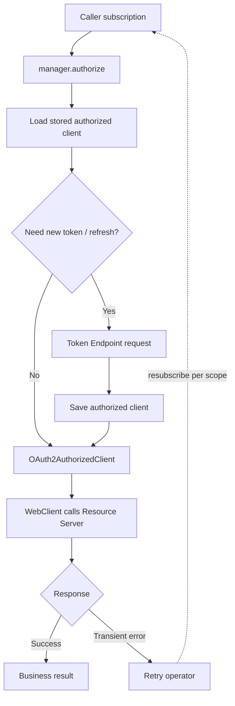
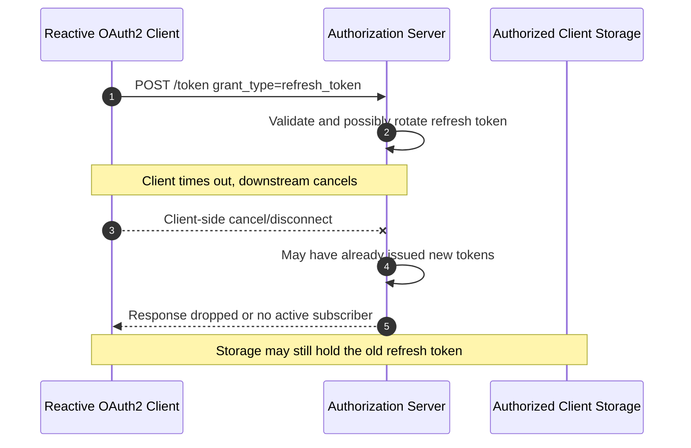

# 21.13. Retry, Cancellation, Timeout, and Avoiding Unintended Repeated Authorization

> **Module:** Spring Security OAuth 2.0 OIDC Client  
> **Chapter:** 21. Reactive OAuth2 Client  
> **Scope:** Spring Security OAuth 2.0 Client in Spring WebFlux, Reactor, and `WebClient`; how to avoid duplicate Token Endpoint calls, control wait timeouts, and handle cancellation/retries without corrupting access token and refresh token lifecycles.

Reactive applications often look simple: call `ReactiveOAuth2AuthorizedClientManager.authorize(...)` to get an access token, then call an API with `WebClient`. However, the same `Mono` can be **resubscribed** on retry; `timeout()` can **cancel** an in-flight request to the Token Endpoint; and two nearly simultaneous requests can **both see an expiring access token** and refresh at the same time. If the Authorization Server (AS) uses **refresh token rotation**, these situations not only add load but can trigger `invalid_grant`, lose the newly issued refresh token, or raise replay alerts.

Several dangerous bugs start from reasonable-looking code:

```java
// Risk: retrying the entire pipeline may run authorize again.
return manager.authorize(authorizeRequest)
    .flatMap(client -> callBusinessApi(client))
    .timeout(Duration.ofSeconds(3))
    .retry(3);
```

That snippet is not automatically wrong in every scenario, yet it **does not retry only the API**. Depending on operator placement, it can resubscribe to resolving the authorized client, calling the Token Endpoint, and other side effects in the pipeline. If the API performs a write operation, the risk grows further: the Resource Server may have executed the request even though the client timed out before receiving the response.

**Core principle of this lesson:** clearly separate **authorization/re-authorization** from **business API requests**, identify which operations are safe to retry, understand what cancellation can and cannot stop, and key stored tokens properly before configuring timeouts or retry policies.

---

## 1. Learning Objectives

After this lesson, you will be able to:

1. Explain why a `Mono` is typically a **cold publisher** and how a new subscription can re-trigger I/O.
2. Understand the roles of `ReactiveOAuth2AuthorizedClientManager`, `ReactiveOAuth2AuthorizedClientProvider`, and `ReactiveOAuth2AuthorizedClientService` in reactive Client Credentials and Refresh Token flows.
3. Distinguish between retrying a **Token Endpoint request**, retrying an **authorization pipeline**, and retrying a **Resource Server API request**.
4. Identify cases where you must not blindly retry `grant_type=refresh_token`, especially under refresh token rotation.
5. Explain why cancellation stops client-side waiting but **does not prove** the AS or API never processed the request.
6. Configure clearly scoped timeouts at the publisher, HTTP client, and end-to-end workflow levels.
7. Use bounded `Retry.backoff(...)` targeting only appropriate transient error classes.
8. Recognize when `retryWhen`, `repeat`, `zip`, `flatMap`, or multiple subscriptions accidentally re-invoke `authorize()`.
9. Understand the limitations of `Mono.cache()` with expiring access tokens, errors, and cancellation.
10. Design **single-flight/in-flight deduplication** keyed by registration ID, principal, tenant, and token target.
11. Control concurrency when multiple requests or multiple pods refresh the same authorized client simultaneously.
12. Distinguish HTTP 401/403 from an API from `invalid_client`/`invalid_grant` from the Token Endpoint.
13. Prevent token leakage, privilege escalation, and infinite retries during error recovery.
14. Design tests with `StepVerifier`, `VirtualTimeScheduler`, a mock AS, and a mock API to count authorize and token requests.

## 2. Two Operations That Should Not Be Lumped Together

In reactive OAuth 2.0 Client flows, there are two related but distinct operations:

**A. Obtaining or preparing an authorized client**

```text
Registration + Principal
         |
         v
ReactiveOAuth2AuthorizedClientManager
         |
         +--> Is the authorized client still usable?
         |       |
         |       +--> Yes: reuse per policy
         |
         +--> No: run grant/token refresh if eligible
         |
         v
Mono<OAuth2AuthorizedClient>
```

**B. Using the access token to call an API**

```text
OAuth2AuthorizedClient
         |
         v
Access Token
         |
         v
WebClient -> Resource Server API
         |
         v
Mono<BusinessResponse>
```

The two operations have **different failure sets**. The Token Endpoint can return `invalid_grant` or `invalid_client`; the API can return 401, 403, 429, 500, or time out. Wrapping both in one `retry()` causes an error from layer B to unintentionally re-trigger layer A.

### 2.1. Separation Table

| Operation | Primary Target | External Side Effects? | Key Caution |
|---|---|---|---|
| `authorize(...)` with valid client | Manager and storage | Often storage read only | Publisher may be subscribed multiple times |
| Fresh Client Credentials Grant | Token Endpoint | AS may mint tokens, write audit logs, enforce rate limits | Excessive token minting, quota usage |
| Refresh Token Grant | Token Endpoint | AS may rotate/invalidate the refresh token | Never blindly retry when outcome is unknown |
| GET API | Resource Server | Safe per HTTP semantics, though verify actual API behavior | Timeouts/network errors, rate limits |
| POST/PUT/PATCH API | Resource Server | May mutate data or create transactions | Requires idempotency/operation policy before retrying |
| Saving authorized client | Reactive service/repository | Writes to storage/token set | Races/overwriting a newer refresh token |

An endpoint exposed as "GET" that performs unusual side effects must be evaluated by its actual behavior. Never treat the HTTP method alone as sufficient proof that retrying is safe.

## 3. Reactive OAuth2 Client Components to Know

| Component | Responsibility | Not Responsible For |
|---|---|---|
| `ReactiveClientRegistrationRepository` | Supplies OAuth2 Client configuration by registration ID | Does not hold access tokens itself |
| `ReactiveOAuth2AuthorizedClientService` | Saves, loads, and removes authorized clients by registration/principal | Does not refresh tokens when simply loading |
| `ServerOAuth2AuthorizedClientRepository` | Saves and retrieves authorized clients within WebFlux `ServerWebExchange` | Does not replace the Token Endpoint |
| `ReactiveOAuth2AuthorizedClientManager` | Authorizes/reauthorizes via providers and storage | Does not automatically retry arbitrary business APIs |
| `ReactiveOAuth2AuthorizedClientProvider` | Executes the matching grant when conditions are met | Does not fabricate consent for an absent user |
| `OAuth2AuthorizedClient` | Holds `ClientRegistration`, access token, and optional refresh token | Does not directly represent an HTTP session |
| `WebClient` | Performs reactive HTTP calls | Does not know token policies without OAuth2 integration |
| `ServerOAuth2AuthorizedClientExchangeFilterFunction` | Integrates authorized clients with `WebClient` in WebFlux | Does not make outbound requests idempotent |

### 3.1. Two Common Managers

**`DefaultReactiveOAuth2AuthorizedClientManager`**:

- Intended for use inside a **WebFlux `ServerWebExchange`/HTTP request**.
- Uses `ReactiveClientRegistrationRepository` and `ServerOAuth2AuthorizedClientRepository`.
- Can be used through an OAuth2-aware `WebClient`.

**`AuthorizedClientServiceReactiveOAuth2AuthorizedClientManager`**:

- Intended for work **outside an HTTP request**, such as schedulers, message consumers, and batch jobs.
- Uses `ReactiveClientRegistrationRepository` and `ReactiveOAuth2AuthorizedClientService`.
- Can be given a workload principal key for the `client_credentials` grant.

Both return `Mono<OAuth2AuthorizedClient>` from `authorize(...)` per the manager interface and are subject to Reactor retry and cancellation behavior.

### 3.2. Where a Reactive Flow Can Loop



If `retryWhen` wraps the **entire pipeline**, the retry branch resubscribes from the beginning, including the manager. If placed strictly on `WebClient.get()...bodyToMono(...)` after the authorized client has already been obtained, an API retry does not force repeating the Token Endpoint call. Still, each HTTP attempt must ensure the token remains valid and targets the right audience.

## 4. `Mono` Is a Cold Publisher: "One Variable" Does Not Mean "One Execution"

A common misconception:

```java
Mono<OAuth2AuthorizedClient> authorized =
    manager.authorize(request);

// Two subscriptions can trigger pipeline execution twice.
authorized.subscribe(client -> processA(client));
authorized.subscribe(client -> processB(client));
```

With standard reactive publishers, **each subscription can restart the work**. Storing a publisher in a variable does not automatically cache its result.

### 4.1. Counting Subscriptions Example

```java
import java.util.concurrent.atomic.AtomicInteger;
import reactor.core.publisher.Mono;

AtomicInteger calls = new AtomicInteger();

Mono<String> tokenWork = Mono.defer(() -> {
    calls.incrementAndGet();
    return Mono.just("result");
});

tokenWork.subscribe();
tokenWork.subscribe();

// calls may equal 2: a cold publisher executes on each subscription.
```

This example does not call real OAuth2 APIs; it demonstrates a reactive property critical for reasoning about Token Endpoint requests.

### 4.2. Operators That Can Trigger Resubscription

| Operator / Behavior | Effect |
|---|---|
| `retry()` / `retryWhen(...)` | Resubscribes to source when matching errors occur |
| `repeat()` / `repeatWhen(...)` | Resubscribes to source after successful completion under conditions |
| Two `subscribe()` calls | Can spawn two independent executions |
| Two HTTP requests sharing the same cold source | Can run authorization twice |
| `zip(a, a)` using the same cold `Mono` | Can subscribe to the source along two branches |
| `flatMap` across concurrent requests | Multiple authorize attempts run concurrently |
| `timeout()` | Cancels upstream when elapsed; does not retry unless paired with another operator |
| `cache()` | Can share/cache results across subscribers, but risks caching errors or expired tokens |

**Do not assume every subscription sends a Token Endpoint request.** The manager may find a usable authorized client in storage; however, **every subscription has the potential to re-run authorization logic**, especially if storage has not been updated yet or the token needs refreshing.

## 5. Where You Place Retry Decides What Re-Executes

Compare two ways of writing the pipeline:

### 5.1. Retrying Both Authorize and Business API

```java
Mono<Report> result =
    manager.authorize(authorizeRequest)
        .flatMap(client -> callReportsApi(client))
        .retryWhen(Retry.backoff(2, Duration.ofMillis(200)));
```

If `callReportsApi(client)` fails and triggers a retry, the entire upstream source can be resubscribed, including `manager.authorize(...)`. When the access token is properly cached, the manager may reuse it; however, do not **assume** that happens safely under every race condition.

### 5.2. Retrying Only the HTTP GET After Authorization

```java
Mono<Report> result =
    manager.authorize(authorizeRequest)
        .switchIfEmpty(Mono.error(
            new IllegalStateException("Authorization unavailable")
        ))
        .flatMap(client ->
            callReportsApi(client)
                .retryWhen(reportsGetRetrySpec())
        );
```

Here the retry scope lives inside the **API call** publisher. The outer authorization runs once per subscription to `result`, unless the caller itself retries or resubscribes to `result`.

This assumes `callReportsApi` is a GET endpoint safe to retry; `reportsGetRetrySpec()` is defined in the next section. Do not copy this pattern for a money-transfer POST or data-creation operation lacking idempotency semantics.

### 5.3. Rule of Thumb: Only Retry the Layer You Understand

When an exception occurs:

1. Determine whether it came from the Token Endpoint or the API.
2. Determine whether the previous request could have **already succeeded on the server**.
3. Only retry when the operation is safe or protected by an idempotency key and state reconciliation.
4. Cap retry count, total duration, and backoff.
5. Let the manager and AS govern access and token lifecycle; never build a higher-privilege fallback.

## 6. Bounded `Retry.backoff` for GET APIs

A straightforward retry policy for GET:

```java
import java.time.Duration;
import org.springframework.web.reactive.function.client.WebClientResponseException;
import reactor.util.retry.Retry;

static Retry reportsGetRetrySpec() {
    return Retry.backoff(2, Duration.ofMillis(250))
        .maxBackoff(Duration.ofSeconds(2))
        .jitter(0.5)
        .filter(error ->
            error instanceof WebClientResponseException response
                && (response.getStatusCode().is5xxServerError()
                    || response.getStatusCode().value() == 429)
        );
}
```

Meaning:

- Retries at most twice after the initial attempt when the error matches the filter.
- Waits using bounded exponential backoff.
- Jitter prevents many clients from retrying in lockstep.
- Does not retry 400/401/403 by default, since those are usually not transient errors.
- Respect the `Retry-After` header on HTTP 429/503 when provided by the server.

This policy illustrates a **GET API** case. On some systems, a 500 error can still occur after the server completed the action; only apply retries where safe/idempotent semantics are clear.

### 6.1. Network Errors Can Be Transient Yet Still Carry Risk

`WebClientRequestException` can represent I/O failures. However, a failure after sending the request differs from failing to connect:

- Connect refused before sending: typically no operation ran on the server.
- Read timeout after sending: the server may have processed the request while the response was lost.
- Connection reset: the server-side outcome may be indeterminate.
- TLS/hostname verification failure: should **not** be retried like a random network glitch; it may indicate misconfiguration or a trust failure.

Therefore, extending a retry filter to network exceptions must be grounded in **API idempotency and real telemetry**, not merely `instanceof WebClientRequestException`.

### 6.2. Do Not Confuse `retry` With `repeat`

`retryWhen(...)` re-runs on error signals; `repeat(...)` re-runs after a publisher completes successfully. Placing `repeat()` on a Token Endpoint or authorization pipeline can generate unnecessary repeated calls even when nothing failed.

## 7. Timeouts Exist at Multiple Layers

In a reactive OAuth2 Client, "a 3-second timeout" can refer to different things:

| Layer | Example | What Does It Bound? |
|---|---|---|
| Connection establishment | Netty `CONNECT_TIMEOUT_MILLIS` | Time to establish the TCP connection |
| HTTP response | Reactor Netty `responseTimeout` | Time waiting for the response per transport semantics |
| Token Endpoint HTTP call | OAuth2 grant WebClient/response client | Token acquisition/refresh phase |
| UserInfo Endpoint | Reactive user service/WebClient | Fetching user profile during OIDC Login |
| API HTTP call | WebClient to Resource Server | Outbound API HTTP request |
| Reactor operator | `Mono.timeout(Duration)` | Total elapsed time from subscribing to the **wrapped publisher** |
| Business deadline | Request/job orchestration | Overall time budget for an entire workflow |

If you write:

```java
manager.authorize(authorizeRequest)
    .flatMap(client -> callReportsApi(client))
    .timeout(Duration.ofSeconds(3));
```

then three seconds bounds **the entire authorize + API chain**, measured from subscription to that publisher. If two seconds are spent at the Token Endpoint, the API only has one second remaining before the outer timeout fires; you cannot assume the API has a full three seconds of its own.

### 7.1. Timeout for the API After Authorization

```java
Mono<Report> result = manager.authorize(authorizeRequest)
    .switchIfEmpty(Mono.error(
        new IllegalStateException("No authorized client")
    ))
    .flatMap(client ->
        callReportsApi(client)
            .timeout(Duration.ofSeconds(4))
    );
```

Here, the four-second limit applies to the API publisher inside `flatMap`. The outer authorization still lacks its own deadline. Bound the Token Endpoint separately if long stalls are a risk; never rely on an API timeout to abort a token grant.

### 7.2. End-to-End Workflow Timeout

A pipeline can combine an overall outer deadline with tighter per-step timeouts:

```java
Mono<Report> workflow =
    manager.authorize(authorizeRequest)
        .timeout(Duration.ofSeconds(5)) // authorizing deadline
        .switchIfEmpty(Mono.error(
            new IllegalStateException("Authorization unavailable")
        ))
        .flatMap(client ->
            callReportsApi(client)
                .timeout(Duration.ofSeconds(4))
        )
        .timeout(Duration.ofSeconds(8)); // overall budget
```

These numbers are examples. In production workflows, the overall budget must account for connection acquisition, DNS, TLS, retries/backoff, AS latency, and API latency. An operator timeout **does not replace** transport timeouts.

### 7.3. Why Enforce Limits at the Transport Layer?

Example dedicated `WebClient` configuration for an API:

```java
import java.time.Duration;
import io.netty.channel.ChannelOption;
import reactor.netty.http.client.HttpClient;
import org.springframework.http.client.reactive.ReactorClientHttpConnector;
import org.springframework.web.reactive.function.client.WebClient;

HttpClient nettyClient = HttpClient.create()
    .option(ChannelOption.CONNECT_TIMEOUT_MILLIS, 2000)
    .responseTimeout(Duration.ofSeconds(5));

WebClient apiClient = WebClient.builder()
    .clientConnector(new ReactorClientHttpConnector(nettyClient))
    .baseUrl("https://api.example.test")
    .build();
```

**Crucial point:** configuring timeouts on `apiClient` does not automatically configure timeouts on the WebClient used internally by **Spring Security's Token Endpoint response client**. To bound HTTP token requests, configure the token response client/provider or its underlying HTTP client per your Spring Security version.

If the application maintains distinct WebClient instances for UserInfo, Token Endpoint, and APIs, configure timeouts and metrics per dependency.

## 8. What Does Cancellation Mean in Reactor?

When downstream no longer needs a result (browser disconnects, `timeout` fires, `take` completes, subscriber disposes), Reactor propagates a **cancel** signal upstream.

Cancel means: the subscriber no longer wants further signals from that publisher. It does **not** mean:

- The AS never received the token request;
- The AS never minted a new access token;
- The old refresh token is guaranteed to still work;
- No database write happened;
- The Resource Server definitely did not execute the POST;
- All network side effects were rolled back.

### 8.1. A Request Is Cancelled While the Server Still Processes It



If refresh token rotation occurred, the Client cannot safely assume it can retry with the old refresh token. A blind retry may return `invalid_grant` or trigger the AS's reuse detection policy.

### 8.2. Do Not Treat Cancellation as a Transaction Rollback

The OAuth2 Token Endpoint is an external service. By default, it does not participate in your application database's distributed transaction. `timeout()`/cancel operates on the reactive subscription, not as a "revoke token issuance" command.

Similarly, timing out on an HTTP POST business API does not prove a payment was not processed. If writes must be retried, design idempotency keys and query business state from the server.

### 8.3. Upstream Interruption Can Affect Token Storage Updates

If a subscription is cancelled after the AS issued new tokens but before the manager finishes persisting the updated authorized client, storage may still contain the older record. Under refresh rotation, that older record may no longer be valid.

Treat a timeout or cancellation during refresh as an **uncertain outcome**, rather than assuming the previous token remains valid.

## 9. Refresh Token Rotation: Why Retries Are Especially Dangerous

Refresh token rotation means the AS can issue a new refresh token and invalidate the old one upon each refresh. It limits the window for abusing a stolen refresh token, but imposes strict **ordering and concurrency** requirements.

Example:

```text
Stored: refresh_token = R1
Request A: refresh(R1) -> AS returns access_token A2 and refresh_token R2
Request B: refresh(R1) -> AS may return invalid_grant/replay
Storage initially still holds R1 if A has not saved R2 yet
```

Common causes producing two concurrent requests:

- Two concurrent HTTP requests needing an expired access token.
- Two subscriptions to the same `Mono`.
- `retryWhen` wrapping the whole authorize pipeline.
- Two instances/pods reading storage before the new token is persisted.
- A timeout causing the caller to retry while the AS still processed the initial request.
- A message consumer redelivering a message and triggering authorization again.

### 9.1. Do Not Retry Infinitely on `invalid_grant`

`invalid_grant` generally indicates the grant or refresh token is no longer valid for the request. Possible causes include expiration, revocation, client binding mismatch, token rotation, or an already-used code/refresh token.

When this happens:

1. Stop sending the same refresh token in a loop.
2. Check the latest authorized client state from authoritative storage.
3. Determine whether another worker already refreshed and wrote a newer record.
4. If a newer valid record exists, evaluate using it per policy.
5. If recovery is not possible, trigger reauthorization/consent via a valid flow when needed.
6. Log the incident and assess potential replay per AS policy.

This differs from a transient 503. Never attach `retryWhen(Retry.max(10))` to the entire refresh pipeline hoping it will eventually succeed.

### 9.2. The AS May Enforce Its Own Replay Policy

Some Authorization Servers offer a short grace period or concurrency tolerance; others revoke the entire token family as soon as refresh token reuse is detected. There is no single response behavior across all providers. The client must follow the AS's contract rather than assuming retrying an old token is harmless.

### 9.3. Client Credentials Differs From Refresh Rotation

With `client_credentials`, the AS normally does not issue a refresh token. Once a token expires, the manager performs a fresh `client_credentials` grant. Concurrent requests can cause redundant token minting and rate limiting, but do not carry the same old-refresh-token-reuse hazard as Authorization Code with refresh token rotation.

Even so, you still need bounded concurrency and protection around client secrets and token traffic.

## 10. Why Does Authorization Repeat Unintentionally?

Common patterns:

### 10.1. Subscribing Inside a Service and Returning Another Publisher

```java
// ANTI-PATTERN: detaching an authorize side effect outside the pipeline.
Mono<OAuth2AuthorizedClient> client = manager.authorize(request);
client.subscribe(this::auditTokenMetadata);
return client;
```

When the caller subscribes to `client`, two subscriptions occur. The code also triggers an unmanaged asynchronous side effect outside the request lifecycle.

Instead:

```java
return manager.authorize(request)
    .doOnNext(this::auditSafeMetadata);
```

`auditSafeMetadata` must never log token values; record only the registration ID, status, and permitted fields.

### 10.2. Creating a `Mono` Once and Using It in Two Independent Branches

```java
Mono<OAuth2AuthorizedClient> client = manager.authorize(request);

Mono<ResultA> a = client.flatMap(this::callApiA);
Mono<ResultB> b = client.flatMap(this::callApiB);

return Mono.zip(a, b);
```

The same cold `client` publisher can be subscribed from both branches, causing the manager to run twice. If API A and API B share the same audience/permissions so sharing the authorized client is valid, perform **one authorize step first**, then fan out:

```java
return manager.authorize(request)
    .switchIfEmpty(Mono.error(
        new IllegalStateException("No authorized client")
    ))
    .flatMap(client ->
        Mono.zip(
            callApiA(client),
            callApiB(client)
        )
    );
```

In this second version, within **a single subscription to the pipeline**, `manager.authorize` runs once before both API calls start. The two API calls still execute independently and can be cancelled together if the caller cancels.

### 10.3. Overly Broad Retry Scope

```java
// Risk: an API timeout re-triggers authorization as well.
return manager.authorize(request)
    .flatMap(this::callApi)
    .retryWhen(Retry.backoff(5, Duration.ofMillis(100)));
```

Move retries down to the permitted layer; token grant failures require a separate, usually stricter policy.

### 10.4. Triggering `authorize` Inside `flatMap` via `subscribe` or `block`

```java
// AVOID:
return incoming.flatMap(item -> {
    manager.authorize(request).subscribe(client -> send(item, client));
    return Mono.empty();
});
```

This breaks error propagation and cancellation semantics, detaching results from the caller. Compose properly instead:

```java
return incoming.flatMap(item ->
    manager.authorize(request)
        .flatMap(client -> send(item, client))
);
```

Even with proper composition, over many items this still invokes **one authorize per item**. If all items share the same authorization context and token target, authorize once upfront and process the batch per policy.

## 11. Authorizing Once for a Whole Batch

Suppose a job processes 100 reports using the same client registration and workload principal.

**Suboptimal:**

```java
return Flux.fromIterable(reportIds)
    .flatMap(id ->
        manager.authorize(request)
            .flatMap(client -> fetchReport(client, id))
    );
```

`flatMap` runs multiple items concurrently, spawning multiple authorize attempts. The manager/storage may reduce actual Token Endpoint calls, yet single-flight is not guaranteed in every environment.

**Better when scope/audience match and the job is short-lived:**

```java
return manager.authorize(request)
    .switchIfEmpty(Mono.error(
        new IllegalStateException("Authorization unavailable")
    ))
    .flatMapMany(client ->
        Flux.fromIterable(reportIds)
            .flatMap(id -> fetchReport(client, id), 8)
    );
```

This performs one authorization per batch subscription, then caps concurrent API operations at eight. However:

- If the batch runs for a long time, the token can expire mid-flight. Build a policy to check/reauthorize between chunks.
- Never reuse one token across APIs with different audiences or scopes.
- `flatMap(..., 8)` limits concurrency **within that batch**, not across the whole application or multiple pods.
- If `fetchReport` causes side effects, ensure idempotency and ordering rules before running concurrently.

### 11.1. Token Lifetime and Long-Running Batches

Another pattern is partitioning the batch into bounded chunks with deadlines/sizes and authorizing at chunk boundaries. Always account for token lifetime and concurrent refresh hazards. Never hold a token across a multi-hour batch assuming it remains valid.

## 12. `Mono.cache()` Is Not a Safe Default OAuth2 Token Cache

In Reactor, you might write:

```java
Mono<OAuth2AuthorizedClient> shared =
    manager.authorize(request).cache();
```

Subscribers can share the source result. This helps in certain in-process **single-flight** scenarios, but introduces several pitfalls:

1. `cache()` can retain results **past access token expiry** if the `Mono` is kept around.
2. It can cache an **error signal**, causing later retries never to call the manager.
3. A `Mono.cache()` shared by multiple subscribers has specific cancellation semantics; upstream may continue running even if one subscriber stops waiting.
4. It does not coordinate across pods/instances.
5. If requests need different scopes, resources, or audiences, sharing one `Mono` can send the wrong token.
6. It does not automatically account for refresh token rotation or newer authorized client versions written to storage.

**Never write:**

```java
// ANTI-PATTERN: permanently caching an authorized client for the entire JVM.
static final Mono<OAuth2AuthorizedClient> TOKEN =
    manager.authorize(request).cache();
```

Never use an unbounded cache as the source of truth for token lifecycle. The authorized client manager/service already stores and evaluates tokens; any extra cache requires strict TTL, invalidation, and partitioning.

### 12.1. Is `cache(Duration)` Enough?

`Mono.cache(Duration)` can bound how long the publisher result is cached, yet a fixed TTL cannot automatically know:

- When the access token actually expires;
- Whether the token was revoked early;
- Whether scopes, audience, or client credentials changed;
- Whether the refresh token rotated;
- Whether the cached failure occurred transiently;
- Whether multiple nodes hold consistent records.

If caching is needed, base it on token expiry minus **clock skew**, keyed by principal/registration/target, with proper invalidation. Never use cookie/session lifetimes as a token cache TTL.

### 12.2. Caching an In-Flight Operation Differs From Long-Term Credential Caching

**In-flight deduplication** only coalesces callers currently waiting on **one active attempt**. Once that attempt completes, the pending entry is removed so later requests go back to the manager to inspect fresh token state in storage.

**Persistent caching** retains tokens across requests; that job belongs to OAuth2 authorized-client storage and the manager. Separating these two concerns prevents unintentionally caching errors or stale tokens.

## 13. Single-Flight: Coalescing Concurrent Authorizations for the Same Key

Goal: if 20 requests arrive simultaneously when an access token has expired, only one authorization attempt executes **for that same authorized-client key** within a single instance, while callers await the shared outcome.

### 13.1. Choosing the Right Deduplication Key

A key typically needs at minimum:

```text
registrationId
+ principal identity / workload key
+ tenant boundary (if applicable)
+ resource/audience/scope context (if dynamic)
```

**Never key solely by `registrationId`** when authorized clients belong to multiple users. Sharing the same key between user A and user B risks handing one user's token to another.

Examples:

| Registration | Principal | Resource | Share In-Flight? |
|---|---|---|---|
| `reporting-m2m` | `nightly-worker` | `reports-api` | Possible, if grant/context match |
| `calendar-user` | `user-a` | `calendar-api` | Only among user A's requests |
| `calendar-user` | `user-b` | `calendar-api` | **Never** share with user A |
| `shared-m2m` | `worker` | `reports-api` | Do not share with requests to `inventory-api` if token targets differ |

### 13.2. Conceptual Algorithm

```text
authorizeOnce(key):
    1. If an attempt is currently in progress for key:
          return the shared publisher for that attempt.
    2. Otherwise:
          atomically register a new attempt for key.
    3. Subscribe to upstream manager.authorize(...) exactly once.
    4. All waiting callers receive the attempt's result or failure.
    5. When the attempt terminates (success/error/managed cancel):
          remove the in-flight entry matching that exact attempt identity.
    6. Subsequent requests consult the manager/service for fresh token state.
```

This is a **single-instance** design and must guard against races where:

- Two threads create entries concurrently;
- An entry is removed before registration finishes;
- An older attempt removes a newer attempt's entry;
- One caller cancels while other callers still await the result;
- Errors remain cached indefinitely;
- Keys change after registration or tenant policies update.

### 13.3. Why Not Present a Short `ConcurrentHashMap` Snippet as a Complete Solution?

You can use `ConcurrentHashMap<Key, Mono<...>>` with a shared publisher, but `computeIfAbsent(...)`, `cache()`, and `doFinally(...)` are notoriously prone to subtle races when an attempt completes synchronously. If map removal does not compare the exact entry identity, an older attempt can evict a newly started one.

In production, single-flight implementations must be tested thoroughly with `StepVerifier`, concurrent subscribers, cancellation, and failures, or built on a library/coordinator with proven semantics. This lesson emphasizes the **required contract** rather than promoting unverified map snippets as a complete distributed lock.

### 13.4. Start With Simpler Scoping First

If a single job processes a batch under one Client/Principal, moving `manager.authorize(...)` outside `Flux.flatMap` (as in section 11) often eliminates duplicate attempts without introducing any global cache.

Single-flight shines when **many truly independent concurrent requests** need the same authorization context.

## 14. Single-Flight Does Not Solve Cross-Pod Concurrency

Even if instance A guarantees at most one in-flight refresh per key, instance B can still start refreshing the same key concurrently.

```text
Pod A -> shared DB load refresh_token R1
Pod B -> shared DB load refresh_token R1
Pod A -> POST refresh(R1)
Pod B -> POST refresh(R1)
AS    -> rotate R1 to R2 for Pod A
AS    -> reject/replay-handle attempt from Pod B
```

This is a **cross-instance coordination** problem. Options to consider:

- Distributed locks keyed by authorized-client key;
- Leases/leader ownership with expiration and fencing;
- Optimistic locking / compare-and-set on token record versions;
- A dedicated token refresh coordinator;
- Properly partitioned workload/tenant keys;
- AS policies aligned with concurrency and refresh token rotation.

A lease lock with only a TTL and no stale-writer protection can still fail: a worker whose lock expired might still overwrite newer tokens with stale ones. Include **fencing/versioning** in the design.

### 14.1. A Distributed Lock Alone Cannot Make Token Requests Atomic

If Pod A sends a refresh and crashes before saving R2, storage still holds R1 despite the lock. When Pod B later acquires the lock, it may send R1 and be rejected. The system needs a recovery policy:

1. Read the latest token state/version.
2. Avoid retrying stale refresh tokens indefinitely.
3. Classify AS errors and potential prior rotation.
4. Trigger reauthorization when recovery is impossible.
5. Track refresh failure rates to detect races or compromise.

There is no general client-side way to "undo" a refresh token rotation that already happened on the AS.

## 15. Timeouts and Retries in the WebClient OAuth2 Filter

In WebFlux, `ServerOAuth2AuthorizedClientExchangeFilterFunction` can resolve an authorized client and attach a Bearer token when `WebClient` calls a Resource Server.

Example inside a **WebFlux HTTP request context**:

```java
import org.springframework.context.annotation.Bean;
import org.springframework.security.oauth2.client.web.reactive.function.client.ServerOAuth2AuthorizedClientExchangeFilterFunction;
import org.springframework.security.oauth2.client.ReactiveOAuth2AuthorizedClientManager;
import org.springframework.web.reactive.function.client.WebClient;

@Bean
WebClient reportsWebClient(
        ReactiveOAuth2AuthorizedClientManager authorizedClientManager) {

    ServerOAuth2AuthorizedClientExchangeFilterFunction oauth2 =
        new ServerOAuth2AuthorizedClientExchangeFilterFunction(
            authorizedClientManager
        );

    return WebClient.builder()
        .baseUrl("https://api.example.test")
        .filter(oauth2)
        .build();
}
```

And selecting the registration per request:

```java
import static org.springframework.security.oauth2.client.web.reactive.function.client.ServerOAuth2AuthorizedClientExchangeFilterFunction.clientRegistrationId;

Mono<Report> report = reportsWebClient.get()
    .uri("/reports/summary")
    .attributes(clientRegistrationId("reports-api"))
    .retrieve()
    .bodyToMono(Report.class)
    .timeout(Duration.ofSeconds(5));
```

**Important:** `.timeout(...)` above applies to the WebClient publisher **including the filter's work to obtain the authorized client**. If the filter calls the Token Endpoint, authorization time consumes part of those five seconds. Do not assume the timeout only starts after the Bearer token is attached.

### 15.1. Retrying Outside the Filter Can Re-Authorize

```java
reportsWebClient.get()
    .uri("/reports/summary")
    .attributes(clientRegistrationId("reports-api"))
    .retrieve()
    .bodyToMono(Report.class)
    .retryWhen(Retry.backoff(2, Duration.ofMillis(200)));
```

Each HTTP attempt passing through the WebClient filter can request the authorized client again. If a valid token is saved, the manager can return it quickly; if the token needs refreshing, new authorize/refresh attempts may occur.

When you strictly require "one authorization for the whole API retry group", authorize via the manager explicitly beforehand and apply retries only to the API call, or use reliable in-flight deduplication. Avoid stacking unconditional retries in both the WebClient filter and business services.

### 15.2. Never Enable a Default Authorized Client for Every API

If a WebClient calls multiple Resource Servers, do not default to attaching the current session's authorized client without checking destinations. A token meant for API A could be sent to API B, causing audience confusion or token leakage.

Specify the registration ID explicitly or separate WebClient instances per API, and enforce Resource Server audience/scope checks.

## 16. Using a Manager Outside HTTP Requests

A scheduled job or queue consumer has no browser `ServerWebExchange`. In that case, a service-backed manager fits better:

```java
import org.springframework.context.annotation.Bean;
import org.springframework.context.annotation.Configuration;
import org.springframework.security.oauth2.client.AuthorizedClientServiceReactiveOAuth2AuthorizedClientManager;
import org.springframework.security.oauth2.client.ReactiveOAuth2AuthorizedClientManager;
import org.springframework.security.oauth2.client.ReactiveOAuth2AuthorizedClientProvider;
import org.springframework.security.oauth2.client.ReactiveOAuth2AuthorizedClientProviderBuilder;
import org.springframework.security.oauth2.client.ReactiveOAuth2AuthorizedClientService;
import org.springframework.security.oauth2.client.registration.ReactiveClientRegistrationRepository;

@Configuration
class BackgroundClientConfiguration {

    @Bean("backgroundAuthorizedClientManager")
    ReactiveOAuth2AuthorizedClientManager backgroundManager(
            ReactiveClientRegistrationRepository registrations,
            ReactiveOAuth2AuthorizedClientService authorizedClients) {

        ReactiveOAuth2AuthorizedClientProvider provider =
            ReactiveOAuth2AuthorizedClientProviderBuilder.builder()
                .clientCredentials()
                .refreshToken()
                .build();

        AuthorizedClientServiceReactiveOAuth2AuthorizedClientManager manager =
            new AuthorizedClientServiceReactiveOAuth2AuthorizedClientManager(
                registrations,
                authorizedClients
            );

        manager.setAuthorizedClientProvider(provider);
        return manager;
    }
}
```

This configuration illustrates a manager supporting two grant strategies when eligible. In `client_credentials`, refresh tokens are rarely used; the `refreshToken()` provider only applies if an authorized client actually holds a refresh token and the AS supports refreshing it.

### 16.1. `OAuth2AuthorizeRequest` for a Workload

```java
import org.springframework.security.oauth2.client.OAuth2AuthorizeRequest;
import reactor.core.publisher.Mono;

OAuth2AuthorizeRequest request =
    OAuth2AuthorizeRequest
        .withClientRegistrationId("reporting-m2m")
        .principal("nightly-reports-worker")
        .build();

Mono<OAuth2AuthorizedClient> client =
    backgroundManager.authorize(request);
```

`"nightly-reports-worker"` is a logical key for managing the authorized client, **not** an interactive logged-in user. Never take a raw username from an untrusted message to look up another user's refresh token.

### 16.2. Creating a Manager Does Not Create a WebSession

Machine authorization differs from user login. The manager can obtain tokens for calling APIs, but it does not create an `OidcUser` or browser session for a user.

## 17. Classify Errors Before Retrying the Token Endpoint

Never lump all exceptions together as "temporary".

| Situation | Error Category | Retry? |
|---|---|---|
| DNS/connect failure before reaching AS | Network/infrastructure | Allowed per policy and grant idempotency |
| HTTP 503/502 from Token Endpoint | AS temporarily unavailable | Consider bounded retry; assess whether request might have succeeded |
| HTTP 429 from Token Endpoint | Rate limit | Honor `Retry-After`/quotas; prevent stampede |
| `invalid_client` | Invalid client authentication | **Never blindly retry**; fix Client ID, secret, or auth method |
| `unauthorized_client` | Grant not permitted | **Never retry** hoping it succeeds |
| `invalid_scope` | Invalid or ungranted scope | **Never retry** the same payload |
| `invalid_grant` on refresh | Refresh token invalid, rotated, or raced | **Never retry with the same old token** |
| Malformed token response | AS/protocol contract mismatch | Investigate; never weaken parser to accept anything |
| Invalid TLS certificate/hostname | Trust failure | **Never** disable TLS verification or retry infinitely |
| Network timeout after sending refresh | Indeterminate AS outcome | **Never blindly retry** the old refresh token |

### 17.1. Client Credentials Is Easier to Retry Than Refresh, Yet Not Free

With `client_credentials`, the AS can issue a fresh token if the client retries after a network error. If the earlier request actually succeeded and only the response was lost, retrying mints an **extra token**. This creates quota, rate-limit, and audit noise, so bounded retries and single-flight still matter.

### 17.2. Refresh Tokens Need Recovery, Not Just Retries

A safe policy prioritizes loading the latest authorized client from storage after an indeterminate failure; if no reliable state exists, fall back to reauthorization/connection-expired handling instead of looping requests. Follow your AS's policies for refresh rotation and replay detection.

## 18. Error Recovery Must Never Downgrade or Escalate Privileges

When the Token Endpoint fails, never:

- Switch to higher-privilege Client Credentials in place of a user token without explicit policy.
- Forge a JWT using `sub`/`role` from input data to "rescue" the request.
- Disable issuer, audience, or signature checks on the Resource Server.
- Return raw refresh or access tokens to the browser for client-side retries.
- Pick a different principal from the authorized client service because the current user's token failed.

A safe fallback might report "Service connection temporarily unavailable", invite retrying later, or prompt the user to reauthorize via the standard flow.

### 18.1. When to Use `onErrorResume`?

`onErrorResume` can map technical failures to safe business responses, but must never swallow security errors silently:

```java
return fetchReports()
    .onErrorResume(ReportServiceUnavailableException.class,
        error -> Mono.just(ReportResult.unavailable()));
```

This illustrates a pattern with application-defined types. Never write `onErrorResume(ex -> Mono.just(fakeAdminData))` to fake success when authorization fails.

## 19. HTTP 401/403 and Authorized Client Eviction Policy

An access token can be rejected by a Resource Server before expiring:

- The AS revoked the token.
- The Resource Server expects a different audience.
- Scopes, roles, or tenant permissions are insufficient.
- The token signature or issuer is invalid for that API.
- Session or permission policies changed.

**401** usually indicates the authentication token was rejected; **403** usually indicates insufficient authorization. Never conflate the two.

### 19.1. Do Not Delete Tokens on Every 403

If an API returns 403 because the client lacks `reports.export`, deleting the token and re-requesting the exact same token accomplishes nothing. It causes needless token-minting loops and extra load on the AS.

### 19.2. Some Integrations Provide Failure Handlers

`ServerOAuth2AuthorizedClientExchangeFilterFunction`, managers, and repositories offer extension points for handling authorization failures depending on version. When configuring eviction or failure handlers, understand **when** they remove tokens and whether the next request triggers reauthorization.

Never build an infinite `401 -> remove -> retry` loop. Before re-requesting a token, verify whether the failure is truly token expiration/revocation rather than a misconfigured audience or permission that refreshing cannot fix.

### 19.3. Do Not Let Retries Turn One API Call Into a Token Endpoint Loop

This cycle can occur:

```text
API 401
 -> remove stored authorized client
 -> next attempt refreshes/authorizes
 -> API 401 again because audience is still wrong
 -> remove again
 -> ...
```

Enforce a cap on re-issuance attempts and distinguish persistent configuration errors from genuine token expiration. If issuer, audience, or scopes are wrong, fix configuration and grants at the AS/Resource Server rather than retrying.

## 20. Token Targets and Cache Keys

In reactive OAuth2 Clients, avoiding duplicate authorization does not mean sharing **every token**. Attributes such as:

- registration ID;
- principal/user;
- tenant;
- scope;
- RFC 8707 resource indicator;
- provider audience extensions;
- client authentication context;

can make one token **non-interchangeable with another**.

### 20.1. Registration ID + Principal Is the Standard Key

Many authorized-client services store records keyed by:

```text
(clientRegistrationId, principalName)
```

If within the same registration and principal you request resource A and then resource B via dynamic custom parameters without differentiating the storage target, the manager may reuse A's token for B.

Partitioning by registration or a properly designed storage/manager key may be required. Never cache tokens under a single `"machine-client"` key across all Resource Servers.

### 20.2. Single-Flight Is Only Valid for Identical Authorization Intent

Two requests sharing a Client ID but requiring different scopes or audiences **must not** be merged into one token request. Verify authorization intent before deduplicating.

## 21. Timeouts, Cancellation, and Refresh-Token Storage Consistency

A critical failure scenario:

```text
T0  Service stores authorized client version 5: access A1, refresh R1
T1  Worker starts refresh(R1)
T2  AS accepts R1, issues A2/R2
T3  Client times out or cancels before save completes
T4  Storage still holds version 5 with R1
T5  Another worker reads R1 and retries refresh
T6  AS rejects with invalid_grant or treats as replay
```

Address this across the **authorization lifecycle**:

1. Never retry old refresh tokens infinitely.
2. Persist newly received tokens promptly and atomically upon receipt.
3. Coordinate concurrent refreshes by authorized-client key.
4. Prevent a stale attempt from overwriting a newer version already in storage.
5. When rotation outcome is indeterminate, fall back to recovery or reauthorization.
6. Use metrics to detect conflicts occurring for the same principal/registration.

Still, there is no universal client-side way to recover R2 if the AS rotated the token and the response was completely lost. Align AS/IdP policies and user consent/re-login workflows accordingly.

## 22. Business Idempotency Is a Separate Defense Layer

Suppose the application takes a valid access token and performs:

```http
POST /payments HTTP/1.1
Host: api.example.test
Authorization: Bearer <redacted>
Idempotency-Key: order-2026-0042
Content-Type: application/json

{"amount":120000,"currency":"VND"}
```

If an HTTP timeout occurs after the POST is transmitted, the Resource Server **may already have recorded the transaction**. Neither the authorization manager nor a token cache can prevent duplicate writes.

A safe design requires:

- A stable idempotency key per logical operation, enforced by the **API server**.
- Reusing the exact same key when retrying the same transaction.
- A status-lookup mechanism when the outcome is uncertain.
- Bounded retries aligned with business policy.
- Permission checks both before and during the operation.
- Zero token exposure in logs.

**OAuth2 authorization deduplication** and **business operation deduplication** solve separate problems. Reducing Token Endpoint calls never makes a POST idempotent.

## 23. Preventing Retry Storms and Rate-Limit Amplification

When the AS slows down or rotates keys, hundreds of requests can simultaneously:

1. Detect the token needs refreshing.
2. Send token requests.
3. Hit timeouts.
4. Retry with un-jittered exponential backoff.
5. Hammer the AS in synchronized waves.

This is a **thundering herd**. Mitigations include:

- Per-instance single-flight keyed by authorized-client key.
- Capped concurrent token requests.
- Shared storage and distributed coordination across pods.
- Bounded exponential backoff + jitter.
- Honoring `Retry-After`, quotas, and provider-specific limits.
- Circuit breakers only where semantics fit, without caching false "authorization successes".
- Explicit timeout budgets rather than blindly stacking multi-layer retries.
- Metrics for authorize attempts, Token Endpoint latency, and refresh failures.
- Load shedding / failing fast with safe business responses when the AS is overloaded.

### 23.1. Do Not Retry the Same Step at Every Layer

Consider stacked configurations:

```text
Token response client: retry 3 times
Manager wrapper: retry 3 times
Business service: retry 3 times
API gateway: retry 3 times
```

This multiplies into far more attempts than intended. Design end-to-end retry budgets specifying which layer owns retries and when to stop.

## 24. Bounded Concurrency in Reactor

Beyond single-flight, you can bound concurrent operations:

```java
Flux.fromIterable(tasks)
    .flatMap(task -> executeTask(task), 4);
```

This bounds `executeTask` concurrency **within that single `Flux`**. It does not reduce authorization calls if `executeTask` invokes the manager with the same key, nor does it cap concurrency across cluster instances.

For a single-registration batch, prefer:

```java
return manager.authorize(request)
    .switchIfEmpty(Mono.error(
        new IllegalStateException("Authorization unavailable")
    ))
    .flatMapMany(client ->
        Flux.fromIterable(tasks)
            .flatMap(task -> executeTaskWithToken(task, client), 4)
    );
```

For long-running batches, track token expiry during execution. Holding an authorized client obtained at startup does not guarantee the access token stays valid indefinitely.

### 24.1. `flatMap`, `concatMap`, and `flatMapSequential`

- `flatMap` runs concurrently; output order is not preserved.
- `concatMap` processes sequentially, limiting concurrency but potentially lowering throughput.
- `flatMapSequential` permits bounded concurrent execution while preserving emission order.

Choose based on business semantics; avoid raising `flatMap` concurrency blindly if the Token Endpoint or downstream API enforces low quotas.

## 25. Observability: Track Authorize Attempts Without Logging Tokens

Useful metrics:

| Metric / Event | Purpose |
|---|---|
| `oauth2.authorize.attempts` | Count of manager authorization requests per registration |
| `oauth2.token_endpoint.requests` | Actual outbound HTTP token requests |
| `oauth2.token_endpoint.latency` | Grant/refresh latency |
| `oauth2.refresh.failures` | Refresh failures grouped by error code |
| `oauth2.authorized_client.storage_errors` | Storage load/save/remove failures |
| `oauth2.inflight_waiters` | Callers coalesced onto one active attempt |
| `oauth2.singleflight.deduplicated` | Token requests avoided within an instance |
| `oauth2.api.unauthorized` | API 401 responses after presenting a token |
| `oauth2.api.forbidden` | API 403 policy denials |
| `oauth2.timeout.cancelled` | Client-observed cancellations and timeouts |
| `oauth2.retry.exhausted` | Exhausted retry budgets |

These names are **application-defined illustrative labels**, not default metric names shipped by Spring Security.

### 25.1. Safe Logging

Example:

```text
event=oauth2_authorization
registrationId=reports-m2m
principalKind=workload
attempt=1
grantType=client_credentials
result=success
durationMs=420
correlationId=opaque-123
tokenValue=[never-log]
```

Never log:

- `access_token`, `refresh_token`, or raw ID tokens;
- Client secrets, private keys, or Token Endpoint `Authorization` headers;
- Authorization codes, PKCE verifiers, or nonces;
- HTTP bodies containing bearer credentials;
- Sensitive principal/user details or unapproved tenant identifiers.

Avoid blindly logging `OAuth2AuthorizedClient.toString()` or `ClientRegistration.toString()`, as contained fields may be unsuitable for exposure.

### 25.2. Distinguish Authorize Calls From Actual Token Requests

Not every `authorize()` invocation calls the Token Endpoint: the manager can reuse a still-valid authorized client. Therefore, rising `authorize.attempts` does not always imply higher token minting.

Instrument both the **manager boundary** and the **token response client HTTP boundary** (with sensitive fields redacted) to verify whether caching or retries actually increase network traffic.

## 26. Writing Tests With `StepVerifier`

When testing reactive code, assert subscription counts and cancel signals—not just final values.

### 26.1. Testing That a Source Is Resubscribed

```java
import java.util.concurrent.atomic.AtomicInteger;
import reactor.core.publisher.Mono;
import reactor.test.StepVerifier;

AtomicInteger attempts = new AtomicInteger();

Mono<String> source = Mono.defer(() -> {
    int n = attempts.incrementAndGet();
    if (n == 1) {
        return Mono.error(new IllegalStateException("transient"));
    }
    return Mono.just("ok");
});

StepVerifier.create(source.retry(1))
    .expectNext("ok")
    .verifyComplete();

// attempts == 2: retry resubscribed to source.
```

This is a foundational Reactor test illustrating retry semantics; it does **not** imply retrying production refresh tokens is safe.

### 26.2. Testing Cancellation

```java
import java.util.concurrent.atomic.AtomicBoolean;
import reactor.core.publisher.Mono;
import reactor.test.StepVerifier;

AtomicBoolean cancelled = new AtomicBoolean(false);

Mono<String> never = Mono.<String>never()
    .doOnCancel(() -> cancelled.set(true));

StepVerifier.create(never)
    .thenCancel()
    .verify();

// cancelled == true
```

The `doOnCancel` hook confirms publisher cancellation, but **does not prove** a real Token Endpoint request was rolled back once already dispatched.

### 26.3. Virtual Time for Backoff

`StepVerifier.withVirtualTime(...)` tests time-based operators without real wall-clock waiting:

```java
import java.time.Duration;
import reactor.core.publisher.Mono;
import reactor.test.StepVerifier;
import reactor.util.retry.Retry;

StepVerifier.withVirtualTime(() ->
        Mono.<String>error(new IllegalStateException("down"))
            .retryWhen(Retry.fixedDelay(2, Duration.ofSeconds(5)))
    )
    .thenAwait(Duration.ofSeconds(11))
    .expectError()
    .verify();
```

When using virtual time, construct the publisher inside the supplier so timers bind to the virtual scheduler. Never mix real network I/O with simulated time and claim timeouts have been exhaustively verified.

## 27. Integration Testing With a Mock Authorization Server

To prove a workflow does not repeat authorizations unexpectedly, run a mock AS or local test OP that lets you **count Token Endpoint calls**.

### 27.1. Scenarios to Test

| Scenario | Setup | What to Verify |
|---|---|---|
| Token still valid | Authorized client saved | Manager reuses token without unnecessary token requests |
| Token expired, 10 concurrent callers | Same registration/principal | No refresh storm when dedup/coordination is configured |
| GET API retry | API returns 503 then 200 | Only the API retries within its intended scope; no extra authorize |
| Overly broad retry wrapper | `retryWhen` around manager + API | Observe resubscription hitting authorize |
| AS returns `invalid_client` | Wrong secret/method | No infinite retries; failure classified cleanly |
| Refresh token rotation | Two concurrent requests using R1 | Simulate conflict and verify recovery policy |
| Slow AS, client timeout | AS finishes after timeout | Never assume old token stays valid; handle uncertain outcome |
| Caller cancels | Cancel mid-authorize | Logs/metrics preserved; cancellation propagates per contract |
| API 401 due to revocation | Token rejected | Bounded eviction/reauthorization per policy |
| API 403 | Insufficient permissions | No futile token retry loops |
| Changing audience/resource | Same Client ID, different targets | Tokens are never shared across incompatible APIs |
| Two pods refreshing concurrently | Shared storage, same key | Distributed coordination and stale-write protection tested |
| Logout / revoked authorization | Refresh token unusable | No synthetic login session or elevated-privilege fallback |

### 27.2. Counting Token Endpoint Requests Test

Example test specification with a mock server:

```text
given:
  registrationId = reports-m2m
  principal = nightly-worker
  access token expired
  20 concurrent API requests
  mock AS token endpoint responds after 200 ms

when:
  requests are subscribed concurrently

then:
  authorization behavior matches explicit coordination design
  token endpoint invocation count is bounded/expected
  no access token is logged
  requests use correct API audience
```

Without single-flight, the count may exceed one; never write tests assuming "Spring Security guarantees a single cluster-wide refresh out of the box." Test the **exact coordination contract your application implements**.

## 28. Testing Timeout After the AS Already Rotated the Token

An essential and frequently overlooked test:

1. Storage contains refresh token R1.
2. Client initiates `refresh(R1)`.
3. Mock AS accepts and marks R1 as used, issuing R2.
4. Response is delayed past the client's timeout.
5. Client times out/cancels and never receives R2.
6. Another caller or worker attempts `refresh(R1)` again.
7. Mock AS returns `invalid_grant`.
8. The application must **halt blind retries** and execute its recovery/reauthorization policy.

This test demonstrates why "timeout -> immediately retry" is not a safe general rule for the refresh grant.

If an AS provides special rules for retrying after timeouts, test that policy explicitly based on provider documentation. Never assume all Authorization Servers behave identically.

## 29. Lab A — Comparing Retry Outside vs Inside `flatMap`

**Objective:** observe how operator placement affects authorization count.

**Setup:** a fake manager returning `Mono<OAuth2AuthorizedClient>` that counts subscriptions; a fake GET API returning 503 once and then 200.

**Steps:**

1. Build pipeline A: `manager.authorize(...).flatMap(api).retryWhen(...)`.
2. Build pipeline B: `manager.authorize(...).flatMap(client -> api(client).retryWhen(...))`.
3. Subscribe to each pipeline in separate tests.
4. Compare how many times the manager is invoked/subscribed.
5. Verify both return the result after the API retry under matching conditions.
6. Call `subscribe()` twice on the same cold `Mono` to observe two attempts.
7. Use stubs only, not real refresh tokens.

**Expected outcome:** pipeline B isolates API retries cleanly within one subscription; pipeline A can repeat authorization when the API fails.

## 30. Lab B — Timeout and Cancellation During Simulated Refresh

**Objective:** observe that cancellation does not revert server-side side effects.

**Setup:** a mock Token Endpoint tracking R1/R2 state with configurable response delay; reactive token response client under test.

**Steps:**

1. Seed an authorized client holding R1.
2. Send a refresh request and delay the response.
3. Set `timeout(Duration.ofMillis(...))` shorter than the delay.
4. Observe the client emitting timeout and cancellation.
5. Inspect whether the mock AS already marked R1 as consumed.
6. Retry with the same R1 and observe the response per test AS policy.
7. Implement a recovery path without blind retries.
8. Ensure test output prints no raw token values.

**Expected outcome:** a client timeout does not prove the AS skipped the refresh; storage may require reauthorization if the new token was lost.

## 31. Lab C — Single-Flight per Registration/Principal

**Objective:** design an in-process in-flight deduplicator.

**Steps:**

1. Build a key from registration ID + principal name.
2. Use a coordinator storing the in-flight publisher/attempt per key.
3. Launch 20 concurrent callers with the same key and an expired token.
4. Verify the upstream authorization attempt runs once **per the coordinator design**.
5. Test a different principal key to confirm user tokens are never shared.
6. Test error outcomes: the in-flight entry must be cleared, never caching failures forever.
7. Test one caller cancelling while others still await completion; avoid breaking the shared attempt for remaining callers.
8. Test synchronous completion to catch races where an entry is removed prematurely.
9. Confirm token TTL/invalidation stays managed by the manager/storage rather than caching a `Mono` permanently.

**Expected outcome:** reduces duplicate authorizations within a process without leaking tokens across principals or resources.

## 32. Lab D — Two Pods and Refresh Token Rotation

**Objective:** understand the limits of in-process deduplication.

**Setup:** two simulated workers, shared authorized-client storage, a mock AS enforcing refresh token rotation, and a coordinator with distributed lock/version checks.

**Steps:**

1. Both workers read R1 from shared storage.
2. Without the coordinator: observe two refresh attempts and a conflict.
3. Enable ownership/locking per authorized-client key.
4. Run both workers concurrently.
5. Simulate worker A crashing after AS rotation but before writing R2.
6. Simulate worker A's lease expiring while worker B proceeds, verifying stale writers cannot overwrite newer token versions.
7. Handle cases needing user reauthorization when the new token cannot be recovered.
8. Use dummy tokens only in the lab.

**Expected outcome:** in-JVM single-flight does not replace distributed coordination, and distributed locks alone cannot resolve every indeterminate outcome under refresh rotation.

## 33. Lab E — Never Retry a POST Lacking Idempotency

**Objective:** separate OAuth2 authorization from business API idempotency.

**Steps:**

1. Mock a POST API that creates a record and delays its response.
2. Trigger a client timeout after the API persisted the record.
3. Retry the POST without an idempotency key; observe duplicate creation.
4. Add a server-validated idempotency key that persists the operation outcome.
5. Retry the exact request/key and verify the server returns the original outcome without creating a duplicate record.
6. Use a valid authorized client in both runs.
7. Verify authorization deduplication does not substitute for business idempotency.

**Expected outcome:** OAuth2 token lifecycle and API transaction safety are independent concerns.

## 34. Lab F — Retry Budgets and Safe Logging

**Objective:** stop retry storms when the AS or API degrades.

**Steps:**

1. Mock the AS returning 429 or 503 for a short window.
2. Generate high concurrency across clients per registration.
3. Compare unbounded retries against bounded backoff + jitter **strictly inside the lab**.
4. Cap attempt counts and total deadlines.
5. Enable keyed single-flight where appropriate.
6. Verify `Retry-After` handling when required by the contract.
7. Inspect `token_endpoint.requests`, latency, retries, exhausted, and in-flight metrics.
8. Confirm logs contain zero tokens or secrets.

**Expected outcome:** authorization traffic stays throttled, failures surface safely, and AS load does not grow exponentially.

## 35. Common Troubleshooting Table

| Symptom | Possible Cause | Resolution |
|---|---|---|
| Token Endpoint called repeatedly for one user | Multiple subscriptions, broad retry, concurrent refresh | Count subscriptions/token calls; bound concurrency and add single-flight |
| `retryWhen` causes extra refreshes | Operator wraps manager + API together | Scope retries to eligible API publishers |
| `Mono.cache()` returns expired tokens | Unbounded caching | Never cache credentials indefinitely; use manager/storage TTL policies |
| `Mono.cache()` replays the same error | Error signal was cached | Evict in-flight entries cleanly on error |
| Timeout occurs inside `authorize` | Slow token HTTP client or tight deadline | Tune token client timeouts separately from total pipeline budgets |
| Timeout occurs, yet AS rotated refresh token | Cancellation does not revert side effects | Halt blind retries; run recovery/reauthorization |
| `invalid_grant` across multiple pods | Same refresh token used concurrently | Add distributed coordination and storage versioning |
| `invalid_client` after retries | Wrong client credentials or auth method | Stop retrying; fix registration/AS setup |
| API keeps returning 401 after refresh | Wrong audience, issuer, or revoked token | Fix API validation rather than looping refreshes |
| API keeps returning 403 after refresh | Missing scope, role, or permission | Fix permissions rather than retrying token requests |
| No HTTP call happens (`subscribe()` omitted) | Cold publisher never subscribed by caller | Return/compose publisher so the framework subscribes |
| Manual `subscribe()` causes duplicate work | Side-effect subscription plus caller subscription | Remove manual `subscribe()`; compose operators |
| WebClient filter attaches another provider's token | Default authorized client or wrong registration | Specify the exact registration for the target API |
| `flatMap` spawns too many token requests | `authorize` inside per-item mapper | Authorize per batch/chunk and cap concurrency |
| Multiple pods run the same scheduled job | Each pod triggers its own schedule | Coordinate job leadership; distinguish workload dedup from token dedup |
| Cancelled request still wrote to DB | Cancellation is not a transaction rollback | Use idempotency keys and reconciliation |
| Storage holds old refresh token after timeout | New response never saved | Use recovery/reauthorization; do not loop R1 |
| Cache key uses only `registrationId` | Tokens leaked across principals/tenants | Key by principal and target context |
| Token has right scope, yet API denies access | Audience or tenant policy mismatch | Verify issued token claims and Resource Server rules |

## 36. Misconceptions to Avoid

| Misconception | Reality |
|---|---|
| "One `Mono` variable means one HTTP request." | A cold `Mono` can re-execute on every subscription. |
| "Retrying an API call never re-runs authorization." | If retry wraps the manager/filter pipeline, authorization can run again. |
| "Timeout means the request was never sent." | The server may have processed the request before the timeout elapsed. |
| "Cancel means the Token Endpoint rolled back." | Reactor cancellation cannot roll back remote side effects. |
| "A refresh token can always be resent after a timeout." | Rotation may have invalidated it; blind retries risk `invalid_grant`/replay. |
| "Spring Security enforces cluster-wide single-flight by default." | Never assume automatic distributed coordination. |
| "Using a JDBC service eliminates refresh races." | Persistence alone differs from serialization, CAS, and fencing. |
| "`Mono.cache()` is a solid token manager." | It can hold expired tokens and errors without invalidation or context awareness. |
| "One registration works for every API audience." | Tokens must match each Resource Server and be keyed accordingly. |
| "API 403 means refresh the token." | 403 usually reflects missing permissions; refreshing adds no grants. |
| "On `invalid_grant`, just retry 10 times." | The refresh token may be rotated or revoked; stop and recover. |
| "Requests share an access token so POST is idempotent." | Token lifecycle says nothing about business operation idempotency. |
| "ThreadLocal `SecurityContext` is always present in Reactor." | Reactive security relies on Reactor Context and web infrastructure. |
| "Authorization Code, Refresh Token, and Client Credentials retry identically." | Each grant has different statefulness and replay semantics. |
| "Setting the API WebClient timeout covers the Token Endpoint." | The OAuth2 token response client may use a separate HTTP client. |
| "Infinite retries make systems more resilient." | They cause retry storms, rate-limit lockouts, and mask config bugs. |

## 37. Self-Check Questions

**Q1.** Why can a single `Mono` wrapping `manager.authorize(...)` trigger multiple token requests?

*Hint:* cold publishers and multiple subscriptions/retries.

**Q2.** How does placing `retryWhen` outside vs inside `flatMap(client -> api(client))` differ?

*Hint:* scope of upstream resubscription.

**Q3.** If refresh token R1 rotated to R2 on the AS before the client timed out, is retrying R1 safe?

*Hint:* no; the server may have already invalidated R1.

**Q4.** Does Reactor cancellation guarantee an API POST did not create data?

*Hint:* no; server-side side effects may have completed.

**Q5.** Why is caching a `Mono<OAuth2AuthorizedClient>` indefinitely dangerous?

*Hint:* token expiry, revocation, cached errors, and missing invalidation.

**Q6.** What must a single-flight key include to prevent sharing tokens between users?

*Hint:* principal identity, registration, and tenant/resource context when applicable.

**Q7.** Does in-JVM single-flight stop two pods from refreshing the same token concurrently?

*Hint:* no; distributed coordination is required.

**Q8.** Which failures must not be blindly retried: `invalid_client`, `invalid_grant`, or 503?

*Hint:* `invalid_client` and `invalid_grant` are non-transient; for 503, inspect request outcome and grant type.

**Q9.** A manager is invoked without triggering an HTTP token request—is that a bug?

*Hint:* not necessarily; an existing authorized client may still be usable.

**Q10.** Does a `timeout(Duration.ofSeconds(5))` attached after a WebClient with an OAuth2 filter include authorization time?

*Hint:* yes; it wraps the entire WebClient/filter publisher.

**Q11.** For state-mutating POST APIs, what is required before retrying an uncertain response?

*Hint:* idempotency keys, server-side deduplication, and state reconciliation.

**Q12.** If an API returns 403 due to missing permissions, will evicting the authorized client and fetching a new token fix it?

*Hint:* not automatically; policy, consent, or scopes must change.

**Q13.** Why does `flatMap(..., 8)` not cap cluster-wide calls at eight?

*Hint:* it bounds concurrency within a single `Flux` instance, not as a distributed semaphore.

**Q14.** Why maintain separate metrics for manager authorize attempts vs Token Endpoint HTTP requests?

*Hint:* the manager can reuse valid tokens without hitting the network.

## 38. Pre-Production Design Checklist

Before deploying a reactive OAuth2 Client to production, verify:

1. **Grant:** Is the flow using Authorization Code, Refresh Token, or Client Credentials? What are its rotation and replay characteristics?
2. **Authorized client key:** Are registration ID, principal, tenant, and token target properly separated?
3. **Storage:** Are you using a session repository, reactive in-memory service, or shared persistent store? Who can read/write it?
4. **Single-flight:** Can concurrent callers target the same key? Are in-flight requests coalesced safely?
5. **Distributed races:** Can multiple pods refresh the same token? Do you need distributed locks, CAS/versioning, or a token coordinator?
6. **Timeouts:** Are separate deadlines set for the Token Endpoint, API calls, and total workflow? Are transport timeouts applied to the right HTTP client?
7. **Retry placement:** Do retries happen in the manager, WebClient filter, business service, or gateway? Are layers accidentally overlapping?
8. **Retry filters:** Are 400/401/403 and `invalid_grant` excluded from blind retries?
9. **Idempotency:** Do mutating business APIs guard against duplicate execution after uncertain responses?
10. **Cancellation:** Does anything assume cancellation rolls back the Token Endpoint or Resource Server? Fix any such assumption.
11. **Token expiry:** Do caches respect `expiresAt` and revalidation policies?
12. **User permissions:** Is there any fallback to a broader-privilege client/role when a user token fails? Remove it or require explicit policy approval.
13. **Observability:** Are actual token requests, refresh failures, retry exhaustion, and in-flight deduplication instrumented?
14. **Secrets:** Are logs, HTTP traces, metric labels, and error responses free of tokens and secrets?
15. **Tests:** Have you tested concurrent refreshes, timeouts after AS rotation, cancellation, 401/403 handling, API idempotency, and multi-instance behavior?

This checklist guides technical design for this lesson and does not replace a module's Content QA pass.

## 39. References

- [Spring Security Reference — Reactive OAuth2 Client](https://docs.spring.io/spring-security/reference/reactive/oauth2/client/index.html): managing OAuth2 Clients, authorized clients, and reactive `WebClient`.
- [Spring Security Reference — Reactive OAuth2 Client Core](https://docs.spring.io/spring-security/reference/reactive/oauth2/client/core.html): `ClientRegistration`, reactive managers, and repositories/services.
- [Spring Security Reference — Authorized Clients](https://docs.spring.io/spring-security/reference/reactive/oauth2/client/authorized-clients.html): reactive authorized client and `WebClient` behavior.
- [Spring Security API — ReactiveOAuth2AuthorizedClientManager](https://docs.spring.io/spring-security/reference/api/java/org/springframework/security/oauth2/client/ReactiveOAuth2AuthorizedClientManager.html): the `authorize(...)` contract.
- [Spring Security API — DefaultReactiveOAuth2AuthorizedClientManager](https://docs.spring.io/spring-security/reference/api/java/org/springframework/security/oauth2/client/web/DefaultReactiveOAuth2AuthorizedClientManager.html): manager for `ServerWebExchange`.
- [Spring Security API — AuthorizedClientServiceReactiveOAuth2AuthorizedClientManager](https://docs.spring.io/spring-security/reference/api/java/org/springframework/security/oauth2/client/AuthorizedClientServiceReactiveOAuth2AuthorizedClientManager.html): manager for outside-request workloads.
- [Spring Security API — ReactiveOAuth2AuthorizedClientProviderBuilder](https://docs.spring.io/spring-security/reference/api/java/org/springframework/security/oauth2/client/ReactiveOAuth2AuthorizedClientProviderBuilder.html): grants and reactive providers.
- [Spring Security API — ServerOAuth2AuthorizedClientExchangeFilterFunction](https://docs.spring.io/spring-security/reference/api/java/org/springframework/security/oauth2/client/web/reactive/function/client/ServerOAuth2AuthorizedClientExchangeFilterFunction.html): integrating `WebClient` with OAuth2 authorized clients.
- [Project Reactor Reference — Retry](https://projectreactor.io/docs/core/release/reference/coreFeatures/error-handling.html): `retryWhen` and error-handling operators.
- [Project Reactor Reference — Caching and Sharing](https://projectreactor.io/docs/core/release/reference/advancedFeatures/advanced-broadcast-multiple-subscribers-connectableflux.html): handling multiple subscribers and sharing publishers.
- [Project Reactor Reference — Testing](https://projectreactor.io/docs/core/release/reference/testing.html): `StepVerifier`, virtual time, and cancellation.
- [Spring Framework WebClient](https://docs.spring.io/spring-framework/reference/web/webflux-webclient.html): reactive HTTP client, response/error handling, and filter chains.
- [Reactor Netty HTTP Client](https://projectreactor.io/docs/netty/release/reference/http-client.html): connection and response timeouts.
- [RFC 6749 — OAuth 2.0](https://www.rfc-editor.org/rfc/rfc6749): Refresh Token Grant, Token Endpoint, and Client Credentials.
- [RFC 9700 — OAuth 2.0 Security Best Current Practice](https://www.rfc-editor.org/rfc/rfc9700): refresh token rotation and replay prevention.
- [RFC 7009 — OAuth 2.0 Token Revocation](https://www.rfc-editor.org/rfc/rfc7009): revoking tokens when authorization is no longer valid.

**Conclusion:** In Spring Security OAuth2 Client Reactive, `retry` and `timeout` are only safe when you know precisely which publisher they wrap and which remote side effects may have already occurred. **Never unconditionally retry the entire authorization + API chain**, never treat cancellation as a rollback, and above all avoid blindly resending a refresh token after a timeout when the AS enforces rotation. Use context-appropriate managers and stores, separate API retries from token grants, bound concurrency and deadlines, partition authorized-client keys properly, and apply single-flight or distributed coordination where needed. OAuth2 token deduplication never replaces business operation idempotency.
