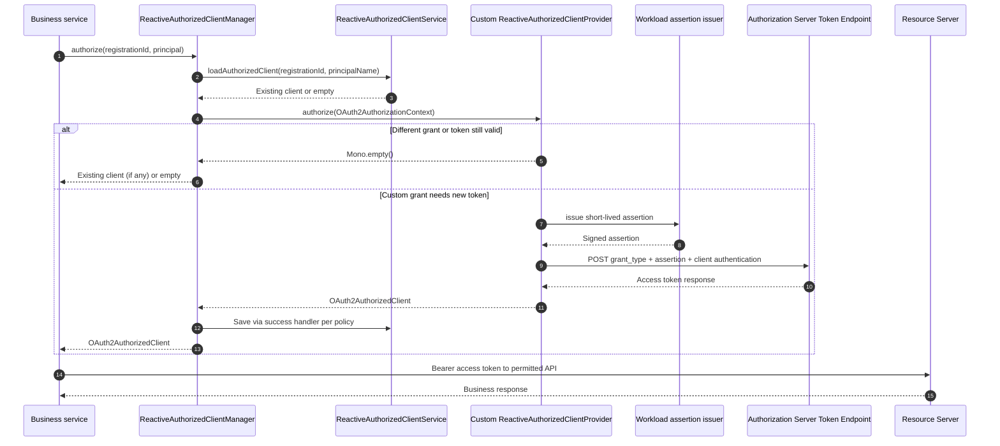
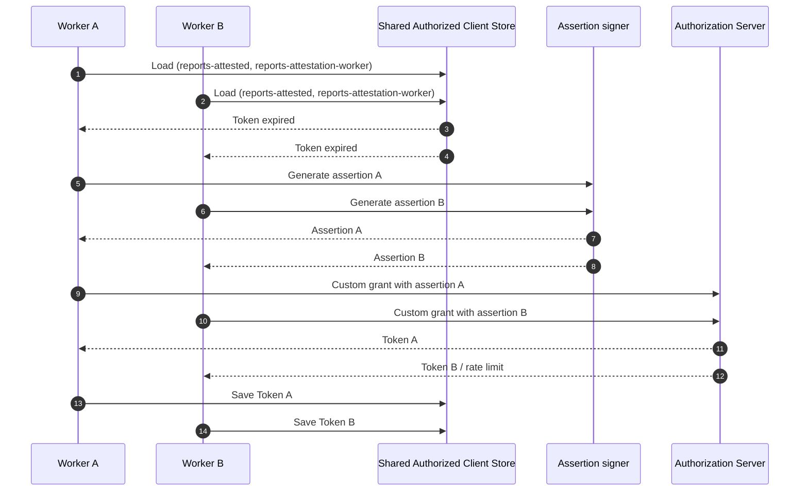

# 22.6. Designing a ReactiveOAuth2AuthorizedClientProvider for a Custom Grant

## 1. When Should You Write a Custom Reactive OAuth2 Authorized Client Provider?

In **Spring Security OAuth 2.0 / OIDC Client**, many token-acquisition needs are already handled by the framework: Authorization Code, Refresh Token, Client Credentials, and—depending on the version—JWT Bearer or Token Exchange. However, some systems integrate with an **Authorization Server using a proprietary extension grant**: the server requires signed workload proof, specialized authorization metadata, or a token-issuance protocol lacking a built-in provider in the library.

For example, the **Employee Portal** runs a periodic reporting job. The enterprise Authorization Server defines a hypothetical extension grant:

```text
grant_type=urn:example:oauth:grant-type:workload-attestation
assertion=<short-lived signed workload assertion>
client_id=<registered-client-id>
client_secret=<client-secret>
```

**The grant name and `assertion` parameter above are only an illustrative contract.** A standard OAuth2 Authorization Server will not understand that grant out of the box. Only use it when the server actually supports it and the client is registered with the right grant, client authentication method, and scopes/audience per policy.

The application must:

1. Verify whether the `ClientRegistration` uses the custom extension grant.
2. Generate workload proof via a trusted signing component.
3. Send an asynchronous token request to the Token Endpoint.
4. Handle OAuth2 token responses and errors per contract.
5. Construct an `OAuth2AuthorizedClient` for the current registration/principal.
6. Coordinate with `ReactiveOAuth2AuthorizedClientManager` to cache/persist, reissue tokens, and track failures.
7. Guarantee **zero blocking on the Reactor event loop**, zero secret leakage, and strict isolation across users, tenants, and audiences.

The central extension point is:

**`ReactiveOAuth2AuthorizedClientProvider`** with the method:

```java
Mono<OAuth2AuthorizedClient> authorize(OAuth2AuthorizationContext context);
```

A provider is a **strategy for executing a grant**; the manager owns the full authorized client lifecycle and invokes the provider when needed. Separating these responsibilities lets your extension plug cleanly into Spring Security's OAuth2 Client rather than scattering Token Endpoint HTTP calls across business code.

### Learning Objectives

You will understand and be able to implement:

- The `ReactiveOAuth2AuthorizedClientProvider` contract: when to return `Mono.empty()`, when to issue a new token, and when to emit an error.
- `OAuth2AuthorizationContext`: registration, principal, existing authorized client, and attributes.
- `ReactiveOAuth2AccessTokenResponseClient<T>`: encapsulating Token Endpoint HTTP communication.
- `AbstractOAuth2AuthorizationGrantRequest`: grant-specific request objects.
- `OAuth2AccessTokenResponse` and `OAuth2AuthorizedClient`.
- `ReactiveOAuth2AuthorizedClientProviderBuilder.provider(...)` together with `ReactiveOAuth2AuthorizedClientManager`.
- Choosing between **request-bound managers** and **service-tier managers** in WebFlux.
- Designing cache keys, token expiry, principals, scopes, audiences, and tenants.
- Testing with Reactor `StepVerifier` and fake token response clients, along with error handling, observability, and security.

This lesson is part of chapter **22. Extension Grants**. Examples use **Java 17+, Spring Boot 3.x, and Spring Security 6.x**. Extension APIs vary by version; always verify against your actual dependencies/BOM. Main class names and contracts follow Spring Security's reactive OAuth2 Client.

> **Principle:** Before designing a custom grant, check whether an official provider already exists. Writing a custom grant is not a substitute for Authorization Code, Client Credentials, JWT Bearer, or Token Exchange when standardized, Spring-supported mechanisms already exist in your version.

## 2. Reactive OAuth2 Client Architecture: Where the Provider Fits

### 2.1. Different Components Have Distinct Responsibilities

| Component | Primary Role | Should Not Do |
| --- | --- | --- |
| `ReactiveClientRegistrationRepository` | Looks up `ClientRegistration` by registration ID | Does not store per-user tokens |
| `ClientRegistration` | Client ID/secret, grant type, scopes, token URI, and provider | Does not represent a logged-in user |
| `ReactiveOAuth2AuthorizedClientManager` | Coordinates authorizing/re-authorizing authorized clients | Does not automatically understand arbitrary extension grants |
| **`ReactiveOAuth2AuthorizedClientProvider`** | Decides whether a grant applies and executes token issuance/reissuance per context | Does not manage HTTP sessions or business authorization |
| `OAuth2AuthorizationContext` | Holds registration, principal, existing authorized client, and context attributes | Is not a browser-redirect authorization request |
| `ReactiveOAuth2AccessTokenResponseClient<T>` | Executes Token Endpoint request/response for a grant | Does not decide which tenant may use a token |
| `OAuth2AccessTokenResponse` | Parsed/validated token response data | Is not a user `Authentication` |
| `OAuth2AuthorizedClient` | Token + registration + principal name | Does not refresh tokens automatically upon read |
| `ReactiveOAuth2AuthorizedClientService` | Saves/loads/deletes authorized clients by registration/principal | Does not authenticate the current HTTP request sender |
| `ServerOAuth2AuthorizedClientRepository` | Authorized clients scoped to a WebFlux `ServerWebExchange` | Does not replace `SecurityContext` |
| `ReactiveOAuth2AuthorizationSuccessHandler` | Persists/handles successful authorization by the manager | Does not construct providers |
| `ReactiveOAuth2AuthorizationFailureHandler` | Handles failures per policy | Is not a mechanism to hide all errors |

### 2.2. Overall Flow



The diagram illustrates a **service-tier manager** backed by a reactive service. For WebFlux HTTP requests, the manager can use `ServerOAuth2AuthorizedClientRepository` and `ServerWebExchange` instead of calling the service directly.

### 2.3. What Counts as a "Custom Grant"?

The OAuth2 Authorization Framework permits **extension grants** via `grant_type` values using a URI identifier agreed upon with the Authorization Server. An extension may require extra Token Endpoint fields or a different issuance flow than standard grants.

Distinguish two levels of customization:

| Scenario | Recommended Direction |
| --- | --- |
| Standard `client_credentials`, only adding `audience`/`resource` per provider | Customize the token request converter/client for the **existing** grant |
| Standard Authorization Code, only adding parameters at the authorization endpoint | Customize the authorization request resolver |
| RFC 8693 Token Exchange | Prefer **`TokenExchangeReactiveOAuth2AuthorizedClientProvider`** when supported by your version |
| RFC 7523 JWT Bearer Grant | Prefer the built-in JWT Bearer provider/response client in supported versions |
| Proprietary OP-defined extension grant with a different protocol | May require a **custom `ReactiveOAuth2AuthorizedClientProvider`** |
| Need to call a Resource Server on another host | Not necessarily a new grant; check registration, audience, scopes, and token selection |
| Want broader scopes without consent/authorization | Never escalate privileges using a custom grant |

**Do not treat every provider-specific parameter as a new grant.** The less custom protocol code in your codebase, the easier it is to maintain security and version compatibility.

## 3. The `ReactiveOAuth2AuthorizedClientProvider` Contract

### 3.1. A Single-Method Interface

```java
package org.springframework.security.oauth2.client;

public interface ReactiveOAuth2AuthorizedClientProvider {

    Mono<OAuth2AuthorizedClient> authorize(
            OAuth2AuthorizationContext context);
}
```

This is the simplified signature for the lesson. It is not a controller handler and does not directly receive HTTP requests.

**`OAuth2AuthorizationContext`** supplies:

- `getClientRegistration()`: the selected client registration.
- `getPrincipal()`: the `Authentication` acting as the authorized client's owner context.
- `getAuthorizedClient()`: any existing authorized client, **possibly `null`**.
- `getAttribute(name)` and `getAttributes()`: custom metadata passed in by the manager.
- Standard attribute constants depending on version.

The provider **does not pick an arbitrary principal itself**. The manager receives the principal from `OAuth2AuthorizeRequest`. A custom provider must use that principal properly while ensuring application policy prevents users from spoofing another principal.

### 3.2. Three Outcomes to Distinguish

| Result of `authorize` | Meaning | Expected Behavior |
| --- | --- | --- |
| **`Mono.empty()`** | Provider does not support this grant **or** no reauthorization is needed per contract | Manager may try another provider or retain the existing authorized client |
| **`Mono.just(authorizedClient)`** | Token issuance/reissuance succeeded | Manager returns the authorized client and runs the success handler |
| **`Mono.error(exception)`** | A genuine error occurred in the grant, transport, token response, or policy | Manager/caller receives the error; failure handling runs per configuration |

Never return `Mono.just(null)` because Reactor disallows null elements.

Never use `Mono.empty()` to **hide a Token Endpoint error**. If the grant matched yet the OP rejected the client secret, returning empty makes it hard for callers to distinguish "provider does not apply" from "authorization failed."

### 3.3. When Should It Return Empty?

A well-designed provider checks:

```java
if (!CUSTOM_GRANT.equals(
        context.getClientRegistration().getAuthorizationGrantType())) {
    return Mono.empty();
}
```

This is **grant matching**. It ensures that when the manager holds multiple providers, the custom provider does not intercept standard grants.

If `getAuthorizedClient()` already holds a token that is not yet due for renewal:

```java
if (existing != null && !isExpiring(existing.getAccessToken())) {
    return Mono.empty();
}
```

Here, empty means **no re-authorization is needed**, not that the authorized client was lost. The manager can retain the existing authorized client. This works when the grant has a stable cache key and consistent reuse policy.

### 3.4. When Should It Emit an Error?

Examples:

- The registration uses the custom grant, yet the Token Endpoint URL is missing.
- The assertion supplier cannot sign with the right key.
- An assertion is required, yet none can be obtained from the trusted source.
- The Token Endpoint reports `invalid_client`, `invalid_grant`, or `unauthorized_client`.
- The response lacks `access_token`, uses an unsupported `token_type`, or has an invalid `expires_in`.
- The token response fails validation against the server's custom contract.
- The system detects the principal is unauthorized for the requested resource/audience.

For well-defined OAuth2 failures, use `OAuth2AuthorizationException` and `OAuth2Error`. For HTTP/network failures, map them to exceptions carrying useful context **without containing raw secrets or assertions**.

### 3.5. Reactive Does Not Mean "Build a Mono and Block"

Anti-pattern:

```java
@Override
public Mono<OAuth2AuthorizedClient> authorize(
        OAuth2AuthorizationContext context) {

    // ANTI-PATTERN: .block() on the event loop.
    OAuth2AccessTokenResponse response =
            tokenClient.getTokenResponse(request).block();

    return Mono.just(toAuthorizedClient(context, response));
}
```

Instead, **compose**:

```java
return tokenClient.getTokenResponse(request)
        .map(response -> toAuthorizedClient(context, response));
```

Never call `subscribe()` manually inside a provider. `authorize` must return a `Publisher` so the manager/caller controls lifecycle, cancellation, error propagation, and backpressure.

## 4. Designing Before Coding: Extension Grant Rules

Before creating classes, write down the contract between client and Authorization Server:

| Topic | Example `workload-attestation` Grant | Must Finalize |
| --- | --- | --- |
| Grant type | `urn:example:oauth:grant-type:workload-attestation` | Must be supported by AS; not a common standard |
| Token endpoint | `https://auth.example.com/oauth2/token` | HTTPS, trusted host, TLS validation |
| Client authentication | `client_secret_post` in demo | Must be allowed by server; consider stronger methods in production |
| Grant evidence | Signed JWT/workload proof in `assertion` | Issuer, audience, subject, clock skew, `jti`/replay policy |
| Scope | `reports.read` | Registration/AS policy |
| Token response | OAuth2-style `access_token`, `token_type=Bearer`, `expires_in` | Parsing and invalid-response handling |
| Refresh | Demo issues no refresh token | Mint new assertion/grant upon expiry |
| Principal key | `reports-batch` | Stable, never taken from user query parameters |
| Audience/resource | One fixed Reports API | Never mix different audiences under the same cache key |
| Failure response | OAuth error JSON / HTTP status | Error codes, retries, fallback |
| Persistence | InMemory or R2DBC service | Access tokens must be protected like secrets |
| Observability | Grant, registration, result, duration | Never log assertions or tokens |

### 4.1. A Self-Chosen Grant Name Is Not Automatically Recognized

`urn:example:oauth:grant-type:workload-attestation` is merely a name for this lesson. Spring can store it as an `AuthorizationGrantType`, yet **the Authorization Server itself must support this `grant_type`**; otherwise the server returns `unsupported_grant_type` or `unauthorized_client`.

If you use Keycloak, Okta, Entra ID, or another OP, verify that provider's extensibility. Never assume different servers share identical support.

### 4.2. Do You Need a Custom Reactive Provider for Token Exchange?

Not necessarily. Spring Security 6.3+ provides **`TokenExchangeReactiveOAuth2AuthorizedClientProvider`** for token exchange (configurable with `WebClientReactiveTokenExchangeTokenResponseClient`). When your use case matches RFC 8693, prefer that provider before re-implementing token exchange.

This lesson still illustrates **a grant without a built-in implementation** so you understand how to design a `ReactiveOAuth2AuthorizedClientProvider`.

### 4.3. Keep Client Authentication Separate from the Grant Credential

The example has:

- **`client_id` and `client_secret`**: authenticates the OAuth client at the Token Endpoint under the demo's `client_secret_post`.
- **`assertion`**: credential proving the extension grant's specific conditions.

The two do not replace each other. A system may use `private_key_jwt`, mTLS, or another method to authenticate the client while an assertion proves workload context. Both being JWTs does not give them the same purpose, audience, or key.

## 5. Spring Boot and ClientRegistration Configuration

### 5.1. Dependencies

```xml
<dependencies>
    <dependency>
        <groupId>org.springframework.boot</groupId>
        <artifactId>spring-boot-starter-webflux</artifactId>
    </dependency>
    <dependency>
        <groupId>org.springframework.boot</groupId>
        <artifactId>spring-boot-starter-security</artifactId>
    </dependency>
    <dependency>
        <groupId>org.springframework.boot</groupId>
        <artifactId>spring-boot-starter-oauth2-client</artifactId>
    </dependency>
</dependencies>
```

Gradle Kotlin DSL:

```kotlin
dependencies {
    implementation("org.springframework.boot:spring-boot-starter-webflux")
    implementation("org.springframework.boot:spring-boot-starter-security")
    implementation("org.springframework.boot:spring-boot-starter-oauth2-client")
}
```

When writing reactive provider tests:

```kotlin
dependencies {
    testImplementation("org.springframework.boot:spring-boot-starter-test")
    testImplementation("io.projectreactor:reactor-test")
}
```

With `reactor-test`, use `StepVerifier` to assert `next`, `complete`, and `error` signals. You do not need a live OP to unit-test provider logic.

### 5.2. Registration for the Extension Grant

```yaml
spring:
  security:
    oauth2:
      client:
        registration:
          reports-attested:
            provider: corporate-as
            client-id: ${REPORTS_CLIENT_ID}
            client-secret: ${REPORTS_CLIENT_SECRET}
            client-authentication-method: client_secret_post
            authorization-grant-type: "urn:example:oauth:grant-type:workload-attestation"
            scope:
              - reports.read

        provider:
          corporate-as:
            token-uri: https://auth.example.com/oauth2/token
```

Explanation:

- `reports-attested` is an internal Spring **registration ID**; it is not the grant type.
- `authorization-grant-type` uses the extension URI; `ClientRegistration` can hold a custom `AuthorizationGrantType`.
- `token-uri` must be an HTTPS endpoint on a server that supports the new grant.
- `client_secret_post` is chosen **purely to keep the transport form request example concise**. Use it only when permitted by the server over TLS; production systems generally prefer client authentication tailored to their threat model and provider.
- `scope` and audience must obey Authorization Server policy. Never use a token issued for the Reports API to call another API.
- Credentials come from a secret manager/runtime config; never hard-code them in Java or the repo.

### 5.3. Do Not Confuse Extension Grants with OIDC Login

The grant in this example involves **no browser redirect**, `authorization_code`, `state` callback, or user-authenticating ID Token.

If the site also provides OIDC Login for employees, that is a separate registration/flow. Never use `client_credentials` or a custom workload grant to "log in on behalf of" a user.

### 5.4. Classes We Will Build

```text
com.example.portal.oauth.extension
├── WorkloadGrantTypes.java
├── ReactiveWorkloadAssertionSupplier.java
├── WorkloadAttestationGrantRequest.java
├── WorkloadAttestationTokenResponseClient.java
├── WorkloadAttestationReactiveOAuth2AuthorizedClientProvider.java
└── WorkloadGrantConfiguration.java

com.example.portal.reports
└── ReportsApiClient.java
```

In a real codebase, classes can be combined or split per your team's conventions. Separating them here highlights the boundaries: **grant state → Token Endpoint transport → provider → manager**.

## 6. Defining the Grant Type and Workload Assertion Source

### 6.1. A Dedicated `AuthorizationGrantType` Constant

```java
package com.example.portal.oauth.extension;

import org.springframework.security.oauth2.core.AuthorizationGrantType;

public final class WorkloadGrantTypes {

    public static final String WORKLOAD_ATTESTATION_VALUE =
            "urn:example:oauth:grant-type:workload-attestation";

    public static final AuthorizationGrantType WORKLOAD_ATTESTATION =
            new AuthorizationGrantType(WORKLOAD_ATTESTATION_VALUE);

    private WorkloadGrantTypes() {
    }
}
```

Centralizing constants in one class helps:

- The provider compare grant types explicitly.
- The token response client send the exact `grant_type`.
- Tests verify the provider does not consume grants from other registrations.
- Avoid duplicating URI strings prone to typos.

### 6.2. Assertion Supplier with a Reactive Contract

```java
package com.example.portal.oauth.extension;

import org.springframework.security.oauth2.client.registration.ClientRegistration;

import reactor.core.publisher.Mono;

@FunctionalInterface
public interface ReactiveWorkloadAssertionSupplier {

    Mono<String> issue(
            ClientRegistration registration,
            String principalName);
}
```

Implementations of this interface are responsible for producing a **short-lived signed assertion accepted by the OP**. This may use a KMS/HSM signer, a workload identity service, or an internal JWT issuer depending on policy.

**Do not** generate assertions from:

- An unsigned random string when the OP requires a signed JWT.
- A long-lived static token hard-coded in `application.yml`.
- A subject/tenant/audience copied directly from an unchecked query parameter.
- A private key stored inside source code.
- A blocking key-management SDK executed directly on the Reactor event loop.

An assertion should have a clear contract covering:

- `iss`, `sub`, or corresponding workload identity.
- `aud` pointing to the exact Token Endpoint/AS per policy.
- `iat`, `exp`, `jti` to mitigate replay.
- Algorithm/`kid`/signature permitted by the server.
- Short TTL and reasonable clock skew.
- Zero unnecessary PII or secrets inside the JWT payload.

**An assertion is a secret capable of minting tokens.** Never log it. Returning a `Mono` from the supplier does not prove its internals are non-blocking; if the signer uses a blocking SDK, offload it to a suitable scheduler or use an async client.

### 6.3. Do Not Issue an Assertion Unless a New Token Is Needed

A well-behaved provider **checks registration matching and token lifetime first**, and only then invokes the assertion supplier. If the existing token is still usable, skip creating and signing a new assertion.

That is why the supplier call belongs inside `Mono.defer` or a chain executed only when the provider decides reauthorization is required—never during bean construction or mere context inspection.

## 7. Creating a Dedicated Grant Request

### 7.1. Why Avoid Passing a Raw Assertion String Everywhere?

`ReactiveOAuth2AccessTokenResponseClient<T>` is parameterized by a request type representing the grant. Defining:

`WorkloadAttestationGrantRequest`

decouples token exchange inputs from `OAuth2AuthorizationContext`.

### 7.2. Extending `AbstractOAuth2AuthorizationGrantRequest`

```java
package com.example.portal.oauth.extension;

import org.springframework.security.oauth2.client.endpoint.AbstractOAuth2AuthorizationGrantRequest;
import org.springframework.security.oauth2.client.registration.ClientRegistration;
import org.springframework.util.Assert;

public final class WorkloadAttestationGrantRequest
        extends AbstractOAuth2AuthorizationGrantRequest {

    private final String assertion;

    public WorkloadAttestationGrantRequest(
            ClientRegistration clientRegistration,
            String assertion) {

        super(clientRegistration);
        Assert.hasText(assertion, "assertion must not be blank");
        this.assertion = assertion;
    }

    public String getAssertion() {
        return this.assertion;
    }
}
```

The base class carries `ClientRegistration`, while the subclass holds the grant's specific credential. The constructor validates `assertion` so we do not send a pointless request if the signer fails.

**Never override `toString()` to print the assertion**. Avoid code-generation/data-class annotations that auto-generate debug methods containing secrets. When logging, include only registration IDs and non-sensitive states.

### 7.3. The Request Type Does Not Determine Grant Validity

A `WorkloadAttestationGrantRequest` instance is just a Java DTO. The Authorization Server decides whether the grant is valid. Consequently, the token response client must:

- Send the right form fields.
- Perform client authentication.
- Parse error responses per contract.
- Validate the access token response.
- Enforce proper timeouts, TLS, redaction, and size limits.

The next section illustrates a response client tailored to this grant.

## 8. Token Endpoint Transport: `ReactiveOAuth2AccessTokenResponseClient<T>`

### 8.1. Why Separate HTTP Requests from the Provider?

Putting all HTTP logic directly inside `authorize(...)` forces the provider to juggle:

- Grant matching and token expiration.
- Assertion generation.
- Client authentication.
- HTTP requests, timeouts, and status codes.
- OAuth2 error JSON parsing.
- Access token response parsing.
- Network testing mixed with authorization logic testing.

Extracting a `ReactiveOAuth2AccessTokenResponseClient<WorkloadAttestationGrantRequest>` lets the provider orchestrate **when** to issue a token while the response client handles **how** to talk to the Token Endpoint.

Core contract:

```java
public interface ReactiveOAuth2AccessTokenResponseClient<
        T extends AbstractOAuth2AuthorizationGrantRequest> {

    Mono<OAuth2AccessTokenResponse> getTokenResponse(T grantRequest);
}
```

For officially supported grants, Spring Security typically supplies a `WebClient`-based response client. For this lesson's custom extension grant, we implement an illustrative response client.

### 8.2. HTTP Request Expected by the Authorization Server

Illustrative request for the hypothetical **workload-attestation** grant:

```http
POST /oauth2/token HTTP/1.1
Host: auth.example.com
Content-Type: application/x-www-form-urlencoded

grant_type=urn%3Aexample%3Aoauth%3Agrant-type%3Aworkload-attestation
&client_id=portal-reports
&client_secret=%3Credacted%3E
&assertion=%3Csigned-workload-assertion%3E
```

Values must be properly **form URL-encoded**, never concatenated raw into the body. All exchanges must go over HTTPS to a Token Endpoint host loaded from trusted configuration.

This example uses `client_secret_post` to keep the snippet brief and clear. **Production must only use a client authentication method registered at the Authorization Server and approved by your organization**; if using `client_secret_basic`, `private_key_jwt`, or mTLS, update the implementation accordingly rather than changing YAML alone while leaving the underlying HTTP request unchanged.

### 8.3. Valid OAuth2 Response

```http
HTTP/1.1 200 OK
Content-Type: application/json
Cache-Control: no-store
Pragma: no-cache

{
  "access_token": "<opaque-or-jwt-access-token>",
  "token_type": "Bearer",
  "expires_in": 1800,
  "scope": "reports.read"
}
```

Under this demo contract, **there is no refresh token**. When the token nears expiration, the provider requests a fresh assertion and re-runs the grant.

If the Token Endpoint returns a body missing `access_token` or carrying an invalid `token_type`, the provider **must never construct a half-baked authorized client**.

### 8.4. Sample Token Response Client

The class below directly illustrates the essential steps. It assumes:

- Only `ClientAuthenticationMethod.CLIENT_SECRET_POST` is supported.
- Only `token_type=Bearer` and positive numeric `expires_in` are accepted.
- No refresh token is accepted under the illustrative grant contract.
- Raw HTTP response bodies are never exposed to callers when the Token Endpoint fails.
- The `WebClient` is configured with TLS, timeouts, and destination guards during bean creation.

```java
package com.example.portal.oauth.extension;

import java.util.Arrays;
import java.util.LinkedHashSet;
import java.util.Map;
import java.util.Set;
import java.util.stream.Collectors;

import org.springframework.core.ParameterizedTypeReference;
import org.springframework.http.HttpStatusCode;
import org.springframework.http.MediaType;
import org.springframework.security.oauth2.client.endpoint.ReactiveOAuth2AccessTokenResponseClient;
import org.springframework.security.oauth2.client.registration.ClientRegistration;
import org.springframework.security.oauth2.core.ClientAuthenticationMethod;
import org.springframework.security.oauth2.core.OAuth2AccessToken;
import org.springframework.security.oauth2.core.endpoint.OAuth2AccessTokenResponse;
import org.springframework.security.oauth2.core.OAuth2AuthorizationException;
import org.springframework.security.oauth2.core.OAuth2Error;
import org.springframework.web.reactive.function.BodyInserters;
import org.springframework.web.reactive.function.client.WebClient;

import reactor.core.publisher.Mono;

public final class WorkloadAttestationTokenResponseClient
        implements ReactiveOAuth2AccessTokenResponseClient<
                WorkloadAttestationGrantRequest> {

    private static final ParameterizedTypeReference<Map<String, Object>> BODY_TYPE =
            new ParameterizedTypeReference<>() {};

    private final WebClient webClient;

    public WorkloadAttestationTokenResponseClient(WebClient webClient) {
        this.webClient = webClient;
    }

    @Override
    public Mono<OAuth2AccessTokenResponse> getTokenResponse(
            WorkloadAttestationGrantRequest request) {

        ClientRegistration registration = request.getClientRegistration();

        // Demo intentionally supports only client_secret_post.
        if (!ClientAuthenticationMethod.CLIENT_SECRET_POST.equals(
                registration.getClientAuthenticationMethod())) {
            return Mono.error(oauthError(
                    "unsupported_client_authentication",
                    "This demo token client requires client_secret_post"));
        }

        String tokenUri = registration.getProviderDetails().getTokenUri();

        if (tokenUri == null || tokenUri.isBlank()) {
            return Mono.error(oauthError(
                    "invalid_client_registration",
                    "Token URI is missing"));
        }

        return webClient.post()
                .uri(tokenUri)
                .contentType(MediaType.APPLICATION_FORM_URLENCODED)
                .body(BodyInserters
                        .fromFormData(
                                "grant_type",
                                WorkloadGrantTypes.WORKLOAD_ATTESTATION_VALUE)
                        .with("client_id", registration.getClientId())
                        .with("client_secret", registration.getClientSecret())
                        .with("assertion", request.getAssertion()))
                .retrieve()
                .onStatus(HttpStatusCode::isError, response ->
                        response.bodyToMono(Void.class)
                                .then(Mono.error(oauthError(
                                        "token_endpoint_error",
                                        "Authorization Server rejected the custom grant"))))
                .bodyToMono(BODY_TYPE)
                .switchIfEmpty(Mono.error(oauthError(
                        "invalid_token_response",
                        "Authorization Server returned an empty response")))
                .map(body -> toTokenResponse(body, registration));
    }

    private OAuth2AccessTokenResponse toTokenResponse(
            Map<String, Object> body, ClientRegistration registration) {

        Object rawToken = body.get("access_token");
        Object rawType = body.get("token_type");
        Object rawLifetime = body.get("expires_in");

        if (!(rawToken instanceof String token) || token.isBlank()) {
            throw oauthError(
                    "invalid_token_response", "Missing access_token");
        }

        if (!(rawType instanceof String type)
                || !"Bearer".equalsIgnoreCase(type)) {
            throw oauthError(
                    "invalid_token_response", "Unsupported token_type");
        }

        if (!(rawLifetime instanceof Number lifetime)
                || lifetime.longValue() <= 0) {
            throw oauthError(
                    "invalid_token_response", "Invalid expires_in");
        }

        // The custom grant contract for this example has no refresh token.
        if (body.get("refresh_token") != null) {
            throw oauthError(
                    "invalid_token_response",
                    "Unexpected refresh_token for this demo grant");
        }

        Set<String> scopes = registration.getScopes();
        Object rawScope = body.get("scope");

        if (rawScope instanceof String scopeText) {
            scopes = Arrays.stream(scopeText.trim().split("\\s+"))
                    .filter(value -> !value.isBlank())
                    .collect(Collectors.toCollection(LinkedHashSet::new));
        }
        else if (rawScope != null) {
            throw oauthError(
                    "invalid_token_response", "Invalid scope format");
        }

        return OAuth2AccessTokenResponse.withToken(token)
                .tokenType(OAuth2AccessToken.TokenType.BEARER)
                .expiresIn(lifetime.longValue())
                .scopes(scopes)
                .build();
    }

    private static OAuth2AuthorizationException oauthError(
            String code, String safeDescription) {

        return new OAuth2AuthorizationException(
                new OAuth2Error(code, safeDescription, null));
    }
}
```

This code **is not a full OAuth2 protocol library**. It demonstrates design boundaries. In production, add the safeguards described below.

### 8.5. Why Parse OAuth2 Errors in a Controlled Manner?

The Token Endpoint may return:

```http
HTTP/1.1 400 Bad Request
Content-Type: application/json

{
  "error": "invalid_grant",
  "error_description": "The workload assertion is expired"
}
```

A production implementation can parse **`error`** and **`error_description`**, provided it:

- Caps response body size.
- Normalizes/masks descriptions before sending them to logs, metrics, or browser responses.
- Never leaks assertions, client secrets, headers, or signed requests.
- Never accepts arbitrary unmanaged error codes to trigger retries or privilege changes.
- Separates `invalid_client`, `invalid_grant`, `unsupported_grant_type`, `temporarily_unavailable`, HTTP 429/5xx, and transport errors.

The demo client above collapses HTTP errors into a generic `token_endpoint_error` to avoid accidentally leaking raw response bodies; production code needs **safe, precise error mapping** to drive retry logic and incident response. Avoiding copying OP `error_description` directly into user-facing exceptions is a sound data-protection choice.

### 8.6. `expires_in` Is Not User Session Expiration

`expires_in` states the expected lifetime of the access token from issuance. When parsed into `OAuth2AccessTokenResponse`, Spring uses timestamps to manage token validity. It is **not** the WebSession or ID Token lifetime.

An access token can still be revoked before expiration. The Resource Server remains responsible for validating the actual token when presented.

### 8.7. Avoid External Input Controlling the Token Endpoint URL

`registration.getProviderDetails().getTokenUri()` must come from trusted configuration/repositories. Never write:

```java
// ANTI-PATTERN: caller specifies the Token Endpoint receiving client_secret.
String tokenUri = browserQueryParameter;
```

and send `client_secret`/assertions to that URI. That creates severe **SSRF + credential disclosure**.

A naive check like `tokenUri.startsWith("https://")` is **insufficient**; application beans should enforce an exact allowlisted token endpoint origin, TLS hostname validation, egress network policies, strict redirect handling, and zero arbitrary host overrides in request builders.

### 8.8. Token Client Timeouts

Configure:

- Reasonable network connection timeouts.
- Response/read timeouts.
- Maximum response size.
- Concurrency limits / circuit breakers where appropriate.
- Separate retry budgets for HTTP transport vs. grant semantics.
- Logging that excludes client secrets and assertions.

Reactor Netty example using the matching connector:

```java
import java.time.Duration;

import io.netty.channel.ChannelOption;
import org.springframework.http.client.reactive.ReactorClientHttpConnector;
import org.springframework.web.reactive.function.client.WebClient;
import reactor.netty.http.client.HttpClient;

HttpClient httpClient = HttpClient.create()
        .option(ChannelOption.CONNECT_TIMEOUT_MILLIS, 3000)
        .responseTimeout(Duration.ofSeconds(5))
        .followRedirect(false);

WebClient tokenEndpointWebClient = WebClient.builder()
        .clientConnector(new ReactorClientHttpConnector(httpClient))
        .build();
```

This configuration **must never disable TLS certificate verification**. Protect the Token Endpoint host via both application and network policies. Never allow auto-following redirects from the Token Endpoint to another host while forwarding client secrets.

## 9. Building `WorkloadAttestationReactiveOAuth2AuthorizedClientProvider`

### 9.1. Provider Responsibilities

The custom provider must execute in order:

1. **Grant filter:** handle only `WORKLOAD_ATTESTATION`.
2. **Token reuse policy:** if the existing `OAuth2AuthorizedClient` is not near expiry and matches the cache key, return empty.
3. **Assertion issuance:** if a new token is needed, obtain a short-lived assertion from a trusted source.
4. **Token Endpoint:** invoke `ReactiveOAuth2AccessTokenResponseClient`.
5. **Authorized client mapping:** bind the new token to the exact `ClientRegistration` and `context.getPrincipal().getName()`.
6. **Error propagation:** emit meaningful errors—never return dummy/placeholder tokens.
7. **No blocking:** return a `Mono`; never call `block()` or `subscribe()`.

### 9.2. Checking Token Expiration with Clock Skew

Do not wait until the exact `expiresAt` instant to request a new token when outbound calls may take several seconds:

```text
issuedAt = 10:00:00
expiresAt = 10:30:00
clockSkew = 60 seconds

From around 10:29:00 onward:
  the provider may consider the token due for renewal before calling APIs.
```

Inject a `Clock` so expiry tests remain deterministic rather than relying on wall-clock time.

### 9.3. Provider Implementation

```java
package com.example.portal.oauth.extension;

import java.time.Clock;
import java.time.Duration;
import java.time.Instant;

import org.springframework.security.oauth2.client.OAuth2AuthorizationContext;
import org.springframework.security.oauth2.client.OAuth2AuthorizedClient;
import org.springframework.security.oauth2.client.ReactiveOAuth2AuthorizedClientProvider;
import org.springframework.security.oauth2.client.endpoint.ReactiveOAuth2AccessTokenResponseClient;
import org.springframework.security.oauth2.core.OAuth2AccessToken;
import org.springframework.security.oauth2.core.OAuth2AuthorizationException;
import org.springframework.security.oauth2.core.OAuth2Error;
import org.springframework.util.Assert;

import reactor.core.publisher.Mono;

public final class WorkloadAttestationReactiveOAuth2AuthorizedClientProvider
        implements ReactiveOAuth2AuthorizedClientProvider {

    private final ReactiveWorkloadAssertionSupplier assertionSupplier;
    private final ReactiveOAuth2AccessTokenResponseClient<
            WorkloadAttestationGrantRequest> tokenResponseClient;
    private final Clock clock;
    private final Duration clockSkew;

    public WorkloadAttestationReactiveOAuth2AuthorizedClientProvider(
            ReactiveWorkloadAssertionSupplier assertionSupplier,
            ReactiveOAuth2AccessTokenResponseClient<
                    WorkloadAttestationGrantRequest> tokenResponseClient,
            Clock clock,
            Duration clockSkew) {

        Assert.notNull(assertionSupplier, "assertionSupplier is required");
        Assert.notNull(tokenResponseClient, "tokenResponseClient is required");
        Assert.notNull(clock, "clock is required");
        Assert.notNull(clockSkew, "clockSkew is required");
        Assert.isTrue(!clockSkew.isNegative(), "clockSkew must be >= 0");

        this.assertionSupplier = assertionSupplier;
        this.tokenResponseClient = tokenResponseClient;
        this.clock = clock;
        this.clockSkew = clockSkew;
    }

    @Override
    public Mono<OAuth2AuthorizedClient> authorize(
            OAuth2AuthorizationContext context) {

        // 1. Do not consume requests for any other OAuth2 grant.
        if (!WorkloadGrantTypes.WORKLOAD_ATTESTATION.equals(
                context.getClientRegistration().getAuthorizationGrantType())) {
            return Mono.empty();
        }

        // 2. Reuse only because this example has one fixed scope/audience
        //    per registration and stable principal-specific cache keys.
        OAuth2AuthorizedClient existing = context.getAuthorizedClient();

        if (existing != null && !isExpiring(existing.getAccessToken())) {
            return Mono.empty();
        }

        // 3. Deferred reactive issuance: no assertion is minted when
        //    the provider does not need to re-authorize.
        return Mono.defer(() ->
                assertionSupplier.issue(
                                context.getClientRegistration(),
                                context.getPrincipal().getName())
                        .switchIfEmpty(Mono.error(authorizationError(
                                "invalid_workload_assertion",
                                "Cannot issue workload attestation")))
                        .flatMap(assertion ->
                                tokenResponseClient.getTokenResponse(
                                        new WorkloadAttestationGrantRequest(
                                                context.getClientRegistration(),
                                                assertion)))
                        .map(tokenResponse ->
                                new OAuth2AuthorizedClient(
                                        context.getClientRegistration(),
                                        context.getPrincipal().getName(),
                                        tokenResponse.getAccessToken(),
                                        tokenResponse.getRefreshToken())));
    }

    private boolean isExpiring(OAuth2AccessToken token) {
        Instant expiresAt = token.getExpiresAt();

        return expiresAt == null
                || !expiresAt.isAfter(
                        clock.instant().plus(clockSkew));
    }

    private static OAuth2AuthorizationException authorizationError(
            String code, String safeDescription) {

        return new OAuth2AuthorizationException(
                new OAuth2Error(code, safeDescription, null));
    }
}
```

### 9.4. Detailed Explanation of Each Design Decision

**(1) Accept only the matching grant.** `ReactiveOAuth2AuthorizedClientProvider` may sit inside a multi-provider chain. If a registration uses `authorization_code` or `client_credentials`, the custom provider must return `Mono.empty()` instead of attempting an assertion exchange.

**(2) Do not call the OP if a valid token exists.** When the manager already loaded an unexpired authorized client, the provider skips minting assertions/tokens and returns empty so the manager reuses the existing client. **This is valid only when the cache key fully captures the token's scope, audience, and identity needed by the request.** Later sections analyze cases where the cache key is insufficient.

**(3) `Mono.defer` and the reactive supplier.** Never generate assertions in the constructor or at startup. The supplier runs only upon genuine subscription when the provider decides a new token is needed.

**(4) Injecting the response client.** Lets tests supply a fake response client without an HTTP server. Transport concerns like TLS, HTTP errors, and parsing stay isolated in the transport client.

**(5) Preserving the exact principal.** `new OAuth2AuthorizedClient(..., context.getPrincipal().getName(), ...)` ensures the manager/service persists under the chosen principal. Never pull principals from untrusted caller-supplied subjects.

**(6) Mapping `OAuth2AccessTokenResponse` to `OAuth2AuthorizedClient`.** The response client already parsed the token response. `getRefreshToken()` is null under our demo contract. The manager persists the client upon success via its success handler.

**(7) `Clock`/`clockSkew`.** Using `Clock` keeps unit tests deterministic and prevents using tokens right on the edge of expiration. Size `clockSkew` relative to token lifetime—never set it close to the entire TTL or you will continuously mint tokens.

### 9.5. When a Grant Adds Actor, Audience, or Tenant, This Logic Must Change

The provider above intentionally supports **only one fixed target API and scope policy per registration**. If requests using the same registration/principal can vary `audience`, `resource`, `scope`, or subject/actor tokens, **never reuse an authorized client based solely on `expiresAt`**.

Dangerous example:

```text
Store key: (token-exchange, employee-4821)

Request A:
  resource=reports-api
  scope=reports.read
  -> stores TokenA

Request B:
  resource=billing-api
  scope=billing.write
  -> manager loads TokenA (still unexpired)
  -> provider returns empty because it only checked expiresAt
  -> manager may return TokenA with the wrong audience
```

You need one of these approaches:

- Separate **`ClientRegistration` per resource/permission profile** so cache keys differ.
- Use a **trusted namespaced principal** representing identity + tenant/resource when the design allows.
- Implement a custom authorized client store keyed by verified scope/audience/subject context.
- Avoid persisting context-specific grant tokens and always execute the grant explicitly per policy.
- Verify token/context metadata before reusing; never decode opaque token strings pretending they are JWTs.
- Never accept arbitrary principals or target audiences from the browser just to "create distinct keys."

**Token mix-up caused by cache keys missing dimensions is one of the easiest design flaws to overlook when writing custom grant providers.**

## 10. Plugging the Custom Provider into `ReactiveOAuth2AuthorizedClientManager`

### 10.1. `ReactiveOAuth2AuthorizedClientProviderBuilder.provider(...)`

Spring Security lets you assemble a provider chain:

```java
ReactiveOAuth2AuthorizedClientProvider provider =
        ReactiveOAuth2AuthorizedClientProviderBuilder.builder()
                .authorizationCode()
                .refreshToken()
                .clientCredentials()
                .provider(workloadAttestationProvider)
                .build();
```

`provider(...)` appends your implementation to the chain. Built-in providers handle only their matching grants, and your custom provider must likewise filter grants as shown in Section 9.

Some versions include built-in JWT Bearer/Token Exchange providers registered separately per that version's docs. **Never replace the entire chain with only your custom provider** if the app still relies on Authorization Code or Client Credentials.

### 10.2. Service-Tier Manager for the Workload Extension Grant

Bean configuration example:

```java
package com.example.portal.oauth.extension;

import java.time.Clock;
import java.time.Duration;

import org.springframework.context.annotation.Bean;
import org.springframework.context.annotation.Configuration;
import org.springframework.security.oauth2.client.AuthorizedClientServiceReactiveOAuth2AuthorizedClientManager;
import org.springframework.security.oauth2.client.ReactiveOAuth2AuthorizedClientManager;
import org.springframework.security.oauth2.client.ReactiveOAuth2AuthorizedClientProvider;
import org.springframework.security.oauth2.client.ReactiveOAuth2AuthorizedClientProviderBuilder;
import org.springframework.security.oauth2.client.ReactiveOAuth2AuthorizedClientService;
import org.springframework.security.oauth2.client.endpoint.ReactiveOAuth2AccessTokenResponseClient;
import org.springframework.security.oauth2.client.registration.ReactiveClientRegistrationRepository;
import org.springframework.web.reactive.function.client.WebClient;

@Configuration
public class WorkloadGrantConfiguration {

    @Bean
    ReactiveOAuth2AccessTokenResponseClient<WorkloadAttestationGrantRequest>
            workloadTokenResponseClient() {

        // A dedicated HTTP client for the trusted Token Endpoint.
        // Add connection/read timeout, destination policy and TLS controls
        // as required by the production environment.
        return new WorkloadAttestationTokenResponseClient(
                WebClient.builder().build());
    }

    @Bean
    ReactiveOAuth2AuthorizedClientProvider workloadAttestationProvider(
            ReactiveWorkloadAssertionSupplier assertions,
            ReactiveOAuth2AccessTokenResponseClient<
                    WorkloadAttestationGrantRequest> tokenClient) {

        return new WorkloadAttestationReactiveOAuth2AuthorizedClientProvider(
                assertions,
                tokenClient,
                Clock.systemUTC(),
                Duration.ofSeconds(60));
    }

    @Bean("workloadGrantManager")
    ReactiveOAuth2AuthorizedClientManager workloadGrantManager(
            ReactiveClientRegistrationRepository registrations,
            ReactiveOAuth2AuthorizedClientService authorizedClients,
            ReactiveOAuth2AuthorizedClientProvider workloadAttestationProvider) {

        ReactiveOAuth2AuthorizedClientProvider provider =
                ReactiveOAuth2AuthorizedClientProviderBuilder.builder()
                        .clientCredentials()
                        .provider(workloadAttestationProvider)
                        .build();

        var manager =
                new AuthorizedClientServiceReactiveOAuth2AuthorizedClientManager(
                        registrations,
                        authorizedClients);

        manager.setAuthorizedClientProvider(provider);
        return manager;
    }
}
```

**A `ReactiveWorkloadAssertionSupplier` bean must be implemented and supplied by the application** from your real signing system. This configuration will not work without a signer bean or an AS that supports the illustrative grant. Never replace the signer with a static unsigned assertion in production.

Here:

- The manager uses **`ReactiveOAuth2AuthorizedClientService`** for workload/background jobs.
- The provider chain supports standard Client Credentials and the custom grant.
- Registration `reports-attested` routes to the custom provider.
- Registration `reports-api` using `client_credentials` (if present) routes to the built-in provider.
- WebFlux user login (if present in the app) can use a separate request-context manager.

### 10.3. A Separate Manager for WebFlux Request-Bound Grants

If a custom grant legitimately runs inside WebFlux HTTP requests (not only background jobs), you can use:

```java
@Bean("requestGrantManager")
ReactiveOAuth2AuthorizedClientManager requestGrantManager(
        ReactiveClientRegistrationRepository registrations,
        ServerOAuth2AuthorizedClientRepository authorizedClientRepository,
        ReactiveOAuth2AuthorizedClientProvider workloadAttestationProvider) {

    ReactiveOAuth2AuthorizedClientProvider provider =
            ReactiveOAuth2AuthorizedClientProviderBuilder.builder()
                    .authorizationCode()
                    .refreshToken()
                    .provider(workloadAttestationProvider)
                    .build();

    var manager = new DefaultReactiveOAuth2AuthorizedClientManager(
            registrations, authorizedClientRepository);

    manager.setAuthorizedClientProvider(provider);
    return manager;
}
```

Import `DefaultReactiveOAuth2AuthorizedClientManager` and `ServerOAuth2AuthorizedClientRepository` accordingly. This is the **HTTP-request variant**; omit it if your application only executes background workload grants.

Key differences:

| Manager | Persistence Source | Requires |
| --- | --- | --- |
| `DefaultReactiveOAuth2AuthorizedClientManager` | `ServerOAuth2AuthorizedClientRepository` | `ServerWebExchange` context |
| `AuthorizedClientServiceReactiveOAuth2AuthorizedClientManager` | `ReactiveOAuth2AuthorizedClientService` | Runs outside HTTP exchanges |
| `ReactiveOAuth2AuthorizedClientProvider` | Not a store | Grant-specific `OAuth2AuthorizationContext` |
| `ReactiveOAuth2AccessTokenResponseClient` | Not a store | Grant request and Token Endpoint |

### 10.4. Choosing the Manager Is an Architectural Decision

- For scheduled jobs, message consumers, and service-to-service integrations: **service-tier manager**.
- For WebFlux controllers/user-bound interactions: **request-bound manager** and an `Authentication`-linked repository.
- For grants requiring consent/user authorization: implement the proper interactive flow—never pass a background `String` principal and claim user rights.
- For tokens issued for specific resources: design valid scopes, audiences, and destinations.

**A custom grant does not turn a client access token into a user ID Token.** Never use an extension grant as a workaround to bypass OIDC login or user permissions.

## 11. Calling the Manager Reactively from a Business Service

### 11.1. `OAuth2AuthorizeRequest` Is Still Used with Reactive Managers

Authorization request:

```java
OAuth2AuthorizeRequest request = OAuth2AuthorizeRequest
        .withClientRegistrationId("reports-attested")
        .principal("reports-attestation-worker")
        .build();
```

Note: the request class is named `OAuth2AuthorizeRequest`, not `ReactiveOAuth2AuthorizeRequest`. The manager method returns `Mono<OAuth2AuthorizedClient>`.

`principal("reports-attestation-worker")` is a **stable technical principal**, not a logged-in browser user. This string only determines the cache key in the authorized client service; calling the manager must still be gated by service/workload permissions.

### 11.2. Using the Token to Call a Preconfigured API

```java
package com.example.portal.reports;

import org.springframework.beans.factory.annotation.Qualifier;
import org.springframework.security.oauth2.client.OAuth2AuthorizeRequest;
import org.springframework.security.oauth2.client.ReactiveOAuth2AuthorizedClientManager;
import org.springframework.stereotype.Service;
import org.springframework.web.reactive.function.client.WebClient;

import reactor.core.publisher.Mono;

@Service
public class AttestedReportsClient {

    private final ReactiveOAuth2AuthorizedClientManager manager;
    private final WebClient reportsApi;

    public AttestedReportsClient(
            @Qualifier("workloadGrantManager")
            ReactiveOAuth2AuthorizedClientManager manager,
            WebClient.Builder builder) {

        this.manager = manager;
        this.reportsApi = builder.clone()
                .baseUrl("https://reports-api.example.com")
                .build();
    }

    public Mono<String> loadSummary() {
        OAuth2AuthorizeRequest request = OAuth2AuthorizeRequest
                .withClientRegistrationId("reports-attested")
                .principal("reports-attestation-worker")
                .build();

        return manager.authorize(request)
                .switchIfEmpty(Mono.error(
                        new IllegalStateException(
                                "Workload grant is not available")))
                .flatMap(authorizedClient ->
                        reportsApi.get()
                                .uri("/v1/reports/summary")
                                .headers(headers -> headers.setBearerAuth(
                                        authorizedClient.getAccessToken()
                                                .getTokenValue()))
                                .retrieve()
                                .bodyToMono(String.class));
    }
}
```

Key precautions:

- Never call `block()` inside reactive handlers/services.
- Never call `subscribe()` and return "success" before the token/API call finishes.
- Never cache an access token `String` in a `static` field.
- `WebClient` uses an application-governed destination; **`baseUrl` alone is not an allowlist** if call sites can supply absolute URIs. Restrict URLs in typed methods, apply redirect/egress controls, and add destination guards where needed.
- If exposing an endpoint allowing users to trigger `loadSummary()`, the backend must **authorize the user first**. A workload access token does not automatically grant permissions to browser users.
- When a token has a fixed `audience`, send it only to the permitted Resource Server.
- If the Token Endpoint returns `invalid_client`, having a user log in again will not fix the workload's secret.

### 11.3. Empty and Error Signals

`manager.authorize(request)` may:

- Emit an authorized client (existing or new).
- Complete empty if no provider handles the grant/context.
- Emit an error if the Token Endpoint, assertion issuer, or persistence fails.

`switchIfEmpty(Mono.error(...))` in the example handles the empty case without fabricating a dummy token. In production, map this to an appropriate domain exception and alert on grant configuration mismatches.

### 11.4. Can You Use the WebClient OAuth2 Exchange Filter?

Yes—Spring Security WebFlux provides `ServerOAuth2AuthorizedClientExchangeFilterFunction`. However, ensure you:

- Inject **the right `ReactiveOAuth2AuthorizedClientManager`**.
- Select the right registration/principal per call.
- Ensure required context exists or use the service-tier manager.
- Never enable a default token on an HTTP client that calls arbitrary URLs.
- Constrain which destinations receive Bearer tokens.
- Never mix user-bound `Authentication` with service principals.

This lesson invokes the manager directly because it makes clear when the custom grant runs and simplifies tracing code and failures.

## 12. Context Attributes: Passing Custom Data from Manager to Provider

### 12.1. `OAuth2AuthorizeRequest` and `OAuth2AuthorizationContext` Differ

Business code submits a request to the manager:

```java
OAuth2AuthorizeRequest request = OAuth2AuthorizeRequest
        .withClientRegistrationId("reports-attested")
        .principal("reports-attestation-worker")
        .build();
```

The manager maps that into an `OAuth2AuthorizationContext` for the provider. Some grants need extra context, such as:

- Verified tenant/resource.
- Controlled requested scopes.
- Subject token/actor token in token exchange.
- System-managed audience.
- Credential reference used to build a signed assertion.
- Internal policy metadata rather than standard OAuth2 parameters.

`OAuth2AuthorizeRequest` can carry attributes, yet **not every attribute automatically becomes a Token Endpoint parameter**. The manager uses a **context attributes mapper** to control what reaches the provider.

### 12.2. Example Setting an Attribute at the Call Site

```java
public final class WorkloadContextAttributes {

    public static final String AUDIENCE =
            "com.example.portal.oauth.requestedAudience";

    private WorkloadContextAttributes() {
    }
}
```

Business code:

```java
OAuth2AuthorizeRequest request = OAuth2AuthorizeRequest
        .withClientRegistrationId("reports-attested")
        .principal("reports-attestation-worker")
        .attributes(attributes -> {
            attributes.put(
                    WorkloadContextAttributes.AUDIENCE,
                    "reports-api");
        })
        .build();
```

**This example only shows passing metadata—it does not make the Token Endpoint receive `audience=...` automatically.** To use an attribute, the provider must read `context.getAttribute(...)`, the request object must carry it, and the token response client must serialize it into a form field per server contract.

### 12.3. Configuring `setContextAttributesMapper(...)`

The service-tier reactive manager exposes:

```java
void setContextAttributesMapper(
        Function<OAuth2AuthorizeRequest, Mono<Map<String, Object>>> mapper);
```

An illustrative mapper **permitting only governed audiences**:

```java
import java.util.Map;
import java.util.Set;

import reactor.core.publisher.Mono;

Set<String> allowedAudiences = Set.of("reports-api");

manager.setContextAttributesMapper(request -> {
    String audience = request.getAttribute(
            WorkloadContextAttributes.AUDIENCE);

    if (audience == null) {
        return Mono.just(Map.of());
    }

    if (!allowedAudiences.contains(audience)) {
        return Mono.error(new IllegalArgumentException(
                "Requested audience is not allowed"));
    }

    return Mono.just(Map.of(
            WorkloadContextAttributes.AUDIENCE,
            audience));
});
```

This is a **code fragment inside a bean factory** where `manager` is an `AuthorizedClientServiceReactiveOAuth2AuthorizedClientManager`, not a standalone class. It demonstrates:

- Never forwarding all caller attributes blindly.
- Validating audience before reaching the custom provider.
- Separating policy validation from transport.
- Failing before the Token Endpoint ever receives assertions or secrets.

**Never accept an arbitrary audience simply because it is a `String`.** When exchanging tokens with user permissions, also verify caller authorization for that tenant/resource before passing attributes.

### 12.4. Provider Reading Attributes via `context.getAttribute(...)`

If building a grant variant that genuinely supports dynamic audiences:

```java
String audience = context.getAttribute(
        WorkloadContextAttributes.AUDIENCE);
```

The provider must validate the value and forward it to the grant request/response client. In this lesson, `WorkloadAttestationReactiveOAuth2AuthorizedClientProvider` in Section 9 **does not read this attribute**, because it uses **one fixed audience per registration**.

Do not paste the mapper snippet above into the demo implementation expecting the Token Endpoint to receive a new audience. That is an **extension step requiring extra code and token storage policies**.

### 12.5. Token Caching Risks When Attributes Change Permissions

`OAuth2AuthorizedClientService` typically stores records by:

```text
(registrationId, principalName)
```

Yet requests may add:

```text
audience=reports-api
scope=reports.read
subject_token=token-A
```

or:

```text
audience=billing-api
scope=billing.write
subject_token=token-B
```

Even with identical key pairs, those two access tokens **cannot be treated as interchangeable**.

If the provider returns `Mono.empty()` because an existing token is unexpired without checking attribute/resource alignment, the manager may return a token with the wrong audience. Therefore, **context attributes must be reflected in your cache-key policy or token reuse policy**.

Do not merely append `audience` to the HTTP body and forget to check whether stale authorized clients are reused.

## 13. Persistence: How the Manager Stores Tokens and How to Prevent Token Mix-Up

### 13.1. Default Persistence Behavior

With `AuthorizedClientServiceReactiveOAuth2AuthorizedClientManager`:

- The manager loads any existing authorized client via `ReactiveOAuth2AuthorizedClientService`.
- When the provider produces a new authorized client, **the default success handler saves it** in the service.
- When authorization fails on certain errors such as `invalid_grant`, **the failure handler** may remove the old authorized client under default policy.
- Success/failure handlers can be replaced when custom policies are required.

Records are typically keyed by:

```text
(clientRegistrationId, principalName)
```

Example:

```text
(reports-attested, reports-attestation-worker)
```

### 13.2. Tokens Can Have More Dimensions Than the Storage Key

Suppose an extension grant varies by user and resource:

```text
grant_type=custom-delegation
principalName=employee-4821
subjectToken=credential-for-user-A
resource=reports-api
```

If the same registration/principal is also used for `resource=billing-api`, the storage key may overwrite rows or reuse the wrong token.

Options:

| Strategy | When Appropriate | Notes |
| --- | --- | --- |
| Separate registration per resource/permission profile | Finite, static integrations | Easy to understand and audit |
| Principal name namespaced by identity/tenant/resource | Consistently governed namespaces | Never accept principal names from unauthorized users |
| Custom reactive authorized-client service with context-rich keys | Dynamic multi-tenant/resource setups | Requires migrations, concurrency control, encryption |
| Do not persist context-specific tokens | Very short-lived tokens; every request needs its own | Success handler and load path must be aligned |
| Reuse after full token-context validation | Reliable metadata for audience/scope exists | Prevent mix-ups; never parse opaque tokens arbitrarily |
| Simplify API contracts to use fixed audiences | Product permits simplification | Smallest bug surface |

In this demo, **each registration represents one API service with fixed scopes**, and the principal is a stable technical workload. That makes the "reuse while unexpired" policy sound.

### 13.3. Never Use Unverified Claims as Security Keys

If the application extracts `sub`, `tenant`, or `aud` by Base64-decoding a JWT payload **without verifying signature, issuer, audience, and expiry**, an attacker can manipulate storage keys or requested token scopes.

Rules:

- User identity must come from a verified `Authentication` or validated token.
- Workload identity must come from trusted runtime/secret manager/identity providers.
- Resource mappings must come from configuration/policy allowlists.
- For token exchange: subject tokens must be evaluated per Authorization Server contract—never treat any JWT string as valid.
- Never use unverified emails as principal keys when collisions or privilege crossover are possible.

### 13.4. Both InMemory and R2DBC Are Credential Stores

You can use:

- `InMemoryReactiveOAuth2AuthorizedClientService` for development or simple M2M setups.
- `R2dbcReactiveOAuth2AuthorizedClientService` when persistent token storage is needed.
- `ServerOAuth2AuthorizedClientRepository` in WebFlux HTTP requests.

However:

- In-memory state is lost on restarts and is not shared across instances.
- R2DBC requires schemas, migrations, TLS, encryption, least privilege, backups, and concurrency controls.
- WebSession repositories tie to browser sessions, making them unnatural for background workloads.
- Storing tokens in a BLOB/BYTEA column **does not mean they are encrypted**.
- The manager succeeding and saving a token does not prove subsequent requests carry valid user authorization.

### 13.5. Replacing the Success Handler Does Not Solve Everything Alone

At the API level, you can replace the success handler:

```java
manager.setAuthorizationSuccessHandler(
        (authorizedClient, principal, attributes) -> Mono.empty());
```

This **illustrates a non-persisting handler**. Yet changing only the success handler **does not stop the manager from loading older authorized clients from the service**; if the store already contains a token under that key, the manager/provider will still inspect it.

To build a true **non-persisted per-request token** mode, align all parts:

- No pre-existing cached rows for that key.
- Provider never silently returns empty and reuses a token from the wrong resource.
- Success handler intentionally skips persistence.
- Failure handler never accidentally deletes tokens belonging to other grants/registrations.
- Token/client context stays consistent throughout the pipeline.
- The OP's rate limits can tolerate frequent token issuance.

**Do not simply attach a no-op success handler and assume all token-reuse/cross-resource risks are eliminated.**

## 14. Distinguishing Extension Grants, Token Exchange, and JWT Bearer

### 14.1. Token Exchange RFC 8693

Token exchange typically sends:

```text
grant_type=urn:ietf:params:oauth:grant-type:token-exchange
subject_token=<token being exchanged>
subject_token_type=<type of subject token>
requested_token_type=<optional>
audience=<optional>
resource=<optional>
actor_token=<optional>
actor_token_type=<optional>
```

In versions offering `TokenExchangeReactiveOAuth2AuthorizedClientProvider`, configure the official provider:

```java
TokenExchangeReactiveOAuth2AuthorizedClientProvider tokenExchangeProvider =
        new TokenExchangeReactiveOAuth2AuthorizedClientProvider();

ReactiveOAuth2AuthorizedClientProvider provider =
        ReactiveOAuth2AuthorizedClientProviderBuilder.builder()
                .provider(tokenExchangeProvider)
                .build();
```

This class provides **subject token resolver** and **actor token resolver** extension points alongside a token-exchange response client. Depending on version, additional response client or authorization context configuration may be needed. **Do not re-implement RFC 8693 from scratch merely because the grant name has colons and many parameters.**

### 14.2. JWT Bearer Grant RFC 7523

The JWT bearer authorization grant uses a JWT assertion as the grant credential under a standardized contract. Compatible Spring Security versions include `JwtBearerReactiveOAuth2AuthorizedClientProvider`.

Unlike this lesson's `workload-attestation` extension:

- JWT Bearer `grant_type` has a standardized value.
- Assertions carry clear RFC and OP-policy semantics.
- Spring may provide built-in resolvers/response clients.
- Not every provider supports the JWT bearer grant, even though it is a standard.

If the AS genuinely supports RFC 7523, check built-in providers before building custom abstractions.

### 14.3. JWT Client Authentication Is Not the JWT Bearer Authorization Grant

Two easily confused concepts:

1. **`private_key_jwt`**: the client uses a JWT assertion to **authenticate the client itself** at the Token Endpoint.
2. **JWT bearer grant**: the JWT assertion is the **authorization grant credential**.
3. **Extension grant**: the server defines its own token-issuance contract—sometimes also using a JWT, yet not automatically equivalent to 1 or 2.

A JWT may appear in a request, yet its role is determined by **grant type, client authentication method, and server contract**, never by string format alone.

### 14.4. Choose the Smallest Extension API Possible

| Need | Preferred Customization |
| --- | --- |
| Add an HTTP header at the Token Endpoint | Token response client / HTTP transport configuration |
| Add `audience` to a standard grant | Parameters converter on the token response client |
| Change timeouts/TLS/proxy | Injected `WebClient`/HTTP connector |
| Exchange tokens across audiences per RFC 8693 | Built-in Token Exchange provider when available |
| RFC 7523 JWT bearer | Built-in JWT Bearer provider when available |
| Proprietary grant lacking an implementation | Custom `ReactiveOAuth2AuthorizedClientProvider` |
| Simply persist tokens to R2DBC | `ReactiveOAuth2AuthorizedClientService`, no custom grant needed |
| Simply attach Bearer tokens in `WebClient` | Authorized Client Manager + WebClient OAuth2 filter, no custom grant needed |

**Do not customize more broadly than necessary**; every line of custom protocol code requires testing, security review, and version maintenance.

## 15. Designing Unit Tests: No Live Token Endpoint Needed

### 15.1. Separate Provider Tests from HTTP Transport Tests

Because the provider takes two dependencies:

- `ReactiveWorkloadAssertionSupplier`.
- `ReactiveOAuth2AccessTokenResponseClient<WorkloadAttestationGrantRequest>`.

you can use fake reactive dependencies to test logic:

- Different grant → `Mono.empty()`.
- Custom grant with no authorized client yet → requests assertion and token.
- Unexpired existing token → calls neither signer nor Token Endpoint.
- Expired token → issues new token request.
- Empty/erroring assertion supplier → emits error, creates no dummy client.
- Response client error → propagates error.
- Principal name in `OAuth2AuthorizedClient` matches context.
- Never calls `block()`, never self-subscribes.

### 15.2. Creating a Test Registration

```java
private static ClientRegistration testRegistration() {
    return ClientRegistration.withRegistrationId("reports-attested")
            .clientId("unit-test-client")
            .clientSecret("unit-test-secret")
            .clientAuthenticationMethod(
                    ClientAuthenticationMethod.CLIENT_SECRET_POST)
            .authorizationGrantType(
                    WorkloadGrantTypes.WORKLOAD_ATTESTATION)
            .tokenUri("https://auth.example.test/oauth2/token")
            .scope("reports.read")
            .build();
}
```

Use **dummy test values**. Never commit client secrets or test fixtures matching production into source repos.

### 15.3. Testing New Token Issuance with StepVerifier

JUnit 5 + Reactor Test example (full imports shown below):

```java
package com.example.portal.oauth.extension;

import static org.junit.jupiter.api.Assertions.assertEquals;

import java.time.Clock;
import java.time.Duration;
import java.util.Set;
import java.util.concurrent.atomic.AtomicInteger;

import org.junit.jupiter.api.Test;
import org.springframework.security.authentication.UsernamePasswordAuthenticationToken;
import org.springframework.security.core.Authentication;
import org.springframework.security.core.authority.AuthorityUtils;
import org.springframework.security.oauth2.client.OAuth2AuthorizationContext;
import org.springframework.security.oauth2.client.endpoint.ReactiveOAuth2AccessTokenResponseClient;
import org.springframework.security.oauth2.client.registration.ClientRegistration;
import org.springframework.security.oauth2.core.ClientAuthenticationMethod;
import org.springframework.security.oauth2.core.OAuth2AccessToken;
import org.springframework.security.oauth2.core.endpoint.OAuth2AccessTokenResponse;

import reactor.core.publisher.Mono;
import reactor.test.StepVerifier;

class WorkloadAttestationProviderTest {

    private static ClientRegistration registration() {
        return ClientRegistration.withRegistrationId("reports-attested")
                .clientId("unit-test-client")
                .clientSecret("unit-test-secret")
                .clientAuthenticationMethod(
                        ClientAuthenticationMethod.CLIENT_SECRET_POST)
                .authorizationGrantType(
                        WorkloadGrantTypes.WORKLOAD_ATTESTATION)
                .tokenUri("https://auth.example.test/oauth2/token")
                .scope("reports.read")
                .build();
    }

    private static Authentication principal() {
        return new UsernamePasswordAuthenticationToken(
                "reports-attestation-worker",
                "N/A",
                AuthorityUtils.NO_AUTHORITIES);
    }

    @Test
    void issuesTokenForCustomGrant() {
        AtomicInteger signerCalls = new AtomicInteger();
        AtomicInteger tokenCalls = new AtomicInteger();

        ReactiveWorkloadAssertionSupplier signer = (registration, name) -> {
            signerCalls.incrementAndGet();
            return Mono.just("signed-assertion-for-unit-test");
        };

        ReactiveOAuth2AccessTokenResponseClient<
                WorkloadAttestationGrantRequest> responseClient = request -> {
            tokenCalls.incrementAndGet();

            return Mono.just(OAuth2AccessTokenResponse
                    .withToken("synthetic-unit-test-access-token")
                    .tokenType(OAuth2AccessToken.TokenType.BEARER)
                    .expiresIn(3600)
                    .scopes(Set.of("reports.read"))
                    .build());
        };

        var provider =
                new WorkloadAttestationReactiveOAuth2AuthorizedClientProvider(
                        signer,
                        responseClient,
                        Clock.systemUTC(),
                        Duration.ofSeconds(60));

        OAuth2AuthorizationContext context =
                OAuth2AuthorizationContext
                        .withClientRegistration(registration())
                        .principal(principal())
                        .build();

        StepVerifier.create(provider.authorize(context))
                .assertNext(client -> {
                    assertEquals("reports-attested",
                            client.getClientRegistration()
                                    .getRegistrationId());
                    assertEquals("reports-attestation-worker",
                            client.getPrincipalName());
                    assertEquals("synthetic-unit-test-access-token",
                            client.getAccessToken().getTokenValue());
                })
                .verifyComplete();

        assertEquals(1, signerCalls.get());
        assertEquals(1, tokenCalls.get());
    }
}
```

This is **illustrative test code**, not a report of executed test runs. It verifies:

- The provider emits an authorized client.
- The token comes from the fake response client.
- Principal and registration are preserved.
- Supplier and response client are invoked only when expected.

### 15.4. Testing Unsupported Grants

Logic to verify:

```java
ClientRegistration otherRegistration =
        ClientRegistration.withRegistrationId("ordinary-m2m")
                .clientId("ordinary-client")
                .clientSecret("unit-test-secret")
                .authorizationGrantType(
                        AuthorizationGrantType.CLIENT_CREDENTIALS)
                .tokenUri("https://auth.example.test/oauth2/token")
                .build();

OAuth2AuthorizationContext otherContext =
        OAuth2AuthorizationContext
                .withClientRegistration(otherRegistration)
                .principal(principal())
                .build();

StepVerifier.create(provider.authorize(otherContext))
        .verifyComplete();
```

In this snippet, `provider` and `principal()` come from the test class above; import `AuthorizationGrantType`. Expect an **empty** Publisher with zero calls to the assertion supplier or token response client. This illustrates a test fragment, not a standalone test class.

### 15.5. Testing Unexpired Existing Tokens

Input:

```java
OAuth2AuthorizedClient existing = new OAuth2AuthorizedClient(
        registration(),
        "reports-attestation-worker",
        new OAuth2AccessToken(
                OAuth2AccessToken.TokenType.BEARER,
                "still-valid-token",
                Instant.now().minusSeconds(60),
                Instant.now().plusSeconds(3600),
                Set.of("reports.read")));

OAuth2AuthorizationContext context =
        OAuth2AuthorizationContext.withAuthorizedClient(existing)
                .principal(principal())
                .build();

StepVerifier.create(provider.authorize(context))
        .verifyComplete();
```

Import `OAuth2AuthorizedClient`, `Instant`, and `Set`. With a 60-second clock skew, the token has plenty of lifetime remaining, so the provider **does not request a new token**. In tests, use fake dependencies and assert counters stay at zero.

Conversely, when the access token is expired relative to the injected `Clock`, the provider must emit a new authorized client. Use `Clock.fixed(...)` for deterministic testing rather than `Thread.sleep(...)`.

### 15.6. Testing Assertion Supplier Failures

You can stub a supplier returning:

```java
ReactiveWorkloadAssertionSupplier signer =
        (registration, principal) -> Mono.error(
                new IllegalStateException("Signing service unavailable"));
```

Expect `provider.authorize(context)` to emit an **error**, never a dummy authorized client. Map errors into safe categories at service boundaries without exposing internal signer details to browsers.

### 15.7. Testing Token Endpoint Transport Separately

For `WorkloadAttestationTokenResponseClient`, test at the HTTP level using a test server such as WireMock, MockWebServer, or a WebClient exchange-function stub:

1. `POST`s to the exact token URI.
2. Uses `Content-Type: application/x-www-form-urlencoded`.
3. Sends `grant_type` matching the custom URI.
4. Form-encodes the assertion, **never placing it in headers or query strings**.
5. Matches the registration's client authentication method.
6. Parses successful responses into accurate tokens/scopes/expiry.
7. Maps HTTP 400/401/429/5xx to appropriate errors.
8. Rejects responses missing or malforming `access_token`.
9. Never auto-follows redirects forwarding client secrets/attestations to another host.
10. Never logs secrets or response bodies in assertion failures.

**Never call production OPs from unit tests.** Integration tests against a mock Token Endpoint with dummy credentials catch encoding and response-mapping bugs without exposing real data.

## 16. Security: Extending Grants Expands the Attack Surface

### 16.1. Sensitive Data at Each Step

| Data | Why Sensitive? | Required Safeguard |
| --- | --- | --- |
| Client secret / private key | Authenticates OAuth client | Secret manager/KMS, rotation, least privilege |
| Signed workload assertion | Can mint tokens while valid | Short TTL, `jti`, audience, anti-replay |
| Access token | Grants access to Resource Server | Never log, encrypt at rest if policy requires |
| Refresh token (if issued by grant) | Can mint new tokens | Stronger protection, rotation handling |
| Subject/actor token | May represent another user/workload | Validate provenance and authorization before exchange |
| Principal name | Token store lookup key | Proper namespacing, never from untrusted queries |
| Audience/resource | Determines where token is accepted | Allowlist and policy |
| Token Endpoint URI | Destination for client secrets/assertions | Trusted HTTPS origin, zero SSRF |
| HTTP tracing/logs | May capture headers/form bodies | Redaction, restricted retention |

### 16.2. Assertions Need Replay Protection

When an extension uses a signed JWT assertion:

- `aud` must target the exact Authorization Server/Token Endpoint per contract.
- `exp` must be short, `iat` reasonable, and `nbf` used where needed.
- `jti` must be unique whenever the server supports/requires anti-replay.
- The OP must verify signature, issuer, audience, and subject/workload identity.
- The client must never reuse an assertion rejected by the OP for expiry/replay.
- KMS/keys must be managed properly—never bake private keys into container images.
- Clock synchronization across workloads, KMS, and OP must be maintained.

If the OP treats assertions as one-time credentials, **retrying the same assertion** will be rejected or flagged as replay. When retrying, mint a fresh assertion per policy rather than replaying infinitely.

### 16.3. Token Endpoint Must Use Proper TLS

- Never enable trust-all certificate managers.
- Never disable hostname verification.
- Never let callers supply arbitrary token URIs.
- Never forward secrets across redirects to other hosts.
- Never enable HTTP wiretaps logging raw form bodies containing assertions or secrets.
- Restrict outbound egress to registered OPs.
- Manage proxies and CA chains properly.

### 16.4. Separate Token Issuance from End-User Permissions

A browser user may click "Run report". If the backend uses a broad-scoped workload token, the application **must check the user's permissions** before invoking `AttestedReportsClient`.

**A custom grant does not automatically grant business permissions to users.** The access token authenticates the workload to the Resource Server, while user authorization inside Employee Portal is an independent layer.

### 16.5. Never Use Token Encryption as a Substitute for Authorization

Encrypting access/refresh tokens in the database mitigates DB-dump exposure, yet you still need:

- Proper `SecurityContext`/`Authentication`.
- Tenant/user authorization.
- Cache keys that never mix identities.
- Validated API destinations.
- Resource Server validation of issuer/audience/scopes.
- Clear logout/revocation/retention rules.

A well-encrypted token that gets **decrypted and sent to the wrong user or host** is still a critical security bug.

## 17. Error Handling, Timeouts, and Retries for Extension Grants

### 17.1. Token Endpoint Errors Differ from Resource Server Errors

A custom provider can fail while **requesting a token**, whereas the `WebClient` calling the API can fail while **using the token**.

| Phase | Error | Common Meaning |
| --- | --- | --- |
| Grant matching | `Mono.empty()` | Provider does not support this grant or token needs no renewal |
| Assertion issuance | Signer/KMS unavailable | Cannot generate grant credential |
| Token Endpoint | `unsupported_grant_type` | Server does not support the extension grant |
| Token Endpoint | `unauthorized_client` | Client lacks permission for the grant |
| Token Endpoint | `invalid_client` | Wrong client authentication or revoked credential |
| Token Endpoint | `invalid_grant` | Assertion invalid/expired/replayed or rejected by policy |
| Token Endpoint | `invalid_scope` | Requested scope disallowed |
| Token Endpoint | `invalid_request` | Missing/malformed form fields |
| Token Endpoint | 429, 503, timeout | Rate limit / upstream / network issue |
| Token response | `invalid_token_response` | Missing token or invalid type/expiry/scopes |
| Authorized-client save | R2DBC/Redis/store error | Token issued yet failed to persist |
| Resource Server | `401 invalid_token` | Wrong, revoked/expired, or audience-mismatched token |
| Resource Server | `403 insufficient_scope` | Token valid yet lacks required API permissions |
| Business service | 403 application authorization | Caller is not permitted to trigger use of the service token |

**Never turn `Mono.empty()` into a blank token, and never "fall back" to another broader-privileged grant** just to make an API call succeed.

### 17.2. Retries Must Match Grant Semantics

Some transient failures may be retried:

- TCP connection reset or connect timeout.
- HTTP 429 honoring `Retry-After`.
- HTTP 502/503/504 when the OP is overloaded.
- Temporary signing service unavailability if policy permits.

Exercise special caution:

- A one-time `jti` assertion may already have been processed by the OP even when the client timed out. Retrying the same assertion fails as replay.
- If the OP issued an access token whose response was lost, retrying mints another token and consumes quota.
- `invalid_client`, `unauthorized_client`, and `invalid_scope` cannot be fixed by repeating the identical request.
- `invalid_grant` may require minting a fresh assertion, though not every new assertion will be permitted.
- Prevent retries from causing a token-issuance flood when multiple nodes start simultaneously.

A sound policy combines timeout budgets, exponential backoff + jitter, transient/permanent classification, and bounded attempt counts alongside per-Authorization-Server circuit breakers.

### 17.3. Example Bounded Transport Retry

In reactive code, Reactor `Retry` can be used:

```java
Retry retryPolicy = Retry.backoff(2, Duration.ofMillis(200))
        .maxBackoff(Duration.ofSeconds(2))
        .filter(this::isTransientTokenEndpointFailure);
```

However, this snippet **only illustrates constructing a retry policy**. To apply it safely:

- `isTransientTokenEndpointFailure` must accurately classify HTTP/transport errors.
- Apply retry around the step capable of **generating a fresh assertion if needed**, never blindly replaying a previously generated one-time assertion.
- Never unconditionally retry `invalid_client` or `invalid_grant`.
- Avoid retrying non-idempotent business HTTP API actions.
- Track total latency budgets and token request counts.

Never blindly tack `.retry(10)` onto every OAuth2 Client chain. One grant misconfiguration can explode into dozens of failed requests and risk getting the client locked out by the AS.

### 17.4. Which Dependency Should a Circuit Breaker Isolate?

The system has three independent failure sources:

```text
Application workflow
    |
    +-- Assertion issuer / KMS
    |
    +-- Authorization Server Token Endpoint
    |
    +-- Reports Resource Server
```

If the Reports API returns 503 while tokens remain valid, do not assume the Token Endpoint is broken. If KMS fails to mint assertions, API calls that already hold valid tokens may still proceed per policy. Circuit breakers and metrics should distinguish each dependency.

### 17.5. When Refresh Tokens Appear in a Custom Grant

The demo intentionally omits refresh tokens. Still, a real extension grant may return a refresh token if defined by the AS. When it does, decide:

- Does the response client parse and retain the refresh token?
- What are the rotation/reuse-detection rules?
- Is the built-in `RefreshTokenReactiveOAuth2AuthorizedClientProvider` included in the chain?
- After refresh, does the token still match the expected audience/subject/actor?
- Does `invalid_grant` delete the old authorized client?
- Must the extension grant re-run with a fresh assertion if refresh fails?

**Do not assume every custom grant permits refresh tokens.** The OP's contract and policy govern this; if the client is not built to handle them, fail closed or update the implementation.

## 18. Concurrency in Multi-Instance Systems

### 18.1. Two Nodes Observe Token Expiration Simultaneously



If both assertions are valid, the OP may issue two tokens. That burns quota and causes last-write-wins overwrites. If assertions were mistakenly generated with a static `jti`, the OP rejects the second request as replay.

**Shared storage does not equal distributed single-flight authorization.**

### 18.2. Workload-Specific Mitigations

- Lock by `registrationId + principalName` when a token is shared.
- Double-check the existing authorized client after acquiring the lock.
- Use optimistic locking/versioning in custom stores with multiple writers.
- Rate-limit Token Endpoint calls per client/workload.
- Generate distinct `jti` values per policy—never share one-time assertions across workers.
- Add jitter when scheduled jobs launch simultaneously.
- Choose reasonable clock skew to avoid renewing tokens far too early.
- Monitor token issuance counts and `invalid_grant`/`429` rates.
- Evaluate cache/stale-token behavior if the OP revokes tokens early.

### 18.3. Database Transactions Do Not Span the Token Endpoint

A token issuance flow looks like:

```text
(1) Sign assertion via KMS
(2) POST Token Endpoint
(3) OP issues token
(4) Manager writes OAuth2AuthorizedClient to R2DBC DB
```

If step (4) fails, an R2DBC transaction cannot roll back step (3). The new token exists at the OP while missing from the cache; the next request will mint another token. Define operational runbooks and idempotency/rate-limiting policies accordingly.

### 18.4. Token Caches Must Not Become Authorization Sources

If a user is disabled or a tenant revoked, a cached token may still have `expiresAt` in the future. Caller permissions in the application must be verified every time a service token is used. The Resource Server must likewise enforce its token, revocation, and authorization policies.

**A provider reusing a token by expiry does not mean business permissions were rechecked.**

## 19. Observability and Operations for Custom Grants

### 19.1. Distinguishable Metric Names

Illustrative metrics:

| Metric | Meaning |
| --- | --- |
| `oauth2.custom_grant.authorize.calls` | Provider invocation count per registration |
| `oauth2.custom_grant.provider.unsupported` | Grant mismatch / provider skipped |
| `oauth2.custom_grant.cache.hit` | Existing authorized client retained |
| `oauth2.custom_grant.assertion.issue.duration` | Time spent signing/obtaining assertions |
| `oauth2.custom_grant.assertion.issue.errors` | Signer/KMS failures |
| `oauth2.custom_grant.token_request.duration` | Token Endpoint latency |
| `oauth2.custom_grant.token_request.errors` | Grant/Token Endpoint errors by category |
| `oauth2.custom_grant.token_response.invalid` | Malformed response schemas/fields |
| `oauth2.custom_grant.authorized_client.save.errors` | Persistence failures |
| `oauth2.custom_grant.api.401` / `403` | Token errors at the Resource Server |
| `oauth2.custom_grant.reauthorization.count` | Frequency of token reissuance |
| `oauth2.custom_grant.concurrent_requests` | Indicator of multiple workers requesting the same key |

These are **suggested names**, not metrics automatically emitted by Spring Security. Instrument via Micrometer/OpenTelemetry, never placing raw assertions, access tokens, or user-specific identifiers into labels.

### 19.2. Safe Logging

```text
INFO event=custom_grant_authorized
     grant=workload-attestation
     registration_id=reports-attested
     principal_type=service
     result=success
     duration_ms=184

WARN event=custom_grant_failed
     registration_id=reports-attested
     phase=token_endpoint
     oauth_error=invalid_grant

ERROR event=custom_grant_store_failed
      registration_id=reports-attested
      store=r2dbc
      error_category=connection_unavailable
```

Never log:

- `assertion` / `subject_token` / `actor_token`.
- Access/refresh tokens or `Authorization` headers.
- `client_secret`, private keys, or signing key IDs paired with sensitive material.
- HTTP form bodies containing credentials.
- Full `OAuth2AuthorizedClient`/`toString` dumps.
- Specific principal names, emails, or `sub` claims in metric labels.
- Raw Token Endpoint error descriptions if they may carry sensitive data.
- URL queries or trace spans containing tokens.

### 19.3. Distinguish Success Across Three Layers

```text
Custom grant provider:
  -> received token

Authorized-client manager:
  -> saved token per policy

Resource Server:
  -> accepted token and permitted API operation
```

**Receiving a token does not mean the API call succeeded.** A well-formed token can still have the wrong audience or lack scopes at the Resource Server. Likewise, the manager may obtain a token yet fail to save it; classify storage errors separately.

### 19.4. Key and Secret Rotation Configuration

- Client secrets and private keys have separate lifecycles from access tokens.
- KMS signers may rotate key IDs, algorithms, or certificates.
- The AS must know valid public keys/certificates for assertions.
- Rolling deployments must avoid nodes signing with old keys after the OP retires them.
- Alert on spikes in `invalid_client` or `invalid_grant` immediately after rotations.
- Never silently enable an unmanaged fallback key just to "keep the system running."

**User logout is unrelated to workload credential rotation**, unless the workload carries delegated user context by specific design.

## 20. Troubleshooting Table

| Symptom | Possible Cause | Resolution |
| --- | --- | --- |
| `authorize(...)` returns `Mono.empty()` | Custom grant mismatch or token still valid | Inspect `AuthorizationGrantType` and existing token |
| Custom provider never invoked | Provider not attached to manager, or wrong manager bean injected | Check builder/provider chain and DI wiring |
| Provider attached, yet `client_credentials` stopped working | Chain replaced with only custom provider | Add back built-in grant providers |
| `unsupported_grant_type` from AS | Server does not support the grant URI | Align grant registration and AS contract |
| `unauthorized_client` | Client lacks permission for the extension | Update client registration at AS |
| `invalid_client` | Wrong secret/auth method | Check `ClientRegistration`, secret rotation, client auth |
| `invalid_grant` | Expired assertion, replay, bad signature/audience | Inspect signer, clock, `jti`, AS policy |
| `invalid_scope` | Scope disallowed | Align registration scopes and AS policy |
| Token Endpoint 429 | Token storm or aggressive retries | Add jitter, rate limiting, backoff |
| Token Endpoint timeout | Network/AS latency | Check connectivity/TLS, timeout budgets, circuit breakers |
| `Mono` created, yet no HTTP call occurs | Publisher never subscribed in pipeline | Return/compose `Publisher`; avoid fire-and-forget |
| `block() not supported` | Blocking call on event loop | Remove `block()`; compose reactive chain |
| Token issued, yet app fails to reuse it | Principal/registration key changes | Stabilize principal and check store |
| App reuses token with wrong audience | Storage key lacks resource dimension | Separate registrations/store keys; validate context |
| User A receives User B's token | Principal read from input or mutable shared cache | Use trusted authentication and permission checks |
| Missing `AssertionSupplier` bean | Organization's signer not implemented | Provide implementation signed with secure key |
| Response lacks `access_token` | AS response violates contract or proxy returned HTML/error body | Validate response; never fabricate dummy tokens |
| Parser rejects `expires_in` | API returns String, negative value, or omits lifetime | Align with standard contract and validation |
| REST API returns 401 right after token issuance | Wrong issuer/audience/expiry/revocation | Check Resource Server contract and registration |
| REST API returns 403 | Missing scope or business permission | Check AS scopes and Resource Server policy |
| Token remains usable after user logout | M2M store or session-independent token persistence | Define explicit lifecycle/reauthorization policy |
| DB save fails after OP issued token | Storage unavailable or mapper error | Recovery, retry policy, R2DBC/schema checks |
| Spike in concurrent token requests | Multiple nodes observe expiry simultaneously | Locking / single-flight / rate limits |
| Tokens/assertions appear in HTTP logs | Unmasked wiretap/body logging | Redact, disable sensitive logging, run incident response |
| Authorization code login breaks after adding custom grant | Default manager replaced by chain lacking `authorizationCode` | Separate managers or keep built-in providers |
| `OAuth2AuthorizeRequest` has attribute, yet provider sees null | Context attributes mapper not configured | Allowlist and map attributes properly |
| Unexpected `refresh_token` from AS | Response contract differs from demo | Add refresh handling or fail closed |

### 20.1. Diagnostic Flowchart

```text
Service needs an OAuth access token for a registration
       |
       v
Does registration have the right grant_type?
       |
       +-- No -> ClientRegistration / AS config
       |
       v
Does Manager include the custom ReactiveProvider in its chain?
       |
       +-- No -> Bean wiring / provider(...)
       |
       v
Are principal and cache key verified?
       |
       +-- No -> business authorization / tenant isolation
       |
       v
Is there an unexpired token with matching audience/scope?
       |
       +-- Yes -> reuse existing authorized client per policy
       |
       +-- No -> Generate assertion
                     |
                     +-- KMS error -> signer/dependency
                     |
                     v
                   Token Endpoint
                     |
                     +-- invalid_client -> client authentication
                     +-- invalid_grant -> assertion signature/aud/exp/jti
                     +-- unsupported_grant_type -> unsupported by AS
                     +-- 429/5xx -> rate limit/upstream
                     |
                     v
                  Parse token response
                     |
                     +-- Invalid -> fail closed
                     |
                     v
                  Build OAuth2AuthorizedClient
                     |
                     v
                  Manager persistence / success handler
                     |
                     +-- Save error -> storage/recovery
                     |
                     v
                  Outbound API request
                     |
                     +-- 401 -> issuer/audience/validity
                     +-- 403 -> scope/authorization policy
                     |
                     v
                  Business result
```

## 21. Practice Scenarios and Expected Behavior

The scenarios below describe **designed behavior**, not executed test results.

### 21.1. Case A — Grant Mismatch

```text
ClientRegistration:
  grant_type=client_credentials

Custom provider:
  supports workload-attestation

Expected:
  Provider returns Mono.empty().
  Delegating provider hands off to ClientCredentials provider.
  Neither generates assertions nor calls the custom Token Endpoint.
```

### 21.2. Case B — Unexpired Token

```text
AuthorizedClient:
  registration=reports-attested
  principal=reports-attestation-worker
  expiresAt in the future (beyond clock skew)

Expected:
  Custom provider returns Mono.empty().
  Manager returns existing authorized client.
  No unnecessary assertion signing.
```

### 21.3. Case C — No Existing Token

```text
Request:
  registrationId=reports-attested
  principal=reports-attestation-worker

Store:
  No authorized client present.

Expected:
  Sign assertion.
  POST custom grant to Token Endpoint.
  Validate access_token/token_type/expires_in.
  Construct OAuth2AuthorizedClient and save per policy.
```

### 21.4. Case D — Expired Assertion

```text
Assertion:
  exp already passed per AS clock.

Token Endpoint:
  invalid_grant

Expected:
  Custom provider emits error.
  Never construct OAuth2AuthorizedClient with dummy token.
  Retry only under policy permitting fresh assertion generation.
```

### 21.5. Case E — Browser-Selected Subject Token

```text
User input:
  subject_token=token-of-another-user

App:
  Invokes extension/token exchange without authorization checks.

Expected design:
  Reject before sending grant.
  Never obtain tokens for caller-asserted subjects or tenants.
```

### 21.6. Case F — Same Principal, Different Audience

```text
First:
  registration=shared-exchange
  principal=user-4821
  audience=reports-api
  stored token=TokenA

Second:
  registration=shared-exchange
  principal=user-4821
  audience=billing-api

Expected:
  Do not reuse TokenA because audience differs.
  Separate keys/registrations or enforce token-context policy.
```

### 21.7. Case G — Malformed Token Response

```text
AS response:
  token_type=mac
  or expires_in=-1
  or empty access_token

Expected:
  Emit invalid_token_response.
  Do not save invalid authorized client.
```

### 21.8. Case H — Multiple Workers Requesting Tokens Simultaneously

```text
Workers A and B:
  Both find cache empty.

Expected:
  May mint two assertions/tokens without coordination.
  Use rate limits/locks where needed.
  Never share one-time jti values across workers.
```

### 21.9. Case I — User Logout Does Not Invalidate M2M Token

```text
Browser user:
  Logs out of local OIDC session.

Workload:
  reports-attested / reports-attestation-worker

Expected:
  Service token lifecycle is independent of browser sessions.
  Web requests must still authenticate users before using Reports API
  via a broad-privileged backend.
```

### 21.10. Case J — Resource Server Returns 403

```text
Token:
  scope=reports.read

API endpoint:
  requires reports.admin

Expected:
  Never switch to a more privileged client or different principal.
  Review business policy and scopes at AS/Resource Server.
```

### 21.11. Case K — Response 200 Yet Persistence Fails

```text
AS:
  Issued token.

R2DBC store:
  Save failed.

Expected:
  Manager/service emits error per policy.
  Do not assume a distributed transaction spans DB and AS.
  Maintain retry/reacquisition runbooks as needed.
```

### 21.12. Case L — Custom Grant Missing from Client Configuration

```text
Registration:
  authorization-grant-type: client_credentials

Application expects:
  workload-attestation

Expected:
  Custom provider is never invoked.
  Fix ClientRegistration rather than forcing the custom provider
  to handle arbitrary grants.
```

## 22. Frequently Asked Questions

### 22.1. Is `ReactiveOAuth2AuthorizedClientProvider` a reactive controller?

No. It is a strategy for **authorizing/re-authorizing an OAuth2 client**, invoked by the manager with an `OAuth2AuthorizationContext`. It never receives HTTP requests directly from browsers and needs no `@PostMapping`.

### 22.2. When should it return `Mono.empty()`?

When the provider does not support the registration's grant, or when no reauthorization is needed under the designed token lifecycle. Never use empty to mask an OAuth2 Token Endpoint error.

### 22.3. Why not call `WebClient` directly against the Token Endpoint from business services?

Technically possible, yet you would have to reimplement registration lookup, principals, token expiry, refresh/caching, error handling, and persistence at every call site. Placing the logic in a provider/response client lets the manager coordinate lifecycle consistently.

### 22.4. Do I need to subclass `OAuth2AuthorizedClient`?

Usually no. Use standard `OAuth2AuthorizedClient` holding `ClientRegistration`, principal name, access token, and refresh token (if any). Grant-specific inputs belong in a subclass of `AbstractOAuth2AuthorizationGrantRequest`.

### 22.5. Does `OAuth2AuthorizeRequest` forward all attributes to the provider automatically?

Not by default. Reactive managers have `setContextAttributesMapper(...)`; configure a mapper to select and validate which attributes pass through. Nor do attributes automatically turn into Token Endpoint form parameters.

### 22.6. Can I use `ReactiveOAuth2AuthorizedClientProviderBuilder.provider(...)`?

Yes. The builder composes custom providers with standard providers. Your custom provider must return empty on non-matching grants so it does not disrupt other flows.

### 22.7. Does `ClientRegistration.authorizationGrantType` accept only standard constants?

No. You can represent custom grants via `new AuthorizationGrantType("urn:...")` and configure the matching grant type. However, **the OP must support that grant** and allow the client to use it.

### 22.8. Must a custom grant always use a signed JWT?

No. That is specific to the `workload-attestation` example. Extension grants may use other credentials/parameters; design strictly against your Authorization Server's contract and relevant RFC/profile.

### 22.9. Why is returning empty when an existing token is unexpired safe?

It is safe only when the token **matches the exact same client, principal, audience, scope, tenant, and resource**. If any of those dimensions vary per request without appearing in the cache key, reuse causes token mix-up.

### 22.10. Should the provider save tokens to R2DBC itself?

Normally **no**. The manager uses its success handler and authorized-client service/repository to persist tokens. Keeping this separate lets the provider focus on grant logic and remain easy to test.

### 22.11. Can the provider run in background jobs?

Yes, using `AuthorizedClientServiceReactiveOAuth2AuthorizedClientManager` and `ReactiveOAuth2AuthorizedClientService`. Workload grants need neither `ServerWebExchange` nor browser sessions.

### 22.12. Does RFC 8693 Token Exchange require a custom provider?

Not necessarily. Spring Security 6.3+ provides `TokenExchangeReactiveOAuth2AuthorizedClientProvider`; prefer it whenever your contract matches the RFC and your version supports it.

### 22.13. How does the JWT assertion in `private_key_jwt` differ from the JWT bearer grant?

`private_key_jwt` is **client authentication**. The JWT bearer grant uses an assertion as the **authorization grant credential**. Both use JWTs, yet at different protocol layers.

### 22.14. Can a browser choose `principalName` and `audience` when requesting tokens?

Not unconditionally. Those values govern token ownership and usage rights. Authenticate callers, check permissions/tenants, and map to allowlisted values before calling the manager.

### 22.15. Should `invalid_grant` be retried?

Never unconditionally retry the identical request. For expired or one-time assertions, evaluate whether minting a new assertion is permitted alongside anti-replay and bounded attempts. For bad signatures or audiences, retrying will not fix the error.

### 22.16. Can we call `block()` inside a provider to fetch tokens faster?

No. `block()` breaks the reactive non-blocking contract and risks stalling event-loop threads. Return `Mono` and compose with `flatMap`/`map`.

### 22.17. What if the Token Endpoint issues a refresh token?

You must define the contract and implementation for refresh token handling, rotation, and caching; this lesson's example **intentionally omits it**. Never assume every extension grant issues refresh tokens.

### 22.18. Does a service account need user OIDC Login to request a custom token?

No, if the grant is designed for workload identity and a service `ClientRegistration`. Never use custom tokens to fabricate user `Authentication`/ID Tokens when the protocol has no user semantics.

### 22.19. Should JWT assertions be logged to debug signature errors?

No. Assertions can mint tokens and are sensitive credentials. Log error categories, governed key versions/references, timestamps, correlation IDs, and masked metadata.

### 22.20. Why test the provider with a fake response client instead of a live OP?

Because unit tests must be deterministic and independent of networks or production secrets. Test HTTP transport and mock-AS integration separately, while provider tests verify grant filtering, expiry, principals, error propagation, and publisher semantics.

## 23. Summary

A **custom `ReactiveOAuth2AuthorizedClientProvider`** implements a strategy for executing an **OAuth 2.0 extension grant** in Spring Security Reactive. Clean design separates:

1. **`ClientRegistration`** — declares grant type, issuer, token endpoint, client authentication, and scopes.
2. **`OAuth2AuthorizationContext`** — carries registration, principal, existing authorized client, and validated attributes.
3. **`ReactiveOAuth2AuthorizedClientProvider`** — checks grant matching, decides reuse vs. re-authorization, and coordinates assertions and the response client.
4. **`AbstractOAuth2AuthorizationGrantRequest`** subclass — encapsulates grant-specific credentials/parameters.
5. **`ReactiveOAuth2AccessTokenResponseClient`** — executes Token Endpoint HTTP requests/responses with TLS, error mapping, and validation.
6. **`OAuth2AccessTokenResponse` → `OAuth2AuthorizedClient`** — builds the token holder with accurate principal/registration.
7. **`ReactiveOAuth2AuthorizedClientManager`** — invokes providers and manages success/failure/persistence.
8. **`ReactiveOAuth2AuthorizedClientService` / repository** — stores tokens per the designed lifecycle.
9. **`WebClient` to Resource Server** — sends Bearer tokens to the right endpoint under independent business authorization.

Minimal contract to remember:

```java
@Override
public Mono<OAuth2AuthorizedClient> authorize(
        OAuth2AuthorizationContext context) {

    if (!CUSTOM_GRANT.equals(
            context.getClientRegistration().getAuthorizationGrantType())) {
        return Mono.empty();
    }

    // If the existing authorized client is still suitable, return Mono.empty()
    // so the manager can reuse it per policy.

    // If a new token is needed: obtain credentials reactively,
    // call the token response client, and map the response to an authorized client.
    return issueAndExchangeReactively(context);
}
```

`issueAndExchangeReactively(...)` is an illustrative helper name for the closing skeleton; the full implementation was factored into `WorkloadAttestationReactiveOAuth2AuthorizedClientProvider` and `WorkloadAttestationTokenResponseClient` in Sections 8–9.

**Key point to remember:** A provider can issue syntactically valid tokens and **still be insecure if storage keys omit audience/tenant/subject dimensions, or if assertions/client secrets are sent to the wrong Token Endpoint**. Start from the grant contract and permission model before writing reactive code.

### References

- [Spring Security — Reactive OAuth2 Client: Core Interfaces and Classes](https://docs.spring.io/spring-security/reference/reactive/oauth2/client/core.html)
- [Spring Security — Reactive OAuth2 Client: Authorization Grants](https://docs.spring.io/spring-security/reference/reactive/oauth2/client/authorization-grants.html)
- [Spring Security — Reactive OAuth2 Client: Authorized Clients](https://docs.spring.io/spring-security/reference/reactive/oauth2/client/authorized-clients.html)
- [Spring Security API — ReactiveOAuth2AuthorizedClientProvider](https://docs.spring.io/spring-security/reference/api/java/org/springframework/security/oauth2/client/ReactiveOAuth2AuthorizedClientProvider.html)
- [Spring Security API — ReactiveOAuth2AuthorizedClientProviderBuilder](https://docs.spring.io/spring-security/reference/api/java/org/springframework/security/oauth2/client/ReactiveOAuth2AuthorizedClientProviderBuilder.html)
- [Spring Security API — OAuth2AuthorizationContext](https://docs.spring.io/spring-security/reference/api/java/org/springframework/security/oauth2/client/OAuth2AuthorizationContext.html)
- [Spring Security API — AuthorizedClientServiceReactiveOAuth2AuthorizedClientManager](https://docs.spring.io/spring-security/reference/api/java/org/springframework/security/oauth2/client/AuthorizedClientServiceReactiveOAuth2AuthorizedClientManager.html)
- [Spring Security API — ReactiveOAuth2AccessTokenResponseClient](https://docs.spring.io/spring-security/reference/api/java/org/springframework/security/oauth2/client/endpoint/ReactiveOAuth2AccessTokenResponseClient.html)
- [Spring Security API — TokenExchangeReactiveOAuth2AuthorizedClientProvider](https://docs.spring.io/spring-security/reference/api/java/org/springframework/security/oauth2/client/TokenExchangeReactiveOAuth2AuthorizedClientProvider.html)
- [Spring Security API — OAuth2AccessTokenResponse](https://docs.spring.io/spring-security/reference/api/java/org/springframework/security/oauth2/core/endpoint/OAuth2AccessTokenResponse.html)
- [Spring Framework — WebClient](https://docs.spring.io/spring-framework/reference/web/webflux-webclient.html)
- [Project Reactor — Reference Guide](https://projectreactor.io/docs/core/release/reference/)
- [OAuth 2.0 — RFC 6749, Extension Grants](https://www.rfc-editor.org/rfc/rfc6749#section-4.5)
- [OAuth 2.0 — RFC 8693, Token Exchange](https://www.rfc-editor.org/rfc/rfc8693)
- [OAuth 2.0 — RFC 7523, JWT Bearer Profiles](https://www.rfc-editor.org/rfc/rfc7523)
- [OAuth 2.0 — RFC 9700, Security Best Current Practice](https://www.rfc-editor.org/rfc/rfc9700)
