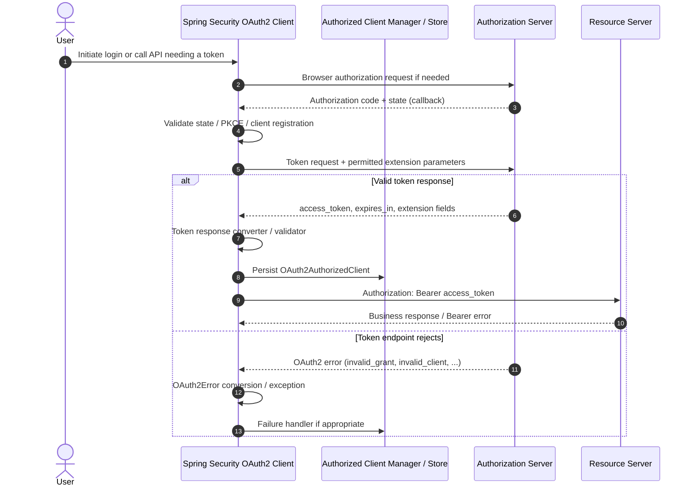

# 22.7. Extending Token Requests, Token Responses, and Error Handling

When integrating **Spring Security OAuth 2.0 / OpenID Connect (OIDC) Client** with an Authorization Server, requests to the **token endpoint** generally follow standard OAuth 2.0: the client sends `grant_type` and matching parameters, and the server returns `access_token` or an OAuth2 error. However, real-world integrations may also require:

- An extra parameter such as `resource`, `audience`, or a custom property defined by the Authorization Server;
- A different **client authentication** method, such as `private_key_jwt` instead of `client_secret_basic`;
- An **extension grant** such as **JWT Bearer Grant (RFC 7523)** or **Token Exchange (RFC 8693)**;
- Parsing a token response that does not strictly match standard field names;
- Classifying and handling `invalid_grant`, `invalid_client`, `invalid_target`, network timeouts, or `401 invalid_token` from the Resource Server.

Spring Security offers multiple extension points for these needs **without rewriting the entire OAuth2 protocol**. The tricky part is identifying **the right layer to extend**: the browser authorization request, the back-channel token request, token response mapping, or the authorized client manager's failure handler.

Example standard token request:

```http
POST /oauth2/token HTTP/1.1
Host: id.example.test
Content-Type: application/x-www-form-urlencoded
Authorization: Basic <redacted-client-authentication>

grant_type=authorization_code&
code=<redacted-code>&
redirect_uri=https%3A%2F%2Fapp.example.test%2Flogin%2Foauth2%2Fcode%2Fcompany&
code_verifier=<redacted-pkce-verifier>
```

A provider may support an additional parameter, such as:

```text
resource=https://reports.example.test
```

**Important:** adding `resource` to the request does not automatically grant new scopes, audiences, or permissions. The Authorization Server must support that parameter, validate the client/grant, and issue tokens strictly within its allowed **authorization policy**.

This lesson walks through a controlled extension approach with **Servlet + RestClient** and **Reactive WebFlux + WebClient** examples, integrating token response clients into Spring Security, separating token endpoint errors from API errors, and covering testing and operational scenarios.

> API examples focus on **Spring Security 6.5 / Spring Boot 3.x, Java 17+**. The `RestClient*TokenResponseClient` classes were introduced in Spring Security 6.4; 6.3 or older projects may still use `Default*TokenResponseClient` and `RestOperations`. Cross-check code against your exact version before going to production. The host `example.test` and scopes are illustrative only.

---

## 1. Understanding the Four Boundaries of an OAuth2 Flow

An OAuth2 Client using the Authorization Code Flow interacts with two distinct HTTP endpoints on the Authorization Server.

**Authorization endpoint:** the browser is redirected to the OP/AS for user authentication and consent.

```text
GET https://id.example.test/oauth2/authorize?
    response_type=code
    &client_id=...
    &redirect_uri=...
    &scope=openid%20profile
    &state=...
    &code_challenge=...
```

**Token endpoint:** the backend uses the authorization code to request tokens:

```text
POST https://id.example.test/oauth2/token
Content-Type: application/x-www-form-urlencoded

grant_type=authorization_code
code=...
redirect_uri=...
code_verifier=...
```

Then the **Resource Server** receives the access token on API calls:

```http
GET /v1/reports HTTP/1.1
Host: reports.example.test
Authorization: Bearer <redacted-access-token>
```

And the **Client Manager** manages existing authorized clients as well as token reissuance when needed.

| Layer | Data and Responsibility | Typical Extension Point |
| --- | --- | --- |
| Browser authorization request | `scope`, `prompt`, `state`, PKCE challenge, login hint | `OAuth2AuthorizationRequestResolver` / `ServerOAuth2AuthorizationRequestResolver` |
| **Token request** | `grant_type`, `code`, `refresh_token`, client auth, audience | `OAuth2AccessTokenResponseClient` and request converters |
| **Token response** | `access_token`, `token_type`, `expires_in`, `refresh_token`, extension fields | `OAuth2AccessTokenResponseHttpMessageConverter` / reactive body extractor |
| **Authorization lifecycle** | Token persistence, refresh, failure/removal, retries | `OAuth2AuthorizedClientManager` and success/failure handlers |
| **Resource Server API call** | `Authorization: Bearer ...`, 401/403, and scopes | `RestClient` / `WebClient` OAuth2 interceptors |

**Never add `prompt=consent` to a token request if the provider expects it at the authorization endpoint.** Similarly, never put `refresh_token` in a callback URL and never expect a custom JSON converter to alter permissions granted in a token.

## 2. End-to-End Extension Flow



In this diagram, **token request/response** customizations live on the back-channel client ↔ Authorization Server path. The downstream API is a separate layer: if the API returns 401/403, that failure reaches the authorized-client failure handler only when the HTTP client is wired to forward it.

## 3. Standard Grants vs. Extension Grants

An **authorization grant** specifies how the client obtains an access token.

| Grant | `grant_type` | Primary Payload | Notes |
| --- | --- | --- | --- |
| Authorization Code | `authorization_code` | `code`, `redirect_uri`, optionally PKCE verifier | Involves user/browser flow |
| Refresh Token | `refresh_token` | `refresh_token` | Uses only a credential issued by the OP |
| Client Credentials | `client_credentials` | Client authentication, scopes when needed | App-only; never impersonates users |
| JWT Bearer | `urn:ietf:params:oauth:grant-type:jwt-bearer` | `assertion` | RFC 7523; JWT must be trusted and validated by AS |
| Token Exchange | `urn:ietf:params:oauth:grant-type:token-exchange` | `subject_token`, `subject_token_type`, optional `audience`/`resource` | RFC 8693; exchanges tokens per policy |
| Vendor-specific extension | URI or value registered with AS | Per agreement | Do not treat as a general OAuth standard |

Distinguish two levels of change:

**Extending parameters of an existing grant**: keep `grant_type=authorization_code` and add `resource` if supported by the AS. The client still obeys all Authorization Code Flow requirements.

**Extending the grant type**: use a distinct `grant_type` with its own request/response and policies. For example, Token Exchange cannot be modeled properly merely by adding `subject_token` to a request that still sends `grant_type=authorization_code`.

### 3.1. Client Authentication Warning

`private_key_jwt` is a **client authentication method**, not necessarily the JWT Bearer grant. In an Authorization Code + `private_key_jwt` request:

```text
grant_type=authorization_code
code=...
client_assertion_type=urn:ietf:params:oauth:client-assertion-type:jwt-bearer
client_assertion=<signed-client-authentication-jwt>
```

In the JWT Bearer Authorization Grant:

```text
grant_type=urn:ietf:params:oauth:grant-type:jwt-bearer
assertion=<jwt-authorization-grant>
```

The JWTs in these two examples serve **two distinct purposes**. Never confuse `assertion` (grant) with `client_assertion` (client authentication) or with an OIDC ID Token.

---

## 4. Spring Security's Token Response Model

Spring Security uses **`OAuth2AccessTokenResponse`** as the token response model after converting HTTP data.

Key fields:

| Token Endpoint Field | Meaning | Client Usage |
| --- | --- | --- |
| `access_token` | Bearer credential used to call APIs | Becomes `OAuth2AccessToken` |
| `token_type` | Token type, usually `Bearer` | Must be compatible with how it is used |
| `expires_in` | Validity in seconds (if returned) | Computes access token expiration |
| `refresh_token` | Optional refresh credential | Becomes `OAuth2RefreshToken` if present |
| `scope` | Granted permissions | Distinguish from requested scopes |
| `id_token` | OIDC ID Token when applicable | Separate OIDC data; never use as API access token |
| `issued_token_type` | Type of token issued in Token Exchange | Extension field per RFC 8693 |
| Custom provider fields | Additional metadata | Can be retained in `additionalParameters` |

Example structurally valid JSON for Token Exchange:

```json
{
  "access_token": "REDACTED_ISSUED_TOKEN",
  "issued_token_type": "urn:ietf:params:oauth:token-type:access_token",
  "token_type": "Bearer",
  "expires_in": 900,
  "scope": "reports.read"
}
```

**Merely having an `access_token` field in JSON does not make the token trustworthy.** The client must still trust the configured token endpoint, validate TLS/client credentials, and follow grant policy, while the Resource Server must validate the token's issuer, audience, and scope.

### 4.1. An OIDC ID Token Is Not an Access Token

During OIDC login, the token endpoint may return both an access token and an ID Token. The ID Token authenticates identity to the client and has its own validation rules—signature, `iss`, `aud`, `exp`, and `nonce` where applicable.

If a custom converter "swaps" an ID Token into an access token, the Resource Server may reject it; worse, the client may bypass OIDC authentication boundaries. **Never use a token response converter to bypass OIDC validation**.

## 5. Spring Security 6.5 APIs Used in This Lesson

### 5.1. Servlet Stack

```java
import org.springframework.security.oauth2.client.endpoint.OAuth2AccessTokenResponseClient;
import org.springframework.security.oauth2.client.endpoint.RestClientAuthorizationCodeTokenResponseClient;
import org.springframework.security.oauth2.client.endpoint.RestClientRefreshTokenTokenResponseClient;
import org.springframework.security.oauth2.client.endpoint.RestClientClientCredentialsTokenResponseClient;
import org.springframework.security.oauth2.client.endpoint.RestClientTokenExchangeTokenResponseClient;
```

`OAuth2AccessTokenResponseClient<T>` is the abstraction for sending a token request and returning an `OAuth2AccessTokenResponse` for a specific grant request type.

Example:

```java
OAuth2AccessTokenResponseClient<OAuth2AuthorizationCodeGrantRequest> client =
    new RestClientAuthorizationCodeTokenResponseClient();
```

The generic type **matters greatly**: a response client for `OAuth2RefreshTokenGrantRequest` cannot be casually substituted for an `OAuth2AuthorizationCodeGrantRequest` response client.

### 5.2. Reactive Stack

```java
import org.springframework.security.oauth2.client.endpoint.ReactiveOAuth2AccessTokenResponseClient;
import org.springframework.security.oauth2.client.endpoint.WebClientReactiveAuthorizationCodeTokenResponseClient;
import org.springframework.security.oauth2.client.endpoint.WebClientReactiveRefreshTokenTokenResponseClient;
import org.springframework.security.oauth2.client.endpoint.WebClientReactiveClientCredentialsTokenResponseClient;
import org.springframework.security.oauth2.client.endpoint.WebClientReactiveTokenExchangeTokenResponseClient;
```

Reactive response clients return **`Mono<OAuth2AccessTokenResponse>`**. They must never block the event loop and must never call `subscribe()` internally and return `Mono.empty()`.

### 5.3. Extension Points Have Distinct Responsibilities

| API | Use For | Do Not Use For |
| --- | --- | --- |
| `addHeadersConverter` | Adding safe HTTP headers to token requests | Replacing client authentication carelessly |
| `setHeadersConverter` | Replacing header-building strategy | Obtaining new permissions from the AS |
| `addParametersConverter` | Appending request parameters | Arbitrarily deleting `grant_type` or `code_verifier` |
| `setParametersConverter` | Overriding default parameters when needed | Automatically wiping all default params |
| `setParametersCustomizer` | Full access to the final parameter map before sending | Stripping mandatory standard fields |
| `setRestClient` | Customizing transport + converters/error handlers | Overriding AS/RS policies |
| `setBodyExtractor` | Customizing response parsing in Reactive | Ignoring OAuth2 error semantics |
| `setAuthorizationFailureHandler` | Post-authorization-failure policy | Modifying the OP's response payload |
| `OAuth2AuthorizedClientProvider` | Enabling grants / token issuance logic | Replacing Resource Server authorization policy |

---

## 6. Adding Token Request Parameters in Servlet: addParametersConverter

This is the first choice when a provider expects a parameter **in addition to** the default fields.

Example where an OP supports the `resource` token parameter under an integration agreement:

```java
import org.springframework.context.annotation.Bean;
import org.springframework.context.annotation.Configuration;
import org.springframework.security.oauth2.client.endpoint.OAuth2AccessTokenResponseClient;
import org.springframework.security.oauth2.client.endpoint.RestClientAuthorizationCodeTokenResponseClient;
import org.springframework.security.oauth2.core.endpoint.OAuth2AuthorizationCodeGrantRequest;
import org.springframework.util.LinkedMultiValueMap;
import org.springframework.util.MultiValueMap;

@Configuration
class AuthorizationCodeTokenClientConfig {

    @Bean
    OAuth2AccessTokenResponseClient<OAuth2AuthorizationCodeGrantRequest>
            authorizationCodeTokenClient() {

        RestClientAuthorizationCodeTokenResponseClient client =
            new RestClientAuthorizationCodeTokenResponseClient();

        client.addParametersConverter(grantRequest -> {
            MultiValueMap<String, String> extra =
                new LinkedMultiValueMap<>();

            String registrationId =
                grantRequest.getClientRegistration().getRegistrationId();

            if ("reports-api".equals(registrationId)) {
                extra.set("resource", "https://reports.example.test");
            }

            return extra;
        });

        return client;
    }
}
```

Key points:

- For registrations other than `reports-api`, the converter returns an empty map: no Reports-specific parameters are added.
- Standard authorization code request parameters are still generated by Spring Security.
- Add `resource` **only if that Authorization Server supports it under an explicit contract**.
- Never take the resource URL from a browser query parameter, or you risk minting tokens for out-of-policy targets.
- `resource` does not guarantee the AS grants the desired audience if the client lacks permission.

### 6.1. When Should You Use audience Instead of resource?

Some OPs define a custom `audience` parameter; RFC 8707 defines **resource indicators**. The two are not automatically equivalent across every provider.

If the OP requires:

```text
audience=reports-api
```

you can write:

```java
client.addParametersConverter(grantRequest -> {
    MultiValueMap<String, String> extra = new LinkedMultiValueMap<>();
    if ("reports-api".equals(
            grantRequest.getClientRegistration().getRegistrationId())) {
        extra.set("audience", "reports-api");
    }
    return extra;
});
```

**Never send both `audience` and `resource` randomly**. Use only what matches the OP's contract and resource/audience policy.

### 6.2. Do Not Put Secrets in Extra Parameters Unless Required

```java
// Avoid: hard-coding a client secret or passing it through a logged parameter map.
extra.set("api_secret", "hardcoded-production-secret");
```

If a provider uses a special client authentication method, configure that method properly or secure the token HTTP client rather than inventing a custom pseudo-password parameter.

---

## 7. Adding HTTP Headers to Token Requests

Spring Security supports `addHeadersConverter()`:

```java
import org.springframework.http.HttpHeaders;

RestClientAuthorizationCodeTokenResponseClient tokenClient =
    new RestClientAuthorizationCodeTokenResponseClient();

tokenClient.addHeadersConverter(grantRequest -> {
    HttpHeaders headers = new HttpHeaders();
    if ("reports-api".equals(
            grantRequest.getClientRegistration().getRegistrationId())) {
        headers.set("X-Integration-Id", "reports-portal");
    }
    return headers;
});
```

This is an example of **non-sensitive metadata headers** agreed upon with the provider.

**Never overwrite `Authorization` with a Resource Server bearer token**. Token endpoint client authentication and API bearer access tokens are two different credentials.

### 7.1. addHeadersConverter vs. setHeadersConverter

- **`addHeadersConverter`** appends to the default headers, ideal when you only need a custom header.
- **`setHeadersConverter`** replaces the header converter entirely, risking dropping `Content-Type` or client authentication headers if misconfigured.

Example low-level header converter configuration:

```java
DefaultOAuth2TokenRequestHeadersConverter headerConverter =
    new DefaultOAuth2TokenRequestHeadersConverter();

headerConverter.setEncodeClientCredentials(false);

tokenClient.setHeadersConverter(headerConverter);
```

This API exists for compatibility with certain token endpoints. **Do not disable encoding for every provider** out of a mistaken belief that it is "more secure." Use it only when provider documentation or interoperability testing confirms it is required.

### 7.2. Client Authentication Must Be Registered

`ClientRegistration.clientAuthenticationMethod` selects mechanisms such as `client_secret_basic`, `client_secret_post`, or other supported methods. With `private_key_jwt`, configure signing keys, audience, algorithms, and assertion lifecycles per the OP.

Never use an arbitrary custom header to "fake" an authentication method the AS does not support.

## 8. Overriding Parameters with setParametersConverter

When a provider requires **replacing a default parameter**, you can use `setParametersConverter`.

Example:

```java
RestClientAuthorizationCodeTokenResponseClient tokenClient =
    new RestClientAuthorizationCodeTokenResponseClient();

tokenClient.setParametersConverter(grantRequest -> {
    LinkedMultiValueMap<String, String> overrides =
        new LinkedMultiValueMap<>();

    if ("legacy-idp".equals(
            grantRequest.getClientRegistration().getRegistrationId())) {
        overrides.set("client_id", "registered-alias-id");
    }
    return overrides;
});
```

In Spring Security 6.5, this method **does not force you to rebuild all standard parameters yourself**. Default parameters are still generated; entries returned by the converter **override** the matching values.

**However, this is a sensitive operation**: overriding `client_id`, `redirect_uri`, `code`, or `code_verifier` can easily break token exchanges or introduce security flaws. An alias example applies only when the AS explicitly registers and allows that rule; normally fix the `ClientRegistration` itself rather than overriding via a converter.

### 8.1. Why Not Change grant_type from authorization_code to token-exchange?

```java
// Wrong model: changing the grant_type string does not turn an
// AuthorizationCodeGrantRequest into RFC 8693 Token Exchange.
tokenClient.setParametersConverter(grantRequest -> {
    LinkedMultiValueMap<String, String> params =
        new LinkedMultiValueMap<>();
    params.set("grant_type",
        "urn:ietf:params:oauth:grant-type:token-exchange");
    return params;
});
```

A Token Exchange request needs `subject_token` and `subject_token_type`, plus grant-specific validation and the matching provider. Use proper **Token Exchange grant support**, not string overrides.

## 9. setParametersCustomizer: Modifying the Entire Parameter Map

When full control is required, Spring Security 6.5 supports `setParametersCustomizer(...)`.

An official documentation example shows removing `client_id` when `client_assertion` is present:

```java
RestClientAuthorizationCodeTokenResponseClient tokenClient =
    new RestClientAuthorizationCodeTokenResponseClient();

tokenClient.setParametersCustomizer(parameters -> {
    if (parameters.containsKey("client_assertion")) {
        parameters.remove("client_id");
    }
});
```

How they differ:

- `addParametersConverter`: **appends** to the request while preserving defaults.
- `setParametersConverter`: **overrides** keys present in the returned map while defaults remain.
- `setParametersCustomizer`: **mutates the final map**, able to add, edit, or remove parameters.

Only remove `client_id` if the token endpoint actually requires it and client authentication is configured appropriately. Never use this hook to strip `grant_type`, PKCE `code_verifier`, or mandatory protocol fields.

### 9.1. Choosing the Minimal Hook

| Need | Preferred Hook |
| --- | --- |
| Only add `resource` | `addParametersConverter` |
| Add a non-sensitive header | `addHeadersConverter` |
| Override an existing parameter | `setParametersConverter` |
| Remove a parameter due to special client auth | `setParametersCustomizer` |
| Change transport/TLS/HTTP converters | `setRestClient` |
| Use a different grant type | Grant-specific client/provider, not an old grant's converter |

---

## 10. Wiring the Authorization Code Token Client into SecurityFilterChain

Declaring a custom response client bean **does not always guarantee** the filter uses it across every setup and version. In a Servlet application, you can wire it explicitly:

```java
import org.springframework.context.annotation.Bean;
import org.springframework.context.annotation.Configuration;
import org.springframework.security.config.annotation.web.builders.HttpSecurity;
import org.springframework.security.oauth2.client.endpoint.OAuth2AccessTokenResponseClient;
import org.springframework.security.oauth2.core.endpoint.OAuth2AuthorizationCodeGrantRequest;
import org.springframework.security.web.SecurityFilterChain;

@Configuration
class OAuth2SecurityConfiguration {

    @Bean
    SecurityFilterChain securityFilterChain(
            HttpSecurity http,
            OAuth2AccessTokenResponseClient<OAuth2AuthorizationCodeGrantRequest>
                authorizationCodeTokenClient) throws Exception {

        return http
            .authorizeHttpRequests(auth -> auth
                .requestMatchers("/", "/error").permitAll()
                .anyRequest().authenticated())
            .oauth2Login(login -> login
                .tokenEndpoint(endpoint ->
                    endpoint.accessTokenResponseClient(
                        authorizationCodeTokenClient)))
            .oauth2Client(client -> client
                .authorizationCodeGrant(code ->
                    code.accessTokenResponseClient(
                        authorizationCodeTokenClient)))
            .build();
    }
}
```

The two DSLs serve two distinct roles:

- **`oauth2Login().tokenEndpoint()`** controls code exchange during OAuth2/OIDC Login.
- **`oauth2Client().authorizationCodeGrant()`** controls Servlet OAuth2 Client authorization-code support.

An application using only OAuth2 Login might not need to customize both. Yet if you both log users in and connect to another API via authorization code, verify that each flow uses the intended token client configuration.

**Do not replace `OAuth2LoginAuthenticationProvider` or the filter chain unless truly necessary**. Token response clients and converters are narrower, lower-risk extension points.

## 11. Refresh Token Request Config Differs from Authorization Code Requests

A token refresh sends:

```http
POST /oauth2/token HTTP/1.1
Host: id.example.test
Content-Type: application/x-www-form-urlencoded
Authorization: Basic <redacted-client-authentication>

grant_type=refresh_token&refresh_token=<redacted>
```

It has **neither `code` nor `redirect_uri`** like an authorization code token request.

Spring Security provides **`RestClientRefreshTokenTokenResponseClient`**:

```java
RestClientRefreshTokenTokenResponseClient refreshClient =
    new RestClientRefreshTokenTokenResponseClient();

refreshClient.addParametersConverter(grantRequest -> {
    MultiValueMap<String, String> extra =
        new LinkedMultiValueMap<>();
    if ("reports-api".equals(
            grantRequest.getClientRegistration().getRegistrationId())) {
        extra.set("resource", "https://reports.example.test");
    }
    return extra;
});
```

Some providers require `resource`/`audience` during refresh as well; others ignore or reject that parameter. **Never reuse an Authorization Code converter by forcing generic casts**.

### 11.1. Attaching the Refresh Response Client to the Manager

```java
import org.springframework.context.annotation.Bean;
import org.springframework.context.annotation.Configuration;
import org.springframework.security.oauth2.client.OAuth2AuthorizedClientManager;
import org.springframework.security.oauth2.client.OAuth2AuthorizedClientProvider;
import org.springframework.security.oauth2.client.OAuth2AuthorizedClientProviderBuilder;
import org.springframework.security.oauth2.client.registration.ClientRegistrationRepository;
import org.springframework.security.oauth2.client.web.DefaultOAuth2AuthorizedClientManager;
import org.springframework.security.oauth2.client.web.OAuth2AuthorizedClientRepository;
import org.springframework.security.oauth2.client.endpoint.RestClientRefreshTokenTokenResponseClient;

@Configuration
class ManagerConfiguration {

    @Bean
    OAuth2AuthorizedClientManager authorizedClientManager(
            ClientRegistrationRepository registrations,
            OAuth2AuthorizedClientRepository storage) {

        RestClientRefreshTokenTokenResponseClient refreshClient =
            new RestClientRefreshTokenTokenResponseClient();

        refreshClient.addParametersConverter(request -> {
            org.springframework.util.MultiValueMap<String, String> p =
                new org.springframework.util.LinkedMultiValueMap<>();
            if ("reports-api".equals(
                    request.getClientRegistration().getRegistrationId())) {
                p.set("resource", "https://reports.example.test");
            }
            return p;
        });

        OAuth2AuthorizedClientProvider provider =
            OAuth2AuthorizedClientProviderBuilder.builder()
                .authorizationCode()
                .refreshToken(refresh ->
                    refresh.accessTokenResponseClient(refreshClient))
                .build();

        DefaultOAuth2AuthorizedClientManager manager =
            new DefaultOAuth2AuthorizedClientManager(registrations, storage);

        manager.setAuthorizedClientProvider(provider);
        return manager;
    }
}
```

This manager is for a **Servlet request context**. When running scheduled jobs with no request, use `AuthorizedClientServiceOAuth2AuthorizedClientManager` and `OAuth2AuthorizedClientService` instead of an HTTP-session repository.

### 11.2. refreshToken() Does Not Create a Refresh Token

Enabling `refreshToken()` only gives the manager the ability to **use a refresh token already issued by the OP**. If `OAuth2AuthorizedClient.getRefreshToken() == null`, the provider cannot synthesize a credential from the access token.

When a refresh fails with `invalid_grant`, handle the invalidated authorized client per failure policy rather than retrying the same refresh token infinitely.

## 12. Client Credentials Token Requests and App Identity

For machine-to-machine calls, use:

```text
grant_type=client_credentials
scope=reports.read
```

along with OP-supported client authentication.

Corresponding token client:

```java
RestClientClientCredentialsTokenResponseClient credentialsClient =
    new RestClientClientCredentialsTokenResponseClient();

credentialsClient.addParametersConverter(request -> {
    MultiValueMap<String, String> extra = new LinkedMultiValueMap<>();
    if ("billing-service".equals(
            request.getClientRegistration().getRegistrationId())) {
        extra.set("audience", "billing-api");
    }
    return extra;
});
```

Service-level manager configuration:

```java
AuthorizedClientServiceOAuth2AuthorizedClientManager manager =
    new AuthorizedClientServiceOAuth2AuthorizedClientManager(
        registrations, authorizedClientService);

OAuth2AuthorizedClientProvider provider =
    OAuth2AuthorizedClientProviderBuilder.builder()
        .clientCredentials(configurer ->
            configurer.accessTokenResponseClient(credentialsClient))
        .build();

manager.setAuthorizedClientProvider(provider);
```

In this example, `registrations` has type `ClientRegistrationRepository` and `authorizedClientService` has type `OAuth2AuthorizedClientService`, injected from the Spring container.

**Never use client credentials to borrow user privileges** when an API genuinely requires delegated user authorization; app-only tokens and user tokens have different trust boundaries.

---

## 13. Token Exchange (RFC 8693): A True Extension Grant

Token Exchange is the foremost example of an **extension grant**. The client sends an existing token (**subject token**) to the Authorization Server and requests another token under policy.

An RFC 8693 request might look like:

```http
POST /oauth2/token HTTP/1.1
Host: id.example.test
Content-Type: application/x-www-form-urlencoded
Authorization: Basic <redacted-client-authentication>

grant_type=urn:ietf:params:oauth:grant-type:token-exchange&
subject_token=<redacted-subject-token>&
subject_token_type=urn:ietf:params:oauth:token-type:access_token&
requested_token_type=urn:ietf:params:oauth:token-type:access_token&
audience=reports-api
```

Fields:

| Parameter | Role |
| --- | --- |
| `grant_type` | Required token-exchange URN |
| `subject_token` | Input credential being exchanged |
| `subject_token_type` | Type of the input subject token |
| `actor_token` | Actor token in delegation models |
| `actor_token_type` | Corresponding actor token type |
| `requested_token_type` | Desired output token type, optional |
| `audience` | Target audience, when supported by AS |
| `resource` | Specific resource indicator |
| `scope` | Permissions requested per AS policy |

Not every token can be exchanged for any arbitrary audience. The Authorization Server must verify the **subject token, client identity, delegation/impersonation policy, allowed audiences, and scopes**.

### 13.1. Token Exchange Does Not Mean Token Forwarding

**Forwarding:** sending Token A directly to API B.

**Token Exchange:** presenting Token A to a trusted Authorization Server and receiving Token B scoped by policy for API B.


If Token A is invalid for Reports API, forwarding is wrong. Exchanging is valid only when the AS explicitly supports RFC 8693 and the client is authorized to perform that exchange.

### 13.2. Spring Security 6.5 Includes Token Exchange Support

Spring Security provides **`TokenExchangeOAuth2AuthorizedClientProvider`** and **`RestClientTokenExchangeTokenResponseClient`**, along with reactive counterparts.

A customized token response client for Token Exchange:

```java
import org.springframework.security.oauth2.client.endpoint.RestClientTokenExchangeTokenResponseClient;
import org.springframework.util.LinkedMultiValueMap;
import org.springframework.util.MultiValueMap;

RestClientTokenExchangeTokenResponseClient exchangeClient =
    new RestClientTokenExchangeTokenResponseClient();

exchangeClient.addParametersConverter(grantRequest -> {
    MultiValueMap<String, String> extra = new LinkedMultiValueMap<>();

    if ("reports-exchange".equals(
            grantRequest.getClientRegistration().getRegistrationId())) {
        extra.set("audience", "reports-api");
    }

    return extra;
});
```

This only handles **adding `audience`**. The provider still needs a **subject token safely resolved from authentication/context** and a registration whose token-exchange grant is approved by the Authorization Server.

### 13.3. Plugging the Response Client into the Provider

```java
TokenExchangeOAuth2AuthorizedClientProvider exchangeProvider =
    new TokenExchangeOAuth2AuthorizedClientProvider();

exchangeProvider.setAccessTokenResponseClient(exchangeClient);

OAuth2AuthorizedClientProvider provider =
    OAuth2AuthorizedClientProviderBuilder.builder()
        .provider(exchangeProvider)
        .build();
```

These classes belong to `org.springframework.security.oauth2.client`, with the builder in the same package.

Then register the provider on the manager:

```java
DefaultOAuth2AuthorizedClientManager manager =
    new DefaultOAuth2AuthorizedClientManager(
        clientRegistrationRepository,
        authorizedClientRepository);

manager.setAuthorizedClientProvider(provider);
```

This snippet assumes the repositories are provided via DI. If the app needs authorization code/refresh/token exchange together, build an appropriate composite provider, for example:

```java
OAuth2AuthorizedClientProvider provider =
    OAuth2AuthorizedClientProviderBuilder.builder()
        .authorizationCode()
        .refreshToken()
        .provider(exchangeProvider)
        .build();
```

**There is no automatic fallback from authorization code to token exchange or client credentials to bypass permissions**. Grants are selected strictly by the configured `ClientRegistration`/context.

### 13.4. Registration for Token Exchange

```yaml
spring:
  security:
    oauth2:
      client:
        registration:
          reports-exchange:
            provider: company
            client-id: ${EXCHANGE_CLIENT_ID}
            client-secret: ${EXCHANGE_CLIENT_SECRET}
            authorization-grant-type: urn:ietf:params:oauth:grant-type:token-exchange
            scope:
              - reports.read

        provider:
          company:
            token-uri: https://id.example.test/oauth2/token
```

A `token-uri` still requires valid HTTPS. Scope `reports.read` here only applies if supported by the AS; exchange policies may also require audience, resource, and token types.

### 13.5. Never Use Someone Else's Token as the Subject Token

If a request is executing for Alice, never let the browser pass an arbitrary `subjectToken` to exchange for the Reports API. Input tokens must come from a trusted source bound to the execution context, matching subject/tenant, and verified exchange permissions.

In multi-tenant systems, audience/resource must never be chosen from an arbitrary user-supplied URL.

## 14. JWT Bearer Grant (RFC 7523) and private_key_jwt

Another extension grant is the **JWT Bearer Authorization Grant**:

```http
POST /oauth2/token HTTP/1.1
Host: id.example.test
Content-Type: application/x-www-form-urlencoded

grant_type=urn:ietf:params:oauth:grant-type:jwt-bearer&
assertion=<redacted-signed-jwt>
```

The Authorization Server validates the JWT signature, issuer, audience, lifetime, subject, and contractual constraints.

In Spring Security 6.x, `JwtBearerOAuth2AuthorizedClientProvider` supports this grant; the token client can be `RestClientJwtBearerTokenResponseClient`.

```java
RestClientJwtBearerTokenResponseClient jwtClient =
    new RestClientJwtBearerTokenResponseClient();

JwtBearerOAuth2AuthorizedClientProvider jwtProvider =
    new JwtBearerOAuth2AuthorizedClientProvider();

jwtProvider.setAccessTokenResponseClient(jwtClient);

OAuth2AuthorizedClientProvider provider =
    OAuth2AuthorizedClientProviderBuilder.builder()
        .provider(jwtProvider)
        .build();
```

The provider still needs a **valid JWT assertion** from the authorization context via a supported mechanism. With `JwtAuthenticationToken`, Spring Security can resolve the assertion from the JWT principal per provider contract; for other sources, configure a trusted resolver.

**Keep distinct**:

- `grant_type=...jwt-bearer` with `assertion`: JWT used as an *authorization grant*;
- `client_assertion_type=...jwt-bearer` with `client_assertion`: JWT used to *authenticate the client*;
- `id_token`: OIDC token authenticating user identity to the client.

Putting an ID Token into `assertion` without OP approval does not make a valid JWT Bearer Grant.

---

## 15. Customizing Token Responses: Why Use a Converter?

Most Authorization Servers return standard JSON:

```json
{
  "access_token": "REDACTED_ACCESS_TOKEN",
  "token_type": "Bearer",
  "expires_in": 3600,
  "refresh_token": "REDACTED_REFRESH_TOKEN",
  "scope": "reports.read"
}
```

Yet a legacy provider might return different field names:

```json
{
  "accessToken": "REDACTED_ACCESS_TOKEN",
  "tokenType": "Bearer",
  "expiresIn": 3600,
  "refreshToken": "REDACTED_REFRESH_TOKEN",
  "permissions": "reports.read",
  "tenant": "west"
}
```

This **is not a standard OAuth2 access token response**. When integrating with it, a response converter can normalize the field names into Spring Security's model.

**Principle:** change how fields are parsed, never compromise token validity. Never fabricate a fake access token, skip signature/audience/expiry checks, or silently escalate scopes.

### 15.1. Default Converters

Spring Security provides:

- **`OAuth2AccessTokenResponseHttpMessageConverter`**: HTTP message converter for JSON token responses on Servlet/RestClient.
- **`DefaultMapOAuth2AccessTokenResponseConverter`**: converts a parameter Map into `OAuth2AccessTokenResponse`.
- **`OAuth2AccessTokenResponse.Builder`**: constructs the model when custom mapping is genuinely required.

When the provider already returns the standard format, **keeping the default converter** is the lowest-risk option.

## 16. Servlet Response Mapping: Normalize Then Delegate

A safe pattern when a provider uses non-standard field names is to **normalize only known aliased fields**, then delegate to Spring Security's standard converter.

```java
import java.util.LinkedHashMap;
import java.util.Map;

import org.springframework.context.annotation.Bean;
import org.springframework.context.annotation.Configuration;
import org.springframework.security.oauth2.core.endpoint.DefaultMapOAuth2AccessTokenResponseConverter;
import org.springframework.security.oauth2.core.endpoint.OAuth2AccessTokenResponse;
import org.springframework.security.oauth2.core.http.converter.OAuth2AccessTokenResponseHttpMessageConverter;

@Configuration
class LegacyTokenResponseMapping {

    @Bean
    OAuth2AccessTokenResponseHttpMessageConverter
            accessTokenResponseConverter() {

        OAuth2AccessTokenResponseHttpMessageConverter converter =
            new OAuth2AccessTokenResponseHttpMessageConverter();

        DefaultMapOAuth2AccessTokenResponseConverter delegate =
            new DefaultMapOAuth2AccessTokenResponseConverter();

        converter.setAccessTokenResponseConverter(raw -> {
            Map<String, Object> normalized =
                new LinkedHashMap<>(raw);

            copyAlias(normalized, "accessToken", "access_token");
            copyAlias(normalized, "tokenType", "token_type");
            copyAlias(normalized, "expiresIn", "expires_in");
            copyAlias(normalized, "refreshToken", "refresh_token");
            copyAlias(normalized, "permissions", "scope");

            OAuth2AccessTokenResponse response =
                delegate.convert(normalized);

            if (response == null) {
                throw new IllegalArgumentException(
                    "Invalid OAuth2 access token response");
            }

            return response;
        });

        return converter;
    }

    private static void copyAlias(Map<String, Object> values,
                                  String source,
                                  String target) {
        if (!values.containsKey(target) && values.containsKey(source)) {
            values.put(target, values.get(source));
        }
    }
}
```

**Explanation:**

1. Do not mutate `raw` in place; copy into a new `LinkedHashMap`.
2. Map only aliases explicitly agreed upon with the provider.
3. Never overwrite an existing valid `access_token` with `accessToken` if both appear.
4. Delegating preserves Spring Security's standard validation rules instead of hand-building tokens.
5. Never coerce broken lifetimes or token types into "values that happen to run" when the response is malformed.

If the response includes `tenant`, it may be retained as additional metadata depending on the converter. **Do not treat that metadata as verified tenant authorization** without validating source and policy.

### 16.1. Warning on Mapping expiresIn

If a provider returns:

```json
{ "expiresIn": 3600000 }
```

that might be **milliseconds**, whereas OAuth2 `expires_in` is expressed in **seconds**. Copying it verbatim could make the client think the token lasts 1,000 times longer.

Confirm the provider contract explicitly; if unit conversion is necessary, perform it inside the converter per registration/provider while checking for overflow, negative numbers, and policy caps. Never assume every field named `expiresIn` is in milliseconds.

### 16.2. Risk of Conflicting Fields

If a response contains both `accessToken` and `access_token` with differing values, **treat it as a contract error** rather than picking one arbitrarily. For security-critical fields, design the converter to fail closed on conflicting data.

## 17. Using the Custom Converter Inside the Token Response Client's RestClient

Defining a converter bean **does not automatically wire it into the token client**. With `RestClientAuthorizationCodeTokenResponseClient`, build a dedicated `RestClient` for the token endpoint:

```java
import org.springframework.http.converter.FormHttpMessageConverter;
import org.springframework.security.oauth2.client.endpoint.RestClientAuthorizationCodeTokenResponseClient;
import org.springframework.security.oauth2.client.http.OAuth2ErrorResponseErrorHandler;
import org.springframework.security.oauth2.core.http.converter.OAuth2AccessTokenResponseHttpMessageConverter;
import org.springframework.web.client.RestClient;

OAuth2AccessTokenResponseHttpMessageConverter tokenConverter =
    new OAuth2AccessTokenResponseHttpMessageConverter();

// You can call setAccessTokenResponseConverter(...) here,
// or inject the converter bean from Section 16.

RestClient tokenRestClient = RestClient.builder()
    .messageConverters(converters -> {
        converters.clear();
        converters.add(new FormHttpMessageConverter());
        converters.add(tokenConverter);
    })
    .defaultStatusHandler(new OAuth2ErrorResponseErrorHandler())
    .build();

RestClientAuthorizationCodeTokenResponseClient tokenClient =
    new RestClientAuthorizationCodeTokenResponseClient();

tokenClient.setRestClient(tokenRestClient);
```

**Both converters must be kept:**

- `FormHttpMessageConverter` to serialize form-urlencoded requests.
- `OAuth2AccessTokenResponseHttpMessageConverter` to deserialize token responses.

At the same time, **`OAuth2ErrorResponseErrorHandler`** ensures HTTP OAuth2 errors map to the proper failures. Passing a bare `RestClient.builder().build()` without converters or error handlers will break token exchanges or mishandle errors.

### 17.1. Customizing Transport with Security Guardrails

The token `RestClient` can configure TLS, trusted proxies, connection/request timeouts, telemetry redaction, and network policies. However:

- Send token requests only to the configured, trusted OP `token-uri`.
- Never auto-follow redirects that could forward client secrets to another origin.
- Never log form requests containing `code`, `refresh_token`, `assertion`, or `client_assertion`.
- Never disable TLS certificate verification.
- Never replay a refresh token repeatedly after receiving `invalid_grant`.

## 18. Reactive Token Requests: WebClientReactiveAuthorizationCodeTokenResponseClient

On WebFlux, the equivalent API performs non-blocking execution:

```java
import org.springframework.context.annotation.Bean;
import org.springframework.context.annotation.Configuration;
import org.springframework.security.oauth2.client.endpoint.ReactiveOAuth2AccessTokenResponseClient;
import org.springframework.security.oauth2.client.endpoint.WebClientReactiveAuthorizationCodeTokenResponseClient;
import org.springframework.security.oauth2.core.endpoint.OAuth2AuthorizationCodeGrantRequest;
import org.springframework.util.LinkedMultiValueMap;
import org.springframework.util.MultiValueMap;

@Configuration
class ReactiveTokenClientConfiguration {

    @Bean
    ReactiveOAuth2AccessTokenResponseClient<OAuth2AuthorizationCodeGrantRequest>
            reactiveAuthorizationCodeTokenClient() {

        WebClientReactiveAuthorizationCodeTokenResponseClient client =
            new WebClientReactiveAuthorizationCodeTokenResponseClient();

        client.addParametersConverter(request -> {
            MultiValueMap<String, String> extra =
                new LinkedMultiValueMap<>();

            if ("reports-api".equals(
                    request.getClientRegistration().getRegistrationId())) {
                extra.set("resource", "https://reports.example.test");
            }

            return extra;
        });

        return client;
    }
}
```

Calling `addParametersConverter()` behaves just like Servlet: it **appends** parameters without discarding defaults.

### 18.1. Reactive Also Has Three Levels of Parameter Customization

```java
WebClientReactiveAuthorizationCodeTokenResponseClient client =
    new WebClientReactiveAuthorizationCodeTokenResponseClient();

client.addParametersConverter(request -> {
    LinkedMultiValueMap<String, String> extra =
        new LinkedMultiValueMap<>();
    extra.set("resource", "https://reports.example.test");
    return extra;
});

// When overriding a default parameter is needed:
client.setParametersConverter(request -> {
    LinkedMultiValueMap<String, String> override =
        new LinkedMultiValueMap<>();
    // Conditional overrides per configured registration.
    return override;
});

// When editing the final map is genuinely required:
client.setParametersCustomizer(params -> {
    if (params.containsKey("client_assertion")) {
        params.remove("client_id");
    }
});
```

These illustrate the three extension points; **you rarely call all three on the same client in production**. Choose the minimal hook matching the provider contract.

### 18.2. Do Not Block the Reactor Event Loop

```java
// Wrong in a reactive pipeline:
OAuth2AccessTokenResponse response =
    client.getTokenResponse(request).block();
```

Instead, compose publishers:

```java
Mono<OAuth2AccessTokenResponse> response =
    client.getTokenResponse(request)
        .doOnNext(value -> recordSafeSuccessMetric());
```

`recordSafeSuccessMetric()` is an application-defined observability method; it must never log raw tokens. Normally the manager calls the response client for you; application code rarely calls it directly.

## 19. Reactive Token Responses: BodyExtractor and Error Mapping

In Reactive, `WebClientReactiveAuthorizationCodeTokenResponseClient` supports **`setBodyExtractor(...)`** to customize transforming the response body into `OAuth2AccessTokenResponse`.

**Skeleton** example for a response converter:

```java
import java.util.Map;
import org.springframework.core.ParameterizedTypeReference;
import org.springframework.http.ReactiveHttpInputMessage;
import org.springframework.security.oauth2.client.endpoint.WebClientReactiveAuthorizationCodeTokenResponseClient;
import org.springframework.security.oauth2.core.endpoint.DefaultMapOAuth2AccessTokenResponseConverter;
import org.springframework.security.oauth2.core.endpoint.OAuth2AccessTokenResponse;
import org.springframework.web.reactive.function.BodyExtractor;
import org.springframework.web.reactive.function.BodyExtractors;
import reactor.core.publisher.Mono;

WebClientReactiveAuthorizationCodeTokenResponseClient client =
    new WebClientReactiveAuthorizationCodeTokenResponseClient();

BodyExtractor<Mono<Map<String, Object>>, ReactiveHttpInputMessage>
    mapExtractor = BodyExtractors.toMono(
        new ParameterizedTypeReference<Map<String, Object>>() {});

DefaultMapOAuth2AccessTokenResponseConverter delegate =
    new DefaultMapOAuth2AccessTokenResponseConverter();

client.setBodyExtractor((inputMessage, context) ->
    mapExtractor.extract(inputMessage, context)
        .map(raw -> {
            Map<String, Object> normalized = normalizeProviderFields(raw);
            OAuth2AccessTokenResponse result =
                delegate.convert(normalized);
            if (result == null) {
                throw new IllegalArgumentException(
                    "Token response could not be converted");
            }
            return result;
        })
);
```

`normalizeProviderFields(...)` is an application-defined helper implementing the provider contract, similar to Section 16. This example **is not complete standalone code** until you implement that helper and error handling.

**Critical warning:** when replacing **`BodyExtractor`**, you must proactively detect and translate **OAuth2 Error Responses** into proper Reactor error signals. The converter must never treat:

```json
{"error":"invalid_grant"}
```

as a valid access token response or return `Mono.empty()` to swallow the failure.

### 19.1. Can We Keep the Default Body Extractor?

Yes, and that is usually the best option. Spring Security supplies **`OAuth2BodyExtractors.oauth2AccessTokenResponse()`** by default to parse token responses and handle errors per contract. Only write a custom extractor when the provider is genuinely incompatible and you have verified error propagation.

### 19.2. Supplying a Custom WebClient Transport

```java
WebClient tokenHttpClient = WebClient.builder()
    // TLS/proxy/timeouts/observability configured under control.
    .build();

WebClientReactiveAuthorizationCodeTokenResponseClient client =
    new WebClientReactiveAuthorizationCodeTokenResponseClient();

client.setWebClient(tokenHttpClient);
```

A custom `WebClient` for the **token endpoint** differs from a `WebClient` configured with an OAuth2 filter for calling Resource Servers. Never configure the token HTTP client so that it attaches the requested access token to token endpoint requests.

## 20. Properly Attaching a Reactive Response Client to a Manager

When a refresh token needs a custom parameter in WebFlux:

```java
import org.springframework.context.annotation.Bean;
import org.springframework.context.annotation.Configuration;
import org.springframework.security.oauth2.client.DefaultReactiveOAuth2AuthorizedClientManager;
import org.springframework.security.oauth2.client.ReactiveOAuth2AuthorizedClientManager;
import org.springframework.security.oauth2.client.ReactiveOAuth2AuthorizedClientProvider;
import org.springframework.security.oauth2.client.ReactiveOAuth2AuthorizedClientProviderBuilder;
import org.springframework.security.oauth2.client.endpoint.WebClientReactiveRefreshTokenTokenResponseClient;
import org.springframework.security.oauth2.client.registration.ReactiveClientRegistrationRepository;
import org.springframework.security.oauth2.client.web.server.ServerOAuth2AuthorizedClientRepository;

@Configuration
class ReactiveManagerConfiguration {

    @Bean
    ReactiveOAuth2AuthorizedClientManager webAuthorizedClientManager(
            ReactiveClientRegistrationRepository registrations,
            ServerOAuth2AuthorizedClientRepository storage) {

        WebClientReactiveRefreshTokenTokenResponseClient refreshClient =
            new WebClientReactiveRefreshTokenTokenResponseClient();

        refreshClient.addParametersConverter(request -> {
            org.springframework.util.LinkedMultiValueMap<String, String> p =
                new org.springframework.util.LinkedMultiValueMap<>();

            if ("reports-api".equals(
                    request.getClientRegistration().getRegistrationId())) {
                p.set("resource", "https://reports.example.test");
            }

            return p;
        });

        ReactiveOAuth2AuthorizedClientProvider provider =
            ReactiveOAuth2AuthorizedClientProviderBuilder.builder()
                .authorizationCode()
                .refreshToken(configurer ->
                    configurer.accessTokenResponseClient(refreshClient))
                .build();

        DefaultReactiveOAuth2AuthorizedClientManager manager =
            new DefaultReactiveOAuth2AuthorizedClientManager(
                registrations, storage);

        manager.setAuthorizedClientProvider(provider);
        return manager;
    }
}
```

Notes:

- `DefaultReactiveOAuth2AuthorizedClientManager` is for **`ServerWebExchange` contexts**.
- In background workers without HTTP exchanges, use `AuthorizedClientServiceReactiveOAuth2AuthorizedClientManager` and `ReactiveOAuth2AuthorizedClientService`.
- `refreshToken()` does not create a refresh token when the OP has not issued one.
- An authorization code token response client customized specifically for login may also need to be wired into the **reactive OAuth2 login authentication manager/DSL** if auto-configuration does not pick up your bean as expected.

---

## 21. OAuth2 Error Responses: Standard Model

OAuth2 token endpoints typically return JSON errors per RFC 6749:

```http
HTTP/1.1 400 Bad Request
Content-Type: application/json
Cache-Control: no-store
Pragma: no-cache

{
  "error": "invalid_grant",
  "error_description": "Refresh token expired",
  "error_uri": "https://id.example.test/docs/errors"
}
```

**`error`** is the code used for classification. `error_description` and `error_uri` contain OP-supplied text; never display them verbatim in the UI or have the backend automatically fetch `error_uri`.

In Spring Security, the corresponding model is **`OAuth2Error`**. When the token endpoint returns an error, the client should throw **`OAuth2AuthorizationException`** (or a matching exception) for the manager/failure handler to process—never return a dummy response such as:

```json
{"access_token": "PLACEHOLDER_TOKEN"}
```

### 21.1. Common Error Codes

| Error Code | Typical Source | Core Meaning | Application Response |
| --- | --- | --- | --- |
| `invalid_request` | Token endpoint | Missing/malformed parameter | Inspect converters and protocol |
| `invalid_client` | Token endpoint | Client authentication failed | Check client ID/secret/cert; do not retry infinitely |
| `invalid_grant` | Token endpoint | Code/refresh token/grant invalid, expired, or revoked | Stop using stale grant; reauthorize when appropriate |
| `unauthorized_client` | Token endpoint | Client is not allowed to use this grant | Fix AS registration/policy |
| `unsupported_grant_type` | Token endpoint | AS does not support `grant_type` | Never silently swap to `client_credentials` |
| `invalid_scope` | Token endpoint | Disallowed scope requested | Check granted scopes and provider policy |
| `invalid_target` | Token Exchange | Target audience/resource disallowed | Check token exchange policy |
| `temporarily_unavailable` | Provider | Service temporarily unavailable | Bounded retry/backoff if sensible |
| `invalid_token` | Resource Server Bearer challenge | Access token invalid | Check audience/expiry/revocation and failure handling |
| `insufficient_scope` | Resource Server Bearer challenge | Token lacks permissions | Request proper consent/scope; do not refresh infinitely |

**An HTTP status code is not identical to an OAuth2 error code.** For instance, a 401 at an API does not prove the token endpoint returned `invalid_client`; a 403 can stem from resource policy even with a valid access token.

## 22. Servlet: Customizing the OAuth2Error Converter

In Spring Security 6.5, **`OAuth2ErrorResponseErrorHandler`** can use **`OAuth2ErrorHttpMessageConverter`** to convert error JSON into an `OAuth2Error`.

Suppose a legacy provider uses `vendor_error` instead of `error`. You can normalize **under a known contract**, without hiding errors:

```java
import org.springframework.security.oauth2.client.http.OAuth2ErrorResponseErrorHandler;
import org.springframework.security.oauth2.core.OAuth2Error;
import org.springframework.security.oauth2.core.http.converter.OAuth2ErrorHttpMessageConverter;

OAuth2ErrorHttpMessageConverter converter =
    new OAuth2ErrorHttpMessageConverter();

converter.setErrorConverter(parameters -> {
    String code = parameters.get("error");

    if (code == null || code.isBlank()) {
        code = parameters.get("vendor_error");
    }
    if (code == null || code.isBlank()) {
        code = "server_error";
    }

    // Do not echo raw error_description if it may contain sensitive data.
    return new OAuth2Error(
        code,
        "Token endpoint rejected the authorization request",
        null);
});

OAuth2ErrorResponseErrorHandler errorHandler =
    new OAuth2ErrorResponseErrorHandler();

errorHandler.setErrorConverter(converter);
```

Then attach the handler to the token `RestClient` alongside the token response converter as in Section 17:

```java
RestClient tokenRestClient = RestClient.builder()
    .messageConverters(converters -> {
        converters.clear();
        converters.add(new FormHttpMessageConverter());
        converters.add(tokenResponseConverter);
    })
    .defaultStatusHandler(errorHandler)
    .build();

tokenClient.setRestClient(tokenRestClient);
```

`tokenResponseConverter` is the `OAuth2AccessTokenResponseHttpMessageConverter` instance you created. This lesson separates the two snippets to highlight responsibilities; in production configure proper beans.

### 22.1. Why Not Just Log the HTTP Status and Return null?

If the token endpoint returns `invalid_grant`, the manager needs to know so it can clean up the stale authorized client. When an error handler returns `null` or a dummy response, the manager may treat authorization as succeeding despite an invalid token, causing retry loops or credential leaks.

**Fail closed**: receive provider error → map to explicit error type → let manager/failure policy handle it; never convert failures into successes.

### 22.2. Non-OAuth2 Error Formats

If a provider returns an HTML `500 Internal Server Error`, proxy failure, or unparseable JSON, that is a **transport/protocol error** requiring separate classification. Never map arbitrary exceptions to `invalid_grant` and wipe users' refresh tokens.

## 23. Reactive: Handling Errors Without Breaking the Reactor Contract

On the Reactive stack, the token client must return:

```java
Mono<OAuth2AccessTokenResponse>
```

on success, and emit:

```java
Mono.error(authorizationException)
```

on failure.

If a custom `BodyExtractor` sees:

```json
{
  "error": "invalid_grant"
}
```

it must emit the appropriate error rather than returning `Mono.empty()`, which misleads the manager into thinking no authorization was needed.

### 23.1. Reactive Error Handling in the Service Layer

When invoking a configured manager, the application can classify errors:

```java
return manager.authorize(authorizeRequest)
    .switchIfEmpty(Mono.error(
        new IllegalStateException("Authorized client unavailable")))
    .onErrorMap(
        OAuth2AuthorizationException.class,
        exception -> classifyForApplication(exception));
```

`classifyForApplication(...)` is an application-defined helper mapping exceptions into domain exceptions **free of tokens or raw provider descriptions**. It does not replace the manager's failure handler and must not swallow error codes needed for cleanup.

### 23.2. Never Subscribe Inside the Token Client

Wrong:

```java
webClient.post()
    .uri(tokenUri)
    .retrieve()
    .bodyToMono(String.class)
    .subscribe(body -> saveToken(body)); // side effect detached from manager
return Mono.empty();
```

Architecturally right: return **a publisher** reflecting success/failure so the manager handles saving tokens and cleanup. In most cases, use the built-in response clients and customize stable hooks rather than hand-writing token endpoint publishers.

## 24. Authorization Failure Handler and Stale Authorized Clients

An `OAuth2AuthorizedClient` holds `ClientRegistration`, principal, access token, and optionally a refresh token. When refresh returns `invalid_grant`, the old refresh token may no longer be usable.

Spring Security provides:

- **`OAuth2AuthorizationFailureHandler`** on Servlet;
- **`ReactiveOAuth2AuthorizationFailureHandler`** on Reactive;
- Matching removal handlers to delete authorized clients when errors warrant eviction.

### 24.1. Delete Only Records with Cause

```text
Before:
  (reports-api, alice) -> { A1, R1 }
  (calendar-api, alice) -> { A2, R2 }

Refresh reports-api with R1:
  invalid_grant

After suitable removal:
  (reports-api, alice) -> no usable authorized client
  (calendar-api, alice) -> unchanged
```

Never delete all of a user's registrations due to one resource-specific failure, never delete another user's tokens, and never delete tokens merely because an API returned 503.

### 24.2. Customizing the Handler Can Lose Default Cleanup

Wrong example:

```java
manager.setAuthorizationFailureHandler(
    (exception, principal, attributes) ->
        logger.warn("OAuth2 failure")); // No cleanup
```

Here you **replaced default behavior** if the manager previously had a failure handler. Delegate to an appropriate removal policy or implement explicit cleanup. Logging a single line is not enough.

### 24.3. Removal Does Not Automatically Revoke Tokens at the OP

`removeAuthorizedClient` deletes stored token state inside the application. It **does not call a token revocation endpoint**, does not necessarily terminate SSO sessions, and does not invalidate active tokens at the Authorization Server.

If business requirements call for disconnecting or revoking tokens, design a dedicated revocation flow.

## 25. Resource Server Errors Require HTTP Client Integration

This is a common point of confusion:

**Token endpoint error:** `invalid_grant` occurs while acquiring/refreshing/exchanging a token → `OAuth2AuthorizedClientManager` receives it directly.

**Resource Server error:** the API returns HTTP 401 with Bearer `invalid_token` → requires `RestClient`/`WebClient` integration configured to forward errors to the failure handler.

For Servlet `RestClient`, Spring Security 6.4+ provides:

```java
OAuth2ClientHttpRequestInterceptor interceptor =
    new OAuth2ClientHttpRequestInterceptor(manager);

interceptor.setAuthorizationFailureHandler(
    OAuth2ClientHttpRequestInterceptor
        .authorizationFailureHandler(authorizedClientRepository));
```

Where:

- `manager` is the configured `OAuth2AuthorizedClientManager`.
- `authorizedClientRepository` is the `OAuth2AuthorizedClientRepository` for the Servlet store.
- If storage uses `OAuth2AuthorizedClientService`, use the matching factory overload.

**Not every HTTP 403 means a broken token**. For `insufficient_scope`, fix scopes, consent, or resource policy instead of deleting the token and retrying infinitely.

### 25.1. Do Not Blindly Retry Sensitive POSTs with a Fresh Token

If a payment call returns an ambiguous error or times out, retrying after a refresh can create duplicate transactions if the API already processed the original request. Use idempotency keys, safe retry policies, and never replay non-idempotent operations infinitely.

---

## 26. How Response Clients Are Selected by Grant

In an application with multiple registrations:

```text
company-login:
    grant = authorization_code
    token request client = authorization code response client

reports-api:
    grant = authorization_code
    refresh token available?
        -> refresh response client when token expires

billing-service:
    grant = client_credentials
    token request client = client credentials response client

reports-exchange:
    grant = urn:ietf:params:oauth:grant-type:token-exchange
    token request client = token exchange response client
```

Generic types cannot be swapped casually:

| Grant Request Class | Typical Response Client |
| --- | --- |
| `OAuth2AuthorizationCodeGrantRequest` | `RestClientAuthorizationCodeTokenResponseClient` |
| `OAuth2RefreshTokenGrantRequest` | `RestClientRefreshTokenTokenResponseClient` |
| `OAuth2ClientCredentialsGrantRequest` | `RestClientClientCredentialsTokenResponseClient` |
| `TokenExchangeGrantRequest` | `RestClientTokenExchangeTokenResponseClient` |
| `JwtBearerGrantRequest` | `RestClientJwtBearerTokenResponseClient` |

Reactive provides the matching `WebClientReactive*TokenResponseClient` classes.

**Just because all these classes return `OAuth2AccessTokenResponse` does not mean they accept the same request type.** Request-specific validation and form fields differ per grant.

## 27. When Should You Implement OAuth2AccessTokenResponseClient Yourself?

Only consider writing a completely custom implementation when:

1. The provider uses a genuinely different token endpoint protocol that converters or a custom `RestClient` cannot accommodate.
2. You need a standardized extension grant not yet built into Spring Security.
3. Client authentication or token serialization needs a specialized adapter.
4. You have explicit provider documentation and a test harness.

An interface skeleton:

```java
final class MyGrantResponseClient
        implements OAuth2AccessTokenResponseClient<MyGrantRequest> {

    @Override
    public OAuth2AccessTokenResponse getTokenResponse(
            MyGrantRequest request) {

        // 1. Validate request/registration/context.
        // 2. Send HTTPS token request to trusted AS token endpoint.
        // 3. Parse success/error accurately.
        // 4. Preserve expiry/scopes and any required metadata.
        // 5. Never log credentials.
        throw new UnsupportedOperationException(
            "Provide an implementation for this custom grant");
    }
}
```

`MyGrantRequest` is an **application-defined request type** satisfying Spring Security's generic bound; the snippet is a skeleton and will not compile standalone. The app also needs a custom `OAuth2AuthorizedClientProvider` and registration wiring so the manager invokes the response client.

**If the provider supports RFC 8693 Token Exchange or RFC 7523 JWT Bearer, prefer the built-in classes before writing a custom grant implementation.**

## 28. Recommended Testing Flows

You never need to log real tokens to verify customizations. Use a **mock HTTP token endpoint** in development or a dedicated test provider.

### 28.1. Token Request Cases

| Case | Input | What to Verify |
| --- | --- | --- |
| Standard Authorization Code | Ordinary registration | Still sends `grant_type=authorization_code`, `code`, `redirect_uri`, PKCE verifier when needed |
| Registration with resource indicator | `reports-api` | Adds exact `resource`; does not affect other registrations |
| Client secret Basic | Confidential client | Client auth preserved cleanly without duplicate credentials |
| Private key JWT | AS-supported method | Valid `client_assertion`; never confused with JWT bearer grant |
| Refresh request | Authorized client holding R1 | Uses `grant_type=refresh_token`; never sends `code` |
| Token exchange | Trusted subject token | Exact grant URN, `subject_token_type`, allowlisted audience/resource |
| Unsupported grant | Registration unsupported by OP | Returns explicit error; never silently falls back |
| Untrusted resource URL | User input | Rejected before sending any token request |

### 28.2. Token Response Cases

| Token Response | Expected Behavior |
| --- | --- |
| Standard JSON with access token | Parsed into `OAuth2AccessTokenResponse` |
| Refresh token present | Saved in authorized client per policy |
| Refresh token absent | Never fabricates a refresh token |
| `issued_token_type` present | Preserves metadata needed for Token Exchange |
| Provider uses contracted alias fields | Normalized properly, then delegated to standard converter |
| Two conflicting token fields | Fails closed per policy instead of picking arbitrarily |
| Invalid `expires_in` | Throws error; never treats token as eternal |
| Unsupported `token_type` | Does not treat token as Bearer if contract forbids |
| Only `error` present | OAuth2 error, never success |
| Error JSON/HTML or malformed body | Clear transport/protocol error; never fabricates a token |

### 28.3. Failure Cases

- `invalid_grant` from refresh: never reuse refresh token infinitely; clean up stale authorized client.
- `invalid_client`: report configuration/secret error; never redirect user login to "fix a secret."
- `invalid_target`: inspect Token Exchange audience/resource policy.
- HTTP 429/503 or timeouts: bounded backoff; never wipe the entire token cache.
- 401 `invalid_token` from downstream API: requires HTTP client failure integration to evict authorized client.
- 403 `insufficient_scope`: never self-escalate grants or pick a higher-privileged client.

**The items above form a study/testing strategy**, not an instruction to execute tests during STEP 4 of document authoring.

## 29. Troubleshooting When Integrating a Real Provider

| Symptom | Common Cause | Resolution |
| --- | --- | --- |
| Token endpoint returns `unsupported_grant_type` | AS has not enabled extension grant | Check grant registration and AS policy |
| Token Exchange returns `invalid_target` | Audience/resource rejected | Confirm allowed targets, scopes, and client permissions |
| Token request lacks custom parameter | Converter not attached to the right response client/flow | Check registration, bean/DSL, and specific grant |
| Custom Authorization Code works, Refresh lacks `resource` | Customized only the code response client | Separately customize refresh response client when OP requires it |
| Standard params still appear after `setParametersConverter` | It is an override hook, not a full wipe | Use `setParametersCustomizer` to mutate final map |
| Token endpoint 401 `invalid_client` | Wrong client auth or rotated secret/cert | Check `clientAuthenticationMethod`, secrets, JWT assertions |
| PKCE token request returns `invalid_grant` | Missing/wrong `code_verifier`, expired or reused code | Preserve PKCE state; never hand-edit forms |
| Parser ignores `accessToken` | Legacy provider uses aliased field names | Normalize in custom response converter if contracted |
| `expiresIn` misinterpreted | Milliseconds vs. seconds mismatch | Convert strictly per provider docs |
| Token response converter returns empty token | Error path treated as success | Emit OAuth2 error and fail closed |
| Custom `RestClient` treats error JSON as success | Missing `OAuth2ErrorResponseErrorHandler` | Register proper `defaultStatusHandler` |
| Custom `RestClient` fails to send form requests | Dropped `FormHttpMessageConverter` | Keep both form and token response converters |
| Reactive extractor hides `invalid_grant` | Replaced default `OAuth2BodyExtractors` without error handling | Emit `Mono.error`, never empty/success |
| Refresh token rotates and fails on next call | R2 not saved when OP returns a new token | Keep success handler and save updated authorized client |
| Custom failure handler causes repeated `invalid_grant` | Replaced default cleanup with logging only | Delegate removal based on error codes |
| API returns 401 despite brand-new token | Wrong audience/issuer/scope or RS policy | Check registration and Resource Server config |
| API returns 403 `insufficient_scope` | Token lacks permissions | Fix authorization/consent; never fake grants |
| Import errors after Spring Security upgrade | `RestClient` API classes absent in older versions | Match dependency versions and versioned docs |
| WebFlux threads blocked | Blocking response client or `.block()` | Use Reactive clients + `Mono` |
| Token sent to external host | User-controlled destination | Allowlist origins, TLS, control redirects/egress |
| Tokens leaked in exceptions/logs | Full form/response logging | Redact headers, request bodies, and response bodies |

## 30. Security When Extending the Protocol

Every extension point sits close to **high-value credentials**. Protection requirements are therefore stricter than when writing an ordinary HTTP client.

### 30.1. Call Only Trusted Token Endpoints

```text
ClientRegistration.providerDetails.tokenUri
  -> https://id.example.test/oauth2/token
```

Never let callers supply arbitrary `token_uri` or `audience` values that could trick the backend into sending refresh tokens or client secrets elsewhere.

### 30.2. Never Log Credentials

Sensitive fields:

```text
Authorization: Basic ...
Authorization: Bearer ...
client_secret
client_assertion
assertion
subject_token
actor_token
refresh_token
authorization code
code_verifier
access_token
id_token
Cookie / session identifiers
```

Never print raw request/response bodies from the token endpoint; even error responses can contain sensitive or provider-injected data.

### 30.3. Never Alter Audience/Scope to Bypass Authorization

`audience` and `resource` may be added to token requests only when genuinely supported by the AS and authorized for the caller. The backend must resolve APIs/resources from trusted configuration.

**Never use an extension grant to turn User A's access token into a token with User B's or another tenant's permissions.**

### 30.4. Never Skip Client Authentication or TLS

If an OP requires signed JWT client assertions, sign them properly and safeguard private keys, audience, `exp`, and `jti` per contract. Never disable client authentication simply because the token endpoint returned an error. For public clients, use the registered method rather than shipping client secrets into browsers to bypass policy.

### 30.5. Constrain Retries

- `invalid_grant`: never retry the same grant/refresh token infinitely.
- `invalid_client`: fix configuration/secrets rather than hammering the token endpoint.
- HTTP 429/503: bounded retry/backoff respecting rate limits.
- Network timeouts: you cannot know whether the AS already issued a token; handle idempotency/correlation where needed.
- Under refresh token rotation, two concurrent requests may replay an old token; consider storage locks, versioning, or CAS.

### 30.6. Audit at the Right Boundary

Log safe event categories:

```json
{
  "event": "oauth2_token_request",
  "registration_id": "reports-exchange",
  "grant_category": "token_exchange",
  "outcome": "invalid_target",
  "environment": "staging",
  "trace_id": "internal-trace-id"
}
```

Never place access tokens, subject tokens, client secrets, or raw OAuth2 error descriptions into metric labels or log events.

---

## 31. Practice Exercises

### Exercise 1 — Adding a resource Parameter

An OP requires `resource=https://reports.example.test` on token requests for registration `reports-api`. Which hook fits best?

> **`addParametersConverter()`** on the token response client for that exact grant. Return a `MultiValueMap` containing `resource` for `reports-api` and an empty map for other registrations.

### Exercise 2 — Overriding a Standard Parameter

A provider expects a contracted `client_id` alias. Does `setParametersConverter()` replace all default parameters?

> **No in the Spring Security 6.5 API.** Default parameters are still generated, while values in the converter override matching keys. Still, fix the registration itself before considering an alias.

### Exercise 3 — Removing a Parameter

A provider requires omitting `client_id` when sending `client_assertion`. Which hook modifies the final parameter map?

> `setParametersCustomizer()`, provided the provider and client authentication are configured compatibly.

### Exercise 4 — Token Exchange Without a Subject Token

An application sends `grant_type=token-exchange` without `subject_token` or `subject_token_type`. Is this a valid RFC 8693 request?

> **No.** Token Exchange requires a subject token and its matching token type. Use the grant's dedicated provider/client and a trusted subject token source.

### Exercise 5 — JWT Bearer and private_key_jwt

Is the `assertion` in the JWT Bearer grant the same as `client_assertion` used for client authentication?

> **No.** One is an authorization grant; the other is a client authentication mechanism. Never equate two JWTs merely because both are signed.

### Exercise 6 — Token Response Without a Refresh Token

An Authorization Code Flow returns an access token with no refresh token. Should a converter fabricate a refresh token?

> **No.** Refresh tokens are optional and decided by the Authorization Server. Converters must never invent credentials.

### Exercise 7 — Provider Returns expiresIn = 3600000

Can you copy this directly into standard `expires_in` without checking?

> No. Verify the unit used by the provider; OAuth2 `expires_in` is defined in seconds. If this value is in milliseconds, convert it safely per the contract.

### Exercise 8 — Spring Security 6.5 + Custom RestClient

After calling `setRestClient(RestClient.builder().build())`, token responses fail to parse properly. What should you inspect?

> The token `RestClient` requires `FormHttpMessageConverter`, `OAuth2AccessTokenResponseHttpMessageConverter`, and `OAuth2ErrorResponseErrorHandler`. Never discard default converters/handlers when customizing transport.

### Exercise 9 — Invalid Grant

The refresh endpoint returns `invalid_grant`. Should you retry 20 times with the same refresh token?

> No. The grant may be expired, revoked, or rotated. Clean up the broken authorized client and perform controlled reauthorization.

### Exercise 10 — Invalid Target

Token Exchange returns `invalid_target`. Where does the issue lie?

> Typically with a target audience/resource that is disallowed or unsupported by the AS. Inspect exchange policy and registration rather than switching to a higher-privileged client to bypass it.

### Exercise 11 — Reactive Body Extractor Returning Mono.empty()

A custom WebFlux extractor reads error JSON yet returns `Mono.empty()`. What goes wrong?

> It hides a token endpoint failure. Emit `Mono.error` with an appropriate OAuth2 error/exception so the manager does not treat it as success or a no-op.

### Exercise 12 — API Returns 403

The Reports API returns `insufficient_scope` despite a freshly issued token. Is the token response converter broken?

> Not necessarily. Check the scopes actually granted and the Resource Server's policy. Converters must never inject extra permissions into tokens.

### Exercise 13 — User Supplies Audience

An endpoint reads `audience` from a query string and passes it into a token exchange request. Is this advisable?

> Not unless validated against a verified allowlist/policy. Audience/resource is a security decision controlled by the backend and Authorization Server.

### Exercise 14 — Multiple Registrations

A converter adds `resource` to every registration, including `company-login`. Where is the bug?

> The converter is not scoped by registration. Inspect `grantRequest.getClientRegistration().getRegistrationId()` and apply extras only to supported clients.

### Exercise 15 — Replacing the Failure Handler Just to Log

Afterward, a revoked refresh token causes repeated `invalid_grant` errors. Why?

> The custom handler replaced the default cleanup mechanism. Delegate to the removal policy or implement cleanup keyed to the right registration/principal/store.

### Exercise 16 — Running WebFlux with a Blocking Response Client

A Reactive manager uses a client that calls `RestTemplate` and `.block()` on the event loop. What is the risk?

> Blocking the event loop degrades throughput and can cause timeouts or deadlocks under load. Use a `ReactiveOAuth2AccessTokenResponseClient` backed by `WebClient`/`Mono`.

### Exercise 17 — Changing Grant Type via String Override

You start with `OAuth2AuthorizationCodeGrantRequest` and swap `grant_type` to RFC 8693 in a converter. Is that enough?

> No. You need the Token Exchange grant request/provider, subject token/type, and separate authorization policy; changing a string does not convert protocol semantics.

### Exercise 18 — Network Error at the Token Endpoint

The token endpoint times out. Should you treat that as `invalid_grant` and delete the refresh token?

> No. A timeout does not prove the credential is invalid. Classify network errors separately and apply bounded backoff/safe retries.

---

## 32. Decision Flow When Extending the Token Protocol

```text
Provider integration does not behave as expected
    |
    v
Which stage are you changing?
    |
    +-- Authorization endpoint (browser)
    |       -> OAuth2AuthorizationRequestResolver
    |       -> scope/prompt/resource/state/PKCE as appropriate
    |
    +-- Token request (back-channel)
    |       |
    |       +-- Add parameter only
    |       |       -> addParametersConverter
    |       |
    |       +-- Override one parameter
    |       |       -> setParametersConverter
    |       |
    |       +-- Delete/edit final parameter map
    |       |       -> setParametersCustomizer
    |       |
    |       +-- Add header
    |       |       -> addHeadersConverter
    |       |
    |       +-- Different grant type
    |               -> grant-specific provider/response client
    |               -> RFC 7523 / RFC 8693 or valid extension
    |
    +-- Token response
    |       |
    |       +-- Standard JSON
    |       |       -> Use default converter
    |       |
    |       +-- Contracted alias fields
    |       |       -> Normalize then delegate to standard converter
    |       |
    |       +-- Reactive nonstandard response
    |               -> BodyExtractor; must preserve OAuth2 error semantics
    |
    +-- Token endpoint failure
    |       -> OAuth2Error / OAuth2AuthorizationException
    |       -> manager failure handler per policy
    |
    +-- Resource Server 401/403
            -> HTTP client integration + Bearer error handling
            -> Never confuse with token endpoint errors
```

**Key principles:**

1. **Extend at the right layer.** Authorization endpoint parameters and token endpoint parameters are not interchangeable.
2. **Prefer the narrowest extension hook.** `addParametersConverter()` is almost always safer than rewriting the entire token HTTP client.
3. **Extension grants need proper providers.** Token Exchange or JWT Bearer is not achieved merely by swapping `grant_type` in an old request.
4. **Preserve token response semantics.** Never fabricate access tokens, refresh tokens, expiries, or scopes.
5. **Errors are part of the protocol.** Converters must emit proper errors, and managers must handle failures scoped to registration/principal.
6. **Separate the Authorization Server from the Resource Server.** API 401/403 responses do not automatically mean a refresh grant failure.
7. **Protect all credentials.** Never log token endpoint requests/responses and never send tokens to user-chosen endpoints.
8. **Servlet and Reactive have parallel APIs that must not mix blocking and non-blocking execution.**
9. **Prefer built-in Spring Security 6.5 clients/providers**, writing custom grant implementations only when backed by a clear contract and necessity.

### Official References

- [Spring Security 6.5 — Servlet OAuth2 Authorization Grant Support](https://docs.spring.io/spring-security/reference/6.5/servlet/oauth2/client/authorization-grants.html)
- [Spring Security 6.5 — Reactive OAuth2 Authorization Grant Support](https://docs.spring.io/spring-security/reference/6.5/reactive/oauth2/client/authorization-grants.html)
- [Spring Security 6.5 API — RestClientAuthorizationCodeTokenResponseClient](https://docs.spring.io/spring-security/reference/6.5/api/java/org/springframework/security/oauth2/client/endpoint/RestClientAuthorizationCodeTokenResponseClient.html)
- [Spring Security 6.5 API — RestClientTokenExchangeTokenResponseClient](https://docs.spring.io/spring-security/reference/6.5/api/java/org/springframework/security/oauth2/client/endpoint/RestClientTokenExchangeTokenResponseClient.html)
- [Spring Security 6.5 API — WebClientReactiveAuthorizationCodeTokenResponseClient](https://docs.spring.io/spring-security/reference/6.5/api/java/org/springframework/security/oauth2/client/endpoint/WebClientReactiveAuthorizationCodeTokenResponseClient.html)
- [Spring Security 6.5 API — OAuth2AccessTokenResponseHttpMessageConverter](https://docs.spring.io/spring-security/reference/6.5/api/java/org/springframework/security/oauth2/core/http/converter/OAuth2AccessTokenResponseHttpMessageConverter.html)
- [RFC 6749 — OAuth 2.0 Access Token Request/Response, Errors](https://www.rfc-editor.org/rfc/rfc6749#section-5)
- [RFC 7523 — JWT Profile for OAuth 2.0 Client Authentication and Authorization Grants](https://www.rfc-editor.org/rfc/rfc7523)
- [RFC 8693 — OAuth 2.0 Token Exchange](https://www.rfc-editor.org/rfc/rfc8693)
- [RFC 8707 — Resource Indicators for OAuth 2.0](https://www.rfc-editor.org/rfc/rfc8707)
- [RFC 9700 — OAuth 2.0 Security Best Current Practice](https://www.rfc-editor.org/rfc/rfc9700)
