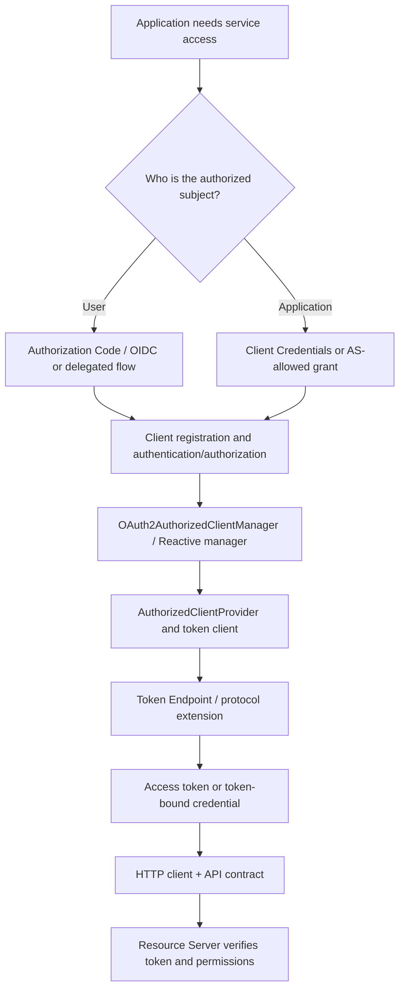
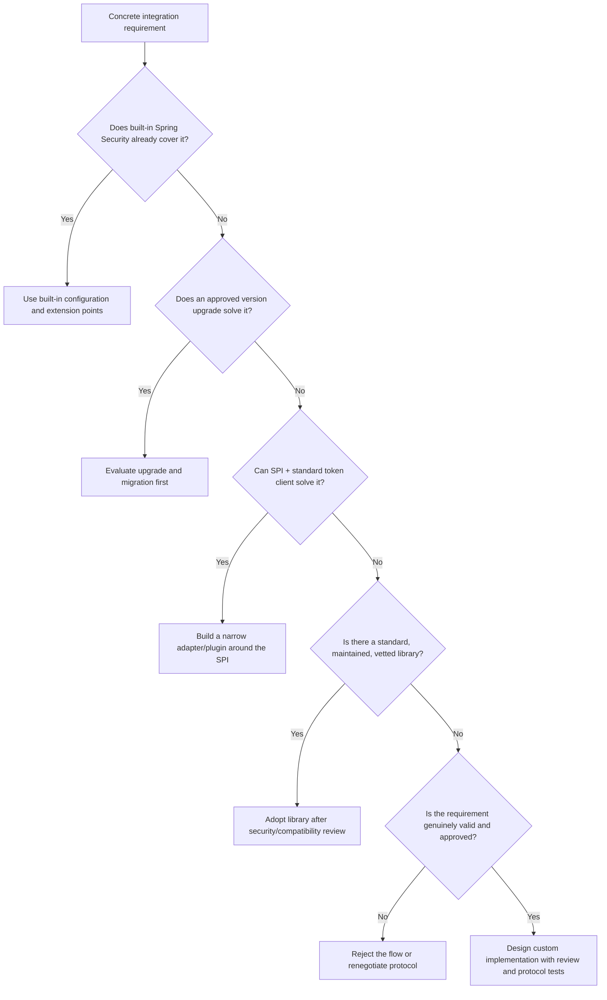
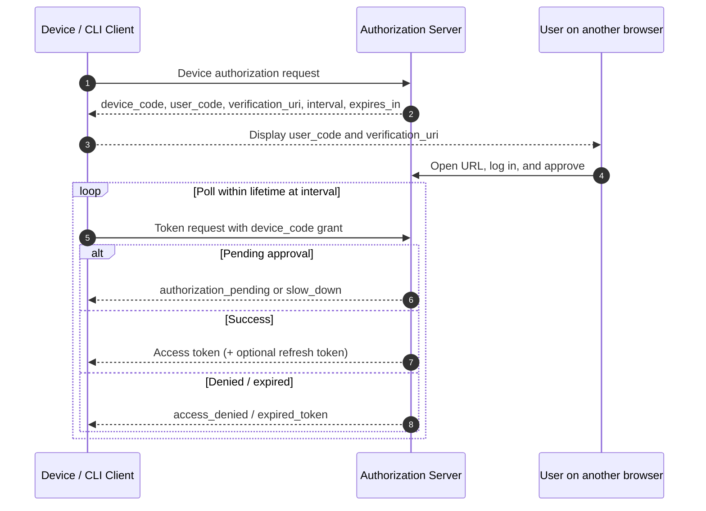

# 22.8. Criteria for Selecting Additional Libraries for Unsupported Flows

In the **Spring Security OAuth 2.0 OIDC Client** module, the lessons on Authorization Code, OIDC Login, refresh tokens, Client Manager, Servlet, and Reactive cover most common login and API-calling applications. Yet in large integration systems, an Authorization Server (AS) or partner sometimes requires a mechanism **not fully supported by the Spring Security version the project is running**.

For example: logging in on a device without a suitable browser, exchanging an existing token for a token targeting another API, authenticating with a JWT assertion under a specialized profile, using proof-of-possession, or meeting strict banking-ecosystem security requirements. In those situations, development teams face three choices: **use Spring Security's built-in capabilities**, **extend via SPI extension points**, or **add a dedicated library/SDK**.

This lesson does not encourage installing a library the moment you encounter a new buzzword. Its goal is to build a **verifiable decision framework** to select a standards-compliant, secure, compatible, and actively maintained solution. The primary target is **Spring Boot 3.x / Spring Security 6.x**, covering both **Servlet** and **WebFlux/Reactive**. In newer Spring Security releases, several grants/extensions already have built-in support; always verify documentation and Javadoc **for the exact version deployed**, rather than relying on an "unsupported" list written at another point in time.

> **Core principle:** Only add a library after proving a concrete functional gap exists, a clear protocol standard or vendor contract is defined, no simpler option exists within the current framework, and the library passes security, compatibility, operational, and maintenance gates.

## 1. Learning Outcomes

After this lesson, you will be able to:

1. Distinguish an **OAuth2 authorization grant** from an **OIDC authentication flow**, a **client authentication method**, a **token format**, and a **protocol extension**.
2. Classify a requirement into: directly supported by Spring, configurable via SPI, requiring a dedicated SDK, or inadvisable to implement.
3. Verify AS/OP requirements against RFCs, OpenID specifications, and framework versions instead of guessing.
4. Use an evaluation matrix covering **protocol conformance, integration scope, security maintenance, dependency risk, reactive behavior, testing, and operations**.
5. Design an adapter layer that prevents external SDKs from leaking into controllers, authentication/sessions, or the business layer.
6. Understand the boundaries of extension points such as `OAuth2AuthorizedClientProvider`, `ReactiveOAuth2AuthorizedClientProvider`, and access-token response clients.
7. Identify special safety requirements for device authorization, token exchange, JWT bearer, CIBA, DPoP, mTLS, PAR/JAR/JARM, and proprietary flows.
8. Test happy paths, protocol errors, replay, token mix-up, concurrency, secret handling, and downgrades.
9. Prepare upgrade, SDK-replacement, and rollback plans without losing control of tokens.

## 2. What Does "Unsupported Flow" Actually Mean?

That phrase can mask several distinct problems:

- **The framework lacks a token-issuance implementation** for the grant required by the AS.
- **The framework supports the grant**, yet lacks a specific AS profile option or request parameter.
- **The client can obtain tokens**, yet lacks the ability to attach proof-of-possession on Resource Server requests.
- **OIDC login is available**, yet a partner requires a back-channel workflow or additional profile conformance.
- **Support already exists in a newer Spring version**, yet the project has not upgraded.
- **The AS requires a proprietary protocol**, not standard OAuth2/OIDC.
- The requirement is actually a **Resource Server** or **Authorization Server** responsibility, not OAuth2 Client's.

The first step is always **pinpointing which layer has the gap**. Never search for a dependency by marketing name before knowing whether you lack a grant, HTTP client, token verifier, JOSE signing, or business delegation.

### 2.1. Layer Diagram



A Token Endpoint extension does not replace Spring Security's entire login filter chain. A JWT SDK does not turn itself into an `OAuth2AuthorizedClientRepository`. Conversely, a Resource Server having a `JwtDecoder` only verifies incoming access tokens—**it does not mean the OAuth2 Client knows how to request new tokens under an extension grant**.

### 2.2. Requirement Discovery Questions

Before looking for a library, document:

| Question | Required Evidence |
| --- | --- |
| Who requires the flow? | Versioned AS/OP documentation or integration contract |
| Exact protocol/grant name? | `grant_type`, RFC/profile, endpoints, and message schemas |
| Who is the token's subject? | End user, client application, actor/on-behalf-of, device |
| Is the client public or confidential? | Client authentication method, ability to safeguard secrets/keys |
| Who is the issuer? | Trusted issuer/AS, metadata, authorization policy |
| Which resource is the token for? | Audience, `resource`, scope, `authorization_details` |
| Where is the token used? | Servlet request, WebFlux pipeline, batch job, or device |
| Which framework versions are running? | Spring Boot, Spring Security, Spring Framework, Java |
| Which standard options does the AS support first? | Discovery, profiles, conformance statements, sandbox |
| Is the extension truly mandatory? | Cannot be met by a supported flow under security/business rules |

A vague statement like "our partner uses special SSO" without endpoints, grant types, and a security contract is **not enough to choose a library**.

## 3. Distinguishing Grants, Profiles, and Protocol Extensions

Many bad decisions start by calling everything a "new OAuth2 flow."

| Mechanism | Actual Role | Protocol Signal | Automatically a New Grant? |
| --- | --- | --- | --- |
| Authorization Code + PKCE | Browser/user authorization | `response_type=code`, PKCE parameters, code token exchange | No; standard grant |
| Client Credentials | Token for the client application | `grant_type=client_credentials` | Standard grant |
| Refresh Token | Obtain a new token using a refresh token | `grant_type=refresh_token` | Standard grant |
| Device Authorization (RFC 8628) | User authorizes on another device; client polls | Device Authorization Endpoint; `urn:ietf:params:oauth:grant-type:device_code` | Yes, has an associated grant |
| Token Exchange (RFC 8693) | Exchange tokens with subject/actor/audience context | `urn:ietf:params:oauth:grant-type:token-exchange` | Yes, extension grant |
| JWT Bearer Authorization Grant (RFC 7523) | Use a JWT assertion as an authorization grant | `urn:ietf:params:oauth:grant-type:jwt-bearer` | Yes, extension grant |
| `private_key_jwt` | Authenticate the client to the AS with a JWT | `client_assertion_type` and `client_assertion` | **Not** a separate grant |
| OIDC CIBA | Backchannel user authentication | CIBA Authentication Request, `auth_req_id`, poll/ping/push | Specialized profile/flow |
| DPoP (RFC 9449) | Sender-constrain tokens and prove key possession | `DPoP` proof JWT, `jkt`, `ath` in context | **Not** an authorization grant |
| mTLS (RFC 8705) | Client authentication or cert-bound tokens | TLS client certificate and AS/RS policy | **Not** a new grant |
| PAR (RFC 9126) | Push authorization request to AS before browser redirect | `request_uri` and PAR endpoint | **Not** a grant |
| JAR (RFC 9101) / JARM | Request object / JWT-secured authorization response | Signed request object / JWT response | Not a grant by default |
| RAR (RFC 9396) | Express fine-grained permissions via `authorization_details` | Structured authorization details | Not a grant |
| SAML 2.0 | Separate federation protocol | SAML assertions, bindings, and metadata | **Not** an OAuth2 grant |

A **JOSE/JWT** library only handles cryptographic message signing, decoding, and verification; it does not handle `state` correlation, consent, token exchange, principal mapping, authorization policies, or persistence.

### 3.1. "Unsupported" Must Specify a Version

Spring Security evolves continuously. An extension may be added in later releases or offered under a different API; a vendor SDK may cease to be recommended once the framework supports the standard.

Therefore, every library evaluation record must capture:

```text
Spring Boot version         = <deployed version>
Spring Security version     = <deployed version>
Web stack                   = Servlet or Reactive
Required protocol / profile = <RFC + version + profile>
Required operation          = <endpoint + parameters + semantics>
Built-in capability check   = <versioned Javadoc/reference>
Decision date               = <evaluation date>
```

A claim that "Spring does not support grant X" without recording the version **is not maintainable evidence**.

## 4. Priority Order for Solving a Non-Standard Flow

Proceed from **least structural change** to **highest custom-implementation responsibility**.



### 4.1. Option A — Stay on Spring Security

Appropriate when solved by:

- `ClientRegistration` and provider metadata.
- Grants already in `OAuth2AuthorizedClientProviderBuilder` or its reactive builder.
- Customizing authorization request resolvers/parameters.
- Configuring token response clients, HTTP clients, TLS, or client authentication.
- `OAuth2AuthorizedClientService` / repositories aligned with token lifecycle.
- Enabling PKCE or setting policies per client type.
- Separating user login and machine-to-machine flows into distinct registrations.

This is the default choice because it adds the least supply-chain and integration risk.

### 4.2. Option B — Upgrade Spring Security

Evaluate an upgrade when:

- A newer version includes the needed extension per Javadoc and tests.
- The current library line is nearing end-of-support.
- Important security fixes or client/token handling improvements are included.
- Upgrading does not break other applications or filters.

Never upgrade blindly. Verify Spring Boot dependency management, Spring Framework, Java baseline, Jakarta APIs, WebFlux/Servlet behavior, and API changes via real application testing.

### 4.3. Option C — Spring Extension Point + Small Adapter

Makes sense when core login/token lifecycles remain sound yet **one specific step** must change, such as token request formatting or a grant-specific provider.

The goal is preserving:

```text
Controller / Business Service
          |
          v
Spring OAuth2 Authorized Client Manager
          |
          v
Well-defined custom provider / token response client
          |
          v
Adapter using protocol standards or a focused library
          |
          v
Trusted Authorization Server
```

Never replace the entire security filter chain with a second OAuth2 implementation merely because one token endpoint parameter differs.

### 4.4. Option D — Third-Party Library/SDK

Select only when the requirement entails substantial complexity, such as:

- JOSE signing, DPoP proofs, and nonce replay protection.
- CIBA with polling/ping/push/correlation.
- Token Exchange profiles with extra constraints and validation.
- Vendor-specific device authentication significantly diverging from common grants.
- FAPI profiles requiring multiple signed messages or sender-constrained tokens.
- Key management / HSM integrations where rolling your own is high-risk.

Prefer SDKs with **narrow APIs usable behind an adapter**, rather than frameworks forcing you to replace existing authentication, sessions, or HTTP clients.

### 4.5. Option E — Implement the Protocol Yourself

This is the **last resort**, justified only when:

- No built-in support or suitable SDK exists.
- Full RFC/profile/contract specs, a sandbox, and test vectors exist.
- The team possesses protocol security and cryptography integration expertise.
- Independent review, threat modeling, and long-term maintenance plans exist.
- Budget covers key rotation, incident response, and compatibility testing.

Never write cryptographic algorithms, JWT signature verifiers, or PKCE generators from scratch when vetted libraries exist.

## 5. Mandatory Gates Before Adding Any Dependency

These are **exclusionary gates**, not bonus points that an ergonomic API can outweigh.

| Mandatory Gate | Requirement | If Unmet |
| --- | --- | --- |
| Clear protocol | RFC/profile/version or vendor docs with test vectors | Do not pick a library yet; request a proper contract |
| Confirmed AS/OP support | Endpoint, scopes, and client registration policy confirmed | Never install an SDK based solely on marketing |
| Token trust boundary | Issuer, audience, subject/actor, and client identity defined | Do not issue or send tokens |
| No security weakening | Never disable TLS, `state`, PKCE, `nonce`, or signature checks | Reject option |
| Secret/key protection | Client secrets, private keys, and refresh tokens safeguarded | Reject or redesign |
| Patching and support | No unmitigated critical vulnerabilities; actively maintained | Reject or obtain time-bound approved exception |
| Runtime compatibility | Compatible with Spring/Java/Jakarta/Reactor/HTTP clients | Block from production |
| Real testability | Sandbox and error/replay test scenarios feasible | Do not deploy to production |
| Legal acceptability | License, distribution, and export/compliance approved | Exclude from artifacts |
| Operational owner | Team accountable for upgrades, alerts, and rollbacks | Reject dependency |

**Never quietly "accept risk"** by disabling security validation or ignoring CVEs to hit an integration deadline. Risk exceptions must be evaluated, formally approved, and time-bound.

## 6. Scoring Matrix After Passing Mandatory Gates

When two or three candidates pass all gates, score them relatively against project priorities.

| Criterion | Reference Weight | How to Evaluate |
| --- | ---: | --- |
| Standards compliance & interoperability | 25% | RFCs/profiles, test vectors, OP conformance |
| Security & patch cadence | 20% | Security advisories, release cadence, trust/key handling |
| Spring architectural fit | 15% | SPI, manager, repository, `SecurityContext`, bean lifecycle |
| Servlet/Reactive compatibility | 10% | Non-blocking on event loops, HTTP client/TLS/config |
| Test & documentation quality | 10% | Integration tests, negative cases, versioned examples |
| Dependency / supply chain | 10% | Transitives, SBOM, license, signatures/provenance |
| Operability / maintainability | 10% | Metrics, failure classification, ownership, migration path |

Formula when scoring each criterion on a 0–5 scale:

```text
Total score = Σ (weight_i × score_i / 5)
```

This is a **decision-support model**, not a mandate from Spring or OAuth. Never use a high total score to waive a security gate. Record both **reasons for selection** and **reasons for rejection** of each option.

### 6.1. Concise Decision Record

```yaml
decision:
  operation: "Exchange delegated token for a downstream API"
  standard: "RFC 8693 + provider profile"
  environment:
    webStack: "WebFlux"
    springSecurityVersion: "<actual-version>"
    javaVersion: "<actual-version>"
  builtInEvaluation:
    supportedForCurrentVersion: "<yes/no/partial>"
    evidence: "<official documentation or API reference>"
  selectedApproach: "<built-in | upgrade | SPI-adapter | vetted-library>"
  chosenDependency:
    coordinates: "<group:artifact:version, if any>"
    license: "<SPDX identifier>"
    owner: "<team>"
  securityControls:
    - "trusted issuer and audience"
    - "subject/actor delegation policy"
    - "key and secret management"
    - "bounded retry and no token logging"
  tests:
    - "successful exchange"
    - "invalid subject token"
    - "wrong audience"
    - "replay / token substitution"
  rollback: "<feature flag and previous supported grant>"
```

This template is a decision record, not a Spring configuration file.

## 7. Example 1 — Do Not Add a Library When `client_credentials` Suffices

Suppose a backend calls the Inventory API using its application identity, with no user involved. If the AS supports `grant_type=client_credentials`, Spring Security OAuth2 Client usually handles this out of the box.

### 7.1. Registration Configuration

```yaml
spring:
  security:
    oauth2:
      client:
        registration:
          inventory-service:
            provider: trusted-inventory-as
            client-id: ${INVENTORY_CLIENT_ID}
            client-secret: ${INVENTORY_CLIENT_SECRET}
            client-authentication-method: client_secret_basic
            authorization-grant-type: client_credentials
            scope:
              - inventory.read
        provider:
          trusted-inventory-as:
            token-uri: ${INVENTORY_TOKEN_URI}
```

`inventory.read` is an illustrative scope only. It must be granted by the AS and validated by the Resource Server per real policy.

### 7.2. Manager for a Backend Without HTTP Requests

```java
import org.springframework.context.annotation.Bean;
import org.springframework.context.annotation.Configuration;
import org.springframework.security.oauth2.client.AuthorizedClientServiceOAuth2AuthorizedClientManager;
import org.springframework.security.oauth2.client.OAuth2AuthorizedClientManager;
import org.springframework.security.oauth2.client.OAuth2AuthorizedClientProvider;
import org.springframework.security.oauth2.client.OAuth2AuthorizedClientProviderBuilder;
import org.springframework.security.oauth2.client.OAuth2AuthorizedClientService;
import org.springframework.security.oauth2.client.registration.ClientRegistrationRepository;

@Configuration
public class InventoryClientManagerConfig {

    @Bean("inventoryClientManager")
    OAuth2AuthorizedClientManager inventoryClientManager(
            ClientRegistrationRepository registrations,
            OAuth2AuthorizedClientService service) {

        OAuth2AuthorizedClientProvider provider =
                OAuth2AuthorizedClientProviderBuilder.builder()
                        .clientCredentials()
                        .build();

        var manager =
                new AuthorizedClientServiceOAuth2AuthorizedClientManager(
                        registrations, service);

        manager.setAuthorizedClientProvider(provider);
        return manager;
    }
}
```

### 7.3. Requesting Tokens on Demand

```java
import org.springframework.beans.factory.annotation.Qualifier;
import org.springframework.security.oauth2.client.OAuth2AuthorizeRequest;
import org.springframework.security.oauth2.client.OAuth2AuthorizedClient;
import org.springframework.security.oauth2.client.OAuth2AuthorizedClientManager;
import org.springframework.stereotype.Service;

@Service
public class InventoryTokenAdapter {

    private final OAuth2AuthorizedClientManager manager;

    public InventoryTokenAdapter(
            @Qualifier("inventoryClientManager")
            OAuth2AuthorizedClientManager manager) {
        this.manager = manager;
    }

    public OAuth2AuthorizedClient authorize() {
        OAuth2AuthorizeRequest request = OAuth2AuthorizeRequest
                .withClientRegistrationId("inventory-service")
                .principal("inventory-worker")
                .build();

        OAuth2AuthorizedClient client = manager.authorize(request);
        if (client == null) {
            throw new IllegalStateException(
                    "Inventory client authorization unavailable");
        }
        return client;
    }
}
```

This solution **requires zero extra grant SDKs**. `principal("inventory-worker")` is merely the lookup key for storing the workload's authorized client; it does not create an OIDC end-user identity or add scopes.

If the real requirement is **calling an API on behalf of a user**, `client_credentials` is the wrong permission model. Evaluate delegation/token exchange instead of changing the principal string to a user ID.

## 8. Example 2 — Token Exchange Under RFC 8693

**OAuth 2.0 Token Exchange (RFC 8693)** allows a client to exchange an existing token under AS policy—for instance, to obtain a token whose audience targets a downstream API.

Conceptual request example:

```http
POST /oauth2/token HTTP/1.1
Host: auth.example.com
Content-Type: application/x-www-form-urlencoded
Authorization: Basic <client-authentication>

grant_type=urn:ietf:params:oauth:grant-type:token-exchange&
subject_token=<TOKEN_ISSUED_TO_CALLER>&
subject_token_type=urn:ietf:params:oauth:token-type:access_token&
audience=https%3A%2F%2Finventory-api.example.com
```

The token request may also include `requested_token_type`, `actor_token`, `actor_token_type`, `resource`, or `scope` depending on profile and AS policy. **Not every AS supports all parameters; not every AS permits exchanging tokens from any arbitrary issuer.**

### 8.1. Criteria for Considering a Library

The library or extension must handle properly:

- `grant_type` and parameter encoding per RFC/profile.
- Appropriate client authentication (secret, private key JWT, mTLS, etc.).
- Verifying `subject_token` genuinely originates from a trusted flow.
- Exact `subject_token_type`.
- `actor_token`/delegation semantics when required.
- Ensuring `audience`/`resource` lies within a server-side allowlist.
- Ensuring AS-granted scopes do not exceed subject/client authority.
- Response token type, expiry, `issued_token_type`, and error codes.
- Logging/redaction, since the body contains sensitive bearer tokens.
- Ensuring during refresh/reauthorization that the source subject token remains valid and permitted by policy.

**Do not treat token exchange as "turning any token into an admin token."** The AS must enforce trust and delegation policies; clients must never use token exchange for privilege escalation.

### 8.2. Check Built-In Support First

Before writing an RFC 8693 plugin:

1. Check the reference docs/Javadoc for your Spring Security version.
2. Check `OAuth2AuthorizedClientProviderBuilder`, its reactive counterpart, and built-in token exchange provider/client APIs.
3. Check whether **Servlet and Reactive** share equal support.
4. Confirm AS parameters/profiles can be customized without rewriting the protocol state machine.
5. If gaps remain, choose a narrow adapter covering only the missing grant/extension.

**Never declare permanently that Spring Security lacks Token Exchange support**; support changes across releases and APIs.

### 8.3. Adapter Boundary

```text
Business Service
      |
      v
TokenExchangePort.exchange(request)
      |
      +-- validate registration/policy
      +-- verify subject token provenance
      +-- normalize token response
      |
      v
Spring provider if available / trusted SDK if needed
      |
      v
Trusted Token Endpoint
      |
      v
Token scoped to right audience
```

The adapter must **keep token material in the backend** and forward tokens only to approved APIs. Never let HTTP callers supply arbitrary `audience` or `token-uri` values using system client credentials.

### 8.4. Example SDK-Agnostic Contract

```java
import reactor.core.publisher.Mono;

// Application port, not a built-in Spring Security class.
public interface DelegatedTokenExchangePort {

    Mono<ExchangedAccessToken> exchange(
            TrustedExchangeRequest request);

    record TrustedExchangeRequest(
            String registrationId,
            String internalSubjectReference,
            String approvedAudience) {}

    record ExchangedAccessToken(
            String tokenValue,
            String tokenType,
            java.time.Instant expiresAt) {}
}
```

This is an **architectural contract**; implementations must fetch the subject token from a trusted store using `internalSubjectReference`, verify ownership/delegation, and never accept raw subject tokens or token endpoints from external HTTP inputs. In production, further limit exposure of `tokenValue` by keeping it inside the HTTP adapter where possible.

Benefit: once Spring Security natively supports your exact profile, you can swap the port implementation **without changing controllers or business policies**.

## 9. Example 3 — Device Authorization Grant (RFC 8628)

Device Authorization targets clients running on input-constrained devices or environments unsuitable for local browser login: TVs, CLIs, policy-supported IoT devices, etc.

General flow:



### 9.1. Mandatory Library Requirements

A viable Device Authorization library must provide:

- Support for the Device Authorization Endpoint and token polling grant per RFC 8628.
- Adherence to the AS `interval`; honoring `slow_down` by increasing polling intervals.
- Bounding by `expires_in` and overall deadlines; cancellation support.
- Zero logging of `device_code`, access/refresh tokens, or secrets.
- Displaying `user_code` and `verification_uri` only on the intended UX surface; never sending sensitive credentials to third-party analytics.
- Brute-force and social-engineering protections per OP architecture.
- Never blocking Reactor event loops with `Thread.sleep(...)`.
- Compatibility with AS public/confidential client policies.
- Not using device flow as a casual replacement for an existing browser `oauth2Login()`.

### 9.2. Reactive Polling and Schedulers

In WebFlux or reactive CLIs, polling should use **non-blocking delays** instead of blocking loops. Conceptual model:

```java
// PSEUDOCODE: deviceTokenClient and response model
// represent the chosen application/library components.
Mono<TokenResponse> pollDeviceCode(DeviceAuthorizationContext ctx) {
    return Mono.defer(() -> deviceTokenClient.poll(ctx))
            .onErrorResume(AuthorizationPending.class,
                    ex -> Mono.delay(ctx.currentInterval())
                              .then(pollDeviceCode(ctx)))
            .onErrorResume(SlowDown.class,
                    ex -> Mono.delay(ctx.increasedInterval())
                              .then(pollDeviceCode(ctx)))
            .timeout(ctx.remainingLifetime());
}
```

This is not copy-paste-ready production code: `AuthorizationPending`, `SlowDown`, `DeviceAuthorizationContext`, and `deviceTokenClient` are hypothetical abstractions. Production requires **bounded recursion/retries**, cancellation, monotonic timeouts, strict polling intervals, and detailed AS error handling. The example simply illustrates why you need an SDK/adapter that understands the **state machine**, not just a single HTTP POST.

## 10. Example 4 — JWT Bearer Grant and `private_key_jwt` Are Not the Same

Both can send a JWT to the Token Endpoint, yet with different responsibilities.

### 10.1. JWT Bearer Authorization Grant — RFC 7523

Grant type:

```text
urn:ietf:params:oauth:grant-type:jwt-bearer
```

The client uses a pre-generated JWT assertion trusted by the AS as an authorization grant. The AS validates issuer, subject, audience, lifetime, signature, and matching policy.

### 10.2. JWT Client Authentication — `private_key_jwt`

A confidential client can authenticate to the Token Endpoint using a JWT assertion:

```text
client_assertion_type =
  urn:ietf:params:oauth:client-assertion-type:jwt-bearer

client_assertion = <signed-client-assertion>
```

This is a **client authentication method**, usable alongside `authorization_code`, `client_credentials`, or another grant. It does **not** mean you are running the JWT bearer authorization grant.

| Distinction | JWT Bearer Grant | `private_key_jwt` |
| --- | --- | --- |
| Purpose | Uses an assertion as an authorization grant | Proves client identity at the Token Endpoint |
| `grant_type` | JWT bearer URN | Grant stays `authorization_code`/`client_credentials`/etc. |
| Validated components | Assertion subject/issuer/audience and grant policy | Client assertion, key, and client auth policy |
| Where risks lie | Subject/delegation mix-up or assertion replay | Private key exposure, wrong `aud`/`jti`/clock, replay |
| Possible library needs | JOSE signing + grant adapter/profile | JOSE signing / client auth integration |

### 10.3. Security Criteria for JWT Assertion Libraries

Must enforce:

- Signing algorithms **approved and allowlisted by the AS**—never trust arbitrary `alg` from untrusted inputs.
- Key management via keystore/HSM/KMS if required by policy.
- Profile-compliant `iss`/`sub`/`aud`; `aud` typically targets the Token Endpoint or issuer per contract.
- Short `exp`, reasonable `iat`/`nbf`, bounded clock skew.
- Unique `jti` when the profile requires replay protection.
- `kid`/JWKS rotation and key revocation capability.
- Zero logging of raw assertions or private keys.
- Negative test coverage: bad signature, wrong audience, expired, replayed assertion.

A convenient JWT library **is not enough** without proper token request architecture, persistence, authorization policies, and provider-specific semantics.

## 11. DPoP and mTLS: Stricter Library Selection Criteria

**DPoP (RFC 9449)** and **OAuth 2.0 Mutual-TLS (RFC 8705)** relate to sender-constrained access tokens. HTTP requests may require cryptographic proof bound to a private key or certificate.

### 11.1. Why Can't You Just Attach an Extra Header?

With DPoP, the proof JWT binds to HTTP method and target URI via `htm`, `htu`, timestamp, and `jti`; Resource Server requests may also require `ath`. The AS/RS may demand server-provided nonces. Tokens may be bound to a key thumbprint.

If an adapter:

- Reuses proof `jti` values.
- Signs for the wrong URI due to proxies/rewrites.
- Fails to refresh nonces.
- Mixes private keys across sessions/clients.
- Forwards tokens across hosts.
- Caches proofs/tokens with overly broad scope.

requests will be rejected or the security model will break.

### 11.2. Criteria for Choosing a DPoP Library

The library must demonstrate proper handling of:

1. Generating and safeguarding key material.
2. Constructing proofs with exact `htm`, `htu`, timestamp, and `jti`.
3. Computing `ath` when presenting access tokens where required.
4. Handling nonce challenges and bounded retries **without arbitrarily replaying business actions**.
5. Attaching proofs on **both token requests and API requests** as required by profile.
6. Aligning proof keys with token confirmation claims/bindings.
7. Never exposing private keys or raw tokens to browsers/logs outside vetted public-client architectures.
8. Compatibility with the application's HTTP stack, redirect policies, and proxies.

DPoP **is not a grant type**; if your framework already provides a matching extension, prefer it over hand-signing proofs in controllers.

### 11.3. Criteria for Choosing an mTLS Library

For mTLS-bound tokens, verify:

- Client certificates are attached to the exact outbound connection.
- Both AS and Resource Server enforce compatible binding policies.
- Trust stores, key stores, certificate chains, and rotation.
- Whether load balancers/proxies terminate TLS and how that affects binding.
- HTTP connection pooling never mixes client identities across pooled connections.
- Operability inside containers, Kubernetes, and service meshes.
- Never bypassing certificate validation just to get a sandbox working.

Never choose an SDK merely because it has an "SSL enabled" option. Prove **mTLS client auth and token binding** against the real profile, including production-like environments.

## 12. PAR, JAR, JARM, RAR, and CIBA: Evaluate Against the Full Profile

A system may require a combination such as:

```text
Authorization Code + PKCE
        +
PAR (pushed authorization request)
        +
JAR (signed request object)
        +
JARM (secured authorization response)
        +
RAR (structured authorization details)
```

These additions **do not necessarily replace `authorization_code` with a new grant**. Adopting "another OAuth2 client library" just for PAR risks creating **two competing login state machines**.

### 12.1. Evaluation Questions

| Extension | Questions to Ask When Choosing an SDK |
| --- | --- |
| PAR | Does the SDK send requests securely to the PAR endpoint and handle `request_uri` and expiry? |
| JAR | Does it sign request objects per profile and manage keys/algorithms/claims? |
| JARM | Does it verify JWT authorization responses, issuer/audience/state/replay? |
| RAR | Does it validate/serialize `authorization_details` per the AS-required schema? |
| CIBA | Does it handle `auth_req_id`, notification/polling modes, binding messages, and user consent properly? |
| FAPI profile | Does it have conformance test results matching the required security profile? |

An SDK advertising generic "OIDC" support does not prove it supports a **specific banking profile**. Require profile specs, test vectors/conformance evidence, and AS agreement.

### 12.2. Do Not Disable `state`/`nonce` Because a Flow Uses Signed JWTs

A signed JARM/JAR request or response does not automatically waive correlation, session, or user-interaction requirements of the flow. Follow the profile and its designed anti-mix-up, CSRF, and replay protections.

## 13. Spring Security Extension Points: Containing Integration Scope

Keep third-party libraries behind stable interfaces rather than calling them directly from every controller.

### 13.1. In Servlet

Extension points to evaluate:

- `OAuth2AuthorizedClientProvider`: handles authorization/reauthorization based on `OAuth2AuthorizationContext`.
- `OAuth2AuthorizedClientManager`: coordinates registrations, principals, providers, and authorized client persistence.
- Grant-specific token response clients: encapsulate Token Endpoint HTTP requests/responses.
- `OAuth2AuthorizationSuccessHandler` / failure handler: persists, deletes, or observes authorization state per policy.
- `ClientRegistrationRepository`: supplies client configurations.
- `OAuth2AuthorizedClientService` or repository: persists tokens across their lifecycle.

**Not every extension point is needed at once.** When only modifying one request parameter, prefer the narrower hook over rewriting the manager.

### 13.2. Controlled Custom Provider Pattern

The example below **illustrates composing a provider**, not implementing the full Token Exchange protocol:

```java
import org.springframework.context.annotation.Bean;
import org.springframework.context.annotation.Configuration;
import org.springframework.security.oauth2.client.DelegatingOAuth2AuthorizedClientProvider;
import org.springframework.security.oauth2.client.OAuth2AuthorizedClient;
import org.springframework.security.oauth2.client.OAuth2AuthorizedClientProvider;
import org.springframework.security.oauth2.client.OAuth2AuthorizedClientProviderBuilder;
import org.springframework.security.oauth2.client.OAuth2AuthorizationContext;

// Application port: implementations must handle protocol, security,
// token responses, and lifecycle accurately per provider.
interface ExtensionGrantAdapter {
    OAuth2AuthorizedClient authorize(
            OAuth2AuthorizationContext context);
}

@Configuration
class ExtensionProviderConfig {

    private static final String TOKEN_EXCHANGE =
            "urn:ietf:params:oauth:grant-type:token-exchange";

    @Bean
    OAuth2AuthorizedClientProvider composedProvider(
            ExtensionGrantAdapter adapter) {

        OAuth2AuthorizedClientProvider standard =
                OAuth2AuthorizedClientProviderBuilder.builder()
                        .authorizationCode()
                        .refreshToken()
                        .clientCredentials()
                        .build();

        OAuth2AuthorizedClientProvider extension =
                context -> {
                    String grant =
                            context.getClientRegistration()
                                    .getAuthorizationGrantType()
                                    .getValue();

                    if (!TOKEN_EXCHANGE.equals(grant)) {
                        return null; // Provider does not handle this grant.
                    }
                    return adapter.authorize(context);
                };

        return new DelegatingOAuth2AuthorizedClientProvider(
                standard, extension);
    }
}
```

In a real deployment:

- Supply a thoroughly tested `ExtensionGrantAdapter` bean, not just an interface.
- Wire `composedProvider` into the manager matching your application context.
- `OAuth2AuthorizationContext` and `OAuth2AuthorizeRequest` must carry subject tokens/actors/claims under an **audited contract**, never unverified user input.
- The adapter must build an `OAuth2AuthorizedClient` for the exact registration/principal without returning stale tokens.
- Evaluate token persistence and failure handling separately.
- Once your Spring Security version provides a standard provider for this grant, **switch to the standard provider** instead of maintaining a custom copy.

This pattern clarifies the boundary: the provider decides **whether the grant applies**, the token request adapter handles the protocol, and the manager still coordinates the authorized client lifecycle.

### 13.3. In WebFlux/Reactive

The corresponding API is:

```java
ReactiveOAuth2AuthorizedClientProvider
```

returning:

```java
Mono<OAuth2AuthorizedClient>
```

A provider that does not handle a grant must signal inapplicability per contract (typically `Mono.empty()`), never block the event loop to call a synchronous HTTP SDK.

Pseudocode:

```java
// PSEUDOCODE: reactiveExtensionAdapter is an application-implemented port.
ReactiveOAuth2AuthorizedClientProvider extension = context -> {
    if (!isSupportedGrant(context)) {
        return Mono.empty();
    }

    return reactiveExtensionAdapter.authorize(context);
};
```

If only a **blocking SDK** exists, evaluate these options:

1. Find an SDK with a genuine reactive/non-blocking HTTP implementation.
2. Isolate blocking SDK calls onto a bounded scheduler inside the adapter with strict timeouts and concurrency limits.
3. Move the work into a separate worker service if latency or I/O is heavy.
4. Re-evaluate whether reactive is needed at that boundary.

Never wrap `blockingSdk.exchange(...)` inside `Mono.just(...)` and claim it is non-blocking; the blocking call executes before the `Mono` is even constructed.

### 13.4. Do Not Mix Servlet Managers with WebFlux

| Component | Servlet | Reactive |
| --- | --- | --- |
| Manager | `OAuth2AuthorizedClientManager` | `ReactiveOAuth2AuthorizedClientManager` |
| Provider | `OAuth2AuthorizedClientProvider` | `ReactiveOAuth2AuthorizedClientProvider` |
| Registration repository | `ClientRegistrationRepository` | `ReactiveClientRegistrationRepository` |
| Authorized client service | `OAuth2AuthorizedClientService` | `ReactiveOAuth2AuthorizedClientService` |
| HTTP context | Servlet request/response | `ServerWebExchange` and Reactor Context |
| Common outbound HTTP client | `RestClient` | `WebClient` |

Third-party SDKs supporting only Servlet filters or `javax.servlet.*` APIs may be incompatible with **Spring Boot 3/Jakarta or WebFlux**. Never ignore compatibility simply because a dependency resolves.

## 14. Technical Compatibility Criteria for Dependencies

A library can follow the RFC and still be incompatible at runtime.

### 14.1. Spring Boot 3 / Spring 6 / Java

Verify:

- Minimum Java baseline and target bytecode version.
- `jakarta.*` vs. `javax.*` APIs if the library touches Servlet APIs.
- Compatibility with Spring Security's managed dependency versions.
- Whether it auto-creates Spring Security filters/beans that collide with yours.
- Whether it relies on removed or deprecated APIs.
- Whether it depends on framework internals prone to breaking in newer releases.
- Jakarta JSON/Validation/Servlet compatibility where applicable.

**Successfully downloading a JAR does not prove runtime compatibility.** `NoSuchMethodError`, `ClassNotFoundException`, and bean conflicts often surface only during integration tests.

### 14.2. Dependency Convergence

An SDK may pull in its own HTTP client, Jackson, JOSE library, Bouncy Castle, or Reactor/Netty versions. If they conflict with Spring Boot dependency management, risks include:

- Altered JWT signing/verification algorithms or behavior.
- Token response serialization failures.
- Breaking HTTP client or TLS changes.
- Duplicate crypto providers.
- CVEs via transitive dependencies.

Use Gradle/Maven dependency insight, dependency convergence checks, and SBOMs to inspect graphs. **Never force-override all Spring dependency versions just to make an old SDK compile** without understanding the security impact.

Example commands for project teams to run during verification (not executed by this lesson):

```bash
./gradlew dependencies --configuration runtimeClasspath
./gradlew dependencyInsight --dependency spring-security-oauth2-client --configuration runtimeClasspath
./gradlew dependencyInsight --dependency nimbus-jose-jwt --configuration runtimeClasspath
```

On Windows, run `gradlew.bat`. Adjust dependency names to match the actual SDK.

### 14.3. Servlet vs. Reactive Runtime

An SDK built on `RestTemplate` or blocking TLS may fit a modest Servlet service, yet will stall WebFlux event loops if invoked directly in a reactive pipeline.

In WebFlux, verify:

- Genuine `Mono`/`Flux` APIs or true asynchronous integration.
- Propagation of cancellation and timeouts down to HTTP requests.
- Connection pooling, TLS, backpressure, and thread usage.
- Whether crypto/HSM I/O or HTTP I/O blocks event-loop callbacks.
- Concurrency caps to avoid exhausting bounded schedulers when wrapping a blocking SDK is unavoidable.

A README claiming "reactive-ready" **is insufficient proof**; verify actual behavior on your target runtime.

## 15. Supply Chain Security and Maintainability

Technical checks must pair with artifact provenance and patching processes.

### 15.1. Verifying Artifact Provenance

Prefer:

- Official repositories and verifiable release provenance.
- Clear, verifiable artifact coordinates.
- Released versions with proper release notes.
- Policy-compliant licensing.
- Available or reliably generated SBOMs.
- Track record of addressing security advisories.
- Published security policies or vulnerability-reporting channels.
- Accountable maintainers/teams.
- Never downloading random JARs from forums or personal drives.

A low-activity library is not automatically broken, yet **oversight and internal ownership must increase** in proportion to the sensitivity of the flow.

### 15.2. What to Do When a CVE Appears?

Do not merely count vulnerabilities. Determine:

1. Which module and version the CVE affects.
2. Whether it sits on the runtime classpath or only test scope.
3. Whether the vulnerable code path is reachable in this flow.
4. Whether the vendor has published a patch or mitigation.
5. Exploitable risk within your current architecture.
6. Remediation deadline and responsible owner.

Never disable TLS/JWT validation or ship a publicly exploited artifact simply because "an older project already used it."

### 15.3. Avoid "Shadow Internal SDKs"

If an internal library was forked from an old OAuth client:

- Who backports upstream security patches?
- Who tracks RFC updates?
- Are there regression tests for token requests and responses?
- Are key/secret logging and dependency vulnerabilities monitored?
- Is there a plan to retire the fork once official upstream support lands?

Without long-term ownership, a fork becomes a larger liability than a small adapter.

## 16. Mandatory Runtime Security Boundaries

### 16.1. Never Choose Issuer/Token Endpoint from Untrusted Input

Anti-pattern:

```java
// DO NOT USE: user specifies issuer and token endpoint.
String tokenUri = httpRequest.getParameter("tokenUri");
String clientId = httpRequest.getParameter("clientId");
thirdPartyOAuthSdk.requestToken(tokenUri, clientId);
```

This creates **SSRF**, client credential leakage, confused deputy, and cross-environment/cross-tenant mix-up.

Replace with:

```text
Authenticated/approved tenant + requested operation
             |
             v
Server-side policy and allowlist
             |
             v
Approved ClientRegistration / TokenEndpoint
             |
             v
Specific extension adapter
```

If dynamic registration is required, adding an issuer must pass through a **vetted enrollment workflow** and metadata validation; never let a browser trigger logins against arbitrary issuers on the fly.

### 16.2. Principals and Subject Tokens Must Come from Trusted Sources

For token exchange, JWT bearer, and on-behalf-of flows:

- Never pull `subject_token` arbitrarily from another user.
- The caller must be authorized to request delegation on behalf of the subject.
- Scope/audience must be bounded by server policy.
- Token issuer, subject, actor, and client bindings must match the contract.
- Multi-tenant mapping must never rely solely on email or a query parameter `tenantId`.
- When user consent is revoked, the user logs out, or an account is disabled, re-evaluate background token policies.

**Never let `principal("admin")` in `OAuth2AuthorizeRequest` grant admin privileges at the AS**; principal name keys authorized client state, not grant elevation.

### 16.3. Key and Secret Management

Any SDK handling private keys or refresh tokens must ensure:

- Secrets come from secret stores/environment config, never committed to source.
- Private keys are protected and rotated per policy.
- Tokens, client secrets, private keys, signed assertions, and cookies are never logged.
- HTTPS/TLS channels verify certificates properly.
- Sensitive data never goes into query strings.
- Bearer/DPoP/cert credentials never leave allowlisted hosts.
- Backups and session/database stores are secured.
- Revocation/cleanup executes on user disconnect or credential compromise.

### 16.4. Never Weaken Standards Just for Provider Compatibility

Changes to reject immediately:

- `trustAllCertificates` or disabling hostname verification.
- Skipping JWT signature, issuer, audience, or expiry checks.
- Skipping `state`, PKCE, `nonce`, or flow correlation checks.
- Adopting OAuth implicit flow or ROPC merely because an old SDK supports them.
- Sending an access token from API A to API B with the wrong audience.
- Letting users control `redirect_uri` toward external domains.
- Returning raw tokens to the browser in server-side architectures.

If an AS demands an insecure profile, negotiate a secure profile instead of installing a library to "work around" security controls.

## 17. Crucial Principle: Never Resurrect Obsolete Flows

Some older OAuth2 libraries advertise **Implicit Flow** or **Resource Owner Password Credentials (Password Grant)** as convenient features.

In modern security design, both carry serious flaws; OAuth 2.0 Security Best Current Practice (RFC 9700) recommends avoiding or prohibiting them for new applications. Appropriate alternatives are typically:

- Authorization Code + PKCE for interactive user apps.
- Client Credentials for machine-to-machine.
- Device Authorization for suitable input-constrained devices.
- Standardized Delegation/Token Exchange when genuinely permitted and needed by the AS.
- OIDC Login for user authentication; never use raw password flows in place of OP authentication.

**Never choose a library because it implements a grant your organization banned in security policy**. "Has an API" is very different from "should be used."

## 18. Protocol Errors and Retry Policies

Each extension has its own error model. A well-built adapter distinguishes **authorization errors**, **client authentication errors**, **network errors**, **authorization policy errors**, and **business API errors**.

| Error / Situation | Likely Meaning | Appropriate Handling |
| --- | --- | --- |
| `invalid_client` | Client authentication failed; bad key/secret/method | Fix registration and secrets; never retry infinitely |
| `unauthorized_client` | Client is not allowed to use this grant/profile | Verify AS permissions; never swap grants arbitrarily |
| `unsupported_grant_type` | AS does not support the submitted grant | Verify capabilities; halt integration |
| `invalid_grant` | Assertion/device code/refresh token invalid, expired, replayed, or policy-rejected | Classify by grant; avoid reusing stale credentials |
| `invalid_scope` | Disallowed scope | Inspect approved scopes and consent |
| `access_denied` | User declined or policy blocked | Do not force consent or switch users |
| `authorization_pending` | Device flow awaiting user approval | Poll per interval/deadline |
| `slow_down` | Device polling too fast | Increase polling interval per spec |
| `expired_token` | Device code/credential no longer valid | Terminate flow; restart via UX |
| `401 invalid_token` from Resource Server | API rejected the access token | Do not blindly refresh and replay every request |
| `403 insufficient_scope` | API permissions missing | Never retry infinitely with the same scopes |
| Network timeout during token exchange/refresh | Outcome ambiguous | Respect grant's replay/reuse semantics |
| OP returns response missing required fields | Contract violation | Reject; never store partial tokens |
| Invalid response signature/claims | Possible tampering/mix-up or misconfiguration | Reject; investigate trust boundary |

### 18.1. Retries Must Follow the State Machine

In Device Flow, `authorization_pending` permits continued polling per `interval`. Under refresh token rotation, retrying the same RT after an ambiguous timeout can trigger reuse detection. With single-use `jti` JWT assertions, resending the old assertion triggers replay rejection.

Therefore, **never apply one generic retry middleware across all token endpoint requests** based solely on 5xx/timeouts. Apply profile-specific error/replay semantics.

### 18.2. API Requests Differ from Token Requests

`GET /orders` to a Resource Server and `POST /token` to an AS sit at different boundaries. Getting a 401 on an API call does not mean another token request fixes it—especially if audience is wrong. A state-mutating POST may not be safe to replay even after obtaining a fresh token.

A good library surfaces structured errors so application policy decides, rather than silently retrying non-idempotent business operations.

## 19. Required Testing Before Adopting a Library

Do not stop at "got HTTP 200 and an `access_token`." Meaningful test suites prove **protocol compliance and isolation**.

### 19.1. Test Matrix

| Category | Scenario | What to Verify |
| --- | --- | --- |
| Positive | Grant succeeds with valid parameters | Token has expected type, audience, scope, expiry |
| Discovery | Valid metadata and matching issuer | Never fetches arbitrary endpoints |
| Client auth | Valid secret/`private_key_jwt`/mTLS | AS authenticates client per policy |
| Wrong issuer | JWT/token from another issuer | Rejected |
| Wrong audience | Token scoped to another API | Never sent to wrong downstream API |
| Wrong subject | Unauthorized actor/subject delegation | Exchange denied |
| Wrong scope | Over-privileged scope requested | Rejected by AS/policy |
| Replay | Reused device code/assertion/`jti`/RT | Standards-compliant behavior; no privilege leak |
| Expiry | Expired access/refresh/device token | Proper flow recovery |
| Clock skew | Skew within and beyond limits | Expired tokens never accepted arbitrarily |
| Concurrent requests | Two callers need tokens simultaneously | No lost fresh tokens or corrupted state |
| Negative response | Structured 400 OAuth error | Properly classified by adapter |
| Timeout | Unclear if server processed request | No blind unsafe grant retries |
| Key rotation | `kid`/JWKS/client key rotated | Signature validation never disabled |
| TLS failure | Bad certificate or hostname | No insecure fallback |
| SSRF | Caller passes unknown URL/issuer | Unknown host never contacted |
| Logging | Tokens/secrets/DPoP proofs in requests | Absent from logs and traces |
| Reactive non-blocking | Slow SDK I/O | Event loop never blocked |
| Session/account | User A logs out, User B logs in | Never receives User A's token |
| Multi-tenant | Another tenant's registration | Policy prevents cross-tenant use |
| Upgrade | Upgrading Spring/SDK | Contract tests continue passing |
| Rollback | Disabling extension | Wrong token/credential types never used |

### 19.2. Unit Tests Differ from Protocol Integration Tests

- **Adapter unit tests:** request mapping, error normalization, caller policies, zero secret logging.
- **Provider tests:** provider selects right grant, returns empty/null when inapplicable, manager persists authorized clients.
- **Contract tests:** AS sandbox/test double receives exact protocol fields.
- **Security tests:** issuer/audience/subject, proof validation, replay, keys/nonces/PKCE/state.
- **Concurrency tests:** refresh token rotation, locks/CAS/versioned storage.
- **End-to-end tests:** UI/device/CLI → Authorization Server → Token Endpoint → Resource Server.
- **Upgrade tests:** new library preserves Servlet/Reactive integration and session lifecycle.

Merely mocking `OAuth2AuthorizedClientManager` to return a dummy token **does not prove** the real extension complies with the protocol.

### 19.3. Never Use Production Tokens in Tests

Generate dedicated fixture tokens/keys, use an OP sandbox, or use test doubles. Never commit real tokens into test snapshots; for diagnostics, log **registration ID, grant type, non-secret correlation ID, and normalized error codes**.

## 20. Observability and Operations

A sound library provides visibility without exposing credentials.

### 20.1. Permitted Metadata to Log

```text
event=oauth2_extension_authorize
grant=token-exchange
registrationId=inventory-delegated
issuerAlias=trusted-as
outcome=success
durationMs=123
correlationId=non-sensitive-id
```

Never log:

- Raw access, refresh, subject, actor, or issued tokens.
- Raw JWT assertions and `private_key_jwt` strings.
- Client secrets, key material, or mTLS private keys.
- `Authorization`/`DPoP` headers.
- Device codes, session cookies, or authorization codes.
- Token Endpoint request/response bodies.
- Raw user identifiers in metric labels.

### 20.2. Recommended Metrics

| Metric | Meaning |
| --- | --- |
| Authorize attempts/success/fail by grant | Tracks extension stability |
| Categorized OAuth2 errors | Separates unsupported grant, invalid client, invalid grant |
| Token endpoint latency | Monitors AS/HTTP client health |
| Device polling interval and `slow_down` | Controls polling rate |
| Token exchange rejections by audience | Detects config/policy errors |
| JWT assertion signing errors | Key/HSM/clock problems |
| DPoP nonce challenges | Diagnoses proof/key mismatches |
| mTLS handshake failures | Certificate/trust/proxy issues |
| Retry budget exhausted | Detects retry storms |
| Security policy denials | Tracks token substitution/downgrade attempts |
| Dependency/SDK version | Supports rollout and rollback tracking |
| Reauthorization-required rate | Measures user impact of unrecoverable tokens |

Never place JWT subjects, emails, refresh tokens, or arbitrary URIs in metric labels: doing so leaks data and explodes cardinality.

## 21. Migration and Rollback Planning

An add-on library for authentication/tokens quickly becomes a **critical dependency**. Before production, ensure you can:

1. Enable/disable the feature by environment, tenant, or registration.
2. Pin dependency versions in dependency management.
3. Run canary/sandbox rollouts against the partner's real AS.
4. Attach dedicated monitoring for the new grant/profile.
5. Detect schema/token response changes when vendors upgrade APIs.
6. Migrate to built-in providers once Spring Security offers full support.
7. Handle authorized client data saved by earlier versions.
8. Revoke/reconnect tokens if key formats or client identities change.
9. Roll back without disabling TLS/validation or crossing trust boundaries.
10. Assign an owner and schedule periodic dependency reviews.

### 21.1. Never Couple Business Services to SDK Classes

Anti-pattern:

```java
// Business service directly depends on SDK and token endpoint specifics:
class InvoiceService {
    VendorSpecificJwtBearerClient sdk;
    VendorSpecificTokenResponse callInvoiceApi(...);
}
```

If the SDK changes, business logic, HTTP contracts, and persistence all break together. Better:

```text
InvoiceService
    |
    v
TrustedInvoiceApiGateway
    |
    v
OAuth2TokenAcquisitionPort
    |
    v
SdkTokenExchangeAdapter (replaceable)
    |
    v
Authorization Server
```

The business layer knows only **permissions and business APIs**; the adapter layer knows **grant/token details**. Never let an SDK touch sessions or databases outside your designed policy.

### 21.2. Feature Flags Are Not Security Bypasses

When disabling an extension, the application should **fail closed** for operations requiring it or fall back only to a grant **approved by security policy**. Never degrade from signed requests/DPoP/mTLS to unbound Bearer tokens merely to keep requests succeeding.

## 22. Four Real-World Decision Scenarios

### Scenario A — Internal API Needs Application Permissions

**Requirement:** Backend periodically reads inventory lists; AS allows `client_credentials`.

**Decision:** Use Spring OAuth2 Client Manager + `clientCredentials()`. Add no extra grant library.

**Rationale:** No protocol gap exists. Adding an SDK introduces extra dependencies, secret handling, and code paths for zero benefit.

### Scenario B — Microservice B Needs a Token on Behalf of a User to Call API C

**Requirement:** AS supports RFC 8693 with audience `api-c` and a subject token from the frontend/middle tier.

**Decision:** Check Spring Security version and built-in token-exchange support. If sufficient, use the framework; otherwise choose an adapter/SDK vetted against RFC 8693 and the AS profile.

**Special conditions:** Explicit subject/actor/audience trust policy; never let B pass another user's token or request excessive scopes.

### Scenario C — CLI Logs In via Device Code

**Requirement:** CLI cannot reliably run local browser redirects; AS supports RFC 8628.

**Decision:** Use a Device Authorization implementation fitting the platform and AS, preferring official/supportable libraries. Verify polling intervals, `slow_down`, expiry, cancellation, secure token storage, and anti-phishing UX.

**Do not:** Use the Password Grant or store user passwords in the CLI for convenience.

### Scenario D — Partner Requires DPoP + PAR + Signed Requests

**Requirement:** Financial profile mandates multiple security extensions simultaneously.

**Decision:** Do not pick a library that only sends `grant_type`. Require an SDK or component suite with **conformance evidence** for the exact profile, key lifecycle, proof generation, nonces, redirect safety, and failure semantics. Prefer vendor-supported integrations approved by your security team.

**Do not:** Disable proof/nonce checks when hitting test-environment errors.

## 23. Post-Integration Troubleshooting

| Symptom | Likely Cause | Resolution |
| --- | --- | --- |
| `unsupported_grant_type` | Grant not enabled on AS or malformed request | Verify server capabilities, grant URI, and client policy |
| `unauthorized_client` | Client lacks permission for the extension | Configure client at AS; never swap grants blindly |
| `invalid_client` | Wrong secret/`private_key_jwt`/mTLS | Inspect authentication method, keys/certs, and token endpoint |
| JWT assertion rejected | Bad `aud`, `iss`, `sub`, `exp`, `jti`, or signature | Verify test vectors, clock skew, key rotation |
| Device flow polls forever | Fails to handle `authorization_pending`/`slow_down` or expiry | Bounded polling, cancellation, and UI feedback |
| Token exchange returns AT, yet API returns 401 | Wrong audience/issuer/token type | Check response and Resource Server contract |
| DPoP proof invalid | `htm`/`htu`/`ath`/nonce/key mismatch | Check proof generation and HTTP redirects/proxies |
| mTLS works locally, fails in production | Cert chain, client auth, or proxy TLS termination | Inspect trust boundaries, service mesh, and cert rotation |
| Sudden WebFlux latency spikes | Synchronous SDK blocking event loop | Switch to reactive client or isolate blocking I/O |
| Startup `NoSuchMethodError` | Transitive or Spring version conflict | Check dependency convergence and compatibility matrix |
| Login loops / missing session | SDK registers extra filters/callbacks racing with Spring | Keep one OAuth2 login flow and one state store |
| Token saved under wrong user | Broken principal key or tenant mapping | Validate subject/actor/registration and storage partitions |
| Refresh token lost | SDK stores tokens separately or drops rotated tokens | Unify authorized client lifecycle and atomic persistence |
| Session fails to deserialize after upgrade | Model/serializer/schema changed | Run migration tests; never log raw sessions |
| Requests lose sender-constrained protection after rollback | Fallback omits security profile | Fail closed; allow only approved paths |
| Library leaves CVEs unpatched | Weak ownership/supply chain | Upgrade or replace; use time-bound approved exceptions |

### 23.1. Investigation Order

1. Pinpoint whether failure occurs in client config, Token Endpoint, OP browser flow, or Resource Server.
2. Record grant/profile, registration ID, and SDK/framework versions.
3. Verify protocol parameters and AS client policy from authoritative docs.
4. Verify issuer, audience, subject/actor, scopes, and client authentication.
5. Inspect TLS/mTLS/JWT/DPoP proofs per active mechanism.
6. Check for blocking I/O, timeouts, or retry storms.
7. Verify authorized client persistence and token rotation if applicable.
8. Confirm logging never leaks tokens or credentials.
9. Compare test fixtures against AS sandbox/profile conformance.
10. Fix config, upgrade the SDK, switch to built-in, or disable per policy—never lower security to mask an error.

## 24. Practice Exercises and Discussion Questions

**Exercise 1 — Is a Library Really Missing?** A backend calls an API using application identity, and the AS allows `client_credentials`. A teammate proposes adding another OAuth2 library to "fetch tokens ourselves."

> Use `OAuth2AuthorizedClientManager`/provider, which already supports the grant. Add an SDK only if a concrete gap exists, such as an unsupported client authentication profile.

**Exercise 2 — Grant or Client Authentication?** The AS requires `private_key_jwt` when a client calls the Token Endpoint with `client_credentials`.

> `private_key_jwt` is the client authentication method; the grant remains `client_credentials`. Check Spring's client authentication extensions before searching for a "JWT bearer grant library."

**Exercise 3 — Token Exchange.** Service B holds User A's token and wants a token for API C. Can B simply pass `audience=api-c` and guarantee access?

> No. The AS checks subject/client/actor and delegation policy. The library must restrict subject token sources and audiences per server-side trust policy.

**Exercise 4 — Device Authorization.** The AS returns `slow_down`. An implementation keeps polling every 1 second unchanged.

> Violates the polling contract and risks rate limiting. Respect `interval` and increase polling delays on `slow_down`, bounded by deadlines and cancellation.

**Exercise 5 — JWT Assertion.** An SDK creates JWTs without `jti` even though the profile requires replay protection.

> Fails protocol/security requirements. Enforce profile-compliant key/claim handling and replay protection rather than just valid signatures.

**Exercise 6 — WebFlux.** An SDK executes synchronous HTTP inside `Mono.just(sdk.requestToken())`.

> The blocking call already ran before the `Mono` was created; this is not non-blocking I/O. Use a reactive API or bounded isolation.

**Exercise 7 — DPoP.** An adapter generates proof `htu` using an internal URL behind a reverse proxy, while the API sees a different public URL.

> Proofs will fail validation. Account for canonical URIs/trusted proxies, profile rules, and how the SDK computes `htu`.

**Exercise 8 — mTLS.** QA suggests disabling certificate verification to get past production handshake failures.

> Unacceptable. Investigate the CA chain, client cert, trust store, key rotation, ingress/proxies, and AS config.

**Exercise 9 — Outdated Library.** An older SDK pulls `javax.servlet.*` and a conflicting Spring Security version into Spring Boot 3.

> Building cleanly is not enough. Audit Jakarta migration, transitive dependencies, CVEs, and runtime tests; prefer a compatible version or another adapter.

**Exercise 10 — Open Redirect.** An application lets browsers pass arbitrary `redirect_uri` values to start OIDC login.

> Violates the trust boundary. Redirect URIs must belong to governed client registrations registered at the OP; validate business `returnTo` separately.

**Exercise 11 — Provider Selection.** A user submits `issuer=https://unknown.example` and the app fetches discovery metadata and requests tokens.

> Risks SSRF, provider confusion, and credential leakage. Enforce allowlists and a trusted issuer-enrollment workflow.

**Exercise 12 — Testing.** Unit tests mock an SDK returning HTTP 200 and dummy tokens. Is that sufficient for production sign-off?

> No. You need negative/security tests, AS contract tests, issuer/audience checks, replay, concurrency, logging checks, and version compatibility tests.

**Exercise 13 — Scoring.** SDK A scores 95/100 yet requires disabling JWT signature validation; SDK B scores 78/100 and passes all security gates.

> SDK A must be disqualified immediately by mandatory gates. A high score never compensates for breaking baseline security.

**Exercise 14 — Rollback.** A feature requires DPoP; when the SDK fails, the app falls back to unbound Bearer tokens.

> Unacceptable if the profile requires sender-constrained tokens. Rollbacks must fail closed or switch to an approved equivalent mechanism.

**Exercise 15 — Spring Upgrade.** After an upgrade, the framework natively supports an extension previously handled by a custom SDK.

> Evaluate migrating to the built-in provider while keeping contract tests and port boundaries to shrink maintenance burden—never keep a fork merely because it "currently works."

## 25. Final Decision Template

Before merging a new dependency, capture the outcome in a brief summary:

| Item | Sample Decision |
| --- | --- |
| Need | Token Exchange for delegated user access to a specific API |
| Evidence | RFC 8693 and verified AS profile and sandbox |
| Framework | Cross-checked docs for exact Spring Security version |
| Gap | Parameter/behavior not configurable via built-in in current version |
| Approach | Narrow adapter around provider/token client and vetted library |
| Trust policy | Approved issuer, subject, actor, audience, scopes |
| Sensitive data | No logging/serialization of raw tokens; secret manager and TLS |
| Reactive/Servlet fit | SDK never blocks request event loop; stack-matched manager/repository |
| Testing | Positive, negative, replay, concurrency, sandbox, upgrade |
| Operations | Metrics, alerts, owner, canary rollout |
| Rollback | Fail-closed feature flag; zero security downgrade |
| Re-review trigger | Spring upgrade, AS profile change, or security advisory |

### Final Checklist

- [ ] Confirmed this is a **genuinely needed grant/extension**, not a missing configuration.
- [ ] Verified **built-in capabilities for the exact Spring Security version**.
- [ ] Confirmed **AS/OP supports the protocol/profile** via docs and sandbox.
- [ ] Distinguished **grants, client authentication, proof-of-possession, and OIDC login**.
- [ ] Verified **issuer, audience, subject/actor, scope, state, nonce, PKCE** per flow.
- [ ] Audited **supply chain, CVEs, license, transitive dependencies, and maintainers**.
- [ ] Verified **Java/Jakarta/Spring/Servlet/Reactive compatibility**.
- [ ] Designed a **port/adapter** so the business layer is never locked into the SDK.
- [ ] Designed appropriate **persistence, refresh/replay, logout, and failure handling**.
- [ ] Implemented **contract, security, and negative tests** with dummy tokens/keys.
- [ ] Established **credential-safe observability** and operational ownership.
- [ ] Prepared a **migration/rollback plan** with no security downgrade.

## 26. Summary

```text
New flow requested by partner / AS
               |
               v
Identify subject, grant, profile, security requirements
               |
               v
Check built-in Spring by exact version and stack
               |
         +-----+------+
         |            |
     Sufficient   Insufficient
         |            |
         v            v
   Use built-in   Can upgrade version / use SPI?
                      |
                +-----+------+
                |            |
               Yes           No
                |            |
                v            v
             Minimal     Evaluate external SDK
             adapter          |
                              v
                    Security + compatibility gates
                              |
                       +------+------+
                       |             |
                      Fail          Pass
                       |             |
                       v             v
                    Reject or    Contract/security
                    renegotiate  + integration tests
                    flow             |
                                     v
                           Rollout, observe, maintain
                                     |
                                     v
                           Review when framework/AS changes
```

**Most important principles:**

1. **Never install a library just because a flow name sounds new.** Identify the exact protocol layer and version-matched framework capabilities.
2. **Never conflate authorization grants with client authentication or sender-constrained tokens.** `private_key_jwt`, DPoP, mTLS, and PAR are not new grants.
3. **Priority order: built-in → version upgrade → small SPI/adapter → vetted SDK → custom protocol last.**
4. **Security gates are mandatory**—scores, deadlines, or marketing never waive them.
5. **Token trust boundaries must be explicit:** issuer, audience, subject, actor, scopes, client identity, keys/nonces, and storage.
6. **Servlet and Reactive have distinct contracts.** Never run blocking SDKs on WebFlux event loops or mix managers/repositories.
7. **Never replace all of Spring OAuth2 Login just to add a grant extension.** Keep sessions, token lifecycles, and provider orchestration intact.
8. **Protocol errors and retries depend on the flow**, especially device polling, token replay, and refresh token rotation.
9. **An SDK is a security dependency with a lifecycle**, requiring ownership, CVE monitoring, tests, canaries, and rollback plans.
10. **Design replaceable adapters** so you are ready to adopt native Spring Security support once available.

### References

- [Spring Security Reference — OAuth 2.0 Client (Servlet)](https://docs.spring.io/spring-security/reference/servlet/oauth2/client/index.html).
- [Spring Security Reference — OAuth 2.0 Client (Reactive)](https://docs.spring.io/spring-security/reference/reactive/oauth2/client/index.html).
- [Spring Security Reference — OAuth 2.0 Login](https://docs.spring.io/spring-security/reference/servlet/oauth2/login/index.html).
- [Spring Security API — OAuth2AuthorizedClientProvider](https://docs.spring.io/spring-security/site/docs/current/api/org/springframework/security/oauth2/client/OAuth2AuthorizedClientProvider.html).
- [Spring Security API — ReactiveOAuth2AuthorizedClientProvider](https://docs.spring.io/spring-security/site/docs/current/api/org/springframework/security/oauth2/client/ReactiveOAuth2AuthorizedClientProvider.html).
- [Spring Security API — OAuth2AuthorizedClientManager](https://docs.spring.io/spring-security/site/docs/current/api/org/springframework/security/oauth2/client/OAuth2AuthorizedClientManager.html).
- [RFC 6749 — OAuth 2.0 Authorization Framework](https://www.rfc-editor.org/rfc/rfc6749).
- [RFC 9700 — Best Current Practice for OAuth 2.0 Security](https://www.rfc-editor.org/rfc/rfc9700).
- [RFC 8628 — OAuth 2.0 Device Authorization Grant](https://www.rfc-editor.org/rfc/rfc8628).
- [RFC 8693 — OAuth 2.0 Token Exchange](https://www.rfc-editor.org/rfc/rfc8693).
- [RFC 7523 — JWT Profile for OAuth 2.0 Client Authentication and Authorization Grants](https://www.rfc-editor.org/rfc/rfc7523).
- [RFC 9449 — OAuth 2.0 Demonstrating Proof of Possession (DPoP)](https://www.rfc-editor.org/rfc/rfc9449).
- [RFC 8705 — OAuth 2.0 Mutual-TLS Client Authentication and Certificate-Bound Access Tokens](https://www.rfc-editor.org/rfc/rfc8705).
- [RFC 9126 — OAuth 2.0 Pushed Authorization Requests](https://www.rfc-editor.org/rfc/rfc9126).
- [RFC 9101 — OAuth 2.0 JWT-Secured Authorization Request (JAR)](https://www.rfc-editor.org/rfc/rfc9101).
- [RFC 9396 — OAuth 2.0 Rich Authorization Requests](https://www.rfc-editor.org/rfc/rfc9396).
- [OpenID Connect Core 1.0](https://openid.net/specs/openid-connect-core-1_0.html).
- [OpenID Connect CIBA Core](https://openid.net/specs/openid-client-initiated-backchannel-authentication-core-1_0.html).
- [OpenID Foundation — Conformance Tests](https://openid.net/certification/).
- [OWASP OAuth 2.0 Cheat Sheet](https://cheatsheetseries.owasp.org/cheatsheets/OAuth2_Cheat_Sheet.html).
- [OWASP Software Component Verification Standard](https://owasp.org/www-project-software-component-verification-standard/).
- [OpenSSF Scorecard](https://securityscorecards.dev/).
