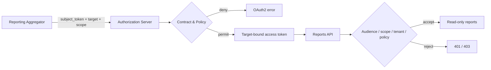
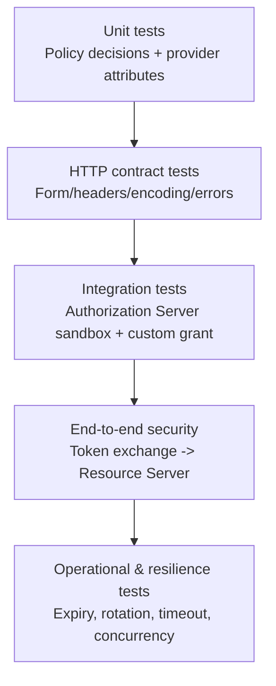

# 22.9. Testing Extension Grant Contracts and Authorization Boundaries

## 1. Why Must Extension Grants Be Tested Like Security Boundaries?

In **Spring Security OAuth 2.0/OIDC Client**, familiar grants like `authorization_code`, `refresh_token`, and `client_credentials` follow relatively clear protocol and integration rules. However, many enterprise systems rely on **OAuth 2.0 extension grants** to exchange credentials or acquire tokens for specialized contexts:

- A service exchanges a user token for a token scoped to a downstream API (*Token Exchange*).
- A client submits a JWT assertion to obtain an access token (*JWT Bearer Assertion Grant*).
- A device lacking a convenient browser needs the *Device Authorization Grant*.
- An integration system uses a custom grant URI published by its Authorization Server.

**Using an extension grant does not mean bypassing authorization boundaries.** On the contrary, credential-exchange paths spanning subjects, tenants, and APIs are prime places for *confused deputy* flaws, token substitution, audience confusion, privilege escalation, and cross-tenant access.

Testing must therefore pursue **two independent yet connected goals**:

1. **Protocol and integration contract testing:** Spring OAuth2 Client sends the exact `grant_type`, parameters, client authentication, encoding, and endpoint; parses token responses and errors accurately; and stores and uses tokens according to a defined lifecycle.
2. **Authorization boundary testing:** The Authorization Server issues tokens strictly for **authorized** subjects, resources, audiences, scopes, tenants, actors, and lifetimes; the Resource Server rejects tokens used outside their intended purpose.

A `200 OK` token response **does not prove** authorization is secure. An endpoint may return valid JSON matching the schema while issuing a token for the wrong API, with overly broad scopes, for another tenant, or with a lifetime exceeding policy.

> **Principle:** Every extension grant must have an explicit input/output contract, verifiable authorization policies, and a suite of **negative test cases** at least as thorough as the happy path. Client-side checks are only defense in depth; **the Authorization Server and Resource Server must enforce policies independently**.

### 1.1. Scope of This Lesson

This lesson focuses on:

- Characteristics of OAuth 2.0 Extension Grants under **RFC 6749, Section 4.5**.
- Running example: **OAuth 2.0 Token Exchange — RFC 8693**.
- Testing **Spring Security OAuth2 Client** when configuring extended providers and token-response clients, across both Servlet and Reactive stacks.
- Contract tests, integration tests, security tests, lifecycle tests, and operational cases.
- Real-world constraints on `resource`, `audience`, `scope`, `subject_token`, `actor_token`, principals, client authentication, replay, and multi-tenancy.

This lesson does **not** teach bypassing Authorization Server policies or designing a grant that mints tokens arbitrarily from unverified inputs. Example tokens are **dummy test values**, never real credentials.

### 1.2. Core Terms to Distinguish

| Term | Meaning | Primary Owner |
| --- | --- | --- |
| **Grant type** | Mechanism the OAuth2 Client uses to request a token | OAuth2 Client and Authorization Server |
| **Extension grant** | Grant identified by a URI and parameters defined in a specification/contract | Provider/grant implementation and Authorization Server |
| **Client authentication** | How the client proves its identity at the Token Endpoint | Verified by Authorization Server; credential configured by client |
| **Access token** | Credential used to call a Resource Server | Issued by Authorization Server; validated by Resource Server |
| **Subject token** | Input token representing the subject in Token Exchange | Type, origin, and permissions verified by Authorization Server |
| **Actor token** | Optional input token identifying an actor acting on behalf of the subject | Actor/delegation policy verified by Authorization Server |
| **Scope** | Set of permissions or capabilities requested/granted | Granted by Authorization Server; enforced by Resource Server |
| **Audience/resource** | Intended token recipient or target API per contract | Constrained by Authorization Server; verified by Resource Server |
| **Authorized client** | `ClientRegistration` + principal + issued token on the Spring side | `OAuth2AuthorizedClientService` / Repository / Manager |

## 2. How Are OAuth2 Extension Grants Identified and Sent?

RFC 6749 defines extension grants using a **`grant_type` value that is an absolute URI**:

```text
grant_type=urn:ietf:params:oauth:grant-type:token-exchange
```

This is not a Java class name, a Spring bean name, or an arbitrary string the client can invent and expect the Authorization Server to accept. The URI identifies **a protocol contract** that both sides must support.

A Token Request typically has this structure:

```http
POST /oauth2/token HTTP/1.1
Host: auth.example.com
Authorization: Basic <redacted-client-credentials>
Content-Type: application/x-www-form-urlencoded
Accept: application/json

grant_type=<absolute-uri>&parameter1=...&parameter2=...
```

Key requirements:

- **HTTPS** with certificate and hostname verification for the Token Endpoint.
- Client authentication matching the registered method (e.g., `client_secret_basic`, `private_key_jwt`, or mTLS).
- `application/x-www-form-urlencoded` form body—never switch to JSON unless **explicitly defined by a provider contract**.
- `grant_type` and required parameters must match exact spelling, types, and encoding.
- Token responses and errors must follow OAuth 2.0 and the extension spec.
- Clients must never send subject/actor tokens to untrusted endpoints or logging systems.
- `ClientRegistration` describes a grant; it does not automatically give Spring Security a built-in provider for **every** extension URI.

### 2.1. Examples of Extension Grants

| Grant | Value / Characteristics | Permission Considerations |
| --- | --- | --- |
| **Token Exchange (RFC 8693)** | `urn:ietf:params:oauth:grant-type:token-exchange` | Subject/actor policy, target audience/resource, and scopes |
| **JWT Bearer Assertion Grant (RFC 7523)** | `urn:ietf:params:oauth:grant-type:jwt-bearer` | Assertion signature, issuer, audience, expiry, and replay |
| **SAML 2.0 Bearer Assertion Grant (RFC 7522)** | `urn:ietf:params:oauth:grant-type:saml2-bearer` | XML signature, issuer, subject, audience, and replay verification |
| **Device Code Grant (RFC 8628)** | `urn:ietf:params:oauth:grant-type:device_code` | Binding device code to user approval, polling interval, and expiry |
| **Custom private grant URI** | URI agreed upon by both parties | Contract, authorization policy, and compatibility explicitly specified |

**Never infer** that because an extension grant exists in an RFC, your version of Spring Security Client includes complete auto-configuration for it. For grants lacking a default provider, implement/integrate the extension via a **custom authorized-client provider** and **token response client** matching your stack.

## 3. Running Example: Permission-Bounded Token Exchange

Suppose a system has:

```text
Browser User
    ↓ OIDC login
Portal API
    ↓ passes user access token to an internal gateway
Reporting Aggregator
    ↓ wants a token scoped strictly to Reports API
Authorization Server
    ↓ issues a newly constrained access token
Reports API (Resource Server)
```

`Reporting Aggregator` acts as the OAuth2 Client performing **Token Exchange** with the Authorization Server.

**Hypothetical business requirements:**

- The subject token must be valid and represent a user belonging to tenant `T1`.
- Client `reporting-aggregator` is authorized to execute Token Exchange.
- The permitted target resource is `https://reports-api.example.com`.
- Output tokens hold permissions equivalent only to `reports.read`, never `reports.admin`.
- If an actor token is used, the actor must be authorized to act for the subject within that tenant.
- Never issue tokens exceeding lifetime, scope, resource, or user/client policy limits.
- Output tokens must be validated by Reports API for **audience, issuer, lifetime, and scopes**.

### 3.1. Three Independent Safeguards



Do not rely solely on the API to block bad tokens. The Authorization Server must **refuse to issue** out-of-policy tokens, and the Resource Server must still **reject** tokens with mismatched targets or permissions.

### 3.2. Three Identities That Must Never Be Conflated

- **Client identity:** OAuth2 Client `reporting-aggregator` authenticating to the Authorization Server.
- **Subject identity:** user or entity represented by `subject_token`.
- **Actor identity:** service/actor performing the operation, represented via `actor_token` or bound by AS policy.

They may relate, yet **they are not the same principal**. Never treat `client_id` as a user ID, never trust `sub` from an unverified JWT, and never assume anyone possessing a subject token automatically has impersonation or delegation rights.

## 4. HTTP Contract of RFC 8693 Token Exchange

A typical Token Exchange request, showing form fields before URL encoding:

```text
POST https://auth.example.com/oauth2/token

grant_type=urn:ietf:params:oauth:grant-type:token-exchange
subject_token=FAKE_USER_ACCESS_TOKEN
subject_token_type=urn:ietf:params:oauth:token-type:access_token
resource=https://reports-api.example.com
scope=reports.read
requested_token_type=urn:ietf:params:oauth:token-type:access_token
```

Where:

| Parameter | Meaning | What Tests Should Assert |
| --- | --- | --- |
| `grant_type` | Token Exchange URI | Exact value; never abbreviated as `token_exchange` |
| `subject_token` | Source token being exchanged | Present, non-empty, excluded from logs |
| `subject_token_type` | Type of source token | Matches actual token type; verifiable by AS |
| `resource` | Target resource URI per RFC 8707/8693 | Chosen strictly from allowlist/policy |
| `audience` | Audience identifier per contract | Validated and bound properly into output token |
| `scope` | Permissions requested at target | Never exceeds delegated/policy limits |
| `requested_token_type` | Desired output token type | Accepts only types supported by AS |
| `actor_token` | Optional actor token | Accepted only when policy supports delegation |
| `actor_token_type` | Type of actor token | Present/matching whenever an actor token is sent |

For `resource` and `audience`, RFC 8693 allows repeated parameters when compliant with the spec. However, **requesting more targets never expands permissions**. The Authorization Server must govern target/scope combinations and reject unacceptable targets with `invalid_target`.

### 4.1. Encoded Form Request

On the wire, grant type URIs and resources are form-encoded:

```http
POST /oauth2/token HTTP/1.1
Host: auth.example.com
Authorization: Basic <redacted>
Content-Type: application/x-www-form-urlencoded

grant_type=urn%3Aietf%3Aparams%3Aoauth%3Agrant-type%3Atoken-exchange&subject_token=FAKE_USER_ACCESS_TOKEN&subject_token_type=urn%3Aietf%3Aparams%3Aoauth%3Atoken-type%3Aaccess_token&resource=https%3A%2F%2Freports-api.example.com&scope=reports.read
```

**Tests should assert decoded form parameters** rather than hard-coding field order or space encoding (`+` vs. `%20`) when both are equivalent under the form contract.

Never build bodies with raw string concatenation in production when `subject_token` can contain special characters. Use `MultiValueMap`, `FormHttpMessageConverter`, or an appropriate HTTP client for accurate encoding.

### 4.2. Success Response

An illustrative response:

```json
{
  "access_token": "FAKE_REPORTS_ACCESS_TOKEN",
  "issued_token_type": "urn:ietf:params:oauth:token-type:access_token",
  "token_type": "Bearer",
  "expires_in": 300,
  "scope": "reports.read"
}
```

In RFC 8693, `issued_token_type` is notable for specifying **the type of token issued**, while `token_type` describes how the token is presented to the Resource Server (e.g., `Bearer`).

Contract tests should verify:

- `access_token` is present and treated as a secret credential.
- `issued_token_type` matches the grant/target and requested type.
- `token_type` is supported.
- `expires_in` obeys policy; reject anomalous lifetimes.
- `scope` reflects provider semantics when present.
- Software does not assume the token is always a JWT: tokens may be opaque.
- Do not assume `refresh_token` is present; Token Exchange **does not promise** refresh tokens across all policies.
- Unknown additional response fields follow contract/compatibility policy and never silently escalate privileges.

### 4.3. Rejection Response

Example where the Authorization Server rejects the target:

```http
HTTP/1.1 400 Bad Request
Content-Type: application/json
Cache-Control: no-store
Pragma: no-cache

{
  "error": "invalid_target",
  "error_description": "Requested target is not permitted"
}
```

`invalid_target` is RFC 8693's error code for a target unacceptable under the request/policy. Standard OAuth2 errors like `invalid_request`, `invalid_scope`, `unauthorized_client`, `invalid_client`, and `invalid_grant` can also occur depending on validation and contract.

**Never include raw subject tokens, actor tokens, or client secrets inside `error_description`.** Responses can end up in application logs or observability pipelines if unguarded.

## 5. Defining a Testable Contract

Before writing JUnit tests, draft a three-layer **contract specification**.

### 5.1. Request Contract

| Aspect | Conditions to Specify | Example Test |
| --- | --- | --- |
| Endpoint | Official HTTPS Token Endpoint | Never misroutes to `/authorize` or business APIs |
| Method / Content-Type | `POST` + `application/x-www-form-urlencoded` | Missing/wrong header → rejected |
| Grant URI | Absolute value matching spec | Unrecognized URI → `unsupported_grant_type` |
| Client authentication | Registered method | Wrong secret/mTLS/assertion → `invalid_client` |
| Subject token | Valid type, authentic, unexpired | Expired/revoked/wrong issuer → denied |
| Actor token | Validated when used | Unauthorized actor → denied |
| `resource`/`audience` | Target allowed for client, subject, tenant | Foreign target → `invalid_target` |
| Scope | Permitted permissions | Out-of-policy `reports.admin` → denied/omitted |
| Token type | Supported input/output types | Mismatch → error |
| Replay / concurrency | Reuse rules if applicable | One-time assertion reuse rejected |
| Logging | Zero credential exposure | Logs/traces contain no raw tokens |

### 5.2. Response Contract

| Aspect | Condition | Counter-Case |
| --- | --- | --- |
| `access_token` | Present in successful issuance responses | Missing or blank |
| `issued_token_type` | Valid for extension grant | Unsupported token type |
| `token_type` | Compatible with client usage | Unsupported token type |
| `expires_in` | Within policy; valid numeric type | Negative, 0 if disallowed, unreasonably large |
| `scope` | Issued permissions explicitly conveyed | Grants excessive scopes |
| `aud` / target binding | Token scoped to approved resource | Token accepted by an unintended API |
| Subject/actor semantics | Actor never confused with subject | Unauthorized impersonation |
| Error response | Valid OAuth2 status/error code, zero leaks | HTTP 200 carrying an ambiguous error body |
| Cache headers | Prevent credential caching per spec | Shared caches storing token responses |
| Correlation | Safe trace/correlation metadata | Logging raw tokens and PII |

### 5.3. Authorization Policy Contract

Define **who can exchange which token, for which token, for which API, with what permissions**. A practical matrix specifies:

- **Client:** which client IDs may use the grant.
- **Subject:** which token types, issuers, tenants, and users are accepted.
- **Actor:** which services may act on behalf of a subject if delegation is supported.
- **Target:** permitted resources/audiences.
- **Scope/capability:** permissions the output token may carry.
- **Constraints:** token lifetime, proof-of-possession, session/device risk, consent, quotas.
- **Outcome:** allow with specific permissions, or deny with an error code/policy reason.

Do not write simply "output scope is the intersection of input scope and requested scope" if the system **maps scopes across two APIs with different namespaces**. For example, source `orders.read` may be mapped by the AS to target `reporting.read` under an explicit policy; names differ while delegated authority stays bounded. The invariant is **zero unapproved privilege expansion**.

## 6. Threat Model: Privilege-Escalation Paths That Must Be Tested

### 6.1. Confused Deputy

A privileged service calling Reports API could be tricked by a lower-privileged client into exchanging tokens to access someone else's reports.

Test:

1. Client A holds only `reports.read` for tenant T1.
2. A submits a subject token for User T1.
3. A requests a token targeting Reports API tenant T2 with scope `reports.admin`.
4. The AS must deny or refuse to grant out-of-policy capabilities.
5. Reports API must also reject tokens invalid for T2 resources.

**No client gains admin privileges merely because a service acts as a proxy or can call the Token Endpoint.**

### 6.2. Cross-Tenant Token Exchange

A client/subject belongs to tenant T1, while the grant request specifies T2's audience/resource.

The contract may mandate:

```text
clientTenant == subjectTenant == resourceTenant
```

or an **explicitly configured trust relationship matrix** if cross-tenant delegation is supported. The default must be **deny** whenever no approved relationship exists.

Never use a shared `principalName` like `system` for multi-tenant user tokens and allow the authorized-client store to reuse a T1 token on a T2 request.

### 6.3. Subject-Token Substitution

An attacker submits:

- An expired token.
- A JWT signed with another issuer's key.
- An OIDC ID Token instead of an access token while claiming `subject_token_type` is `access_token`.
- A token lacking a valid audience/trust relationship for exchange at the AS.
- A revoked token.
- A token from an unpermitted client or tenant.

The AS must verify the **actual token type, issuer, signature/introspection, validity, trust policy, and bindings**. Client-side validation never replaces this.

### 6.4. Actor-Token Substitution

When the grant includes `actor_token`:

- The actor token must be validated according to its declared type.
- The actor must be authorized to act for/represent the subject.
- Output tokens must reflect actor/subject semantics per provider contract when required.
- Never trust a plain `actor_id` string sent by the client as delegation proof without proving actor identity.

### 6.5. Audience Confusion and Token Laundering

A source token issued only for API A has no automatic right to be exchanged for API B. The Authorization Server must have a policy permitting the exchange; Resource Server B validates that the output token targets it specifically.

Test:

```text
Token for Inventory API -> call Reports API directly: DENY.
Token for Inventory API -> exchange for Reports API without policy: DENY.
Token for Reports API -> call Reports API with valid scope/tenant: ALLOW.
```

**Sharing the same issuer or signing key** does not mean a token can be presented to every Resource Server.

### 6.6. Replay and Reuse Semantics

Some extension grants using **JWT/SAML assertions** may need `jti`, nonce, or one-time-use checks to block replay; meanwhile **RFC 8693 Token Exchange does not by default require every subject token to be single-use**. Test against each grant's exact contract rather than applying JWT-assertion replay rules to every access token.

With proof-of-possession/mTLS/DPoP, test key/certificate bindings and constraints rather than generic JWT signature checks alone.

## 7. Permission Test Matrix: Happy Paths and Deny Paths

An example test matrix for **Reporting Token Exchange**:

| ID | Client / Subject | Target | Requested Scope | Expected Outcome |
| --- | --- | --- | --- | --- |
| P01 | Permitted client + valid T1 subject | Reports T1 | `reports.read` | Allow; target-bound token |
| P02 | Valid subject, narrower requested scope | Reports T1 | `reports.read` | Allow per policy |
| N01 | Client lacks extension grant permission | Reports T1 | `reports.read` | Deny, `unauthorized_client` or contract error |
| N02 | Wrong client secret | Reports T1 | `reports.read` | Deny `invalid_client` |
| N03 | Expired subject token | Reports T1 | `reports.read` | Deny; no token issued |
| N04 | Subject token from untrusted issuer | Reports T1 | `reports.read` | Deny |
| N05 | Token type mismatches declaration | Reports T1 | `reports.read` | Deny |
| N06 | Subject tenant T1, target T2 | Reports T2 | `reports.read` | Deny per tenant policy |
| N07 | Client allowed read only | Reports T1 | `reports.admin` | Deny / do not issue admin |
| N08 | Unknown/foreign `resource` | External API | `reports.read` | Deny `invalid_target` |
| N09 | Unauthorized actor | Reports T1 | `reports.read` | Deny |
| N10 | Revoked subject | Reports T1 | `reports.read` | Deny |
| N11 | Unsupported `requested_token_type` | Reports T1 | `reports.read` | Deny |
| N12 | Token request missing `subject_token` | Reports T1 | `reports.read` | Deny `invalid_request` |
| N13 | Adding an unpermitted second target | Reports + Billing | `reports.read` | Deny target combination |
| N14 | Reports-scoped token sent to Billing | Billing API | Any | Billing rejects with `401/403` per policy |
| N15 | Read token calls admin endpoint | Reports `/admin` | `reports.read` | Reports rejects with `403` |
| N16 | Expired token sent to API | Reports API | `reports.read` | API rejects with `401 invalid_token` |
| N17 | Grant request exceeds max TTL | Reports T1 | `reports.read` | Never issue token exceeding policy |
| N18 | One-time assertion replayed | Reports T1 | `reports.read` | Deny if grant policy enforces replay prevention |

Each test should specify:

```text
Given: client, subject, actor, tenant, resource, scope, token type
When:  send grant request / call Resource Server
Then:  HTTP status + OAuth2 error/capabilities + persistence effects
And:   no credential leakage, no unexpected privilege changes
```

Do not turn the matrix into "every invalid request must return the exact same OAuth2 error code." **Exact error codes depend on the spec and provider contract**; what must never change is **zero out-of-policy grants** and responses that leak zero secrets.

## 8. Organizing Tests Across Multiple Layers



### 8.1. Unit Tests: Fast and Policy-Focused

Test logic such as:

- Whether the client is permitted to use the grant.
- Client/subject/actor/tenant bindings.
- Target allowlists and scope mappings.
- Token lifetime ceilings.
- Accepted token types.
- No `default allow` when data is missing.
- Permissions never expand under adversarial inputs.

These tests should be **deterministic**, require no network, and never log real tokens.

### 8.2. HTTP Contract Tests: Confirming Spring OAuth2 Client Sends the Right Wire Payload

Verify:

- `POST`s to the exact Token Endpoint with form content type.
- Full `grant_type` URI.
- Mandatory RFC fields.
- Encoding and client authentication.
- Never putting secrets or subject tokens in query URLs.
- Accurate token response parsing and error mapping.
- Never retrying non-retryable failures.

A mock HTTP server can verify the **client transport contract** without a live Authorization Server.

### 8.3. Integration Tests: Real or Sandbox Authorization Server

Use a **test IdP/Authorization Server instance** with the extension grant enabled to verify:

- Allowed grant types, client authentication, and scopes/targets.
- Signature/introspection checks and rejection of forged source tokens.
- Actor/subject mapping and cross-tenant denial.
- Contract-compliant error responses.
- Short token lifetimes, revocation, and rotation if applicable.

Never use production client secrets or real user tokens in CI.

### 8.4. End-to-End Tests: Resource Server Rejects Misdirected Tokens

A successful grant request **is still not enough**. Use the new token to call the target API as well as unauthorized APIs:

```text
Exchange token for Reports API -> GET allowed Reports endpoint -> 2xx.
Same token -> Billing API -> rejected.
Same token -> Reports admin endpoint -> 403.
Expired token -> Reports API -> 401.
Token without tenant entitlement -> another tenant target -> rejected.
```

This verifies **effective permissions**, not merely scope names in a JSON response.

### 8.5. Resilience and Operational Tests

Test token endpoint timeouts/503/429, TLS failures, rotation/revocation, concurrent requests, retries, token cache isolation, logging, and cleanup. Not all of these need to be unit tests if real containers/environments are required, yet they should have clear pass criteria and appropriate automation.

## 9. Does Spring Security Support Extension Grants Automatically?

In Spring Security OAuth2 Client, `ClientRegistration` can represent a custom grant:

```java
AuthorizationGrantType TOKEN_EXCHANGE =
    new AuthorizationGrantType(
        "urn:ietf:params:oauth:grant-type:token-exchange");
```

And a registration can be built explicitly:

```java
ClientRegistration registration =
    ClientRegistration.withRegistrationId("reports-token-exchange")
        .clientId("reporting-aggregator")
        .clientSecret(secretFromSecureConfiguration)
        .clientAuthenticationMethod(
            ClientAuthenticationMethod.CLIENT_SECRET_BASIC)
        .authorizationGrantType(TOKEN_EXCHANGE)
        .tokenUri("https://auth.example.com/oauth2/token")
        .scope("reports.read")
        .clientName("Reports Token Exchange")
        .build();
```

Here `secretFromSecureConfiguration` is injected from secure config; imports and setup are omitted.

**Important:** `new AuthorizationGrantType(...)` only models a grant identifier. For the manager to actually call the Token Endpoint with RFC 8693 parameters, you must have a **custom `OAuth2AuthorizedClientProvider`** or a token exchange implementation supported by your version.

Merely putting YAML:

```yaml
spring:
  security:
    oauth2:
      client:
        registration:
          reports-token-exchange:
            provider: company-auth
            client-id: ${REPORTING_CLIENT_ID}
            client-secret: ${REPORTING_CLIENT_SECRET}
            authorization-grant-type: urn:ietf:params:oauth:grant-type:token-exchange
        provider:
          company-auth:
            token-uri: https://auth.example.com/oauth2/token
```

**must never lead you to assume** Spring Security automatically knows how to resolve `subject_token`, `actor_token`, target fields, validate responses, or enforce tenant policy. Built-in support depends on version; check whether a matching provider exists or build custom integration.

### 9.1. Extension Points on Servlet / Non-Reactive

For grants not supported by default, an implementation typically involves:

```java
OAuth2AuthorizedClientProvider
OAuth2AccessTokenResponseClient<CustomGrantRequest>
OAuth2AuthorizedClientManager
OAuth2AuthorizedClientService
```

The provider receives `OAuth2AuthorizationContext`, checks grant type and eligibility conditions, builds the grant request, calls the Token Endpoint via `OAuth2AccessTokenResponseClient`, builds an `OAuth2AuthorizedClient`, and lets the manager handle lifecycle and persistence.

### 9.2. Extension Points on WebFlux / Reactive

Correspondingly:

```java
ReactiveOAuth2AuthorizedClientProvider
ReactiveOAuth2AccessTokenResponseClient<CustomGrantRequest>
ReactiveOAuth2AuthorizedClientManager
ReactiveOAuth2AuthorizedClientService
```

Compose using `Mono`/`Flux`; never call `.block()` inside a reactor pipeline.

**Never confuse client-side provider support with Authorization Server policy.** Spring OAuth2 Client *requests tokens*; authoritative enforcement of grants, scopes, audiences, and impersonation/delegation belongs to the AS and Resource Server.

## 10. Testing Seam: Separating Transport, Provider, and Policy

A testable design separates:

```text
Business Gateway
    ↓
Custom OAuth2AuthorizedClientProvider
    ↓
Token Exchange Request Factory
    ↓
Token Exchange Transport / Response Client
    ↓
Authorization Server
```

Where:

- **Request Factory:** constructs form parameters, validates required inputs, and selects targets from trusted configuration.
- **Transport / Response Client:** sends HTTP requests, performs client authentication, and parses responses/errors.
- **Authorized-Client Provider:** decides when the custom grant applies, calls transport, and builds `OAuth2AuthorizedClient`.
- **Manager / Store:** saves, loads, and removes authorized clients by registration + principal/context.
- **AS / Resource Server:** enforces final security policies.

This lets contract tests mock the Token Endpoint, provider tests use a fake transport, and security tests run against an Authorization Server sandbox to validate policy.

### 10.1. Authorization Context Attributes Are Not Trusted by Default

A custom provider can read attributes from:

```java
OAuth2AuthorizationContext context
```

such as `subject_token`, `resource`, or `actor_token` populated by application code.

**Never take raw `resource`, `requested_scope`, or `subject_token` values from a user HTTP request and treat them as authorized.** Before invoking the provider, the gateway must identify the authenticated caller, tenant, target API, and business intent. The AS must independently validate the claims and permissions inside the source token.

Example **internal contract** for the provider:

```java
record ExchangeIntent(
    String registrationId,
    String subjectToken,
    URI targetResource,
    Set<String> requestedScopes,
    String tenantId
) {}
```

This is an application-defined DTO, **not a built-in Spring Security class**. If actor context is needed, include the matching token type and proof—never stick a bare actor ID string into a DTO and treat it as delegation proof.

## 11. Code Example: HTTP Contract Test with Spring Test

To test form encoding and request transmission, use **`MockRestServiceServer`** with `RestClient` (Spring Framework 6.1+) without hitting the network.

### 11.1. Test Dependencies

```gradle
dependencies {
    implementation 'org.springframework.boot:spring-boot-starter-oauth2-client'
    implementation 'org.springframework.boot:spring-boot-starter-web'

    testImplementation 'org.springframework.boot:spring-boot-starter-test'
}
```

This uses Java/Spring Test to illustrate the HTTP contract. In WebFlux, apply the same pattern with a fake HTTP endpoint, reactive client connector, or test server to test `ReactiveOAuth2AccessTokenResponseClient`. Exact mocking APIs vary by version and transport.

### 11.2. A Minimal Transport as a Test Fixture

The class below **only illustrates encoding and the HTTP contract**. It is not a production-complete `OAuth2AuthorizedClientProvider`: it omits strict token parsing, failure policies, audience validation, timeouts, and manager integration.

```java
final class ExampleTokenExchangeTransport {

    static final String TOKEN_EXCHANGE =
        "urn:ietf:params:oauth:grant-type:token-exchange";

    static final String ACCESS_TOKEN_TYPE =
        "urn:ietf:params:oauth:token-type:access_token";

    private final RestClient restClient;
    private final String clientId;
    private final String clientSecret;

    ExampleTokenExchangeTransport(
            RestClient restClient,
            String clientId,
            String clientSecret) {
        this.restClient = restClient;
        this.clientId = clientId;
        this.clientSecret = clientSecret;
    }

    String exchangeForReports(String subjectToken) {
        var form = new LinkedMultiValueMap<String, String>();

        form.add("grant_type", TOKEN_EXCHANGE);
        form.add("subject_token", subjectToken);
        form.add("subject_token_type", ACCESS_TOKEN_TYPE);
        form.add("requested_token_type", ACCESS_TOKEN_TYPE);
        form.add("resource", "https://reports-api.example.com");
        form.add("scope", "reports.read");

        return restClient.post()
            .uri("/oauth2/token")
            .headers(headers ->
                headers.setBasicAuth(clientId, clientSecret))
            .contentType(MediaType.APPLICATION_FORM_URLENCODED)
            .body(form)
            .retrieve()
            .body(String.class);
    }
}
```

Why does the example fix `https://reports-api.example.com`? To illustrate a **gateway/contract-bound target**, with no user-chosen URL parameter.

In production:

- Store client ID/secret in a secret manager or secured configuration.
- Add a token response DTO/parser verifying `issued_token_type`, `token_type`, `expires_in`, and scopes.
- Map OAuth2 error responses per contract (not raw `HttpClientErrorException` alone).
- Configure timeouts, TLS, proxies, retry policies, and provider-compliant client auth methods.
- Never return raw JSON token responses to controllers or logs.
- Never place source tokens in URIs/queries, metric labels, or exception messages.

### 11.3. JUnit Test Verifying the Request

```java
class ExampleTokenExchangeTransportTest {

    @Test
    void sendsRfc8693FormToExpectedTokenEndpoint() {
        RestClient.Builder builder = RestClient.builder()
            .baseUrl("https://auth.example.test");

        MockRestServiceServer mock =
            MockRestServiceServer.bindTo(builder).build();

        mock.expect(requestTo(
                "https://auth.example.test/oauth2/token"))
            .andExpect(method(HttpMethod.POST))
            .andExpect(header(
                HttpHeaders.CONTENT_TYPE,
                startsWith("application/x-www-form-urlencoded")))
            .andExpect(header(
                HttpHeaders.AUTHORIZATION,
                startsWith("Basic ")))
            .andExpect(content().string(containsString(
                "grant_type=urn%3Aietf%3Aparams%3Aoauth" +
                "%3Agrant-type%3Atoken-exchange")))
            .andExpect(content().string(containsString(
                "subject_token_type=urn%3Aietf%3Aparams" +
                "%3Aoauth%3Atoken-type%3Aaccess_token")))
            .andExpect(content().string(containsString(
                "subject_token=FAKE_SUBJECT_TOKEN")))
            .andExpect(content().string(containsString(
                "scope=reports.read")))
            .andRespond(withSuccess(
                """
                {
                  "access_token": "FAKE_ISSUED_TOKEN",
                  "issued_token_type":
                    "urn:ietf:params:oauth:token-type:access_token",
                  "token_type": "Bearer",
                  "expires_in": 300,
                  "scope": "reports.read"
                }
                """,
                MediaType.APPLICATION_JSON));

        ExampleTokenExchangeTransport transport =
            new ExampleTokenExchangeTransport(
                builder.build(),
                "test-client",
                "test-secret");

        String response =
            transport.exchangeForReports("FAKE_SUBJECT_TOKEN");

        assertNotNull(response);
        assertTrue(response.contains("issued_token_type"));
        mock.verify();
    }
}
```

The example requires standard static imports from JUnit 5, Hamcrest, and `MockRestRequestMatchers`/`MockRestResponseCreators`:

```java
import static org.junit.jupiter.api.Assertions.*;
import static org.hamcrest.Matchers.*;
import static org.springframework.test.web.client.match.MockRestRequestMatchers.*;
import static org.springframework.test.web.client.response.MockRestResponseCreators.*;
```

Along with `RestClient`, `MockRestServiceServer`, `HttpHeaders`, `HttpMethod`, `MediaType`, `LinkedMultiValueMap`, and `@Test`. The example uses **Java 17+ text blocks**.

**Testing note:** this is an **outbound contract fixture**, not a complete security suite. `containsString` checks verify that key parameters appear; production test suites should **parse the form** to confirm no duplicate out-of-contract parameters, no unknown fields, no secrets in the body, the exact resource, and proper client authentication. Avoid asserting the entire form body in a fixed key order when order is not part of the contract.

### 11.4. Negative HTTP Contract Test: `invalid_target`

Mock an Authorization Server rejecting an unpermitted target:

```java
@Test
void rejectsInvalidTargetWithoutTreatingErrorAsToken() {
    RestClient.Builder builder = RestClient.builder()
        .baseUrl("https://auth.example.test");

    MockRestServiceServer mock =
        MockRestServiceServer.bindTo(builder).build();

    mock.expect(requestTo(
            "https://auth.example.test/oauth2/token"))
        .andExpect(method(HttpMethod.POST))
        .andRespond(withStatus(HttpStatus.BAD_REQUEST)
            .contentType(MediaType.APPLICATION_JSON)
            .body("""
                {
                  "error": "invalid_target",
                  "error_description": "Target not permitted"
                }
                """));

    var transport = new ExampleTokenExchangeTransport(
        builder.build(), "test-client", "test-secret");

    HttpClientErrorException ex = assertThrows(
        HttpClientErrorException.class,
        () -> transport.exchangeForReports("FAKE_SUBJECT_TOKEN"));

    assertEquals(HttpStatus.BAD_REQUEST, ex.getStatusCode());
    assertTrue(ex.getResponseBodyAsString()
        .contains("\"error\": \"invalid_target\""));

    mock.verify();
}
```

In a real Spring Security integration, the adapter/token response client should translate this contract failure into an **OAuth2 error/exception with the matching error code**. This test simply confirms the transport **does not treat a 400 error as a valid access token**.

**Never record real token responses in stack traces or reports.** Use dummy values and log sanitized error codes.

### 11.5. Testing Proper Encoding with Special Characters

Subject tokens are often JWTs or opaque tokens that may contain characters requiring form encoding. Include a contract test using a dummy token:

```text
subjectToken = "FAKE+TOKEN/with=chars"
```

The expected **decoded form value** must match the original string identically. Use mock HTTP request/server tests that parse the form instead of manually concatenating:

```java
"subject_token=" + subjectToken
```

into the form body. A `+` in a URL-encoded form carries space semantics unless encoded properly, making **round-trip decode tests** valuable.

## 12. Unit-Testing Permissions Against an Illustrative Policy

To avoid mixing validation with HTTP transport, suppose the application enforces an **internal** policy constraining Token Exchange requests. This is *defense in depth*, not a replacement for Authorization Server policy.

```java
record ExchangePolicyInput(
    String clientId,
    String subjectTenant,
    String callerTenant,
    URI target,
    Set<String> requestedScopes,
    Set<String> subjectAllowedScopes,
    Set<String> clientAllowedScopes
) {}

final class ExampleExchangePolicy {

    private static final URI REPORTS =
        URI.create("https://reports-api.example.com");

    boolean allowed(ExchangePolicyInput input) {
        return "reporting-aggregator".equals(input.clientId())
            && Objects.equals(
                input.subjectTenant(), input.callerTenant())
            && REPORTS.equals(input.target())
            && input.subjectAllowedScopes()
                .containsAll(input.requestedScopes())
            && input.clientAllowedScopes()
                .containsAll(input.requestedScopes());
    }
}
```

**Limitations of this sample policy:** it assumes source and target share **identical scope names** and does not model actors, consent, token proofs, risk signals, or resource-specific role mappings. In practice, the Authorization Server may use a separate policy engine/entitlements and **must independently verify** inputs rather than trusting client-supplied strings.

### 12.1. Basic Permission JUnit Tests

```java
class ExampleExchangePolicyTest {

    private final ExampleExchangePolicy policy =
        new ExampleExchangePolicy();

    private ExchangePolicyInput input(
            String subjectTenant,
            String callerTenant,
            URI target,
            Set<String> requested) {

        return new ExchangePolicyInput(
            "reporting-aggregator",
            subjectTenant,
            callerTenant,
            target,
            requested,
            Set.of("reports.read"),
            Set.of("reports.read")
        );
    }

    @Test
    void allowsLeastPrivilegeForMatchingTenant() {
        var intent = input(
            "T1",
            "T1",
            URI.create("https://reports-api.example.com"),
            Set.of("reports.read"));

        assertTrue(policy.allowed(intent));
    }

    @Test
    void rejectsCrossTenant() {
        var intent = input(
            "T1",
            "T2",
            URI.create("https://reports-api.example.com"),
            Set.of("reports.read"));

        assertFalse(policy.allowed(intent));
    }

    @Test
    void rejectsPrivilegeEscalation() {
        var intent = input(
            "T1",
            "T1",
            URI.create("https://reports-api.example.com"),
            Set.of("reports.admin"));

        assertFalse(policy.allowed(intent));
    }

    @Test
    void rejectsForeignResource() {
        var intent = input(
            "T1",
            "T1",
            URI.create("https://billing-api.example.com"),
            Set.of("reports.read"));

        assertFalse(policy.allowed(intent));
    }
}
```

These unit tests verify **the illustrative policy logic**. They do **not** prove a real Authorization Server rejects out-of-policy requests. You still need integration tests against a test AS instance and E2E tests against the Resource Server to prove enforcement.

### 12.2. Testing Authorization Monotonicity

A useful property:

> Requesting more capabilities without new authorization must never yield permissions beyond the allowed boundary.

For example, if T1 is allowed `reports.read`:

```text
request reports.read                 -> ALLOW
request reports.admin                -> DENY
request reports.read + reports.admin -> DENY
```

Depending on contract, an AS may issue a subset instead of rejecting outright. Tests must assert that **effective granted permissions never exceed policy**, rather than forcing every Authorization Server to pick the identical error response.

Variations to test:

- Adding a second audience.
- Adding another tenant or actor.
- Increasing requested lifetime.
- Changing `subject_token_type`.
- Changing client identity.
- Changing `requested_token_type` to an unsupported type.

A secure extension grant must never turn into an easy privilege-escalation path by adding a form field.

## 13. Contract Tests for Custom `OAuth2AuthorizedClientProvider`

A custom grant provider in Spring Security must fulfill its responsibility of **creating or declining to create an authorized client** for the given context.

In Servlet / non-reactive:

```java
OAuth2AuthorizedClientProvider
OAuth2AuthorizationContext
OAuth2AuthorizedClient
OAuth2AccessTokenResponseClient<CustomGrantRequest>
```

In Reactive:

```java
ReactiveOAuth2AuthorizedClientProvider
OAuth2AuthorizationContext
Mono<OAuth2AuthorizedClient>
ReactiveOAuth2AccessTokenResponseClient<CustomGrantRequest>
```

`CustomGrantRequest` is an **application-defined type** when the grant lacks an official request class in your Spring Security version. Do not mistake an illustrative pseudotype for a built-in API.

### 13.1. Cases the Provider Must Be Tested For

| Test | Context | Expected Result |
| --- | --- | --- |
| Grant type is not the extension URI | `client_credentials` registration | Custom provider does not handle it |
| Missing subject token | No source token | Fails per contract; sends no Token Request |
| Source token does not belong to caller/tenant | Invalid context | Denied before request if client can detect; AS still validates |
| Target not in allowlist | Out-of-policy API | Never sends credentials toward untrusted targets |
| Token Endpoint returns success | Schema-compliant response | Builds `OAuth2AuthorizedClient` with right registration/principal |
| Token response missing required field | Missing `issued_token_type` or access token | Errors; never persists broken client |
| Unsupported token type | Unaccepted output token type | Denied; never sends wrong token to API |
| Token Endpoint returns OAuth2 error | `invalid_target` | Propagates/maps error; never treats as success |
| Access token valid per cache policy | Existing authorized client | Avoids overly frequent re-exchanges if policy allows reuse |
| Token nearing expiry | Authorized client due for renewal | Reauthorizes per explicit policy |
| Multiple principals | Same registration, different users | Never mixes tokens across principals |
| Multiple tenants | Same client, different tenants | Never reuses tokens across tenants |
| Cancellation | Reactor subscription canceled | Leaks no resources and persists no unintended results |

**Important:** with Token Exchange, caching **solely by `(registrationId, principalName)`** is not always safe. If the same principal can exchange multiple subject tokens, audiences, or actor contexts, expand your key/storage strategy or disable cross-request reuse.

The generic `OAuth2AuthorizedClientService` API looks up entries by registration/principal; it **does not automatically distinguish every subject, audience, resource, or tenant of an extension grant**. When multiple contexts coexist simultaneously, use safely bound registrations/principals or design a custom store/manager strategy.

### 13.2. Never Misuse the Refresh Provider as a "Generic Exchange"

`RefreshTokenOAuth2AuthorizedClientProvider` strictly sends `grant_type=refresh_token` with a valid standard refresh token, whereas an extension provider sends a grant URI with its own parameters.

Never do:

```text
subject_token -> stuff into refresh_token parameter -> call refresh provider
```

That violates the protocol and risks having the source token mishandled or logged by an unintended security branch.

### 13.3. Testing Manager-Orchestrated Lifecycle

A provider might return an `OAuth2AuthorizedClient` cleanly while the manager/service fails to persist it properly. Tests should cover:

1. Exact client registration selection.
2. Request attributes carrying policy-compliant subject/actor/target.
3. Accurate grant execution by the provider.
4. Token response parsing.
5. Manager success handler saving the authorized client under the right key/context.
6. Subsequent calls not reusing tokens for different targets, subjects, or tenants.
7. Failure handler not deleting unrelated authorized clients.
8. Separation between local cleanup and remote revocation.
9. Never synthesizing refresh tokens when the extension contract omits them.

## 14. Reactive Contract Tests: Verifying Non-Blocking Behavior and Context

In WebFlux, an extension provider returns `Mono<OAuth2AuthorizedClient>`. Test with Reactor Test:

```gradle
dependencies {
    testImplementation 'io.projectreactor:reactor-test'
}
```

Pseudocode example using `StepVerifier`:

```java
Mono<OAuth2AuthorizedClient> result =
    customReactiveProvider.authorize(authorizationContext);

StepVerifier.create(result)
    .assertNext(client -> {
        assertEquals(
            "reports-token-exchange",
            client.getClientRegistration().getRegistrationId());
        assertNotNull(client.getAccessToken());
        assertEquals(
            expectedPrincipalName,
            client.getPrincipalName());
    })
    .verifyComplete();
```

Above, `customReactiveProvider`, `authorizationContext`, and `expectedPrincipalName` are **application-constructed test fixtures**, not pre-existing beans. This illustrates the reactive provider's contract. Real unit tests must use a fake `ReactiveOAuth2AccessTokenResponseClient` to avoid network calls and assert sent parameters.

### 14.1. Testing Error Signals

Example:

```java
StepVerifier.create(
        customReactiveProvider.authorize(invalidContext))
    .expectErrorMatches(error ->
        error instanceof OAuth2AuthorizationException)
    .verify();
```

Depending on contract, a custom provider emits `Mono.empty()` when **inapplicable** to the current grant, or `Mono.error(...)` when the grant matches yet the request is **invalid**. Keep these two cases distinct so the manager/provider chain never masks genuine authorization errors.

### 14.2. Never `.block()` Inside a Reactive Provider

A common buggy custom implementation:

```java
OAuth2AccessTokenResponse response =
    reactiveTokenClient.getTokenResponse(request).block();
```

Calling `.block()` on a WebFlux event loop causes errors or collapses throughput. Replace with `map`/`flatMap`:

```java
Mono<OAuth2AuthorizedClient> authorized =
    reactiveTokenClient.getTokenResponse(customGrantRequest)
        .map(response -> toAuthorizedClient(
            context,
            response));
```

`toAuthorizedClient(...)` is an **application-written mapping function** that validates the token response, principal, and registration per contract.

### 14.3. Testing Concurrency and Cache Boundaries

Use a fake HTTP server to simulate concurrent subscribers/requests:

- Same principal / same target: policy may allow token reuse.
- Same principal / different target: **must not** reuse a target-bound token for the wrong API.
- Same target / different tenant: **must not** share tokens.
- Same target / same user, different actor: verify actor authorization.
- One request fails after another updated the token: the failure handler should not delete the newer token if store/versioning policy forbids it.

Non-blocking reactive code does not automatically guarantee **single-flight**, atomic refreshes, or transactional token stores. Design concurrency controls at the appropriate layer.

## 15. Testing Authorization Boundaries at the Authorization Server

This layer cannot be replaced by client unit tests.

### 15.1. Client Lacks Grant Permission

Given:

```text
client_id = unapproved-client
grant_type = urn:ietf:params:oauth:grant-type:token-exchange
```

When sending a token request with a valid test subject token.

Then:

- The AS issues no access token.
- Compliant OAuth2 error, typically `unauthorized_client` per policy.
- No token or authorization created in storage.
- No internal/sensitive client details leaked.

### 15.2. Scope Escalation

Given:

```text
subject capability = reports.read
client policy       = reports.read
requested scope     = reports.admin
```

Then the AS must deny or issue **only permitted permissions**, never an unapproved admin token.

When tests inspect JWT output tokens, you may verify signed claims in a **test environment**. Still, remember the Resource Server makes the final authorization decision; **never treat a `scope` claim alone as complete business authority** when additional policies exist.

### 15.3. Out-of-Allowlist Audience/Resource

Given:

```text
resource = https://unapproved-api.example.com
```

Then the AS rejects the target—for example with `invalid_target` if applicable. Never issue an audience-less token that any API might accept.

### 15.4. Unauthorized Subject/Actor

Given:

```text
subject = User A / Tenant T1
actor   = Service B not authorized to act on behalf
```

Then the AS denies the request. Never accept a validly signed `actor_token` whose actor lacks delegation rights.

### 15.5. Untrusted Token Source

Test:

- Subject token signed by an untrusted test issuer.
- Expired subject token.
- Subject token revoked per introspection.
- Token scoped for another API when policy forbids exchanging from that source.
- Token type mismatch.
- Tampered claims or signature.
- `sub` belonging to a different user than the authenticated context.
- Source token issued inside a different tenant.

The AS must validate the source token per contract before issuing a target token. Never use a JWT-decoding library without signature verification to derive subject identity.

## 16. Testing the Resource Server: Tokens Only Work Where Intended

A minimal E2E test suite:

### Case 1: Authorized to Read Reports

```http
GET /reports/me HTTP/1.1
Host: reports-api.example.com
Authorization: Bearer <issued-for-reports>
```

Expected: HTTP `200` (or success status), returning only data belonging to the authorized permissions and tenant.

### Case 2: Wrong Audience

Send the exact same Reports token to Billing:

```http
GET /invoices HTTP/1.1
Host: billing-api.example.com
Authorization: Bearer <issued-for-reports>
```

Expected: Billing API rejects per Bearer/token validation policy—typically `401` or a matching error; **never** grant access merely because a trusted AS signed the token.

### Case 3: Insufficient Scope

Reports token with only `reports.read` calls:

```http
DELETE /reports/42 HTTP/1.1
Host: reports-api.example.com
Authorization: Bearer <read-only-token>
```

Expected: rejected, typically `403 insufficient_scope`/policy denial. Assert not only the status code, but also **that no data was deleted**.

### Case 4: Wrong Tenant

A tenant T1 Reports token calls an endpoint accessing T2 reports.

Expected: rejected or strictly limited to T1 data per policy. Never assume `reports.read` grants access across all tenants.

### Case 5: Disabled/Revoked Subject

If Resource Server policy requires revocation or active-account checks, test that locked users lose access within the committed timeframe/consistency model. With self-contained JWTs, revocation may not be instantaneous without additional mechanisms; **the contract must state exact expectations**.

**E2E outcomes prove effective authorization**, not merely that the Token Endpoint emitted plausible JSON.

## 17. Testing Client Authentication Security at the Token Endpoint

Extension grants must still enforce client authentication policies. For confidential clients:

- Client ID/secret or private key/certificate must be verified by the AS.
- The client auth method must match registration.
- Rotated/revoked secrets must be rejected.
- Never allow `client_secret_post` as an ad-hoc fallback when the IdP accepts only `client_secret_basic`.
- Never skip mTLS/JWT proofs merely because the subject token is valid.
- Never put client credentials in query URLs, logs, or error bodies.

### 17.1. Testing HTTP Basic / Form Body

With `client_secret_basic`:

```http
Authorization: Basic <redacted>
```

With `client_secret_post` if permitted by provider:

```text
client_id=<id>&client_secret=<secret>
```

Contract tests must prove **only the registered method is used**. When using mTLS or `private_key_jwt`, test key/cert rotation and assertion validation per provider standards.

**Never treat Base64 as security encryption**. The Token Endpoint must enforce TLS with certificate and hostname verification.

### 17.2. Testing `private_key_jwt`

When using JWT client assertions, test checks may include:

- Registered/allowlisted signature and algorithm.
- `iss`/`sub` matching client identity per contract.
- `aud` pointing to the Token Endpoint or contracted audience.
- Valid `exp`, `iat`, `nbf`.
- `jti`/replay prevention per policy.
- Key ID/rotation handling and rejection of unknown keys.

Never conflate a JWT **for client authentication** with a JWT **used as a subject token in an extension grant**. They verify two separate steps.

## 18. Authorization Server Metadata and Contract Versioning

When a provider supports OAuth2 Authorization Server Metadata (RFC 8414) or OpenID Connect Discovery, it may advertise the Token Endpoint and supported grants.

Still, **metadata listing a grant does not guarantee a specific client is permitted to use it**. `grant_types_supported` describes server capability; per-client allowed grants must still be registered and enforced.

### 18.1. Contract Changes That Can Break Clients

Common breaking changes:

- Changing the grant URI.
- Changing required form fields.
- Changing token types and `issued_token_type`.
- Changing actor/subject claim schemas or semantics.
- Changing allowed audiences/resources.
- Changing client authentication methods.
- Changing scope mapping policies.
- Changing expiry/rotation behavior.
- Changing error codes or HTTP statuses relied on by clients.
- Mandating proof-of-possession for tokens that used to be plain Bearer.

Maintain a **CI contract test suite** per AS/client version matrix, alongside versioning, migration, compatibility-window, and negative-case documentation.

### 18.2. Provider-Specific Fields

If a provider defines custom parameters such as:

```text
requested_tenant
delegation_reason
requested_actor_context
```

then:

- Names, types, required/optional status, encoding, and allowed values must be documented.
- Never blindly trust client-supplied values for permission decisions.
- The Authorization Server must derive/verify identity and tenant from trusted credentials.
- Parameters must never become "grant admin" merely because a string says `role=admin`.
- Unknown fields may be rejected per contract; if forward compatibility is permitted, assess security impacts.

**Never copy custom form fields from one IdP to another** without an explicit shared contract.

## 19. Error Contract: Testing Failure Paths Too

A common error matrix:

| Error | Source | Meaning / Handling |
| --- | --- | --- |
| `invalid_request` | Token Endpoint | Missing/malformed/duplicate fields per contract |
| `unsupported_grant_type` | Token Endpoint | AS does not support this grant URI |
| `unauthorized_client` | Token Endpoint | Client not allowed to use grant |
| `invalid_client` | Token Endpoint | Client authentication failed |
| `invalid_scope` | Token Endpoint | Requested scopes disallowed |
| `invalid_target` | Token Exchange AS | Resource/audience unacceptable |
| `invalid_grant` | Token Endpoint | Grant/credential invalid for context |
| `server_error` / 5xx | Token Endpoint | Server failure; apply backoff/observability |
| `invalid_token` | Resource Server | Bearer token rejected by API |
| `insufficient_scope` | Resource Server | Token lacks permissions for API operation |
| Timeout / TLS error | Network | Not proof that the token itself is invalid |
| 429 | AS or API | Rate limited; apply appropriate retry policy |

Some error codes come from core OAuth2, others from extensions; **exact error codes in each negative test must be pinned against the Authorization Server contract**.

### 19.1. Do Not Retry Every Error

Never write:

```text
catch any exception -> re-exchange token -> resend API call -> infinite loop
```

Because:

- The client secret may be wrong (`invalid_client`).
- The scope may be disallowed (`invalid_scope`).
- The resource may be disallowed (`invalid_target`).
- The source token may be revoked.
- The output token may carry the wrong audience.
- The API may deny access (`insufficient_scope`).
- A POST may already have produced side effects.

None of these are solved by minting tokens repeatedly.

### 19.2. When Should You Retry?

Bounded retries may make sense for network timeouts or certain 5xx/429 responses when permitted by contract, using backoff/jitter and an overall deadline.

With **Token Exchange**, however, each retry can consume quota or mint extra tokens. With **one-time assertions**, retrying the same assertion triggers replay rejection. With **side-effecting downstream POSTs**, retries can duplicate data unless guarded by idempotency keys and status checks.

### 19.3. 401/403 Differs from Token Endpoint Errors

A successful token exchange followed by a `401` from the Resource Server is a failure **after a token was already issued**. Do not treat it as a Token Endpoint `invalid_client` error. If the API returns `403 insufficient_scope`, resolve the authorization policy rather than silently requesting broader grants.

## 20. Protecting Tokens, PII, and Test Data

Contract tests often capture HTTP requests and responses for assertions—making them a prime place for secrets to leak.

### 20.1. Test Data Principles

- Use only **synthetic test identities** and dummy tokens in unit and HTTP mock tests.
- For integration/E2E sandboxes, use test users/tenants and client credentials strictly isolated from production.
- Never commit real access tokens, refresh tokens, subject/actor tokens, mTLS private keys, or client secrets to source control.
- Never paste real HTTP authorization headers into tickets, snapshots, or logs.
- Never use production accounts for negative tests (especially cross-tenant or revocation tests).
- Reset token states, sessions, and test data per sandbox policy.
- For token replay tests, use short-lived, isolated test assertions.
- Avoid saving full JWT claim payloads containing PII; assert only necessary fields in tests.

### 20.2. Mock Data Must Not Create False Confidence

A test token with payload `{"scope":"reports.admin"}` proves nothing if unsigned/unvalidated and never checked by AS policy. When testing issuer/audience/expiry, use a **test issuer/test JWKS** or token stubs validated cleanly by a Resource Server test configuration.

Never configure production Resource Servers with `permitAll()` or disable signature verification just to make E2E tests pass.

### 20.3. Logging and Observability Characteristics

Useful structured fields:

```text
registrationId=reports-token-exchange
grantType=token-exchange
clientKind=confidential
sourceIssuer=trusted-idp
targetResource=reports-api
requestedScopeClass=read-only
result=invalid_target
latencyMs=...
```

Never log:

```text
subject_token=<raw-token>
actor_token=<raw-token>
access_token=<raw-token>
client_secret=<raw-secret>
Authorization: Basic ...
Authorization: Bearer ...
Cookie: SESSION=...
```

The event/metric names above are **design suggestions**, not metrics emitted automatically by Spring Security. Never put raw subjects, emails, or token values in high-cardinality metric labels.

## 21. Testing Token Lifecycle, Retention, and Revocation

An extension grant typically produces tokens cached/persisted by the OAuth2 Client. Test:

1. Unexpired tokens are reused **only while** registration, principal, subject, and target bindings still match.
2. Expired tokens are not sent to APIs when the manager can issue a valid token.
3. Revoked tokens stop being used once detected per policy.
4. Unauthorized client errors do not evict tokens belonging to other users/clients.
5. User logout does not delete unrelated service-to-service tokens.
6. Local `removeAuthorizedClient` is **not equivalent** to revocation at the Authorization Server.
7. Multi-pod / shared-store behavior works as expected.
8. Token exchange issues no refresh token when forbidden by policy.
9. Token lifespans never exceed AS/target policy maximums.
10. If refresh tokens are issued, the refresh grant is authorized under its own contract.

### 21.1. Caution When Caching Target-Bound Tokens

Never save a Token Exchange output under `(registrationId, principalName)` and reuse it for **any** target unless target binding is part of the storage key.

Dangerous example:

```text
Authorized client key:
    (token-exchange, service)

Request A:
    subject=User1, resource=Reports, tenant=T1
    -> saves Reports/User1 token

Request B:
    subject=User2, resource=Billing, tenant=T2
    -> loads the same key
    -> sends User1/Reports token to Billing
```

This is **token mix-up / cross-context reuse**. A custom grant implementation must choose appropriate representations and storage keys:

- Separate registrations per downstream/target.
- Derive principal keys safely from subject/actor/tenant context.
- Use custom token stores keyed by subject, actor, tenant, target, and policy version.
- Disable reuse entirely in sensitive contexts.
- Design access controls and cleanup on user logout or source token revocation.

**Never use raw subject tokens as cache keys or log labels**; use a secure fingerprint or opaque ID per policy without treating fingerprints as authorization proof.

### 21.2. Losing Tokens on Restart Differs from Revocation

With `InMemoryOAuth2AuthorizedClientService` or its reactive counterpart:

- JVM restart → loses local authorized clients.
- Tokens at the AS/Resource Server are not automatically revoked.
- Subsequent requests may run the grant again if preconditions hold.
- Losing refresh tokens in RAM may force users to log in/consent again.

If tokens must survive across pods, use JDBC/shared storage with proper credential protection and concurrency control. Never rely on in-memory stores as a "cluster-wide revocation" mechanism via pod restarts.

## 22. Testing Concurrency, Token Rotation, and Eventual Consistency

### 22.1. Concurrent Exchange

Two requests exchange the same subject token simultaneously:

```text
Request X: subject=User1, target=Reports, scope=read.
Request Y: subject=User1, target=Reports, scope=read.
```

Depending on provider, concurrent exchanges may be allowed or rate-limited. The contract must specify rate-limit, reuse, and idempotency semantics; never assume Token Exchange is one-time-use like an authorization code.

### 22.2. Concurrent Refresh

If an extension grant issues refresh tokens and the AS uses rotation:

```text
Input tokens: A1/R1
Request X: refreshes R1 -> A2/R2
Request Y: refreshes R1 -> invalid_grant
```

Test that the manager/store never overwrites R2 with R1, never deletes the fresh record when Request Y fails, and never retries R1 infinitely.

### 22.3. Delayed Failure Handler

One request sends old token A to an API that slowly returns `401 invalid_token`. Meanwhile, another request obtains and saves new token B.

If the failure handler deletes by `(registrationId, principalName)` without comparing versions, it can **delete B as well**. Test concurrent failures against a fake HTTP server and a versioned store when production policy requires conditional removal.

### 22.4. Eventual Consistency of Revocation

If the AS revokes a token while Resource Servers cache JWT keys/claims or introspection responses, APIs may continue accepting the token for a bounded window. The security contract must state:

- Maximum tolerable revocation lag.
- Whether immediate revocation is required.
- Maximum token expiry.
- Cache invalidation/introspection policy.
- Tests should assert within the SLA rather than promising instant revocation when infrastructure lacks it.

## 23. Common Test Design Mistakes

**Mistake 1 — Testing only happy-path `200 OK`.**  
Fails to test privilege escalation, tenant isolation, audience, actor, invalid source tokens, or Resource Server enforcement.

**Mistake 2 — Assuming a mock Token Endpoint returning valid JSON proves the AS is secure.**  
Mocks only prove the client formats and parses HTTP properly. AS policy requires real/sandbox integration tests.

**Mistake 3 — Checking only that the token contains an expected scope string.**  
Scope names alone do not prove effective permissions. Resource Servers also check audience, tenant, roles, and domain policies.

**Mistake 4 — Using a browser-supplied subject token without validation.**  
Clients must never blindly trust raw source tokens; the AS must verify them, and the gateway must bind source tokens to the authenticated caller/context per threat model.

**Mistake 5 — Mistaking an OIDC ID Token for an access token.**  
An ID Token authenticates the user to the OIDC Client; never default to passing it as `subject_token_type=access_token` or sending it directly to a Resource Server.

**Mistake 6 — Putting only `authorization-grant-type` URI in YAML.**  
Custom grants still require provider and token client implementations when the framework lacks built-in support.

**Mistake 7 — Storing all exchanged tokens under one shared principal.**  
Risks cross-user, cross-tenant, and cross-target token mix-up.

**Mistake 8 — Wiping the entire authorized-client store after one 401.**  
One target/registration error does not invalidate unrelated tokens. Evict only the matching key/context per policy.

**Mistake 9 — Retrying every `invalid_target` and `insufficient_scope`.**  
Those are permission/policy rejections; repeating token requests will not fix them.

**Mistake 10 — Using production credentials in CI.**  
Risks leaking tokens/secrets and impacting real accounts.

**Mistake 11 — Testing mock JWTs by disabling signature validation globally, including production.**  
Keep test configs strictly isolated; never weaken production security checks for convenience.

**Mistake 12 — Using `Thread.sleep(...)` in tests to wait for token expiry.**  
Creates flaky tests; use controllable clocks, deterministic token lifetimes, and sandbox fixtures.

## 24. Pre-Deployment Contract Checklist

### 24.1. Protocol

- [ ] Grant URI accurately versioned and defined.
- [ ] Token Endpoint, client authentication, and TLS configured properly.
- [ ] Request body/form fields and encoding tested.
- [ ] Token response schema and error codes finalized.
- [ ] Consistent policy for unknown/duplicate fields.
- [ ] Timeouts/retries neither leak credentials nor trigger token storms.
- [ ] Spring provider/manager actually supports the extension grant.
- [ ] No confusion with `refresh_token` or OIDC Login.

### 24.2. Authorization Boundaries

- [ ] Allowed clients/grants enforced server-side.
- [ ] Subject token issuer, type, validity, and revocation verified.
- [ ] Actor identity/delegation verified when applicable.
- [ ] Resource/audience allowlists and tenant isolation enforced.
- [ ] Scope/capability mapping never grants out-of-policy permissions.
- [ ] Output tokens have appropriate expiry, token type, and target bindings.
- [ ] Resource Server independently validates audience, scopes, and tenant.
- [ ] Cross-tenant, impersonation, replay, and confused-deputy cases tested.
- [ ] Policy exists for multi-target requests and lifetime ceilings.

### 24.3. Lifecycle & Operations

- [ ] Token store keys never mix user, actor, or target contexts.
- [ ] Manager success/failure handlers save/evict the right authorized clients.
- [ ] Concurrency and rotation handled properly.
- [ ] Difference between local removal and token revocation documented.
- [ ] Test secrets isolated; logs and traces redacted.
- [ ] CI runs contract/unit tests; sandbox/E2E tests scheduled appropriately.
- [ ] Plans in place for contract versioning, rotation, and rollback.

A checklist is a **design tool**, not proof a system is secure. Execute tests and record actual results.

## 25. Practice Scenarios

### Scenario A — A Service Tries to Get an Admin Token from a Read-Only User

**Given:** the subject token holds read-only permissions; the client is permitted the extension grant yet lacks admin rights.

**When:** requesting `scope=reports.admin`.

**Then:** the AS must deny or grant only permitted permissions; the Resource Server must reject admin endpoints. Checking only for `200` from the Token Endpoint misses privilege escalation bugs.

### Scenario B — Token Exchange Targeting Another Audience

**Given:** a source token from the inventory workflow.

**When:** a caller requests `resource=https://billing-api.example.com`.

**Then:** without a delegation/trust policy for Billing, the AS denies with `invalid_target` or a matching error. Billing API likewise rejects tokens intended only for Inventory.

### Scenario C — Replayed JWT Bearer Assertion

**Given:** an assertion with `jti` and short lifetime used as a grant under a one-time-use contract.

**When:** submitting the assertion twice.

**Then:** the second attempt is rejected by replay policy; never accept it merely because the signature is still valid. Note this applies to that specific assertion grant/policy—**do not apply it blindly to every Token Exchange**.

### Scenario D — Same User, Different Tenants

**Given:** User A is authorized in tenant T1 but has no permissions in T2.

**When:** a client requests a target token for T2.

**Then:** the AS denies or restricts the token to T1; the Resource Server returns zero T2 data. Verify `subjectTenant`, client/actor identity, and effective entitlements together.

### Scenario E — Custom Provider Returns the Right Authorized Client, Yet Caching Is Wrong

**Given:** a custom store keyed solely by `(registrationId, service)`.

**When:** a new request swaps in another subject token for a different resource.

**Then:** never reuse the previous exchanged token. Design proper cache-key/context bindings or disable reuse in that case.

### Scenario F — Token Endpoint Returns 429

**Given:** the Authorization Server rate-limits; the Resource Server has not received a request.

**Then:** perform bounded retries honoring `Retry-After`/backoff if permitted by contract; never treat this as an invalid token or escalate scopes to retry.

### Scenario G — Token Issued Successfully, Yet Reports API Returns 403

**Given:** the AS returns an access token with `scope=reports.read`.

**When:** calling `DELETE /reports/42`.

**Then:** the API rejects it; this is proper enforcement. Never switch the grant request to `reports.admin` just because the API returned 403.

### Scenario H — Client Secret Rotated

**Given:** the Token Endpoint begins requiring the new client credential.

**When:** an integration test uses the revoked secret.

**Then:** `invalid_client`; zero access token issued. Tests must confirm the secret never appears in logs or error responses.

### Scenario I — An Extension Grant Requires mTLS

**Given:** the client holds registered certificate A.

**When:** a request arrives with no client certificate or unapproved certificate B.

**Then:** TLS/client authentication fails; even a valid source token cannot bypass this step.

### Scenario J — Reactive Client Encounters `Mono.empty()`

**Given:** the provider chain lacks a custom extension provider for the grant URI.

**When:** the manager is asked to authorize the custom registration.

**Then:** do not assume the framework mints tokens automatically; configure the custom Reactive provider and handle empty/error results per contract without calling `.block()` or bypassing the manager with ad-hoc HTTP calls.

## 26. Review Questions

**1. Why do OAuth2 extension grants use URIs for `grant_type`?**

RFC 6749 Section 4.5 specifies absolute URIs for extension grants to identify protocols unambiguously and avoid naming collisions.

**2. Does putting a custom URI into `ClientRegistration` automatically build full token requests?**

No. Grants without default support require a matching provider and token response client.

**3. How do contract tests differ from authorization tests?**

Contract tests verify that client and AS speak the right HTTP/schema/parameters. Authorization tests verify that AS and Resource Server **never issue or accept out-of-policy permissions**.

**4. Is a Token Endpoint returning `200` enough to prove a grant is secure?**

No. You must also check token type, scopes, target, tenant, expiry, and effective access at the Resource Server.

**5. Is `subject_token` the output access token?**

No. It is the **source** token passed as input to Token Exchange. The output token is a newly issued credential per contract.

**6. Is `actor_token` client authentication?**

Not by default. An actor token describes the actor in Token Exchange; the client still authenticates to the Token Endpoint using its registered method.

**7. What do `resource` and `audience` govern?**

They identify the target/token audience. The AS must constrain targets; the Resource Server must verify the token was issued for it.

**8. Does a differently named scope string always mean privilege escalation?**

No. APIs may use policy-defined scope mappings. What matters is that effective capabilities never exceed delegated authority, not mechanical string matching.

**9. How does `issued_token_type` differ from `token_type`?**

`issued_token_type` states the kind of security token issued in Token Exchange, while `token_type` states how the token is used in OAuth2 (e.g., `Bearer`).

**10. When does an Authorization Server return `invalid_target`?**

Per RFC 8693, when the requested target (`resource`/`audience`) cannot be accepted under policy/contract.

**11. Is scope `reports.read` enough to query report data across all tenants?**

No. The Resource Server must still check tenant, ownership, business authorization, and audience.

**12. Why must you test sending tokens to the wrong target API?**

To prove the Resource Server enforces audience/resource bindings and prevents token reuse outside the intended recipient.

**13. Do client-policy unit tests replace AS integration tests?**

No. The AS is the authoritative enforcer; client-side guards are only defense in depth.

**14. Why never use raw tokens as storage keys or log labels?**

Tokens are sensitive credentials. Putting them in keys, logs, or metrics risks data leaks and cardinality explosions.

**15. What is the default key of `OAuth2AuthorizedClientService`?**

The pair `(registrationId, principalName)`; custom grants spanning multiple subjects/targets may need extra strategies to avoid mixing tokens.

**16. When must token replay be tested?**

Whenever the grant/credential type and provider policy require it—such as JWT/SAML assertions with one-time-use semantics; do not blindly apply it to every subject token.

**17. How does `invalid_client` differ from `invalid_token`?**

`invalid_client` typically means the Token Endpoint failed to authenticate the OAuth2 Client; `invalid_token` typically means the Resource Server rejected a Bearer token.

**18. Should `invalid_target` or `insufficient_scope` be retried repeatedly?**

No. Those are permission/contract errors; retrying will not change policy.

**19. When should refresh token rotation be tested?**

When the grant/Authorization Server actually issues rotating refresh tokens; never assume every Token Exchange issues refresh tokens.

**20. Should a Reactive provider call `.block()` to invoke a token response client?**

No. Compose with `Mono`, `map`, and `flatMap`, and test error and cancellation signals.

**21. When should you inspect the AS's `grant_types_supported`?**

When integrating a provider supporting discovery/metadata. Even then, it is not proof a specific client is authorized to use the grant.

**22. How should Client, AS, and Resource Server divide security controls?**

The client must never send credentials to wrong destinations; the AS enforces token-issuance permissions; the Resource Server validates tokens and effective access before returning data.

## 27. References

- [RFC 6749 — OAuth 2.0 Authorization Framework, Section 4.5: Extension Grants](https://www.rfc-editor.org/rfc/rfc6749#section-4.5)
- [RFC 8693 — OAuth 2.0 Token Exchange](https://www.rfc-editor.org/rfc/rfc8693)
- [RFC 8707 — Resource Indicators for OAuth 2.0](https://www.rfc-editor.org/rfc/rfc8707)
- [RFC 7523 — JWT Profile for OAuth 2.0 Client Authentication and Authorization Grants](https://www.rfc-editor.org/rfc/rfc7523)
- [RFC 7522 — SAML 2.0 Profile for OAuth 2.0 Client Authentication and Authorization Grants](https://www.rfc-editor.org/rfc/rfc7522)
- [RFC 8628 — OAuth 2.0 Device Authorization Grant](https://www.rfc-editor.org/rfc/rfc8628)
- [RFC 8414 — OAuth 2.0 Authorization Server Metadata](https://www.rfc-editor.org/rfc/rfc8414)
- [RFC 7662 — OAuth 2.0 Token Introspection](https://www.rfc-editor.org/rfc/rfc7662)
- [RFC 7009 — OAuth 2.0 Token Revocation](https://www.rfc-editor.org/rfc/rfc7009)
- [RFC 6750 — OAuth 2.0 Bearer Token Usage](https://www.rfc-editor.org/rfc/rfc6750)
- [RFC 9068 — JWT Profile for OAuth 2.0 Access Tokens](https://www.rfc-editor.org/rfc/rfc9068)
- [RFC 9700 — Best Current Practice for OAuth 2.0 Security](https://www.rfc-editor.org/rfc/rfc9700)
- [Spring Security Reference — OAuth 2.0 Client (Servlet)](https://docs.spring.io/spring-security/reference/servlet/oauth2/client/index.html)
- [Spring Security Reference — OAuth 2.0 Client (Reactive)](https://docs.spring.io/spring-security/reference/reactive/oauth2/client/index.html)
- [Spring Security API — OAuth2AuthorizedClientProvider](https://docs.spring.io/spring-security/reference/api/java/org/springframework/security/oauth2/client/OAuth2AuthorizedClientProvider.html)
- [Spring Security API — ReactiveOAuth2AuthorizedClientProvider](https://docs.spring.io/spring-security/reference/api/java/org/springframework/security/oauth2/client/ReactiveOAuth2AuthorizedClientProvider.html)
- [Spring Framework Reference — MockRestServiceServer](https://docs.spring.io/spring-framework/reference/testing/spring-mvc-test-client.html)
- [Spring Framework Reference — RestClient](https://docs.spring.io/spring-framework/reference/integration/rest-clients.html)

**Key takeaway:** **Testing an extension grant must prove both *contract compliance* and *enforcement of authorization boundaries*.** Getting the `grant_type` URI, token request/response, and client authentication right is only the starting point. You need a test matrix covering **subject/actor/tenant/resource/audience/scope/token type**, negative rejections, integration tests against the Authorization Server, and E2E tests at the Resource Server. In Spring Security, custom grants need a genuinely supporting provider/token response client, and caching/storage must bind to the exact principal and target. Never treat a `200 OK`, a scope name, a signed token, or client-side unit tests alone as sufficient proof to allow delegation or impersonation.
