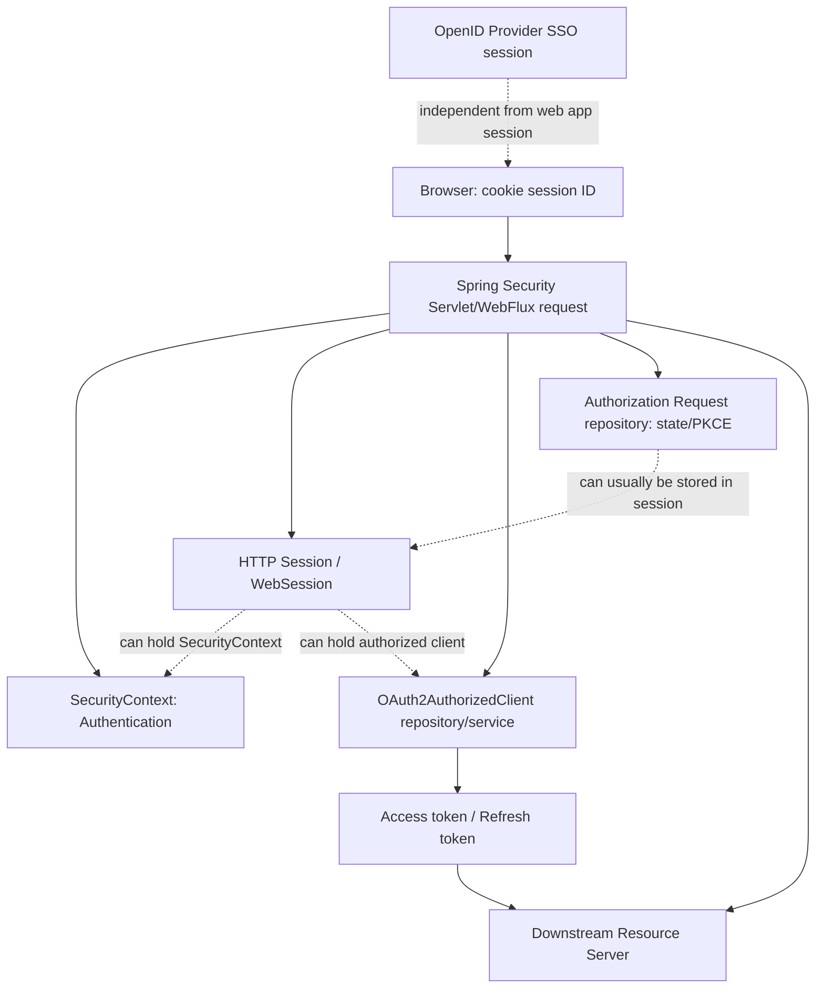
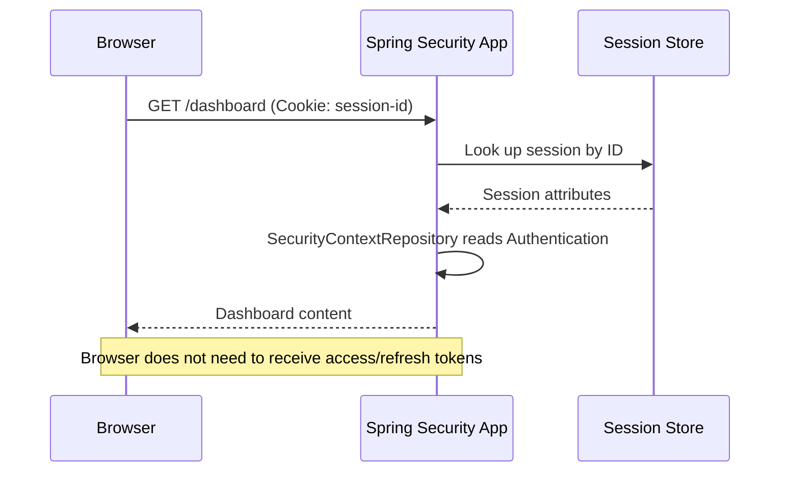
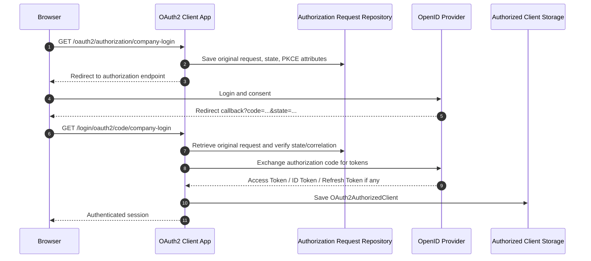
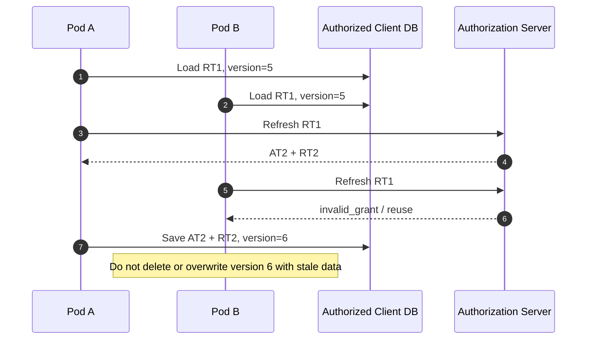
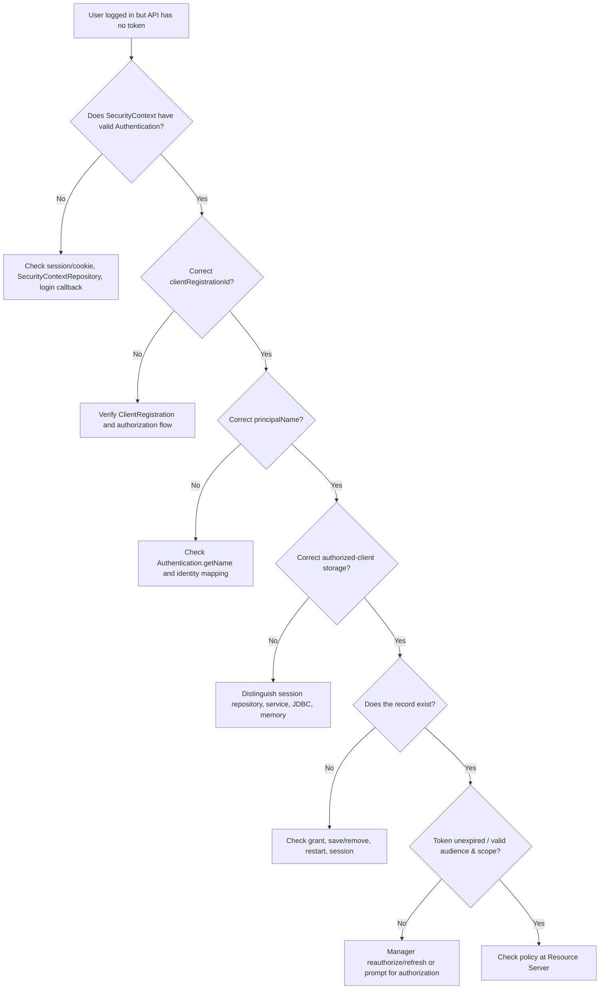

# 23.1. Data Separation Between SecurityContext, Session, and Authorized Client

In **Spring Security OAuth 2.0 / OpenID Connect (OIDC) Client**, a successful login typically introduces multiple types of state simultaneously: the application knows **who is logged in**, the browser has an **HTTP session**, and the backend may hold an **access token/refresh token** to call APIs. If you lump all of these into a single "login session" concept, you easily run into hard-to-diagnose issues: the user is still logged in yet the API has no token, deleting the session leaves tokens in the database, the token expires yet the user remains authenticated, or one user's access token is mistakenly used for another user.

This lesson defines clear boundaries among three central components:

1. **`SecurityContext`**: the security state for a single processing cycle, most importantly `Authentication`, which describes the principal and authorities.
2. **Session**: the mechanism for maintaining HTTP state across multiple browser requests, typically using a session ID cookie and a server-side session store. The session is **a place where some security data may be stored**, not `SecurityContext` itself.
3. **`OAuth2AuthorizedClient`**: a record of a `ClientRegistration` that has been authorized for a principal, containing an access token and possibly a refresh token, retrieved through a dedicated repository/service.

In addition, there are **temporary authorization requests** (`state`, PKCE, nonce context), **ID Token/UserInfo**, the **session at the OpenID Provider**, and **tokens accepted by the Resource Server**. They are related, but not interchangeable.

> Design rule: **knowing who the user is does not mean you have an access token**, and **having an access token does not mean the user has a valid web session or is permitted to perform every business operation**.

## 1. Learning Objectives

After this lesson, you can:

- Explain `SecurityContext`, `Authentication`, `SecurityContextRepository`, and `SecurityContextHolder`.
- Distinguish the HTTP session ID in a cookie from server-side session data.
- Know what types of data `OAuth2AuthorizedClientRepository` and `OAuth2AuthorizedClientService` store, and under which keys.
- Understand why `OAuth2AuthenticationToken` is not where you read access tokens to call APIs.
- Describe how state flows through Authorization Code Flow/OIDC Login, callback, API call, refresh, and logout.
- Choose an appropriate storage model for Spring MVC Servlet, WebFlux Reactive, multiple instances, or background jobs.
- Explain that token expiry, session expiry, logout, revocation, and OP SSO session are distinct events.
- Diagnose errors such as "logged in but no token", "session lost after deploy", and "token still works after logout".
- Design securely: CSRF, cookie/session fixation, token encryption, tenant isolation, cleanup, and concurrency.

## 2. The Big Picture: Where State Lives



The diagram illustrates **logical relationships**, without prescribing a single implementation. Both `SecurityContext` and the authorized client **can** be stored in the same HTTP session, but usually in different attributes/stores. They can also be stored **in different places**: for example, `SecurityContext` in a Redis session and the authorized client in JDBC.

### 2.1. Quick Comparison Table

| Question | Primary Responsible Component |
|---|---|
| "Who is this request authenticated as?" | `SecurityContext` → `Authentication` |
| "Does the user have `ROLE_ADMIN` or `REPORT_READ`?" | `Authentication.getAuthorities()` and authorization policy |
| "Can the browser continue the current session next time?" | Session ID cookie, server session, and `SecurityContextRepository` |
| "Which `state` was generated during the redirect to the OP before the callback?" | `OAuth2AuthorizationRequestRepository` or Reactive `ServerAuthorizationRequestRepository` |
| "Is there an access token for registration X and principal Y?" | `OAuth2AuthorizedClientRepository` / `OAuth2AuthorizedClientService` |
| "The token has expired; who decides to refresh or reauthorize?" | `OAuth2AuthorizedClientManager` and provider |
| "Is this token allowed to call the Reports API?" | Resource Server: signature/introspection, issuer, audience, scope, and object-level policy |
| "Has the user logged out of the OP?" | OP session, OIDC Logout protocol, and provider policy |

### 2.2. An Important Example

Alice logs in successfully with registration `company-login`. A subsequent request might have:

```text
SecurityContext:
  Authentication.name       = employee-42
  Authentication.authorities = [OIDC_USER, SCOPE_openid, ...]
  Authentication.authenticated = true

HTTP Session:
  session-id                = [opaque identifier]
  security-context         = [data managed by the repository]
  authorization-request    = [only while a flow is in progress]
  authorized-client-data   = [present or absent, depending on repository]

OAuth2AuthorizedClientService:
  (registrationId=company-login, principalName=employee-42)
    -> accessToken = [secret]
    -> refreshToken = [secret if issued]
```

This is an illustrative model, **not default attribute keys to hardcode** in application code. Each repository has its own storage layout and data types.

## 3. SecurityContext: Request Identity and Authorities

In Spring Security, `SecurityContext` is the container holding the `Authentication` of the security context:

```text
SecurityContext
  └── Authentication
        ├── principal
        ├── name
        ├── authorities
        ├── authenticated
        ├── credentials (depending on authentication type)
        └── details (depending on implementation)
```

In Servlet OAuth2 Login, the post-login `Authentication` is typically `OAuth2AuthenticationToken`; with OIDC, the principal is typically `OidcUser`. `OidcUser` can provide access to the ID Token/UserInfo and claims verified during the flow.

### 3.1. What Questions Does SecurityContext Answer?

A Servlet controller:

```java
import org.springframework.security.core.Authentication;
import org.springframework.web.bind.annotation.GetMapping;
import org.springframework.web.bind.annotation.RestController;

@RestController
class CurrentIdentityController {

    @GetMapping("/me")
    Identity me(Authentication authentication) {
        return new Identity(
                authentication.getName(),
                authentication.isAuthenticated(),
                authentication.getAuthorities().stream()
                        .map(authority -> authority.getAuthority())
                        .toList());
    }

    record Identity(
            String principalName,
            boolean authenticated,
            java.util.List<String> authorities) {}
}
```

This example returns only the name/authorities permitted to be exposed under the application's policy. In production, you must restrict the endpoint, avoid leaking sensitive claims/roles, and handle anonymous authentication properly.

Once a request is authenticated, the application can use `hasAuthority(...)`, `hasRole(...)`, `@PreAuthorize`, or business policy to make decisions. **You should not use "having an access token in the database" as the sole proof of user authentication**.

### 3.2. Does Authentication Contain the Access Token?

`OAuth2AuthenticationToken` contains `principal`, `authorities`, and `authorizedClientRegistrationId`. It is **not** `OAuth2AuthorizedClient` and is not the standard API for obtaining an access token to send to a downstream API.

Example:

```java
import org.springframework.security.oauth2.client.authentication
        .OAuth2AuthenticationToken;

if (authentication instanceof OAuth2AuthenticationToken oauth2) {
    String registrationId = oauth2.getAuthorizedClientRegistrationId();
    String principalName = oauth2.getName();

    // These two values locate the authorized client,
    // not the access token itself.
}
```

If you need an access token for an API, use `OAuth2AuthorizedClientRepository`, `OAuth2AuthorizedClientService`, `@RegisteredOAuth2AuthorizedClient`, or `OAuth2AuthorizedClientManager` appropriate for your flow; do not cast the principal expecting a `getAccessToken()` method.

### 3.3. OIDC ID Token vs. Access Token

An OIDC `OidcUser` can hold an `OidcIdToken` verified by the framework; the ID Token serves **identity authentication at the client**. The access token is meant for the **Resource Server**, matching its audience and scopes.

| Data | What Is It Used For? | Should It Be Sent to a Downstream API? |
|---|---|---|
| `Authentication.getName()` | Principal name in the application | Not a bearer credential |
| `OidcUser.getIdToken()` | User's OIDC authentication info | Do not use in place of an access token |
| `OAuth2AuthorizedClient.getAccessToken()` | Credential to call authorized APIs | Yes, only to the intended Resource Server |
| `OAuth2AuthorizedClient.getRefreshToken()` | Obtain a new access token at the token endpoint | Do not send to a Resource Server |

Even though `OidcUser` does not contain the access token, **`SecurityContext` can still hold sensitive data**, especially the ID Token/claims. Do not serialize the entire `SecurityContext` into a JSON response or write it to logs.

### 3.4. How Does SecurityContext Persist During a Request?

In Servlet applications, `SecurityContextHolder` typically binds `SecurityContext` to the current processing thread via a context storage strategy. Spring Security uses filters and `SecurityContextRepository` to load and save the context across requests in stateful configurations.

Do not do this:

```java
// Wrong when used as a session/global store:
static SecurityContext GLOBAL_CONTEXT;
```

Using a static/shared variable as the context can leak one request's principal into another request. In async flows, thread-locals can also change; you need a propagation mechanism supported by Spring Security.

## 4. HTTP Session: Mechanism for Maintaining State Across Requests

An HTTP session is a server-side state area linked to a browser through a session identifier. The browser typically holds a **session cookie** (for example, `JSESSIONID` in Servlet) and sends it on subsequent requests. The cookie normally carries the **session ID**, not the full `SecurityContext` or refresh token.



A session can store a shopping cart, flash messages, CSRF-related state, `SecurityContext`, or authorized-client data; each piece must have a clear **owner and lifecycle**.

### 4.1. Session Is Not Authentication

A session can exist when:

- The user is **not logged in** (an anonymous session created to support a stateful flow).
- The user **is logged in** and `SecurityContext` is stored.
- The user just **logged out**, the session was invalidated or its ID rotated, while the browser or OP still holds other state.
- The application restarted and the session store survived, whereas some in-memory token data was lost.

Therefore: **having a session ≠ being authenticated**; and **having an authenticated request ≠ requiring a session**. A bearer-token Resource Server with a stateless policy can authenticate each request without creating a web session.

### 4.2. SecurityContextRepository Handles the Binding

In Servlet, the `SecurityContextRepository` abstraction loads and saves `SecurityContext` between a request and persistence. Common implementations include:

- `HttpSessionSecurityContextRepository`: uses the HTTP session.
- `RequestAttributeSecurityContextRepository`: keeps the context within the scope of a request and certain dispatches.
- `DelegatingSecurityContextRepository`: combines multiple repositories in configured order.
- `NullSecurityContextRepository`: does not persist the context across requests.

In modern Spring Security configurations, a default may be `DelegatingSecurityContextRepository` combining request attributes and the HTTP session. **Do not assume every Spring Boot version uses a single fixed repository**; inspect the actual security filter chain and auto-configuration.

### 4.3. Example of Configuring Session Policy as Needed

```java
import org.springframework.context.annotation.Bean;
import org.springframework.security.config.annotation.web.builders.HttpSecurity;
import org.springframework.security.config.http.SessionCreationPolicy;
import org.springframework.security.web.SecurityFilterChain;

@Bean
SecurityFilterChain appSecurity(HttpSecurity http) throws Exception {
    return http
            .authorizeHttpRequests(auth -> auth
                    .requestMatchers("/", "/error").permitAll()
                    .anyRequest().authenticated())
            .sessionManagement(session ->
                    session.sessionCreationPolicy(
                            SessionCreationPolicy.IF_REQUIRED))
            .oauth2Login(oauth2 -> {})
            .build();
}
```

`IF_REQUIRED` allows creating a session when needed. It does not mean every request will forcibly create a session; details depend on the flow. In browser-based OIDC Authorization Code Flow, a session is typically useful for holding the request `state` before the callback and the `SecurityContext` after login.

### 4.4. STATELESS Is Not Simply "OAuth2 Login Without a Session"

`SessionCreationPolicy.STATELESS` only instructs Spring Security not to create or use an `HttpSession` for `SecurityContext` under that policy. It **does not automatically replace all storage for `OAuth2AuthorizationRequest`** and does not eliminate the need for correlation between the authorization-code redirect and callback.

If you want a login architecture without traditional sessions, you must design **the entire** storage of state/nonce/PKCE, callback correlation, `SecurityContext`, cookies, or token-based login within proper security boundaries—not just swap an enum and assume the flow will keep working.

## 5. OAuth2AuthorizedClient: Granted Authorization and Tokens

`OAuth2AuthorizedClient` stores information about an OAuth2 client registration **that has been authorized** for a principal:

```text
OAuth2AuthorizedClient
  ├── ClientRegistration
  │     ├── registrationId = "company-login"
  │     ├── clientId = "portal-web-prod"
  │     ├── grantType = authorization_code
  │     └── provider/tokenUri/scopes/...
  ├── principalName = "employee-42"
  ├── OAuth2AccessToken
  │     ├── tokenValue = [secret]
  │     ├── issuedAt / expiresAt
  │     └── scopes
  └── OAuth2RefreshToken (if issued)
        ├── tokenValue = [secret]
        └── issuedAt
```

It is not an "online user" record; a token may remain after the web session is deleted, or it may expire while the user is still logged in.

### 5.1. The Key Pair (registration ID, principal name)

`OAuth2AuthorizedClientService` uses the pair:

```text
(clientRegistrationId, principalName)
```

Example:

| `clientRegistrationId` | `principalName` | Data |
|---|---|---|
| `company-login` | `alice` | Token issued to Alice for Corporate OP |
| `company-login` | `bob` | Bob's token for Corporate OP |
| `reports-api` | `alice` | Alice's separate token for Reports API |
| `inventory-service` | `service:inventory-job` | Service's `client_credentials` token |

Keying only by `registrationId` risks Alice's and Bob's tokens overwriting each other. Keying only by `principalName` mixes up tokens from two providers or two registrations.

### 5.2. Registration ID vs. Client ID

- `registrationId` is the internal name in application configuration, e.g., `company-login`.
- `clientId` is issued by the Authorization Server, e.g., `portal-web-prod`.
- `principalName` refers to the identity the client is stored for, e.g., `employee-42`.
- `sessionId` is the browser session identifier; **it is not part of the default service key pair**.

One principal can have multiple authorized clients; one registration can also have authorized clients for multiple principals. Do not treat `clientId` or session ID as a substitute key for this pair.

### 5.3. How Do Repository and Service Differ?

In Servlet:

```java
OAuth2AuthorizedClientService.loadAuthorizedClient(
        clientRegistrationId, principalName);
```

Whereas the repository uses:

```java
OAuth2AuthorizedClientRepository.loadAuthorizedClient(
        clientRegistrationId, authentication, httpServletRequest);
```

| Characteristic | `OAuth2AuthorizedClientService` | `OAuth2AuthorizedClientRepository` |
|---|---|---|
| Role | Access authorized client storage by principal | Access authorized client in an HTTP request context |
| Lookup parameters | Registration ID + principal name (String) | Registration ID + Authentication + HttpServletRequest |
| Use in background jobs | Suitable | Requires a corresponding HTTP context |
| Example implementations | `InMemoryOAuth2AuthorizedClientService`, `JdbcOAuth2AuthorizedClientService` | `HttpSessionOAuth2AuthorizedClientRepository`, `AuthenticatedPrincipalOAuth2AuthorizedClientRepository` |
| Must data live in the HTTP session? | No | No; depends on the repository |

`AuthenticatedPrincipalOAuth2AuthorizedClientRepository` can delegate storing an authenticated principal's authorized client to an `OAuth2AuthorizedClientService`; some configurations use `HttpSessionOAuth2AuthorizedClientRepository` for anonymous cases. Therefore, seeing "repository" does not guarantee the token lives in the session, and having a session does not guarantee the token can be read from the service you injected.

### 5.4. Which Component Refreshes Tokens?

`OAuth2AuthorizedClientManager` coordinates with `OAuth2AuthorizedClientProvider` to authorize or reauthorize according to the grant:

```text
Application / WebClient
        |
        v
OAuth2AuthorizedClientManager
        |
        +--> load authorized client from repository/service
        |
        +--> check grant/expiration and select provider
        |
        +--> call token endpoint if needed and allowed
        |
        +--> save new authorized client to the proper storage
        |
        v
OAuth2AuthorizedClient used to call the API
```

**`loadAuthorizedClient(...)` only reads**; it does not promise that the token is unexpired or has the right audience/scope. With `client_credentials`, the manager can request a new token directly; with `authorization_code`, initial authorization requires a browser and callback—a batch job cannot mint an authorization code on its own.

## 6. Another Temporary Store: OAuth2AuthorizationRequest

Authorization Code Flow needs to store an `OAuth2AuthorizationRequest` **before** the client has any tokens.



In Servlet, `HttpSessionOAuth2AuthorizationRequestRepository` is the common implementation for keeping the original request in the HTTP session. In WebFlux, there is `WebSessionOAuth2ServerAuthorizationRequestRepository`. This is **short-lived, pre-callback** data, not authorized client storage.

### 6.1. Two Different Kinds of "Request"

| Type | Timing | Data |
|---|---|---|
| `OAuth2AuthorizationRequest` | Created before redirecting to the OP | `client_id`, `scope`, `redirect_uri`, `state`, PKCE/nonce context |
| `OAuth2AuthorizeRequest` | Application code calls `OAuth2AuthorizedClientManager.authorize(...)` | Registration/principal/attributes for the manager to select the authorized client or grant |
| `OAuth2AuthorizedClient` | After the Authorization Server grants authorization | Access token, refresh token, and registration/principal info |

Do not use `OAuth2AuthorizationRequestRepository` as a long-term token store. If the original request is lost, the callback may report `invalid_state`; if the authorized client is lost after login, an API call may fail to find a token. These are two different errors.

### 6.2. Why Are state, nonce, and PKCE Tied to the Session?

Spring Security needs to correlate the callback with a login flow **actually initiated by that browser**. `state` is generated unpredictably and compared on callback; the PKCE `code_verifier` must match the sent `code_challenge`; the OIDC `nonce` binds the ID Token to the request according to the standard mechanism.

When customizing session/repository configuration:

- Do not hardcode `state` or `nonce`.
- Do not put `code_verifier` in the authorization URL, logs, or insecure browser storage.
- Do not share request state across users or tenants.
- Do not let a faulty custom login handler destroy the session before the callback.
- Do not skip correlation just because "the provider returned a valid code".

### 6.3. Authorization Request Lifecycle

```text
T0: Request starts login -> save state/correlation
T1: Redirect to OP -> browser is outside the application
T2: Callback arrives at app -> load and validate original request
T3: Exchange code and authenticate -> remove/complete temporary request
T4: Authorized client and Authentication have been created/saved
```

Sometimes a session timeout between T1 and T2 causes a login failure even though credentials at the OP were valid. That is not an access token expiration error.

## 7. Decision Table: Where Should Data Live?

| Data | Appropriate Location | Avoid |
|---|---|---|
| Current user principal and GrantedAuthorities | `Authentication` in `SecurityContext` | A global static variable or unverified frontend claims |
| Session ID | Protected cookie + session store | Using it as an OAuth2 client secret or access token |
| Server-side flash messages, short-lived UI state | HTTP session if needed | Stuffing into the access token or SecurityContext |
| Pre-callback state/PKCE/nonce context | `OAuth2AuthorizationRequestRepository` | Storing unprotected in the URL yourself |
| Access token for calling downstream APIs | `OAuth2AuthorizedClient` via repository/service | ID Token, `Authentication.details`, browser localStorage in a BFF |
| Refresh token | Protected authorized client storage | Browser JS/cookies, logs, or query strings |
| Client secret/private key | Secret manager, protected configuration | SecurityContext or user session |
| Verified OIDC ID Token | `OidcUser`/authentication context where appropriate | Sending in place of an access token to an API |
| Tenant/resource permissions | Server-side policy and business authorization data source | Trusting only a browser-supplied tenant name or self-asserted scopes |
| Audit history | Dedicated audit/event store | Using SecurityContext or OAuth2AuthorizedClient as an audit database |
| Token revocation state | Authorization Server/token service, per supported mechanism | Assuming deleting the local session alone is enough |

**Data separation is not just choosing a database**; it is deciding where each piece of data is produced, who may read it, how long it is kept, and which event deletes it.

## 8. Different Lifecycles: Login, API Call, Token Expiry, Session Expiry

### 8.1. Successful Login

In a typical OIDC Servlet login:

1. The browser initiates the Authorization Code Flow.
2. The Authorization Request is saved for callback verification.
3. The OP returns an authorization code and state.
4. The client exchanges the code for tokens, verifies the ID Token, and creates an `OidcUser`/`Authentication`.
5. The user's `SecurityContext` is saved via `SecurityContextRepository` according to policy.
6. `OAuth2AuthorizedClient` is saved via the appropriate repository/service.
7. The browser continues using the session cookie to send requests to the app.

Steps 5 and 6 are **two distinct save operations**, even if both happen to rely on the HTTP session.

### 8.2. Access Token Expiration

```text
Browser session is still alive
SecurityContext still has Alice's Authentication
Reports API Access Token has expired
Refresh Token may still be valid
```

This is completely normal. The client manager can refresh the access token if the flow and provider allow it. **The user does not have to be logged out** simply because an API access token expired.

If the refresh token is also invalid, the user may need to reauthorize; that is a different action from reading `Authentication` on the current request.

### 8.3. Web Session Expiration

```text
Browser session times out
Session-backed SecurityContext is gone
Authorized client in JDBC may still exist
```

If the user returns to the application, Spring Security may treat them as unauthenticated even though a token row still exists in the database for that principal name. **You must not automatically grant a web login merely because an authorized client exists for that principal key**. Request authentication must be re-verified through an allowed flow.

Conversely, a session may still exist while an in-memory authorized client was lost after a restart. The user remains authenticated, yet the API has no token.

### 8.4. OP SSO Session Expiration

The login session at the OP is **independent** of the application session. The OP's SSO session can expire while the application still holds a valid `SecurityContext` and tokens; or the OP SSO session can remain active after the application logs out.

This explains why a user who logs out of the Portal and clicks Login can re-enter immediately because the OP still maintains an SSO session. If Single Logout is required, you must use an OIDC logout flow rather than only clearing the application session.

## 9. Matrix of Events and Impacts

| Event | SecurityContext | HTTP Session | Authorized Client | OP / API |
|---|---|---|---|---|
| Successful OIDC login | Has authenticated principal | Typically used to maintain web login | Typically stores authorized client for the granted registration | OP completed auth/consent |
| Access token expires | May be unchanged | May be unchanged | Old token has expiresAt; manager can refresh | API may return 401 if expired token is sent |
| Refresh token rejected `invalid_grant` | May still be authenticated | May still exist | May be removed/marked invalid by failure handler | Reauthorization needed depending on flow |
| Browser session timeout | Session-backed SecurityContext is gone | Gone / ID changed | JDBC service may still retain token | OP SSO may remain |
| Application logout | Typically clears SecurityContext | Typically invalidates session per logout handlers | Not automatically revoked/deleted across all stores | OP SSO and access tokens may remain |
| Remove local authorized client | Not necessarily changed | May remain | Corresponding record deleted from the called store | Issued tokens may still be valid |
| OP revokes refresh token | Web authentication may remain | May remain | Local record may remain, but refresh fails | OP rejects refresh |
| Redis/JDBC store loses connectivity | May still have principal from session | Depends on session store | Load/save may error | Do not treat outage as "token does not exist" |
| Rolling restart | Depends on session persistence | Depends on session store | In-memory lost, JDBC may remain | Does not alter already-issued tokens |

This table describes **possible outcomes**; not every configuration produces a single fixed result. The specific repository, handlers, and session policy determine what data survives.

## 10. Spring MVC Configuration: SecurityContext and Authorized Client

### 10.1. OIDC Login in Servlet

`application.yml`:

```yaml
spring:
  security:
    oauth2:
      client:
        registration:
          company-login:
            provider: company
            client-id: "${COMPANY_CLIENT_ID}"
            client-secret: "${COMPANY_CLIENT_SECRET}"
            client-authentication-method: client_secret_basic
            authorization-grant-type: authorization_code
            redirect-uri: "{baseUrl}/login/oauth2/code/{registrationId}"
            scope:
              - openid
              - profile
              - email
              - reports.read
        provider:
          company:
            issuer-uri: "https://idp.example.org/realms/company"
```

`reports.read` is an example scope and works only if the provider actually supports and grants it. Do not assume OIDC Login with `openid` makes the access token accepted by every API.

Security chain:

```java
import org.springframework.context.annotation.Bean;
import org.springframework.security.config.Customizer;
import org.springframework.security.config.annotation.web.builders.HttpSecurity;
import org.springframework.security.web.SecurityFilterChain;

@Bean
SecurityFilterChain securityFilterChain(HttpSecurity http) throws Exception {
    return http
            .authorizeHttpRequests(authorize -> authorize
                    .requestMatchers("/", "/error").permitAll()
                    .anyRequest().authenticated())
            .oauth2Login(Customizer.withDefaults())
            .build();
}
```

After login, controllers can receive the user's `Authentication`. To obtain a token for an API, an appropriate authorized client is needed.

### 10.2. SecurityContext Does Not Replace Authorized Client Lookup

```java
import org.springframework.security.core.Authentication;
import org.springframework.security.oauth2.client.OAuth2AuthorizedClient;
import org.springframework.security.oauth2.client.OAuth2AuthorizedClientService;
import org.springframework.web.bind.annotation.GetMapping;
import org.springframework.web.bind.annotation.RestController;

@RestController
class SessionStateController {

    private final OAuth2AuthorizedClientService clientService;

    SessionStateController(OAuth2AuthorizedClientService clientService) {
        this.clientService = clientService;
    }

    @GetMapping("/internal/session-state")
    State state(Authentication authentication) {
        OAuth2AuthorizedClient client =
                clientService.loadAuthorizedClient(
                        "company-login", authentication.getName());

        return new State(
                authentication.getName(),
                client != null,
                client != null
                        ? client.getAccessToken().getExpiresAt()
                        : null);
    }

    record State(
            String principal,
            boolean authorizedClientPresent,
            java.time.Instant accessExpiresAt) {}
}
```

This example is for internal observation only; **never return token values**. Whether lookup in `OAuth2AuthorizedClientService` finds a record depends on **which repository/storage login actually uses**. If the authorized client is stored separately in `HttpSessionOAuth2AuthorizedClientRepository`, the service may return `null` even when login succeeded.

### 10.3. Lookup During an HTTP Request via Repository

```java
import jakarta.servlet.http.HttpServletRequest;
import org.springframework.security.core.Authentication;
import org.springframework.security.oauth2.client.OAuth2AuthorizedClient;
import org.springframework.security.oauth2.client.web
        .OAuth2AuthorizedClientRepository;

OAuth2AuthorizedClient client =
        authorizedClientRepository.loadAuthorizedClient(
                "company-login",
                authentication,
                httpServletRequest);
```

The repository accepts `HttpServletRequest` so it can store in the session or delegate to a service depending on the implementation.

**Never use a request parameter `principalName` to look up another user's token**; the browser request's principal must come from the authenticated `Authentication`.

### 10.4. Using @RegisteredOAuth2AuthorizedClient

Spring Security supports resolving an authorized client in Servlet controllers:

```java
import org.springframework.security.oauth2.client.OAuth2AuthorizedClient;
import org.springframework.security.oauth2.client.annotation
        .RegisteredOAuth2AuthorizedClient;
import org.springframework.web.bind.annotation.GetMapping;
import org.springframework.web.bind.annotation.RestController;

@RestController
class ReportsController {

    @GetMapping("/reports/client-status")
    String status(
            @RegisteredOAuth2AuthorizedClient("company-login")
            OAuth2AuthorizedClient authorizedClient) {

        return "registration="
                + authorizedClient.getClientRegistration().getRegistrationId();
    }
}
```

This illustrates resolution when a matching authorized client exists. It **does not guarantee the token is still valid, targets the Reports API audience, or permits viewing all reports**; those requirements depend on the manager/provider and Resource Server authorization.

## 11. Passing Tokens to APIs Properly

A web application calling a downstream API on behalf of a user should use the OAuth2 Client integration with `WebClient`/`RestClient`, or a manager to obtain a valid authorized client.

Example **after resolving a valid authorized client**:

```java
import org.springframework.web.reactive.function.client.WebClient;

WebClient api = WebClient.builder()
        .baseUrl("https://reports-api.example.org")
        .build();

Mono<String> reports = api.get()
        .uri("/v1/reports")
        .headers(headers -> headers.setBearerAuth(
                authorizedClient.getAccessToken().getTokenValue()))
        .retrieve()
        .bodyToMono(String.class);
```

`authorizedClient` must be obtained by the application from a repository/manager bound to the authenticated principal, never from browser input. Use a fixed, server-controlled URL to prevent **SSRF/bearer token leakage** to an attacker-chosen host.

Do not send `OidcIdToken.getTokenValue()` in place of an access token. The API must validate the access token using JWT verification or introspection according to its configuration, issuer, audience, expiration, scope, and business policy.

## 12. Customizing SecurityContextRepository: Key Considerations

In some applications that need to change how `SecurityContext` is stored, Spring Security allows specifying a repository. For example, a Servlet app choosing the HTTP session:

```java
import org.springframework.security.web.context.HttpSessionSecurityContextRepository;

HttpSessionSecurityContextRepository securityContextRepository =
        new HttpSessionSecurityContextRepository();

http.securityContext(context ->
        context.securityContextRepository(securityContextRepository));
```

This is a **configuration snippet** and must be placed inside the appropriate `SecurityFilterChain`. Changing the repository requires considering the default strategy, filter chain ordering, and context-saving behavior in your Spring Security version.

### 12.1. When Authenticating a User Manually

In Spring Security 6, custom authentication flows may need to **explicitly save `SecurityContext`** using `SecurityContextRepository.saveContext(...)` if the filter configuration does not save automatically after you update `Authentication`. Merely calling:

```java
SecurityContextHolder.getContext().setAuthentication(authentication);
```

inside custom code **does not necessarily persist the login across the next request**. When using `SecurityContextHolderFilter` with explicit save semantics, you must save the context according to the configured repository's contract. For framework-managed `oauth2Login()`, do not rewrite the success handler just to save manually unless you have a specific reason.

### 12.2. Stateless APIs Should Not Rely Solely on Web Login Sessions

An application that exposes both stateless bearer-token APIs and stateful OIDC web pages may need **multiple `SecurityFilterChain` beans** with distinct matchers and `SessionCreationPolicy` settings:

```text
/api/**  -> Resource Server, bearer token, request-level Authentication
/web/**  -> OAuth2 Login, session SecurityContext, authorized client
```

Filter chain separation must be configured with the proper order and matchers. Do not enable a global `STATELESS` policy and expect the OAuth2 Login callback to still work without a repository holding state/PKCE.

## 13. Separation in Spring WebFlux Reactive

In WebFlux, do not use `HttpServletRequest` or thread-local `SecurityContextHolder` as the single source of truth across async callbacks. Spring Security Reactive uses `ReactiveSecurityContextHolder` and Reactor-based context propagation.

### 13.1. Reactive SecurityContext

Example reading the principal:

```java
import org.springframework.security.core.Authentication;
import org.springframework.security.core.context.ReactiveSecurityContextHolder;
import reactor.core.publisher.Mono;

Mono<String> currentName =
        ReactiveSecurityContextHolder.getContext()
                .map(context -> context.getAuthentication())
                .map(Authentication::getName);
```

Or in a WebFlux controller/handler, accept `Principal`/`Authentication` passed by the framework per contract. Never call `block()` to read `ReactiveSecurityContext` on an event loop.

### 13.2. Reactive Session and Repositories

Components:

| Servlet | Reactive |
|---|---|
| `HttpSession` | `WebSession` |
| `SecurityContextRepository` | `ServerSecurityContextRepository` |
| `HttpSessionSecurityContextRepository` | `WebSessionServerSecurityContextRepository` |
| `OAuth2AuthorizedClientService` | `ReactiveOAuth2AuthorizedClientService` |
| `OAuth2AuthorizedClientRepository` | `ServerOAuth2AuthorizedClientRepository` |
| `HttpSessionOAuth2AuthorizationRequestRepository` | `WebSessionOAuth2ServerAuthorizationRequestRepository` |
| `OAuth2AuthorizedClientManager` | `ReactiveOAuth2AuthorizedClientManager` |

`WebSession` in Reactive is accessed through `ServerWebExchange` and `Mono`; do not mix servlet session objects with WebFlux session repositories.

### 13.3. WebSession and Authorized Clients Can Be Stored Separately

A WebFlux app can use:

```text
ReactiveSecurityContextHolder
    -> Request Authentication

WebSessionServerSecurityContextRepository
    -> stores SecurityContext in WebSession

WebSessionServerOAuth2AuthorizedClientRepository
    -> stores authorized client in WebSession

OR

AuthenticatedPrincipalServerOAuth2AuthorizedClientRepository
    -> delegates to ReactiveOAuth2AuthorizedClientService
    -> application's R2DBC/Redis store
```

Depending on the repository, tokens may reside in `WebSession` or in a separate data store. Do not assume injecting `ReactiveOAuth2AuthorizedClientService` can read tokens stored separately in `WebSession`.

### 13.4. Example: Reactive Service Loading an Authorized Client

```java
import org.springframework.security.oauth2.client.OAuth2AuthorizedClient;
import org.springframework.security.oauth2.client
        .ReactiveOAuth2AuthorizedClientService;
import reactor.core.publisher.Mono;

final class ReactiveClientLookup {

    private final ReactiveOAuth2AuthorizedClientService store;

    ReactiveClientLookup(ReactiveOAuth2AuthorizedClientService store) {
        this.store = store;
    }

    Mono<OAuth2AuthorizedClient> find(
            String registrationId, String principalName) {

        return store.<OAuth2AuthorizedClient>loadAuthorizedClient(
                registrationId, principalName);
    }
}
```

`Mono.empty()` normally means no record was found. `Mono.error()` indicates a storage failure; do not unconditionally use `onErrorResume(e -> Mono.empty())` and turn a database outage into "user has not granted authorization".

### 13.5. Avoid Blocking Storage on the Event Loop

Do not wrap synchronous JDBC like this:

```java
// DO NOT DO THIS on a reactive event loop:
Mono.just(jdbcService.loadAuthorizedClient(registrationId, name));
```

Because the JDBC call executes eagerly, it can block the event loop. For Reactive persistence, consider `R2DBC`, `ReactiveRedisTemplate`, or a custom reactive adapter. When a blocking DAO is unavoidable, isolate it on a managed scheduler and evaluate load carefully.

## 14. Service Manager vs. Web Manager

The manager decides **when to reuse an existing token, refresh it, or reauthorize**. It does not replace the repository/storage.

| Context | Appropriate Manager | Storage Typically Used |
|---|---|---|
| Servlet HTTP request | `DefaultOAuth2AuthorizedClientManager` | `OAuth2AuthorizedClientRepository` |
| Servlet background/service | `AuthorizedClientServiceOAuth2AuthorizedClientManager` | `OAuth2AuthorizedClientService` |
| WebFlux HTTP request | `DefaultReactiveOAuth2AuthorizedClientManager` | `ServerOAuth2AuthorizedClientRepository` |
| Reactive background/service | `AuthorizedClientServiceReactiveOAuth2AuthorizedClientManager` | `ReactiveOAuth2AuthorizedClientService` |

### 14.1. Why Background Jobs Should Not Depend on HTTP Sessions

A `client_credentials` job has no user browser, no `HttpServletRequest`, and usually no `WebSession`. Use a service manager with a stable logical principal:

```java
import org.springframework.security.oauth2.client.OAuth2AuthorizeRequest;

OAuth2AuthorizeRequest request =
        OAuth2AuthorizeRequest
                .withClientRegistrationId("inventory-service")
                .principal("service:nightly-import")
                .build();

OAuth2AuthorizedClient client = serviceManager.authorize(request);
```

This is an example of a **Servlet/synchronous** service manager. In Reactive, `manager.authorize(request)` returns `Mono<OAuth2AuthorizedClient>`. Do not use a random per-run principal name like `job-run-id` if you want stable reuse of the authorized client.

### 14.2. A Service Token Is Not a User Session

A `client_credentials` token represents the client/service and the permissions granted to it by the provider. It **does not authenticate Alice**. If Alice clicks a button in her browser that triggers a backend job using a privileged token, the backend must still check whether Alice is authorized to trigger that job.

Do not store the service token in Alice's `SecurityContext` just because her request initiated the job. Keep the two permission domains separate.

## 15. How to Answer "Store in Session or Database?"

There is no single answer. Determine the **data type, lifecycle, security requirements, and resilience needs** before choosing storage.

### 15.1. Model A: Single-Instance Web App, Session-Centric

```text
Browser cookie -> HttpSession
                  |
                  +-- SecurityContext
                  +-- OAuth2AuthorizationRequest (during login)
                  +-- OAuth2AuthorizedClient (if repository chooses session)
```

Pros: simple; state is tied to the browser session. Cons: restarts or scale-out can lose state without session persistence; the session may contain secret refresh tokens and must be protected.

### 15.2. Model B: SecurityContext in Session, Tokens in Database

```text
Browser cookie -> HttpSession / Spring Session
                  |
                  +-- SecurityContext
                  +-- Temporary AuthorizationRequest

OAuth2AuthorizedClientService -> JDBC encrypted token store
                                 (registrationId, principalName)
```

Pros: tokens are durable and shareable across replicas by identity; independent retention policies are possible. Cons: tokens can **outlive session expiration**, so logout/cleanup/revocation and token access controls must be designed separately.

### 15.3. Model C: Reactive WebSession and Reactive Token Store

```text
Browser -> WebSession/Spring Session Reactive
             |
             +-- SecurityContext
             +-- Authorization Request

ReactiveOAuth2AuthorizedClientService
  -> R2DBC / Reactive Redis, encrypted tokens
```

A multi-instance WebFlux app must synchronize or share session and token storage as required. Simply "using Redis" does not automatically solve everything: expiry/eviction, concurrency, encryption keys, and session cookie policies still matter.

### 15.4. Model D: Stateless API Verifying Bearer Tokens Only

```text
Client -> Authorization: Bearer <access-token> -> Resource Server
                                                   |
                                                   +-- request Authentication
                                                   +-- JWT/introspection + policy
                                                   +-- no web login session needed
```

This is an **OAuth2 Resource Server** rather than an OAuth2 Login Client. Do not confuse a bearer token's request-level `SecurityContext` with an OAuth2 Client application's authorized client storage.

## 16. Multiple Instances: Session and Token Must Have Consistent Strategies

A system with three pods:

```text
                Load Balancer
                 /    |    \
              Pod A  Pod B  Pod C
                 \    |    /
             Shared Session Store
                 \    |    /
           Authorized Client Store
```

There are at least **two types of state to evaluate independently**:

1. **Session/authentication**: can the callback locate the authorization request/`state`? Can subsequent requests load the right `SecurityContext`?
2. **Authorized client/token**: if one pod refreshes AT/RT, can other pods read the new token? Can concurrent refreshes overwrite each other?

Sticky sessions can reduce the chance of a request hitting a different pod, but they do not protect against pod crashes or rolling deployments. Using a shared session store solves loading `SecurityContext`/request state, but **does not automatically share an in-memory authorized client store**.

### 16.1. Where Does Spring Session Fit In?

Spring Session can replace `HttpSession`/`WebSession` persistence with Redis or another supported store. When properly integrated, data **stored in the session** can survive beyond a single pod's memory.

However:

- If the authorized client lives in `JdbcOAuth2AuthorizedClientService`, it does not automatically become a session attribute.
- If the authorized client lives in `InMemoryOAuth2AuthorizedClientService`, shared Spring Session does not automatically move it to Redis.
- If `SecurityContext`/custom principal serialization changes across deployments, session deserialization can fail.
- If the session store and token store are separate, you must define consistency, backup, retention, and cleanup for each store.

### 16.2. Refresh Token Rotation and Overwrites



With rotation, both **HTTP retries** and **concurrent requests** can resend an old RT. The store should support versioning/CAS or single-flight per `(registrationId, principalName)` when required. Failure handlers must not mistakenly delete a newer token when a stale request receives `invalid_grant`.

## 17. Session Fixation, Cookies, CSRF, and Other Boundaries

### 17.1. Session Fixation Protection

When a user transitions from anonymous to authenticated, the application should protect against **session fixation**. Spring Security provides session fixation protection in standard configurations, such as changing the session ID upon authentication. Do not keep an attacker-controlled session ID unchanged just to "avoid losing data".

However, when the session ID changes, data needed for callbacks/authorized clients must be handled properly by the framework/repository. If you write custom session management, carefully verify context transfer and login state.

### 17.2. Secure Cookies

Session cookies should be configured according to the environment:

| Attribute | Purpose |
|---|---|
| `Secure` | Send cookies only over HTTPS |
| `HttpOnly` | Restrict JavaScript access to cookies |
| `SameSite` | Mitigate certain cross-site request risks within browser limits |
| `Path` / `Domain` | Restrict cookie scope |
| Session ID rotation | Reduce session fixation risk |
| Session timeout | Limit how long state is retained |

`SameSite` must account for OAuth2/OIDC **top-level redirects and callbacks**. An overly strict setting can prevent the session cookie from being sent on the browser callback, causing `state` loss. Do not disable CSRF protections just because a cookie was blocked; design the `SameSite`/redirect flow to fit browser behavior and protocol contracts.

### 17.3. CSRF vs. OAuth2 state

- **`state`** correlates an OAuth2 authorization request with its callback, protecting the authorization flow boundary.
- **Web application CSRF tokens/protection** prevent cross-site state-changing requests against application endpoints.

These two mechanisms complement each other; **they do not replace each other**. Having OAuth2 `state` does not mean you can disable CSRF for all state-modifying POST endpoints when the web app uses cookie session authentication.

### 17.4. Do Not Put Tokens in Arbitrary Cookies

In a Backend-for-Frontend (BFF), the browser typically needs only a **session cookie**, while tokens stay server-side. Putting access/refresh tokens into cookies or `localStorage` changes the threat model significantly: XSS, cookie scope, CSRF, replay, key rotation, and logout all require different designs.

Do not "optimize" by serializing `OAuth2AuthorizedClient` into a cleartext cookie and Base64-encoding it. Base64 **is not encryption**, and a refresh token is a credential that must be protected.

## 18. Logout: Three Different Operations

When a user clicks "Log out", distinguish between:

1. **Local logout**: ending the application's `Authentication`/`SecurityContext` and session.
2. **Authorized client cleanup/revocation**: removing local tokens and asking the provider to revoke tokens if supported/appropriate.
3. **OIDC OP logout**: ending or coordinating the SSO session at the OpenID Provider via the OIDC logout flow.

There is no rule that calling any one of these three **automatically completes all three**.

### 18.1. Local Logout

In Servlet, Spring Security logout configuration typically includes handlers to clear `SecurityContext` and invalidate the session according to policy. Example:

```java
http.logout(logout -> logout
        .logoutUrl("/logout")
        .invalidateHttpSession(true)
        .clearAuthentication(true));
```

This is a **configuration snippet** and belongs in the appropriate filter chain. For cookie-session web apps, POST logout and CSRF must be configured properly; do not assume `GET /logout` works in every version and configuration.

### 18.2. Removing the Local Authorized Client

```java
authorizedClientService.removeAuthorizedClient(
        "company-login",
        authentication.getName());
```

This deletes the record from the invoked service. If the token actually lives in a different session repository, you must clean up the actual store. If a user has multiple registrations, deleting one key pair **does not necessarily delete** other authorized clients.

**Be careful with logout ordering:** if you clear `Authentication`/session before reading the registration/principal needed for cleanup, you may lose the information required to delete the right token. Order handlers deliberately and ensure exceptions do not leak tokens.

### 18.3. Token Revocation at the Authorization Server

If the provider supports token revocation (for example, RFC 7009), the backend can call the revocation endpoint using its client authentication/contract to revoke refresh or access tokens. This is a separate operation with its own network failures and policies.

Even after removing local tokens, already-issued JWT access tokens may continue to be accepted by Resource Servers until expiration if the API does not use introspection, a revocation list, or another rejection mechanism. Thus, local logout should not be advertised as "immediately invalidating every API token everywhere".

### 18.4. OIDC Provider Logout

Spring Security supports OIDC Client-Initiated Logout in suitable environments, such as `OidcClientInitiatedLogoutSuccessHandler` in Servlet. It involves `end_session_endpoint` and the logout flow at the OP, depending on provider discovery and configuration.

**OP logout differs from token revocation**; logging out of the OP SSO session does not guarantee all issued access/refresh tokens are immediately revoked. Some systems also support front-channel or back-channel logout; each has distinct assumptions and implementation requirements.

### 18.5. Logout Matrix

| Action | User Authenticated at Portal? | Local Authorized Client? | OP SSO Session? |
|---|---|---|---|
| Clear SecurityContext only | Next request may become anonymous | May remain | May remain |
| Invalidate HTTP session | Web session-backed login usually ends | Depends on authorized-client storage | May remain |
| Remove from authorized client service | Not necessarily changed | Matching record deleted | Not necessarily changed |
| Revoke refresh token at OP | SecurityContext may remain until app handles it | Local record may remain, but refresh fails | Depends on provider |
| OIDC RP-initiated logout | Local logout must be coordinated properly | Does not automatically guarantee deletion/revocation | OP may end SSO session |

## 19. Expiration: Session Timeout, Token Expiry, and Idle Timeout

In operations, at least three kinds of lifetimes must be configured:

| Clock / Lifetime | Impact | Who Decides |
|---|---|---|
| HTTP session idle timeout | How long of inactivity before the web session expires | Application / session store |
| Access token `expiresAt` | When the token should no longer be accepted by APIs | Authorization Server / token semantics |
| Refresh token expiry/rotation/idle policy | How long new access tokens can be requested | Authorization Server |
| OP SSO session timeout | When the user must reauthenticate at the OP | OP / identity provider |
| Consent/grant revocation | Whether the OAuth2 grant is still permitted | OP / Authorization Server and user/admin |

Example scenario:

```text
Browser session:      30-minute idle timeout
Access token:         10 minutes
Refresh token:        8 hours per provider policy
OP SSO session:       2 hours
```

This is a **hypothetical example**, not Spring defaults. During 30 minutes of activity, the access token can be refreshed multiple times while the web session stays alive. After 30 minutes of inactivity, the web session may expire even though the JDBC refresh token remains; the application must still require valid authentication for new requests.

### 19.1. Do Not "Extend" Tokens by Editing Local Timestamps

When an access token expires, do not modify `expiresAt` in `OAuth2AuthorizedClient` or the database to keep the user online. The Resource Server can verify `exp` independently and reject the token. The right flow is to reauthorize/refresh per grant and policy, or require re-login when needed.

### 19.2. Refresh Token Rotation and Retention

An authorized client with an expired access token but a valid refresh token may need to be retained for refreshing. Do not mechanically set the Redis TTL of the entire record to `accessToken.expiresAt`, as that will delete a still-usable refresh token.

Conversely, do not store refresh tokens indefinitely. Retention should follow provider policy, user consent, privacy requirements, cleanup rules, and business needs.

## 20. Protecting Data at Rest

### 20.1. SecurityContext Also Contains Sensitive Data

`Authentication` can hold the principal and authorities, and `OidcUser` can carry the ID Token and personal claims. When `SecurityContext` is serialized into a session store:

- Restrict who has read access to the session store.
- Protect backups, diagnostic dumps, and replication streams.
- Do not write raw `SecurityContext` or serialized principals to logs.
- Account for serialization compatibility when upgrading Spring Security, principal models, or class loaders.
- Avoid persisting unnecessary or non-serializable objects in the session.

Do not assume that "because tokens are in a separate database, `SecurityContext` is completely harmless".

### 20.2. Authorized Client Contains Access/Refresh Tokens

Token storage requires:

- Encryption at rest and encryption in transit per architecture.
- Strict credential-store IAM/ACLs so other applications cannot read arbitrarily.
- Key rotation, backups, access auditing, TTL, and cleanup management.
- Never exposing plaintext tokens in analytics, exceptions, logs, tracing, or the browser.
- Protection against overwrites when multiple instances refresh concurrently.
- Cleanup of orphaned records when principal names or registrations change.

In particular, **refresh tokens** can remain valid much longer than access tokens; leaking one can allow continuous minting of new tokens until revoked or expired.

### 20.3. Service Accounts and Dedicated Principals

For `client_credentials`, define a stable logical principal:

```text
(inventory-service, service:nightly-import)
```

Do not use a user's web session principal for background tokens when the intent is a service token; likewise, do not share a single service principal across applications/tenants that require true isolation.

Partitioning storage keys alone does not create tenant permissions on a token. The Authorization Server and Resource Server must still enforce client identity, audience, scope, and data access rules.

## 21. Debugging: "Logged In but No Access Token"

A common symptom:

```text
SecurityContext.authentication != null
Authentication.isAuthenticated() = true
OAuth2AuthorizedClientService.loadAuthorizedClient(...) = null
```

Do not immediately conclude that login failed. There are several causes:

1. The authorized client was saved using the **HTTP session repository**, not the service being queried.
2. Wrong `registrationId`: the user logged in with `company-login` while code loads `reports-api`.
3. `principalName` at load time differs from save time because the OIDC name attribute changed.
4. Multiple replicas are running with an in-memory authorized client service.
5. The authorized client was removed or the user has not granted consent for that registration.
6. The token storage/database is unavailable, but the exception was swallowed into `null`/empty.
7. The service manager and web manager use different storage.
8. The login flow only creates `Authentication` and does not issue a token for the target API due to a different provider/registration.

### 21.1. Layered Investigation Flow



Investigating **does not require logging token values**. You can log the registration ID, storage type, correlation ID, boolean record presence, token expiration time, and error category according to policy.

### 21.2. "Login Lost After Callback"

If the callback succeeds but the next request becomes anonymous:

- Check whether the session cookie is sent back by the browser.
- Check reverse proxy headers, `Secure`, `SameSite`, domain/path, and HTTPS.
- Check `SecurityContextRepository` and explicit save semantics if using custom authentication.
- Check session persistence and pod routing.
- Check whether a handler accidentally invalidates the session or clears the context.

Do not "fix" this by putting the raw ID Token in a cookie and dropping sessions without designing a secure alternative authentication mechanism.

### 21.3. "Token Still in DB After Logout"

This can be expected behavior if:

- logout only invalidates the HTTP session;
- the authorized client is stored in `JdbcOAuth2AuthorizedClientService`;
- no custom logout handler deletes the authorized client;
- the token has not been revoked at the provider.

Adjust your **cleanup/revocation policy** rather than assuming session logout automatically purges data across all stores.

### 21.4. "Session Alive but API Returns 401"

`SecurityContext` and the session can be completely valid; 401 happens because the access token:

- is expired or revoked;
- has the wrong audience, issuer, or token type;
- lacks the required permissions/scopes;
- was sent to the wrong API;
- was not refreshed in time.

Fix this in the authorized client manager, routing, or API validation—do not automatically invalidate `SecurityContext` on every API error.

## 22. Special Notes on Multi-Tenancy

In a multi-tenant system, "which user?" and "which token?" must be bound to **verified identity and permissions**:

```text
OIDC identity:
  issuer = https://idp.example.org/realms/company
  sub    = employee-42

Local identity:
  userId = local-user-123
  tenantMemberships = [tenant-north]

Authorized client:
  (company-login, local-user-123) -> token

Business request:
  requestedTenant = tenant-north
  server policy   = validate user membership + token rights
```

OIDC `sub` must be evaluated within the context of `issuer`. Email/username can change or collide across providers; do not merge principals merely because two ID Tokens share the same email.

If an access token is issued for a specific API/tenant, ensure storage and API routing never cross-use a token for another tenant. **Choosing the right authorized client key alone does not replace object-level authorization** at the API.

### 22.1. Do Not Let the Browser Choose principalName to Read Tokens

**Insecure** example:

```java
// DO NOT USE:
@GetMapping("/proxy-token")
String token(@RequestParam String principalName) {
    OAuth2AuthorizedClient client =
            service.loadAuthorizedClient("company-login", principalName);
    return client.getAccessToken().getTokenValue();
}
```

This risks exposing another user's token and must never exist in a real application. The principal must come from the verified `Authentication` and policy; tokens should stay in the backend and only be sent to the intended Resource Server.

## 23. Unit and Integration Testing per Layer

| What to Verify | Which Layer to Test? | Expectation |
|---|---|---|
| User logs in successfully | Security filter chain / login integration | `Authentication` is created and subsequent requests carry the expected identity |
| Session ID persists/ends properly | Session integration | Login, idle timeout, logout, and cookie behavior match policy |
| OAuth2 callback verifies state | Authorization Request repository | Unpredictable state; callback accepts only matching request |
| Authorized client save/load | Service/repository unit test | Composite key isolates registrations and principals |
| Refresh token rotation | Manager/storage integration | New token saved properly; stale failure never overwrites newer token |
| Local logout | Logout integration | SecurityContext/session cleared/invalidated properly |
| Authorized client cleanup | Storage + logout handler integration | Deletes only the target record, leaving other users' tokens intact |
| Provider revocation | Integration with mock OP/token endpoint | Sends revocation if policy requires; handles errors safely |
| Multiple replicas | Distributed integration | SecurityContext/request state and tokens are found per storage strategy |
| Downstream API | Resource Server integration | Tokens with wrong issuer/audience/scope are rejected |

### 23.1. Testing Authentication with MockMvc

For the Servlet controller `/me`, you can test access control:

```java
import static org.springframework.security.test.web.servlet.request
        .SecurityMockMvcRequestPostProcessors.user;
import static org.springframework.test.web.servlet.request.MockMvcRequestBuilders.get;
import static org.springframework.test.web.servlet.result.MockMvcResultMatchers.status;

mockMvc.perform(get("/me").with(user("alice").roles("USER")))
        .andExpect(status().isOk());
```

This test only verifies **request-level authentication** injected by the mock; it does not prove there is a real OAuth2 authorized client, real token, or multi-request session persistence.

### 23.2. Testing Keyed Authorized Client Storage

```java
OAuth2AuthorizedClient aliceClient =
        clientService.loadAuthorizedClient(
                "company-login", "alice");

OAuth2AuthorizedClient bobClient =
        clientService.loadAuthorizedClient(
                "company-login", "bob");

// In unit tests, mock two distinct records/tokens.
// Alice and Bob must never share the same bearer token.
```

When tests use an in-memory service, each test should create an isolated store or clean up afterward so test tokens do not leak across test cases.

### 23.3. Testing WebFlux Requests

With WebFlux, `WebTestClient` can test routes requiring authentication and cookie/session flows; `StepVerifier` helps test `ReactiveOAuth2AuthorizedClientService` returning `Mono`:

```java
StepVerifier.create(
        reactiveService.<OAuth2AuthorizedClient>loadAuthorizedClient(
                "company-login", "alice"))
        .expectNextMatches(client ->
                "alice".equals(client.getPrincipalName()))
        .verifyComplete();
```

This snippet assumes `StepVerifier` is imported and a test authorized client was saved beforehand. Never call `block()` in application code just to "make it look like Servlet".

### 23.4. Most Valuable Test Cases: Independent Lifecycles

Simulate:

1. Alice logs in; the app has both `SecurityContext` and an authorized client.
2. The API token expires while the session remains: manager refreshes or responds appropriately.
3. Session times out while the JDBC token remains: a new request is **not automatically authenticated**.
4. Deleting the authorized client in the service: the web session **does not automatically log out**.
5. Local logout: JDBC tokens may remain unless cleaned up; tests must verify the desired policy.
6. Pod restart: in-memory authorized clients are lost; persistent stores retain them.
7. Alice and Bob log in concurrently: tokens for the same registration are never cross-loaded.
8. Callback hits a different pod: authorization request repository/session architecture supports it.
9. Provider revokes the refresh token: `SecurityContext` does not vanish automatically; API call/refresh handles it.
10. API receives a token with the wrong audience: rejected even when client selection and session are valid.

These tests verify proper **separation of responsibilities**, rather than testing only the login happy path.

## 24. Design Mistakes to Avoid

1. Treating **`SecurityContext` and the HTTP session as the same object**.
2. Treating **`Authentication` as the access token store** and looking for `getAccessToken()` on `OAuth2AuthenticationToken`.
3. Treating **`OidcIdToken` as an access token** to send to downstream APIs.
4. Assuming **an active user session means the access token is still valid**.
5. Assuming **a token in JDBC means the user is still authenticated**.
6. Assuming **local logout revokes all tokens and logs out of the OP**.
7. Using only `registrationId` as the key for everyone, causing authorized clients to overwrite each other.
8. Letting the browser pass a principal name to load arbitrary tokens.
9. Confusing `OAuth2AuthorizationRequestRepository` with `OAuth2AuthorizedClientRepository`.
10. Using `SessionCreationPolicy.STATELESS` without redesigning OAuth2 callback correlation.
11. Assuming a shared HTTP session automatically shares `InMemoryOAuth2AuthorizedClientService`.
12. Using `@Async`/Reactor schedulers while assuming thread-local `SecurityContextHolder` is always populated.
13. Serializing access/ID/refresh tokens to the frontend or to logs for debugging.
14. Using mutable email/username as the principal name without a migration strategy.
15. Treating session timeout, refresh token expiry, and OP SSO timeout as a single lifetime.
16. Deleting the authorized client after clearing the principal/registration during logout.
17. Retrying a rotated refresh token or losing responses without handling unknown outcomes.
18. Using a `client_credentials` service token to bypass permissions of the user triggering the job.
19. Clearing the session/tokens every time an API returns 403 without diagnosing object-level policies.
20. Using `Redis/JDBC` while ignoring encryption, backups, TTL, concurrency, and key rotation.

## 25. End-to-End Scenario: Portal, Reports API, and Inventory Job

Suppose an enterprise has:

- **Spring MVC Portal**: employees log in via OIDC `company-login`.
- **Reports API**: accepts user access tokens with scope `reports.read`.
- **Inventory Job**: runs nightly using `inventory-service` / `client_credentials`.
- **Three application instances**: sessions use Spring Session Redis; authorized clients use protected JDBC.

```text
Browser (cookie session ID)
         |
         v
      Portal
         |
         +-- SecurityContextRepository
         |       -> Redis Session
         |       -> Authentication(name=employee-42)
         |
         +-- OAuth2AuthorizationRequestRepository
         |       -> temporary state/PKCE in session (during login)
         |
         +-- OAuth2AuthorizedClientService
                 -> JDBC encrypted token storage
                 -> (company-login, employee-42) -> AT/RT
                         |
                         v
                      Reports API

Inventory Scheduler
         |
         +-- AuthorizedClientServiceOAuth2AuthorizedClientManager
                 -> (inventory-service, service:nightly-import)
                         |
                         v
                      Inventory API
```

Rules:

1. Employees are authenticated via `SecurityContext`/session, not because JDBC happens to hold a token bearing a matching name.
2. The Reports API is called with an appropriate access token; the ID Token is never sent instead.
3. Expiration of the API token does not necessarily expire the Portal session.
4. When a user logs out, the local session must terminate; token storage cleanup/revocation must follow its own policy.
5. The Inventory Job uses a stable service principal and does not depend on any browser session.
6. A request routed to another pod must still locate the right session and authorized client; the two stores have different consistency requirements.
7. Tokens are encrypted in JDBC with restricted access; `SecurityContext` in Redis must also be protected.
8. Authorization at Reports/Inventory API checks audience, scope, tenant, and resource permissions; the mere existence of an authorized client record does not replace these checks.

### 25.1. Pre-Production Design Checklist

| Question | Decision to Clarify |
|---|---|
| Who holds `Authentication` for HTTP requests? | `SecurityContextRepository` and security filter chain |
| Where and how long is the session stored? | `HttpSession`/`WebSession`, Redis/JDBC, cookie policy |
| Who stores the Authorization Request before callback? | Authorization Request repository, state/PKCE lifecycle |
| Who stores `OAuth2AuthorizedClient` after login? | Specific repository/service, principal mapping |
| Do tokens survive restarts? | InMemory/session/JDBC/Redis |
| Does the app run multiple instances? | Shared session, shared token store, consistency |
| Who refreshes expired access tokens? | Authorized client manager/provider |
| Does refresh token rotation have a concurrency policy? | Single-flight/CAS/versioning/failure handler |
| Does logout clear session, tokens, and OP session? | Three workflows defined separately |
| Could data leak via logs/cookies/backups? | Redaction, encryption, IAM/ACL, key rotation |
| How is tenant identity bound? | (`iss`, `sub`) → local ID, resource policy |
| Does the API enforce audience/scope/object-level access? | Resource Server configuration and business authorization |

## 26. Review Questions

1. What does `SecurityContext` contain, and why is it not synonymous with HTTP session?
2. Why is `OAuth2AuthenticationToken` usually not where you get an access token to call an API?
3. What different purposes do `OidcIdToken` and `OAuth2AccessToken` serve?
4. What data does an HTTP session cookie typically contain, and how is server-side data retrieved?
5. What is `SecurityContextRepository` responsible for in the request lifecycle?
6. How does `OAuth2AuthorizedClientRepository` differ from `OAuth2AuthorizedClientService` in parameters and context?
7. What is the primary key pair of an authorized client service, and why are both parts needed?
8. At what stage does `OAuth2AuthorizationRequestRepository` store data, and how does it differ from authorized client storage?
9. Why can a session exist while the user is still anonymous? Does an authenticated `Authentication` always require a session?
10. If the access token expires while the web session is still active, what should the system do?
11. If the web session expires while the authorized client remains in JDBC, should the user be automatically re-authenticated?
12. Why is the OP SSO session different from the Portal session, and how does this affect logout?
13. Does removing an authorized client via the service revoke the token at the Authorization Server?
14. Why doesn't shared Spring Session Redis automatically share tokens stored in an `InMemory` service on another pod?
15. What are the limitations of thread-local `SecurityContextHolder` in async Servlet and WebFlux?
16. When should you choose `AuthorizedClientServiceOAuth2AuthorizedClientManager` over the web manager?
17. Why is versioning/single-flight needed if the provider uses refresh token rotation?
18. To debug "login succeeded but no token", which layers should you inspect?
19. Why does using `client_credentials` for a background job not establish an end-user identity?
20. Which data should never be logged or returned in browser responses?
21. How do session fixation, OAuth2 `state`, and CSRF tokens differ?
22. What data could be lost if a Redis TTL is set based on access token expiration?
23. How should a multi-tenant BFF bind `issuer`, `sub`, principal, and registration?
24. After local logout succeeds, what additional action is required if the business demands immediate token revocation?

## References

- [Spring Security Reference — SecurityContextHolder (Servlet)](https://docs.spring.io/spring-security/reference/servlet/authentication/architecture.html)
- [Spring Security Reference — SecurityContext Repository (Servlet)](https://docs.spring.io/spring-security/reference/servlet/authentication/persistence.html)
- [Spring Security Reference — Session Management (Servlet)](https://docs.spring.io/spring-security/reference/servlet/authentication/session-management.html)
- [Spring Security Reference — OAuth2 Login](https://docs.spring.io/spring-security/reference/servlet/oauth2/login/index.html)
- [Spring Security Reference — OAuth2 Client Core Model](https://docs.spring.io/spring-security/reference/servlet/oauth2/client/core.html)
- [Spring Security Reference — OAuth2 Client Authorized Clients](https://docs.spring.io/spring-security/reference/servlet/oauth2/client/authorized-clients.html)
- [Spring Security Reference — Reactive SecurityContext](https://docs.spring.io/spring-security/reference/reactive/authentication/index.html)
- [Spring Security Reference — Reactive OAuth2 Client](https://docs.spring.io/spring-security/reference/reactive/oauth2/client/index.html)
- [Spring Security API — OAuth2AuthorizedClient](https://docs.spring.io/spring-security/reference/api/java/org/springframework/security/oauth2/client/OAuth2AuthorizedClient.html)
- [Spring Security API — OAuth2AuthorizedClientService](https://docs.spring.io/spring-security/reference/api/java/org/springframework/security/oauth2/client/OAuth2AuthorizedClientService.html)
- [Spring Security API — OAuth2AuthorizedClientRepository](https://docs.spring.io/spring-security/reference/api/java/org/springframework/security/oauth2/client/web/OAuth2AuthorizedClientRepository.html)
- [Spring Security API — SecurityContextRepository](https://docs.spring.io/spring-security/reference/api/java/org/springframework/security/web/context/SecurityContextRepository.html)
- [Spring Security API — ReactiveOAuth2AuthorizedClientService](https://docs.spring.io/spring-security/reference/api/java/org/springframework/security/oauth2/client/ReactiveOAuth2AuthorizedClientService.html)
- [Spring Security API — ServerOAuth2AuthorizedClientRepository](https://docs.spring.io/spring-security/reference/api/java/org/springframework/security/oauth2/client/web/server/ServerOAuth2AuthorizedClientRepository.html)
- [Spring Session Reference](https://docs.spring.io/spring-session/reference/)
- [RFC 6749 — OAuth 2.0 Authorization Framework](https://datatracker.ietf.org/doc/html/rfc6749)
- [RFC 7009 — OAuth 2.0 Token Revocation](https://datatracker.ietf.org/doc/html/rfc7009)
- [RFC 9700 — OAuth 2.0 Security Best Current Practice](https://www.rfc-editor.org/rfc/rfc9700.html)
- [OpenID Connect Core 1.0](https://openid.net/specs/openid-connect-core-1_0.html)
