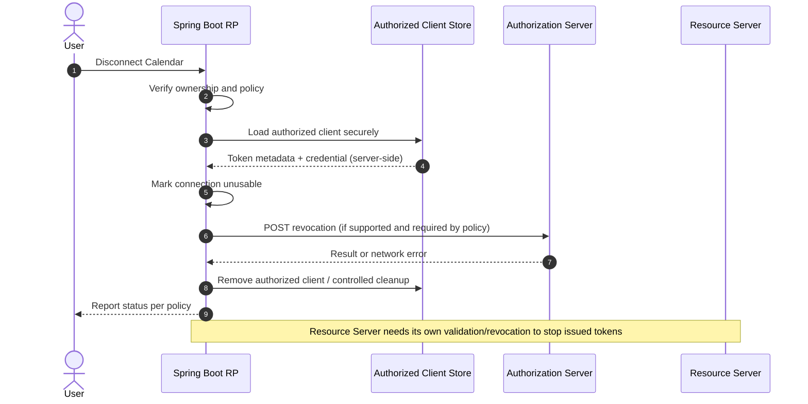
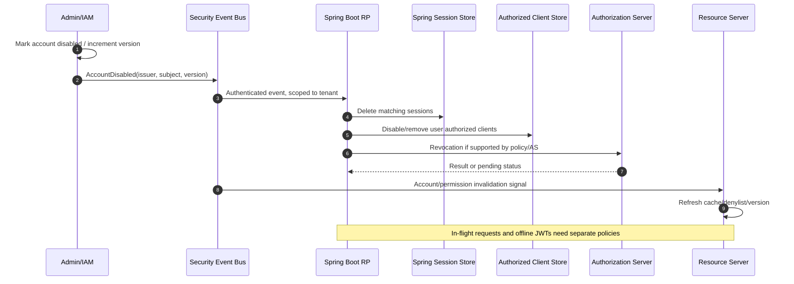

# 23.5. Data Lifecycle on Logout, Account Lock, or Permission Revocation

> **Module:** Spring Security OAuth 2.0 OIDC Client  
> **Chapter:** 23. Token and Session Storage  
> **Focus:** Designing the OAuth 2.0/OIDC Client data lifecycle in Spring Security when a user logs out, an account is disabled, permissions change, or an API integration grant is revoked. Clearly distinguishing login sessions, authorized clients, access tokens, refresh tokens, OpenID Provider SSO sessions, and Resource Server authorization validity.

When a user clicks **Log out**, many Spring Boot apps simply call `/logout` and assume everything has ended. In reality, the system may still hold `OAuth2AuthorizedClient` records in JDBC containing access and refresh tokens; the OpenID Provider (OP) may still keep an SSO session; and Resource Servers may continue accepting already-issued access tokens until expiration or a revocation signal arrives.

The reverse also happens: an administrator **locks an account** at the Identity Provider, yet an existing `HttpSession` remains active in the Spring Security app. Or a user has `ADMIN` removed, while `Authentication.getAuthorities()` in the session still holds authorities computed during an earlier login. In both cases, "the token has not expired" does not prove access is still permitted.

Therefore, data lifecycle cannot be solved by a single session deletion or a single `removeAuthorizedClient(...)` call. Applications need policies per event, covering all involved stores, acceptable revocation latency, cross-instance synchronization, and Resource Server behavior.

**Core principle:** **logout, account lock, and permission revocation are distinct business/security events**. They may trigger overlapping actions, but they do not automatically clear the same data or invalidate every credential.

---

## 1. Learning Objectives

After this lesson, you can:

1. List the data involved in login and OAuth2 Clients: `SecurityContext`, `HttpSession`, session cookies, `OAuth2AuthorizedClient`, access tokens, refresh tokens, ID tokens, SSO sessions, and authorization info.
2. Distinguish **local logout**, **RP-Initiated Logout**, **OIDC Back-Channel Logout**, **disconnecting an API**, **account locking**, and **permission revocation**.
3. Understand what happens by default when Spring Security handles logout on the Servlet stack, and what **does not happen automatically**.
4. Distinguish `OAuth2AuthorizedClientRepository` (HTTP request/session scoped) from `OAuth2AuthorizedClientService` (registration ID and principal name scoped).
5. Explain why deleting a local authorized client does not mean revoking the token at the Authorization Server.
6. Explain RFC 7009 Token Revocation, the limits of offline JWT validation at Resource Servers, and introspection cache latency.
7. Design invalidation of active sessions when an account is locked rather than blocking only the next login.
8. Handle revoked permissions while `Authentication` or JWT claims still hold stale authorities.
9. Design retryable, deduplicated revocation/cleanup flows that avoid leaking tokens.
10. Use `LogoutHandler`, `OidcClientInitiatedLogoutSuccessHandler`, `OAuth2AuthorizedClientService`, and Spring Session according to their proper roles.
11. Establish retention, auditing, and data minimization policies for sensitive credentials.
12. Build a test matrix covering multiple devices, multiple instances, live sessions, unexpired tokens, and delayed revocation signals.

## 2. Map of Data to Manage

A Spring Security OIDC Client application does not have just one "token" or one "session".

| Data | Managing Party | Purpose | Typical Storage | Termination Mechanism |
|---|---|---|---|---|
| Application `HttpSession` | Relying Party (RP) / Servlet container / Spring Session | Maintain web session | Memory, Redis, JDBC... | Timeout, logout, session invalidation |
| Session cookie, e.g. `JSESSIONID` | Browser and RP | Reference session | Browser cookie | Cookie deletion, expiry, server session gone |
| `SecurityContext` | Spring Security RP | Store authenticated `Authentication`/authorities | Session or configured repository | Logout, clear context, session invalidation |
| `OAuth2AuthenticationToken` | Spring Security RP | Represent principal logged in via OAuth2/OIDC | `SecurityContext` | Follows `Authentication`/session lifecycle |
| `OAuth2AuthorizedClient` | OAuth2 Client RP | Store Client registration, access token, and refresh token if any | HTTP session, in-memory/JDBC/custom service | Remove, cleanup, reauthorization lifecycle |
| Access token | Authorization Server (AS), RP, Resource Server (RS) | Call APIs | Authorized client and HTTP requests to RS | Expiry, revocation/policy at AS/RS |
| Refresh token | AS and RP Client | Request new access tokens | Protected authorized client storage | Expiry, rotation, revocation, local removal |
| ID token | OP and RP | OIDC user authentication result | User principal/authorized login state per implementation | ID token expiry (does not auto-delete session) |
| OP SSO session | OpenID Provider | Maintain authentication at OP | OP-side cookie/session | End-session, OP timeout, global logout |
| Consent/authorization grant | AS/OP | Record which scopes a Client may access | AS-side grant store | User/admin revokes consent, policy update |
| Business roles/permissions | IAM/app/RS system | Decide permitted operations | DB, PDP, JWT claims, session authorities, caches | Permission change, cache eviction, revalidation |
| Audit/security events | RP/AS/RS | Traceability per policy | Event log/SIEM | Retention and deletion per policy |

Rows in this table can exist **simultaneously** with independent lifecycles. Deleting one row does not necessarily delete the others.

### 2.1. Example of One Login and One API Connection

```text
Browser
├── RP Cookie: JSESSIONID = abc
└── OP Cookie: SSO_SESSION = xyz  (different domain)

Spring Boot RP
├── HttpSession abc
│   └── SecurityContext
│       └── OAuth2AuthenticationToken
│           ├── registrationId = corporate-login
│           └── principalName = user-734
└── OAuth2AuthorizedClientService (JDBC)
    ├── (corporate-login, user-734) -> access/refresh token A
    └── (calendar-api, user-734)    -> access/refresh token B

Authorization Server / OP
├── SSO session xyz
├── Authorization grant for corporate-login
└── Authorization grant for calendar-api

Resource Server
├── Calendar API validates access token B
└── Reports API uses different tokens/permissions
```

If the browser logs out of the RP:

- Session `abc` may be destroyed.
- The RP cookie may be cleared.
- The JDBC record for `calendar-api` **may still exist**.
- The SSO session `xyz` at the OP **may still exist**.
- Already-issued access token B **may still be accepted by the RS**.

This is not necessarily a framework bug: it reflects separate data stores and policies. The real question is **which behavior the product requires, and whether the application implements it**.

## 3. Three Questions to Answer When an Event Occurs

For every security event, ask:

**Question 1 — Who must lose access?**

- Only the current browser/session?
- All devices belonging to the same user?
- A specific integration/Client registration?
- The entire account?
- One tenant, one workspace, or one permission such as `REPORT_EXPORT`?

**Question 2 — Which actions must stop?**

- Opening RP pages?
- Continuing to call APIs with issued tokens?
- Refreshing tokens to obtain new access tokens?
- Starting a new OIDC Login?
- Background workers continuing offline access?
- Performing sensitive business operations while a session lingers?

**Question 3 — Which data must be invalidated or deleted?**

- `HttpSession`/`SecurityContext`?
- Authorized clients in the HTTP session?
- Authorized clients in JDBC?
- Refresh tokens/grants at the AS?
- The SSO session at the OP?
- Caches, JWT denylists, session indexes?
- Personal data and audits per retention policy?

Without answering all three questions, "lock the user" often turns into setting `enabled=false` in a database while other access paths continue working.

## 4. Event Classification and Expectations

| Event | Typical Goal | Do Not Assume Automatically |
|---|---|---|
| User clicks **Log out this device** | End the current authenticated RP session | Tokens for all integrations/devices are auto-revoked |
| User clicks **Log out all devices** | Invalidate all RP sessions for the user, possibly OP sessions per policy | One `session.invalidate()` suffices across a cluster |
| User clicks **Disconnect Calendar** | Stop using the Calendar registration's authorization/tokens | User must be logged out of the RP app |
| User withdraws consent at OP | Stop authorization granted to the Client | RP definitely receives the event immediately |
| Admin **locks account** | Block login and active access per policy | Existing sessions/issued JWTs automatically know account state |
| Admin **revokes `ROLE_ADMIN`** | Block operations requiring that role | Authorities in sessions/JWTs automatically update |
| Password reset due to suspected compromise | May force reauthentication and revoke sessions/tokens per security policy | Every password reset carries identical semantics |
| Individual token revoked | Stop use of that specific credential | OP SSO session or RP session ends automatically |
| OP sends Back-Channel Logout | RP terminates matching sessions per Logout Token | All OAuth2 access tokens at every RS are auto-revoked |

This table shows **target design expectations**, not a single universal default of Spring Security or every OP.

## 5. Local Logout in Spring Security Servlet

In Spring Security Servlet, web logout is handled by logout components in the security filter chain. With standard configuration, logout can:

- Retrieve the current `Authentication`.
- Clear `SecurityContext`.
- Invalidate `HttpSession` via logout handlers.
- Delete configured/relevant cookies.
- Redirect or return a logout success response.

In standard CSRF-enabled configurations, logout should use **POST** with a valid CSRF token; avoid creating a side-effecting GET logout endpoint that bypasses CSRF protection.

### 5.1. Local Logout Is Not Token Revocation

A minimal configuration:

```java
import org.springframework.context.annotation.Bean;
import org.springframework.context.annotation.Configuration;
import org.springframework.security.config.Customizer;
import org.springframework.security.config.annotation.web.builders.HttpSecurity;
import org.springframework.security.web.SecurityFilterChain;

@Configuration
class WebSecurityConfig {

    @Bean
    SecurityFilterChain securityFilterChain(HttpSecurity http)
            throws Exception {

        return http
            .authorizeHttpRequests(auth -> auth
                .requestMatchers("/", "/error").permitAll()
                .anyRequest().authenticated()
            )
            .oauth2Login(Customizer.withDefaults())
            .logout(logout -> logout.logoutSuccessUrl("/"))
            .build();
    }
}
```

After logout, new requests to protected endpoints follow the RP's login policy. However, the snippet above **does not guarantee**:

- Deleting any `OAuth2AuthorizedClient` in JDBC.
- Calling an RFC 7009 Token Revocation Endpoint.
- Logging out of the OP SSO session.
- Revoking JWT access tokens already sent to RSs.
- Clearing sessions across all devices.
- Updating application permission caches.

Achieving those requires explicit **policies and integrations**.

### 5.2. SecurityContext and Sessions

`Authentication` lives inside `SecurityContext`. Once the session is invalidated, new requests no longer receive that session's `Authentication`. However, requests that already started before logout may still be executing.

Never claim "logout immediately aborts every in-flight operation". For critical business actions, perform authorization checks close to commit time or use explicit task cancellation.

## 6. Deleting Cookies vs. Deleting Server-Side Sessions

A cookie holding a session ID is not the session record itself.

| Action | Effect | Limitation |
|---|---|---|
| `HttpSession.invalidate()` | Invalidates current server-side session | Does not auto-revoke tokens at the AS |
| Delete `JSESSIONID` cookie | Browser stops sending that cookie | Does not auto-delete session records across a cluster |
| Clear site cookies via browser directive | Clears certain origin-scoped browser state | Cannot delete OP cookies on another domain |
| Spring Session `deleteById` | Deletes specific session record from shared store | In-flight requests may still finish; indexes must align |
| Clear `SecurityContext` | Removes `Authentication` from current context | Does not directly touch JDBC authorized clients |

If using `Clear-Site-Data` after logout, understand origin scope and browser support; avoid blanket storage-wipe directives if the app keeps legitimate user data in browser storage.

### 6.1. One Device or All Devices?

Default browser logout targets the current session. A "log out everywhere" feature requires finding and deleting **every session for that principal** in a shared session store, while also addressing caches and propagation delays.

With per-node in-memory HTTP sessions, hitting one node cannot delete a user's sessions across all pods. You need a shared session store or distributed invalidation mechanism.

## 7. RP-Initiated Logout: Logging Out at the OP

With OpenID Connect, the RP can use **RP-Initiated Logout** if supported by the OP. Spring Security Servlet provides `OidcClientInitiatedLogoutSuccessHandler` to redirect to the OP's end-session endpoint per metadata.

Example:

```java
import org.springframework.context.annotation.Bean;
import org.springframework.security.oauth2.client.registration.ClientRegistrationRepository;
import org.springframework.security.oauth2.client.oidc.web.logout.OidcClientInitiatedLogoutSuccessHandler;
import org.springframework.security.web.authentication.logout.LogoutSuccessHandler;

@Bean
LogoutSuccessHandler oidcLogoutSuccessHandler(
        ClientRegistrationRepository registrations) {

    OidcClientInitiatedLogoutSuccessHandler handler =
        new OidcClientInitiatedLogoutSuccessHandler(registrations);

    handler.setPostLogoutRedirectUri("{baseUrl}/");
    return handler;
}
```

Wire the handler into `SecurityFilterChain`:

```java
.logout(logout ->
    logout.logoutSuccessHandler(oidcLogoutSuccessHandler)
)
```

This **replaces** `logoutSuccessUrl("/")` from the previous section—do not declare both expecting both to control the final redirect.

### 7.1. Things to Verify

- Does the OP publish/support an end-session endpoint?
- Is the post-logout redirect URI registered/allowed by the OP?
- Does the browser actually follow the redirect to the OP?
- Do ID Token hint, state, and logout parameters match the OP's contract?
- Is the RP session invalidated before/at the right time?
- If OP logout fails or the user closes the tab, how is RP state handled?

Never construct an arbitrary end-session URL and redirect browsers there without verifying metadata and trust boundaries.

### 7.2. OP Logout Does Not Auto-Revoke All Access Tokens

An OP can end the browser's SSO session while unexpired API access tokens still exist. These are **different mechanisms**:

- End-session: manages the authentication session at the OP.
- Token revocation: asks the AS to revoke credentials/grants.
- Session invalidation at RP: terminates the RP web session.
- Resource Server validation: decides whether to accept a token on a specific request.

Coordinate all mechanisms if the product requires "log out and stop all access".

## 8. OIDC Back-Channel Logout: OP Notifies RP

**Back-Channel Logout** is an OIDC mechanism where the OP sends a logout message to the RP over a back channel. It is useful when a user logs out at the OP or another application and the OP notifies linked RPs.

The message contains a **Logout Token** with standard claims, such as:

- `iss`: issuing OP.
- `aud`: receiving RP/Client.
- `iat`: issuance timestamp.
- `jti`: unique ID to prevent duplicate processing.
- `events`: identifies the back-channel logout event.
- `sid` and/or `sub` per spec/configuration.

A Logout Token is neither an ID token nor an API access token. The RP must verify its signature/issuer/audience, event type, lifetime/replay policy, and session correlation.

### 8.1. Impact on Sessions

After validating a Logout Token, the RP identifies **which sessions** match and invalidates them per policy:

```text
OP logout event
    |
    v
Verify Logout Token
    |
    v
Map (issuer, sid/sub, client) -> RP sessions
    |
    v
Invalidate matching sessions
    |
    v
Do not automatically assume API token revocation
```

Simply accepting a JSON/JWT labeled "logout" is not enough to delete sessions. Without verifying the sender and token validity, attackers could forge logout requests to disrupt other accounts.

### 8.2. Delayed or Replayed Logout Tokens

Event delivery may not be instantaneous, and events may be redelivered. Design idempotency using `jti`/issuer and replay policies. Never assume "the session is always deleted before the browser's next request" unless the system guarantees it.

Spring Security supports OIDC back-channel logout in specific versions/configurations; check the exact Spring Security version syntax and OP metadata before deploying to production.

## 9. Storing OAuth2AuthorizedClient: HTTP Session vs. JDBC Service

Spring Security Servlet offers two key abstractions:

**`OAuth2AuthorizedClientRepository`**

- Bound to `HttpServletRequest`, `HttpServletResponse`, and `Authentication`.
- Can store data in the HTTP session or delegate to a service.

**`OAuth2AuthorizedClientService`**

- Saves/loads/removes authorized clients by registration ID and principal name.
- Does not require an HTTP request.
- Provides in-memory or JDBC implementations.

Example:

```text
Web Login
   |
   v
OAuth2AuthorizedClientRepository
   ├── HttpSessionOAuth2AuthorizedClientRepository
   │      └── HttpSession
   └── AuthenticatedPrincipalOAuth2AuthorizedClientRepository
          └── OAuth2AuthorizedClientService
                ├── InMemory
                └── JdbcOAuth2AuthorizedClientService
```

### 9.1. Does Logout Delete the Authorized Client?

**It depends on where the data is stored.**

- If the authorized client lives inside the invalidated HTTP session, it disappears with the session.
- If it lives in `JdbcOAuth2AuthorizedClientService`, the record can survive logout.
- With a custom repository/service, behavior depends on your implementation and handlers.
- If a background job shares that JDBC service, the job can still load tokens after the browser logs out.

Do not base critical policies on assuming "the framework cleans up everything automatically" when storage is customized.

### 9.2. Decide Based on Integration Semantics

There are two distinct product models:

**Model A — API connection tied to the web session.**

On logout, the authorized client tied to that session may need to be removed if required by business logic/consent. Tokens must not continue being used offline.

**Model B — User connects an external service for long-lived syncing.**

When logging out of the website, the integration can keep running under **valid offline authorization**. A separate "Disconnect Service" button removes/revokes that authorization.

Both models are valid when clearly explained to users and paired with proper revocation/consent controls. Never silently keep long-lived tokens if the product promises logout halts all access.

## 10. Service Methods and Deletion Limits

`OAuth2AuthorizedClientService` defines this core contract:

```java
<T extends OAuth2AuthorizedClient> T loadAuthorizedClient(
    String clientRegistrationId, String principalName);

void saveAuthorizedClient(
    OAuth2AuthorizedClient authorizedClient,
    Authentication principal);

void removeAuthorizedClient(
    String clientRegistrationId, String principalName);
```

Example disconnecting one registration:

```java
authorizedClientService.removeAuthorizedClient(
    "calendar-api",
    authentication.getName()
);
```

This operation **deletes only the local keyed record** in the injected service.

### 10.1. There Is No `removeAllByPrincipal()` in the Standard Interface

If you need to "delete all authorized clients for a user", `OAuth2AuthorizedClientService` provides no built-in method to list and delete every registration for a principal.

Options:

- The app knows the finite list of allowed registrations and deletes each registration/principal pair.
- Maintain a separate ownership index table for authorized client records.
- Implement a custom store/admin service supporting queries/deletions by principal and tenant.
- Partition storage by namespace/tenant for safe cleanup.
- If touching JDBC directly, follow the store's schema/migration and transaction rules to avoid corrupting Spring Security's data.

**Never pretend `removeAllByPrincipal(...)` exists on the interface** and assume code will compile.

### 10.2. Principal Name Must Be Trusted

Never let an HTTP caller supply `principalName=someoneElse` to select an authorized client to read or delete. Derive the principal from the verified `Authentication` or an authorized admin event.

In multi-tenant or multi-issuer systems, use a stable namespaced key, such as an internal mapping from `(issuer, subject)`. Unverified or mutable emails are unsafe default keys for token storage lookups.

## 11. Customizing Logout to Remove a Service Authorized Client

If product policy dictates that local logout **must delete** a specific integration stored in `OAuth2AuthorizedClientService`, register a custom `LogoutHandler`.

Illustrative example:

```java
import org.springframework.context.annotation.Bean;
import org.springframework.security.oauth2.client.OAuth2AuthorizedClientService;
import org.springframework.security.config.Customizer;
import org.springframework.security.config.annotation.web.builders.HttpSecurity;
import org.springframework.security.web.SecurityFilterChain;

@Bean
SecurityFilterChain securityFilterChain(
        HttpSecurity http,
        OAuth2AuthorizedClientService authorizedClients) throws Exception {

    return http
        .authorizeHttpRequests(auth -> auth
            .anyRequest().authenticated()
        )
        .oauth2Login(Customizer.withDefaults())
        .logout(logout -> logout
            .addLogoutHandler((request, response, authentication) -> {
                if (authentication != null) {
                    authorizedClients.removeAuthorizedClient(
                        "calendar-api",
                        authentication.getName()
                    );
                }
            })
            .logoutSuccessUrl("/")
        )
        .build();
}
```

**Explicit limitations of this example:**

- Deletes only `calendar-api` for the current principal **in the configured service**.
- Does not revoke the refresh token at the OP/AS.
- Does not delete other registrations.
- Does not delete records from a separate HTTP-session-only repository if the service is not the actual store.
- This is a policy choice; **not a recommendation to always delete every integration on logout**.

### 11.1. When Both Revocation and Local Cleanup Are Needed

Avoid making long blocking Token Endpoint network calls directly inside `LogoutHandler` without timeouts and failure policies. HTTP logout must behave reliably and never leak credentials in logs.

A production "Disconnect" workflow might do:

1. Verify integration ownership.
2. Load the authorized client from the actual store.
3. Identify the refresh token to revoke if supported by the AS.
4. Call revocation via a secured client or enqueue a safe, deadline-bound task.
5. Delete the local record / mark disconnected per policy.
6. Block backend jobs from reusing that connection while remote revocation is pending.
7. Record audit metadata without logging token values.

Design ordering and network-failure handling carefully. Do not delete token material too early and lose the ability to execute remote revocation, unless the product accepts local-only disconnect.

## 12. RFC 7009: Token Revocation Is a Separate Operation

**RFC 7009 — OAuth 2.0 Token Revocation** defines how a Client asks an AS to revoke a token.

Illustrative request:

```http
POST /oauth2/revoke HTTP/1.1
Host: login.example.test
Authorization: Basic <redacted-client-credentials>
Content-Type: application/x-www-form-urlencoded

token=<redacted-refresh-token>&token_type_hint=refresh_token
```

Key points:

- The Client sends the token to the **revocation endpoint provided by the AS**.
- Client authentication must match the registration.
- `token_type_hint` is only a hint, not a guarantee; the AS may determine the token type itself.
- Per spec, a successful response may not reveal whether the token was previously valid, preventing token probing.
- An AS may also revoke related access tokens/authorization grants depending on policy.
- Not every OP supports the same endpoint or revocation semantics.

### 12.1. Deleting Local Tokens Does Not Equal Revoking at the AS

```java
authorizedClientService.removeAuthorizedClient(registrationId, principalName);
```

is a local operation. RFC 7009 is an HTTP call to the AS. They can be combined, but neither replaces the other.

### 12.2. After Revoking a Refresh Token, What About JWT Access Tokens?

The AS can reject future refreshes, yet an already-issued JWT access token may still be accepted by Resource Servers until `exp` if the RS performs only **offline** signature/issuer/audience/expiry checks.

Token invalidation lag depends on:

- Token format (JWT vs. opaque).
- Whether the Resource Server uses introspection, denylists, or version checks.
- Whether the AS emits push/continuous access signals.
- RS/introspection cache TTLs.
- Whether the API authorization layer checks account status per request.
- Access token lifetime and clock skew.

Thus, "AS returned 200 on revoke" does not guarantee every API stops accepting an issued JWT **at that exact instant**.

## 13. Ordering Revocation, Local Cleanup, and Failure Handling

A "Disconnect" flow spans two separate systems:



This is a **conceptual sequence**, not a distributed transaction guarantee. There is no shared ACID transaction across RP, AS, and RS.

### 13.1. What If the AS Is Unreachable?

Choose a clear policy:

- **Immediate local disconnect:** mark the connection disabled so jobs stop using the token; retry remote revocation safely per design. Protect any temporary token material used for retries—never store credentials in plaintext queues.
- **Fail and let the user retry:** do not claim remote revocation succeeded before confirmation; you may still block local usage.
- **Synchronous revoke then delete:** viable when the AS is reliable and low-latency, provided strict timeouts and error handling are in place.

Never report "revoked across all devices" if only the local record was deleted.

### 13.2. What If You Delete the Record Before Calling Revoke?

If the only copy of the token is deleted, you may no longer have `tokenValue` to send to the revocation endpoint. If remote revocation is required, design ordering or a temporary workflow protecting the token in short-lived, encrypted, least-privilege storage.

**Never store plaintext refresh tokens in event buses, audit logs, or dead-letter queues** for retry convenience.

### 13.3. Idempotency of Disconnect

A user may click "Disconnect" twice or a message may be redelivered. The desired end state is **connection disabled, no longer used**. Never resurrect an old token because a delayed retry event arrived.

## 14. Locking an Account: Not Just Blocking New Logins

An account can be locked when:

- An admin disables the user.
- A user reports a lost device or compromised account.
- An employee leaves the organization.
- The system detects account takeover signals.
- Tenant policy revokes the user's access.
- The OP reports the account is disabled.

The requirement is usually stronger than local logout: **every active session and every access path for that account must be evaluated**.

### 14.1. Layers to Control

1. **New logins:** verify whether the user is still allowed to log into the RP.
2. **Existing sessions:** invalidate matching sessions without waiting for user logout.
3. **Authorized clients:** block usage of tokens/grants for the locked account per policy.
4. **Refresh tokens:** revoke where possible and required, or ensure the AS refuses further issuance.
5. **Resource Servers:** check access token/authorization close to usage time, especially for sensitive APIs.
6. **Background jobs:** halt offline access on the user's behalf.
7. **Caches:** clear/invalidate related decision caches.
8. **Audits:** record who/what locked the account and step outcomes without logging tokens.

### 14.2. Does Locking an Account at the OP Auto-Delete RP Sessions?

**There is no universal guarantee.** The RP may have created `Authentication` from an earlier OIDC login and retained it in the session. When the OP locks the account, the RP only learns about it via event notifications, back-channel logout, token revalidation, or dedicated account-status checks.

Even if the OP rejects new refresh tokens, RP requests **that do not call external APIs** may still succeed under the old session unless the RP checks account status.

For systems requiring rapid account-lock enforcement, combine **session invalidation + runtime authorization checks** rather than waiting for tokens to expire.

### 14.3. Do Not Confuse UserDetailsService with OAuth2 Login

If the app uses OIDC Login instead of form login, setting `UserDetails.enabled=false` in a local table **is not guaranteed** to be consulted by the OIDC authentication pipeline or active sessions. Wire account-status checks directly into your login and authorization logic.

## 15. Blocking New OIDC Logins for Locked Accounts

One approach is wrapping `OidcUserService` with an account-state lookup after OIDC protocol handling completes:

```java
import org.springframework.context.annotation.Bean;
import org.springframework.security.oauth2.client.oidc.userinfo.OidcUserRequest;
import org.springframework.security.oauth2.client.oidc.userinfo.OidcUserService;
import org.springframework.security.oauth2.client.userinfo.OAuth2UserService;
import org.springframework.security.oauth2.core.OAuth2AuthenticationException;
import org.springframework.security.oauth2.core.OAuth2Error;
import org.springframework.security.oauth2.core.oidc.user.OidcUser;

@Bean
OAuth2UserService<OidcUserRequest, OidcUser> checkedOidcUsers(
        AccountAccessService accounts) {

    OidcUserService delegate = new OidcUserService();

    return request -> {
        OidcUser oidc = delegate.loadUser(request);

        String issuer = oidc.getIdToken().getIssuer().toString();
        String subject = oidc.getSubject();

        if (!accounts.isLoginAllowed(issuer, subject)) {
            throw new OAuth2AuthenticationException(
                new OAuth2Error("account_disabled")
            );
        }

        return oidc;
    };
}
```

Here `AccountAccessService` is an **application-defined** business abstraction querying a trusted source by `(issuer, subject)`. This example assumes Spring Security Servlet with synchronous DB/API calls; in WebFlux, use a reactive user service and reactive lookup instead of blocking the event loop.

Wire the service into OAuth2 Login:

```java
.oauth2Login(login -> login
    .userInfoEndpoint(userInfo ->
        userInfo.oidcUserService(checkedOidcUsers)
    )
)
```

This configuration snippet replaces `oauth2Login(Customizer.withDefaults())`—do not paste it as a standalone method outside `SecurityFilterChain`.

### 15.1. Boundaries of This Approach

- It rejects **new OIDC Logins** when the account is locked.
- It **does not automatically find and delete existing active sessions**.
- It **does not automatically revoke JWT access tokens** at the AS.
- It **does not automatically stop background jobs** using the user's refresh token.
- The account source must be reliable with proper timeouts and failure policies.
- Never use unverified emails as the lock key across issuers.

### 15.2. What Should Happen If Account Status Lookup Fails?

If user account state is a mandatory precondition for access, errors should normally **fail closed** or treat state as unverified—never default to allowing login as an active account.

At the same time, design retries, degraded modes, and UX messages to avoid overloading the source of truth during outages.

## 16. Invalidating All Sessions for a User with Spring Session

For multi-instance apps, Spring Session can provide a shared session store and principal indexing. `FindByIndexNameSessionRepository` can look up sessions by principal name when indexing is configured.

Conceptual example for an admin service:

```java
import org.springframework.session.FindByIndexNameSessionRepository;
import org.springframework.session.Session;
import org.springframework.stereotype.Service;

@Service
class UserSessionRevoker {

    private final FindByIndexNameSessionRepository<? extends Session> sessions;

    UserSessionRevoker(
            FindByIndexNameSessionRepository<? extends Session> sessions) {
        this.sessions = sessions;
    }

    void revokeAllLocalSessions(String principalName) {
        sessions.findByPrincipalName(principalName)
            .keySet()
            .forEach(sessions::deleteById);
    }
}
```

**Prerequisites before use:**

- Configured a Spring Session implementation supporting principal lookup and storing the right index.
- `principalName` matches how Spring Security stores/maps the principal in the session.
- The admin event is authenticated and authorized for this operation.
- Mechanisms handle multiple users/tenants and track invalidation results.
- Aware that in-memory requests already executing may still finish after the session record is deleted.

### 16.1. Why Not Just Invalidate the Current Session?

`request.getSession().invalidate()` affects only the session tied to the current request. When an admin locks another user logged in across multiple devices, there is no single `HttpServletRequest` representing all sessions to delete.

You must look up sessions by principal or an application-maintained trusted session-ownership index.

### 16.2. Principal Index Alone May Not Separate Tenants

If the name `alex` appears under two issuers/tenants while the repository index only stores `alex`, deleting by principal name may hit the wrong user or miss sessions.

Establish a stable internal identity mapping—such as deriving a user ID from `(issuer, sub)`—and apply it to principal/session indexing per policy. If changing principal-naming strategies, plan migration/invalidation of legacy sessions and token records.

## 17. "Immediate Lock" and the Limits of Session Invalidation

Even after deleting session records from Redis/JDBC:

- A request that already passed authentication before invalidation may still be running.
- WebSocket/streaming connections need dedicated policies if present.
- Background jobs may already be running without using sessions.
- Other Resource Servers may still accept access tokens.
- Local caches may not have received invalidation yet.

Therefore, for highly sensitive operations, check **account status or authorization version near commit time**, rather than relying solely on session authentication checked at request start.

Example:

```text
Request A starts at 10:00:00; SecurityContext authenticated
Admin locks user at 10:00:01; session record deleted
Request A finishes writing data at 10:00:03
```

Session invalidation does not roll back an already-started transaction. The business layer must enforce appropriate checks if the product promises immediate lock enforcement on all transactions.

### 17.1. Using an Authorization Version

One pattern is storing an `authorizationVersion` or `accountVersion` in a trusted data source:

- Increment the version when changing permissions or locking a user.
- Sessions/tokens or caches record the version used when making decisions.
- Sensitive APIs compare against the latest version.
- If the version is stale, deny/reload authorities/reauthenticate per policy.

This is an **application design pattern**, not a built-in OIDC claim or pre-existing Spring Security property.

## 18. Revoking a Role or Permission vs. Locking an Account

Suppose a user is still allowed to log in, yet loses `ROLE_ADMIN`.

Logging out the whole user is not always right. You may need to:

- Let the user keep using regular features.
- Block admin endpoints/operations immediately per policy.
- Refresh/invalidate authorities in the session.
- Update policy decision caches.
- Never assume an existing JWT access token with `roles=["ADMIN"]` updated itself.
- Require reauthentication or reauthorization for high-risk actions if policy demands.

### 18.1. Authentication Authorities Can Be Stale

`Authentication.getAuthorities()` in `SecurityContext` may be computed at login and persisted in the session:

```java
Authentication authentication = ...;
Collection<? extends GrantedAuthority> authorities =
    authentication.getAuthorities();
```

If an admin removes a role after login, this collection **does not self-update**. Both `@PreAuthorize("hasRole('ADMIN')")` and URL rules reading old authorities will continue allowing access without revalidation.

### 18.2. JWT Claims Can Also Be Stale

A signed JWT access token carrying `roles` or `scope` claims is a snapshot of authorization at issuance time per AS policy. You cannot alter an already-issued token's payload by updating a role in a database.

Mitigations:

- Access token lifetimes short enough for freshness requirements.
- Introspection, token revocation, or denylists where available.
- Runtime authorization checks against a trusted source for sensitive operations.
- Authorization version / last-modified checks.
- Session invalidation or rebuilding `Authentication` when needed.
- AS/RS permission sync mechanisms with clear event/caching policies.

**Token refresh does not automatically update `Authentication.getAuthorities()` in the RP session.**

## 19. Business Permissions and Delegated Scopes Are Not Identical

There are two layers:

**OAuth2 scopes / application roles at AS/RS**

For example, a token carries `reports.read` or `reports.export`. The RS verifies scopes/app roles per contract.

**Internal permissions at RP**

For example, a user may export reports for tenant A, but not tenant B.

Revoking an internal permission may need immediate effect in the authorization layer even if the token still holds `reports.export`. Conversely, revoking consent at the AS may not delete role rows in the RP database.

### 19.1. Do Not Use Scope Refresh as a Permission Update Mechanism

When the AS issues a new access token, claims/scopes can change per policy, yet Spring Security does not automatically update all authorities of an already-logged-in session. Instant permission updates require explicit design.

### 19.2. Avoid Turning 403 into an "Infinite Refresh Loop"

When an RS returns 403, the cause is usually insufficient permissions. Deleting the authorized client and repeatedly requesting new tokens will not change policy and can trigger a token request storm.

Distinguish:

- 401 due to rejected token: handle error/reauthorization properly.
- 403 due to missing permissions: surface/adjust permissions; do not escalate privileges automatically.

## 20. User Withdraws Consent at the OpenID Provider

A user can visit the OP's account management page and revoke an application's grant.

Consequences may include:

- The refresh token is no longer accepted by the AS.
- The next refresh returns `invalid_grant` or a matching error.
- Existing access tokens may remain valid until expiry depending on validation/revocation policy.
- The RP receives no automatic notification unless the OP offers suitable signals/webhooks.
- Local JDBC records may remain even though authorization at the AS was revoked.

### 20.1. What Should the RP Do?

1. Observe and classify refresh failures.
2. When authorization is invalid, mark the integration disconnected / requiring reauthorization.
3. Clean up the local authorized client per policy; avoid retrying the old refresh token forever.
4. Stop background jobs relying on that authorization.
5. When the user returns, require a fresh authorization flow if they want to reconnect.
6. Never "fall back" to a privileged machine Client to keep acting on the user's behalf.

### 20.2. Do Not Claim Immediate Revocation If Detected Only on Next Refresh

Without push events, the RP may detect consent revocation **late**. If business requirements demand immediacy, leverage AS/OP capabilities or RS authorization checks and define a realistic revocation SLA.

## 21. Access Token, Refresh Token, and ID Token: What Gets Revoked?

| Credential | Used For | Can Still Be Used After Local Logout? | Required Controls |
|---|---|---|---|
| Access token | Calling Resource Servers | Possibly, until expiry or RS rejection | TTL, revocation/denylist/introspection, audience and scopes |
| Refresh token | Requesting new access tokens | Possibly, if AS still accepts and Client retains it | Rotation, revocation, storage, offline access policy |
| ID token | Verifying identity at OIDC Client upon issuance/validation | Token data may remain, but is not a general session credential | OIDC validation, data minimization, retention |
| RP session cookie | Referencing HTTP session | Cookie may remain, though destroyed session no longer authenticates | `HttpOnly`/`Secure`/`SameSite`, invalidation |
| OP SSO cookie | Maintaining OP session | Yes, if only local RP logout occurred | OP end-session/logout protocols |

**Never send an ID token as a Bearer access token** to regular Resource Servers. Never use a refresh token to reconstruct RP `Authentication` as a shortcut to avoid re-login after session expiry.

### 21.1. Refresh Token Rotation and Races

If two workers use the old refresh token `R1` simultaneously, the AS may rotate the first request to `R2` and reject the second for reuse. An account-lock or consent-revocation event can also happen mid-refresh; avoid writing new tokens to storage after a connection was marked disabled.

Coordinate concurrency and **state/version checks** when saving authorized clients, especially across multiple instances.

## 22. Offline JWTs, Opaque Tokens, and Revocation Latency

### 22.1. Offline JWT Validation

A Resource Server can validate JWTs using public keys and claims such as:

- `iss`;
- `aud`;
- `exp`/`nbf`;
- scopes/app roles;
- token type and additional policies.

Without calling the AS or an account-status source, the RS may not know an account was just locked or a token just revoked. Tokens may still be accepted until expiration.

### 22.2. Opaque Tokens / Introspection

For opaque tokens, the RS normally calls an introspection endpoint or AS validation service. The AS returns whether the token is active. However:

- The RS may cache introspection responses.
- Network failures can produce varying degraded behaviors.
- `active=true` does not replace authorization checks on specific resources.
- Cache TTL partly determines revocation detection lag.

### 22.3. There Is No Free "Instant Revocation"

If a product requires account locks to take effect across all APIs within seconds, the design may need:

- Push authorization/session events.
- Per-request account checks on critical APIs.
- Denylists/authorization versions.
- Token introspection with tuned cache TTLs.
- Short-lived JWTs paired with disallowing refresh reuse.
- Continuous access evaluation or provider-specific signals where supported.

Every approach trades off latency, availability, consistency, cost, and security.

## 23. Event Sequence: Locking an Account Across Multiple Services



This diagram is an **orchestration model**, not automatic behavior of a single Spring Security bean.

### 23.1. Events Must Be Trustworthy

To stop a forged message from mass-logging out or locking users:

- Authenticate the event publisher.
- Verify signatures or publish permissions on the event bus.
- Validate tenant/issuer/subject/event type.
- Never trust a raw user ID from an unprivileged request.
- Enforce replay protection, versioning, and event IDs.
- Audit actions while safeguarding sensitive data.

### 23.2. Eventual Consistency Must Be Quantified

An event might reach the RP before the RS, or vice versa. Never promise "locking a user blocks everything instantaneously everywhere" if the pipeline only guarantees eventual delivery.

Define revocation SLOs/SLAs: e.g., when sessions must be deleted, when RSs will reject requests, and when the AS refuses refreshes. Measure actual lag via metrics/traces with sensitive data redacted.

## 24. Handling Duplicate and Out-of-Order Events

Suppose:

```text
Event #101: AccountDisabled(user-734)
Event #102: AccountEnabled(user-734)
Event #101 is redelivered after #102
```

If a worker applies event `#101` late without checking version, it can disable an account that was just re-enabled. You need:

- Event IDs for deduplication.
- Account version/sequence numbers to prevent stale states from overwriting newer ones.
- Persisted account state at the source of truth.
- Idempotent operations: deleting a session twice never restores it.
- Retry and dead-letter policies without putting plaintext tokens into queues.
- Never assume topic delivery order holds cluster-wide without an explicit contract.

### 24.1. "Delete" Must Not Be Reversed by an Old Attempt

Race condition:

1. Worker A reads the authorized client and starts a refresh.
2. Admin revokes the connection; Worker B marks it disabled and deletes the record.
3. Worker A receives a new access token and saves the authorized client back.
4. The connection is **resurrected** without a check.

A solid design checks connection state/version before saving and rejects writes from attempts started before revocation. This goes beyond the basic `OAuth2AuthorizedClientService` interface and may require a custom storage/coordination layer.

## 25. Coordinating with Background Jobs

Some integrations run without an open browser:

- Scheduled calendar imports.
- Email or document syncing.
- Batch exports under offline authorization.
- CRM data ingestion.
- Event consumers acting on behalf of a user.

When an account is locked or consent is revoked, a worker may still hold an authorized client in memory. Therefore:

1. Every job must check connection/account state before starting and near side-effect time.
2. Never cache tokens or authorization decisions indefinitely.
3. Never assume "the refresh token still works" means the user still has access.
4. If an account is locked, stop/suspend jobs per policy.
5. If consent is revoked, never fall back to broader machine Client privileges.
6. If an in-flight job already started, check state/version when committing or publishing results if needed.

### 25.1. Client Credentials vs. Delegated User Tokens

A service's `client_credentials` token does not inherently belong to a logged-in user. Locking one user does not require revoking every machine token in the organization.

Conversely, using a machine token to continue accessing a locked user's data may violate policy even though the machine token itself remains valid. This is a **business authorization** decision, not merely a token-type question.

## 26. What Data Remains After Access Is Revoked?

"Delete tokens" and "delete user data" are not the same requirement.

| Data Type | After Local Logout | After Integration Disconnect | After Account Deletion / Offboarding |
|---|---|---|---|
| RP session | Usually invalidates target session | Usually can stay | Usually must be revoked per policy |
| Authorized client | Depends on storage/policy | Deletes/disables matching registration | Cleaned up across user/tenant scope |
| Token value | Never returned to browser; may remain in storage | Revoked + deleted locally when specified | Never retain credentials without purpose |
| User profile cache | May remain per TTL/policy | Depends on data source | Deleted/anonymized per policy |
| Account settings | Retained | Retained | Separate deletion/retention policy |
| Audit/security events | May retain minimal metadata | May log disconnect event | Retained per compliance obligations and policy |
| Synced API data | Not necessarily deleted | Depends on consent/data contract | Handled per ownership, retention, and purpose |
| Backups | Do not vanish immediately | Per backup retention | Needs safe retention/restoration plan |

### 26.1. Never Promise Immediate Erasure of Every Copy

Deleting from the active database does not automatically erase:

- Snapshots;
- Redis replicas;
- Backups;
- Audit logs;
- Crash dumps;
- Traces;
- Event archives;
- Caches in RSs or third-party services.

Data policies must specify retention, copy protection, disposal when backups expire, and preventing revoked credentials from "coming back to life" after restores.

### 26.2. Never Log Tokens in Audits "For Evidence"

Audits need only non-sensitive metadata, for example:

```text
event=integration_disconnected
registrationId=calendar-api
internalSubjectId=user-734
actorType=end_user
outcome=local_removed
remoteRevocationStatus=pending
correlationId=evt-1023
tokenValue=[never-log]
```

If an event must retain token material for revocation retries, use dedicated encrypted storage with minimal retention—never plaintext logs.

## 27. Restricting Access to Token Storage

`JdbcOAuth2AuthorizedClientService` can store token values in a database. Even a single unauthorized `SELECT` can expose bearer credentials.

Essential controls:

- Separate DB read/write permissions per principle of least privilege.
- TLS for network connections to the database.
- Encryption at rest and consider application-layer encryption of token values per threat model.
- Restrict backups/dumps and manage encryption keys.
- Never expose `OAuth2AuthorizedClient` in HTTP responses.
- Never put raw tokens into exception messages.
- Enforce principal-registration-tenant ownership on load/remove.
- Clean up orphaned authorized client records per policy without accidentally deleting records whose account mapping is uncertain.

### 27.1. Token Storage Services Do Not Auto-Enforce Ownership

The method:

```java
authorizedClientService.loadAuthorizedClient(
    registrationId,
    principalName
);
```

takes whatever key the caller passes. If an endpoint lets a user pick `principalName`, the service does not know whether the caller is allowed to read that principal's token. Controllers/services must derive the principal from verified `Authentication` or an authorized admin context.

### 27.2. Multi-Issuer and Multi-Tenant

Two issuers can both issue `sub="42"`. If a system uses `"42"` as an un-namespaced key in the token store or session index, it risks:

- Deleting someone else's token.
- Missing sessions that need revocation.
- Using an authorized client from the wrong tenant.
- Granting access to the wrong account.

Use namespaced identity mappings and keep login, session indexes, authorized-client keys, audit events, and job owners consistent.

## 28. Managing Caches and Issued Artifacts

When permissions change, stale data may reside in:

- RP `SecurityContext`/sessions.
- JWT claims at clients/RSs.
- Backend authorization result caches.
- `@Cacheable` role/permission caches.
- Resource Server introspection caches.
- Browser/UI caches (display-only, never trusted for enforcement).
- API Gateway authorization caches.
- Worker memory.

Clearing cache in just one layer fails if another layer still trusts old decisions.

### 28.1. Hiding UI Buttons Is Not Security

After `ROLE_ADMIN` is revoked, the frontend may hide the admin button. Yet APIs must still verify permissions server-side on every call; browsers can send HTTP requests even when the UI hides elements.

### 28.2. When Should Permissions Be Re-Fetched?

Depends on risk level:

- Low-sensitivity permissions: short cache + event invalidation may fit.
- High-privilege actions: pre-operation revalidation or a policy decision engine.
- Financial transactions / security setting changes: check authorization near commit time; consider step-up authentication.
- Account locked: favor deny-checking at primary entry points while revocation propagates.

No single TTL fits every feature.

## 29. Network Failures and the Impossibility of Distributed Transactions

Revocation/cleanup flows can encounter:

- AS times out even though it revoked the token.
- RP deletes DB tokens before sending revocation.
- Token revocation succeeds while deleting the local record fails.
- Session store temporarily loses connectivity.
- Event bus redelivers account lock events.
- A worker finishes a refresh started before the connection was disabled.
- An RS has not received invalidation yet while an access JWT remains unexpired.

### 29.1. Design with Explicit States, Not a Single Boolean

An integration can track states:

```text
CONNECTED
   |
   v
DISCONNECT_REQUESTED
   |
   v
LOCALLY_DISABLED
   |
   +--> REVOCATION_PENDING
   |       |
   |       +--> REVOCATION_CONFIRMED
   |       +--> REMOTE_RESULT_UNKNOWN
   |
   v
CLEANED_UP
```

This is an illustrative state model; exact names and transitions depend on your product. What matters: **block local usage** as soon as disconnect is accepted, even while remote revocation is pending.

### 29.2. When Remote Results Are Unknown

If the AS times out after receiving the request, you cannot know whether revocation succeeded or failed. RFC 7009 has semantics supporting idempotent revocation, yet implementation and network reliability still need clear policies.

Retry within bounded limits per spec/provider while keeping the connection disabled. Never re-enable an account or token just to "wait for the AS".

## 30. Event Decision Table

| Event | RP Sessions | Local Authorized Client | AS/OP Action | RS/API Action |
|---|---|---|---|---|
| Log out current device | Invalidate current session | Per policy (session store vs. JDBC) | OP end-session if user chooses SSO logout | Usually unchanged unless policy requires |
| Log out all devices | Invalidate all RP sessions for user | Review offline connection policy | May invoke OP global logout and revoke tokens if supported | Revalidation/denylist if rapid enforcement is needed |
| Disconnect Calendar | Can keep session | Disable/remove `calendar-api` | Revoke refresh token/grant per provider | Stop using Calendar tokens |
| Lock account | Revoke all user sessions | Disable/revoke user-delegated clients per policy | Disable/revoke at AS/OP if integrated | Account-deny checks, token invalidation/claim freshness |
| Revoke `ROLE_ADMIN` | Can keep session, but must update authorities/decisions | Not required to delete all tokens | Update app permissions/AS roles if applicable | Reject admin operations within SLA |
| OP sends Back-Channel Logout | Invalidate sessions matching event | Does not automatically delete JDBC tokens | OP initiated event | Per dedicated policy |
| User withdraws consent at AS | Does not necessarily log out RP | Remove/disable connection once detected | AS revoked authorization | Token handling per AS/RS |
| Delete account | Revoke sessions | Delete/disable credentials | Revoke/cleanup per provider | Reject all access for principal |
| Refresh token `invalid_grant` | Session may still exist | Clean up authorized client / mark reauthorize needed | AS rejected grant | Stop background access once authorization expires |

This is a **reference design matrix**; concretize it with product requirements, IAM policies, and actual AS/OP/RS capabilities.

## 31. Lifecycle Logging and Observability

To verify that the system actually revokes access on time, track metrics:

| Metric / Event | Meaning |
|---|---|
| `security.account_disabled.events` | Count of account-lock events received |
| `security.session_revocations` | Count of deleted/invalidated sessions |
| `security.session_revocation_latency` | Lag from event to session store completion |
| `oauth2.authorized_client_removals` | Count of locally cleaned-up authorized clients |
| `oauth2.remote_revocation_attempts` | Count of calls to AS revocation endpoint |
| `oauth2.remote_revocation_failures` | Remote revocation errors by category |
| `oauth2.refresh.invalid_grant` | Refreshes rejected, potentially due to revocation/rotation |
| `security.permission_cache_invalidations` | Authorization caches invalidated |
| `security.revocation_end_to_end_latency` | Time until RS/RP effectively blocks access per SLA |
| `security.stale_session_access_denied` | Requests denied due to changed account/version |

These names are **illustrative application metrics**, not built-in Spring Security metrics.

### 31.1. Tracing Without Exposing PII or Tokens

Use correlation IDs, event IDs, registration IDs, and controlled opaque internal user IDs. Never log access tokens, refresh tokens, ID tokens, client secrets, session cookies, or raw `Authorization` headers.

Restrict who can view audit logs: even without tokens, account-lock events and IAM metadata are sensitive.

## 32. Lab A — Local Logout Leaves JDBC Tokens Intact

**Goal:** observe two independent stores.

**Setup:** Spring Boot Servlet OIDC Client, Spring Security, JDBC authorized client service, a test OP, and a `calendar-api` registration with test tokens.

**Steps:**

1. Log in with OIDC and verify `/me` has `Authentication`.
2. Connect Calendar so an authorized client is stored in the JDBC service.
3. Verify **the record exists** without printing token values.
4. Submit a valid POST `/logout`.
5. Visit `/me`: the browser no longer has the previous `Authentication` per policy.
6. Inspect the JDBC service: the authorized client may still be present.
7. Build/verify a cleanup policy for a "Disconnect Calendar" feature.
8. Confirm local logout does not imply remote token revocation.

**Expected outcome:** HTTP sessions and JDBC authorized clients have separate lifecycles; clearing both requires explicit design.

## 33. Lab B — OP Logout and RP-Initiated Logout

**Goal:** distinguish the RP session from the OP SSO session.

**Steps:**

1. Log in via the test OP and observe both RP and OP sessions.
2. Perform local RP logout, then revisit the login path; if the OP SSO session is still valid, re-login may complete immediately.
3. Configure `OidcClientInitiatedLogoutSuccessHandler` with an allowed post-logout redirect URI.
4. Trigger RP-Initiated Logout against a supporting test OP.
5. Observe the end-session redirect and SSO session outcome.
6. Test whether an already-issued access token is rejected immediately by the RS; never assume.
7. If needed, add explicit revocation in the test.
8. Document OP semantics per provider documentation/version.

**Expected outcome:** OP logout, RP local logout, and token revocation are separate mechanisms.

## 34. Lab C — Locking a Multi-Device Account

**Goal:** invalidate every indexed session for a user.

**Setup:** Spring Session shared store, at least two browser sessions for the same principal, and a test account-state service.

**Steps:**

1. Log in as the same user in two different browsers.
2. Confirm both sessions exist in the store.
3. Emit an authenticated `AccountDisabled` event.
4. Use principal mapping to find and delete all matching sessions.
5. Send follow-up requests from both browsers: both must be denied per policy.
6. Attempt a new OIDC login; the account checker must reject it.
7. Send a request right around lock time to evaluate in-flight races.
8. Verify behavior across multiple instances if testing in a cluster.

**Expected outcome:** updating account state alone is not enough; session invalidation and runtime policy enforcement are required.

## 35. Lab D — Revoking a Role During a Live Session

**Goal:** detect stale authorities.

**Steps:**

1. Log in as a test user with `ROLE_ADMIN`.
2. Confirm the admin endpoint allows access.
3. In the internal authorization source, revoke `ROLE_ADMIN`.
4. Without invalidating/refreshing the session, test the old behavior to observe the bug.
5. Enable permission revalidation or session invalidation per policy.
6. Call the admin endpoint again; expect 403 or an appropriate authentication flow.
7. Ensure regular endpoints still work if the user is not locked.
8. For JWT-based RSs, measure claim cache/expiry lag separately.

**Expected outcome:** role changes do not automatically update `Authentication.getAuthorities()` or issued JWTs; freshness policies are mandatory.

## 36. Lab E — Revoked Consent and Refresh Tokens

**Goal:** understand detecting revoked authorization.

**Setup:** test OP/AS capable of revoking grants or refresh tokens, plus a saved authorized client.

**Steps:**

1. Complete Authorization Code/OIDC Login and obtain a refresh token in the lab if issued by the AS.
2. Persist the authorized client securely.
3. Revoke consent/grant at the test OP.
4. When the access token needs refreshing, invoke the manager/provider.
5. Observe the AS error per contract (typically `invalid_grant`).
6. Do not retry the old refresh token endlessly.
7. Mark the integration disconnected and remove the local record per policy.
8. Present UX prompting the user to reauthorize if they want to reconnect.

**Expected outcome:** local records can persist after remote revocation, yet can no longer obtain new tokens.

## 37. Lab F — Offline JWTs Can Outlive Revocation

**Goal:** measure token invalidation lag at the Resource Server.

**Setup:** test AS issuing short-lived JWT access tokens, test RS validating offline, and a mock account policy.

**Steps:**

1. Issue an access token with valid audience/scopes.
2. Call the RS and confirm the request succeeds.
3. At the AS, revoke the refresh token or disable the account.
4. Call the RS with the old access token before it expires.
5. Observe offline RS validation behavior.
6. Add runtime account-deny checks, introspection, or a denylist if required by the architecture.
7. Call the RS again and measure lag until rejection.
8. Never drop signature/issuer/audience checks to make "revocation easier".

**Expected outcome:** revoking at the AS does not necessarily cause offline RSs to reject issued JWTs immediately; design validation/authorization accordingly.

## 38. Lab G — Never Let Refresh Resurrect a Disconnected Integration

**Goal:** test races between revocation and token refresh.

**Steps:**

1. Worker A loads the authorized client and begins refreshing the token.
2. Hold the response at the mock AS.
3. Worker B processes "Disconnect", marks the connection disabled, and increments the version.
4. Worker B removes the local authorized client per policy.
5. Release the refresh response to Worker A.
6. Assert Worker A **must not** save the new token and flip the connection back to `CONNECTED`.
7. If the save is rejected, handle cleanup/revocation of the newly issued token properly.
8. Repeat the test with redelivered or out-of-order events.

**Expected outcome:** a revoked connection state is never overwritten by a stale authorization attempt.

## 39. Automated Test Matrix

| Test | Setup | Expectation |
|---|---|---|
| Local logout current session | RP has `HttpSession` and `OAuth2AuthenticationToken` | Next request has no authenticated session |
| Cookie removed, session still in store | Clear browser cookie | Browser cannot reach old session; store needs its own retention policy |
| JDBC authorized client remains after logout | Token in JDBC service | Do not confuse local logout with token cleanup |
| Disconnect specific registration | User has two integrations | Only the target registration is disabled/removed |
| Logout all devices | Two sessions for same principal | Both invalidated via shared session index |
| Wrong tenant/issuer | Two users share subject | Never delete/load the wrong session/token |
| OIDC RP-initiated logout | OP supports end-session | Redirect and local logout per policy |
| Back-channel invalid token | Forged Logout Token | Rejected; no sessions deleted |
| Back-channel duplicate | Same `jti` resent | Idempotent; no state corruption |
| Account disabled before new login | OP authenticates, app account disabled | Login denied |
| Account disabled with existing session | Active session exists | Invalidated/denied within SLA |
| Role revoked | Old authorities still in session | Runtime policy blocks protected operation |
| Refresh after consent revoke | AS rejects grant | No infinite retries; cleanup/reconnect state |
| JWT offline after revoke | Old token unexpired | Behavior matches RS validation policy; lag measured |
| Revocation endpoint timeout | Unknown outcome | Local connection disabled; remote retry/reconcile |
| Refresh save race | Revoke arrives between load and save | Never resurrects disabled connection |
| Backup restore | Old token records in restored snapshot | Revoked credentials never reused |
| OP logout while RP session remains | No logout propagation | Gap detected; evaluate back-channel/policy |
| Background worker still running | Token cached after account disable | Job blocked by account/connection state |
| 403 due to missing role | Token unexpired | No unnecessary grant retry/revocation |

Tests should verify **the application's promised contract**, without assuming the AS, OP, or Spring Security handles every step automatically.

## 40. Common Error Diagnostics

| Symptom | Possible Cause | Resolution |
|---|---|---|
| After logout, clicking Login logs right back in | OP SSO session still alive | Distinguish local logout from RP-Initiated Logout |
| After logout, backend job still calls Calendar | JDBC authorized client remains / offline access | Review disconnect policy, worker gate, and revocation |
| Admin locks user, yet RP pages stay accessible | Old session still holds `SecurityContext` | Invalidate sessions and add runtime account checks |
| Admin removes `ROLE_ADMIN`, yet endpoint still allows | Stale session authorities | Refresh/revalidate permissions or invalidate session |
| Token revoked, yet API still allows | Unexpired offline JWT or introspection cache | Inspect RS validation and freshness SLA |
| `removeAuthorizedClient` does not clear data | Token actually lives in HTTP session repository, not service | Identify actual store/repository in use |
| Unsure how to delete all authorized clients | Service interface has no `removeAll` | Use an index, registration list, or custom store |
| Back-channel logout fails to clear sessions | Mismatched `sid`/`sub`/issuer or session index | Check correlation and validation |
| "Log out all devices" affects only one node | Separate in-memory sessions | Use shared Spring Session or invalidation bus |
| Refresh token `invalid_grant` after revocation | Grant was revoked | Stop retrying and prompt reauthorization if needed |
| Revocation returns 200, yet API accepts token | Different token lifecycle/RS policy | Check access token TTL, introspection, or denylist |
| Remote revoke times out | Unknown whether AS processed it | Disable locally and reconcile/retry within bounds |
| After disconnect, token reappears | In-flight refresh/save overwrote state | Add state/version checks and concurrency control |
| Wrong tenant's session deleted | Principal key lacks issuer/tenant namespace | Fix identity mapping and index |
| Backup restore revives old connection | Restored token records lack revocation state | Run reconciliation and version/revocation checks |
| OIDC login succeeds even with DB user disabled | OAuth2 Login does not consult local `UserDetailsService` | Wire account check into login pipeline |
| API returns 403, yet code keeps refreshing | Confused missing permission with token expiry | Check authorization policy instead of retrying |

## 41. Misconceptions to Avoid

| Misconception | Accurate Understanding |
|---|---|
| "Logout deletes all OAuth2 tokens." | Local logout primarily handles the RP session; token storage/revocation are separate. |
| "Deleting the cookie deletes the server-side session." | The cookie and the session record are separate artifacts. |
| "OIDC end-session is RFC 7009 revocation." | End-session and token revocation serve different purposes. |
| "Deleting a JDBC authorized client means APIs stop accepting the token." | RSs may still accept already-issued tokens. |
| "Locking an account at the OP immediately clears every RP session." | Requires back-channel/events, session invalidation, or revalidation. |
| "`UserDetails.enabled=false` blocks all OIDC Logins by default." | OIDC login has its own pipeline; wire explicit account checks. |
| "Revoking a role automatically updates existing JWTs." | Signed JWTs cannot self-modify; use runtime policies or revocation/expiry. |
| "Revoking a refresh token guarantees JWT access tokens fail immediately." | Depends on AS/RS/token validation. |
| "One `HttpSession.invalidate()` clears all user sessions." | Only the current session; cross-device needs a shared index/coordination. |
| "Having back-channel logout means all API tokens are revoked." | Back-channel logout primarily notifies login sessions; API tokens are handled separately. |
| "Calling `removeAuthorizedClient` deletes that registration for other users too." | The method deletes by registration ID and principal name. |
| "`OAuth2AuthorizedClientService` enforces token ownership automatically." | Callers must verify the principal/tenant is authorized to access it. |
| "An unexpired token means the account is not locked." | Token validity and account status are independent. |
| "Refresh token failure automatically logs out all sessions." | Define explicit policy; token failure may affect only one integration. |
| "Event buses deliver exactly once, in exact order." | Design idempotency, versioning, and delivery-uncertainty handling. |
| "One DB transaction rolls back token revocation at the AS." | There is no default distributed transaction between RP and AS. |
| "Deleting an active DB row removes all copies in backups/logs." | Requires separate retention and data lifecycle management. |

## 42. Self-Check Questions

**Q1.** A user POSTs `/logout` at the RP. Why might their refresh token in `JdbcOAuth2AuthorizedClientService` still exist?

*Hint:* the authorized client service has its own storage and lifecycle independent of the HTTP session.

**Q2.** When Spring Security uses `OidcClientInitiatedLogoutSuccessHandler`, which OP mechanism is initiated?

*Hint:* RP-Initiated Logout via the end-session endpoint—not RFC 7009 by default.

**Q3.** Does deleting `JSESSIONID` in the browser revoke a JWT access token already issued for an API?

*Hint:* no; the Resource Server evaluates token validity independently.

**Q4.** An account is disabled at the OP, yet the RP session remains. Why can the user still open pages?

*Hint:* the RP relies on the cached `Authentication` in the session without propagation or revalidation.

**Q5.** Is `OAuth2AuthorizedClientService.removeAllByPrincipal(...)` available out of the box?

*Hint:* no; the standard interface only removes by registration ID + principal name.

**Q6.** If a signed JWT contains `ROLE_ADMIN`, does deleting the role in the DB modify the JWT?

*Hint:* no; you need permission/claim freshness policies.

**Q7.** Once the AS revokes a refresh token, why might an offline Resource Server still accept the access JWT?

*Hint:* signature/issuer/expiry remain valid and the RS does not receive immediate revocation notices.

**Q8.** To log out all devices, what kind of session repository or index is needed?

*Hint:* a shared session store with an index capable of finding sessions by principal.

**Q9.** If a background worker refreshes a token after an integration disconnected and writes the authorized client back, what bug occurs?

*Hint:* the credential/connection is resurrected by a race; version/state checks are required.

**Q10.** When the RFC 7009 revocation endpoint times out, can you conclude the token was not revoked?

*Hint:* no; the network outcome is unknown.

**Q11.** An admin `AccountDisabled` event arrives after `AccountEnabled`. What data does the system need to handle this safely?

*Hint:* event/account versions, idempotency, and a source of truth.

**Q12.** Why shouldn't you store refresh tokens in a dead-letter queue to retry revocation?

*Hint:* queues/audits are not token vaults; tokens are sensitive bearer credentials.

**Q13.** Must "Disconnect Calendar" force the user to log out of the entire website?

*Hint:* not by default; integration authorization and the RP login session are distinct.

**Q14.** If an RS returns 403 after a permission is revoked, can retrying a refresh token fix it automatically?

*Hint:* usually not; missing permissions are a policy decision.

**Q15.** How can you prevent a newly locked user from completing an already-started transaction?

*Hint:* authorization/account revalidation near commit time or policy-based transaction cancellation—not session invalidation alone.

## 43. Holistic Design Architecture

A system with clear requirements typically separates responsibilities:

```text
Browser / RP login
  ├── Spring Security oauth2Login()
  ├── SecurityContext + HttpSession / Spring Session
  ├── Local logout + OIDC logout policy
  └── Account/role revalidation

OAuth2 authorized clients
  ├── OAuth2AuthorizedClientRepository (request/session)
  ├── OAuth2AuthorizedClientService (in-memory/JDBC/custom)
  ├── Connection state + ownership + tenant mapping
  └── Refresh/revoke/cleanup lifecycle

Identity / Authorization Server
  ├── OP SSO session
  ├── User account status
  ├── Consent/grant records
  ├── Token issuance/refresh/rotation
  └── Revocation + logout notifications if supported

Resource Servers
  ├── Signature/introspection + issuer/audience/expiry
  ├── Scope/app role checks
  ├── Runtime authorization/tenant checks
  └── Revocation/denylist/version freshness per SLA

Cross-cutting
  ├── Security event bus, idempotency/versioning
  ├── Spring Session shared storage
  ├── Token vault/encryption and retention
  ├── Metrics, auditing, incident response
  └── Idempotent cleanup/reconciliation workflows
```

### 43.1. Do Not Try to "Solve Everything" Inside One LogoutHandler

A handler can remove the current user's local authorized client, yet cannot on its own:

- find every session across a cluster;
- manage an OP SSO session on another domain;
- revoke every token across multiple ASs;
- block JWTs at every RS;
- halt every background job;
- invalidate every business permission cache.

Organize these responsibilities into **service/event workflows with clear contracts**, treating `LogoutHandler` as just one trigger among many.

### 43.2. Prioritize Measurable Revocation Policies

Evaluate a design with these questions:

1. When an account is locked, how long until the RP rejects new requests?
2. When a permission is revoked, how long can sensitive APIs still accept the old permission?
3. Are offline tokens in JDBC deleted/revoked per policy?
4. Can a stale refresh attempt resurrect a disconnected integration?
5. Which instances are responsible for cleaning up sessions and stores?
6. If the AS or event bus suffers an outage, is the final state reconciled?
7. Can users/admins see when remote revocation is pending or failed?
8. Do backups/audits enforce proper retention and access controls?

Answers must come from product requirements, threat models, and AS/RS contracts—not from assuming a Spring Security method name covers every effect.

## 44. References

- [Spring Security Reference — Logout](https://docs.spring.io/spring-security/reference/servlet/authentication/logout.html): local logout, handlers, cookies, security context.
- [Spring Security Reference — OAuth 2.0 Login](https://docs.spring.io/spring-security/reference/servlet/oauth2/login/index.html): OAuth2/OIDC Login and `Authentication`.
- [Spring Security Reference — OAuth 2.0 Client](https://docs.spring.io/spring-security/reference/servlet/oauth2/client/index.html): authorized clients, repositories, services, and token lifecycles.
- [Spring Security Reference — Authorized Clients](https://docs.spring.io/spring-security/reference/servlet/oauth2/client/authorized-clients.html): using and managing `OAuth2AuthorizedClient`.
- [Spring Security Reference — Session Management](https://docs.spring.io/spring-security/reference/servlet/authentication/session-management.html): session persistence, expiration, and security strategies.
- [Spring Security API — OAuth2AuthorizedClientService](https://docs.spring.io/spring-security/reference/api/java/org/springframework/security/oauth2/client/OAuth2AuthorizedClientService.html): `load/save/removeAuthorizedClient`.
- [Spring Security API — OidcClientInitiatedLogoutSuccessHandler](https://docs.spring.io/spring-security/reference/api/java/org/springframework/security/oauth2/client/oidc/web/logout/OidcClientInitiatedLogoutSuccessHandler.html): OIDC RP-Initiated Logout.
- [Spring Session Reference](https://docs.spring.io/spring-session/reference/): shared session storage and principal-based session management.
- [Spring Session API — FindByIndexNameSessionRepository](https://docs.spring.io/spring-session/docs/current/api/org/springframework/session/FindByIndexNameSessionRepository.html): finding sessions by principal index.
- [OpenID Connect Core 1.0](https://openid.net/specs/openid-connect-core-1_0.html): ID Token, UserInfo, subject, and authentication semantics.
- [OpenID Connect RP-Initiated Logout 1.0](https://openid.net/specs/openid-connect-rpinitiated-1_0.html): RP requesting OP to end SSO session.
- [OpenID Connect Back-Channel Logout 1.0](https://openid.net/specs/openid-connect-backchannel-1_0.html): Logout Token and logout notifications to RPs.
- [RFC 7009 — OAuth 2.0 Token Revocation](https://www.rfc-editor.org/rfc/rfc7009): token revocation endpoint.
- [RFC 7662 — OAuth 2.0 Token Introspection](https://www.rfc-editor.org/rfc/rfc7662): checking token state at AS.
- [RFC 6749 — OAuth 2.0 Authorization Framework](https://www.rfc-editor.org/rfc/rfc6749): access tokens, refresh tokens, and authorization grants.
- [RFC 9700 — OAuth 2.0 Security Best Current Practice](https://www.rfc-editor.org/rfc/rfc9700): token management, refresh token rotation, replay protection, and security posture.

**Conclusion:** **Logout, account locking, and permission revocation are not a single data-deletion action.** In a Spring Security OAuth2/OIDC Client, separate the lifecycles of `SecurityContext/HttpSession`, authorized client storage, access/refresh tokens, the OP SSO session, and Resource Server authorization. Local logout directly handles only the RP session per configuration; deleting an authorized client deletes only the local record; revocation requires the AS and may still incur lag at RSs. When an account is locked or roles change, block both **new logins and existing sessions/tokens** per policy using session invalidation, permission freshness, token lifecycle controls, event versioning, and race-safe cleanup. A good design has clear boundaries, observable state, and verified revocation SLAs—never relying on refresh tokens expiring or waiting for users to log out themselves.
