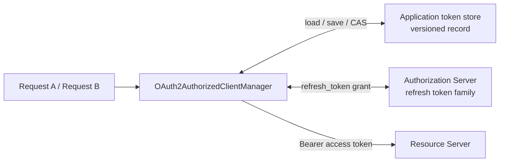
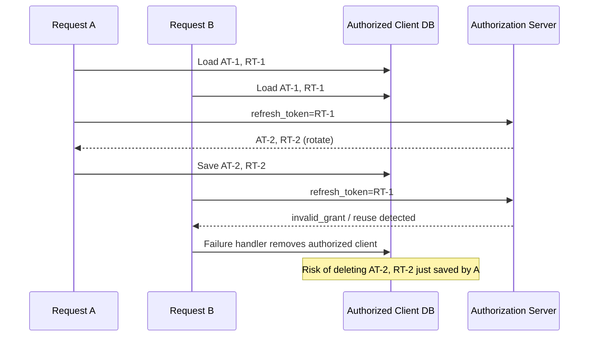
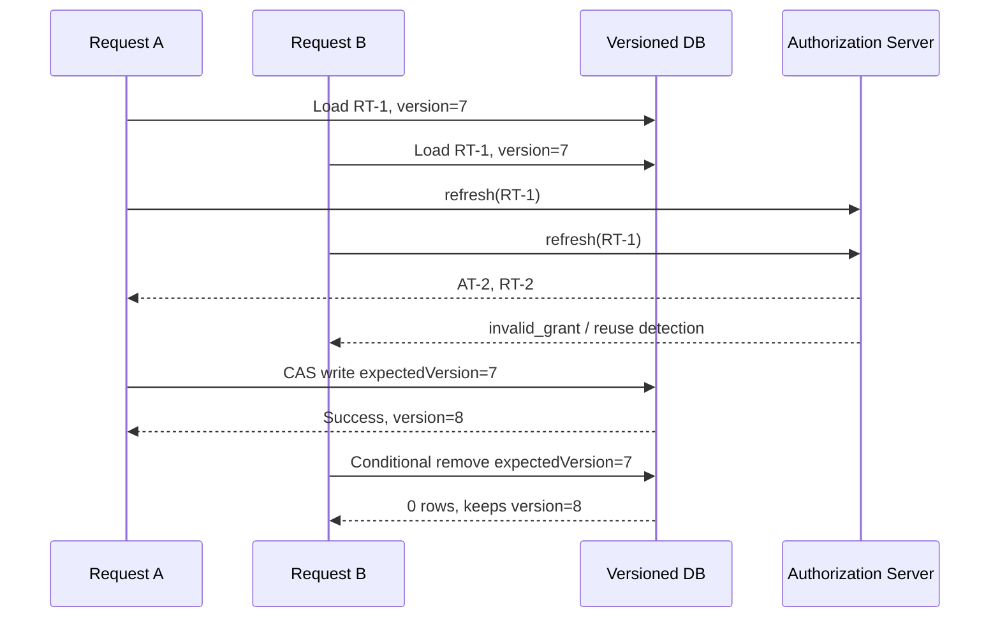
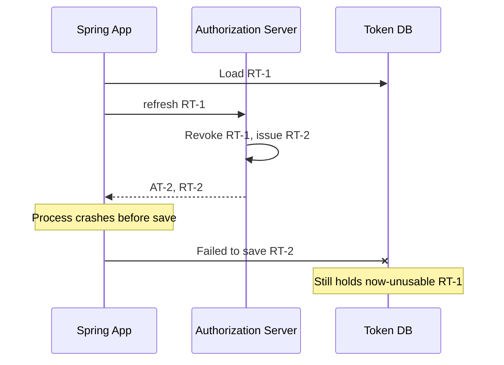
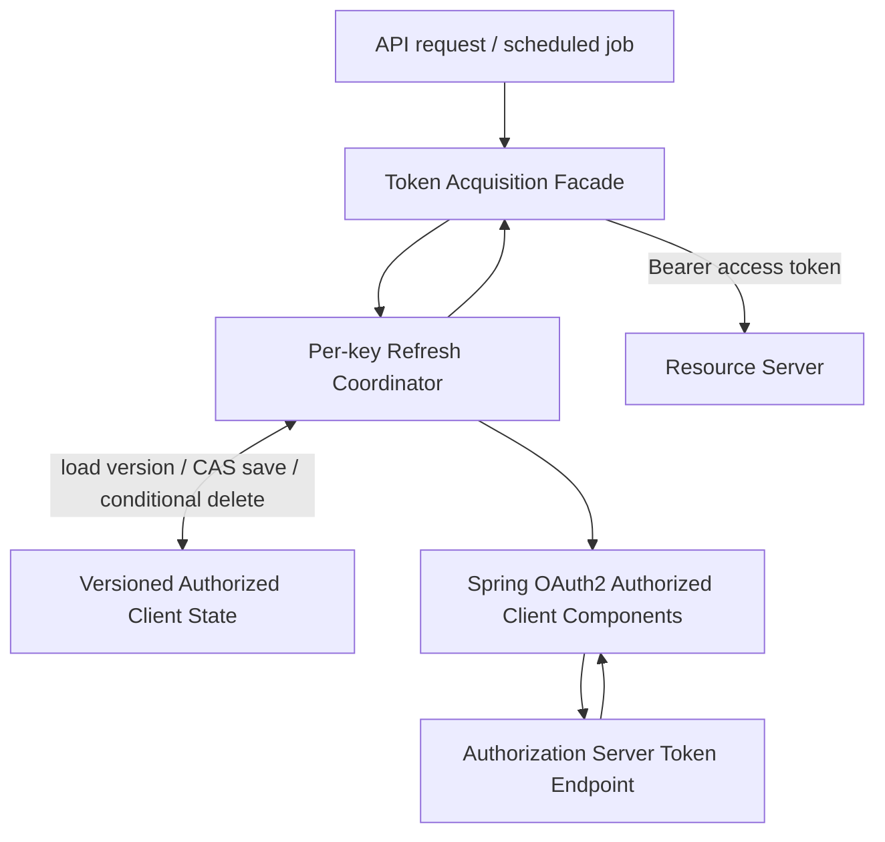

# 23.8. Transactions, Optimistic Locking, and Concurrent Token Updates

In **Spring Security OAuth 2.0/OIDC Client**, an `OAuth2AuthorizedClient` is typically bound to a **client registration**, a **principal**, and active tokens: access token, optional refresh token, issuance/expiration timestamps, and scopes. When the access token expires, `OAuth2AuthorizedClientManager` can coordinate with the `refreshToken()` provider to obtain new tokens from the Authorization Server and update the authorized client.

For a single user, a single request, and a single-instance app, this flow is straightforward. In production systems, however, you face:

- Multiple browser tabs firing concurrent requests.
- Multiple threads handling tokens for the same principal.
- Multiple application instances sharing a database or Redis.
- Scheduled jobs using the same authorized client.
- Refresh token rotation, forbidding reuse of old refresh tokens.
- Network errors, timeouts, restarts, or crashes between the AS issuing tokens and the database saving them.
- Failure handlers deleting tokens after `invalid_grant`, sometimes occurring **after another request already saved a valid newer token**.

Under those conditions, a seemingly simple "load → refresh → save" sequence becomes a problem of **concurrency, consistency, and security boundaries**.

This lesson focuses on three principles:

1. **Database transactions** keep local data consistent, yet **cannot create an atomic transaction spanning the Authorization Server's Token Endpoint**.
2. **Optimistic locking/CAS** stops a stale request from overwriting newer results, yet **does not stop two requests from both sending the old refresh token to the AS**.
3. With **refresh token rotation**, you often need coordination **before executing the refresh**, alongside versioned token persistence and conditional error/delete handling.

The goal is designing a system that never loses newly issued refresh tokens, never mixes up tokens across principals, never enters refresh loops, and never deletes a valid authorized client because of a stale error.

---

## 1. Authorized Client as the Unit of State to Protect

### 1.1. Involved Spring Security Objects

An `OAuth2AuthorizedClient` represents an OAuth client's authorization within a specific principal context.

```text
OAuth2AuthorizedClient
├── ClientRegistration
│   ├── registrationId = company
│   ├── clientId = portal-web-prod
│   ├── grantType = authorization_code
│   └── provider details
├── principalName = user-725
├── OAuth2AccessToken
│   ├── tokenValue = AT-1
│   ├── issuedAt = ...
│   ├── expiresAt = ...
│   └── scopes = [orders.read]
└── OAuth2RefreshToken
    ├── tokenValue = RT-1
    └── issuedAt = ...
```

Key abstractions:

| Component | Role | Concurrency Relevance |
|---|---|---|
| `ClientRegistrationRepository` | Looks up OAuth client config | Not a user token store |
| `OAuth2AuthorizedClient` | Token state bound to registration/principal | Must be replaced as one consistent state |
| `OAuth2AuthorizedClientRepository` | Saves/loads client in Servlet request context | May back onto HTTP session or a service |
| `OAuth2AuthorizedClientService` | Saves/loads client by registration and principal, independent of Servlet requests | Integration point for persistence and locking |
| `OAuth2AuthorizedClientManager` | Coordinates authorization, refresh, success/failure | Multiple callers may authorize concurrently |
| `OAuth2AuthorizedClientProvider` | Executes the grant, e.g., refresh token | May call Token Endpoint concurrently |
| `OAuth2AuthorizationSuccessHandler` | Handles successful token re-issuance | Must persist the new version cleanly |
| `OAuth2AuthorizationFailureHandler` | Handles authorization errors | Must avoid deleting records just updated by another request |

### 1.2. Logical Key of an Authorized Client

For a service-based store, the key usually takes the form:

```text
(client_registration_id, principal_name)
```

Example:

```text
(company, user-725) -> AT-A, RT-A
(company, user-813) -> AT-B, RT-B
```

Never use `registrationId=company` alone as the cache key for user-delegated tokens. Otherwise, User A's token can be sent on User B's request.

In multi-tenant or multi-audience systems, the logical key may require **additional boundaries** beyond those two fields, or distinct registrations/principals per context. Never merge tokens with different scopes, resources, or tenants merely because they share a client ID.

### 1.3. New Tokens Form One Unified State

A rotation refresh may yield:

```text
Before refresh:
  access_token  = AT-1
  refresh_token = RT-1
  access_exp    = T1

After refresh:
  access_token  = AT-2
  refresh_token = RT-2
  access_exp    = T2
```

Update all related fields as **one consistent logical change**. Never save `AT-2` while keeping `RT-1` when the AS rotated, and never save `RT-2` while leaving stale AT expiry metadata.

## 2. Two Consistency Layers That Cannot Be Merged Into One

At least two systems own state:

1. **Authorization Server (AS)** decides which refresh tokens are still valid, rotated, or revoked, and which access tokens are issued.
2. **Spring application** stores the authorized client to reuse tokens and track the next credential.



**A database transaction covers only mutations inside the participating database.** HTTP requests to the Token Endpoint do not join a standard database transaction.

Therefore, even when the application uses:

```java
@Transactional
public void refreshSomething() {
    // ...
}
```

that annotation **does not turn** the HTTPS call to the AS into part of a shared atomic transaction.

This is the foundation for understanding why optimistic locking, distributed coordination, and recovery strategies each serve distinct roles.

## 3. Basic Race Condition: Two Requests Refreshing Together

Suppose `AT-1` has expired while `RT-1` is still valid. Two requests arrive almost simultaneously.



What can happen:

- Request A succeeds; `RT-1` is invalidated by the AS, and `RT-2` becomes the new refresh token.
- Request B sends stale `RT-1` and receives `invalid_grant`.
- B's failure handler deletes the authorized client by registration ID + principal name.
- A's new record is wiped out, even though **`RT-2` is completely valid**.

This is a **stale delete**.

Another variant: if the AS allows a brief reuse grace window or does not rotate strictly, A and B might both receive new tokens. If B writes last, A's result is overwritten—causing a **lost update** or leaving a refresh token that is no longer the newest per AS policy.

### 3.1. Why Does This Bug Appear Only Under Load?

A user sending one request at a time rarely hits the race. But when opening a dashboard:

```text
GET /api/profile
GET /api/orders
GET /api/notifications
GET /api/permissions
```

four API calls may all need an access token simultaneously. When the token nears expiry, all four enter the authorized client manager. Without storage coordination, multiple threads can decide to refresh at nearly the same instant.

The same happens when:

- The browser opens multiple tabs.
- Multiple consumers process events for one account.
- Kubernetes runs multiple replicas.
- The load balancer spreads requests across nodes.
- A background job and web requests share an authorized client.

## 4. Classifying Concurrent Failure Patterns

| Failure Pattern | What Happens | Consequence |
|---|---|---|
| **Lost update** | Request B writes an older token/version after A | Valid newer token is overwritten |
| **Duplicate refresh** | A and B both call AS with `RT-1` | `invalid_grant`, replay detection, extra load |
| **Stale delete** | B's failure handler deletes the newer record A just wrote | User loses refresh capability, forced re-login |
| **Stale read** | B reads an un-updated cache/session copy | Continues using old RT |
| **Partial update** | New AT and new RT saved in separate steps | Mismatched token state |
| **Lost response** | AS rotated, yet client timed out | App does not know the new RT |
| **Crash window** | AS issued `RT-2`, yet app crashed before commit | DB still holds invalidated `RT-1` |
| **Token cache stampede** | Flood of requests refresh simultaneously | AS overloaded / rate limited |
| **Cross-principal mix-up** | Token saved/loaded under overly broad key | Privilege leak across users/tenants |
| **ABA problem** | Token state changed and later looked identical | Simple token-string comparison misses version changes |

Not every failure can be solved by **one kind of lock**. Match the mitigation to each failure mechanism.

## 5. What Can Database Transactions Do?

### 5.1. Atomicity of the Token Record

Once a response with `AT-2` and `RT-2` arrives, save the token record as one atomic mutation:

```sql
UPDATE oauth_authorized_client_state
SET access_token_ciphertext  = :new_access_token,
    refresh_token_ciphertext = :new_refresh_token,
    access_expires_at        = :new_expiry,
    granted_scopes           = :new_scopes,
    updated_at               = CURRENT_TIMESTAMP
WHERE registration_id = :registration_id
  AND principal_name  = :principal_name;
```

This is illustrative SQL for a **custom schema**, not a mandatory Spring Security table name.

A single-row `UPDATE` in a transactional database ensures all modified columns **commit or roll back together**. That is far better than writing the access token and refresh token in two unmanaged statements.

### 5.2. Transactions Alone Do Not Guarantee Correct Read-Then-Write Logic

Example:

```text
Transaction A: read version 3
Transaction B: read version 3
Transaction A: update token -> version 4
Transaction B: update token -> version 4 or overwrite
```

At common isolation levels, two transactions reading the same initial state and then both writing can cause a lost update unless the app enforces version checks or locking.

**`@Transactional` alone does not prevent lost updates.** It defines transaction boundaries per configuration; it does not automatically reject stale writers.

### 5.3. Avoid Holding DB Transactions Open Across HTTP Token Endpoint Calls Unnecessarily

A tempting approach:

```java
@Transactional
public Token refresh() {
    var record = tokenRepository.lockForUpdate(key);
    var response = callAuthorizationServer(record.refreshToken());
    tokenRepository.save(response);
    return response;
}
```

This uses pessimistic locking to serialize inside the DB, yet if the HTTP request takes seconds, the DB transaction, connection, and row lock stay held the entire time.

Consequences:

- Holds DB connections for a long time.
- Increases lock contention and timeouts.
- Exhausts connection pools under load.
- Couples DB throughput to network/AS latency.
- If the process crashes, the transaction rolls back even though the AS already rotated the refresh token.

Some low-traffic systems use this with strict timeouts, yet it is **not a universally scalable default** and still cannot close the AS-to-DB gap.

## 6. What Is Optimistic Locking?

**Optimistic locking** assumes most updates do not conflict. Instead of holding a lock throughout the operation, each record carries a **version**. When writing, the writer must prove the record is still at the version it read.

### 6.1. Versioned State

```text
Key:
  registration_id = company
  principal_name = user-725

Token state:
  access_token = AT-1
  refresh_token = RT-1
  version = 17
```

Request A reads version 17; Request B also reads version 17.

When A writes:

```text
UPDATE ... WHERE version=17
-> affected rows = 1
-> record version=18
```

When B writes:

```text
UPDATE ... WHERE version=17
-> affected rows = 0
-> stale writer detected
```

**B is prevented from overwriting version 18.**

### 6.2. Compare-and-Swap (CAS) in SQL

```sql
UPDATE oauth_authorized_client_state
SET access_token_ciphertext  = :new_access_token,
    refresh_token_ciphertext = :new_refresh_token,
    access_expires_at        = :new_expiry,
    granted_scopes           = :new_scopes,
    version                  = version + 1,
    updated_at               = CURRENT_TIMESTAMP
WHERE registration_id = :registration_id
  AND principal_name  = :principal_name
  AND version         = :expected_version;
```

The application checks **affected row count**:

- `1`: CAS succeeded.
- `0`: record missing or version mismatched; **conflict occurred**, reload and apply policy.
- DB error: treat as persistence failure, never as a saved refresh.

### 6.3. Why Use a Version Instead of Comparing Token Values?

Comparing raw refresh tokens in `WHERE` has serious drawbacks:

- Refresh tokens are secrets.
- Randomized encryption changes ciphertext even for identical plaintext.
- Seeing an apparently identical token value does not prove the row never changed.
- You need to detect whenever another request modified the row.

A monotonic version is clean metadata for update ordering. An HMAC **token fingerprint** can supplement safe state comparisons if needed, without logging raw tokens or using weak hashes that leak secret structure.

## 7. Custom Schema for Optimistic Concurrency

A PostgreSQL example:

```sql
CREATE TABLE oauth_authorized_client_state (
    registration_id         VARCHAR(100) NOT NULL,
    principal_name          VARCHAR(255) NOT NULL,
    access_token_ciphertext BYTEA NOT NULL,
    refresh_token_ciphertext BYTEA,
    access_issued_at        TIMESTAMPTZ,
    access_expires_at       TIMESTAMPTZ,
    refresh_issued_at       TIMESTAMPTZ,
    granted_scopes          TEXT,
    version                 BIGINT NOT NULL DEFAULT 0,
    updated_at              TIMESTAMPTZ NOT NULL DEFAULT NOW(),

    CONSTRAINT pk_oauth_authorized_client_state
      PRIMARY KEY (registration_id, principal_name)
);
```

**This is a custom illustrative schema.** Do not use it as a drop-in replacement for `JdbcOAuth2AuthorizedClientService`'s official schema. When customizing storage, implement serialization, encryption, deserialization, schema migrations, and version handling completely.

### 7.1. What Is the Primary Key For?

The primary key prevents two concurrent rows for the same pair:

```text
(registration_id, principal_name)
```

It does not replace versioning. The primary key prevents **duplicate identity rows**, while `version` detects **stale updates to an existing row**.

### 7.2. Why Store Ciphertext?

Access tokens and refresh tokens are bearer credentials and should not be stored in plaintext when your threat model demands application-layer encryption at rest.

Consider:

- KMS/HSM or secret manager holding encryption keys.
- Authenticated encryption (AEAD) and key rotation.
- Never storing encryption keys inside the same DB in a way that a DB compromise exposes everything.
- Minimal read/write token privileges.
- Backups/snapshots, replication, retention, and cleanup.
- Never exposing ciphertext or token metadata in public APIs.

Disk encryption at rest remains useful, yet does not always stop a DB reader with `SELECT` privileges from seeing plaintext if the app wrote plaintext; assess against your threat model.

### 7.3. Mind Indexes and Row Size

Token values can be large. Storing large JWTs and rich metadata affects row sizes and serialization performance. Keep only required columns and index only for common queries.

Never index raw token values or full JWTs merely for debugging correlation.

## 8. CAS Example with JdbcTemplate

This snippet illustrates **the core of custom token persistence**, not a full `OAuth2AuthorizedClientService` implementation.

```java
import org.springframework.jdbc.core.JdbcTemplate;
import org.springframework.stereotype.Repository;

import java.sql.Timestamp;
import java.time.Instant;

@Repository
public class VersionedTokenStateRepository {

    private final JdbcTemplate jdbc;

    public VersionedTokenStateRepository(JdbcTemplate jdbc) {
        this.jdbc = jdbc;
    }

    public boolean updateIfVersionMatches(
            String registrationId,
            String principalName,
            long expectedVersion,
            byte[] encryptedAccessToken,
            byte[] encryptedRefreshToken,
            Instant expiresAt,
            String grantedScopes) {

        int changed = jdbc.update("""
            UPDATE oauth_authorized_client_state
               SET access_token_ciphertext  = ?,
                   refresh_token_ciphertext = ?,
                   access_expires_at        = ?,
                   granted_scopes           = ?,
                   version                  = version + 1,
                   updated_at               = CURRENT_TIMESTAMP
             WHERE registration_id = ?
               AND principal_name  = ?
               AND version         = ?
            """,
            encryptedAccessToken,
            encryptedRefreshToken,
            Timestamp.from(expiresAt),
            grantedScopes,
            registrationId,
            principalName,
            expectedVersion
        );

        return changed == 1;
    }
}
```

This code uses Java text blocks and assumes a compatible Java version, SQL dialect, and mapper. In production:

- `encryptedAccessToken` and `encryptedRefreshToken` must come from a secure encryption component.
- Never let callers arbitrarily assign tokens to another principal.
- Never add ungranted scopes into `grantedScopes`.
- Handle absent refresh tokens, deleted rows, and SQL exceptions.
- Define transaction boundaries at the service layer when multiple DB operations run together.
- If `false` is returned, callers must never treat the save as successful.

### 8.1. Handling CAS Failure

```java
boolean saved = repository.updateIfVersionMatches(
    key.registrationId(),
    key.principalName(),
    state.version(),
    encryptedNewAccess,
    encryptedNewRefresh,
    newExpiresAt,
    grantedScopes
);

if (!saved) {
    throw new ConcurrentTokenUpdateException(
        "Authorized client was updated concurrently");
}
```

`ConcurrentTokenUpdateException` and `key/state` here are application-defined types.

After a conflict, **reload the latest state** before deciding:

- Did another request already save a valid token?
- Was the record deleted by logout/revocation?
- Was the subject disabled?
- Should the operation retry or return an error?

Never write an infinite CAS retry loop, and never blindly retry refreshing with an old assertion/refresh token after a conflict.

## 9. `@Version` with JPA/Hibernate

If the app uses JPA for synchronous persistence, optimistic locking can use `@Version`:

```java
import jakarta.persistence.Column;
import jakarta.persistence.Entity;
import jakarta.persistence.Id;
import jakarta.persistence.Table;
import jakarta.persistence.Version;

@Entity
@Table(name = "oauth_client_state")
public class OAuthClientStateEntity {

    @Id
    private String storageKey;

    @Column(nullable = false)
    private String registrationId;

    @Column(nullable = false)
    private String principalName;

    @Column(nullable = false)
    private byte[] encryptedAccessToken;

    private byte[] encryptedRefreshToken;

    @Version
    @Column(nullable = false)
    private long version;

    protected OAuthClientStateEntity() {
        // JPA
    }

    // Constructors, getters, and update methods omitted.
}
```

`storageKey` is a stable unique key derived safely from identity; real implementations must encode/guarantee uniqueness without collisions rather than concatenating strings with delimiters that might appear in principal names.

When two transactions modify the same entity based on an old version, the ORM detects the conflict and throws an exception such as `OptimisticLockException` or Spring's `ObjectOptimisticLockingFailureException`.

### 9.1. `@Transactional` and `@Version` Are Separate Responsibilities

```java
@Transactional
public void persistTokenUpdate(...) {
    // Load entity + update fields + commit.
    // @Version detects stale updates.
}
```

- `@Transactional` defines the transaction boundary.
- `@Version` detects concurrent updates to the same entity.
- Neither stops two Token Endpoint requests already sent in parallel.
- An optimistic lock exception must be handled **by reloading/applying policy**, not unconditional overwrite retries.

### 9.2. Do Not Treat a JPA Entity Directly as `OAuth2AuthorizedClient`

`OAuth2AuthorizedClient` is not a JPA entity with a built-in `@Version`. With a custom entity:

```text
JPA versioned entity
    |
    v
Encrypted token state + metadata
    |
    v
Mapper
    |
    v
OAuth2AuthorizedClient
```

Design how the **version snapshot** accompanies the authorization flow so saving knows the expected version.

If you map the entity to `OAuth2AuthorizedClient` and discard version metadata, a plain `saveAuthorizedClient(client, principal)` **has no idea which version the request read**. Adding `@Version` to an entity helps nothing if your integration drops the version between load and save.

## 10. Does Spring's Default JDBC Service Provide Optimistic Locking Automatically?

Spring Security provides `JdbcOAuth2AuthorizedClientService` for JDBC persistence of authorized clients (where the corresponding version/constructor is available). This implementation is convenient for:

- Saving/loading authorized clients.
- Keying tokens by registration ID and principal name.
- Providing persistent storage instead of in-memory storage.

However, **never assume using `JdbcOAuth2AuthorizedClientService` automatically gives you optimistic locking or distributed refresh coordination**. Spring Security's default schema/reference implementation does not turn every refresh into a distributed transaction or lock refresh token families merely because JDBC is used.

For strict rotation and high concurrency, inspect the **exact implementation version and schema in use**, then layer custom storage/coordination as needed.

### 10.1. Layers of Responsibility

```text
OAuth2AuthorizedClientManager
  -> Provider decides to refresh
  -> Token endpoint HTTP request
  -> Success handler saves authorized client
  -> OAuth2AuthorizedClientService persistence

CUSTOM REQUIREMENTS:
  -> Versioned state
  -> CAS
  -> Conditional delete
  -> Coordination before token endpoint
  -> Recovery after ambiguous failure
```

Do not try to "turn on optimistic locking" by adding a `version` column to the schema without updating load/update code and failure handling. If the default service ignores the column, **it has zero logical effect**.

## 11. Optimistic Locking Does Not Prevent Sending a Refresh Token Twice

This is the most critical limitation.



CAS prevents **stale deletes/overwrites** in the DB, yet Request B still sent old `RT-1` to the AS.

Depending on the AS, reuse detection may:

- Reject only the stale token use.
- Revoke the entire refresh token family.
- Require user reauthorization.
- Flag a security incident.

If the AS revokes the entire token family on reuse detection, **even `RT-2` saved by A may now be invalid**. CAS cannot undo AS-side consequences.

Therefore, with strict refresh token rotation, consider **single-flight/serialization before calling the Token Endpoint**.

## 12. Single-Flight Refresh Within One JVM

**Single-flight** means that for a given authorized client key, only one request refreshes; other requests wait and reuse the outcome.

```text
(key = company, user-725)
   Request A ----> Refresh coordinator ----> AS refreshes RT-1
   Request B ----> Waits on same refresh
   Request C ----> Waits on same refresh
                                    |
                                    v
                         AT-2 / RT-2 saved once
                                    |
                          A, B, C receive result
```

### 12.1. Key by Exact Identity

The lock key must at least distinguish:

```text
(clientRegistrationId, principalName)
```

If tenant/resource dimensions separate tokens, include those boundaries as well.

Never use a single global lock across all users, or User A refreshing a token blocks unrelated User B.

### 12.2. Per-Key Lock Pattern

Pseudocode:

```java
TokenState refreshWithLocalLock(TokenKey key) {
    Lock lock = localLockRegistry.get(key);
    lock.lock();

    try {
        TokenState state = tokenRepository.load(key);

        if (!needsRefresh(state)) {
            return state; // Double-check after acquiring lock.
        }

        TokenResponse response =
            authorizationServer.refresh(state.refreshToken());

        return tokenRepository.saveNewStateAtomically(
            key, state.version(), response);
    } finally {
        lock.unlock();
    }
}
```

This is **architectural pseudocode**, not a ready-to-run Java class. Key points:

- Acquire the lock for the exact key.
- **Reload and recheck** state **after** acquiring the lock.
- Refresh only if still needed.
- Persist with the expected version.
- Release the lock in `finally`.
- Bound wait times, handle interruptions, and clean up the lock registry.

### 12.3. Limits of a JVM-Local Lock

When running:

```text
Instance A -> LocalLockRegistry A
Instance B -> LocalLockRegistry B
```

two instances can still refresh concurrently for the same user. Local locks only coordinate concurrency **within a single process**.

Across multiple replicas, you need shared coordination or an architecture that partitions refresh ownership per key.

## 13. Does a Distributed Lock Solve Everything?

A distributed lock in Redis, DB, ZooKeeper, or another coordination service limits how many instances refresh one key concurrently.

```mermaid
sequenceDiagram
    participant A as Spring Instance A
    participant B as Spring Instance B
    participant Lock as Distributed Lock
    participant DB as Token DB
    participant AS as Authorization Server

    A->>Lock: Acquire lock(company, user-725)
    Lock-->>A: Granted
    B->>Lock: Acquire same lock
    Lock-->>B: Waiting
    A->>DB: Reload latest state
    DB-->>A: RT-1, version=10
    A->>AS: Refresh RT-1
    AS-->>A: AT-2, RT-2
    A->>DB: CAS save expectedVersion=10
    DB-->>A: Saved version=11
    A->>Lock: Release lock
    Lock-->>B: Granted
    B->>DB: Reload state after lock
    DB-->>B: AT-2, RT-2, version=11
    B->>B: Token is valid; skip refresh
    B->>Lock: Release lock
```

Unlike pure optimistic locking, Request B **never sends `RT-1` to the AS** before seeing the updated state.

### 13.1. Locks Must Have TTL and Ownership

If Instance A crashes, the lock must not stay held forever. You normally need:

- A lease/TTL sized for Token Endpoint timeouts.
- An ownership token so only the holder releases its own lock.
- Bounded lock wait timeouts.
- Handling for lock-service outages.
- Lock renewal/validity checks for longer operations.
- Metrics to observe lock contention.

Never build a lock using a Redis key without a TTL or letting any instance delete any key blindly.

### 13.2. Why Can Lease Expiry Still Cause Races?

Suppose A takes a 10-second lock, stalls for 15 seconds, the lock expires, and B acquires a new lock. Then A resumes and calls the AS or writes to the DB.

```text
A: obtains lease 101
A: stalls
lease expires
B: obtains lease 102
B: refreshes / saves
A: resumes with stale lease 101
```

Thus, a distributed lock with **lease expiry** but without fencing/version validation still allows stale writers to proceed.

### 13.3. Fencing Tokens and CAS

One way to reduce stale writes:

```text
lease A -> fencingToken=101
lease B -> fencingToken=102

DB accepts state update only if writer's fencing token
is compatible with latest recorded ownership/version.
```

**Fencing protects storage**, yet if A already sent stale `RT-1` to the AS before being blocked at the DB, fencing cannot undo token reuse at the AS. Design must govern **when the Token Endpoint call starts** and lease semantics.

Never promise that any distributed lock guarantees exactly-once refresh under all failures. Network partitions, lease expirations, and process pauses still require handling.

## 14. Choosing Between Optimistic Locking, Pessimistic Locking, and Distributed Coordination

| Mechanism | Prevents Local Lost Updates? | Prevents Concurrent AS Calls? | Scope | Trade-offs |
|---|---|---|---|---|
| **Optimistic locking/CAS** | Yes, if used properly | **No** | Shared DB | Must handle conflicts and versions |
| **JVM per-key lock** | Reduces intra-node races; still use CAS | Yes, within **one JVM** | Single process | Ineffective cross-node |
| **DB row lock `FOR UPDATE`** | Yes within transaction | Possibly, if held across HTTP call | Nodes sharing DB | Holds connections/locks long |
| **Distributed lock/lease** | Needs accompanying CAS/fencing | Limits cross-node concurrency | Multiple instances | Complexity, lease expiry, failure recovery |
| **Partition/owner per key** | Depends on storage | Reduces concurrent refreshers | Worker architecture | Ownership/failover routing |
| **AS token reuse grace policy** | No | No | AS behavior | Security trade-off and provider-dependent |
| **Increase access token TTL** | No | Reduces frequency | AS policy | Widens stolen-token abuse window |

There is no single answer. For small apps with lenient AS rotation, CAS + default manager may suffice. For strict rotation, multiple nodes, and sensitive permissions, stricter coordination and recovery are needed.

## 15. Transactions and Token Endpoint: Why You Cannot "Roll Back"

### 15.1. Asymmetry Between AS and DB

Flow:

```text
1. App reads RT-1.
2. App sends refresh(RT-1).
3. AS invalidates RT-1, issues RT-2.
4. App receives RT-2.
5. App writes RT-2 to DB.
```

If a failure strikes **between steps 3 and 5**, the app lacks `RT-2` in durable storage.

Example:



A database transaction cannot tell the AS to "roll back rotating `RT-1`" after a process crash.

### 15.2. There Is No Easy Exactly-Once

An HTTP request can encounter:

- Timeout **before** the AS receives the request.
- Timeout **after** the AS receives it, before processing.
- Timeout **after** the AS rotated tokens, before the response reaches the app.
- Response arrives, yet process crashes before DB commit.

From the app's perspective, a timeout cannot tell whether the AS processed the grant.

Therefore, **do not immediately retry the same `RT-1`** when the AS enforces strict replay detection. Classify errors and apply recovery policies.

### 15.3. Recovery Strategy

Mitigations:

- Align refresh token TTL/rotation policies and client auth.
- Set explicit timeouts on the Token Endpoint client.
- Minimize work between receiving the token response and durable saving.
- Commit new token state before secondary steps like logging/auditing.
- After an ambiguous failure, mark the state suspect or force reauthorization if the new token cannot be determined.
- If the AS provides a valid recovery API/contract, follow it; never invent non-standard endpoints.
- Decouple external AS side effects from DB transactions and acknowledge distributed consistency limits.

Sometimes **re-login/reauthorization** is the right outcome when a refresh token family cannot be recovered. Never endlessly replay old RTs just to avoid asking the user to log in.

## 16. Suggested State Machine for Token Lifecycle

Instead of storing only token values, demanding systems can track status metadata:

```text
READY
  |
  | token near expiry
  v
REFRESHING (owner/lease, version)
  |
  +-- success --> READY (new tokens, version+1)
  |
  +-- AS invalid_grant --> REAUTH_REQUIRED
  |
  +-- ambiguous timeout --> UNKNOWN / REAUTH_REQUIRED
  |
  +-- owner crash --> stale lease recovery
```

This is a **custom application model**, not a built-in state machine inside `OAuth2AuthorizedClient`.

### 16.1. Why Is a `REFRESHING` State Helpful?

If a row tracks the refresh owner:

```text
registration = company
principal = user-725
version = 27
status = REFRESHING
owner = instance-A
leaseUntil = 2026-11-16T03:45:00Z
```

Request B sees A is refreshing and waits/reloads instead of also sending `RT-1`.

### 16.2. Do Not Trust `REFRESHING` Forever

If A crashes:

- The lease expires.
- B must check whether a new token already committed.
- If the AS rotated without saving the new token, retrying the old RT may trigger replay detection.
- Reauthorization may be mandatory when recovery from DB is impossible.

An explicit state machine captures failure modes cleanly, though it cannot replace the contract between app and AS.

## 17. Conditional Delete: Never Delete Newer Tokens Due to Stale Request Errors

### 17.1. Problem with Plain `removeAuthorizedClient`

`OAuth2AuthorizedClientService` provides:

```java
void removeAuthorizedClient(
    String clientRegistrationId,
    String principalName
);
```

This API takes no `expectedVersion`. If Request B read version 7 while Request A just saved version 8, B calling remove by key can wipe version 8 if the implementation deletes unconditionally.

Some Spring Security manager/failure-handler setups remove the authorized client on `invalid_grant`. Exact behavior depends on version, manager, and configured failure handlers.

Under concurrent rotation, guard against **stale deletes**, not just stale updates.

### 17.2. Conditional Delete SQL

```sql
DELETE FROM oauth_authorized_client_state
 WHERE registration_id = :registration_id
   AND principal_name  = :principal_name
   AND version         = :expected_version;
```

Outcome:

- `1 row`: deleted the failing version (if policy permits).
- `0 rows`: another request already updated/deleted the record; **do not delete the newer version**.

### 17.3. Illustrative JdbcTemplate Code

```java
public boolean removeIfVersionMatches(
        String registrationId,
        String principalName,
        long expectedVersion) {

    int removed = jdbc.update("""
        DELETE FROM oauth_authorized_client_state
         WHERE registration_id = ?
           AND principal_name  = ?
           AND version         = ?
        """,
        registrationId,
        principalName,
        expectedVersion
    );

    return removed == 1;
}
```

Assumes this method lives in a repository holding `JdbcTemplate jdbc` from earlier examples.

**Note:** use conditional deletion only when failure policy truly calls for deletion. Never immediately delete tokens on transient network errors. On `invalid_grant`, distinguish truly revoked tokens, stale post-rotation tokens, and races with newer records.

### 17.4. Never Guess Current Version Inside the Failure Handler

If a failure handler knows only principal/registration without knowing **which version the failing request used**, it cannot infer the right expected version.

Propagate context reliably:

```text
load authorized state -> capture version=7
refresh using state v7
success/failure result retains observed version=7
conditional save/delete against version=7
```

Never call `loadLatestVersion()` and delete that version; that would still delete another request's newer version.

## 18. Integrating Versioning with `OAuth2AuthorizedClientManager`

### 18.1. The Abstraction Gap

`OAuth2AuthorizedClient` holds registration, principal, and tokens, **with no built-in persistence version field**.

`OAuth2AuthorizedClientService.saveAuthorizedClient(...)` likewise accepts only authorized client and `Authentication`, with no expected version.

Therefore, end-to-end CAS requires deliberate integration:

- A dedicated **versioned token state repository/service**.
- A **refresh coordinator** loading both tokens and versions.
- A **customized authorized client manager/provider/failure handler** or wrapper.
- A mechanism carrying version snapshots across the lifecycle.
- Clear separation between Spring default behavior and custom behavior.

### 18.2. Architecture Model



Some systems keep the default manager **inside** the facade while customizing success/failure handlers; others implement a dedicated token acquisition service for rotating grants.

Either way, ensure **only one component can update token state for that key at a time** or CAS is enforced consistently.

### 18.3. Do Not Merely Wrap `saveAuthorizedClient` with `@Transactional`

This example **is insufficient**:

```java
@Transactional
public void saveAuthorizedClient(
        OAuth2AuthorizedClient client,
        Authentication principal) {
    jdbcService.saveAuthorizedClient(client, principal);
}
```

Because:

- There is no expected version.
- Two requests may have already called the AS before saving.
- Another failure handler may delete unconditionally.
- The transaction covers only this local method call.
- It does not resolve network timeouts or rotation.

It can ensure local DB statements commit together, yet is not a concurrency coordination solution.

## 19. Relationship Between Optimistic Locking and Refresh Retries

After a CAS conflict, the right logic **is not**:

```java
while (!repository.save(newTokens)) {
    // Blindly retry saving the same old result.
}
```

That forces stale token updates over newer versions without inspecting current state.

A sound workflow:

1. CAS fails.
2. Reload the latest state from the database.
3. Check whether the latest token is valid and matches principal/scope/resource.
4. If usable, **use the latest**, discarding the stale result.
5. If deleted or marked reauth-required, follow policy.
6. If a refresh is still needed, coordinate and use the **latest valid refresh token**, never the old one.
7. Cap retry attempts and prevent loops.

### 19.1. Stale Successful Responses Remain an Issue

If A and B both send `RT-1`, the AS might return two token sets depending on policy:

```text
A -> AT-2/RT-2
B -> AT-3/RT-3
```

If B wins CAS and saves `RT-3`, A must not overwrite it with `RT-2` just because A finished later. Worse, if the AS enforces strict family ordering, having two exchanges happen may have already invalidated one or both refresh tokens.

Thus, **preventing duplicate refreshes before the Token Endpoint call** matters more than only handling CAS conflicts afterward.

## 20. Multi-Instance and Session-Based Authorized Client Storage

### 20.1. Session Stores Can Also Suffer Lost Updates

Concurrency bugs are not limited to JDBC services. If authorized clients live in `HttpSessionOAuth2AuthorizedClientRepository`, concurrent requests in the same session can:

- Load two session snapshots around the same time.
- Both run refreshes.
- Mutate two separate session snapshots.
- Persist the last snapshot, overwriting the earlier snapshot's newer authorized client.

Behavior depends on the session implementation, serialization, and backing store. **Never assume HTTP sessions automatically serialize token updates.**

### 20.2. Sticky Sessions Do Not Eliminate Races

Load balancer affinity routes a browser to one node, yet:

- Multiple tabs still create concurrent requests on that node.
- Request timeouts/retries can overlap.
- Node failover shifts traffic mid-flight.
- Background jobs may share authorized clients via a service store.
- Distributed session stores have their own update semantics.

With session storage and strict rotation, check the session framework's concurrent-update/CAS semantics or build coordination at the token acquisition layer.

### 20.3. Choosing Storage by Lifecycle

| Need | Suitable Option |
|---|---|
| Demo / single-node | `InMemoryOAuth2AuthorizedClientService` or session repository |
| Servlet BFF, session-scoped tokens | HTTP session repository with concurrency policy |
| User-delegated offline access | Persistent service store with consent/revocation management |
| Multiple instances and strict rotation | Shared versioned store + cross-node coordinator |
| `client_credentials` workload | Per-workload service manager/cache, usually without refresh tokens |
| Reactive WebFlux | Reactive authorized client abstractions and non-blocking DB/cache |

Do not pick persistent DB storage merely because "keeping tokens longer is convenient". Retaining refresh tokens adds security, retention, and access-control responsibilities.

## 21. Distinguishing Refresh Token Grant from Client Credentials

### 21.1. Refresh Token Grant

With Authorization Code / OIDC Login:

```text
AT-1 expired
RT-1 exists
  -> POST /token grant_type=refresh_token
  -> AT-2, optionally RT-2
```

The AS may rotate/revoke `RT-1`; concurrency is critical.

### 21.2. Client Credentials Grant

For non-user workloads:

```text
AT-1 expired
  -> POST /token grant_type=client_credentials
  -> AT-2
```

Normally there is no refresh token. Two concurrent requests asking for access tokens increase AS load, yet **do not trigger refresh token reuse detection** like rotation does.

Still, caching/single-flight helps:

- Avoid hitting token endpoint rate limits.
- Keep latency predictable.
- Avoid redundant token issuance.
- Prevent mixing tokens across workloads, scopes, or audiences.

**Never apply an "`invalid_grant` ⇒ delete user refresh token" policy to Client Credentials** without distinguishing grant type and actual error cause.

## 22. Integrating with Spring Security Failure Handlers

### 22.1. Why Failure Handlers Cause Surprises

Some Spring Security manager configurations have default failure behavior that removes the authorized client on certain OAuth errors like `invalid_grant`. That makes sense when the refresh token is truly dead and no concurrent update occurred.

In a race, however:

```text
A refreshes RT-1 -> saves RT-2 (version 11)
B refreshes RT-1 -> invalid_grant
B failure handler -> remove(company, user-725)
```

an unconditional remove deletes version 11.

### 22.2. Version-Aware Failure Policy

A custom handler needs **the token state version used by the failing request**, then:

```text
if error = invalid_grant:
    removeIfVersionMatches(key, expectedVersion)
    if no row deleted:
        reload latest
        do not delete current newer state
else if error is transient:
    retain valid persisted state
    return/report retryable failure
```

Still consider the case where the AS revoked the entire token family due to reuse detection: "latest DB row exists" does not prove "latest refresh token is still valid". You may need to transition to **`REAUTH_REQUIRED`** once there is evidence the AS revoked the family.

Never assume every `invalid_grant` is a harmless race.

### 22.3. Handlers Must Never Leak Secrets

When logging failures:

```text
event=oauth2_token_refresh_failed
registrationId=company
principalKey=<internal-id>
observedVersion=10
errorCode=invalid_grant
concurrentUpdateDetected=true
correlationId=<non-secret-id>
```

Never log `refresh_token`, raw token responses, client secrets, or full `OAuth2AuthorizedClient` objects.

## 23. Can Transaction Isolation Levels Replace Optimistic Locking?

Databases offer isolation levels such as `READ COMMITTED`, `REPEATABLE READ`, and `SERIALIZABLE`; exact guarantees depend on the DB engine.

### 23.1. `READ COMMITTED`

In many systems, `READ COMMITTED` works well with explicit version checks. However, read-then-write under `READ COMMITTED` without CAS leads directly to lost updates.

### 23.2. `REPEATABLE READ`

Stabilizes snapshot reads inside a transaction per DB semantics, yet cannot resolve races spanning external I/O and the Token Endpoint. Transactions may fail with serialization conflicts or behave differently across engines.

### 23.3. `SERIALIZABLE`

Detects database anomalies and forces transaction retries. However:

- Increases contention and transaction aborts.
- Still cannot bring the HTTP Token Endpoint inside DB atomicity.
- Retrying the entire business transaction can **resend the old refresh token**, which is dangerous.
- Does not replace distributed coordination or recovery policies.

**Never raise isolation to `SERIALIZABLE` and retry the entire HTTP refresh method** without accounting for side effects already executed at the AS.

## 24. `@Transactional` in a Refresh Workflow

To avoid holding DB connections across network calls, a design can split:

```text
Short transaction 1:
  load version and/or claim refresh ownership

External network:
  call Token Endpoint

Short transaction 2:
  CAS commit new tokens, clear ownership
```

Requirements for this pattern to be safe:

- Claiming ownership is atomic with a lease/fencing token.
- Other requests do not send the old RT while ownership is held.
- After the response, commit the new token state promptly.
- If transaction 2 fails, run a defined recovery policy.
- If the process crashes, the lease expires while token state may be ambiguous.

Short transactions reduce DB pressure, yet require a sound state machine/coordinator. Do not merely split transactions and drop all locking.

### 24.1. Spring Transaction Proxy Caveats

With Spring `@Transactional`, transactions apply only when calls pass through the proxy or configured transaction interceptor. One method calling another on the same object (`self-invocation`) bypasses the Spring transaction proxy.

Never rely on `@Transactional` on a private method or self-invocation assuming token writes are transactional.

### 24.2. Checked Exceptions and Rollback

Rollback rules depend on Spring transaction configuration. When updating token state fails, ensure the transaction rolls back cleanly without partial updates; check exception types or configure explicit `rollbackFor` rules.

Never catch persistence errors and return success if tokens were not durably committed.

## 25. Reactive Stack: Transactions and Locking Differ from Servlet

In WebFlux, Spring Security uses:

- `ReactiveOAuth2AuthorizedClientManager`.
- `ServerOAuth2AuthorizedClientRepository`.
- `ReactiveOAuth2AuthorizedClientService`.

When using R2DBC for token storage, transactions are managed via **`ReactiveTransactionManager`** and Reactor Context rather than traditional JDBC `ThreadLocal` binding.

### 25.1. `ReactiveTransactionalOperator` Example

```java
import org.springframework.transaction.reactive.TransactionalOperator;
import reactor.core.publisher.Mono;

public final class ReactiveTokenStateService {

    private final ReactiveTokenStateRepository repository;
    private final TransactionalOperator transactions;

    public ReactiveTokenStateService(
            ReactiveTokenStateRepository repository,
            TransactionalOperator transactions) {
        this.repository = repository;
        this.transactions = transactions;
    }

    public Mono<Boolean> saveWithCas(
            TokenKey key,
            long expectedVersion,
            EncryptedTokenState next) {

        return repository.updateIfVersionMatches(
                key, expectedVersion, next)
            .map(affectedRows -> affectedRows == 1)
            .as(transactions::transactional);
    }
}
```

`TokenKey`, `EncryptedTokenState`, and `ReactiveTokenStateRepository` are hypothetical application types; the repository must use a reactive DB client returning affected row counts.

### 25.2. Never Call JDBC Directly on the Event Loop

Do not write:

```java
return Mono.just(jdbcTemplate.update(sql, args));
```

The JDBC call executes synchronously before the `Mono` is even created.

If legacy JDBC is unavoidable, wrap it with `Mono.fromCallable(...).subscribeOn(Schedulers.boundedElastic())`, preserving proper DB transactions and lock semantics. Even then, wrapping does not turn JDBC into non-blocking I/O.

### 25.3. Never Call `.block()` to "Wait for Transaction Commit"

```java
// Incorrect on a reactive event loop.
boolean saved = reactiveRepository.saveWithCas(...).block();
```

Use reactive composition instead:

```java
return reactiveRepository.saveWithCas(...)
    .flatMap(saved -> {
        if (!saved) {
            return Mono.error(new ConcurrentTokenUpdateException());
        }
        return Mono.just(saved);
    });
```

Never fire-and-forget subscribe to persist tokens "later" while already returning the new access token to callers. Making API requests with a new token before its refresh token is durably saved widens the crash window.

## 26. Real-World Failure Modes to Distinguish

### 26.1. AS Rotated, Yet DB Save Failed

Symptom:

```text
POST /token -> 200, RT-2 issued
DB update -> timeout / deadlock / unavailable
```

You cannot simply roll back the AS. Treat this as a critical token-persistence error and invoke recovery or reauthorization per policy.

### 26.2. CAS Failed, Yet DB Holds a Valid Newer Token

```text
CAS expectedVersion=12 -> 0 rows
Reload -> version=13, AT-3 valid, RT-3 present
```

You can use the latest token instead of overwriting with a stale response—while still verifying whether the AS may have detected reuse and revoked the family.

### 26.3. Retrying Token Endpoint After a Network Timeout

A timeout does not prove the AS never processed the request. Retrying the same refresh token can trigger reuse detection. Cap retries and distinguish safe transient failures from grant/token-family errors.

### 26.4. Logout Occurs During an In-Flight Refresh

```text
A refresh starts
B user logs out and removes authorized client
A refresh completes and saves token after logout
```

If A performs an **unconditional upsert**, the token is "resurrected" after logout.

Use versions, tombstones, revocation generations, or ownership/state checks so **stale refreshes never recreate logged-out records**.

### 26.5. Account Locked While Refresh Is Running

If the app enforces account-disabled or consent-revoked policies, a refresh success from the AS does not override local account status. Check status/version before saving or using new tokens.

### 26.6. Client Secret Rotation Across Nodes

One node uses the old secret while another uses the new secret. The Token Endpoint returns `invalid_client` on the old node. This is not refresh-token concurrency; synchronize secret rollouts and key rotation.

### 26.7. Principal Key Changes During Upgrade

If `principalName` used to be email and now becomes user ID, the app fails to find old authorized clients and creates new records. This is an identity mapping/migration issue, not solvable with optimistic locking.

### 26.8. Session Copy Overwrites Persistent Store

If login uses an HTTP session repository while an API manager uses a separate JDBC service, the two sources diverge. Unify the source of truth before adding locks.

## 27. Logout, Revocation, and Tombstones

### 27.1. Deleting a Record Differs from Revoking at the Authorization Server

`OAuth2AuthorizedClientService.removeAuthorizedClient(...)` removes the local authorized client. It **does not guarantee the AS revoked the refresh token or access token**.

If AS-side revocation is required, call a mechanism supported by the AS, such as OAuth 2.0 Token Revocation (RFC 7009), with proper client authentication and policies.

### 27.2. Tombstones to Block Stale Saves

A custom design may avoid immediate hard deletion, instead incrementing generation and marking:

```text
state = REVOKED
version = 24
generation = 4
```

After logout, a stale request that read generation 3 **cannot CAS-save** back to `READY` because generation/version changed.

Tombstones may require TTL/cleanup. This is a **custom persistence pattern**, not a built-in property of `OAuth2AuthorizedClient`.

### 27.3. If the App Hard-Deletes Records

With hard deletes, a stale request may try to **re-insert** the same key after a refresh. If code uses unconditional upserts, logout can be reversed.

Maintain account/authorization generations, tombstones, consent state, or checks blocking reinsertion after revocation. Do not rely solely on `UPDATE WHERE version` if code falls back to "no row ⇒ INSERT" without checking authorization state.

## 28. Transactional Outbox and Event Auditing

Token lifecycles often emit audits:

```text
TOKEN_REFRESH_SUCCEEDED
TOKEN_REFRESH_FAILED
AUTHORIZED_CLIENT_REMOVED
CONSENT_REVOKED
REAUTH_REQUIRED
```

When auditing is mandatory, a **transactional outbox** in the same DB as token state can atomically record:

```text
BEGIN;
  CAS update authorized client;
  INSERT outbox event (no secrets);
COMMIT;
```

Then a worker publishes events to the message broker.

**Limitation:** the outbox guarantees atomicity only across changes **within that same database transaction**. It does not make the AS refresh atomic, nor does it permit putting raw access/refresh tokens into event payloads.

### 28.1. Auditing Should Not Arbitrarily Block Durable Token Updates

If the app receives `RT-2` and makes a synchronous HTTP audit call **before saving `RT-2`**, an audit timeout can cost you the new token.

Prefer committing durable token updates before secondary side effects, or write non-secret audit metadata inside the same DB transaction.

## 29. Testing Concurrency Scenarios

Testing code in production requires controlled concurrency tests.

### 29.1. Two Requests Sharing an Expired Token

Use a fake Authorization Server / token client with deterministic behavior:

```text
Initial DB: AT-1 expired, RT-1, version 5

Request A loads v5
Request B loads v5

Expected:
  no stale overwrite
  no stale delete
  token state has AT-new/RT-new
  Token Endpoint call count matches coordination policy
```

### 29.2. Testing Strict Rotation

Fake AS:

```text
refresh(RT-1) first call -> AT-2, RT-2
refresh(RT-1) second call -> invalid_grant and/or family revoked
```

Do not assert only that DB version incremented; verify **the number of refresh calls** and the refresh token family state.

### 29.3. CAS Conflict

```text
A reads version 7
B writes version 8
A attempts UPDATE ... WHERE version=7
Expected affected rows=0
A reloads or reports concurrent update
```

Never silently treat `affected rows = 0` as a successful save.

### 29.4. Failure Handler After a Successful Update

```text
A: refresh succeeds and saves version 8
B: receives invalid_grant for version 7
Expected: B cannot delete version 8 without proper policy
```

If the AS actually revoked the family, mark state/reauth appropriately instead of blindly assuming version 8 is still valid.

### 29.5. Process Crash Windows

Simulate:

- Crash before sending the Token Endpoint request.
- Crash after AS processing, before receiving the HTTP response.
- Crash after receiving the response, before CAS commit.
- Crash after commit, before releasing the distributed lock.
- Distributed lock lease expiring mid-request.
- Network partition between app and DB.

For each case, define **which states are recoverable** and which require user reauthorization.

### 29.6. Logout During Refresh

Use a coordination barrier:

```text
A loads authorization generation 10
B logout -> generation 11 / revoked
A receives RT-2
A saves expectedGeneration 10 -> rejected
```

Ensure stale refreshes never resurrect authorized clients after logout.

## 30. Observability: Tracking Conflicts Without Exposing Tokens

Useful metrics:

```text
oauth2_refresh_requests_total{
  registration_id="company",
  outcome="success"
}

oauth2_refresh_requests_total{
  registration_id="company",
  outcome="invalid_grant"
}

oauth2_token_state_cas_conflicts_total{
  registration_id="company"
}

oauth2_refresh_lock_wait_seconds{
  registration_id="company"
}

oauth2_authorized_client_reauth_required_total{
  registration_id="company"
}
```

These are illustrative metric names. Size cardinality carefully for your Micrometer/observability stack.

### 30.1. Avoid High-Cardinality `principalName` Labels

With millions of users, a label like:

```text
principal_name="user-725"
```

causes cardinality explosion and exposes identity data. Aggregate by registration, provider, environment, or other low-cardinality dimensions. Use protected audit/correlation logs to trace individual users.

### 30.2. Never Log Token Values

Avoid:

```text
refresh_token=RT-1
access_token=AT-2
Authorization: Basic <secret>
Authorization: Bearer <token>
```

Log safely instead:

```text
event=authorized_client_cas_conflict
registrationId=company
observedVersion=7
currentVersion=8
outcome=reloaded_new_state
correlationId=...
```

Even metadata logs require access controls and retention limits.

### 30.3. Alerting Signals

- `invalid_grant` spikes after scaling replicas.
- Token Endpoint calls surge relative to API requests.
- CAS conflicts climb while the app lacks a retry/reload policy.
- Lock wait times rise and requests time out.
- Users face unexpected re-logins after rotation.
- One node exhibits a different token-error rate than peers.
- Token persistence fails after the AS issued new tokens.
- Authorized client records "come back to life" after logout.

## 31. Security Boundaries Must Never Be Traded Off for Concurrency

A clever locking scheme cannot rescue a system that sends or loads tokens for the wrong principal.

### 31.1. Key by Trusted Principal

Derive the principal from a trusted authentication/authorization context. Never read an arbitrary `principalName` from query parameters to look up someone else's token.

### 31.2. Scope and Audience

Even when the latest token state is saved at the exact right version, the access token must still satisfy the Resource Server:

```text
issuer valid
AND audience matches API
AND token not expired/revoked
AND scope includes required operation
AND user/tenant/object permission allows action
```

Concurrency control does not replace API authorization.

### 31.3. Never Send Refresh Tokens to the Browser

In a Spring MVC/BFF confidential client, keep refresh tokens server-side in controlled storage. The browser uses a protected session cookie and never needs refresh tokens to handle races.

### 31.4. Access and Refresh Tokens Must Be Encrypted and Protected

DB optimistic locking does not replace encryption at rest, key management, least privilege, backup controls, TLS, and secret redaction.

### 31.5. Never Retry Authorization Codes

Authorization Code Flow uses single-use authorization codes. Optimistic locking challenges in token storage are never a reason to replay old authorization codes to "fix" refresh failures.

## 32. Production Token Persistence Design Checklist

Follow a structured checklist:

1. **Identify grants and rotation policies.** Authorization Code + Refresh Token, Client Credentials, or extended grants? Does the AS enforce one-time refresh tokens / reuse detection?
2. **Choose authorized client storage.** HTTP session, JDBC `OAuth2AuthorizedClientService`, Redis, or custom store.
3. **Define identity keys.** Registration + principal, plus tenant/resource dimensions if needed.
4. **Are token state updates atomic?** AT/RT/expiry/scopes must save consistently together.
5. **Do you have versioning or CAS?** Prevent stale writers from overwriting newer state.
6. **Do you have conditional deletes?** Stop failure handlers from wiping newer versions saved by other requests.
7. **Do you coordinate before refreshing?** Under strict rotation, use single-flight/per-key locks or equivalent.
8. **Running multiple instances?** JVM-local locks do not coordinate across nodes.
9. **Do you have lease/fencing policies?** Define lock timeouts, process stalls, and ownership checks.
10. **Do you handle crash windows?** When the AS rotated an RT before the app saved, rollback is impossible.
11. **Do you separate transient errors from `invalid_grant`?** Never infinitely retry the same RT.
12. **Can logout/revocation race with refresh?** Enforce versions, generations, or tombstones.
13. **Are Spring abstractions wired properly?** Manager, providers, and success/failure handlers must use the same source of truth.
14. **Are token secrets protected?** Encryption, KMS, RBAC, backups, and log redaction.
15. **Do you have metrics and concurrency tests?** Track token endpoint calls, conflicts, stale deletes, and reauth rates.

## 33. Commonly Misunderstood Advice

| Misconception | Reality to Remember |
|---|---|
| "Adding `@Transactional` eliminates races." | Transactions do not add optimistic locking or span AS HTTP calls. |
| "Having a `version` column enables optimistic locking." | Code must **read expected version** and run `UPDATE ... WHERE version = expected`. |
| "CAS prevents refresh token reuse." | CAS protects only local storage; two requests can still call the AS with the same RT. |
| "A Redis distributed lock gives exactly-once." | Lease expiry, network partitions, process pauses, and crashes can still race. |
| "Just delete the authorized client on `invalid_grant`." | Stale failures can wipe newer tokens; use version-aware policies. |
| "Keep retrying the refresh token until it works." | Rotated old refresh tokens are rejected by the AS and may trigger reuse detection. |
| "HTTP sessions serialize token updates." | Concurrent tabs, requests, and session snapshots still conflict. |
| "`JdbcOAuth2AuthorizedClientService` handles all concurrency automatically." | Inspect your actual version; default persistence is not a distributed coordinator. |
| "A successful refresh response means the token is safe." | Until durably saved, a crash can lose the new RT. |
| "Logout deleted the row, so stale requests cannot re-save." | Unconditional upserts can resurrect tokens; use generation/tombstone policies. |
| "Put the whole refresh in `SERIALIZABLE`." | The external Token Endpoint is outside the DB transaction; retries cause side effects. |
| "Token cache only needs client ID." | User-delegated tokens must be partitioned by principal and relevant boundaries. |

## 34. Design Examples Across Three Scales

### 34.1. Learning App or Small Single-Instance Service

Start with:

- Standard `OAuth2AuthorizedClientManager` + service/repository.
- In-memory or session storage matching lifecycle.
- An in-process per-key mutex if provider rotation is strict.
- Reloading state after acquiring the lock.
- Token protection and clean logout/error handling.

Limitation: restarts wipe in-memory state, and scaling to multiple nodes outgrows local mutexes.

### 34.2. Multi-Replica BFF Using OIDC Refresh Token Rotation

Typically requires:

- Shared persistent authorized client store.
- Versioned state, CAS, and conditional deletes.
- Per-key distributed refresh coordination or single-owner partitioning.
- Explicit timeouts, leases, and fencing/recovery policies.
- Session/identity binding and logout generations.
- Metrics for `invalid_grant`, contention, and reauth.
- Never blindly retrying when the AS enforces strict reuse detection.

### 34.3. Backend Workload Using Client Credentials Only

Typically:

- `AuthorizedClientServiceOAuth2AuthorizedClientManager`.
- Stable synthetic service principal.
- `clientCredentials()` provider.
- Token caching/single-flight to avoid redundant token issuance.
- Registrations/scopes/audiences separated per workload.
- No assumption of refresh token rotation.

Concurrency management still applies, though **risk levels and failure semantics differ** from user refresh tokens.

## 35. Conclusion

In Spring Security OAuth2/OIDC Client, **token persistence is part of the security protocol**, not just storing strings in a database.

When concurrent requests need refreshes, control all of:

- **Local state:** token values, scopes, expiry, principal binding, and version.
- **External operations:** refresh token grants at the Authorization Server.
- **Update ordering:** stale writers must never overwrite newer tokens.
- **Deletion ordering:** stale failures must never delete valid newer records.
- **Un-rollbackable failures:** AS rotated tokens while the app crashed or lost the response.
- **Permissions and lifecycles:** logout, account disabling, consent revocation, and tenant isolation.

**Optimistic locking** (typically `@Version` or SQL CAS) is essential for catching stale writes. **Database transactions** keep local mutations consistent. Yet with **strict refresh token rotation**, preventing an old token from being sent twice to the AS also requires **coordinating refreshes before calling the Token Endpoint**, alongside a clear recovery strategy when networks or processes fail.

A solid design never makes baseless "exactly-once" promises. Instead, it defines **what the DB guarantees, what the AS owns, what may retry, and when users must reauthorize**.

## 36. References

- [Spring Security — OAuth 2.0 Client](https://docs.spring.io/spring-security/reference/servlet/oauth2/client/index.html): `OAuth2AuthorizedClientManager`, providers, and authorized client persistence.
- [Spring Security — OAuth 2.0 Client Core Interfaces](https://docs.spring.io/spring-security/reference/servlet/oauth2/client/core.html): repositories, services, and manager lifecycles.
- [Spring Security — OAuth2AuthorizedClientService API](https://docs.spring.io/spring-security/site/docs/current/api/org/springframework/security/oauth2/client/OAuth2AuthorizedClientService.html): loading/saving/removing authorized clients.
- [Spring Security — DefaultOAuth2AuthorizedClientManager API](https://docs.spring.io/spring-security/site/docs/current/api/org/springframework/security/oauth2/client/web/DefaultOAuth2AuthorizedClientManager.html): authorization success/failure handling.
- [Spring Security — AuthorizedClientServiceOAuth2AuthorizedClientManager API](https://docs.spring.io/spring-security/site/docs/current/api/org/springframework/security/oauth2/client/AuthorizedClientServiceOAuth2AuthorizedClientManager.html): authorized client management outside Servlet requests.
- [Spring Security — Reactive OAuth 2.0 Client](https://docs.spring.io/spring-security/reference/reactive/oauth2/client/index.html): reactive authorized clients and token lifecycles.
- [Spring Framework — Transaction Management](https://docs.spring.io/spring-framework/reference/data-access/transaction.html): declarative transactions, isolation, and proxy semantics.
- [Spring Data JPA — Locking](https://docs.spring.io/spring-data/jpa/reference/jpa/locking.html): locking and JPA interactions.
- [Jakarta Persistence — Version](https://jakarta.ee/specifications/persistence/): optimistic locking in JPA.
- [RFC 6749 — OAuth 2.0 Authorization Framework](https://www.rfc-editor.org/rfc/rfc6749): refresh token grant and Token Endpoint.
- [RFC 9700 — Best Current Practice for OAuth 2.0 Security](https://www.rfc-editor.org/rfc/rfc9700): refresh token rotation, replay detection, and protecting OAuth credentials.
- [RFC 7009 — OAuth 2.0 Token Revocation](https://www.rfc-editor.org/rfc/rfc7009): revoking tokens at the Authorization Server.
- [RFC 9126 — Pushed Authorization Requests](https://www.rfc-editor.org/rfc/rfc9126): additional context on protecting authorization requests; does not replace token persistence concurrency.
