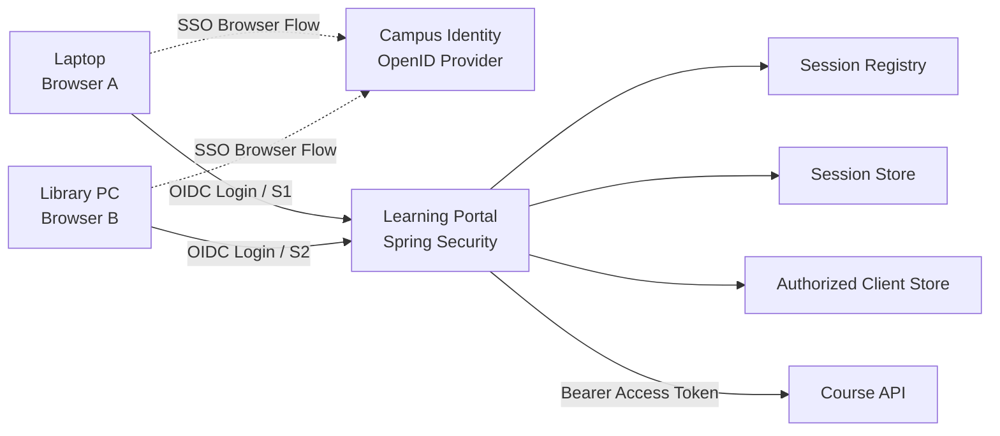
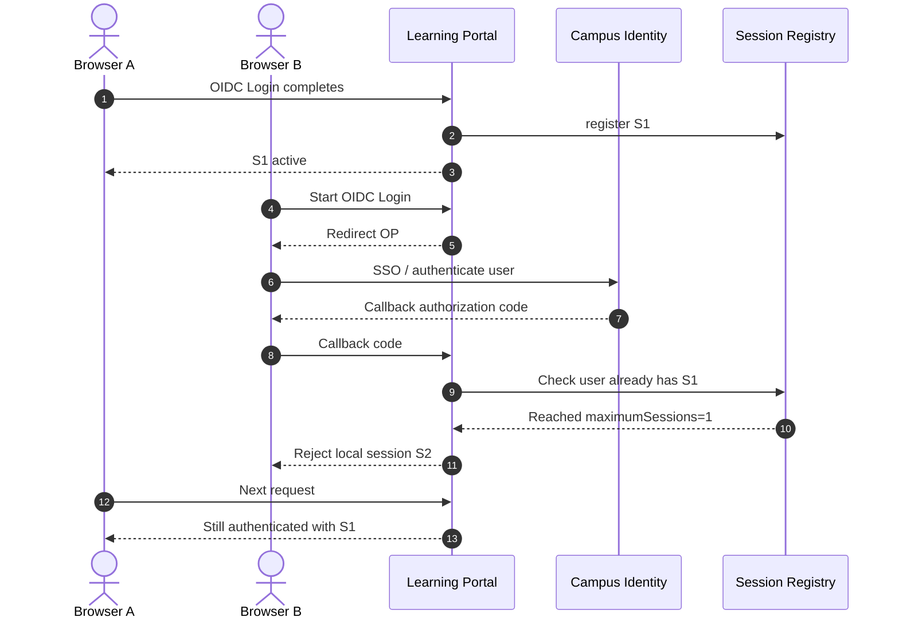
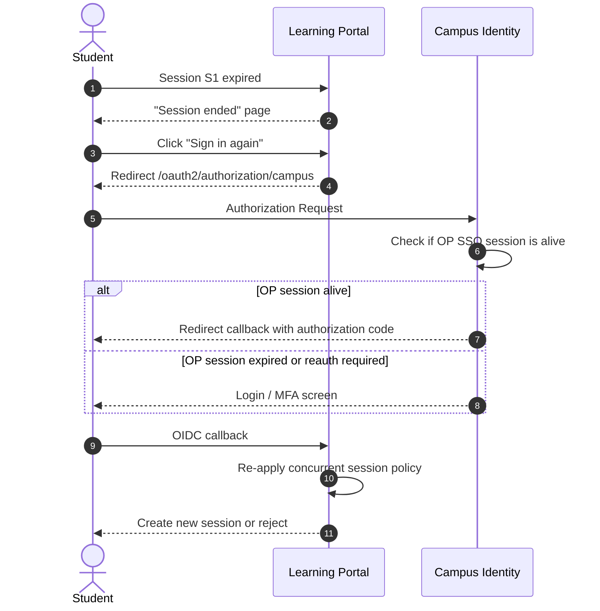

# 23.9. Session Limits and Handling Re-Login

## Lesson Objectives

After this lesson, you can:

- Explain what a **login session** is in a Spring Security OAuth 2.0/OIDC Client application and distinguish the application's session from the SSO session at the OpenID Provider (OP).
- Distinguish **concurrent session limits** from session timeouts, remember-me policies, device limits, and Access Token/Refresh Token lifetimes.
- Configure Spring Security **Servlet** so each user holds only one or a few sessions via `maximumSessions(...)`, choosing between **expiring older sessions** or **rejecting new logins**.
- Understand the roles of `SessionRegistry`, `SessionRegistryImpl`, `HttpSessionEventPublisher`, `ConcurrentSessionFilter`, and session-limit strategies.
- Understand how **WebFlux/Reactive** limits sessions using `ReactiveSessionRegistry`, `SessionLimit`, and `ServerMaximumSessionsExceededHandler` in supported Spring Security versions.
- Design UX for **re-logging in from another device**, replaced sessions, expired sessions, and failed OAuth2/OIDC callbacks.
- Explain why **deleting a session at the Relying Party does not mean logging out at the OP**, and why an active OP SSO session can make "re-login" nearly instantaneous.
- Choose how to handle `OAuth2AuthorizedClient` when a session expires, is invalidated, or the user logs out; understand the difference between session-stored tokens and service/database-stored tokens.
- Implement session limits in multi-instance deployments with **Spring Session**, avoiding the trap of JVM-local registries.
- Build test cases for second logins, refresh tokens, logout, and concurrency without leaking session IDs, tokens, or client secrets.

---

## 1. Context: A Student Logs In From Two Places

Suppose **Learning Portal** is a Spring Boot application using Campus Identity for OpenID Connect login.

In the morning:

```text
09:00
  Browser on laptop logs into Campus Identity
  -> Learning Portal creates session S1
  -> Student views courses
```

At noon:

```text
12:00
  Browser on a library computer logs into the same account
  -> Learning Portal creates session S2
```

If system policy permits only **one active session per user**, you must choose one of two behaviors:

1. **New login wins:** let S2 proceed and invalidate session S1.
2. **Existing session wins:** keep S1 alive and **reject** creating login session S2.

This is **Concurrent Session Control** in Spring Security, not a built-in property of an OAuth2 Access Token.

> **Practical definition:** session limits are policies enforced on **local login sessions managed by your application**. They do not automatically limit other apps sharing the same OP, do not automatically revoke tokens at the Authorization Server, and do not always equate to physical device limits.

### 1.1. Components in the Picture



`REG`, `STORE`, and `TOK` may all live in memory in small setups, yet represent **three distinct logical roles**:

- **Session registry:** tracks which user holds which sessions to enforce limits.
- **Session store:** stores web session data, `SecurityContext`, and framework state.
- **Authorized-client store:** stores OAuth2 Access Tokens/Refresh Tokens keyed by registration and principal.

Inspecting only one of the three makes it easy to misjudge that "the user is completely logged out" or "all tokens were revoked".

## 2. Distinguishing Commonly Confused Lifecycles

| Artifact | When Created? | Used For? | Effect When Expired/Deleted? |
| --- | --- | --- | --- |
| **RP session** | After valid login to Learning Portal | Maintaining `Authentication` in the app | User loses that local session |
| **OP/SSO session** | When Campus Identity authenticates user | Enabling SSO across apps | May require reauthenticating at OP |
| **ID Token** | In OIDC authentication response | User authentication proof for RP | Does not mean RP session ends exactly when ID Token expires |
| **Access Token** | When Client is authorized to call APIs | Sent to Resource Server | API may reject expired/revoked tokens |
| **Refresh Token** | When issued by Authorization Server per policy | Obtaining new Access Tokens | Invalidity may require reauthorization |
| **Session cookie** | Browser receives cookie like `JSESSIONID` or `SESSION` | Carrying session ID to RP | Losing cookie prevents browser from finding session |
| **SessionRegistry entry** | When concurrent control records a session | Counting/managing sessions per principal | Stale entries must be cleaned to avoid wrongly blocking logins |

### 2.1. Session Timeout vs. Maximum Sessions

Example:

```text
maxSessions = 1
sessionTimeout = 30 minutes of inactivity
```

Session limits answer:

```text
How many concurrent login sessions can one user hold?
```

Timeout answers:

```text
How long without activity before a session expires?
```

A session can be marked expired by a **second login** even if created seconds ago. Conversely, a session can time out on its own with no other login occurring.

### 2.2. One Device Does Not Equal One Session

A single laptop can open:

- Two tabs in the same browser, usually sharing one cookie/session.
- Two different browsers, creating two sessions.
- A regular browser window and a private/incognito window, creating separate sessions.
- Multiple browser profiles with isolated cookies.

Thus `maximumSessions(1)` means **at most one session**, not "at most one physical device" or "at most one tab".

### 2.3. A JWT Access Token Does Not Become a Session Just Because It Has `sub`

A Resource Server API authenticating via:

```http
Authorization: Bearer <access-token>
```

can run **statelessly**. If the API maintains no login sessions, `maximumSessions(...)` in the web application **does not limit how many Bearer JWTs circulate**.

To limit stateless sessions/tokens, apply dedicated policies at the Authorization Server, token stores/introspection, revocation, token binding, or tracking systems. Never attach an RP `SessionRegistry` and assume all Access Tokens are controlled.

## 3. Two Policies When Exceeding the Limit

Assume a limit of `1`.

### 3.1. Policy A — New Login Wins

```text
09:00 Browser A -> login -> S1 active
12:00 Browser B -> login -> S2 active
     Spring Security marks S1 expired
12:01 Browser A -> next request -> no longer authenticated
     Browser B -> remains active
```

The default Servlet behavior for `maximumSessions(1)` **expires the older active session**, usually choosing the least recently used session.

Key detail: S1 is typically **marked expired** in the registry; Browser A sees the result on its next request passing through the concurrency filter. Do not expect the server to instantly wipe data already rendered on Tab A without a new request.

### 3.2. Policy B — Existing Session Wins

```text
09:00 Browser A -> login -> S1 active
12:00 Browser B -> OIDC login completes at OP
     RP detects limit reached
     RP refuses to create authenticated session S2
12:01 Browser A -> remains active
```

In the Servlet DSL, this option is:

```java
.maxSessionsPreventsLogin(true)
```

This does not mean the OP failed to authenticate the user. The OP may have finished authentication/SSO and returned an authorization code, yet the **Relying Party** rejects issuing a new local session per policy.

### 3.3. Comparison Table

| Criterion | New Login Wins | Existing Session Wins |
| --- | --- | --- |
| Browser A holding S1 | S1 is expired when B logs in | S1 stays intact |
| Browser B requesting S2 | Session created | Rejected when exceeding limit |
| UX if user forgot to log out on old PC | Easy to continue on new PC | May be locked out until S1 times out/logs out |
| Support needs | Explain why A lost its session | Provide safe revocation of old session |
| Design risk | Without warning, A feels abruptly logged out | Users may get stuck if they lose their old device |
| OP SSO session | Not automatically removed | Not automatically removed |
| Token revocation | Not automatically guaranteed | Not automatically guaranteed |

**There is no universal right choice.** Banking apps, learning portals, or admin consoles choose differently based on threat models and desired UX.

## 4. Spring Security Servlet: Concurrent Session Control Architecture

For Spring MVC/Servlet, common components include:

| Component | Responsibility |
| --- | --- |
| `HttpSecurity` | Declares `SecurityFilterChain` and session policies |
| `SessionRegistry` | Lists, registers, and looks up sessions per principal |
| `SessionRegistryImpl` | Default in-memory implementation in many setups |
| `ConcurrentSessionControlAuthenticationStrategy` | Checks session count upon successful authentication |
| `RegisterSessionAuthenticationStrategy` | Registers the new session in the registry |
| `ChangeSessionIdAuthenticationStrategy` | Prevents session fixation on authentication |
| `CompositeSessionAuthenticationStrategy` | Composes multiple session authentication strategies |
| `ConcurrentSessionFilter` | Detects expired sessions on subsequent requests |
| `SessionInformationExpiredStrategy` | Decides the response for an expired session |
| `HttpSessionEventPublisher` | Publishes container session lifecycle events to clean the registry |
| `OAuth2LoginAuthenticationFilter` | Handles Servlet OAuth2/OIDC Login callbacks |

These names describe **system roles**; exact wiring varies across Spring Security releases. Notably, since Spring Security 6, authentication mechanisms invoke `SessionAuthenticationStrategy` directly rather than relying solely on `SessionManagementFilter` running on every request.

### 4.1. Why Does SessionRegistry Matter?

If User A holds S1 and S2, the app needs to know:

```text
principal A -> [S1, S2]
```

When S3 is created, the strategy compares active session count against the limit to decide whether to expire an older session or reject the new one.

If the registry lives only on Instance X while User B logs in via Instance Y, Y **has no idea** S1 exists on X. That is why multi-node deployments need shared session storage and a shared registry.

### 4.2. SessionInformation Is Not the HTTP Session Itself

A `SessionRegistry` entry holds:

```text
sessionId
principal
lastRequest
expiredFlag
```

The mechanism relies on session IDs to match web sessions. Calling `SessionInformation.expireNow()` essentially **marks the session expired in the registry**; do not claim it immediately calls `HttpSession.invalidate()` for every browser before their next request.

## 5. Servlet Configuration: Allow One Session, New Login Wins

Spring Security Servlet example with OAuth2/OIDC Login:

```java
@Configuration
@EnableWebSecurity
class WebSecurityConfiguration {

    @Bean
    SecurityFilterChain securityFilterChain(HttpSecurity http)
            throws Exception {

        http
            .authorizeHttpRequests(auth -> auth
                .requestMatchers(
                    "/", "/error",
                    "/session/expired",
                    "/assets/**"
                ).permitAll()
                .anyRequest().authenticated()
            )
            .oauth2Login(Customizer.withDefaults())
            .sessionManagement(session -> session
                .sessionFixation(fixation ->
                    fixation.changeSessionId()
                )
                .maximumSessions(1)
                .expiredUrl("/session/expired")
            );

        return http.build();
    }

    @Bean
    HttpSessionEventPublisher httpSessionEventPublisher() {
        return new HttpSessionEventPublisher();
    }
}
```

This example targets modern Spring Security Servlet with Spring MVC/OAuth2 Client starters and a valid `ClientRegistration`. Imports are omitted to focus on policy. If your app already defines `HttpSessionEventPublisher` or a matching `SecurityFilterChain`, avoid duplicate bean declarations.

Core settings:

```java
.maximumSessions(1)
```

means **each principal keeps at most one session** in the active registry.

```java
.expiredUrl("/session/expired")
```

specifies where a browser whose session **was expired by concurrent session control** is redirected on its next request.

`/session/expired` must be accessible without login, or you will trigger a redirect loop.

### 5.1. Session Fixation Protection Is Not a Session Limit

```java
.sessionFixation(fixation -> fixation.changeSessionId())
```

rotates the session ID on successful authentication, mitigating session fixation risks. This is **distinct** from `maximumSessions`.

In Servlet 3.1+, common Spring Security versions enable session fixation protection by default; the line above highlights responsibility rather than being strictly mandatory everywhere.

### 5.2. What Does `HttpSessionEventPublisher` Do?

This bean:

```java
@Bean
HttpSessionEventPublisher httpSessionEventPublisher() {
    return new HttpSessionEventPublisher();
}
```

lets Spring Security observe HTTP session create/destroy events emitted by the container and update the registry. If a container session expires without notifying the registry, the app may still think the user holds an active session.

When integrating Spring Session, inspect **Spring Session's corresponding event/registry mechanism** so you do not run conflicting state-update mechanisms.

### 5.3. Minimal OIDC Registration

`application.yml` example:

```yaml
spring:
  security:
    oauth2:
      client:
        registration:
          campus:
            provider: campus
            client-id: ${CAMPUS_CLIENT_ID}
            client-secret: ${CAMPUS_CLIENT_SECRET}
            authorization-grant-type: authorization_code
            client-authentication-method: client_secret_basic
            redirect-uri: "{baseUrl}/login/oauth2/code/{registrationId}"
            scope:
              - openid
              - profile
              - email
              - courses.read
        provider:
          campus:
            issuer-uri: https://login.example.org/realms/campus
```

This is an OIDC Login config, not an OP session-limit setting.

### 5.4. Login/Callback Paths Differ from the Expired Path

```text
Start OIDC Login:
  /oauth2/authorization/campus

Callback:
  /login/oauth2/code/campus

Session replaced notice page:
  /session/expired
```

Never configure `/session/expired` to immediately redirect to `/oauth2/authorization/campus` if UX needs to explain why the user was logged out; OP SSO may still be active, causing an immediate re-login that **expires the other session right back**.

## 6. Servlet: Keep Old Session and Block New Logins

If policy allows one active session and rejects second logins:

```java
@Bean
SecurityFilterChain securityFilterChain(HttpSecurity http)
        throws Exception {

    http
        .authorizeHttpRequests(auth -> auth
            .requestMatchers(
                "/", "/error", "/login",
                "/login/session-limit", "/assets/**"
            ).permitAll()
            .anyRequest().authenticated()
        )
        .oauth2Login(oauth2 -> oauth2
            .failureUrl("/login/session-limit")
        )
        .sessionManagement(session -> session
            .maximumSessions(1)
            .maxSessionsPreventsLogin(true)
        );

    return http.build();
}
```

`failureUrl(...)` here illustrates UX policy. In real applications, distinguish **session-limit authentication failures** from other OIDC errors like `invalid_state`, `invalid_client`, or Token Endpoint timeouts. Never display "already logged in elsewhere" for every OAuth2 failure.

### 6.1. Flow When Browser B Logs In



An important business question: if the student lost Laptop A, how can they revoke S1?

You can provide **session management** after additional verification (step-up MFA/reauthentication at the OP) so the user can terminate the old session rather than waiting for timeout.

### 6.2. Login Rejected at RP Is Not Login Rejected at OP

The OP may have authenticated the user successfully, yet the RP refuses to create a new session. This is a **local session rejection**, not an indication of wrong credentials or an OP outage.

Showing "Wrong password" confuses users. Show instead:

> Your account already has an active session elsewhere. Log out of the old session, wait for it to expire, or use session management if available.

Never display the other session's Session ID, full IP address, User-Agent fingerprint, or exact location to an unauthenticated/blocked caller.

## 7. Session Expired Notice Page

A Servlet controller can serve simple notice pages:

```java
@Controller
class SessionNoticeController {

    @GetMapping("/session/expired")
    String expired() {
        return "session-expired";
    }

    @GetMapping("/login/session-limit")
    String tooManySessions() {
        return "session-limit";
    }
}
```

The page should explain the situation clearly:

```text
Your session ended because this account signed in
from another browser or device.

You can sign in again if this was you.
If you do not recognize this activity, check your account security.
```

### 7.1. Avoid Infinite Auto Re-Login Loops

A loop-prone design:

```text
S1 expired
  -> /session/expired
    -> direct redirect to OP
      -> OP still has SSO session
        -> creates S3
          -> expires S2
            -> S2 redirects to OP again
```

Two browsers end up kicking each other's sessions endlessly.

Better approach:

- The expired page explains **why and offers choices**.
- The user clicks "Sign in again" deliberately.
- The app enforces a clear policy between competing sessions.
- If activity looks suspicious, offer security actions such as signing out other sessions or contacting support.
- Avoid auto-redirecting to the OP on every frontend 401.

### 7.2. Distinguish `expiredUrl` from `invalidSessionUrl`

- **`expiredUrl`**: target URL for sessions marked expired by **Concurrent Session Control**.
- **`invalidSessionUrl`**: handles requests carrying an invalid session ID, such as timed-out sessions or stale cookies.

These two scenarios are not identical. In newer Spring Security versions, `SessionManagementFilter` is not enabled identically by default; some legacy invalid-session hooks may not behave as expected. Verify against your version and test rather than assuming `invalidSessionUrl(...)` catches everything.

### 7.3. Stale Cookies and Redirect Loops

Browsers may keep sending an old session cookie after timeout. If a handler sends `/login` and `/login` bounces back without clearing/handling stale cookie state, users hit a loop.

Verify:

- Notice pages are publicly permitted.
- Cookies are cleared with matching name/path/domain when needed.
- Standard session invalidation workflows are used.
- Never bypass CSRF or cookie security to fix loops.
- Distinguish missing-authentication redirects from session-expired redirects.

## 8. OIDC SSO: RP Session vs. OP Session

In OIDC, at least two systems manage sessions:

```text
Browser
  | cookie for learning.example.org
  v
Learning Portal (RP Session)

Browser
  | separate cookie for login.example.org
  v
Campus Identity (OP Session)
```

If the RP expires S1, the browser may still hold an SSO session at Campus Identity. When the user clicks **Sign in again**, the OP can issue an authorization code via SSO **without prompting for a password again**.

This is not a Spring Security bug; it is standard SSO behavior.

### 8.1. Logout and Re-Login Diagram



**Important:** the RP's maximum-sessions check must run **every time the RP creates a new login session**, not only when the OP prompts for a password.

### 8.2. Should You Automatically Log Out of the OP When an Old Session Expires?

Not necessarily. A user may be using Campus Identity SSO across many other apps. Logging out at the OP terminates SSO for unrelated apps, causing wider impact than intended.

If security policy requires ending the OP session, consider **OIDC RP-Initiated Logout** or an OP-supported mechanism and inform users of the impact. Never invoke OP logout unconditionally on every session-expired event just for UX convenience.

### 8.3. `prompt=login`, `max_age`, and Re-Login

OIDC lets clients request authentication behavior:

```text
prompt=login
max_age=0
```

These parameters can ask the OP to reauthenticate the user per OIDC spec/OP policy instead of relying silently on an existing SSO session.

However:

- They are **parameters on an Authorization Request**, not arbitrary flags to slap onto every URL.
- Never use them to bypass RP session-limit checks.
- Account for MFA/step-up and UX.
- Never assume every OP renders identical UI; exact behavior depends on the provider contract.
- Spring Security requires a custom authorization request resolver/config per version to inject these parameters per flow.

### 8.4. Avoid Auto "Logout Then Re-Login" on Suspected Takeover

If a session was unexpectedly displaced, some products should pause at a warning page and ask the user to confirm, inspect devices, or perform step-up authentication. An automatic OP redirect can mask signs of unauthorized logins from elsewhere.

## 9. Local Logout, OP Logout, and Token Revocation

| Action | Primary Effect | Does Not Guarantee |
| --- | --- | --- |
| `HttpSession.invalidate()` | Invalidates one RP session | OP SSO session removed |
| SessionRegistry marks expired | Session blocked on next check | All Access Tokens revoked |
| Spring Security local logout | Clears `Authentication`/`SecurityContext` and session per config | All client registrations/grants revoked at OP |
| OIDC RP-Initiated Logout | Requests OP to end OP session if supported | All API Access Tokens instantly invalidated |
| Token Revocation Endpoint | Asks AS to revoke token/grant per spec/policy | RP browser/session automatically deleted |
| OIDC Back-Channel Logout | OP sends Logout Token so RP terminates linked sessions | All other internet clients logged out unless notified separately |

### 9.1. Servlet: RP-Initiated Logout If OP Supports It

Spring Security Servlet example:

```java
@Bean
SecurityFilterChain filterChain(
        HttpSecurity http,
        ClientRegistrationRepository registrations) throws Exception {

    OidcClientInitiatedLogoutSuccessHandler oidcLogout =
        new OidcClientInitiatedLogoutSuccessHandler(registrations);

    oidcLogout.setPostLogoutRedirectUri("{baseUrl}/logged-out");

    http
        .authorizeHttpRequests(auth -> auth
            .requestMatchers("/", "/logged-out").permitAll()
            .anyRequest().authenticated()
        )
        .oauth2Login(Customizer.withDefaults())
        .logout(logout -> logout
            .logoutSuccessHandler(oidcLogout)
        );

    return http.build();
}
```

This snippet **illustrates RP-initiated logout**, not a recommendation to wire this handler into every `maximumSessions` exceedance.

The OP must support the matching endpoint and parameters. Keep CSRF protection on logout requests; in standard web apps, state-changing logout uses POST.

### 9.2. OP Back-Channel Logout Is a Separate Mechanism

The OP can send a **Logout Token** to the RP requesting session termination by `sid`/`sub` and verified claims. That is **OIDC Back-Channel Logout** when supported by both provider and Spring Security version.

It helps synchronize logouts triggered at the OP or OP session revocations. Never confuse:

```text
RP concurrent-session limit
```

with:

```text
OP-issued Logout Token
```

Spring Security includes `OidcSessionRegistry` and `OidcBackChannelLogoutHandler` in supporting versions; when using Spring Session (`SESSION` cookie instead of `JSESSIONID`), check the matching configuration for back-channel handlers.

### 9.3. Deleting Client-Side Tokens Does Not Invalidate Access Tokens at APIs

If a Resource Server validates JWTs offline and the token has not expired, the Access Token can still be accepted until expiry or until revocation/denylist mechanisms take effect.

Never document or display in UI that "all Access Tokens have been revoked" solely because the RP deleted an HTTP session.

## 10. How Do Session Limits Affect `OAuth2AuthorizedClient`?

Spring Security OAuth2 Client manages `OAuth2AuthorizedClient` separately from `SessionRegistry`.

An authorized client looks like:

```text
registrationId = campus
principalName  = student-7e04
accessToken    = AT1
refreshToken   = RT1
```

Yet **where it is stored** depends on the repository/service:

1. `HttpSessionOAuth2AuthorizedClientRepository`: stored in the Servlet session.
2. `AuthenticatedPrincipalOAuth2AuthorizedClientRepository`: can delegate to `OAuth2AuthorizedClientService` for authenticated principals.
3. `JdbcOAuth2AuthorizedClientService`: stored in a database, independent of session lifetime.
4. Custom repositories/services per business design.

### 10.1. Tokens Stored in HTTP Session

```text
S1:
  SecurityContext A
  OAuth2AuthorizedClient A/campus -> AT1/RT1

S2:
  SecurityContext A
  OAuth2AuthorizedClient A/campus -> AT2/RT2
```

If state lives only inside S1, invalidating S1 makes that authorized client inaccessible.

That **does not mean** `RT1` was revoked at the OP.

### 10.2. Tokens Stored in a Service / Database

```text
DB:
  (registration=campus, principalName=A) -> AT2/RT2

Browser A Session S1 -> A
Browser B Session S2 -> A
```

If S1 expires while the DB row remains, S2 or a backend component can still access the authorized client under that principal key, depending on policy and access controls.

Crucial takeaway:

> **Limiting to one RP session does not guarantee a refresh token stays bound to that exact session** if the authorized-client store keys by principal independently of sessions.

If policy requires "a new login revokes all tokens from the old device", design explicit token binding/authorization persistence and revocation—do not rely on `maximumSessions(1)` alone.

### 10.3. When Two Sessions Share a Refresh Token

If a service store shares:

```text
A/campus -> AT1/RT1
```

two browsers can refresh simultaneously when the Access Token expires. Refresh-token rotation may let one request succeed with `RT2` while the other fails with `invalid_grant` on `RT1`.

Session limits reduce concurrent sessions, yet do not eliminate races completely because:

- An older request may still be in-flight when its session expires.
- One session can have multiple browser tabs.
- Background jobs may share the same principal/store.
- Multiple nodes or retries can run concurrently.

Implement token-store concurrency control such as single-flight refresh, locking, and compare-and-swap when saving/deleting state.

## 11. `SessionRegistryImpl`: Why Is "the Same User" Sometimes Not Recognized?

`SessionRegistryImpl` typically maps from **principal objects** to session IDs. Stability of the principal's `equals()`/`hashCode()` directly determines whether sessions for the same user match.

Example custom principal:

```java
public final class PortalUserPrincipal implements Serializable {
    private final String stableUserId;

    // equals() and hashCode() should rely on stable identity,
    // never on Access Token, refresh token, or login timestamp.
}
```

If each OIDC Login produces a distinct principal whose `equals()`/`hashCode()` are inconsistent, the registry treats the same user as two separate principals, breaking session limits.

### 11.1. Never Use Unconditional Email as an Immutable Identifier

Emails can change, be unverified, or collide across identity environments.

In OIDC, a trustworthy identity key normally combines:

```text
issuer + subject
```

Example:

```text
https://login.example.org/realms/campus
+
student-7e04
```

Two OPs issuing the same `sub` string do not necessarily represent the same person. When linking multiple OPs to one internal account, maintain a verified mapping table and explicit policy.

### 11.2. Never Use Access Tokens in `equals()`/`hashCode()`

Tokens change on refresh:

```text
AT1 -> AT2
```

If principal equality depends on the token, `SessionRegistry` loses track of the user when tokens rotate even though identity never changed.

### 11.3. Customizing Identity Keys Needs a Tenant Policy

An internal user may belong to multiple tenants or roles. Decide whether session limits count:

```text
across the entire internal account
```

or:

```text
per tenant/organization
```

and enforce that consistently across `SessionRegistry`, SSO mapping, logout, and audits. Never take an arbitrary principal name from an HTTP query parameter as an identity key.

## 12. Multi-Instance Deployments: `SessionRegistry` Must See Sessions Across All Nodes

Deployment topology:

```text
         Load Balancer
          /        \
       Pod A       Pod B
       S1          S2
       Registry A  Registry B
```

If each pod runs its own local `SessionRegistryImpl`, Pod B does not know the user already holds S1 on Pod A. Thus `maximumSessions(1)` **fails to enforce cluster-wide**.

### 12.1. Spring Session and Shared Session Stores

Spring Session stores HTTP sessions in Redis or a database shared across nodes. For Servlet Concurrent Session Control, the registry must also see sessions across the cluster.

One option supported by Spring Session is:

```java
SpringSessionBackedSessionRegistry<S>
```

backed by a compatible `FindByIndexNameSessionRepository<S>`.

Conceptual configuration in Spring Security Servlet:

```java
@Bean
SpringSessionBackedSessionRegistry<? extends Session> sessionRegistry(
        FindByIndexNameSessionRepository<? extends Session> sessions) {

    // Actual generic syntax may need a method type parameter
    // matching the repository bean provided by Spring Session.
    return new SpringSessionBackedSessionRegistry(sessions);
}
```

The snippet above shows the concept; for cleaner Java generics, declare:

```java
@Bean
<S extends Session> SpringSessionBackedSessionRegistry<S>
sessionRegistry(FindByIndexNameSessionRepository<S> sessions) {
    return new SpringSessionBackedSessionRegistry<>(sessions);
}
```

`Session` here is `org.springframework.session.Session`, not Servlet `HttpSession` or `SessionInformation`.

Wire it into `SecurityFilterChain`:

```java
@Bean
SecurityFilterChain securityFilterChain(
        HttpSecurity http,
        SessionRegistry sessionRegistry) throws Exception {

    http
        .oauth2Login(Customizer.withDefaults())
        .sessionManagement(session -> session
            .maximumSessions(1)
            .sessionRegistry(sessionRegistry)
        );

    return http.build();
}
```

In real code, add `authorizeHttpRequests`, logout/CSRF/expired UX, and all required Spring Session beans.

### 12.2. Centralized Sessions Do Not Prove Everything Is Atomic

Even with a shared registry and store, two near-simultaneous logins can race unless locking/atomic limit enforcement is present.

Test **real multi-node concurrent logins**, not just single-JVM tests. Also verify:

- Session expiry events are processed and clean the registry.
- Distributed cache/DB availability.
- Principal/session indexing works accurately.
- Principal equality and serialization remain stable.
- Logout/invalidation from Node A is observed on Node B.
- Never treat sticky sessions as a full substitute for a shared registry when cluster-wide guarantees are required.

### 12.3. Limitations of `SpringSessionBackedSessionRegistry`

Spring Session's implementation may not support `getAllPrincipals()` the same way `SessionRegistryImpl` does, depending on the store contract. Never build an admin dashboard relying on enumerating all principals via that method without checking actual capabilities.

## 13. WebFlux Reactive: Session Limits with a Dedicated DSL

Spring Security Reactive provides concurrent session control from **version 6.3 onward**. In supporting versions, configuration uses:

```java
SecurityWebFilterChain
ServerHttpSecurity
ReactiveSessionRegistry
SessionLimit
```

instead of Servlet's `SessionRegistryImpl`/`HttpSessionEventPublisher`.

WebFlux example:

```java
@Configuration
@EnableWebFluxSecurity
class ReactiveSecurityConfiguration {

    @Bean
    SecurityWebFilterChain securityWebFilterChain(
            ServerHttpSecurity http) {

        return http
            .authorizeExchange(exchanges -> exchanges
                .pathMatchers(
                    "/", "/error", "/session/expired"
                ).permitAll()
                .anyExchange().authenticated()
            )
            .oauth2Login(Customizer.withDefaults())
            .sessionManagement(sessions -> sessions
                .concurrentSessions(concurrency -> concurrency
                    .maximumSessions(SessionLimit.of(1))
                )
            )
            .build();
    }

    @Bean
    ReactiveSessionRegistry reactiveSessionRegistry() {
        return new InMemoryReactiveSessionRegistry();
    }
}
```

Key takeaways:

- `SessionLimit.of(1)` enforces a one-session limit per user.
- `InMemoryReactiveSessionRegistry` **is not shared across multiple instances**.
- Integrates with **authentication success** in WebFlux.
- By default when exceeded, one or more least recently active sessions are invalidated/expired.

Match imports/packages to your Spring Security version; never mix `org.springframework.security.web.server` classes with Servlet session strategies.

### 13.1. Dynamic Limits by Authentication

Some users may be allowed two sessions while regular users get one:

```java
private SessionLimit maxSessions() {
    return authentication -> {
        boolean admin = authentication.getAuthorities().stream()
            .anyMatch(authority ->
                authority.getAuthority().equals("ROLE_ADMIN")
            );

        return Mono.just(admin ? 2 : 1);
    };
}
```

Wire into the DSL:

```java
.sessionManagement(sessions -> sessions
    .concurrentSessions(concurrency -> concurrency
        .maximumSessions(maxSessions())
    )
)
```

For unlimited sessions for a group per policy, use `SessionLimit.UNLIMITED` or a `SessionLimit` returning `Mono.empty()` per the Reactive API.

**Never** read a raw client-supplied role from a query string to decide the limit; `Authentication` and authorities must come from verified policy.

### 13.2. Rejecting New Logins in WebFlux

In WebFlux, swap the exceeded-session handler:

```java
.sessionManagement(sessions -> sessions
    .concurrentSessions(concurrency -> concurrency
        .maximumSessions(SessionLimit.of(1))
        .maximumSessionsExceededHandler(
            new PreventLoginServerMaximumSessionsExceededHandler()
        )
    )
)
```

`PreventLoginServerMaximumSessionsExceededHandler` raises an error when the limit is reached instead of expiring older sessions. Depending on login mechanism, configure matching UX and authentication failure handling.

**Version note:** the exact class name includes `Server` (`PreventLoginServerMaximumSessionsExceededHandler`) in `org.springframework.security.web.server.authentication`. Some online examples use a shortened name that does not match Javadoc; verify against your actual version when copying.

### 13.3. WebFlux and Custom Authentication Success Handlers

Reactive concurrent session control plugs into authentication mechanisms' success handlers, including OAuth2 Login in supported setups. If an app replaces the **entire** `ServerAuthenticationSuccessHandler` on OAuth2 Login/Form Login, it can accidentally drop concurrent-control session registration/checks.

A WebFlux setup includes:

```text
ConcurrentSessionControlServerAuthenticationSuccessHandler
RegisterSessionServerAuthenticationSuccessHandler
```

When adding custom success behavior, **compose with the default handlers** instead of replacing them wholesale. Always test second logins after modifying success handlers.

### 13.4. `ReactiveSessionRegistry` and Spring Session

For multi-instance WebFlux deployments, `InMemoryReactiveSessionRegistry` works only for a single JVM. Supporting versions of Spring Session provide:

```java
SpringSessionBackedReactiveSessionRegistry
```

backed by `ReactiveSessionRepository`/`ReactiveFindByIndexNameSessionRepository` where supported by the infrastructure.

Never use Servlet `SpringSessionBackedSessionRegistry` in place of the Reactive registry. Verify APIs and dependency versions, especially for Redis/R2DBC session stores and principal indexing.

## 14. Session Limits When OAuth2 Login Uses `state`, `nonce`, and PKCE

OIDC Authorization Code Flow relies on transaction-binding data:

```text
state
nonce
PKCE code_verifier / code_challenge
OAuth2AuthorizationRequest
```

Common mechanisms store temporary authorization requests inside `HttpSession` or `WebSession`.

Suppose Browser A starts login:

```text
1. RP creates authorization request + state
2. Browser redirects to OP
3. Temporary session is deleted/times out mid-flow
4. OP redirects callback with code + state
5. RP no longer has state to verify
```

Login fails even though Client ID/secret are valid, because the transaction can no longer be securely correlated.

### 14.1. Never Bypass `state` to Fix Callback Errors

On errors like:

```text
authorization_request_not_found
invalid_state
```

inspect:

- Whether sessions/cookies survive the OP redirect.
- Cookie `SameSite`, `Secure`, `Path`, and reverse-proxy scheme headers.
- Whether authorization request storage is consistent across nodes.
- Callback wait times and session timeouts.
- Whether any logic clears the old session during login initiation.

Never disable `state`/nonce validation just to let stale callbacks "log in".

### 14.2. Session Fixation During Login

After successful OIDC Login, Spring Security applies session fixation protection per stack/version. If you write custom session-creating filters, ensure the relevant strategy runs; otherwise an old session ID can survive authentication.

A session ID rotation for fixation protection **does not mean** "the user opened another session on a different device". The registry must track the lifecycle consistently.

### 14.3. Multiple Tabs in the Same Browser

Two tabs sharing a session cookie:

```text
Tab 1: requests /oauth2/authorization/campus
Tab 2: requests /oauth2/authorization/campus
```

When multiple authorization requests start concurrently, the repository must correlate each flow's `state` accurately. A login callback must be rejected if `state` differs or was already removed.

`maximumSessions(1)` does not solve multi-tab authorization-state races; that belongs to the OAuth2 authorization request repository and cookies.

## 15. When Users "Re-Log In" in the Same Browser

A common requirement:

> User already holds session S1 and wants to reauthenticate to switch accounts or perform a sensitive action.

There are at least three distinct scenarios:

1. **Re-login as the same user** in the same browser session.
2. **Switch account** to a different user.
3. **Step-up authentication** via MFA or `max_age=0` without necessarily wanting a second local session.

`maximumSessions` alone cannot distinguish these. Re-logging in on the same browser may rotate the session ID via fixation protection, while step-up may update the current `Authentication` with fresh claims.

### 15.1. Switching Accounts

An app offering "Sign in with another account" should explicitly handle the current local session before starting a new OIDC flow. If OP SSO still remembers the previous account, you may need an account chooser or prompt supported by the OP.

Never reuse User A's tokens or authorized clients after `SecurityContext` switches to User B.

### 15.2. Reauthenticating for Elevated Actions

For sensitive operations, `maximumSessions(1)` does not replace checking:

```text
auth_time
acr / amr
max_age
MFA status
```

OIDC can express recent-authentication requirements, yet you must configure and validate per OP contract. Creating a new local session does not prove the user just completed MFA.

## 16. Security Considerations When a Session Is Replaced

If Browser A suddenly sees a session-replaced notice, possible causes include:

- The user logged in on another browser themselves.
- An older browser session was restored/reused.
- Stale session registry entries or unstable principal keys.
- Someone else logged in using compromised credentials or SSO.
- Session synchronization bugs across pods.

**Never assert a breach with certainty** from one event alone. Still, design UX to support safe user actions:

- Show a clear notice without leaking sensitive details of the remaining session.
- Offer a path to support or session management after strong authentication.
- Allow changing password, reviewing MFA, or revoking OP sessions when needed.
- Never put Session IDs, refresh tokens, or client secrets in notices.
- Warn the user if they do not recognize the activity.

### 16.1. What Session Limits Do Not Replace

Session limits **do not replace**:

```text
MFA / passkeys
CSRF protection
Session fixation protection
Secure + HttpOnly cookies
Login rate limiting
Token validation
Access token audience/scope checks
Refresh token rotation management
Device risk detection
OP-side session policies
```

Expiring an RP session does not make a stolen Access Token expire immediately if Resource Servers still accept it.

### 16.2. Keep CSRF Protection on Logout

For browser-based RP sessions, logout mutates state. Never expose `GET /logout?user=...` as a public endpoint that deletes someone else's session.

Use POST with CSRF protection per stack, and guard session-management endpoints with proper `Authentication` and authorization.

## 17. "Log Out Other Sessions" Needs Dedicated Design

Sometimes a user wants to log in on Browser B while maintaining a single-session policy. You can provide:

```text
Re-verify identity
  -> List sessions belonging to that account
    -> Choose to invalidate other sessions
      -> Create/keep current session
```

To implement safely:

1. Authenticate the user and optionally require step-up MFA.
2. Only allow viewing/terminating sessions owned by the verified account.
3. Never accept an arbitrary principal name from the client to manipulate someone else's session.
4. Apply auditing, rate limiting, and race controls.
5. If tokens live outside the session, apply matching grant cleanup/revocation policies.
6. Across multiple nodes, operate on the shared session registry/store.
7. Design UX to prevent users from locking themselves out of all sessions with no way back in.

### 17.1. Servlet: `SessionRegistry` Pattern

Look up sessions by principal:

```java
List<SessionInformation> sessions =
    sessionRegistry.getAllSessions(principal, false);
```

For a session to expire:

```java
sessionInformation.expireNow();
```

However, those calls **do not form a complete "log out all devices" workflow** on their own. Obtaining the right principal object, updating shared registries/stores, actual session invalidation, caller authorization, and cleanup events must all be designed.

Never expose an endpoint like:

```java
@GetMapping("/expire-all")
```

that accepts any `username` and calls `expireNow()` without authentication and authorization.

### 17.2. Reactive: Operating via `ReactiveSessionRegistry`

In WebFlux, `ReactiveSessionRegistry` can fetch a user's sessions, invalidate them, and remove them from `WebSessionStore` reactively.

Structural example:

```java
public Mono<Void> invalidateSessions(String username) {
    return reactiveSessionRegistry.getAllSessions(username)
        .flatMap(session ->
            session.invalidate().thenReturn(session)
        )
        .flatMap(session ->
            webSessionStore.removeSession(session.getSessionId())
        )
        .then();
}
```

This illustrates an **authorized internal service**, not an HTTP endpoint letting users submit arbitrary `username` values. Principal names must come from verified identity, never unchecked query parameters.

## 18. Testing Servlet: Second Login Replaces First

A test for `maximumSessions(1)` can use `MockMvc` and Spring Security Test. With form login, a short test:

```java
@SpringBootTest
@AutoConfigureMockMvc
class ConcurrentSessionTests {

    @Autowired
    MockMvc mvc;

    @Test
    void secondLoginExpiresFirstSession() throws Exception {

        MvcResult first = mvc.perform(
                formLogin().user("student").password("password")
            )
            .andExpect(authenticated())
            .andReturn();

        MockHttpSession firstSession =
            (MockHttpSession) first.getRequest().getSession();

        mvc.perform(get("/private").session(firstSession))
            .andExpect(authenticated());

        mvc.perform(
                formLogin().user("student").password("password")
            )
            .andExpect(authenticated());

        mvc.perform(get("/private").session(firstSession))
            .andExpect(unauthenticated());
    }
}
```

This tests session mechanics for **form login**, not the full OIDC Authorization Code Flow. If your app uses OAuth2 Login only without form login, write integration tests using an appropriate OIDC provider/test fixture.

### 18.1. With OIDC Login, Test the Real Flow

A thorough test sets up:

```text
Browser A:
  authorization request
  callback code/state
  valid ID Token
  session S1 created

Browser B:
  authorization request
  callback code/state
  same stable OIDC identity
  session S2 created/rejected

Check:
  S1/S2 state matches policy
```

`oauth2Login()` in Spring Security Test's `MockMvc` simulates `Authentication` in tests, yet **does not automatically exercise full browser redirects, token exchanges, ID Token verification, and production session strategies**. Write integration tests with a mock/controlled OP for critical requirements.

### 18.2. Testing Prevent-New-Login Policy

With `maxSessionsPreventsLogin(true)`:

```text
Given:
  S1 is logged in
When:
  Browser B logs in as the same principal
Then:
  B has no authenticated session
  S1 remains authenticated
```

Tests must verify **both browsers**, because asserting only that B was rejected does not prove S1 wasn't accidentally expired.

### 18.3. Testing the Expired Page

With new-login-wins policy:

```text
Given S1 is active
When S2 succeeds
Then S1's next request:
  can no longer access protected content
  receives response / redirect to the right expired page
```

`/session/expired` must be public. Never let an expired S1 keep reading protected data via a stale controller cache or `SecurityContext`.

## 19. Testing WebFlux

For WebFlux apps, use `WebTestClient` or integration tests verifying reactive session semantics.

Cases:

| Case | Expectation |
| --- | --- |
| User A logs in S1, User A logs in S2, limit 1 | S1 invalidated/expired by default |
| `PreventLoginServerMaximumSessionsExceededHandler` | S2 rejected, S1 remains active |
| Two different OIDC users | Neither affects the other's sessions |
| Same `sub` under different issuers | Identities never merged without trusted account linking |
| Custom `ServerAuthenticationSuccessHandler` | Does not accidentally disable concurrent control |
| `WebSession` timeout | Registry cleaned up per lifecycle |
| OP SSO still alive | RP re-login may not prompt for password |
| `InMemoryReactiveSessionRegistry` across multiple pods | Do not assume cluster-wide enforcement |
| Shared reactive registry | Invalidations visible across all nodes |
| Session expired | Blocked session can no longer use its authorized client |

### 19.1. Limitations of Mock OIDC Principal Tests

`SecurityMockServerConfigurers.mockOidcLogin()` is great for testing controllers and authorization rules, yet **does not replace** testing OAuth2 Login callbacks, `ReactiveSessionRegistry` registration, session limits on real authentication success, and OP SSO logout.

### 19.2. Testing When OP Still Holds an SSO Cookie

Simulate:

```text
Browser B completes RP Logout
Browser B visits /oauth2/authorization/campus
OP SSO is still alive
OP returns callback quickly without password prompt
```

Expectation: the RP re-applies the session limit and never triggers an infinite redirect loop when A and B log in alternately.

## 20. API/Frontend: Return 401 or Redirect?

Traditional HTML pages can redirect users to login when a session ends. However, an SPA or JavaScript calling:

```http
GET /api/my-courses
Accept: application/json
```

if given a `302` to the OP, may follow the redirect and receive login HTML instead of JSON, or hit CORS errors.

Separate policies clearly:

| Access Path | Response When Session Invalid |
| --- | --- |
| Browser navigation to web page | Redirect to login/expired page with clear UX |
| API/XHR/fetch | HTTP 401 or JSON error with internal code |
| API lacking permissions while authenticated | HTTP 403 |
| OIDC login callback error | Display recoverable authentication error |
| Session expired by concurrent control | May return app code `SESSION_REPLACED` without exposing another user's info |

Illustrative JSON error:

```json
{
  "error": "SESSION_EXPIRED",
  "message": "Your login session is no longer valid.",
  "loginUrl": "/oauth2/authorization/campus"
}
```

This is an **application-defined contract**, not a standard OAuth2 error response. Never return Access Tokens or Session IDs in JSON.

### 20.1. Avoid API Refresh Loops

Frontend can handle this cleanly:

```text
401 -> refresh view state once / show login prompt
```

Avoid:

```text
401 -> auto-redirect to login repeatedly
     -> OP SSO auto-login
     -> RP expires session again
     -> 401 -> infinite loop
```

Cap retries and let the user choose an explicit action.

### 20.2. Do Not Treat Every 401 Identically

A 401 from **Course API Resource Server** can mean an invalid/expired Access Token, whereas a 401 from **Learning Portal** means the browser session expired.

When proxying through a backend/BFF, map errors to the frontend by exact source so a transient Token Endpoint or Resource Server hiccup never wipes the entire RP session.

## 21. Common Issues and Fixes

| Symptom | Possible Cause | Fix |
| --- | --- | --- |
| `maximumSessions(1)` does not block new session | Inconsistent registry, broken principal equality, custom filters | Check `SessionRegistry`, authentication strategy, principal mapping |
| User logged out yet still counted as having a session | Session destroy events never reach registry | Check `HttpSessionEventPublisher` and session lifecycle |
| S1 not kicked immediately when S2 logs in | S1 is marked expired and waits for next request | Test S1 request through concurrent session filter |
| Two browsers keep logging each other out | New-login-wins + auto-login | Build expired notice page; avoid auto-redirecting to OP |
| Login rejected even after closing old browser | S1 hasn't timed out or registry is stale | Clean up sessions; provide secure session management |
| OIDC Login succeeds at OP, RP errors | `maxSessionsPreventsLogin(true)` at RP | Distinguish concurrency rejection from bad credentials in UX |
| OP skips password prompt after RP logout | OP SSO session still alive | Implement RP-Initiated Logout or reauth as needed |
| `invalid_state` on callback | OAuth2 authorization request session lost | Check session/cookies/timeouts/multi-node sharing |
| Same user holds sessions on two pods | Separate in-memory registries | Use shared session registry and integration tests |
| Expired cookie triggers redirect loop | Misconfigured invalid-session/expired handler | Make expired route public and clear cookies properly |
| Tokens lost when session expires | Authorized client stored in session | Align token lifecycle and reauthorization design |
| DB still has refresh tokens after logout | Authorized-client service decoupled from session | Define cleanup/revocation policy |
| API accepts Access Token after RP logout | JWT token not revoked | Define Token Revocation / RS validation policy |
| Browser A and B refresh `RT1` together | Shared token store + rotation race | Single-flight/locking/CAS |
| "Per-user" session limit ignores OIDC logins | Custom principal equality or auth success strategy | Check principal & OIDC integration |
| `SessionLimit` class missing in WebFlux | Spring Security too old or wrong imports | Use a Reactive version supporting concurrent sessions |
| WebFlux custom success handler bypasses session registry | Replaced entire built-in handler list | Compose required handlers |
| Session timeout too long | Registry sees stale sessions after user leaves device | Tune inactivity timeout |
| Session timeout too short | Users forced to re-login constantly | Balance UX/security; never arbitrarily stretch refresh tokens |
| `expire-all` wipes another user's sessions | Endpoint lacks ownership checks | Enforce strong auth and authorization |
| Multiple tabs share one session | Normal behavior, not a `maximumSessions` bug | Explain session vs. device/tab distinction |
| Form login test passes, OIDC test fails | Different authentication flows | Test OIDC callbacks and OP SSO explicitly |

### 21.1. Layered Diagnostic Checklist

1. **Stack:** Servlet or WebFlux? Spring Security version?
2. **Authentication:** Did `oauth2Login()` build `Authentication` with the right principal?
3. **Identity:** Does the same user produce the exact same identity key?
4. **Session Registry:** How many sessions are counted, and on which nodes?
5. **Session Store:** Was the old session expired/invalidated/timed out?
6. **Concurrency Policy:** New login wins or prevent new login?
7. **User Experience:** Do `expiredUrl`/failure handlers create redirect loops?
8. **OIDC:** Is OP SSO still active? Are callback `state`/`nonce` valid?
9. **Authorized Client Store:** Are tokens in the session or keyed by principal in a DB?
10. **Security:** Are cleanup/revocation, CSRF, cookie flags, and logging configured properly?

Never fix session-limit bugs by disabling OIDC `state`/`nonce` or JWT validation.

## 22. Choosing Policies by Business Domain

Example organizational requirements:

| Domain | Policy to Consider | Watch Out For |
| --- | --- | --- |
| General learning portal | 1–3 sessions, new login wins | Multi-device study UX |
| Online exams / assessments | Single active session with explicit transfer workflow | Do not equate session limits with full anti-cheating/proctoring |
| Sensitive admin systems | Strict limit, MFA, new-login alerts | Admins need recovery if a device is lost |
| Technical support | Few sessions based on role | Never trust roles from unverified claims |
| Shared labs / kiosks | Short timeouts, logout/browser wipe after use | Manage OP SSO cookies too |
| Server-to-server APIs | RP session limits usually irrelevant | Use `client_credentials`/dedicated token policies |

Never treat `maximumSessions(1)` as a complete anti-account-sharing control. Systems may need device registration, attestation, risk scoring, user education, auditing, and dedicated security policies—each designed with privacy in mind.

## 23. Hands-On Exercises

### Exercise 1 — New Login Wins

**Problem:** Limit is one session. User holds S1, then logs in on Browser B.

**Question:** What happens to S1 and S2 under default Concurrent Session Control?

**Answer:** S2 is allowed to log in and S1 is marked expired; S1's next request is handled by the expired-session strategy.

### Exercise 2 — Keep Existing Session

**Problem:** Do not let a new login kick an active browser.

**Servlet Answer:**

```java
.sessionManagement(session -> session
    .maximumSessions(1)
    .maxSessionsPreventsLogin(true)
)
```

Provide failure UX and a safe way to revoke the old session if the user lost that device.

### Exercise 3 — Role of `HttpSessionEventPublisher`

**Answer:** forwards session lifecycle events so the registry updates/cleans state and avoids counting destroyed sessions as still active.

### Exercise 4 — Two Tabs in Chrome

**Question:** A user opens two tabs in the same browser with a session limit of one. Is that two sessions?

**Answer:** Usually no; if both tabs share the same session cookie, it is still one session.

### Exercise 5 — RP Logged Out, OP Still Has SSO

**Question:** Why does clicking "Sign in again" not ask for a password?

**Answer:** The OP still holds an active SSO session. RP session timeout/logout does not automatically clear the OP session.

### Exercise 6 — Single Session in WebFlux

**Suggested Answer:**

```java
.sessionManagement(sessions -> sessions
    .concurrentSessions(concurrency -> concurrency
        .maximumSessions(SessionLimit.of(1))
    )
)
```

Requires a matching `ReactiveSessionRegistry`; small apps can use `InMemoryReactiveSessionRegistry`.

### Exercise 7 — Blocking New Logins in WebFlux

**Suggested Answer:**

```java
.maximumSessionsExceededHandler(
    new PreventLoginServerMaximumSessionsExceededHandler()
)
```

Place inside `concurrentSessions` configuration and handle authentication failures in UX.

### Exercise 8 — Two Pods

**Problem:** Pod A holds S1, Pod B holds S2, both using in-memory registries. Why isn't the single-session limit enforced?

**Answer:** Each node sees only its own local state. Use a shared registry/session store and run cluster tests.

### Exercise 9 — Tokens Remain in DB After Logout

**Question:** Does `maximumSessions(1)` automatically delete rows from `JdbcOAuth2AuthorizedClientService`?

**Answer:** Not by default. The authorized-client service has a separate lifecycle from HTTP sessions and needs its own cleanup/revocation policy.

### Exercise 10 — OIDC Callback Gets `invalid_state`

**Question:** Should you disable `state` checking so login succeeds?

**Answer:** No. Debug session/cookie/authorization-request persistence and the callback flow instead.

### Exercise 11 — Session Expired, Yet API JWT Returns 200

**Question:** Is this a contradiction?

**Answer:** Not necessarily. The RP session ended, yet the JWT Access Token at the Resource Server may still be valid. They have separate lifecycles.

### Exercise 12 — User Sees Session Replaced Unexpectedly

**Question:** Should you display Browser B's Session ID and full IP address so the user can check?

**Answer:** No. Show a safe notice and a verified review/revocation workflow while minimizing disclosed details.

## 24. Self-Check Questions

**1. What does a session limit in Spring Security actually restrict?**

> The number of concurrent local login sessions the RP allows one principal to hold, according to the configured registry and policy.

**2. Does `maximumSessions(1)` mean one physical device?**

> No. Multiple tabs, browsers, or profiles on one device can create one or multiple sessions.

**3. Under default settings, when a second login happens, which session expires?**

> Typically the older/least recently used session expires, while the new login proceeds.

**4. How do you block new logins in Servlet?**

> `maxSessionsPreventsLogin(true)` combined with `maximumSessions(...)`.

**5. Why is `HttpSessionEventPublisher` important?**

> It keeps the registry updated when sessions are destroyed or expire per lifecycle.

**6. Is `SessionRegistryImpl` suitable by default for clusters?**

> No, not when each node has its own in-memory registry. Use a shared registry/store such as Spring Session integration.

**7. How does `expiredUrl` differ from `invalidSessionUrl`?**

> `expiredUrl` handles concurrent-session expiration; `invalidSessionUrl` handles invalid session IDs, with exact behavior varying by version/filter config.

**8. Does deleting the RP session log out the OP automatically?**

> No. The OP SSO session is a separate lifecycle.

**9. When OP SSO is still active, will re-login prompt for a password?**

> Possibly not. The OP may issue an authorization response immediately using the active SSO session.

**10. Does `maximumSessions(1)` revoke JWT Access Tokens?**

> Not by default.

**11. Are tokens stored in a JDBC service auto-deleted when an HTTP session expires?**

> Not necessarily. They can persist by principal according to their own persistence policy.

**12. Which registry does Spring Security Reactive use?**

> `ReactiveSessionRegistry`, such as `InMemoryReactiveSessionRegistry` in a single JVM.

**13. What is the handler name to reject new sessions in Reactive?**

> `PreventLoginServerMaximumSessionsExceededHandler` inside WebFlux `concurrentSessions` configuration.

**14. Why must you preserve authentication success handlers when customizing Reactive login?**

> Replacing the entire handler list can drop concurrent-session checks and registration.

**15. Does the same `sub` at two OPs guarantee the same user?**

> No. OIDC subjects are scoped by issuer, usually identified by `(iss, sub)`.

**16. Does expiring a session stop a background task already running?**

> It does not guarantee immediate cancellation of in-flight tasks. Manage task authorization/tokens and cancellation lifecycles separately.

**17. Is `max_age=0` a session limit?**

> No. It is an OIDC parameter requesting recent authentication at the OP, not an RP session count limit.

**18. Should you auto-redirect to the OP infinitely after an expired event?**

> No. It can cause re-login loops and browsers kicking each other's sessions endlessly.

---

## Takeaways

**Session limits in a Spring Security OAuth 2.0/OIDC Client** govern **RP sessions**—they are not a token revocation mechanism and do not automatically end the **OP SSO session**. In **Servlet**, configure `maximumSessions(...)` with `SessionRegistry` and `HttpSessionEventPublisher`, choosing either **new login replaces old session** or `maxSessionsPreventsLogin(true)` to **keep the existing session and reject new logins**. In **WebFlux/Reactive**, use `SessionLimit`, `ReactiveSessionRegistry`, and `ServerMaximumSessionsExceededHandler` in supporting versions. Across multiple nodes, deploy a shared registry/session store and enforce consistent principal identity. When users re-login, design UX without redirect loops, preserve OIDC `state`/`nonce`/PKCE, and explicitly align local logout, OP logout, and **`OAuth2AuthorizedClient`/Refresh Token lifecycles**. Every session block or replacement must be tested alongside security, privacy, and API authorization policies.

## References

- [Spring Security — Servlet Authentication Persistence and Session Management](https://docs.spring.io/spring-security/reference/servlet/authentication/session-management.html): `SessionRegistry`, `maximumSessions`, `maxSessionsPreventsLogin`, and session events.
- [Spring Security — Reactive Concurrent Sessions Control](https://docs.spring.io/spring-security/reference/reactive/authentication/concurrent-sessions-control.html): `SessionLimit`, `ReactiveSessionRegistry`, exceeded handlers, and OP session notes.
- [Spring Security — Servlet OIDC Logout](https://docs.spring.io/spring-security/reference/servlet/oauth2/login/logout.html): local logout, RP-Initiated Logout, and Back-Channel Logout.
- [Spring Security — Reactive OIDC Logout](https://docs.spring.io/spring-security/reference/reactive/oauth2/login/logout.html): logout in WebFlux/OIDC.
- [Spring Session — Spring Security Concurrent Session Control](https://docs.spring.io/spring-session/reference/spring-security.html): integrating `SpringSessionBackedSessionRegistry` in clusters.
- [Spring Session — Providing ReactiveSessionRegistry](https://docs.spring.io/spring-session/reference/configuration/common.html): `SpringSessionBackedReactiveSessionRegistry` and shared session stores.
- [Spring Security — ConcurrentSessionControlAuthenticationStrategy API](https://docs.spring.io/spring-security/reference/api/java/org/springframework/security/web/authentication/session/ConcurrentSessionControlAuthenticationStrategy.html): Servlet session-limit strategy.
- [Spring Security — PreventLoginServerMaximumSessionsExceededHandler API](https://docs.spring.io/spring-security/reference/api/java/org/springframework/security/web/server/authentication/PreventLoginServerMaximumSessionsExceededHandler.html): strategy preventing new logins in Reactive.
- [OpenID Connect Core 1.0](https://openid.net/specs/openid-connect-core-1_0.html): End-User authentication, Authorization Requests, and parameters such as `prompt` and `max_age`.
- [OpenID Connect RP-Initiated Logout](https://openid.net/specs/openid-connect-rpinitiated-1_0.html): OP session logout initiated by the RP.
