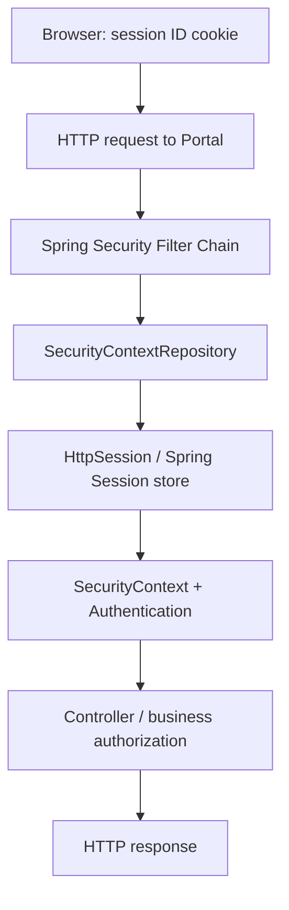
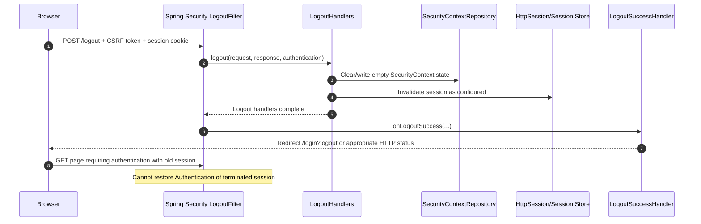
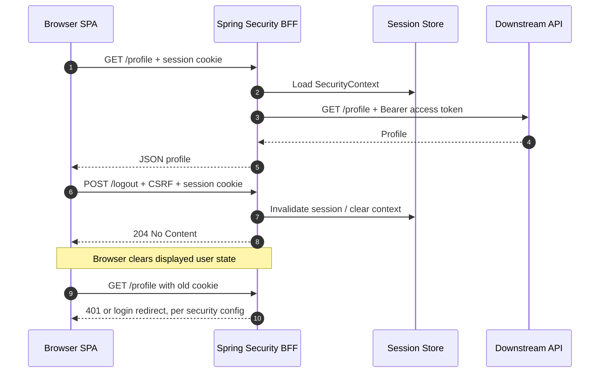
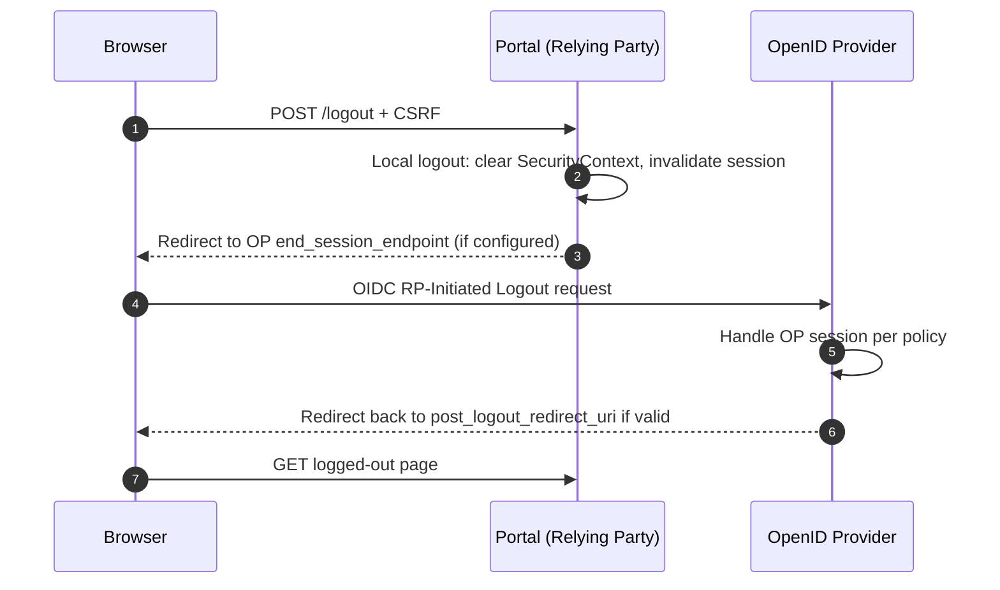
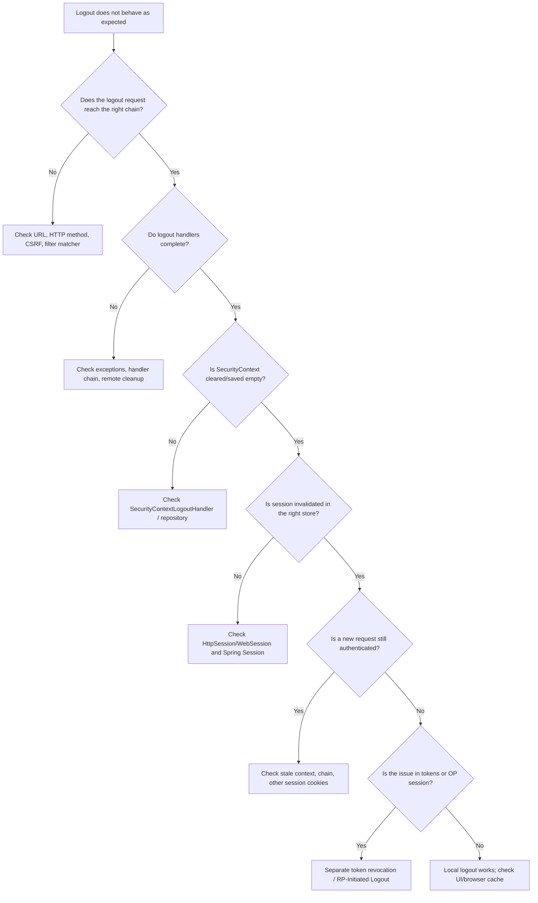

# 24.1. Application Logout and Clearing SecurityContext and Session

In an application using **Spring Security OAuth 2.0 / OpenID Connect (OIDC) Client**, users typically log in by redirecting to an OpenID Provider (OP), receiving an authorization code, and completing OIDC Login on the backend. After a successful login, the application has an `Authentication` and can maintain a session via HTTP session or WebSession. When a user clicks **Log Out**, the single most important operation to perform is **local logout**: ending the authentication state in the application itself, clearing the `SecurityContext` attached to the request, and invalidating the session appropriately.

However, logging out of the application is **not synonymous** with logging out of the OpenID Provider, revoking access tokens, deleting all refresh tokens in the database, or terminating all sessions across all devices. These have different lifecycles. This lesson focuses on **24.1. Application Logout and Clearing SecurityContext and Session**; it also points out the boundaries where coordination with OIDC RP-Initiated Logout and token revocation is needed in other steps.

> **Principle:** A successful local logout means the browser can no longer use the **application's current authenticated session** to call pages/APIs that require login. It **does not by itself prove** that all issued tokens are invalidated at the Authorization Server or that the user has logged out of the OP.

## 1. Learning Objectives

After this lesson, you will be able to:

1. Explain the difference between local logout, OIDC logout at the OP, and OAuth2 token revocation.
2. Understand how `SecurityContext`, `SecurityContextHolder`, `Authentication`, `SecurityContextRepository`, and `HttpSession`/`WebSession` participate in logout.
3. Analyze the processing order of `LogoutFilter`, `LogoutHandler`, and `LogoutSuccessHandler` in Spring Security Servlet.
4. Configure the logout URL, require POST with CSRF, clear authentication, invalidate the session, clear cookies, and redirect after logout.
5. Know when a custom logout handler is needed to clean up application data without losing default protections.
6. Implement local logout in Spring WebFlux with `ServerHttpSecurity` and Reactive logout handlers.
7. Distinguish clearing a session from removing an `OAuth2AuthorizedClient` and revoking tokens at the provider.
8. Avoid logout issues in multi-replica systems, reverse proxies, SPA/BFF, and multi-tenant setups.
9. Write tests confirming that post-logout requests are no longer authenticated, rather than only checking HTTP 302.

## 2. Three Types of "Logout" Not to Be Equated

| Action | Scope of Impact | Expected Outcome |
|---|---|---|
| **Local application logout** | `SecurityContext`, HTTP session/WebSession, and login state within the application itself | Subsequent requests cannot continue using the old session's authentication |
| **OIDC RP-Initiated Logout** | SSO session at the OpenID Provider, via an endpoint/protocol supported by the OP | OP processes the SSO session termination request according to policy |
| **OAuth2 token revocation** | Access/refresh tokens at the Authorization Server, if the endpoint/contract supports it | Provider revokes the requested token; effectiveness for APIs depends on token type and verification mechanism |

Example:

```text
Browser logs into Portal via Corporate OP
  |
  +-- Portal has Alice's SecurityContext
  +-- Browser has Portal's session cookie
  +-- Portal has OAuth2AuthorizedClient (AT/RT)
  +-- Corporate OP has its own SSO session
```

When Alice logs out of **Portal**, the application can clear Portal's `SecurityContext` and session, but Corporate OP **still has** its SSO session. If Alice clicks Login again, the OP may log her back in very quickly without prompting for a password. This can be normal SSO behavior, **not evidence that local logout failed**.

Conversely, if Portal only deletes the authorized client token from the database while keeping the `SecurityContext`/session, Alice can still access screens requiring an authenticated user, even though downstream APIs may no longer have an access token.

### 2.1. Scope Matrix

| Event | Portal SecurityContext | Portal HTTP session | Authorized client/token store | OP SSO session |
|---|---|---|---|---|
| Default local logout, session-backed | Cleared/not reused for new requests | Usually invalidated | **Not guaranteed** to be deleted in all stores | Not automatically terminated |
| Remove `OAuth2AuthorizedClient` from service | Not automatically changed | Not automatically changed | Corresponding record deleted | Not automatically terminated |
| OIDC logout at OP | Needs coordination with local logout | Needs coordination with local logout | Does not automatically guarantee token revocation | OP handles per protocol |
| Token revoked at AS | May still be authenticated | May still exist | Local record may remain, but token is unusable | Depends on OP policy |
| Browser deletes Portal session cookie | New requests lack the old session ID | Server-side session may still exist until timeout if not invalidated | Not automatically changed | Not automatically changed |

Do not build UX copy saying "Logged out from all devices and all services" if you only run local logout.

## 3. How Are SecurityContext and HTTP Session Related?

`SecurityContext` holds `Authentication`, for example `OAuth2AuthenticationToken` with `OidcUser` as the principal in OIDC Login:

```text
SecurityContext
  └─ Authentication (OAuth2AuthenticationToken)
       ├─ principal (OidcUser)
       ├─ authorities
       ├─ authenticated = true
       └─ authorizedClientRegistrationId = company-login
```

In Spring MVC, `SecurityContextHolder` typically binds the current request's context to the appropriate execution context, defaulting to thread-local association. `SecurityContextRepository` determines how the context is loaded/saved across requests. In a session-based web app, the implementation can typically use `HttpSessionSecurityContextRepository` or a composite repository.

The browser holds a session cookie, such as `JSESSIONID`; the server uses the ID to look up the session and the attributes stored by the application/security framework. A regular cookie is **not** a JSON payload containing the full `Authentication` or access token.



Local logout must ensure that **subsequent requests cannot restore the old authentication** via the repository/session, not merely set a Java variable to `null` in the current controller.

### 3.1. Why Is clearContext() Not Enough?

Example:

```java
SecurityContextHolder.clearContext();
```

This call clears the context bound to the **current** execution context. It does not necessarily:

- Invalidate `HttpSession` on the server.
- Remove the `SecurityContext` persisted in `SecurityContextRepository`.
- Delete the session cookie in the browser.
- Remove `OAuth2AuthorizedClient` from JDBC/Redis.
- Call the OP logout endpoint.

If an application writes its own "logout controller" that only calls `clearContext()`, a subsequent request may reload the Authentication from the session/repository depending on configuration. The standard approach is to let the **Spring Security logout pipeline** handle this.

### 3.2. Why Is invalidateSession() Not Enough?

`request.getSession().invalidate()` terminates a specific session, but if a custom security flow retains context in another repository, or stores Authentication in an inappropriate place, you still need proper security context cleanup.

Additionally, if the Session ID is held in a browser cookie, simply invalidating the session on the server does not necessarily make the cookie **disappear from the browser**. The cookie may persist until expiration, though the old ID must not be allowed to restore an invalidated session.

### 3.3. Authentication in OIDC Is Not OAuth2AuthorizedClient

`OAuth2AuthenticationToken` identifies the logged-in user, principal, and registration; `OAuth2AuthorizedClient` contains the access token/refresh token for the registration and principal. They may be stored in different repositories.

```text
SecurityContext
   -> Authentication(name=employee-42)

OAuth2AuthorizedClientService
   -> (company-login, employee-42)
      -> access_token, refresh_token
```

Clearing the SecurityContext **does not automatically delete the JDBC record** of the authorized client. Whether tokens can still be used outside the application after logout depends on the API/AS, and is not invalidated solely because Portal stops storing the Authentication.

## 4. Spring Security Servlet Logout Pipeline

With Spring MVC/Servlet, Spring Security provides `LogoutFilter` in the filter chain. When an HTTP request matches the logout request matcher, the filter runs the configured `LogoutHandler` instances, and then invokes `LogoutSuccessHandler`.



**`LogoutHandler` and `LogoutSuccessHandler` have distinct responsibilities.**

| Component | Responsibility |
|---|---|
| `LogoutFilter` | Matches the HTTP logout request and invokes the processing components |
| `LogoutHandler` | Cleans up security context/session and application data requiring cleanup |
| `SecurityContextLogoutHandler` | Clears authentication/context and invalidates the HTTP session per settings |
| `CookieClearingLogoutHandler` | Emits Set-Cookie headers to delete specified cookies |
| `CsrfLogoutHandler` | Cleans up CSRF token state when configured |
| `LogoutSuccessHandler` | Decides the post-logout response: redirect, HTTP status, or OIDC redirect |

Default implementations/handlers may vary across Spring Security versions and configurations, but the **logout handlers → logout success response** model is foundational.

### 4.1. Why Use the Logout DSL?

Avoid writing:

```java
// Do not replace the logout pipeline with a manual context-clearing endpoint.
@PostMapping("/logout")
String logout() {
    SecurityContextHolder.clearContext();
    return "redirect:/login";
}
```

With Spring Security, `/logout` is usually already handled by the filter; the MVC endpoint above may never be called. If it does get called because you changed the matcher or removed the filter, it easily misses session invalidation and repository cleanup. Instead of "creating a logout controller," **configure `HttpSecurity.logout(...)`**.

## 5. Basic Local Logout Configuration with Spring MVC

Example OIDC Login application:

```yaml
spring:
  security:
    oauth2:
      client:
        registration:
          company-login:
            provider: corporate
            client-id: "${OIDC_CLIENT_ID}"
            client-secret: "${OIDC_CLIENT_SECRET}"
            client-authentication-method: client_secret_basic
            authorization-grant-type: authorization_code
            redirect-uri: "{baseUrl}/login/oauth2/code/{registrationId}"
            scope: [openid, profile, email]
        provider:
          corporate:
            issuer-uri: "https://idp.example.org/realms/company"
```

Example SecurityFilterChain:

```java
import org.springframework.context.annotation.Bean;
import org.springframework.context.annotation.Configuration;
import org.springframework.security.config.Customizer;
import org.springframework.security.config.annotation.web.builders.HttpSecurity;
import org.springframework.security.web.SecurityFilterChain;

@Configuration
class SecurityConfig {

    @Bean
    SecurityFilterChain securityFilterChain(HttpSecurity http)
            throws Exception {
        return http
                .authorizeHttpRequests(authorize -> authorize
                        .requestMatchers("/", "/login", "/error")
                        .permitAll()
                        .anyRequest().authenticated())
                .oauth2Login(Customizer.withDefaults())
                .logout(logout -> logout
                        .logoutUrl("/logout")
                        .logoutSuccessUrl("/login?logout")
                        .invalidateHttpSession(true)
                        .clearAuthentication(true))
                .build();
    }
}
```

Meaning:

- `logoutUrl("/logout")`: defines the endpoint matched by the Spring Security filter.
- `logoutSuccessUrl("/login?logout")`: redirects back to a notification page/path after local logout.
- `invalidateHttpSession(true)`: requests invalidation of the current HTTP session upon logout.
- `clearAuthentication(true)`: clears Authentication from the security context.

`invalidateHttpSession` and `clearAuthentication` are typically already the appropriate default behaviors of `SecurityContextLogoutHandler`; writing them explicitly here illustrates their responsibilities.

Note: `/login?logout` is the **local logout success page**, not the OP end-session endpoint. This code **does not call RP-Initiated Logout**.

### 5.1. When CSRF Is Enabled, Logout Is Typically POST

In web apps using cookie sessions, Spring Security protects state-changing operations with CSRF. When CSRF is enabled, the default logout request is usually **POST `/logout`** (with a valid CSRF token), not a GET link that an external website could trigger.

Example HTML form with Thymeleaf (when integrating CSRF tokens into templates):

```html
<form th:action="@{/logout}" method="post">
  <button type="submit">Log out</button>
</form>
```

In applications with Thymeleaf/Spring Security integration, the CSRF hidden field can be added automatically by the integration mechanism. If using another template engine, the client must send the CSRF token according to the configured `CsrfTokenRepository`. **Do not assume every HTML form automatically includes a CSRF token** without the corresponding integration.

A static HTML form can add a hidden input:

```html
<form action="/logout" method="post">
  <input type="hidden" name="_csrf" value="SERVER_GENERATED_CSRF_TOKEN" />
  <button type="submit">Log out</button>
</form>
```

The value above is a placeholder; production must use a valid token issued by the server, **never hardcoded**.

### 5.2. Why Not Arbitrarily Enable GET Logout?

GET is an operation that browsers, crawlers, or external sites can trigger via links, images, or redirects. If GET `/logout` terminates the session without CSRF, another website could force the user to be logged out.

Therefore:

- Use POST + CSRF for local logout in cookie-session web apps.
- Do not configure a GET logout matcher merely for the convenience of a link without considering CSRF.
- For SPA/BFF, the frontend can send `fetch("/logout", {method:"POST", headers:{...CSRF...}})`; you must align how the CSRF token is obtained and the cookie policy.
- Disabling CSRF globally just to make "logout work" can expose vulnerabilities on other POST/PUT/DELETE endpoints.

### 5.3. GET /logout Can Be a Confirmation Page

In some Spring Security configurations, GET `/logout` renders a logout confirmation/form page (rather than executing logout immediately), while session termination happens after POST. This detail depends on the default login page/CSRF setup and version. Do not write tests asserting "GET /logout always destroys the session"; test **the request that actually triggers logout** in your active configuration.

## 6. SecurityContextLogoutHandler: What Gets Cleaned Up

`SecurityContextLogoutHandler` is a core implementation of Servlet logout. It can:

1. Invalidate `HttpSession` if configured.
2. Remove `Authentication` from `SecurityContext`.
3. Clear the current context from `SecurityContextHolder`.
4. Coordinate with `SecurityContextRepository` to ensure the old context is not reloaded per the contract/version.

Example usage when building a special custom endpoint (not the recommended default approach):

```java
import jakarta.servlet.http.HttpServletRequest;
import jakarta.servlet.http.HttpServletResponse;
import org.springframework.security.core.Authentication;
import org.springframework.security.web.authentication.logout
        .SecurityContextLogoutHandler;

void terminateLocalSession(
        HttpServletRequest request,
        HttpServletResponse response,
        Authentication authentication) {

    SecurityContextLogoutHandler handler =
            new SecurityContextLogoutHandler();

    handler.setInvalidateHttpSession(true);
    handler.setClearAuthentication(true);
    handler.logout(request, response, authentication);
}
```

This is only an API example; if the default `LogoutFilter` already runs, **do not invoke the handler again** inside a controller. A manual logout endpoint would also have to handle CSRF, the logout success response, repository configuration, session cookies, and the behavior of other logout handlers.

### 6.1. SecurityContextRepository and Explicit-Save

In Spring Security 6, flows that **authenticate manually** may require an explicit `SecurityContextRepository.saveContext(...)` when running with `SecurityContextHolderFilter`/explicit-save semantics. Logout must also respect the configured repository.

What to avoid:

```java
// Does not guarantee state is cleared from persistence:
SecurityContextHolder.getContext().setAuthentication(null);
```

This only mutates the current object in memory. When using a custom repository or custom authentication pipeline, verify that saving/clearing the context follows the contract. Using the configured `LogoutFilter` and `SecurityContextLogoutHandler` is safer than manipulating the thread-local directly.

### 6.2. Do Not Clear Authentication Too Early When OIDC Logout Is Needed

If the application later adds OIDC RP-Initiated Logout, `LogoutSuccessHandler` may need the **OidcUser/ID Token** of the user logging out to construct the request to the OP. In the `LogoutFilter` flow, the original `Authentication` is passed to the handlers and success handler.

If custom code overwrites/clears the authentication variable early and then looks for the ID Token, the OP logout handler may lack the required data. Keep the **original Authentication only within the permitted logout processing scope** so the framework can complete the protocol; never include ID Tokens or refresh tokens in responses or logs.

## 7. Deleting Session Cookies: Distinguishing Browser and Server

`invalidateHttpSession(true)` destroys the server-side session, while the browser may still retain the old session ID cookie. Subsequent server requests must refuse to restore authentication from the invalidated ID.

If you want to instruct the browser to delete the cookie:

```java
.logout(logout -> logout
        .invalidateHttpSession(true)
        .clearAuthentication(true)
        .deleteCookies("JSESSIONID")
        .logoutSuccessUrl("/login?logout"))
```

`deleteCookies("JSESSIONID")` emits a cookie-deletion header as supported by Spring Security. However, whether the browser successfully deletes it depends on **cookie name, domain, path, Secure flag, and proxy/session resolver configuration**. If the cookie uses a different name, or was issued with a different path/domain, sending a Set-Cookie to delete `JSESSIONID` will not necessarily remove the old cookie.

### 7.1. A Cookie Is Not the Session Store

```text
Browser:
  Cookie: JSESSIONID=opaque-id

Server:
  Session store[opaque-id]
      -> SecurityContext
      -> other session attributes
```

Deleting the browser cookie without **invalidating** the server-side session can leave an unexpired session active until timeout. Conversely, invalidating the server-side session protects authentication even if the browser continues sending the old ID.

**Prioritize terminating server-side state**, then align cookie cleanup according to UX/security requirements.

### 7.2. The Authorization Server Cookie Belongs to a Different Domain

Portal may issue cookies for `portal.example.org`; Corporate OP issues cookies for `idp.example.org`. Portal **cannot arbitrarily delete cookies belonging to the OP's domain**. To terminate the SSO session at the OP, you must use the OIDC logout protocol/endpoint supported by the provider.

Do not attempt to send `Set-Cookie` for a domain the application does not control in order to "clear the OP session."

### 7.3. Reverse Proxy, HTTPS, and SameSite

When the browser connects over `https://portal.example.org` while the backend runs HTTP behind a proxy, forwarded headers from a **trusted** proxy must be handled so redirect URLs and cookie settings are accurate.

| Attribute | Effect |
|---|---|
| `Secure` | Cookie is only sent over HTTPS |
| `HttpOnly` | JavaScript cannot read the cookie |
| `SameSite` | Restricts certain cross-site cookie behaviors |
| `Path`/`Domain` | Scopes the cookie and deletion matching conditions |
| Idle timeout | Ends the session after a period of inactivity |

Setting `SameSite` too strictly can affect OIDC callbacks depending on browser and flow. Setting it too loosely can increase CSRF risk. Balance according to your redirect architecture—do not disable all CSRF or cookie protections just to fix a failing callback.

### 7.4. Clear-Site-Data Is a Supplementary Measure

The `Clear-Site-Data` HTTP header can instruct the browser to clear certain origin/site data, such as cookies or storage depending on browser support. It **does not replace** server-side session invalidation and can affect data of other applications sharing the same origin/site.

Use it only after evaluating the blast radius, browser support, and product requirements. Do not blindly turn on "clear all cookies/storage" across an entire enterprise domain.

## 8. LogoutSuccessHandler: Response After Ending the Session

After the `LogoutHandler` instances run, `LogoutSuccessHandler` decides the response sent to the browser:

```java
.logout(logout -> logout
        .logoutSuccessUrl("/login?logout"))
```

For traditional web pages, redirecting to `/login?logout` is often appropriate. For APIs/BFFs serving an SPA, the frontend may expect HTTP `204 No Content` instead of an HTML redirect.

### 8.1. Returning HTTP 204 for SPA/BFF

```java
import org.springframework.http.HttpStatus;
import org.springframework.security.web.authentication.logout
        .HttpStatusReturningLogoutSuccessHandler;

http.logout(logout -> logout
        .logoutUrl("/logout")
        .invalidateHttpSession(true)
        .clearAuthentication(true)
        .logoutSuccessHandler(
                new HttpStatusReturningLogoutSuccessHandler(
                        HttpStatus.NO_CONTENT)));
```

This is an **alternative** to redirecting to a success URL; do not combine contradictory response outcomes for the same endpoint. `204` indicates the local logout request was processed through the pipeline; **it does not prove that refresh tokens were revoked or the OP session ended**.

### 8.2. The Success Page Must Be Accessible When Anonymous

If you redirect to `/goodbye` but `/goodbye` requires authentication, the browser may be redirected to the login page, making it feel like "logout failed." Configure permit rules:

```java
.authorizeHttpRequests(authorize -> authorize
        .requestMatchers("/", "/login", "/goodbye", "/error")
        .permitAll()
        .anyRequest().authenticated())
```

Do not judge logout solely by whether the UI displays the goodbye page. Test a request to a protected endpoint **after logout**.

## 9. Adding a Custom LogoutHandler When Application Data Needs Cleanup

A system may hold state outside `SecurityContext`:

- Shopping carts or temporary drafts that should not persist after logout.
- Tokens stored in `OAuth2AuthorizedClientService`.
- Per-principal/session caches.
- WebSocket subscriptions tied to the user session.
- Temporary tenant or account selection data.

With Servlet `HttpSecurity`, you can add an application `LogoutHandler` via `addLogoutHandler(...)`, while letting the framework keep its default cleanup:

```java
import org.springframework.security.web.authentication.logout.LogoutHandler;

LogoutHandler applicationCleanup =
        (request, response, authentication) -> {
            if (authentication != null) {
                String principalName = authentication.getName();
                // Clean up only permitted application data for the principal.
                auditLogoutIntent(principalName);
            }
        };

http.logout(logout -> logout
        .addLogoutHandler(applicationCleanup)
        .invalidateHttpSession(true)
        .clearAuthentication(true)
        .logoutSuccessUrl("/login?logout"));
```

`auditLogoutIntent(...)` is an application method you implement; it is not a Spring Security API. Design auditing so it does not log tokens or excessive PII and avoids exceptions disrupting logout.

**Do not call `SecurityContextLogoutHandler` a second time** inside a custom handler if default logout cleanup is already configured. If you replace the entire handler chain, you must preserve all required session/context/CSRF/cookie cleanup duties.

### 9.1. Cleaning Up the Authorized Client When Business Logic Requires It

Suppose the application wants to remove tokens for registration `company-login` from `OAuth2AuthorizedClientService` when the user logs out:

```java
import org.springframework.security.oauth2.client
        .OAuth2AuthorizedClientService;
import org.springframework.security.web.authentication.logout.LogoutHandler;

LogoutHandler removeCompanyClient(
        OAuth2AuthorizedClientService clientService) {

    return (request, response, authentication) -> {
        if (authentication != null) {
            clientService.removeAuthorizedClient(
                    "company-login", authentication.getName());
        }
    };
}
```

Attach it to the chain with:

```java
http.logout(logout -> logout
        .addLogoutHandler(removeCompanyClient(clientService))
        .invalidateHttpSession(true)
        .clearAuthentication(true));
```

This example only works when `OAuth2AuthorizedClientService` is actually used to store authorized clients for that registration. If tokens reside in `HttpSessionOAuth2AuthorizedClientRepository`, invalidating the session clears the session data; calling an unrelated service will have no effect.

### 9.2. Removing Local Tokens Does Not Automatically Revoke Tokens at the OP

```text
Portal DB:
  DELETE (company-login, alice)

Authorization Server:
  Old Access Token may still be valid
  Old Refresh Token may still be valid
```

`removeAuthorizedClient(...)` is a **local storage** operation. If business requirements demand invalidating tokens at the provider, you need OAuth2 Token Revocation (RFC 7009) or a supported provider-specific API, along with error handling and cleanup ordering. This is a **separate** step from local logout.

### 9.3. LogoutHandler Is Not a Good Place for Arbitrary Slow Network Calls

Servlet `LogoutHandler.logout(...)` is a synchronous API. Calling a series of remote APIs to "clean up every system" when they time out can cause user logout to hang or fail.

In practice, you need to:

- Identify which cleanups are mandatory/fast at the logout boundary.
- Avoid breaking local logout protection because a downstream system is failing.
- Use timeouts/bounded retries and auditing when communicating with the provider if required.
- Have a reliable job/event mechanism when asynchronous cleanup is needed, without advertising revocation completion until it is actually confirmed.
- Never log refresh tokens or send them over an unprotected event queue.

**Do not swallow every exception** if doing so hides a legal/security requirement that must be verified. At the same time, avoid letting an external outage prevent users from ending their **local session**.

## 10. Logout Ordering and Required Data

A common mistake is clearing the SecurityContext before extracting the information needed for cleanup:

```text
Clear Authentication
   -> authentication = null
   -> cannot find principalName
   -> do not know which authorized client to remove
```

The Spring Security logout pipeline receives the **original Authentication** and passes it to each handler and success handler. Write cleanup logic using the passed `authentication` parameter rather than reading `SecurityContextHolder` after the context has been cleared.

Example:

```java
(request, response, authentication) -> {
    if (authentication == null) {
        return;
    }
    String name = authentication.getName();
    // Clean up the exact data associated with name in the verified store.
};
```

When implementing OIDC RP-Initiated Logout, `OidcUser.getIdToken()` may be needed to build `id_token_hint` per the spec/provider. That data should only be used within the authenticated logout flow via the appropriate handler, never taken from a browser query parameter.

## 11. Session Fixation and Concurrent Sessions

Session fixation protection typically **rotates the session ID when transitioning from anonymous to authenticated**. Upon logout, invalidating the session ensures the old session can no longer restore the SecurityContext.

A user may have multiple sessions:

```text
Alice:
  Browser A -> Portal session S1
  Browser B -> Portal session S2
  Mobile    -> Different session/token
```

Local logout from Browser A typically terminates **S1**, without guaranteeing that S2 is also invalidated. If the product requires "log out from all devices," you need **global session invalidation** and coordinated token revocation/OP sessions per the architecture—not just `invalidateHttpSession(true)` on the current request.

### 11.1. SessionRegistry Does Not Automatically Handle All OAuth2 Tokens

Spring Security provides components for managing concurrent sessions (depending on Servlet/Reactive and configuration). They can help manage authenticated sessions, but **do not imply** access to all refresh tokens in a service store or revoking them at the provider.

When logout-all is required:

1. Identify the user's session IDs from a trusted source.
2. Invalidate the corresponding sessions in the backing store.
3. Clean up authorized client records per policy and principal key.
4. If required, perform provider token revocation/OP logout.
5. Handle non-cookie-session clients/devices (mobile, native apps, API keys) separately.

Do not allow the browser to submit an arbitrary user ID to force-logout another account's sessions.

## 12. Multiple Applications and Multiple Spring Security FilterChains

An application may simultaneously act as:

- **OIDC Login Client** for `/web/**`, using cookie sessions.
- **OAuth2 Resource Server** for `/api/**`, validating bearer tokens on every request.
- **OAuth2 Client** using `client_credentials` to call other APIs.

These Authentication types have different lifecycles:

```text
/web/**:
  Browser cookie -> SecurityContext from HttpSession
  POST /logout -> ends local web session

/api/**:
  Authorization: Bearer <access-token>
  -> validates access token per request
  -> web logout does not automatically invalidate bearer token

Background worker:
  client_credentials -> service access token
  -> no browser session to log out
```

If configuring multiple `SecurityFilterChain` beans with separate matchers/orders, ensure **`/logout` routes through the chain with the proper logout filter**. If the logout request is matched first by a stateless API chain, the behavior may be 401/404 or missing expected cleanup.

### 12.1. Do Not Use Browser Logout for client_credentials

`client_credentials` represents an application/service, usually has no `OidcUser`, and maintains no user HTTP session. When a service token needs to be retired, manage client registration, authorized client storage, and client credentials rotation/revocation—do not send an HTTP POST `/logout` simulating a browser session.

### 12.2. Do Not Delete All Service Tokens Because One User Logs Out

Suppose Portal stores both user token `(company-login,alice)` and service token `(inventory-service,service:nightly-import)`. Alice logging out **should not** delete the global service token if the nightly job remains authorized and operates independently.

Clearly separate user and service tokens by registration/principal and storage policy; custom logout handlers should clean up only the owned scope.

## 13. BFF Pattern: Frontend Holds Only the Session Cookie

With a Backend-for-Frontend (BFF), the browser may never see access/refresh tokens. The backend holds the tokens and uses `HttpSession` to manage login state.



**Do not send the refresh token to the browser** to let it revoke/refresh tokens on its own if the BFF design intentionally keeps tokens server-side.

### 13.1. What Should the Frontend Handle After HTTP 204?

- Clear profile data/UI caches tied to user identity.
- Stop requests or subscriptions that require authentication.
- Navigate to a public/login screen.
- Do not expect `204` to have a JSON body containing tokens.
- Do not rely on an `isLoggedIn=true` flag as proof of authentication.

The backend is the authority on whether an old session remains valid. Clearing local UI state on the frontend is only display cleanup, not a substitute for server-side local logout.

### 13.2. Limit Caching of Personal Data in the Browser

Even after the session ends, the browser may retain recently viewed pages, query caches, service worker caches, or history. For sensitive data, control HTTP cache headers and frontend data-clearing policies. Do not assume the browser clears all caches automatically when the server invalidates a session.

## 14. Logout with Spring WebFlux / Reactive Security

In Spring WebFlux, `ServerHttpSecurity` builds a `SecurityWebFilterChain`. Security state flows through the Reactor context, typically accessed via `ReactiveSecurityContextHolder`. `WebSession` is the corresponding session abstraction, not `jakarta.servlet.http.HttpSession`.

Key APIs:

| Servlet | Reactive WebFlux |
|---|---|
| `HttpSecurity.logout(...)` | `ServerHttpSecurity.logout(...)` |
| `LogoutFilter` | `LogoutWebFilter` |
| `LogoutHandler` | `ServerLogoutHandler` |
| `SecurityContextLogoutHandler` | `SecurityContextServerLogoutHandler` |
| `LogoutSuccessHandler` | `ServerLogoutSuccessHandler` |
| `HttpSession` | `WebSession` |
| `SecurityContextRepository` | `ServerSecurityContextRepository` |
| `SecurityContextHolder` | `ReactiveSecurityContextHolder` |

**Do not take a Servlet example and merely swap class names.** In Reactive, handlers must return `Mono<Void>` and respect non-blocking flows.

### 14.1. Configuring Reactive Local Logout

```java
import org.springframework.context.annotation.Bean;
import org.springframework.context.annotation.Configuration;
import org.springframework.security.config.annotation.web.reactive
        .EnableWebFluxSecurity;
import org.springframework.security.config.web.server.ServerHttpSecurity;
import org.springframework.security.web.server.SecurityWebFilterChain;

@Configuration
@EnableWebFluxSecurity
class ReactiveLogoutSecurityConfig {

    @Bean
    SecurityWebFilterChain securityWebFilterChain(
            ServerHttpSecurity http) {

        return http
                .authorizeExchange(exchanges -> exchanges
                        .pathMatchers("/", "/login", "/goodbye", "/error")
                        .permitAll()
                        .anyExchange().authenticated())
                .oauth2Login(oauth2 -> {})
                .logout(logout -> logout.logoutUrl("/logout"))
                .build();
    }
}
```

This is a minimal local logout configuration; Spring Security uses the version's default Reactive logout filter/handler. If you need to **invalidate the entire WebSession** rather than only clearing the SecurityContext, explicitly inspect and configure the `WebSession` lifecycle as shown in the next example.

### 14.2. Combining Clearing SecurityContext and Invalidating WebSession

A custom `ServerLogoutHandler` can combine the framework's context handler with `WebSession` invalidation. Example:

```java
import org.springframework.security.web.server.authentication.logout
        .SecurityContextServerLogoutHandler;
import org.springframework.security.web.server.authentication.logout
        .ServerLogoutHandler;
import org.springframework.web.server.WebSession;

SecurityContextServerLogoutHandler clearContext =
        new SecurityContextServerLogoutHandler();

ServerLogoutHandler clearContextAndSession =
        (exchange, authentication) ->
                clearContext.logout(exchange, authentication)
                        .then(exchange.getExchange()
                                .getSession()
                                .flatMap(WebSession::invalidate));

http.logout(logout -> logout
        .logoutUrl("/logout")
        .logoutHandler(clearContextAndSession));
```

This is a **configuration snippet inside `SecurityWebFilterChain`**, not a standalone Java block. When customizing the logout handler, preserve the cleanup performed by the default handler, keep the CSRF policy intact, and ensure an appropriate success response. If the application uses a custom `ServerSecurityContextRepository`, make sure `SecurityContextServerLogoutHandler` is configured to work with **that exact repository**, rather than a different default.

### 14.3. Do Not Block the Reactor Event Loop

Do not write:

```java
// AVOID in a Reactive logout handler:
clientService.removeAuthorizedClient(...).block();
```

If you need to clean up `ReactiveOAuth2AuthorizedClientService`, compose with `then(...)` or `Mono.when(...)` according to the contract. Deleting tokens from Redis/R2DBC should use Reactive APIs without blocking threads.

Illustrative logic example:

```java
ServerLogoutHandler cleanup =
        (exchange, authentication) -> {
            if (authentication == null) {
                return Mono.empty();
            }

            return reactiveClientService.removeAuthorizedClient(
                    "company-login", authentication.getName());
        };
```

This snippet requires importing `Mono` and injecting the appropriate `reactiveClientService`; if using `logoutHandler(cleanup)` to replace the default, **it must be combined** with the handler that clears SecurityContext/session. Deleting only the authorized client while forgetting the security context **is not a complete local logout**.

### 14.4. ServerLogoutSuccessHandler

Reactive logout also separates cleanup handlers from the post-logout response. Depending on version/framework, you can use `RedirectServerLogoutSuccessHandler` to redirect or implement `ServerLogoutSuccessHandler` to return a status for an SPA.

Example designing a JSON/HTTP 204 response:

```java
import org.springframework.http.HttpStatus;
import org.springframework.security.web.server.authentication.logout
        .ServerLogoutSuccessHandler;
import reactor.core.publisher.Mono;

ServerLogoutSuccessHandler noContent = (exchange, authentication) -> {
    exchange.getExchange().getResponse()
            .setStatusCode(HttpStatus.NO_CONTENT);
    return exchange.getExchange().getResponse().setComplete();
};

http.logout(logout -> logout
        .logoutUrl("/logout")
        .logoutSuccessHandler(noContent));
```

This is a snippet for Reactive security configuration; pair it with the appropriate logout handler above. Do not return 204 before mandatory cleanup has completed or overstate 204 as meaning OP logout/token revocation.

## 15. Logout and OAuth2AuthorizedClientRepository

One of the biggest misconceptions in OIDC Client is assuming `SecurityContext` and `OAuth2AuthorizedClient` are stored and cleared together automatically.

In Servlet:

| Storage | Typical Stored Data | How Does Local Logout Affect It? |
|---|---|---|
| `HttpSessionSecurityContextRepository` | Authentication/SecurityContext | Session invalidation typically removes this data |
| `HttpSessionOAuth2AuthorizationRequestRepository` | OAuth2 Authorization Request before callback | When the session invalidates, temporary requests in it are gone |
| `HttpSessionOAuth2AuthorizedClientRepository` | Authorized clients stored in HTTP session | When the session actually holds this data and is destroyed, it is no longer available via session |
| `InMemoryOAuth2AuthorizedClientService` | Authorized clients in JVM by key pair | Not automatically removed on browser session end |
| `JdbcOAuth2AuthorizedClientService` | Authorized clients in database | Not automatically removed on browser session end |
| Custom service (Redis/KMS/DB) | Data per implementation | Needs a separate cleanup policy |

In WebFlux there is a similar distinction between `WebSessionServerOAuth2AuthorizedClientRepository` and `ReactiveOAuth2AuthorizedClientService`.

### 15.1. Example: User Logged Out but Token Remains in JDBC

```text
T0: Alice logs in successfully
    HttpSession S1 -> SecurityContext(Alice)
    JDBC           -> (company-login, Alice) -> AT1/RT1

T1: Alice POST /logout
    HttpSession S1  -> invalidated
    SecurityContext -> cleared
    JDBC            -> (company-login, Alice) -> AT1/RT1 (may remain)

T2: Browser GET /private
    No Authentication from S1
    -> redirect login / 401 per security policy
```

The `GET /private` request is not authenticated even though the JDBC token remains, because **token storage is not proof of login**. If another application has permission to read that token, it could still use it until expiration/revocation; that is a separate cleanup/authorization concern.

### 15.2. Local Removal Differs from Token Revocation

`OAuth2AuthorizedClientService.removeAuthorizedClient(registrationId, principalName)`:

- Only removes the record from the invoked service.
- Does not call the OP's `end_session_endpoint`.
- Does not by default send an RFC 7009 revocation request.
- Does not guarantee already-issued JWT access tokens will stop being accepted by APIs.
- Does not automatically log out all browser sessions of the principal.

To achieve "comprehensive logout," additional steps must be designed according to product and provider requirements.

### 15.3. When the Provider Uses Refresh Token Rotation

If a request is refreshing token `RT1` while the user logs out:

```text
Request A: refresh RT1 -> RT2
Request B: logout -> remove authorized client
Request A: save AT2/RT2 after logout
```

A race condition can cause the authorized client **to be written back** after logout. If the requirement is "logout must cut off access to stored tokens," you need concurrency control, versioning/tombstones, cancellation, and an appropriate cleanup policy to prevent stale refreshes/writes after logout.

Simply adding a remove call does not by itself eliminate in-flight refresh flows running on other instances.

## 16. OIDC RP-Initiated Logout at the Lesson Boundary

When logging out of the OP is needed, Spring Security Servlet provides `OidcClientInitiatedLogoutSuccessHandler` to build the redirect flow to the end-session endpoint when the OP supports the corresponding metadata/protocol. However, this is a step **coordinated with local logout**, not a replacement for clearing `SecurityContext`.

Diagram:



Only perform RP-Initiated Logout when the provider supports it, the redirect URI is registered, and the application has an appropriate strategy for `id_token_hint`/`state`/callback. If the OP has no end-session endpoint or logout is local-only, do not construct provider URLs from browser input.

### 16.1. Why OP Logout Does Not Automatically Revoke API Tokens

An OP may terminate the browser SSO session while the access token remains a self-verifying JWT accepted by the Resource Server until `exp`. Another system might use introspection/revocation to reject it immediately. The outcome depends on the provider and API policy.

Therefore, do not verify local logout by checking "whether the old token returns 401 at the API yet"; that tests **token invalidation**, not `SecurityContext`/session cleanup.

## 17. Logout in Multi-Instance Systems

A deployment with a load balancer and Spring Session Redis:

```text
                  Browser
                    |
                Load Balancer
                  /  |  \
               Pod A B  C
                  \  |  /
                Session Store
                    |
               SecurityContext

        AuthorizedClient DB (separate)
```

If a user POSTs logout to Pod B, the application must invalidate **the exact session** in the shared store. Subsequent requests routed to Pod C must not reload Authentication from the old session ID.

### 17.1. Sticky Sessions Do Not Replace Invalidation

Sticky sessions may keep a browser pinned to Pod A, but if Pod A dies or the load balancer reroutes, in-memory state can be lost. Shared Spring Session preserves state across pods when configured properly, yet logout must perform invalidation through that same session infrastructure.

If custom code only clears a thread-local SecurityContext on Pod B without updating the session store, Pod C can still restore the old context.

### 17.2. Concurrent Requests Running During Logout

Suppose:

```text
Request A: starts while session S1 is still authenticated
Request B: POST /logout, invalidates S1
Request A: already has Authentication in request context, still processing
```

Local logout generally guarantees that **new requests will not reuse the session**, but does not necessarily abort requests already authorized before the moment of logout. For particularly sensitive operations, the application may need to re-check session/account state at the commit boundary or use a dedicated revocation/versioning mechanism.

Do not advertise local logout as a system-wide transaction capable of rolling back every in-flight operation.

### 17.3. Multiple Browser Tabs

Multiple tabs share a single session cookie. When logging out in Tab A, subsequent requests from Tab B are typically no longer authenticated, though Tab B's UI may still display cached data until the next status check.

The frontend can update the UI via events/broadcasts or by handling 401/redirect responses; however, syncing tab UIs does not replace backend invalidation.

## 18. Common Security Issues During Logout

| Risk | Why It Happens | Mitigation |
|---|---|---|
| Logout CSRF | GET/logout endpoint can be triggered by external sites | POST + CSRF in cookie-session web apps |
| Session fixation | Attacker-controlled session ID retained across authentication | Session fixation protection at login; invalidate at logout |
| Stale SecurityContext | Only thread-local cleared, repository still holds context | Use LogoutFilter/handlers and the proper repository |
| Cookie not deleted | Wrong name, path/domain/Secure config | Align Set-Cookie/session resolver; server invalidation remains mandatory |
| Open redirect | `logoutSuccessUrl`/returnUrl controlled by browser | Allowlist URIs/relative paths; never redirect arbitrarily |
| Token leak | Logging ID/access tokens or sending them to frontend | Redaction; BFF keeps tokens server-side |
| Incomplete logout | Only token store cleared while session remains authenticated | Separate and explicitly perform local logout |
| Overbroad cleanup | User logout deletes global service tokens | Scope by registration/principal/tenant |
| Refresh/logout race | New RT saved after record was deleted | Version/CAS/tombstone or synchronization mechanism |
| Login/logout loop | Success URL requires authentication or OP SSO auto-logs back in | Permit public success page; distinguish local vs OP SSO |
| Fake logout-all | Invalidates only one browser session while displaying "all devices" | Coordinate session registry/global invalidation by design |
| Custom handler throws | Unrelated cleanup prevents local logout from completing | Define error handling and separate mandatory vs optional duties |

### 18.1. Do Not Use Unvalidated returnUrl

Dangerous example:

```text
POST /logout?returnUrl=https://attacker.example/phishing
```

If the success handler redirects to an arbitrary URL, an attacker can abuse Portal's trusted domain as an open redirector. Only redirect to relative paths in an allowlist or strictly validated/registered URIs.

### 18.2. Do Not Log Tokens in Logout Handlers

Values that **must not be logged**:

- Raw access tokens, refresh tokens, ID Tokens.
- `Authorization` headers, session cookie values.
- Client secrets/private keys, authorization codes, PKCE verifiers.
- Full serialized `Authentication`/`SecurityContext` if containing sensitive claims.
- OP logout request query strings if containing `id_token_hint` and identifying data.

Safer logging:

```text
event=local_logout
registrationId=company-login
sessionInvalidated=true
securityContextCleared=true
authorizedClientCleanup=not-configured
correlationId=server-generated
```

The fields above are application-designed log examples, not default Spring metrics/fields. Limit principal identifiers/PII per policy and never use raw session IDs as metric labels.

## 19. Troubleshooting Local Logout Issues

| Symptom | Possible Cause | What to Check |
|---|---|---|
| POST `/logout` returns 403 | Missing/invalid CSRF token | How form/SPA sends CSRF, cookies, and `CsrfTokenRepository` |
| GET `/logout` does not end session | GET only shows confirmation or matcher only accepts POST | Send the right HTTP method and test the logout matcher |
| Logout returns 302 but protected page is still authenticated | Custom handler did not clear/save context, old session still in store | `SecurityContextRepository`, `LogoutFilter`, session invalidation |
| Logout success redirects automatically back to login | Success page requires authentication or OP SSO remains active | Permit public page; distinguish OP session |
| `JSESSIONID` cookie stays in browser | Cookie deletion not sent or cookie path/domain mismatch | Cookie name, path/domain, response headers |
| Cookie disappears but app still has session on server | Only browser cookie deleted, store not invalidated | `invalidateHttpSession(true)` and session persistence |
| User logs out but JDBC token remains | Authorized client stored outside HTTP session | Design separate cleanup if needed |
| User logs out but OP still remembers account | Local logout only, no RP-Initiated Logout | end-session endpoint and provider contract |
| User logs out but API accepts old token | Local logout does not revoke access token | Token revocation/introspection/expiry API |
| Logged out on Pod A but Pod B still authenticated | Shared session store not used or invalidation not propagated | Spring Session config, load balancer, and repository |
| Logout breaks background job | Custom handler deleted `client_credentials` token globally | Scope cleanup by principal/registration |
| WebFlux logout leaves WebSession alive | Only security context cleared, session not invalidated as required | Reactive `ServerLogoutHandler` and WebSession lifecycle |
| Logout handler does not run | URL hits another security chain or CSRF blocks earlier | `SecurityFilterChain` matchers, order, and request method |
| OIDC logout cannot find ID Token | Authentication cleared by custom code or user is not OIDC | Original authentication, OP metadata, and handler |
| Browser still shows user name after logout | Frontend cache/UI state not cleared | BFF response, SPA state, and protected API status |

### 19.1. Diagnostic Flow



Do not fix "OP still has SSO" by clearing `SecurityContext` multiple times. And do not fix "JWT token still accepted by API" by repeatedly deleting browser cookies; those are different layers.

## 20. Testing Servlet Logout with MockMvc

The most important test is verifying that **requests after logout are no longer authenticated**.

A test setup with `spring-security-test` can use `MockMvc`, `formLogin`/`oauth2Login` test helpers, or a mock authenticated session. Do not use real client secrets or a live OP just to test local session invalidation.

### 20.1. Testing Logout with CSRF

Example with a test session:

```java
import org.junit.jupiter.api.Test;
import org.springframework.mock.web.MockHttpSession;
import org.springframework.test.web.servlet.MockMvc;

import static org.springframework.security.test.web.servlet.request
        .SecurityMockMvcRequestPostProcessors.csrf;
import static org.springframework.test.web.servlet.request
        .MockMvcRequestBuilders.post;
import static org.springframework.test.web.servlet.result
        .MockMvcResultMatchers.status;

class LogoutIntegrationTest {

    private MockMvc mvc; // Inject with @Autowired in actual tests.

    @Test
    void logoutAcceptsPostWithCsrf() throws Exception {
        MockHttpSession session = new MockHttpSession();
        mvc.perform(post("/logout")
                    .session(session)
                    .with(csrf()))
                .andExpect(status().is3xxRedirection());
    }
}
```

This is a **test structure illustration** requiring a Spring test context/`MockMvc` configured with the security filter chain. In real tests, inject `MockMvc`, create an **authenticated session**, and assert post-logout state; the example above only verifies that a POST request with CSRF is accepted according to the redirect configuration.

### 20.2. Testing That Logout Without CSRF Is Rejected

```java
mvc.perform(post("/logout").session(authenticatedSession))
        .andExpect(status().isForbidden());
```

Expecting 403 is appropriate when CSRF is enabled and the request lacks a valid token. `authenticatedSession` is a test fixture, not an object automatically created by Spring.

### 20.3. Testing Session Invalidation

An integration test should create an authenticated session, send logout with CSRF, and then reuse that same old session/cookie:

```text
1. Login -> session S1, protected GET /private returns 200
2. POST /logout with S1 + CSRF -> logout success
3. GET /private with old S1
4. Expect no longer authenticated:
     redirect to login or 401 depending on chain
```

`MockHttpSession.isInvalid()` or session state in tests can assist in checking invalidation, but you should test the **behavior of a protected endpoint** rather than just an internal flag.

Do not assert that post-logout requests always return 401: in form/OIDC login web apps, Spring Security may return a **302 redirect to login**. Choose the expectation matching your entry point/security chain.

### 20.4. Testing Logout Does Not Equal Token Revocation

In local logout tests, you do not need to actually call OP end-session/revocation endpoints. Conversely, when testing a "comprehensive logout" feature, separately mock the provider and assert revocation/OP logout per contract. A test checking only 302 `/login?logout` is not enough to prove those steps occurred.

## 21. Testing Reactive Logout with WebTestClient

In WebFlux, use `WebTestClient` with your security configuration and test WebSession:

```java
import org.junit.jupiter.api.Test;
import org.springframework.beans.factory.annotation.Autowired;
import org.springframework.test.web.reactive.server.WebTestClient;

class ReactiveLogoutTest {

    @Autowired
    WebTestClient webTestClient;

    @Test
    void unauthenticatedRequestToPrivateIsRejected() {
        webTestClient.get()
                .uri("/private")
                .exchange()
                .expectStatus().is3xxRedirection();
    }
}
```

The example above only illustrates the **security entry point** when unauthenticated, assuming the app redirects to a login page. It does not create a session or perform logout yet, so a full integration test should:

1. Create an Authentication in `WebSession` via test mechanisms or mocked OIDC login.
2. Call a protected endpoint and confirm it is authenticated.
3. POST logout with a valid CSRF token/cookie.
4. Verify the success response per the configured handler.
5. Call the protected endpoint using the old `WebSession`/cookie and confirm rejection/redirect.
6. With a custom handler invalidating `WebSession`, verify the session store no longer restores the SecurityContext.

If a custom `ServerLogoutSuccessHandler` is configured to return 204, the test should expect 204 instead of 302. Tests must follow the **application contract**, not a hardcoded HTTP status applied to every configuration.

### 21.1. Testing Multiple Sessions

```text
Browser A (session A), browser B (session B) both belong to Alice
  -> POST /logout on A
  -> session A is no longer authenticated
  -> session B may remain authenticated if global logout is not enabled
```

This is expected behavior for standard local logout. If the application claims "log out all devices," add tests verifying session B is also invalidated and token state is handled appropriately.

### 21.2. Testing Multiple Instances

With Spring Session Redis or a shared store, an integration test can create a session on instance A, invoke logout on B, and then test a protected endpoint on C. Tests must ensure routing/storage matches production rather than accidentally using isolated in-memory sessions.

## 22. End-to-End Scenario: OIDC Portal + Reports API + Multiple Tabs

Suppose an enterprise has:

- A Spring MVC Portal using OIDC login via `company-login`.
- Server-side cookie sessions storing `SecurityContext`.
- `JdbcOAuth2AuthorizedClientService` holding AT/RT for the Reports API.
- An SPA with multiple tabs sharing the same session.
- An OP with an independent SSO session.

```text
User Alice
  |
  +-- Tab A -> POST /logout + CSRF
  |             |
  |             +-- LogoutFilter
  |             +-- SecurityContextLogoutHandler
  |             +-- Invalidate Portal session
  |             +-- Optional: cleanup authorized client in JDBC
  |             +-- LogoutSuccessHandler -> 204/redirect
  |
  +-- Tab B -> GET /reports after logout
                |
                +-- old session has no authentication
                +-- 401 or redirect to login

OP SSO session:
  May still exist; requires RP-Initiated Logout to terminate

Reports API access token:
  May still be unexpired; requires revocation when business demands
```

Operational principles:

1. **Local logout** must occur via configured framework handlers, not merely JavaScript clearing the user's name from the UI.
2. Old browsers/sessions must not remain authenticated through an invalidated session.
3. Authorized client cleanup must target the **right storage** (JDBC vs session) and the right registration/principal.
4. Alice's logout must not delete `client_credentials` tokens used by background jobs.
5. If multi-tab UI still shows cached data, the frontend clears/reloads it without treating it as an authentication source.
6. If OP SSO remains, the next login may succeed quickly; terminating the OP session requires using the supported protocol.
7. If the API still accepts the old access token, that is a separate **token lifecycle/revocation** concern.
8. With multiple pods and refresh token rotation, prevent stale writes after logout and ensure shared session invalidation.

## 23. Production Deployment Checklist

| Question | Decision Needed |
|---|---|
| Which logout URL and HTTP method? | E.g., POST `/logout` with CSRF when using cookie sessions |
| Which SecurityFilterChain handles logout? | Correct matchers/order for web routes |
| What clears the SecurityContext? | `LogoutFilter` and `SecurityContextLogoutHandler` or Reactive equivalent |
| What invalidates the session? | `HttpSession`/`WebSession` per the actual repository/session store |
| Are cookies deleted properly? | Name, Path, Domain, Secure, and proxy alignment |
| Is the post-logout response a redirect or 204? | Traditional web UX or SPA/BFF |
| Is the logout success page public? | Allow anonymous access |
| Where is the authorized client stored? | HTTP session, JDBC, Redis, custom storage |
| Is local token cleanup needed? | By registration/principal and data retention policy |
| Is AS token revocation needed? | Token revocation contract, timing/error handling |
| Is OP logout needed? | OIDC end-session endpoint and redirect flow |
| Are there multiple tabs/devices? | Local session vs global logout semantics |
| Are there multiple pods? | Shared session invalidation and token concurrency |
| Is there a custom logout handler? | Do not delete unintended data; do not disable default cleanup |
| Are tokens/cookies logged? | Redaction, limit audit data |
| What to test? | Protected requests after logout, CSRF, session, storage, and OP separately |

## 24. Common Pitfalls

1. **Treating `SecurityContextHolder.clearContext()` as full logout** while the session/repository still holds authentication.
2. **Deleting only the browser cookie** without invalidating the server-side session.
3. **Deleting only the authorized client in the DB** while leaving the user authenticated in `SecurityContext`.
4. **Treating local logout as OIDC OP logout** without calling the end-session endpoint.
5. **Treating OP logout as token revocation** when access tokens may still be valid.
6. **Using unprotected GET logout** in a cookie-session web app, causing logout CSRF.
7. **Disabling CSRF application-wide** just so POST logout works.
8. **Creating `@PostMapping("/logout")`** that bypasses or duplicates `LogoutFilter`.
9. **Overriding the logout handler** in a way that drops default SecurityContext/session cleanup.
10. **Reading the principal from `SecurityContextHolder` after it was cleared**, leaving no data to clean up the right tokens.
11. **Passing browser `returnUrl` directly into a redirect** without an allowlist.
12. **Deleting the wrong cookie name/path/domain**, leaving the browser with an unintended session ID.
13. **Assuming a single local logout ends all devices**, when the user has multiple sessions.
14. **Treating `client_credentials` service tokens like user tokens** and deleting them during user logout.
15. **Logging ID Tokens/access/refresh tokens** to debug logout.
16. **Deleting tokens from the store without considering in-flight refreshes**, allowing stale writes to resurrect tokens after logout.
17. **Blocking the WebFlux event loop** with `block()` in a Reactive logout handler.
18. **Requiring authentication on the logout success page**, causing a redirect loop.
19. **Testing only HTTP 302/204 and declaring logout secure**, without testing a subsequent protected request.
20. **Failing to test Spring Session/multi-instance behavior**, allowing old sessions to be restored on another pod.

## 25. Review Questions

1. How does local logout differ from OIDC RP-Initiated Logout and OAuth2 token revocation?
2. Why might `SecurityContextHolder.clearContext()` not be enough to log out a browser session?
3. What tasks does `SecurityContextLogoutHandler` perform in Servlet applications?
4. How do `LogoutHandler` and `LogoutSuccessHandler` differ in timing and responsibility?
5. Why is `POST /logout` with CSRF usually preferable to `GET /logout` in cookie-session applications?
6. How do `invalidateHttpSession(true)` and `deleteCookies("JSESSIONID")` differ?
7. Can an invalidated session ID cookie still appear in the browser? What ensures it cannot re-authenticate?
8. Why can an OP automatically log a user back in on the next visit after the user logged out of Portal?
9. Why does local logout not automatically delete `OAuth2AuthorizedClient` records in JDBC?
10. Does `removeAuthorizedClient(...)` cause an old JWT access token to be rejected immediately by an API?
11. In logout with OIDC `id_token_hint`, why must the original `Authentication` be preserved for the appropriate success handler?
12. In WebFlux, how do `ServerLogoutHandler` and `WebSession.invalidate()` differ from Servlet APIs?
13. Why should you not call `block()` inside a Reactive logout handler?
14. With multiple `SecurityFilterChain` beans, what matcher mistake can prevent the logout handler from running?
15. If a user has two browser sessions, does local logout in Browser A automatically invalidate Browser B?
16. If a request is refreshing a token while the user logs out, what race condition can cause the token to be written back?
17. When SPA/BFF logout returns HTTP 204, what must the frontend and backend each do?
18. How do you test that an old session can no longer be used to access a protected endpoint?
19. What cookie/proxy issues can cause a session to appear active even after logout?
20. When should OP logout or token revocation be added on top of local logout?

## References

- [Spring Security Reference — Logout (Servlet)](https://docs.spring.io/spring-security/reference/servlet/authentication/logout.html)
- [Spring Security Reference — SecurityContext Persistence (Servlet)](https://docs.spring.io/spring-security/reference/servlet/authentication/persistence.html)
- [Spring Security Reference — Session Management (Servlet)](https://docs.spring.io/spring-security/reference/servlet/authentication/session-management.html)
- [Spring Security Reference — CSRF (Servlet)](https://docs.spring.io/spring-security/reference/servlet/exploits/csrf.html)
- [Spring Security Reference — OAuth2 Login (Servlet)](https://docs.spring.io/spring-security/reference/servlet/oauth2/login/index.html)
- [Spring Security Reference — OIDC Logout (Servlet)](https://docs.spring.io/spring-security/reference/servlet/oauth2/login/logout.html)
- [Spring Security Reference — Reactive Logout](https://docs.spring.io/spring-security/reference/reactive/authentication/logout.html)
- [Spring Security Reference — Reactive OAuth2 Login](https://docs.spring.io/spring-security/reference/reactive/oauth2/login/index.html)
- [Spring Security API — SecurityContextLogoutHandler](https://docs.spring.io/spring-security/reference/api/java/org/springframework/security/web/authentication/logout/SecurityContextLogoutHandler.html)
- [Spring Security API — LogoutFilter](https://docs.spring.io/spring-security/reference/api/java/org/springframework/security/web/authentication/logout/LogoutFilter.html)
- [Spring Security API — LogoutSuccessHandler](https://docs.spring.io/spring-security/reference/api/java/org/springframework/security/web/authentication/logout/LogoutSuccessHandler.html)
- [Spring Security API — OidcClientInitiatedLogoutSuccessHandler](https://docs.spring.io/spring-security/reference/api/java/org/springframework/security/oauth2/client/oidc/web/logout/OidcClientInitiatedLogoutSuccessHandler.html)
- [Spring Security API — SecurityContextServerLogoutHandler](https://docs.spring.io/spring-security/reference/api/java/org/springframework/security/web/server/authentication/logout/SecurityContextServerLogoutHandler.html)
- [Spring Security API — ServerLogoutHandler](https://docs.spring.io/spring-security/reference/api/java/org/springframework/security/web/server/authentication/logout/ServerLogoutHandler.html)
- [Spring Security API — WebSession](https://docs.spring.io/spring-framework/docs/current/javadoc-api/org/springframework/web/server/WebSession.html)
- [Spring Session Reference](https://docs.spring.io/spring-session/reference/)
- [RFC 7009 — OAuth 2.0 Token Revocation](https://datatracker.ietf.org/doc/html/rfc7009)
- [OpenID Connect RP-Initiated Logout 1.0](https://openid.net/specs/openid-connect-rpinitiated-1_0.html)
- [RFC 9700 — OAuth 2.0 Security Best Current Practice](https://www.rfc-editor.org/rfc/rfc9700.html)
