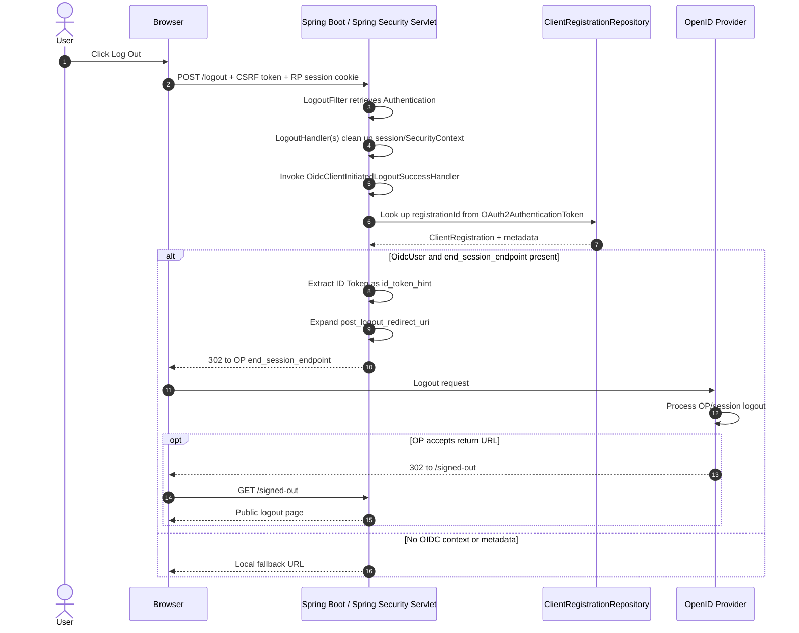

# 24.2. OidcClientInitiatedLogoutSuccessHandler in Servlet

When a user logs into a Spring Security OAuth 2.0 Client application via OpenID Connect (OIDC), **logging out of the application** does not necessarily mean **logging out of the OpenID Provider (OP)**. After Spring Security clears the application's HTTP session, the single sign-on (SSO) session at the OP may still be active. If the user logs in again, the OP may authenticate them immediately without prompting for a password.

In **Spring MVC/Servlet**, the **`OidcClientInitiatedLogoutSuccessHandler`** class enables the application (Relying Party, RP) to initiate **OIDC RP-Initiated Logout**: after local logout, the browser is redirected to the OP's `end_session_endpoint` with **`id_token_hint`** and an optional **`post_logout_redirect_uri`**.

Minimal example:

```java
OidcClientInitiatedLogoutSuccessHandler handler =
    new OidcClientInitiatedLogoutSuccessHandler(clientRegistrationRepository);

handler.setPostLogoutRedirectUri("{baseUrl}/signed-out");

http.logout(logout ->
    logout.logoutSuccessHandler(handler));
```

This is a `LogoutSuccessHandler`—not a place that generates access tokens, not an API to revoke refresh tokens, and not a `LogoutHandler` replacing session cleanup.

This lesson belongs to chapter **24. OIDC Logout**, covering protocol concepts, the data sources Spring Security uses, complete Java configuration, CSRF, local fallback, multiple providers, reverse proxies, cookies, security, and handling common errors.

> **Scope:** Java 17+, Spring Boot 3.x, Spring Security 6.x, **Servlet `HttpSecurity`**. Primary APIs and examples reference Spring Security 6.5; for 7.x or specific OPs, verify against the corresponding version. The `example.test` domain in this lesson is illustrative only.

---

## 1. Three Logout Scopes to Distinguish

### 1.1. Local Logout

When the browser sends a valid logout request to the application, Spring Security can:

- Invalidate the RP's HTTP session;
- Clear `SecurityContext` and Authentication;
- Remove CSRF token or remember-me state as configured;
- Redirect to a local URL, commonly `/login?logout`.

Example:

```text
Browser --> POST https://app.example.test/logout
Spring Security --> invalidate HttpSession
                --> clear SecurityContext
                --> redirect /login?logout

OP session at id.example.test:
                --> may still exist
```

Consequently, a working local logout can still lead to an **SSO re-login without a password prompt**.

### 1.2. RP-Initiated Logout

The RP asks the OP to terminate the SSO session by **directing the User Agent to the OP's logout endpoint**. The OP can handle its own session cookie, ask the user for confirmation, or redirect back to the RP.

```text
Browser --> POST /logout at RP
RP      --> local session cleanup
RP      --> 302 Location: https://id.example.test/.../logout?...
Browser --> GET OP logout endpoint
OP      --> logout session per policy
OP      --> optionally redirect to https://app.example.test/signed-out
```

Whether the OP actually terminates the session, asks for confirmation, and redirects back **belongs to OP policy**, not something the handler can guarantee unconditionally.

### 1.3. Token Revocation and Logging Out Other Applications

RP-Initiated Logout **does not automatically** perform:
- OAuth2 token revocation for all access/refresh tokens;
- Deletion of all `OAuth2AuthorizedClient` records in a standalone database;
- Logout across all devices and all other RPs;
- Confirmation that self-contained tokens (JWTs) stop working at every Resource Server.

If the system needs **Disconnect**, **Revoke access**, or **Log out on all devices**, you must design and use dedicated mechanisms supported by the OP/API.

| Task to Perform | Primary Mechanism | Decision Owner |
| --- | --- | --- |
| Clean up application session | `LogoutFilter` and `LogoutHandler` | Spring Security / RP |
| Request OP logout via browser | **`OidcClientInitiatedLogoutSuccessHandler`** | RP sends request; OP handles |
| OP requests RP logout | OIDC Back-Channel Logout / Logout Token | OP and RP |
| Revoke credentials | Revocation endpoint and token policy | Authorization Server |
| Block access tokens at API | Token validation/revocation policy | Resource Server |

## 2. Participating Parties

An illustrative system:

| Component | Address/Identifier |
| --- | --- |
| Relying Party (Spring Boot application) | `https://app.example.test` |
| RP logout endpoint | `POST /logout` |
| OpenID Provider issuer | `https://id.example.test/realms/company` |
| OP `end_session_endpoint` | `https://id.example.test/realms/company/protocol/openid-connect/logout` |
| RP post-logout page | `https://app.example.test/signed-out` |

**Three distinct URIs**:
1. `/logout`: the browser requests the **RP** to perform local logout.
2. `end_session_endpoint`: the browser goes to the **OP** to request terminating the OP session.
3. `post_logout_redirect_uri`: the **RP** URI to which the OP may return the browser.

The URI `/login/oauth2/code/{registrationId}` is the login **authorization-code callback**, **not** a post-logout return URI.

## 3. Standard Flow Diagram



**Processing order** matters: `LogoutHandler` runs before `LogoutSuccessHandler`. Even though `SecurityContext` is cleared, Spring Security still passes the **original Authentication** object into `onLogoutSuccess`; the handler needs it to obtain the ID Token.

## 4. Structure of OidcClientInitiatedLogoutSuccessHandler

Servlet class:

```java
import org.springframework.security.oauth2.client.oidc.web.logout.OidcClientInitiatedLogoutSuccessHandler;
```

It extends `SimpleUrlLogoutSuccessHandler` and implements `LogoutSuccessHandler`. Constructor:

```java
new OidcClientInitiatedLogoutSuccessHandler(
    ClientRegistrationRepository clientRegistrationRepository)
```

`ClientRegistrationRepository` is the store of **OAuth2/OIDC client configurations**, not a token or session store. The handler finds the `ClientRegistration` matching the current login.

### 4.1. Conditions for an OP Logout Redirect

Per the Spring Security 6.x implementation, the handler requires:

1. `Authentication` is of type **`OAuth2AuthenticationToken`**.
2. Principal is an **`OidcUser`** and provides an ID Token.
3. A `ClientRegistration` exists for `getAuthorizedClientRegistrationId()`.
4. The registration metadata contains **`end_session_endpoint`**.

When all conditions are met, the handler builds the OP logout URL. When any condition is missing, the handler can use the **fallback** inherited from `SimpleUrlLogoutSuccessHandler`.

### 4.2. Why Must It Be OidcUser?

`OAuth2User` in plain OAuth2 login does not necessarily have an ID Token. With OIDC Login, the principal is typically `OidcUser`, which provides:

```java
OidcUser user = (OidcUser) authentication.getPrincipal();
String idToken = user.getIdToken().getTokenValue();
```

**This code snippet only explains the source of the ID Token**, not advice to log the token or return it in JSON. Using an access token or refresh token in place of an ID Token is semantically incorrect.

### 4.3. How Is the Registration Chosen from Auth?

```text
OAuth2AuthenticationToken
  principal: OidcUser
  authorizedClientRegistrationId: "company"
              |
              v
ClientRegistrationRepository.findByRegistrationId("company")
              |
              v
ProviderDetails.configurationMetadata["end_session_endpoint"]
```

Having the handler look up the exact registration from Authentication prevents picking the wrong OP and sending OP A's ID Token to OP B's logout endpoint.

### 4.4. Local Fallback

If the user is not logged in, logged in via form login, or lacks logout metadata, the handler does not fabricate a fake OP URI. For fallback:

```java
handler.setDefaultTargetUrl("/signed-out");
```

`setDefaultTargetUrl` comes from the parent class `SimpleUrlLogoutSuccessHandler`. **It is different from `setPostLogoutRedirectUri`**.

## 5. Understanding RP-Initiated Logout Parameters

According to **OpenID Connect RP-Initiated Logout 1.0**:

| Parameter | Purpose | Notes |
| --- | --- | --- |
| **`id_token_hint`** | ID Token issued by OP, hinting which user/session to log out | Recommended; handler obtains it from `OidcUser` |
| **`post_logout_redirect_uri`** | URI the RP wants the OP to return the browser to after logout | Optional, must be permitted/registered at the OP |
| `state` | Optional correlation between logout request and return redirect | Supported by spec, **do not assume the basic handler manages state** |
| `logout_hint` | Hint about the session/user per OP policy | Not supported uniformly across all OPs |
| `client_id` | Client identifier in cases where the OP requires it | Not a default parameter sent by every handler/version |

### 5.1. Where Does id_token_hint Come From?

The OP issued the ID Token during OIDC login. The handler uses that value as a hint in the OP logout request:

```http
HTTP/1.1 302 Found
Location: https://id.example.test/logout?id_token_hint=<redacted>&post_logout_redirect_uri=https%3A%2F%2Fapp.example.test%2Fsigned-out
```

Parameters may be encoded in the redirect URL. **Do not print raw `Location` or `id_token_hint`** into logs, tickets, or public debuggers: the ID Token is a credential containing authentication/identity claims and may be recorded in browser history/reverse-proxy logs.

### 5.2. What Does post_logout_redirect_uri Do?

It is the **return address at the RP**, not where the OP performs logout. Example:

```text
https://app.example.test/signed-out
```

The OP must validate that this URI is allowed. Do not assume every OP will redirect back if the client sends an arbitrary URI. The RP-Initiated Logout spec requires the URI to match a registered value or corresponding registration mechanism.

### 5.3. state Is Not Provided Automatically by the Handler

In Authorization Code Login, `state` correlates the login callback with the authorization request. RP-Initiated Logout also defines an optional `state`, but it is a **different transaction**.

The basic `OidcClientInitiatedLogoutSuccessHandler` **is not a full framework for storing and validating logout-callback state**. If the application must verify return state for a sensitive workflow, you must explicitly design correlation, storage, expiry, and validation.

### 5.4. Post-Logout Return Does Not Guarantee Global Logout

The user returning to `/signed-out` does not prove that all access tokens, refresh tokens, OP sessions on other devices, or other applications have been revoked. It is a **browser navigation path**, not a global revocation confirmation.

---

## 6. Spring Boot 3.x Dependencies

```xml
<dependencies>
    <dependency>
        <groupId>org.springframework.boot</groupId>
        <artifactId>spring-boot-starter-web</artifactId>
    </dependency>
    <dependency>
        <groupId>org.springframework.boot</groupId>
        <artifactId>spring-boot-starter-security</artifactId>
    </dependency>
    <dependency>
        <groupId>org.springframework.boot</groupId>
        <artifactId>spring-boot-starter-oauth2-client</artifactId>
    </dependency>
</dependencies>
```

In this lesson, `HttpSecurity`, `SecurityFilterChain`, and the handler belong to **Servlet**. Do not use WebFlux's `OidcClientInitiatedServerLogoutSuccessHandler`.

## 7. Configuring OIDC ClientRegistration

```yaml
spring:
  security:
    oauth2:
      client:
        registration:
          company:
            provider: company
            client-id: ${OIDC_CLIENT_ID}
            client-secret: ${OIDC_CLIENT_SECRET}
            authorization-grant-type: authorization_code
            redirect-uri: "{baseUrl}/login/oauth2/code/{registrationId}"
            scope:
              - openid
              - profile
              - email
        provider:
          company:
            issuer-uri: https://id.example.test/realms/company
```

Explanation:
- `openid` requests OIDC authentication/ID Token.
- `issuer-uri` enables discovery of provider endpoints and metadata.
- `redirect-uri` is the **login callback**, not `post_logout_redirect_uri`.
- `end_session_endpoint` must be supported and published by the provider or configured per contract; it is **not auto-generated** from the login redirect URI.
- The client secret must be stored in environment variables/a backend secrets manager, never committed to source code.

### 7.1. Discovery Metadata

OIDC Discovery is typically accessed using the issuer and `.well-known/openid-configuration`. The OP may return:

```json
{
  "issuer": "https://id.example.test/realms/company",
  "authorization_endpoint": "https://id.example.test/realms/company/protocol/openid-connect/auth",
  "token_endpoint": "https://id.example.test/realms/company/protocol/openid-connect/token",
  "jwks_uri": "https://id.example.test/realms/company/protocol/openid-connect/certs",
  "end_session_endpoint": "https://id.example.test/realms/company/protocol/openid-connect/logout"
}
```

The URLs are examples. **Do not guess `end_session_endpoint` by appending `/logout`** if the OP does not publish or support it.

### 7.2. Inspecting Metadata via Java API

An inspection snippet (without logging tokens):

```java
import org.springframework.security.oauth2.client.registration.ClientRegistration;
import org.springframework.security.oauth2.client.registration.ClientRegistrationRepository;

ClientRegistration registration = repository.findByRegistrationId("company");

Object endpoint = registration.getProviderDetails()
    .getConfigurationMetadata()
    .get("end_session_endpoint");

// Check presence only; do not log raw ID Tokens or sessions.
boolean logoutSupported = endpoint != null;
```

This snippet omits full null checking; if the registration does not exist, handle it explicitly. Also verify HTTPS URLs and trusted issuers before accepting a new provider in a multi-tenant system.

---

## 8. Complete SecurityFilterChain in Servlet

```java
package example.security;

import org.springframework.context.annotation.Bean;
import org.springframework.context.annotation.Configuration;
import org.springframework.security.config.Customizer;
import org.springframework.security.config.annotation.web.builders.HttpSecurity;
import org.springframework.security.oauth2.client.oidc.web.logout.OidcClientInitiatedLogoutSuccessHandler;
import org.springframework.security.oauth2.client.registration.ClientRegistrationRepository;
import org.springframework.security.web.SecurityFilterChain;
import org.springframework.security.web.authentication.logout.LogoutSuccessHandler;

@Configuration
class OidcLogoutConfiguration {

    @Bean
    SecurityFilterChain securityFilterChain(
            HttpSecurity http,
            ClientRegistrationRepository registrations) throws Exception {

        return http
            .authorizeHttpRequests(authorize -> authorize
                .requestMatchers("/", "/signed-out", "/error").permitAll()
                .anyRequest().authenticated())
            .oauth2Login(Customizer.withDefaults())
            .logout(logout -> logout
                .logoutUrl("/logout")
                .logoutSuccessHandler(oidcLogoutSuccessHandler(registrations)))
            .build();
    }

    private LogoutSuccessHandler oidcLogoutSuccessHandler(
            ClientRegistrationRepository registrations) {

        OidcClientInitiatedLogoutSuccessHandler handler =
            new OidcClientInitiatedLogoutSuccessHandler(registrations);

        // URL RP wants OP to redirect back to.
        handler.setPostLogoutRedirectUri("{baseUrl}/signed-out");

        // Fallback when not OIDC login or OP endpoint is absent.
        handler.setDefaultTargetUrl("/signed-out");

        return handler;
    }
}
```

**Important:**
1. `oauth2Login()` authenticates the user via OIDC.
2. `logout()` configures Servlet `LogoutFilter` and logout success behavior.
3. `logoutSuccessHandler(...)` only decides what happens after local cleanup; it does not replace local logout handlers.
4. `setPostLogoutRedirectUri` defines the return address the RP sends to the OP.
5. `setDefaultTargetUrl` defines the local fallback.
6. `/signed-out` must be **public** so a user who just logged out is not immediately sent to login.

### 8.1. Post-Logout Page

```java
import org.springframework.stereotype.Controller;
import org.springframework.web.bind.annotation.GetMapping;

@Controller
class SignedOutPageController {

    @GetMapping("/signed-out")
    String signedOut() {
        return "signed-out";
    }
}
```

This example requires a `signed-out.html` template or corresponding view resolver. You can use a controller returning other HTML/JSON content if the UI does not use Thymeleaf.

### 8.2. Why Not Use /login/oauth2/code/company as the Return URL?

That is the callback for the **Authorization Code Flow**, expecting `code` and `state`. OIDC post-logout return has different semantics; do not send the browser to the login callback endpoint to avoid callback/correlation errors.

---

## 9. LogoutFilter, LogoutHandler, and LogoutSuccessHandler

Spring Security processes local logout via a pipeline:

```text
POST /logout (valid CSRF)
        |
        v
LogoutFilter
        |
        +-- SecurityContextLogoutHandler
        |     -> invalidateHttpSession (typically enabled)
        |     -> clear SecurityContext
        +-- CsrfLogoutHandler
        +-- RememberMe/other LogoutHandlers (if any)
        +-- LogoutSuccessEvent (depending on config)
        |
        v
LogoutSuccessHandler
        |
        +-- OidcClientInitiatedLogoutSuccessHandler
               -> OP redirect or local fallback
```

### 9.1. Original Auth Is Still Passed to the Success Handler

Even though the local SecurityContext has been cleared, `LogoutFilter` retains the `Authentication` present at the start of logout and passes it into:

```java
void onLogoutSuccess(
    HttpServletRequest request,
    HttpServletResponse response,
    Authentication authentication);
```

The handler can obtain the `OidcUser` and ID Token from the passed Authentication. **Do not write a custom MVC logout controller that clears Authentication before calling the handler with null**.

### 9.2. If You Want Additional Cleanup

You can use:

```java
.logout(logout -> logout
    .invalidateHttpSession(true)
    .deleteCookies("JSESSIONID")
    .logoutSuccessHandler(oidcHandler))
```

`oidcHandler` is the instance from your configured bean/DI. If using **Spring Session**, the cookie may be named `SESSION` instead of `JSESSIONID`. Deleting the cookie with the right name/Path/Domain is separate; **server-side session invalidation** is what ensures the old session ID no longer holds a login session.

### 9.3. Is LogoutHandler the Place to Redirect?

Typically **no**. `LogoutHandler` is for cleanup, while `LogoutSuccessHandler` decides the redirect or response status. Do not convert `OidcClientInitiatedLogoutSuccessHandler` into a `LogoutHandler` arbitrarily.

## 10. Ensuring Safe CSRF When Users Click Logout

In a Servlet app using default CSRF protection, **POST /logout** with a CSRF token is the standard path. `GET /logout` when CSRF is enabled normally only displays a confirmation page.

### 10.1. Thymeleaf Form Example

```html
<form th:action="@{/logout}" method="post">
    <input type="hidden"
           th:name="${_csrf.parameterName}"
           th:value="${_csrf.token}" />
    <button type="submit">Log out</button>
</form>
```

Depending on MVC/Thymeleaf integration, the CSRF hidden field may be automatically inserted into POST forms by the framework; if so, do not add a duplicate field. What matters is that the browser sends **a valid CSRF token** with the logout request.

### 10.2. Why Not Create a Direct GET Link?

```html
<!-- Do not use GET as a logout action with side effects. -->
<a href="/logout">Log out</a>
```

With CSRF enabled, GET is normally a confirmation page. Disabling CSRF just to allow GET logout introduces logout CSRF risks and weakens the protection model of the entire application.

### 10.3. SPA/AJAX Calling /logout

If the frontend calls `fetch("/logout")` and receives a cross-origin redirect to the OP, **fetch does not behave like top-level browser navigation**. CORS or redirect policies may prevent the tab from actually reaching OP logout.

For RP-Initiated Logout via the user agent, the convenient approach is usually **submitting a POST form via the browser** or designing a frontend flow that triggers explicit browser navigation. Do not rely on a background AJAX call to claim the OP SSO session was terminated.

## 11. post_logout_redirect_uri and URI Templates

The handler supports:

| URI template variable | Meaning |
| --- | --- |
| `{baseScheme}` | Scheme of the public request, usually `https` |
| `{baseHost}` | Host of the RP |
| `{basePort}` | Port (if any) |
| `{basePath}` | Context path |
| **`{baseUrl}`** | `{baseScheme}://{baseHost}{basePort}{basePath}` |

Example:

```java
handler.setPostLogoutRedirectUri("{baseUrl}/signed-out");
```

If the RP is at `https://app.example.test` with an empty context path, the URI becomes:

```text
https://app.example.test/signed-out
```

If the context path is `/portal`:

```text
https://app.example.test/portal/signed-out
```

### 11.1. This URI Is Not the OP's URL

`post_logout_redirect_uri` belongs to the RP. `end_session_endpoint` belongs to the OP. Both values are placed by the handler into the redirect request to the OP according to encoding rules.

### 11.2. Registering the Return URL at the OP

In the OP console, depending on the vendor, there may be a field like **Allowed post-logout redirect URI**. Example:

```text
https://app.example.test/signed-out
https://staging.example.test/signed-out
```

The actual URI sent by the handler must match **a URI allowed by the OP**, which may compare scheme/host/port/path/query/trailing slash exactly.

**Do not mix this list with Authorization Code redirect URIs** such as `/login/oauth2/code/company`.

### 11.3. Fixed URI When Not Depending on Request Host

```java
handler.setPostLogoutRedirectUri(
    "https://app.example.test/signed-out");
```

This can be simpler if the public origin is fixed. Put the value into externalized config per environment; never hardcode production URIs into staging.

### 11.4. Fallback Differs from Post-Logout Redirect

```java
handler.setPostLogoutRedirectUri("{baseUrl}/signed-out");
handler.setDefaultTargetUrl("/signed-out");
```

- First line: **sends the OP** a return URL if RP-Initiated Logout runs.
- Second line: **redirects locally** when the handler cannot build an OP logout target.

If the user merely sees `/signed-out`, you cannot infer that the browser visited the OP. Observe the redirect path safely.

---

## 12. Reverse Proxy and Public Origin

Deployment example:

```text
Browser:    https://app.example.test
Ingress:    TLS termination
Spring app: http://app-service:8080
```

If `{baseUrl}` is built from the internal request, the OP might receive:

```text
http://app-service:8080/signed-out
```

instead of:

```text
https://app.example.test/signed-out
```

When using a trusted reverse proxy, you can configure:

```yaml
server:
  forward-headers-strategy: framework
```

**Only trust Forwarded/X-Forwarded-* headers set by a managed proxy.** The proxy must strip or overwrite headers sent by external callers; otherwise, the public base URL can be influenced by untrusted input.

### 12.1. Network Path Checklist

- Real browser connects over `https`;
- OP issuer URI and `end_session_endpoint` are trusted URLs;
- Proxy forwards accurate `Host`, scheme, port, and context path;
- Generated URI matches the OP's allowlist;
- Return URL is publicly accessible without Authentication;
- Full logout `Location` containing `id_token_hint` is never logged.

### 12.2. HTTP Localhost

Some OPs accept HTTP localhost for dev environments; others require HTTPS for post-logout URIs. Do not disable HTTPS/TLS validation in production to "fix" a local mismatch. Create a registration/local profile aligned with provider policy.

## 13. Multiple OIDC ClientRegistrations

An application may use two OPs:

```yaml
spring:
  security:
    oauth2:
      client:
        registration:
          company:
            provider: company
            client-id: ${COMPANY_CLIENT_ID}
            client-secret: ${COMPANY_CLIENT_SECRET}
            scope: [openid, profile]
          partner:
            provider: partner
            client-id: ${PARTNER_CLIENT_ID}
            client-secret: ${PARTNER_CLIENT_SECRET}
            scope: [openid, profile]
        provider:
          company:
            issuer-uri: https://id.company.example.test/realm
          partner:
            issuer-uri: https://id.partner.example.test/tenant
```

When a user logs in via `partner`, `OAuth2AuthenticationToken.getAuthorizedClientRegistrationId()` returns the matching registration. The handler fetches **partner's logout metadata**, not the first OP in the file.

### 13.1. Do Not Pick the Logout Endpoint from a Query Parameter

Wrong:

```java
String opLogoutUrl = request.getParameter("logoutUrl");
response.sendRedirect(opLogoutUrl + "?id_token_hint=" + idToken);
```

Risks include token leakage to an attacker-controlled origin, open redirect, and login/logout confusion. The logout endpoint must come from trusted metadata/registration.

### 13.2. Multiple Authorized Clients Do Not Mean Multiple OP Sessions Will Be Logged Out

A user may log in via `company` while also authorizing `calendar-api` and `crm-api`. The handler processes the current login Authentication; it does not automatically revoke those two authorized clients or log out other providers.

## 14. Missing end_session_endpoint

Some providers do not support RP-Initiated Logout or do not publish the metadata. In that case, the handler cannot build an OIDC logout URL from `end_session_endpoint` and can fall back.

Do not guess:

```text
issuer + "/logout"
issuer + "/protocol/openid-connect/logout"
authorization_endpoint.replace("/authorize", "/logout")
```

These string concatenations are not valid for every OP. Check **OIDC Discovery / provider documentation** and client configuration policy.

### 14.1. Missing ID Token

Plain OAuth2 Login may return an access token without an ID Token. In that case, the principal is not `OidcUser`, so the OIDC handler has no `id_token_hint`. Do not substitute an access token as a fake ID Token to "force" logout.

### 14.2. Form Login Is Also a Fallback

If an app supports both `formLogin()` and `oauth2Login()`, local logout for form users is appropriate. Use a shared fallback URL `/signed-out` without displaying an OP logout confirmation when no OP redirect occurred.

---

## 15. RP and OP Session Cookies Are Independent

```text
app.example.test:
    JSESSIONID or SESSION (RP cookie)

id.example.test:
    OP SSO cookie
```

When the RP invalidates its session, the browser may still keep the OP cookie. The RP cannot directly delete host-only cookies of the OP's domain via a `Set-Cookie` from the app domain. The OP must be visited through the browser to handle the OP session.

### 15.1. HttpSession Invalidation Does Not Automatically Delete All Tokens

An `OAuth2AuthorizedClient` stored in the HTTP session can disappear when the session is invalidated. However, if a persistent `OAuth2AuthorizedClientService` (e.g., DB) is used, the token record may remain.

Token store cleanup must follow **registration/principal** and policy. Do not delete another user's tokens, and do not arbitrarily call a token revocation endpoint without the corresponding business/authorization requirement.

### 15.2. Access Tokens May Still Work After Logout

A Resource Server may accept a valid access token until expiration if no revocation check is performed. Therefore:
- Local logout does not automatically revoke access tokens;
- RP-Initiated Logout is not token revocation;
- Expiry, introspection, revocation, and API access policies belong to a separate token lifecycle.

### 15.3. Be Careful When Deleting Cookies

```java
.logout(logout -> logout
    .invalidateHttpSession(true)
    .deleteCookies("JSESSIONID")
    .logoutSuccessHandler(handler))
```

With Spring Session, the cookie may be `SESSION`. Cookie deletion must match name/Path/Domain and does not replace server-side invalidation.

## 16. GET Redirect vs POST to the OP

As of Spring Security 6.5, the handler defaults to redirecting the browser via **HTTP GET** to the OP logout endpoint. When sending OP logout via POST is needed and supported by the OP, Spring Security documents configuring an appropriate redirect strategy such as `FormPostRedirectStrategy`.

**Separate the two POSTs:**
- **POST /logout at RP**: requests local logout, requires a CSRF token under session-based CSRF protection.
- **Form POST to OP logout endpoint**: requests RP-Initiated Logout per the response mode supported by the OP; does not use the RP's CSRF token.

GET can place `id_token_hint` in the URL; POST reduces query exposure risk but does not make the ID Token harmless. Only switch redirect strategies when your Spring Security version and OP actually support it, while maintaining appropriate TLS/header/log protections.

## 17. Logout Success URL Is Not Proof of OP Logout

Suppose the browser sees:

```text
https://app.example.test/signed-out
```

There are at least two possibilities:
1. The RP redirected to the OP, the OP processed it, and returned the browser.
2. The handler lacked OIDC context/metadata and fell back locally to the same page.

Even in case one, there is no guarantee that all sessions/tokens on all devices were revoked.

If the product needs analytics, record the **navigation source** where the handler decides (`rp_initiated_redirect` vs `local_fallback`) using safe data, rather than relying on a caller-supplied query parameter.

### 17.1. /signed-out Must Be Public

Wrong:

```java
.authorizeHttpRequests(auth -> auth
    .anyRequest().authenticated())
```

if the return page is not excluded. After logout, the user may be sent back to login and OP SSO may trigger a login loop.

Right:

```java
.authorizeHttpRequests(auth -> auth
    .requestMatchers("/signed-out", "/", "/error").permitAll()
    .anyRequest().authenticated())
```

Do not make **every** endpoint `permitAll` just so the signed-out page works.

## 18. Distinguishing from OIDC Back-Channel Logout

**RP-Initiated Logout**: RP starts with a browser redirect to the OP.

**Back-channel Logout**: OP sends a **Logout Token** to an RP endpoint, and the RP validates the token to terminate the associated session.

```text
RP-Initiated:
  User -> RP POST /logout
  RP -> Browser -> OP logout endpoint

Back-channel:
  OP -> RP POST /logout/connect/back-channel/{registrationId}
  RP -> validate Logout Token -> invalidate matching RP sessions
```

Two Servlet components:

| Function | Class/API |
| --- | --- |
| RP sends logout request to OP | `OidcClientInitiatedLogoutSuccessHandler` |
| OP sends logout request to RP | `OidcBackChannelLogoutHandler` / `oidcLogout().backChannel()` |
| Clear SecurityContext/HttpSession | `SecurityContextLogoutHandler` |
| Local redirect after logout | `SimpleUrlLogoutSuccessHandler` |

Only configure Back-channel when the OP and business requirements need it. The RP-Initiated handler does not automatically enable the Back-channel callback or process `sid`/`sub` from a Logout Token.

## 19. Logging and Security

A reasonable observability event:

```json
{
  "event": "oidc_rp_initiated_logout",
  "registration_id": "company",
  "mode": "op_redirect",
  "end_session_endpoint_present": true,
  "post_logout_redirect_configured": true,
  "trace_id": "internal-id"
}
```

This is an **application-defined** example schema, not automatically emitted by Spring Security.

Avoid logging:
- `id_token_hint` and raw ID Tokens;
- Full `Location` containing the ID Token;
- HTTP session cookies and CSRF tokens;
- Access tokens/refresh tokens and Authorization headers;
- Full `OidcUser` claims;
- Provider error strings or URL queries containing personal data.

May be logged under control:
- Registration ID from config;
- Presence/absence of OP logout metadata;
- Redirect mode by category;
- HTTP status category;
- Internal trace ID (not tokens).

### 19.1. Do Not Accept OP Issuer from User Input

Letting a client choose `issuerUri` and trusting metadata from an arbitrary URL can cause the RP to send the ID Token hint to an attacker-controlled endpoint. Only use issuers/client registrations from trusted sources, with proper tenant onboarding/allowlisting and security review.

### 19.2. Do Not Put Raw URLs in Exceptions

When debugging 302/Location, the URL may include `id_token_hint`. Mask/redact it before writing to logs, tickets, or telemetry. Having the ID Token appear in a URL does not make it harmless public data.

---

## 20. Common Failure Scenarios

| Symptom | Likely Cause | Resolution |
| --- | --- | --- |
| Only `/login?logout` appears | Missing OIDC context or missing OP metadata | Check principal/registration/`end_session_endpoint` |
| Only fallback `/signed-out` appears | Handler did not build OP target | Distinguish local fallback from OP redirect |
| GET /logout renders confirmation page | CSRF is enabled | Use POST + CSRF token |
| POST /logout returns 403 | Missing/invalid CSRF token | Check form, session, and CSRF repository |
| Logout does not redirect to OP | Handler not registered in `logoutSuccessHandler` | Check SecurityFilterChain handling the route |
| OP reports invalid `post_logout_redirect_uri` | Return URI not allowlisted or path/scheme mismatch | Fix OP registration and public URL |
| `{baseUrl}` becomes `http://app-service:8080` | Reverse proxy / forwarded headers misconfigured | Configure public scheme/host from trusted proxy |
| OP logout returns and immediately logs back in | `/signed-out` is protected | `permitAll()` on the return page |
| RP session ends but OP still has SSO | OP redirect did not happen or OP policy differs | Check browser navigation and OP session |
| OP logs out but does not return to RP | OP rejects URI, user closed tab, or unsupported | Do not treat returning redirect as mandatory |
| Form login user does not redirect to OP | Principal is not `OidcUser` | Local fallback is expected |
| Plain OAuth2 does not log out OP | No ID Token/OIDC principal | Do not use access token instead of ID Token |
| Re-login requires no password | OP SSO session has not ended | Inspect OP session; do not conclude local logout failed |
| DB token still exists after logout | Persistent authorized-client service | Design separate removal/revocation |
| API still accepts token after logout | Access token not expired/revoked | Token lifetime/RS revocation policy |
| GET redirect logs ID Token | Query contains `id_token_hint` | Redact logs; consider POST if supported |
| Logs out wrong provider | Wrong registration mapping or custom URL | Rely on Authentication + trusted registration |
| Spring Session cookie still visible | Cookie name/Path/Domain or browser cache | Check session invalidation and exact cookie |
| API logout via fetch does not navigate tab | CORS/browser redirect semantics | Form POST / top-level navigation |
| Multiple sessions still exist | RP-Initiated does not equal global logout | Requires OP session policy/Back-channel/revocation |
| No `end_session_endpoint` | OP does not publish logout metadata | Check provider docs; do not guess URL |

## 21. Procedure for Investigating a Logout Issue

1. Confirm the user **logged in with OIDC** and has an `OidcUser`.
2. Confirm `OAuth2AuthenticationToken.getAuthorizedClientRegistrationId()` matches.
3. Check that `ClientRegistrationRepository` has that registration.
4. Confirm provider discovery metadata includes `end_session_endpoint`.
5. Confirm the browser sends **POST /logout** with a valid CSRF token.
6. Confirm Servlet `LogoutFilter` and logout handlers cleaned up the local session.
7. Confirm `OidcClientInitiatedLogoutSuccessHandler` is actually attached to the filter chain.
8. Inspect the **token-redacted** redirect: does it go to the OP or local fallback?
9. If going to the OP, verify `post_logout_redirect_uri` matches the public URL and OP allowlist.
10. Confirm the real browser reaches the OP; do not just check that an AJAX fetch finished.
11. Observe OP session policy: logout, confirm dialog, return redirect.
12. Check that `/signed-out` has `permitAll()` and does not auto-login.
13. If token revocation is needed, handle it in a separate workflow; do not assume the handler did it.
14. With multiple providers or tenants, confirm the issuer and ID Token go to the matching OP.

These are study/verification steps for learners, not a requirement to run project QA content or tests during documentation authoring.

## 22. Scenario Exercises

### A. Local Logout While SSO Persists

Alice logs out of Portal, then logs in again and enters the Dashboard immediately.

**Explanation:** Portal's local session may have been properly cleared while the OP's SSO session remained active. Configure RP-Initiated Logout if OP logout is needed.

### B. Missing `end_session_endpoint`

OIDC Discovery provides token and authorize endpoints but no logout endpoint.

**Resolution:** The handler can fall back locally; check whether the OP supports RP-Initiated Logout. Do not arbitrarily append `/logout` to the issuer.

### C. OP Rejects Return URL

The provider registered `https://app.example.test/signed-out`, but the handler sends `http://localhost:8080/signed-out`.

**Resolution:** Fix the public origin and OP registration; do not disable CSRF or signature validation as a workaround.

### D. Form Login User

A user logs in with a local username/password and clicks logout; the handler does not redirect to the OP.

**Explanation:** Authentication is not an `OAuth2AuthenticationToken` with `OidcUser`. Local fallback is appropriate.

### E. Return Page Causes a Login Loop

After logout, the OP redirects to `/signed-out`, which requires Authentication, so Spring Security immediately starts OAuth2 Login.

**Resolution:** Make `/signed-out` public and avoid calling APIs from that page that trigger automatic login redirects.

### F. Multiple OPs

The user logs in via `partner`, but the developer hardcoded `company`'s logout endpoint.

**Risk:** Sending the ID Token to the wrong OP or failing logout. Use the registration ID from Authentication to look up the right metadata.

### G. Access Token Still Calls APIs

The RP and OP logged out, yet an old JWT access token has not expired.

**Explanation:** RP-Initiated Logout is not revocation, and the Resource Server may not track OP sessions. Design token lifetime/revocation separately.

### H. Clearing Session Before Calling Custom Handler

A custom controller calls `SecurityContextHolder.clearContext()@@ and then invokes `onLogoutSuccess(..., null)@@.

**Risk:** Authentication/ID Token hint is lost. Use standard `LogoutFilter` so the original auth is passed to the handler.

### I. Browser fetch() Does Not Reach OP

The UI sends `fetch("/logout", { method: "POST" })`; CORS blocks the redirect to the OP.

**Resolution:** Use a form POST or appropriate browser navigation; do not assume `fetch` triggers a top-level redirect.

### J. Requiring State for Logout Callback

The product wants to verify that the callback returning from the OP belongs to the initiated logout flow.

**Explanation:** The RP-Initiated Logout spec has an optional `state` parameter, but the basic handler is not a full logout-state persistence/validation system. Build a dedicated correlation mechanism if business requirements demand it.

### K. Revoking All User Sessions

Business requests a "Log out from all devices" button using only this handler.

**Explanation:** The handler primarily requests OP logout via the current browser. Do not promise global logout; you need OP admin/session APIs or appropriate mechanisms and authorization.

### L. Spring Session Cookie

A deployment uses Spring Session Redis with cookie `SESSION`. Configuring `deleteCookies("JSESSIONID")` does not delete the actual cookie.

**Resolution:** Configure the right cookie name/path/domain; ensure server-side session invalidation across the active session store.

### M. Logging Out via GET Link

A developer uses `<a href="/logout">` and disables CSRF because GET only shows confirmation.

**Resolution:** Do not disable CSRF for this reason. Use a POST form submitting a CSRF token as recommended.

### N. Token Hint Logged

A proxy logs the full 302 `Location` containing `id_token_hint`.

**Resolution:** Redact sensitive fields in location/query logs, limit analytics data, and review GET/POST compatibility with the OP.

---

## 23. Self-Check Questions

**Question 1.** What is the Servlet package of the handler?

> `org.springframework.security.oauth2.client.oidc.web.logout.OidcClientInitiatedLogoutSuccessHandler`.

**Question 2.** Is this class a LogoutHandler or a LogoutSuccessHandler?

> It is a **`LogoutSuccessHandler`**. `LogoutHandler` instances clean up the local session first; this handler decides the redirect afterward.

**Question 3.** What does its constructor accept?

> `ClientRegistrationRepository`, used to retrieve registration/provider metadata.

**Question 4.** What are the key conditions for the handler to redirect to the OP?

> Matching OIDC Authentication, `OidcUser` principal, existing registration, and presence of `end_session_endpoint`.

**Question 5.** Which token does `id_token_hint` come from?

> The **`OidcUser`'s ID Token**, not an access token or refresh token.

**Question 6.** How does `setPostLogoutRedirectUri` differ from `setDefaultTargetUrl`?

> The first sets the URI the OP may redirect **back to the RP**; the second sets the **local fallback** if the handler has no OP logout target.

**Question 7.** Where is `{baseUrl}` derived from?

> Scheme, host, port, and context path of the public Servlet request, which may be affected by forwarded headers from a trusted proxy.

**Question 8.** Why must the OP not redirect to arbitrary URIs?

> To prevent open redirect/phishing; the post-logout return URI must be registered/permitted under the RP-Initiated Logout spec.

**Question 9.** Which HTTP method should invoke local logout when CSRF is enabled?

> **POST** with a valid CSRF token; GET usually displays confirmation.

**Question 10.** Does the handler automatically revoke refresh tokens?

> **No.** Token revocation is a separate responsibility.

**Question 11.** Does the handler automatically log out all devices?

> Not guaranteed. OP session outcome and global logout depend on OP policy.

**Question 12.** What happens when logging in with plain OAuth2 without an ID Token?

> OIDC RP-Initiated Logout cannot be used by default; the handler usually falls back locally.

**Question 13.** Why should `/signed-out` be public?

> After logout, Authentication has been cleared; if the page requires login, it will cause a redirect/relogin loop.

**Question 14.** Is OIDC logout `state` the same as login `state`?

> Both relate to correlation, but they are separate transactions. The basic handler should not be assumed to automatically create and validate logout state.

**Question 15.** Why should the full logout redirect Location not be logged?

> It may contain the ID Token in `id_token_hint`.

**Question 16.** Does this handler replace Back-channel Logout?

> No. Back-channel is the OP sending a Logout Token to the RP, which is a different flow.

**Question 17.** When the handler falls back locally, should OP logout be recorded as successful?

> No, because there is no guarantee the browser reached the OP.

**Question 18.** With multiple OPs, how is the right logout endpoint selected?

> Based on `getAuthorizedClientRegistrationId()` from Authentication and the trusted `ClientRegistrationRepository`.

## 24. Summary Diagram

```text
User clicks "Log Out"
           |
           v
Browser POST /logout + CSRF
           |
           v
Spring Security LogoutFilter
           |
           +-- LogoutHandler(s):
           |     invalidate RP HttpSession
           |     clear SecurityContext
           |
           v
OidcClientInitiatedLogoutSuccessHandler
           |
           +-- OAuth2AuthenticationToken + OidcUser?
           +-- Matching ClientRegistration?
           +-- end_session_endpoint present?
           |
           +-- YES:
           |      |
           |      +-- id_token_hint = original OIDC ID Token
           |      +-- post_logout_redirect_uri (if configured)
           |      |
           |      v
           |    302 to OP logout endpoint
           |      |
           |      v
           |    OP handles SSO session
           |      |
           |      +-- Return URL allowed by OP -> /signed-out
           |      +-- No redirect back -> RP remains locally logged out
           |
           +-- NO:
                  |
                  v
                Local fallback /signed-out
```

**Core takeaways:**

1. **`OidcClientInitiatedLogoutSuccessHandler`** is the RP-Initiated Logout success handler for **Servlet**.
2. It retrieves **`end_session_endpoint`** from provider metadata and the **ID Token hint** from `OidcUser`.
3. **Local logout happens before the redirect**; OP logout depends on the browser and OP policy.
4. **`post_logout_redirect_uri`** must match the OP's allowlist; **`{baseUrl}`** must rely on the accurate public origin.
5. **POST /logout requires a CSRF token** when CSRF is enabled; do not disable CSRF to perform GET logout.
6. The handler has a **local fallback** when OIDC context/metadata is insufficient; never treat fallback as successful OP logout.
7. **RP-Initiated Logout, Back-channel Logout, and token revocation are distinct**; the handler does not automatically delete all sessions/tokens.
8. **Never log ID Tokens, Locations containing `id_token_hint`, or raw session cookies**.
9. In multi-provider setups, **the registration and OP endpoint must come from Authentication + trusted config**, never user input.

### Official References

- [Spring Security 6.5 — OIDC Logout in Servlet](https://docs.spring.io/spring-security/reference/6.5/servlet/oauth2/login/logout.html)
- [Spring Security 6.5 — Handling Logouts in Servlet](https://docs.spring.io/spring-security/reference/6.5/servlet/authentication/logout.html)
- [Spring Security API — OidcClientInitiatedLogoutSuccessHandler](https://docs.spring.io/spring-security/reference/6.5/api/java/org/springframework/security/oauth2/client/oidc/web/logout/OidcClientInitiatedLogoutSuccessHandler.html)
- [Spring Security API — LogoutSuccessHandler](https://docs.spring.io/spring-security/reference/6.5/api/java/org/springframework/security/web/authentication/logout/LogoutSuccessHandler.html)
- [Spring Security source — OidcClientInitiatedLogoutSuccessHandler](https://github.com/spring-projects/spring-security/blob/main/oauth2/oauth2-client/src/main/java/org/springframework/security/oauth2/client/oidc/web/logout/OidcClientInitiatedLogoutSuccessHandler.java)
- [OpenID Connect RP-Initiated Logout 1.0 — Final](https://openid.net/specs/openid-connect-rpinitiated-1_0-final.html)
- [OpenID Connect Discovery 1.0](https://openid.net/specs/openid-connect-discovery-1_0.html)
- [OpenID Connect Back-Channel Logout 1.0](https://openid.net/specs/openid-connect-backchannel-1_0.html)
