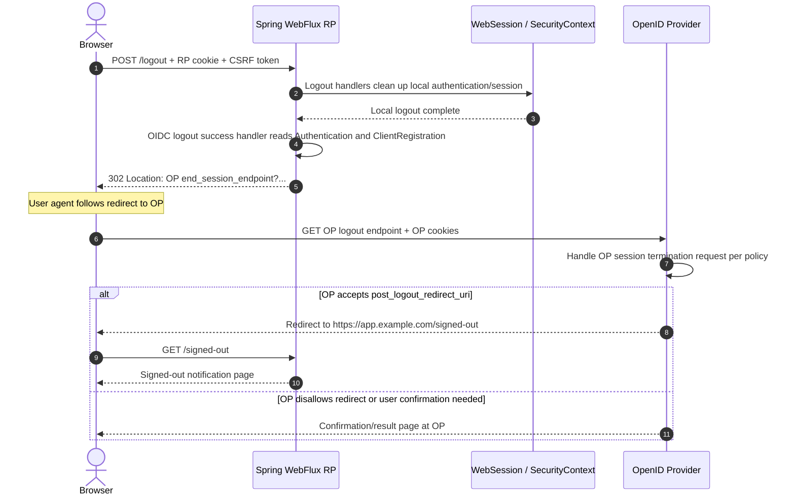

# 24.3. OidcClientInitiatedServerLogoutSuccessHandler in Reactive

An application using **Spring Security OAuth 2.0 / OpenID Connect (OIDC) Client** running on **Spring WebFlux** can authenticate users via an OpenID Provider (OP), store the application session in `WebSession`, and access authorized resources. However, when a user clicks **Log Out**, clearing the application's session **does not automatically terminate the Single Sign-On (SSO) session at the OP**.

With only local logout, the user can return to the login screen, click the login button for the same OP, and be authenticated immediately because the **OP's SSO cookie is still valid**. To proactively ask the OP to end its session, Spring Security Reactive provides:

**`OidcClientInitiatedServerLogoutSuccessHandler`**

This class supports **OIDC RP-Initiated Logout**: the application acts as a **Relying Party (RP)**, performs local logout, and redirects the **browser** to the OP's logout endpoint. After the OP processes it, the browser can be returned to a registered address of the application.

This lesson explains the mechanism and implementation on **Spring Boot 3.x, Spring Security 6.x, WebFlux, and Reactor**; it also distinguishes local logout, RP-Initiated Logout, Back-Channel Logout, token revocation, CSRF protection, redirect configuration behind a reverse proxy, multi-instance deployments, and testing.

> **Key takeaway:** `OidcClientInitiatedServerLogoutSuccessHandler` is a **`ServerLogoutSuccessHandler` used to direct the user agent to the OP**—not an HTTP client using refresh tokens or an endpoint that automatically revokes all tokens and SSO sessions on every device.

Addresses and IDs in the examples are illustrative only. Verify the actual metadata, URIs, and policies of the OP you integrate with.

## 1. Why Does an OIDC Application Need Two Logout Layers?

In a typical OIDC architecture, **two session domains** can coexist simultaneously:

1. **Session at the Relying Party (RP):** the Spring WebFlux application uses `WebSession` and `SecurityContext` to know which Authentication the browser currently holds.
2. **Session at the OpenID Provider (OP):** the browser holds a cookie/SSO session belonging to the identity provider's domain, such as enterprise SSO.

```text
Browser
  |
  +-- Cookie for app.example.com
  |      |
  |      +--> Spring WebFlux / WebSession / SecurityContext
  |                     |
  |                     +--> User is logged into the application
  |
  +-- Cookie for login.example-idp.com
         |
         +--> SSO session at the OpenID Provider
                        |
                        +--> User may still be logged in at the OP
```

Deleting the application's `WebSession` **cannot delete a session cookie belonging to the OP's domain** via an HTTP response from a different domain. The browser must visit the OP (or the OP must proactively execute a supported logout mechanism) to resolve the OP side.

### 1.1. Three Distinct Logout Scenarios

| Scenario | Who Initiates? | Desired Outcome | Related Mechanism |
| --- | --- | --- | --- |
| **Local Logout** | User at the application | Clear SecurityContext/application session | `logout()`, `ServerLogoutHandler` |
| **RP-Initiated Logout** | User at the application, RP redirects browser to OP | Log out of RP and ask OP to end SSO session | `OidcClientInitiatedServerLogoutSuccessHandler` |
| **OP-Initiated / Back-Channel Logout** | OP | OP notifies RP to terminate matching sessions | OIDC Logout Token and dedicated endpoint, if supported |

There is also **OAuth 2.0 Token Revocation (RFC 7009)**. Revoking access/refresh tokens via a revocation endpoint is **different** from RP-Initiated Logout. An OP may support some mechanisms without supporting all of them.

### 1.2. Why Does Local Logout Not Resolve the SSO Experience?

Example:

```text
09:00  User logs into app via OP.
09:10  User clicks Log Out.
09:10  RP clears SecurityContext.
09:11  User visits /oauth2/authorization/company.
09:11  OP still has SSO session -> issues new authorization response.
09:11  User is logged back in without entering a password.
```

This is **not necessarily a Spring Security bug**. The RP performed local logout but never asked the OP to terminate the SSO session. When the product wants "Log out of SSO as well," verify the OP supports RP-Initiated Logout and configure the corresponding success handler.

## 2. Role of `OidcClientInitiatedServerLogoutSuccessHandler`

In Spring Security Reactive, the full class name is:

```java
org.springframework.security.oauth2.client.oidc.web.server.logout
        .OidcClientInitiatedServerLogoutSuccessHandler
```

It implements the interface:

```java
org.springframework.security.web.server.authentication.logout
        .ServerLogoutSuccessHandler
```

Basic contract of the success handler:

```java
Mono<Void> onLogoutSuccess(
        WebFilterExchange exchange,
        Authentication authentication);
```

`WebFilterExchange` represents the objects of the web security filter flow; `Authentication` is the logout-related authentication passed into the handler by Spring. The return value is `Mono<Void>` to complete reactive response handling.

**Do not call `onLogoutSuccess(...)` manually from a controller** to replace login/logout filters. Wire the handler in `ServerHttpSecurity.logout(...)` so Spring coordinates the proper logout sequence.

### 2.1. Key Constructor

```java
new OidcClientInitiatedServerLogoutSuccessHandler(
        reactiveClientRegistrationRepository);
```

The argument is **`ReactiveClientRegistrationRepository`**, not Servlet's `ClientRegistrationRepository`.

From the OP's registration, the handler can locate **`end_session_endpoint`** in the provider configuration metadata. When the user logged in through a suitable OIDC registration, the handler uses the login/ID Token data and metadata to construct the logout request.

### 2.2. Main Configuration Methods

| API | Purpose |
| --- | --- |
| `setPostLogoutRedirectUri(String)` | URI template where the RP wants the OP to return the browser after logout |
| `setLogoutSuccessUrl(URI)` | Fallback URL when the user does not belong to a matching OIDC login |
| `setRedirectStrategy(ServerRedirectStrategy)` | Customizes how the redirect response is issued; check version support |
| `onLogoutSuccess(...)` | Reactive handling once local logout completes |
| `setRedirectUriResolver(...)` | Customizes redirect URI resolution in supported versions (API added in later releases) |

For basic practice, you only need the constructor and `setPostLogoutRedirectUri(...)`. You do not need to customize redirect strategies, error handling, or discovery if the OP supports the standard flow.

### 2.3. Comparison with the Servlet Class

| Servlet | Reactive/WebFlux |
| --- | --- |
| `OidcClientInitiatedLogoutSuccessHandler` | **`OidcClientInitiatedServerLogoutSuccessHandler`** |
| `ClientRegistrationRepository` | **`ReactiveClientRegistrationRepository`** |
| `HttpSecurity` | **`ServerHttpSecurity`** |
| `SecurityFilterChain` | **`SecurityWebFilterChain`** |
| `LogoutSuccessHandler` | **`ServerLogoutSuccessHandler`** |
| `HttpServletRequest/Response` | **`ServerWebExchange/WebFilterExchange`** |
| `HttpSession` | **`WebSession`** |

In a WebFlux application, do not copy a Servlet configuration and only rename classes: the repository, security chain, and callback handler must all belong to the reactive stack.

## 3. OIDC RP-Initiated Logout: Complete Flow

Suppose a user logged into the RP via the company OP:

- RP: `https://app.example.com`
- OP issuer: `https://id.example.com/realms/company`
- OIDC registration ID: `company`
- OP logout endpoint: `https://id.example.com/realms/company/protocol/openid-connect/logout` (example; does not apply to every OP)
- RP post-logout redirect: `https://app.example.com/signed-out`



**Two different HTTP requests:**

1. The browser sends **POST** to the application's `/logout` with a CSRF token to perform local logout.
2. After local logout, the browser typically follows a **GET** redirect to the OP's `end_session_endpoint`.

Do not confuse Spring requiring POST on `/logout` with the handler using GET when redirecting to the OP. They have **different purposes and security boundaries**.

### 3.1. Which Parameters Are Included in the Request to the OP?

An example URL with the real token redacted/masked:

```text
https://id.example.com/.../logout
  ?id_token_hint=<OIDC_ID_TOKEN>
  &post_logout_redirect_uri=https%3A%2F%2Fapp.example.com%2Fsigned-out
```

In the RP-Initiated Logout protocol, common parameters include:

| Parameter | Meaning | Notes |
| --- | --- | --- |
| `id_token_hint` | ID Token previously issued by OP to RP, helping OP identify session/identity | Contains sensitive data; send only to the right OP |
| `post_logout_redirect_uri` | URI the OP may redirect back to upon logout completion | Must be allowed/registered at the OP |
| `state` | Value RP can use to correlate the redirect response when the profile supports it | Include only if your implementation actually creates and validates it |
| `client_id` | May be needed in some cases per RP-Initiated Logout spec/OP | Not auto-generated if the provider does not require it |
| `logout_hint` | Hint to OP about session/user in supported profiles | Not used as authentication proof |
| `ui_locales` | Hint for OP UI language | Optional per spec/provider |

**Do not claim the default handler automatically sends all of the parameters above.** Spring's examples primarily use the ID Token hint and post-logout redirect; additional parameters depend on API/version and OP customization capabilities.

### 3.2. ID Token Is a Hint, Not a Refresh Token

Upon successful OIDC login, `OidcUser` holds an `OidcIdToken` issued by the OP. The handler can use that ID Token as `id_token_hint` so the OP correlates the logout request.

Do not use:

- An access token sent as `id_token_hint`.
- A refresh token placed in the logout URL.
- An RP session ID in place of an ID Token.
- An unverified user email as evidence for OP logout.

Because `id_token_hint` can appear in URLs/redirects, carefully control access logs, browser history, proxies, tracing, and referrer leakage. Never print the raw `Location` containing the token into production logs.

### 3.3. Is the OP Required to Terminate the Session Immediately?

No. Depending on OP policy:

- It may log out immediately.
- It may display a confirmation screen.
- It may require additional conditions.
- It may reject an unregistered post-logout redirect.
- It may terminate only one specific OP session.
- It may not fully log out upstream federated IdPs.

**The RP sends a logout request; it cannot guarantee that all other browsers/sessions/devices are logged out.** If the product requires global sign-out, evaluate OP-Initiated/Back-Channel Logout and session management mechanisms for each provider.

## 4. Prerequisites Before Configuring the Handler

For the flow to work properly, at minimum you need:

1. A **WebFlux application** actually using reactive Spring Security.
2. `oauth2Login()` configured so users authenticate via OIDC.
3. A **`ReactiveClientRegistrationRepository`** with the matching registration ID.
4. A registration with grant `authorization_code`, scope `openid`, and corresponding OIDC metadata.
5. An OP publishing or reliably configured with **`end_session_endpoint`**.
6. The user logging out while the app still has an **OIDC Authentication** so the handler has the right context.
7. A post-logout URI permitted/registered at the OP.
8. A local logout endpoint with CSRF protection and a UI sending the right HTTP method.
9. Properly configured HTTPS, browser cookies, and reverse proxy.
10. A post-logout page route **accessible without requiring re-login**.

If the OP does not publish `end_session_endpoint`, the app can only perform local logout/fallback. Do not guess logout URLs or disable validation without a provider contract.

## 5. Configuring Spring Boot WebFlux and the OIDC Provider

### 5.1. Maven Dependencies

```xml
<dependencies>
    <dependency>
        <groupId>org.springframework.boot</groupId>
        <artifactId>spring-boot-starter-webflux</artifactId>
    </dependency>
    <dependency>
        <groupId>org.springframework.boot</groupId>
        <artifactId>spring-boot-starter-oauth2-client</artifactId>
    </dependency>
</dependencies>
```

### 5.2. Gradle Dependencies

```groovy
dependencies {
    implementation 'org.springframework.boot:spring-boot-starter-webflux'
    implementation 'org.springframework.boot:spring-boot-starter-oauth2-client'
}
```

In Spring Boot 3, avoid adding `spring-boot-starter-web` if the app is meant to use WebFlux; having Spring MVC on the classpath can cause Boot to auto-detect and choose the Servlet web application type.

### 5.3. `application.yml`

```yaml
spring:
  security:
    oauth2:
      client:
        registration:
          company:
            provider: company-oidc
            client-id: ${COMPANY_OIDC_CLIENT_ID}
            client-secret: ${COMPANY_OIDC_CLIENT_SECRET}
            client-authentication-method: client_secret_basic
            authorization-grant-type: authorization_code
            scope:
              - openid
              - profile
              - email
            redirect-uri: "{baseUrl}/login/oauth2/code/{registrationId}"

        provider:
          company-oidc:
            issuer-uri: ${COMPANY_OIDC_ISSUER_URI}
```

Environment variables/secret managers must supply real values. Never commit client secrets to the repository, and never log the full client registration.

`issuer-uri` enables Spring to load **OIDC Discovery Metadata** when the provider supports it, determining authorization/token/JWKS endpoints and other metadata. When the metadata includes `end_session_endpoint`, the handler can use the endpoint published by the OP.

**Note:** declaring `issuer-uri` does not force the OP to support RP-Initiated Logout; if metadata lacks `end_session_endpoint`, the handler cannot invent that capability.

### 5.4. Equivalent `application.properties`

```properties
spring.security.oauth2.client.registration.company.provider=company-oidc
spring.security.oauth2.client.registration.company.client-id=${COMPANY_OIDC_CLIENT_ID}
spring.security.oauth2.client.registration.company.client-secret=${COMPANY_OIDC_CLIENT_SECRET}
spring.security.oauth2.client.registration.company.client-authentication-method=client_secret_basic
spring.security.oauth2.client.registration.company.authorization-grant-type=authorization_code
spring.security.oauth2.client.registration.company.scope=openid,profile,email
spring.security.oauth2.client.registration.company.redirect-uri={baseUrl}/login/oauth2/code/{registrationId}
spring.security.oauth2.client.provider.company-oidc.issuer-uri=${COMPANY_OIDC_ISSUER_URI}
```

Use one format consistent with project conventions. Never define a token endpoint from a browser-chosen URL; issuer and metadata must belong to the list of OPs trusted by the application.

## 6. Implementing the Handler in `SecurityWebFilterChain`

Here is a basic configuration example suitable for reactive Spring Security:

```java
import org.springframework.context.annotation.Bean;
import org.springframework.context.annotation.Configuration;
import org.springframework.security.config.Customizer;
import org.springframework.security.config.web.server.ServerHttpSecurity;
import org.springframework.security.oauth2.client.oidc.web.server.logout
        .OidcClientInitiatedServerLogoutSuccessHandler;
import org.springframework.security.oauth2.client.registration
        .ReactiveClientRegistrationRepository;
import org.springframework.security.web.server.SecurityWebFilterChain;
import org.springframework.security.web.server.authentication.logout
        .ServerLogoutSuccessHandler;

@Configuration
public class OidcReactiveLogoutSecurityConfig {

    @Bean
    SecurityWebFilterChain springSecurityFilterChain(
            ServerHttpSecurity http,
            ReactiveClientRegistrationRepository registrations) {

        return http
                .authorizeExchange(exchanges -> exchanges
                        .pathMatchers(
                                "/", "/login", "/error",
                                "/signed-out", "/assets/**")
                            .permitAll()
                        .anyExchange()
                            .authenticated())
                .oauth2Login(Customizer.withDefaults())
                .logout(logout -> logout
                        .logoutSuccessHandler(
                                oidcLogoutSuccessHandler(registrations)))
                .build();
    }

    private ServerLogoutSuccessHandler oidcLogoutSuccessHandler(
            ReactiveClientRegistrationRepository registrations) {

        OidcClientInitiatedServerLogoutSuccessHandler handler =
                new OidcClientInitiatedServerLogoutSuccessHandler(
                        registrations);

        handler.setPostLogoutRedirectUri("{baseUrl}/signed-out");
        return handler;
    }
}
```

Explanation:

- `.oauth2Login(...)` enables OAuth2/OIDC browser login.
- `.logout(...)` keeps logout processing inside Spring Security.
- `.logoutSuccessHandler(...)` sets the handler that navigates to the OP **after** local logout handlers finish.
- `ReactiveClientRegistrationRepository` supplies OP information from the registration.
- `{baseUrl}/signed-out` is the URL the RP wants the OP to redirect the browser back to.
- `/signed-out` has `permitAll`, avoiding immediately forcing the browser to start login again.

**Reminder:** This is **`SecurityWebFilterChain`**. Do not use Servlet's `OidcClientInitiatedLogoutSuccessHandler` or `ClientRegistrationRepository` in reactive configuration.

### 6.1. Why Not Create `@PostMapping("/logout")`?

If you write your own controller:

```java
@PostMapping("/logout")
Mono<Void> logout() {
    // Manually delete a few cookies and return.
}
```

you can bypass logout filters, the context repository, CSRF, security handlers, and token/session cleanup. **Use `ServerHttpSecurity.logout()`**, and only customize `ServerLogoutSuccessHandler` when needed.

If product requirements force a separate endpoint, ensure the entire security logout chain still executes. Do not replace it with a controller that manually redirects to the OP.

### 6.2. Configuring the Post-Logout URI

```java
handler.setPostLogoutRedirectUri("{baseUrl}/signed-out");
```

Template variables supported by the handler's Javadoc:

| Placeholder | Meaning |
| --- | --- |
| `{baseScheme}` | Public scheme, e.g., `https` |
| `{baseHost}` | Public host, e.g., `app.example.com` |
| `{basePort}` | Port when needed |
| `{basePath}` | Context/base path of the application |
| `{baseUrl}` | `{baseScheme}://{baseHost}{basePort}{basePath}` |

Thus `{baseUrl}/signed-out` is usually better than hardcoding hosts across dev/staging/prod environments. However, only use the template when **the public scheme/host/port are accurately determined from trusted headers**. Check slashes if the application has a special base path.

### 6.3. This URI Must Be Allowed by the OP

Many OPs require registering the exact `post_logout_redirect_uri` in the OIDC client management settings. Example:

```text
https://app.example.com/signed-out
```

Do not confuse it with the Authorization Code callback:

```text
https://app.example.com/login/oauth2/code/company
```

These are **two URIs used for two different stages**, usually configured separately at the OP.

### 6.4. Post-Logout Page

`/signed-out` is a public route and should display content independent of Authentication. With a simple functional endpoint:

```java
import org.springframework.http.MediaType;
import org.springframework.context.annotation.Bean;
import org.springframework.context.annotation.Configuration;
import org.springframework.web.reactive.function.server.RouterFunction;
import org.springframework.web.reactive.function.server.ServerResponse;

import static org.springframework.web.reactive.function.server
        .RequestPredicates.GET;
import static org.springframework.web.reactive.function.server
        .RouterFunctions.route;

@Configuration
public class SignedOutRoutes {

    @Bean
    RouterFunction<ServerResponse> signedOutRoute() {
        return route(GET("/signed-out"), request ->
                ServerResponse.ok()
                        .contentType(MediaType.TEXT_PLAIN)
                        .bodyValue("You have signed out of the application."));
    }
}
```

The message should be understood as **local logout completed and the browser returned per the flow**; if the product needs OP logout guarantees, do not claim all devices/OP sessions ended merely because the browser reached this route.

## 7. How to Trigger Logout from the Browser: POST and CSRF

Spring Security WebFlux by default requires **POST to `/logout`** and a valid CSRF token. This is a critical design to prevent a malicious website from logging a user out simply by loading an image or GET link.

```text
Browser page (with CSRF token)
          |
          v
POST /logout
          |
          v
LogoutWebFilter + ServerLogoutHandler
          |
          v
OidcClientInitiatedServerLogoutSuccessHandler
          |
          v
Redirect to OP logout endpoint
```

### 7.1. Thymeleaf Form Example for WebFlux

If the application uses Thymeleaf and exposes `CsrfToken` in the model/request attribute per configuration, you can render:

```html
<form th:action="@{/logout}" method="post">
  <button type="submit">Log out</button>
  <input type="hidden"
         th:name="${_csrf.parameterName}"
         th:value="${_csrf.token}" />
</form>
```

**Note:** `_csrf` expressions require Spring Security WebFlux/Thymeleaf integration and proper model exposure. Never hardcode a CSRF token or copy a value from another environment. When using another template engine, generate the field/header from the server-issued `CsrfToken`.

### 7.2. SPA Sending Logout via Fetch

An SPA frontend might send:

```javascript
// PSEUDOCODE: csrfToken must be issued by the application via a proper
// protection mechanism, not taken from a hardcoded string.
await fetch("/logout", {
  method: "POST",
  credentials: "same-origin",
  headers: {
    "X-CSRF-TOKEN": csrfToken
  }
});
```

However, if `fetch` receives a **302 to an OP on a different origin**, the browser will not necessarily navigate the top-level page as desired; CORS and Fetch redirects do not replace browser navigation. For RP-Initiated Logout via the user agent, a **regular HTML form POST** is much more likely to follow the flow properly.

If an SPA must log out via an API, explicitly design the browser navigation and CSRF strategy—do not disable security or rely on `fetch` to change the page's location on its own.

### 7.3. Why Not Use a GET Link to `/logout`?

```html
<!-- Not a safe default way to trigger logout -->
<a href="/logout">Logout</a>
```

In WebFlux, the default logout filter handles POST with CSRF; GET may not log out or may render a different page depending on configuration. Do not alter the logout matcher so GET destroys the session just to satisfy a link tag. If you want link-like styling in the UI, style a button/form with POST semantics.

### 7.4. RP CSRF Differs from OP Logout State

- **CSRF token** protects the `POST /logout` request on the application itself.
- **OIDC `state`** in RP-Initiated Logout, if used by the implementation, correlates the redirect returning from the OP.
- **`id_token_hint`** helps the OP identify the OIDC context of the request.

They **do not replace one another**. Do not use a CSRF token as `id_token_hint` or treat having an ID Token as a reason to drop CSRF on the RP logout endpoint.

## 8. Where Does Spring Get `end_session_endpoint`?

In OIDC Discovery, the OP publishes metadata at a standard endpoint corresponding to its issuer. Metadata may include:

```json
{
  "issuer": "https://id.example.com/realms/company",
  "authorization_endpoint": "https://id.example.com/.../authorize",
  "token_endpoint": "https://id.example.com/.../token",
  "jwks_uri": "https://id.example.com/.../certs",
  "end_session_endpoint": "https://id.example.com/.../logout"
}
```

This is an abbreviated example schema. Actual endpoints vary by OP. When Spring Boot builds `ClientRegistration` from `issuer-uri` and discovery, provider configuration metadata can contain `end_session_endpoint`.

### 8.1. Role of `ReactiveClientRegistrationRepository`

A post-login `OAuth2AuthenticationToken` carries a registration ID, e.g., `company`. The handler can:

1. Determine which registration the user logged in with.
2. Query the reactive repository by registration ID.
3. Retrieve the provider metadata.
4. Read `end_session_endpoint`.
5. Construct the corresponding logout URL, using the ID Token hint and redirect URI if configured.
6. Redirect the browser.

```text
Authentication (OAuth2AuthenticationToken)
             |
             v
getAuthorizedClientRegistrationId() = "company"
             |
             v
ReactiveClientRegistrationRepository
             |
             v
ClientRegistration("company")
             |
             v
providerDetails.configurationMetadata["end_session_endpoint"]
             |
             v
Logout redirect to trusted OP
```

Do not let the browser pass an arbitrary `end_session_endpoint` and then build a redirect using current client secrets/ID Token. The endpoint must come from controlled registration/metadata.

### 8.2. What to Do When Metadata Lacks a Logout Endpoint?

Some OPs:

- Do not support OIDC RP-Initiated Logout.
- Only support a vendor-specific mechanism.
- Do not publish `end_session_endpoint` in discovery.
- Support a logout endpoint but require a specialized profile.

In those cases, `OidcClientInitiatedServerLogoutSuccessHandler` can use a **local logout fallback**, depending on Authentication and version; the application can configure `setLogoutSuccessUrl(...)` for non-OIDC cases.

Do not guess by forming `issuer-uri + "/logout"`. Hardcoding the wrong endpoint can send `id_token_hint` to an untrusted host or cause unclear logout errors.

If supporting an OP without standard discovery is mandatory, review the vendor's published profile, trusted `ClientRegistration` configuration mechanism, and security requirements before writing a custom handler.

## 9. When a User Did Not Log In via OIDC, What Does the Handler Do?

`OidcClientInitiatedServerLogoutSuccessHandler` specializes in OIDC logins. Yet the same site may support:

- OIDC users via `oauth2Login()`.
- Local form login.
- Custom `Authentication` implementations.
- APIs using Bearer JWT with a resource server.
- Anonymous requests.
- An OAuth2 login without an ID Token.

Not every Authentication has an `OidcUser` or `OidcIdToken`. For cases ineligible for RP-Initiated Logout, the handler provides a fallback URL for local logout.

### 9.1. Explicit Fallback Configuration

```java
import java.net.URI;

OidcClientInitiatedServerLogoutSuccessHandler handler =
        new OidcClientInitiatedServerLogoutSuccessHandler(
                registrations);

handler.setPostLogoutRedirectUri("{baseUrl}/signed-out");
handler.setLogoutSuccessUrl(URI.create("/signed-out"));
```

Per Javadoc, `setLogoutSuccessUrl(...)` applies when **the initial logout is not an OIDC login**, usually defaulting to `/login?logout`. Setting the fallback to the same `/signed-out` page creates a consistent UX, though it does not mean the OP received an RP-Initiated Logout.

### 9.2. Distinguishing "Logout Succeeded" from "OP Confirmed"

A `ServerLogoutSuccessHandler` runs when **RP-side logout succeeded**. It can steer the browser to the OP, but it is not a synchronous callback verifying the OP completed every action.

Therefore, do not record:

```text
opGlobalLogoutConfirmed=true
```

just because the handler's `Mono<Void>` completed. In a browser redirect flow, the OP might display a UI or refuse the redirect; design UX/audit semantics accurately.

## 10. What Does Local Logout Actually Clean Up?

Setting `logoutSuccessHandler` **does not automatically replace** the `ServerLogoutHandler` responsible for cleaning up application state.

Related reactive components:

| Component | Responsibility |
| --- | --- |
| `LogoutWebFilter` | Matches the logout request and orchestrates logout |
| `ServerLogoutHandler` | Performs state cleanup on logout |
| `SecurityContextServerLogoutHandler` | Removes SecurityContext from `ServerSecurityContextRepository` |
| `WebSessionServerLogoutHandler` | Invalidates the current `WebSession` |
| `DelegatingServerLogoutHandler` | Combines multiple logout handlers |
| `ServerLogoutSuccessHandler` | Controls response/redirect once logout finishes |
| `OidcClientInitiatedServerLogoutSuccessHandler` | RP-Initiated Logout redirect to OP |

### 10.1. Clearing SecurityContext Differs from Invalidating the Entire WebSession

This is a frequent confusion between Servlet and Reactive: **clearing SecurityContext** does not necessarily have the same effect as **invalidating a WebSession containing other attributes**.

If policy requires deleting all session-scoped data, including authorized clients inside `WebSession`, verify that the active logout logic actually does so. Do not assume a custom `ServerLogoutHandler` setup cleans up everything automatically.

### 10.2. Example of Explicit Session Invalidation When Needed

If the application requires clearing both SecurityContext and WebSession:

```java
import org.springframework.security.web.server.authentication.logout
        .DelegatingServerLogoutHandler;
import org.springframework.security.web.server.authentication.logout
        .SecurityContextServerLogoutHandler;
import org.springframework.security.web.server.authentication.logout
        .WebSessionServerLogoutHandler;

// Inside ServerHttpSecurity configuration:
http.logout(logout -> logout
        .logoutHandler(new DelegatingServerLogoutHandler(
                new SecurityContextServerLogoutHandler(),
                new WebSessionServerLogoutHandler()))
        .logoutSuccessHandler(oidcLogoutSuccessHandler(registrations)));
```

This is an **alternative to the `.logout(...)` block** in the main example—do not declare two competing logout blocks simultaneously.

If the app uses a custom `ServerSecurityContextRepository`, `SecurityContextServerLogoutHandler` must be configured consistently with that repository. When replacing the default logout handler, ensure you do not drop cleanup the app relies on (sessions, tokens, user-specific caches).

**Note:** Preserve the `Authentication` Spring passes to the success handler for RP-Initiated Logout; do not erase all traces of the ID Token before the handler can construct the OP logout request.

### 10.3. Does Local Logout Automatically Revoke Tokens?

There is no guarantee. Authorized clients in:

- `WebSessionServerOAuth2AuthorizedClientRepository` may be deleted if the session is invalidated.
- `ReactiveOAuth2AuthorizedClientService` or a separate database may still persist.
- The OP/Authorization Server may still accept issued refresh/access tokens until they expire or are revoked.

If the product requires **Disconnecting an account or revoking consent**, you need a separate flow calling the revocation API supported by the OP and cleaning up authorized client storage accordingly. RP-Initiated Logout is not Token Revocation.

## 11. Distinguishing Logout from the Login Callback

OIDC login uses a URI like:

```text
/login/oauth2/code/company
```

for the OP to return the authorization code and `state`.

RP-Initiated Logout can use:

```text
/signed-out
```

for the OP to return the browser after logout.

| URI | Role | Needs User Authentication to Access? |
| --- | --- | --- |
| `/oauth2/authorization/company` | Starts Authorization Code Flow | Usually public |
| `/login/oauth2/code/company` | OIDC login callback | Handled by Spring Security |
| `/logout` | Local logout at RP | POST with CSRF; handled by security filter |
| OP's `end_session_endpoint` | Target RP redirects browser to for OP logout | Handled by OP per policy |
| `/signed-out` | RP post-logout page | Usually `permitAll` |

Do not set `post_logout_redirect_uri` to `/login/oauth2/code/company`. The login callback is designed to receive `code` and `state` of the Authorization Code Flow; the OP logout redirect has different semantics.

### 11.1. Avoiding a Post-Logout Redirect Loop

If `/signed-out` is `.authenticated()`, the flow can become:

```text
OP logout -> /signed-out
            -> Spring requires Authentication
            -> starts OIDC login
            -> OP logs the user back in per policy
```

Users will think logout is broken. Allow the post-logout route to render **without Authentication**, and do not automatically trigger OAuth2 login from it.

### 11.2. Avoiding Open Redirect from `returnTo`

Do not do:

```text
POST /logout?returnTo=https://attacker.example/collect
```

and pass `returnTo` directly into `post_logout_redirect_uri`. The app could become an open redirect or cause the OP to redirect to an unauthorized origin.

Use a fixed logout completion URL or a server-side mapping from approved routes. When the OP requires an exact registered URI, sending an arbitrary redirect URI also usually fails at the OP.

## 12. Multi-Provider: Logging Out of the Same OP Used to Log In

An application may have:

```yaml
spring:
  security:
    oauth2:
      client:
        registration:
          staff:
            provider: staff-op
            client-id: ${STAFF_CLIENT_ID}
            client-secret: ${STAFF_CLIENT_SECRET}
            authorization-grant-type: authorization_code
            scope: openid,profile
          partner:
            provider: partner-op
            client-id: ${PARTNER_CLIENT_ID}
            client-secret: ${PARTNER_CLIENT_SECRET}
            authorization-grant-type: authorization_code
            scope: openid,profile
        provider:
          staff-op:
            issuer-uri: ${STAFF_ISSUER}
          partner-op:
            issuer-uri: ${PARTNER_ISSUER}
```

Suppose a user logs in with `partner`. The success handler must select the OP matching **`OAuth2AuthenticationToken.getAuthorizedClientRegistrationId()`**, not a system "default OP."

```text
Authentication:
  authorizedClientRegistrationId = partner
             |
             v
ReactiveClientRegistrationRepository
             |
             v
ClientRegistration(partner) -> Partner end_session_endpoint
             |
             v
Browser redirect -> Partner OP
```

### 12.1. Do Not Pick OP Logout from a Query Parameter

Wrong:

```java
// ANTI-PATTERN:
String provider = request.getQueryParams()
        .getFirst("provider");
redirectTo(provider + "/logout?id_token_hint=" + idToken);
```

The browser could specify an arbitrary host, leaking the ID Token or confusing issuers. Obtain the registration from the **verified Authentication** and server-managed repository.

### 12.2. What If One User Links Multiple OPs?

An application may support account linking: a user logs in via corporate SSO and links a partner account. Default RP-Initiated Logout targets the **current OIDC Authentication**, not necessarily logging out all linked OPs.

If the product requires disconnecting every link, design each OP's logout/revocation separately along with consent and redirect strategies; do not arbitrarily chain redirects across multiple OPs without accounting for browser/cookie/privacy policies.

### 12.3. Multi-Tenant

With multiple tenants, consider:

- Unique registration IDs per trust boundary.
- Tenant-accurate issuer, client ID, and end-session endpoint.
- Do not merge identities solely by email.
- Never let Tenant A use an ID Token to log out at Tenant B's OP.
- Valid post-logout URI for the tenant's public host.
- Clear account-switching and WebSession cleanup policies.

OIDC subject (`sub`) is scoped to an issuer; do not treat identical `sub` values from two OPs as the same session.

## 13. Reverse Proxy, HTTPS, and `{baseUrl}`

Most production apps run behind an ingress or reverse proxy:

```text
Browser:
  https://app.example.com

Ingress:
  TLS termination / reverse proxy

Spring WebFlux container:
  http://app-service:8080
```

When the handler expands `{baseUrl}`, if the app sees the internal scheme/host, the OP might receive:

```text
http://app-service:8080/signed-out
```

instead of:

```text
https://app.example.com/signed-out
```

The OP will normally reject the unregistered URI; the browser also cannot reach the internal hostname.

### 13.1. Configuring Forwarded Headers

In Spring Boot, one option when using a trusted proxy is:

```yaml
server:
  forward-headers-strategy: framework
```

However, **merely enabling a property does not make it safe**. The edge proxy must **strip/overwrite** `Forwarded`/`X-Forwarded-*` headers sent by untrusted clients and supply only canonical scheme/host/port values.

If the app trusts arbitrary `X-Forwarded-Host` values, an attacker can corrupt the public base URL and manipulate redirects. Verify proxy configuration, network trust boundaries, and test with spoofed request headers.

### 13.2. Addresses Must Be Consistent

A properly configured environment might have:

```text
Public RP base URL:
  https://app.example.com

OIDC login callback:
  https://app.example.com/login/oauth2/code/company

OIDC post-logout redirect:
  https://app.example.com/signed-out

OP issuer:
  https://id.example.com/realms/company

OP end-session endpoint:
  https://id.example.com/.../logout
```

Do not have Spring use an internal URL in one step and a public URL in another. URIs and hosts verified under security policy must be consistent.

## 14. Cookies, SameSite, and the Browser

OIDC logout involves multiple navigations between two origins:

```text
app.example.com -> id.example.com -> app.example.com
```

RP and OP browser cookies are governed by domain, `Secure`, `HttpOnly`, `SameSite`, privacy settings, and browser tracking/cross-site cookie policies.

### 14.1. RP Cookies

Server-side `WebSession` typically uses a `SESSION` cookie (or configured name) holding only a session identifier. Cookies should not contain raw refresh tokens/ID Tokens. Apply:

- HTTPS and `Secure`.
- `HttpOnly` where appropriate.
- `SameSite` aligned with login/logout flows.
- Minimal necessary domain/path scope.
- Session timeout and logout invalidation.
- CSRF protection for POST/logout.

### 14.2. OP Cookies

The RP cannot delete the OP's SSO cookie via `Set-Cookie` on the RP domain. RP-Initiated Logout sends the browser to the OP so **the OP itself handles** its session/cookies.

If the OP uses upstream federated providers, logging out at the OP may not propagate to upstream providers or other apps unless corresponding federation/session logout is supported.

### 14.3. SameSite and Callbacks

With top-level GET redirects, `SameSite=Lax` usually works well for many Authorization Code flows; however, if a flow uses `form_post` or another redirect style, cookies may not be sent as expected. Test with real browsers and the OP profile—never disable `SameSite`/CSRF indiscriminately just because a callback failed.

## 15. WebFlux/Reactor: What Does Returning `Mono<Void>` Mean?

`ServerLogoutSuccessHandler.onLogoutSuccess(...)` returns `Mono<Void>`. Spring Security composes this publisher into the web filter pipeline and subscribes within the request lifecycle.

```text
LogoutWebFilter
     |
     v
ServerLogoutHandler.logout(...) : Mono<Void>
     |
     v
ServerLogoutSuccessHandler.onLogoutSuccess(...) : Mono<Void>
     |
     v
Reactive response completes
```

Do not call `block()` or manually `subscribe()` to perform a logout redirect. Doing so can:

- Block the Reactor event loop.
- Complete the response before issuing the redirect.
- Create side effects outside the request pipeline.
- Fail to propagate exceptions/cancellation properly.
- Break SecurityContext correlation.

### 15.1. Do Not Call the OP Logout Endpoint from the Backend Using `WebClient`

A common mistake:

```java
// ANTI-PATTERN in browser-based RP-Initiated Logout:
webClient.get()
        .uri(opEndSessionEndpoint)
        .retrieve()
        .bodyToMono(Void.class);
```

This backend request **does not carry the browser's SSO cookie at the OP**, so it does not satisfy browser RP-Initiated Logout semantics. That is why the success handler redirects the **user agent** to the OP.

If the OP has a **Back-Channel Logout** mechanism or a dedicated admin session termination API, those use different protocols and must be implemented per their exact contracts—not replaced with an arbitrary GET.

### 15.2. Do Not Pull Security Context into a Background Job

`ReactiveSecurityContextHolder` uses the Reactor Context, not a global session. A scheduler running without a browser request cannot infer which user logged in or obtain their ID Token to log out of the OP.

RP-Initiated Logout involves **user-agent interaction**. If you need OP-initiated logout for stored sessions, evaluate back-channel/session registry solutions instead of picking users from a global variable.

## 16. RP-Initiated Logout Is Not Back-Channel Logout

The names sound similar, but message directions are opposite:

### 16.1. RP-Initiated

```text
User at RP -> POST /logout
RP -> 302 browser to OP end_session_endpoint
OP -> may redirect browser back to RP
```

**Class in this lesson:** `OidcClientInitiatedServerLogoutSuccessHandler`.

### 16.2. OP-Initiated / Back-Channel

```text
OP emits logout event
       |
       v
OP server -> RP back-channel logout endpoint
       |
       v
RP validates Logout Token (signature/iss/aud/events/sid/sub/exp/iat)
       |
       v
RP locates and invalidates matching local sessions
```

Some Spring Security versions support reactive back-channel logout via `oidcLogout().backChannel(...)` and a session registry. This is a **separate mechanism** requiring accurate session correlation and cookie name management.

**Do not assume `OidcClientInitiatedServerLogoutSuccessHandler` automatically provides a back-channel endpoint**. If the OP must proactively notify the RP to log out across all browser sessions, configure and test the back-channel flow separately.

### 16.3. Back-Channel Logout Differs from OAuth2 Token Revocation

- **Back-channel logout:** OP tells RP to terminate associated sessions, typically via a signed Logout Token.
- **Token revocation:** client calls an endpoint to invalidate a token/grant as authorized.
- **RP-Initiated Logout:** browser is directed to the OP to request ending the OP session.

A "Sign out everywhere" product feature may require combining several mechanisms depending on the OP, not just swapping one logout success handler.

## 17. Distinguishing Local Logout from Deleting Authorized Clients

In reactive OAuth2 Client, tokens may be stored by:

- `WebSessionServerOAuth2AuthorizedClientRepository`.
- `AuthenticatedPrincipalServerOAuth2AuthorizedClientRepository`.
- `ReactiveOAuth2AuthorizedClientService`.
- A custom per-user/tenant store.

### 17.1. Tokens Stored in WebSession

If all of a user's authorized clients reside in `WebSession` and the session is invalidated, that local data usually disappears with the session.

However:

- The OP may still accept already-issued access/refresh tokens until revoked/expired.
- Other browsers have their own sessions.
- Database/service-backed authorized clients may retain records.
- Backups/session snapshot retention may keep credentials beyond the visible lifecycle.

### 17.2. Tokens Stored in an Authorized Client Service

If an application enables background calendar or personal data syncing, a service may hold refresh tokens by principal even after the browser session ends. RP and OP logout do not always delete this object automatically.

Define explicit policies:

| User Action | Clear WebSession? | Revoke Delegated Token? | Stop Background Job? |
| --- | --- | --- | --- |
| "Sign out this session" | Usually yes | Depends on policy | Depends on product |
| "Disconnect Calendar" | Not required | Should follow consent/revocation policy | Usually yes |
| "Sign out all devices" | Needs session registry/OP mechanisms | Needs clear policy | Possibly needed |
| "Disable account" | Must revoke access | May need token revocation | Possibly needed |

Do not use a single `logout` action and assume every column completes automatically. Separate UI semantics from server operations.

### 17.3. Do Not Delete Refresh Tokens Too Early If OP Logout Context Is Still Needed

RP-Initiated Logout usually relies on the **ID Token inside Authentication**, not the refresh token. Still, if your custom logout sequence performs revocation/session cleanup, order the steps clearly so you do not erase needed credentials before a mechanism uses them.

Do not retain raw tokens longer than needed or duplicate them merely for ordering convenience.

## 18. When the OP Does Not Support Logout as Expected

### 18.1. Metadata Lacks `end_session_endpoint`

The result may be local logout and a fallback redirect. Inspect the OIDC discovery document of the exact issuer; do not guess an endpoint from the login URL.

### 18.2. OP Rejects `post_logout_redirect_uri`

The OP may return an error like "invalid redirect URI" or keep the browser on the OP's page. Check:

- Exact registered URI.
- Correct HTTPS host and port.
- No duplicate context path.
- Proxy not rewriting scheme/host incorrectly.
- Whether the OP requires `id_token_hint` or `client_id` per profile.
- Trailing slash/path mismatches.

### 18.3. ID Token Is No Longer Available

If the user session already expired, Authentication lacks an OIDC principal/ID Token, so the handler cannot build the same RP-Initiated request as when logged in. It may fall back locally.

**Never grab the most recent user's ID Token from a singleton field**; that is a severe cross-user leakage vulnerability.

### 18.4. ID Token Is Expired

Some OPs have specific policies on accepting an expired `id_token_hint` or one no longer tied to a session. Do not bypass checks at the OP or send an access token instead. Follow the provider contract; UX may prompt the user to confirm logout at the OP.

### 18.5. Redirect to OP Succeeds, but Browser Does Not Return to RP

RP-Initiated Logout does not force the OP to redirect immediately in all cases. The OP may show a confirmation screen, deny redirect by policy, or wait for user interaction.

The application should not treat local logout as failed solely because the user did not return to `/signed-out`, nor should it record "OP logout completed" without proper evidence.

## 19. Conditionally Customizing Redirect Behavior

In some Spring Security versions, the handler provides an API to set `ServerRedirectStrategy`; the default uses a standard redirect, usually GET.

If the OP requires a special way of directing the user agent, read the Javadoc for **your exact Spring Security version** before customizing—for example, a form-post redirect strategy in versions that support it.

Do not write custom JavaScript to embed a raw ID Token into an intermediate page or place tokens in `localStorage`. Doing so can expose the ID Token and easily violate CSRF/CSP, cookie, and form submission policies.

### 19.1. Custom Redirect URI Resolver

Some newer Spring Security versions provide `setRedirectUriResolver(...)`, accepting a converter to compute the post-logout URI. If implementing on a supported version, select URIs only from a **server-side allowlist**.

Notes:

- Do not accept an arbitrary `returnTo` from query parameters.
- Do not expose ID Tokens/OP metadata to untrusted resolvers.
- Respect URIs registered at the OP.
- Do not switch registrations based on browser parameters.
- Maintain version compatibility; on older Spring Security 6.x releases, the API may not exist.

Most applications only need `setPostLogoutRedirectUri("{baseUrl}/signed-out")`.

## 20. Mandatory Security Requirements

| Threat | Bad Example | Mitigation |
| --- | --- | --- |
| Logout CSRF | Accepting GET `/logout` to destroy session | Use POST and CSRF token |
| Open redirect | Taking `post_logout_redirect_uri` from `?next=...` | Fixed URI/allowlist |
| ID Token leakage | Logging full `Location` containing `id_token_hint` | Redact URLs/queries, tracing, and access logs |
| Provider confusion | Choosing OP logout from user input | Use authenticated registration ID |
| Host header injection | Trusting `X-Forwarded-Host` from client | Trusted proxy, header sanitization |
| Stale session | User B sees User A's token after switching accounts | Invalidate/clean up WebSession and authorized clients |
| Missing OP support | Guessing logout URL from issuer | Use verified discovery/contract |
| Token revocation misunderstanding | Deleting cookie and assuming token revoked | Design separate revocation when needed |
| Login loop | `/signed-out` requires authentication | `permitAll` |
| Cross-tenant mix-up | Sending Tenant A's ID Token to OP B | Registration/issuer binding |
| Reactive blocking | Calling `block()` to look up metadata/logout | Reactive composition |
| Excessive permissions | Deleting all tokens of all users on logout | Scope cleanup to exact principal/session |
| Sensitive backups | Session store keeps RT/ID Token unprotected | ACL/TLS/encryption/retention |

### 20.1. Do Not Log `Location` Containing `id_token_hint`

A reverse proxy often logs query strings of redirects or requests to the OP; an APM may capture HTTP headers. When an ID Token is placed in the OP logout URL, **never configure logging of full raw redirect URIs on the RP**.

If you must diagnose errors, log non-secret metadata:

```text
event=oidc_rp_initiated_logout
registrationId=company
issuerAlias=company-oidc
outcome=redirect_created
hasEndSessionEndpoint=true
hasPostLogoutRedirect=true
requestId=non-secret-correlation-id
```

Never log raw ID Tokens, access/refresh tokens, session cookies, or credentials.

### 20.2. URL Redirects Must Enforce a Host Allowlist

OIDC metadata comes from trusted issuers. Do not use user-controlled issuers/redirect URIs; do not redirect to an arbitrary endpoint just because its path includes `logout`. If the app supports dynamic multi-tenancy, onboarding issuers/client registrations must be a vetted administrative action.

### 20.3. Do Not Authorize Actions Based on OP Logout Dispatch

A logout success handler does not decide roles, authorities, or user ownership. Logout state must not be used to automatically link accounts/tenants or delete a user's data based solely on a `userId` query parameter.

## 21. Test Design: What to Verify

A test suite should cover **local logout, redirecting to the right OP, and handling when the OP lacks support**.

### 21.1. Scenario Matrix

| Test | Context | Expected Outcome |
| --- | --- | --- |
| T1: OIDC user logout | OP has `end_session_endpoint` | RP redirects browser to the right endpoint |
| T2: ID Token hint | OIDC Authentication has test ID Token | Redirect has matching parameters, no refresh token |
| T3: Post-logout URI | Handler uses `{baseUrl}/signed-out` | URI expands to accurate public base URL |
| T4: OP allowlist | OP permits only registered URIs | Provider accepts valid URI, rejects wrong URI |
| T5: Non-OIDC login | Form login user | Local fallback `/signed-out`, no OP logout sent |
| T6: Anonymous/expired session | No Authentication | Does not pull ID Token from another user |
| T7: Missing end-session endpoint | OP metadata lacks field | Proper local logout/fallback |
| T8: CSRF missing | `POST /logout` without CSRF token | Logout not triggered |
| T9: CSRF valid | POST with matching session's token | Logout filter processes request |
| T10: GET logout | GET request under WebFlux defaults | Does not perform logout violating CSRF policy |
| T11: Local context cleanup | After logout | Subsequent request lacks old Authentication |
| T12: WebSession invalidation | App requires invalidation | Session data and session-based authorized clients cleared |
| T13: Service-backed token | Token stored outside WebSession | Cleanup/revocation per policy, not assumed auto-deleted |
| T14: Two OIDC providers | User logged into `partner` | Redirects to Partner OP, not Staff OP |
| T15: Proxy HTTPS | Public HTTPS, backend HTTP | Post-logout redirect uses `https://public-host` |
| T16: Header spoofing | Client sends fake `X-Forwarded-Host` | Does not redirect to attacker domain |
| T17: Browser navigation | Logout via form POST | Browser follows OP redirect, not stuck in Fetch/CORS flow |
| T18: OP refuses redirect | Unpermitted URI | Local logout still succeeds; UX/failure handled |
| T19: Account switching | Login A → logout → login B | Does not reuse A's authorized client/ID Token |
| T20: Sensitive logging | Proxy/APM DEBUG | Does not log raw `id_token_hint`/cookies |
| T21: Multi-instance session | Requests hit two nodes | Logout/session cleanup matches storage policy |
| T22: Browser return page | GET `/signed-out` | Public, does not automatically restart login |

### 21.2. How Unit Tests Differ from Integration Tests

- **Security configuration test:** Spring builds `SecurityWebFilterChain`, handler is attached.
- **Handler test:** with mock OIDC Authentication and mock reactive registration repository, assert redirect.
- **WebTestClient test:** POST logout with valid CSRF, session, and authentication.
- **OIDC protocol test:** OP test double supplies metadata/logout endpoint and verifies the request.
- **Browser E2E:** verifies OP cookies, redirects, and real browser behavior.
- **Distributed session test:** verifies session invalidation/cleanup across multiple nodes if applicable.

A test that only asserts `302` **does not prove the OP logged out**. It only proves the RP produced a redirect under the test condition.

### 21.3. WebTestClient Integration Skeleton

A project can use `WebTestClient` and Spring Security Test to provide test OIDC Authentication and a CSRF token.

```java
import org.junit.jupiter.api.Test;
import org.springframework.beans.factory.annotation.Autowired;
import org.springframework.boot.test.autoconfigure.web.reactive
        .AutoConfigureWebTestClient;
import org.springframework.boot.test.context.SpringBootTest;
import org.springframework.test.web.reactive.server.WebTestClient;

import static org.springframework.security.test.web.reactive.server
        .SecurityMockServerConfigurers.csrf;
import static org.springframework.security.test.web.reactive.server
        .SecurityMockServerConfigurers.mockOidcLogin;

@SpringBootTest(
        webEnvironment = SpringBootTest.WebEnvironment.RANDOM_PORT)
@AutoConfigureWebTestClient
class ReactiveOidcLogoutTest {

    @Autowired
    WebTestClient webTestClient;

    @Test
    void logoutRequestIsAcceptedWithCsrf() {
        webTestClient
                .mutateWith(mockOidcLogin())
                .mutateWith(csrf())
                .post()
                .uri("/logout")
                .exchange()
                .expectStatus()
                .is3xxRedirection();
    }
}
```

**Test limitations:** this example only verifies that POST logout with CSRF returns a redirect when an appropriate test security context/registration exists. With a real OIDC handler, also supply a test configuration with a mock registration containing `end_session_endpoint` and an OIDC test Authentication with the matching registration ID. Without matching metadata or principal, the redirect may go to the fallback URI.

Assert that `Location` points to the right OP, contains the properly encoded post-logout URI, and includes `id_token_hint` from the **mock** token. Never print tokens into test output outside controlled mock fixtures.

### 21.4. Testing Response Headers Without Leaking Data

You may inspect the `Location` header in a **test environment with a mock ID Token** and parse the URL. In production, however, access logs should mask the `id_token_hint` parameter. Critical security tests should assert that raw tokens never appear in logs/traces.

### 21.5. Do Not Use External Production Issuers in Tests

If Spring Boot configures `issuer-uri` causing startup to query discovery over the Internet, integration tests will depend on an external provider. Use an OP test double or configuration metadata fixture for stable tests, avoiding real credentials.

## 22. Troubleshooting by Symptom

| Symptom | Possible Cause | Resolution |
| --- | --- | --- |
| Clicking Logout only logs out locally | OIDC handler not attached or OP lacks logout metadata | Check `logoutSuccessHandler` and `end_session_endpoint` |
| Re-login succeeds immediately without password | RP logged out but OP SSO session remains active | Configure RP-Initiated Logout; inspect OP policy |
| Missing `ReactiveClientRegistrationRepository` bean | OAuth2 Client not enabled or wrong web stack | Check starter, YAML, and WebFlux type |
| Class import does not exist | Using Servlet package or incompatible version | Use `...oidc.web.server.logout...` and matching Spring Security version |
| `/logout` returns 403 | Missing/invalid CSRF token | POST with CSRF token from the matching session |
| GET `/logout` does not actually log out | WebFlux defaults to POST only | Use form POST instead of a GET link |
| Browser receives 302 but OP does not log out | OP endpoint/session/cookie or ID Token hint rejected | Check OP contract, not just RP status |
| OP reports invalid redirect | `post_logout_redirect_uri` unregistered or wrong public URL | Check OP client settings, proxy headers |
| Redirect points to `http://internal:8080` | `{baseUrl}` computed from internal request | Configure trusted forwarded headers |
| Returning to app immediately starts login | `/signed-out` requires auth | `permitAll` on post-logout route |
| Handler lacks `id_token_hint` | Authentication is not OIDC or missing ID Token | Check `oauth2Login`/`OidcUser` and session |
| Anonymous logout goes to `/login?logout` | Default fallback for non-OIDC | Configure `setLogoutSuccessUrl(...)` |
| Two OPs configured but logs out wrong OP | Wrong registration mapping or Authentication | Rely on authenticated registration ID |
| Logout with `fetch` does not change page | Redirect stays inside Fetch, not top-level browser nav | Use HTML form/navigation strategy |
| WebSession tokens remain after logout | Only SecurityContext cleared, session not invalidated | Configure/test `WebSessionServerLogoutHandler` as needed |
| Background job still uses refresh token after logout | Token in database/service outside WebSession | Design separate revocation/job cancellation |
| OP logs out but another device remains logged in | Only ended current session or OP policy | Evaluate global sign-out/back-channel |
| Browser cookie not sent in flow | SameSite/Secure/domain/path mismatch | Check cookies and redirect mode |
| Proxy log shows `id_token_hint` | Unredacted redirect URL logging | Mask token query parameter in RP/proxy/APM |
| Back-channel logout not invoked | OP-Initiated flow not configured | This lesson's handler does not create a back-channel endpoint |

### 22.1. Safe Diagnostic Procedure

1. Confirm the Spring Boot application type is WebFlux.
2. Check whether `SecurityWebFilterChain` has `oauth2Login()` and the OIDC logout success handler.
3. Identify which registration the user logged in with.
4. Check whether metadata includes `end_session_endpoint` for that exact issuer.
5. Verify the browser sends `POST /logout` with a CSRF token.
6. Confirm local SecurityContext/WebSession cleanup matches policy.
7. Check whether `Location` points to the right **trusted OP**; only use mock tokens when debugging.
8. Confirm the public `post_logout_redirect_uri` uses proper HTTPS and is registered at the OP.
9. Inspect OP cookies/session and redirect behavior under browser policy.
10. When the product requires global session termination, evaluate Back-Channel Logout and token revocation rather than expecting the success handler to do everything.

## 23. Common Design Mistakes

### 23.1. Using the Servlet Class in Reactive

**Wrong:** `OidcClientInitiatedLogoutSuccessHandler` with `HttpSecurity`.  
**Right:** `OidcClientInitiatedServerLogoutSuccessHandler` with `ServerHttpSecurity` and `ReactiveClientRegistrationRepository`.

### 23.2. Assuming the Logout Handler Automatically Revokes All Tokens

**Wrong:** OP logout endpoint and token revocation are not the same mechanism.  
**Right:** have explicit policies for sessions, authorized client stores, and OP revocation when needed.

### 23.3. Dropping CSRF for `/logout`

**Wrong:** arbitrary GET/logout allows malicious sites to log users out.  
**Right:** POST with CSRF handled inside Spring Security `LogoutWebFilter`.

### 23.4. Using a User-Controlled Logout URL

**Wrong:** an attacker could receive `id_token_hint` at an external host.  
**Right:** retrieve `end_session_endpoint` from trusted registration metadata.

### 23.5. Setting the Post-Logout URI to the Login Callback

**Wrong:** `/login/oauth2/code/company` is not a post-logout URI.  
**Right:** a dedicated public route such as `/signed-out`.

### 23.6. Leaving the Post-Logout Route Requiring Authentication

**Wrong:** OP redirects back to RP, and RP immediately restarts login.  
**Right:** `permitAll` and do not auto-redirect to the authorization endpoint.

### 23.7. Calling OP Logout from Backend WebClient

**Wrong:** the backend does not carry the browser's OP cookie.  
**Right:** RP-Initiated Logout directs the **user agent** to the OP.

### 23.8. Confusing OIDC ID Token with Access Token

**Wrong:** using an access token/refresh token for `id_token_hint`.  
**Right:** use the OIDC ID Token per the protocol and standard handler.

### 23.9. Clearing SecurityContext and Assuming Session State Is Gone

**Wrong:** in WebFlux there may be other `WebSession` attributes.  
**Right:** verify logout handlers and invalidate `WebSession` per policy.

### 23.10. Treating Every 302 as Proof of Successful OP Logout

**Wrong:** 302 only means the RP asked the browser to go to the OP.  
**Right:** test browser+OP behavior; define UX/audit accurately.

## 24. Practice Exercises

**Exercise 1 — Choosing the right class.** A WebFlux app uses `ServerHttpSecurity`. Which handler should you choose?

> `OidcClientInitiatedServerLogoutSuccessHandler`; not Servlet's `OidcClientInitiatedLogoutSuccessHandler`.

**Exercise 2 — Local vs OP.** A user logs out of the RP, then logs back in via the OP without entering a password. Did the RP fail to clear SecurityContext?

> Not necessarily. The RP may have logged out locally while the OP SSO session remained active. RP-Initiated Logout is needed to request OP logout.

**Exercise 3 — Metadata.** OIDC Discovery returns issuer, token endpoint, and JWKS, but no `end_session_endpoint`. Can the handler guarantee OP logout?

> No. Official provider support or local fallback is needed. Never guess a logout URI.

**Exercise 4 — CSRF.** A page only has `<a href="/logout">`. Is that enough to safely trigger default logout?

> No. Spring WebFlux default logout processes POST with CSRF. Use a form POST.

**Exercise 5 — Callback.** You set `setPostLogoutRedirectUri("{baseUrl}/login/oauth2/code/company")`. What is wrong?

> The login callback handles authorization code/state, not post-logout routing. Choose a public page like `/signed-out` and register it properly at the OP.

**Exercise 6 — Reverse proxy.** The RP is at `https://app.example.com`, yet the OP sees the post-logout URI `http://localhost:8080/signed-out`.

> Check `{baseUrl}`, public host/scheme, and trusted forwarded headers on the reverse proxy.

**Exercise 7 — ID Token.** A developer plans to send a refresh token as `id_token_hint`.

> Wrong. `id_token_hint` is an OIDC ID Token hint; a refresh token is a Token Endpoint credential and must never be put in a logout redirect.

**Exercise 8 — Multiple OPs.** A user logged in with `partner`, but the handler redirects to Staff OP.

> Check `OAuth2AuthenticationToken.getAuthorizedClientRegistrationId()` and repository mapping; do not use a default OP or arbitrary query parameter.

**Exercise 9 — Anonymous.** A user without OIDC Authentication clicks logout, and the app redirects to `/login?logout`.

> This is the handler/default fallback behavior, not proof that RP-Initiated Logout occurred. You can use `setLogoutSuccessUrl(...)` to pick a public page.

**Exercise 10 — WebSession.** After logout, `SecurityContext` is cleared, but custom `WebSession` attributes and OAuth2 tokens remain.

> Define the session invalidation policy, check `WebSessionServerLogoutHandler` and actual storage. Clearing SecurityContext does not always mean clearing all session attributes.

**Exercise 11 — `fetch`.** An SPA calls `fetch("/logout", {method:"POST"})`, receives 302, yet the page does not navigate to the OP.

> Fetch is not top-level navigation. Use a form POST or a designed browser redirect strategy while keeping CSRF.

**Exercise 12 — Another browser.** Does RP-Initiated Logout from Machine A force Machine B logged into the same account to log out?

> Not guaranteed. It depends on OP session policy and Back-Channel/Global Logout mechanisms, which require separate testing.

**Exercise 13 — Token revocation.** After RP logout, refresh tokens in `ReactiveOAuth2AuthorizedClientService` can still be used.

> This does not contradict RP-Initiated Logout. A separate revoke/disconnect policy is needed if the product wants to stop delegated background access.

**Exercise 14 — User input.** The browser sends `?logoutEndpoint=https://malicious.example` and the server redirects there with the ID Token.

> This is credential leakage/open redirect. Obtain the endpoint from trusted registration metadata, never from user input.

**Exercise 15 — Testing.** A test asserts `POST /logout` returns 302. Can you conclude the OP session ended?

> Not yet. You must verify the exact `Location`, OIDC request parameters, browser/OP behavior, and cases where the OP rejects or does not redirect.

## 25. Architecture Summary

```text
User clicks Log Out
          |
          v
POST /logout + CSRF token
          |
          v
Spring Security Reactive LogoutWebFilter
          |
          v
ServerLogoutHandler
  - SecurityContext cleanup
  - WebSession invalidation if policy requires
          |
          v
OidcClientInitiatedServerLogoutSuccessHandler
          |
          +--> Matching OIDC Authentication?
          |          |
          |       +--+--+
          |       |     |
          |      No    Yes
          |       |     |
          |       v     v
          |    Fallback  Query ReactiveClientRegistrationRepository
          |                    |
          |                    v
          |            end_session_endpoint present?
          |                |          |
          |               No         Yes
          |                |          |
          |                v          v
          |             Fallback   Build RP logout request
          |                            |
          |                            v
          |                       id_token_hint
          |                       post_logout_redirect_uri
          |                            |
          |                            v
          |                       Browser redirect to OP
          |                            |
          |                            v
          |                     OP logout policy
          |                            |
          |                            v
          +--------------------> /signed-out (public)
```

### Remember

1. **RP-Initiated Logout combines local logout and a browser redirect to the OP.** The two session domains are independent; deleting only the RP cookie cannot log out of the OP.
2. **`OidcClientInitiatedServerLogoutSuccessHandler` is the WebFlux class**, taking `ReactiveClientRegistrationRepository` and implementing `ServerLogoutSuccessHandler`.
3. **`end_session_endpoint` must come from trusted OP metadata**; never guess or accept endpoints from users.
4. **`setPostLogoutRedirectUri("{baseUrl}/signed-out")`** defines the URI the OP can return the browser to; the URI must be permitted by the OP.
5. **`id_token_hint` carries the ID Token**, not an access/refresh token, and must be redacted from logs/tracing.
6. **POST `/logout` requires a CSRF token**; the browser GET redirect to the OP is a separate step.
7. **Logout handlers clean up RP state; the success handler builds the OP redirect.** Clearing SecurityContext does not always mean all `WebSession` attributes were invalidated.
8. **Local logout fallback** must be designed for non-OIDC users or OPs lacking a logout endpoint.
9. **RP-Initiated Logout differs from Back-Channel Logout and Token Revocation**; it does not guarantee global sign-out or revoking all refresh tokens.
10. **Tests must cover CSRF, routing to the right OP registration, public redirect, session cleanup, proxy, cookies, provider errors, and credential redaction**, not merely asserting status 302.

### References

- [Spring Security Reference — OIDC Logout (Reactive)](https://docs.spring.io/spring-security/reference/reactive/oauth2/login/logout.html).
- [Spring Security API — OidcClientInitiatedServerLogoutSuccessHandler](https://docs.spring.io/spring-security/reference/api/java/org/springframework/security/oauth2/client/oidc/web/server/logout/OidcClientInitiatedServerLogoutSuccessHandler.html).
- [Spring Security Reference — Reactive CSRF](https://docs.spring.io/spring-security/reference/reactive/exploits/csrf.html).
- [Spring Security API — SecurityContextServerLogoutHandler](https://docs.spring.io/spring-security/reference/api/java/org/springframework/security/web/server/authentication/logout/SecurityContextServerLogoutHandler.html).
- [Spring Security API — WebSessionServerLogoutHandler](https://docs.spring.io/spring-security/reference/api/java/org/springframework/security/web/server/authentication/logout/WebSessionServerLogoutHandler.html).
- [Spring Security Reference — Reactive OAuth2 Login](https://docs.spring.io/spring-security/reference/reactive/oauth2/login/index.html).
- [Spring Security Reference — Reactive OAuth2 Client](https://docs.spring.io/spring-security/reference/reactive/oauth2/client/index.html).
- [Spring Security API — ReactiveClientRegistrationRepository](https://docs.spring.io/spring-security/reference/api/java/org/springframework/security/oauth2/client/registration/ReactiveClientRegistrationRepository.html).
- [OpenID Connect RP-Initiated Logout 1.0](https://openid.net/specs/openid-connect-rpinitiated-1_0.html).
- [OpenID Connect Discovery 1.0](https://openid.net/specs/openid-connect-discovery-1_0.html).
- [OpenID Connect Back-Channel Logout 1.0](https://openid.net/specs/openid-connect-backchannel-1_0.html).
- [RFC 7009 — OAuth 2.0 Token Revocation](https://www.rfc-editor.org/rfc/rfc7009).
- [RFC 9700 — OAuth 2.0 Security Best Current Practice](https://www.rfc-editor.org/rfc/rfc9700.html).
- [Spring Session Reference](https://docs.spring.io/spring-session/reference/).
