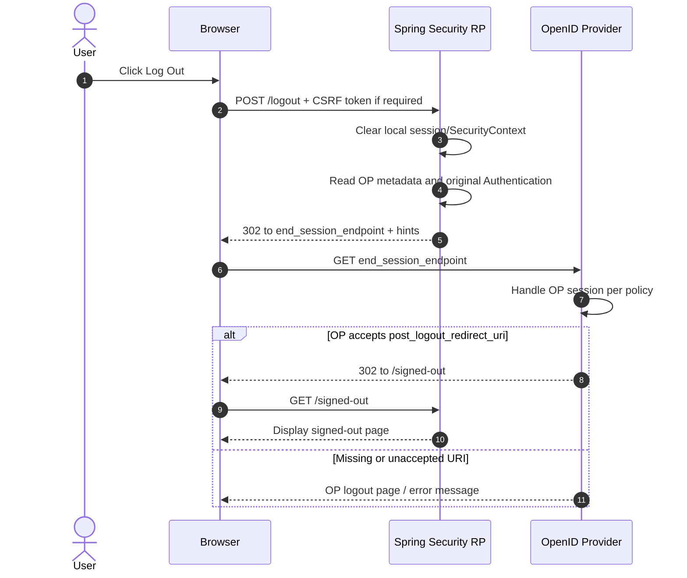

# 24.4. Discovery of `end_session_endpoint` and Provider Support Conditions

In **Spring Security OAuth 2.0/OIDC Client**, users can log in via an OpenID Provider (OP), receiving an authenticated session in the application and a Single Sign-On (SSO) session at the identity provider. When a user clicks **Log Out**, clearing the application's session does not necessarily terminate the SSO session at the OP. To request that the OP end its session, OpenID Connect defines the **RP-Initiated Logout** mechanism.

A decisive technical detail for whether an application can apply this mechanism is the **`end_session_endpoint`** metadata. An OP may publish this address in the **OpenID Provider Configuration** document fetched via **OIDC Discovery**. Spring Security can use that metadata together with the user's ID Token to build the logout URL and redirect the browser to the OP.

However, **`end_session_endpoint` is optional metadata**. The fact that a provider supports OIDC Login, returns an ID Token, publishes `issuer`, or serves `/.well-known/openid-configuration` **does not prove** the provider supports RP-Initiated Logout. Even when metadata includes the endpoint, the OP may still require registering `post_logout_redirect_uri`, validating `id_token_hint` or `client_id`, applying custom session policies, and supporting only specific parameters.

This lesson explains how discovery works, how to verify actual provider support, how to configure **`OidcClientInitiatedLogoutSuccessHandler`** in Servlet and **`OidcClientInitiatedServerLogoutSuccessHandler`** in WebFlux, how to distinguish local logout from OP logout/token revocation, as well as how to secure redirects and handle missing endpoints.

## 1. The Problem: Application Logged Out, Yet Re-Entry Needs No Password

A common scenario:

1. The user visits `https://portal.example.test`.
2. Portal uses Spring Security `oauth2Login` and redirects to `https://login.example.test`.
3. The OP authenticates the user; the browser receives the OP's SSO cookie.
4. Portal receives the authorization code, exchanges tokens, verifies the ID Token, and creates a local session.
5. The user clicks **Log Out** on Portal.
6. Portal deletes the local session but **does not** ask the OP to end the SSO session.
7. The user clicks **Log In** again; the OP still has its SSO cookie and can issue a new authorization code without prompting for a password.

This is not necessarily a Spring Security bug: local logout may have executed properly. The issue lies in the fact that there are **two separate sessions**.

```text
Browser
├── Portal session cookie (local session)
│     └── Spring Security Authentication / SecurityContext
└── OpenID Provider session cookie (OP session)
      └── SSO login state at the provider

Local logout:
  Deletes/invalidates Portal's local session
  Does not automatically delete the OP cookie

RP-Initiated Logout:
  Portal directs the browser to the OP's end_session_endpoint
  OP handles the session termination request per its policy
```

**The goal of RP-Initiated Logout** is to allow the Relying Party (RP, i.e., the Spring application) to actively request an OP logout. It is not a command that wipes every session across all websites and devices.

## 2. Terms to Distinguish Before Configuring

| Term | Meaning | Misconception to Avoid |
|---|---|---|
| **Relying Party (RP)** | Application using OIDC to log users in | RP is not the Authorization Server |
| **OpenID Provider (OP)** | Provider performing OIDC authentication and issuing ID Tokens | OP session is not identical to local app session |
| **OIDC Discovery** | Mechanism to fetch metadata on OP's issuer, endpoints, and capabilities | Discovery does not guarantee every feature is present |
| **`end_session_endpoint`** | Endpoint published by OP for RP-Initiated Logout | Not `token_endpoint` or `revocation_endpoint` |
| **RP-Initiated Logout** | RP asks OP to end the session via browser | Does not necessarily log out all other RPs |
| **`id_token_hint`** | Previously issued ID Token passed by RP to OP to hint which session to log out | Not an access token or refresh token |
| **`post_logout_redirect_uri`** | URL to which OP may return the browser after logout | Usually must be registered and approved by OP |
| **Logout `state`** | Optional value for RP to correlate logout response with initial request | Different from `state` in OAuth2 authorization code flow |
| **Local logout** | Destroys local SecurityContext/session at RP | Does not automatically revoke tokens at OP |
| **Token revocation** | Asks AS to invalidate access/refresh tokens via supported mechanism | Not identical to OP session logout |
| **Front-/Back-Channel Logout** | Mechanisms for OP to notify other RPs of logout | Different from an RP-Initiated Logout request |

An application may use all three operations—**local logout**, **RP-Initiated Logout**, and **token revocation**—but each must be chosen and configured separately.

## 3. What Is OIDC Discovery?

An OP supporting OpenID Connect Discovery publishes metadata at a well-known location tied to its issuer. Example issuer:

```text
https://login.example.test/realms/company
```

The metadata document typically resides at:

```text
https://login.example.test/realms/company/.well-known/openid-configuration
```

Abbreviated example content:

```json
{
  "issuer": "https://login.example.test/realms/company",
  "authorization_endpoint": "https://login.example.test/realms/company/authorize",
  "token_endpoint": "https://login.example.test/realms/company/token",
  "jwks_uri": "https://login.example.test/realms/company/jwks",
  "userinfo_endpoint": "https://login.example.test/realms/company/userinfo",
  "response_types_supported": ["code"],
  "subject_types_supported": ["public"],
  "id_token_signing_alg_values_supported": ["RS256"],
  "end_session_endpoint": "https://login.example.test/realms/company/logout"
}
```

This is **illustrative JSON**, not metadata from a real provider. Actual fields depend on the OP, tenant, and version.

### 3.1. What Does the `end_session_endpoint` Field Tell Us?

It tells the RP the URL published by the OP to initiate session termination via RP-Initiated Logout.

Example:

```text
end_session_endpoint
  = https://login.example.test/realms/company/logout
```

The RP can build a browser navigation request to that endpoint along with appropriate protocol parameters. However:

- Having the endpoint **does not mean** every logout parameter is supported.
- Having the endpoint **does not guarantee** all OP sessions or federated sessions are deleted.
- The endpoint may require `id_token_hint`, `client_id`, or return URL registration.
- The provider may exhibit specific behavior when multiple user sessions are open or when logged in via a linked IdP.
- Support may vary across environments, tenants, or product versions.

### 3.2. Is `end_session_endpoint` Required in OIDC Discovery?

**No.** An OP can fulfill OIDC Login without **publishing `end_session_endpoint`**. This metadata relates to a separately specified OIDC logout mechanism, not a mandatory requirement for OIDC Core Authorization Code Login.

A valid login document might contain only:

```json
{
  "issuer": "https://login.example.test/realms/company",
  "authorization_endpoint": "https://login.example.test/authorize",
  "token_endpoint": "https://login.example.test/token",
  "jwks_uri": "https://login.example.test/jwks",
  "response_types_supported": ["code"],
  "subject_types_supported": ["public"],
  "id_token_signing_alg_values_supported": ["RS256"]
}
```

In this case, do not guess the logout URL as `issuer + "/logout"` and treat it as a standard endpoint. The provider may document a proprietary logout mechanism or not support RP-Initiated Logout at all.

### 3.3. Metadata Key Names Must Be Exact

The standard name is:

```text
end_session_endpoint
```

Do not confuse it with:

```text
logout_endpoint
revocation_endpoint
frontchannel_logout_uri
backchannel_logout_uri
check_session_iframe
token_endpoint
```

Other keys belong to different protocols, extensions, or proprietary integrations. **Do not rename keys arbitrarily** and expect Spring to recognize `end_session_endpoint`.

## 4. Fetching Metadata with Tools and Reading the Result

In an environment permitted to access the provider, you can check:

```bash
curl --fail --silent --show-error \
  https://login.example.test/realms/company/.well-known/openid-configuration
```

To display only specific fields if `jq` is installed:

```bash
curl --fail --silent --show-error \
  https://login.example.test/realms/company/.well-known/openid-configuration \
  | jq '{issuer, authorization_endpoint, token_endpoint, end_session_endpoint}'
```

Example output:

```json
{
  "issuer": "https://login.example.test/realms/company",
  "authorization_endpoint": "https://login.example.test/realms/company/authorize",
  "token_endpoint": "https://login.example.test/realms/company/token",
  "end_session_endpoint": "https://login.example.test/realms/company/logout"
}
```

If `jq` returns `null` for `end_session_endpoint`, then **the downloaded document lacks that field** or has a JSON null value. Inspect the raw metadata and provider documentation rather than inferring an endpoint by guesswork.

### 4.1. Be Careful with Discovery Paths

An issuer sometimes includes a **path** like `/realms/company`. The exact location of the well-known URL depends on discovery rules and the issuer. Modern Spring Security releases include appropriate metadata resolution algorithms when using an issuer location.

Do not write a custom discovery helper that blindly concatenates paths across all providers without checking the spec and actual paths. For a specific provider, use the `issuer-uri` published by the OP and official documentation.

### 4.2. Do Not Confuse Discovery Failure with Unsupported Logout

Different outcomes:

| Result | Reasonable Conclusion |
|---|---|
| Cannot connect to discovery URL | DNS/TLS/network/path error or temporary provider outage |
| HTTP 404 at well-known | URL or issuer may be wrong; does not prove provider lacks logout |
| JSON parse error | Invalid metadata or wrong response content type |
| Metadata `issuer` differs from configured issuer | Wrong provider/tenant or untrusted configuration |
| Valid metadata, missing `end_session_endpoint` | No logout endpoint **advertised via this metadata** |
| Field present but invalid URL | Broken metadata or unmet expectation; do not redirect blindly |
| HTTPS endpoint present and valid registration | Grounds to try RP-Initiated Logout integration; still verify real behavior |

Never disable TLS validation to fetch metadata. Never accept an arbitrary issuer URL sent by the browser to steer the browser to an untrusted logout endpoint.

## 5. How Does OIDC RP-Initiated Logout Work?

A typical flow:



Key point: **the RP redirects the browser** to the OP. The OP typically needs the browser's cookie/session context to know which session is logging out.

### 5.1. Why Not Simply Make a Backend HTTP GET to `end_session_endpoint`?

A backend HTTP client sending a direct request to the OP **does not carry the OP's session cookie from the user's browser** the way browser navigation does. The backend might hit the right URL without affecting the SSO session held by the browser.

Therefore, do not replace the redirect with:

```java
// AVOID treating this as RP-Initiated browser logout:
restClient.get()
    .uri(endSessionEndpoint)
    .retrieve()
    .toBodilessEntity();
```

Standards and provider implementations may allow other forms, but for standard RP-Initiated Logout, **the user's User-Agent** is an essential part of the flow.

### 5.2. Does Logging Out at the OP Mean Logging Out Every Application?

There is no guarantee. The OP may:

- Terminate the current OP SSO session.
- Notify RPs registered for front-channel/back-channel logout according to its capabilities.
- Skip notifying other RPs that do not support those mechanisms.
- Keep the session of an upstream IdP/federation alive.
- Keep unexpired access tokens issued to Resource Servers valid.
- Apply session policies per device, browser, or tenant.

In particular, **RP-Initiated Logout is not automatically a protocol that revokes all access tokens**.

## 6. Parameters in RP-Initiated Logout

Under **OpenID Connect RP-Initiated Logout 1.0**, key parameters include:

| Parameter | Purpose | Notes |
|---|---|---|
| `id_token_hint` | Hints to OP about the relevant session/user/RP via previously issued ID Token | Recommended; provider may require it |
| `logout_hint` | Hints user/session in OP-defined format | Optional, provider-specific |
| `client_id` | Helps OP identify the RP, especially without `id_token_hint` or when Client ID is needed | Follows OP policy |
| `post_logout_redirect_uri` | Desired URL for OP to return browser to after logout | Usually must be registered/approved by OP |
| `state` | Optional value helping RP correlate post-logout response with request | OP echoes it back if supported per spec |
| `ui_locales` | Hints UI language for logout screen | OP-dependent |

### 6.1. Example Logout URL

```text
https://login.example.test/realms/company/logout
  ?id_token_hint=EXAMPLE_ID_TOKEN
  &post_logout_redirect_uri=https%3A%2F%2Fportal.example.test%2Fsigned-out
  &state=EXAMPLE_LOGOUT_STATE
```

The URL above **only illustrates the protocol format**; never copy real tokens into documentation or logs. Depending on the provider and Spring Security version, actual requests may **not** include every parameter.

### 6.2. `id_token_hint` Is Not an Access Token

In OIDC:

```text
ID Token:
  used by RP to verify identity; can be passed as id_token_hint

Access token:
  used to call Resource Servers

Refresh token:
  used to obtain a new access token at the Token Endpoint
```

Never use an access token as `id_token_hint`. Also never treat `id_token_hint` as a command forcing the OP to invalidate access tokens across all APIs.

### 6.3. Why Does the OP Want `id_token_hint`?

An OP may serve many sessions and many Clients. The ID Token issued to the RP helps identify:

- Which Client participated in authentication.
- The relevant issuer and subject.
- Session context if claims like `sid` are present.
- Whether the request is valid per policy.

Each OP may require the ID Token to fall within a time window, have matching issuer/audience, or include `sid` depending on implementation. **There is no universal guarantee** that an expired ID Token is always accepted for logout.

### 6.4. Does `client_id` Replace `id_token_hint`?

Some OPs accept `client_id` to identify the RP when no ID Token is present. However, merely passing `client_id` does not force an OP to terminate any arbitrary browser session.

If the provider requires `id_token_hint` or extra confirmation, the Client must comply. Never forge an ID Token or pass an unverified JWT to "qualify."

### 6.5. `post_logout_redirect_uri` Is Not an Open Redirect

The OP typically requires the URL to appear in the **registered list** for the Client. Example:

```text
https://portal.example.test/signed-out
```

If the Client passes:

```text
https://attacker.example.test/collect
```

the OP must validate per spec/policy; the RP must likewise ensure it does not create an open redirect from untrusted input. Never turn `post_logout_redirect_uri` into a value taken straight from a browser-supplied `returnTo` query parameter.

## 7. Practical Conditions for Provider Logout Support

A typical set of prerequisites:

1. **The provider is a valid OIDC OP** for the login you are performing, not merely an OAuth2 Authorization Server.
2. **The provider supports an RP-Initiated Logout mechanism** compatible with Spring Security's integration.
3. **Discovery metadata contains `end_session_endpoint`**, if using discovery to build the URL.
4. **ClientRegistration retains that metadata** or the app has a properly implemented trusted custom endpoint config.
5. **User Authentication still holds required OIDC info at logout time**, typically `OAuth2AuthenticationToken` with `OidcUser` and ID Token.
6. **The OP accepts/understands the parameters** sent by RP; `id_token_hint`, `client_id`, or specific requirements must be satisfied.
7. **`post_logout_redirect_uri` is registered** if redirecting back to the app is requested.
8. **The browser can reach the OP** over HTTPS and carry the right session context.
9. **Portal allows access to the post-logout landing page** without immediately forcing re-login.
10. **The app defines a fallback** when the OP does not support or rejects logout.

**Without the endpoint in discovery**, Spring's built-in handler typically lacks metadata to build a standard OP redirect. Still, a provider might offer a proprietary logout API or undocumented endpoint; custom integration requires checking the vendor's contract.

### 7.1. Support Levels

| Level | Capability | How to Handle |
|---|---|---|
| A | No OIDC Login | Do not use OIDC logout handler |
| B | OIDC Login, no `end_session_endpoint` published | Local logout; check provider docs if custom logout is needed |
| C | `end_session_endpoint` present, OP rejects current redirect URI | Register exact post-logout URI or use a flow without redirect |
| D | Endpoint present and valid hints handled | Can use RP-Initiated Logout |
| E | Supports front/back-channel logout in addition to RP-Initiated Logout | Can design synchronized logout across RPs, requiring separate integration |

Do not assume Level E is enabled by default just because Level D works.

## 8. Configuring `issuer-uri` and Discovery in Spring Boot

Example OIDC Client running on Servlet Spring MVC:

```yaml
spring:
  security:
    oauth2:
      client:
        registration:
          company:
            provider: company-op
            client-id: ${OIDC_CLIENT_ID}
            client-secret: ${OIDC_CLIENT_SECRET}
            client-authentication-method: client_secret_basic
            authorization-grant-type: authorization_code
            scope:
              - openid
              - profile
              - email
            redirect-uri: "{baseUrl}/login/oauth2/code/{registrationId}"

        provider:
          company-op:
            issuer-uri: https://login.example.test/realms/company
```

When Spring Boot/Spring Security processes OIDC provider discovery for the configured issuer:

- Reads provider metadata matching the issuer.
- Sets up Authorization Endpoint, Token Endpoint, JWKS, and required values.
- `ClientRegistration` can retain the fetched provider metadata.
- If metadata contains `end_session_endpoint`, the OIDC logout handler can use that endpoint.

**There is no standard `end-session-uri` property under `spring.security.oauth2.client.provider` where you can simply type a URL and assume Spring uses it as metadata.** If a provider does not publish the endpoint yet you want custom logout support, pick a reliable customization approach and check your API/version rather than inventing property names.

### 8.1. Difference with Manual Configuration

Some projects skip `issuer-uri` and declare endpoints manually:

```yaml
spring:
  security:
    oauth2:
      client:
        registration:
          company:
            provider: company-op
            client-id: ${OIDC_CLIENT_ID}
            client-secret: ${OIDC_CLIENT_SECRET}
            authorization-grant-type: authorization_code
            scope: [openid, profile]

        provider:
          company-op:
            authorization-uri: https://login.example.test/oauth2/authorize
            token-uri: https://login.example.test/oauth2/token
            jwk-set-uri: https://login.example.test/oauth2/jwks
            user-info-uri: https://login.example.test/oauth2/userinfo
            user-name-attribute: sub
```

Configuring login endpoints **does not automatically populate `end_session_endpoint` in provider configuration metadata**. To use the standard handler when metadata lacks it, ensure `ClientRegistration` holds appropriate metadata from a trusted source or use another logout integration supported by the provider.

### 8.2. OAuth2 Login Without OIDC

For example, a registration with only `profile` or `read:user` where the OAuth2 provider issues no ID Token:

```text
OAuth2 Login -> OAuth2User
OIDC Login   -> OidcUser (with verified ID Token)
```

`OidcClientInitiatedLogoutSuccessHandler` targets **OIDC**, not a universal logout mechanism for every OAuth2 provider. Never try to cast an `OAuth2User` to `OidcUser` or fabricate an ID Token.

## 9. Where Does Spring Security Read `end_session_endpoint` From?

With a discovered `ClientRegistration`, metadata can be accessed via provider details.

Java example **reading metadata for observation only** (not performing logout itself):

```java
import java.util.Map;

import org.springframework.security.oauth2.client.registration.ClientRegistration;
import org.springframework.security.oauth2.client.registration.ClientRegistrationRepository;

public final class OidcLogoutMetadataInspector {

    private final ClientRegistrationRepository registrations;

    public OidcLogoutMetadataInspector(
            ClientRegistrationRepository registrations) {
        this.registrations = registrations;
    }

    public boolean hasEndSessionEndpoint(String registrationId) {
        ClientRegistration registration =
            registrations.findByRegistrationId(registrationId);

        if (registration == null) {
            return false;
        }

        Map<String, Object> metadata =
            registration.getProviderDetails().getConfigurationMetadata();

        Object value = metadata.get("end_session_endpoint");

        return value instanceof String endpoint && !endpoint.isBlank();
    }
}
```

On Java 17+, pattern matching `instanceof` as shown is supported. This method answers **whether metadata contains an endpoint string**; it does not replace host/HTTPS checks, provider contracts, `ClientRegistration` verification, or redirect URI registration.

### 9.1. Does `hasEndSessionEndpoint=true` Guarantee Successful Logout?

**No.** It only confirms metadata holds a value. Failures can still happen due to:

- Wrong URI or redirecting to a nonexistent endpoint.
- OP requiring `id_token_hint` when Authentication lacks it.
- Unregistered `post_logout_redirect_uri`.
- Expired OP session or one belonging to another user.
- Browser blocking cookies/redirects.
- Provider supporting only certain HTTP methods or parameters.
- Handler not wired into the active Spring Security filter chain.

Name the method to reflect the exact check scope—do not call it `isLogoutFullySupported()` based solely on one metadata field.

### 9.2. What If the Field Is Missing in `ClientRegistration` Yet Present in Well-Known?

Possible reasons:

- The app points to a different provider than the issuer you queried with curl.
- `ClientRegistration` was built **manually**, discarding discovery metadata.
- Metadata was cached or a build used a different provider version.
- A custom `ClientRegistrationRepository` bean failed to copy provider configuration metadata.
- The discovery response changed after app startup while the repository was not refreshed.

When diagnosing, verify the exact **registrationId**, **issuer**, **source metadata**, and **live bean in the JVM**, rather than inspecting only browser URLs.

## 10. Configuring RP-Initiated Logout in Spring MVC/Servlet

Spring Security provides **`OidcClientInitiatedLogoutSuccessHandler`** for Servlet.

Typical import:

```java
import org.springframework.security.oauth2.client.oidc.web.logout.OidcClientInitiatedLogoutSuccessHandler;
```

Configuration example:

```java
import org.springframework.context.annotation.Bean;
import org.springframework.context.annotation.Configuration;
import org.springframework.security.config.Customizer;
import org.springframework.security.config.annotation.web.builders.HttpSecurity;
import org.springframework.security.oauth2.client.oidc.web.logout.OidcClientInitiatedLogoutSuccessHandler;
import org.springframework.security.oauth2.client.registration.ClientRegistrationRepository;
import org.springframework.security.web.SecurityFilterChain;

@Configuration
public class SecurityConfiguration {

    @Bean
    SecurityFilterChain securityFilterChain(
            HttpSecurity http,
            ClientRegistrationRepository clientRegistrations)
            throws Exception {

        var oidcLogout =
            new OidcClientInitiatedLogoutSuccessHandler(
                clientRegistrations
            );

        oidcLogout.setPostLogoutRedirectUri("{baseUrl}/signed-out");

        http
            .authorizeHttpRequests(authorize -> authorize
                .requestMatchers("/", "/signed-out", "/error").permitAll()
                .anyRequest().authenticated()
            )
            .oauth2Login(Customizer.withDefaults())
            .logout(logout -> logout
                .logoutSuccessHandler(oidcLogout)
            );

        return http.build();
    }
}
```

### 10.1. What This Configuration Does

- `ClientRegistrationRepository` holds the OIDC clients and provider metadata.
- The logout success handler uses the OIDC login info and provider metadata to build an RP-Initiated Logout request **when conditions are satisfied**.
- `setPostLogoutRedirectUri("{baseUrl}/signed-out")` specifies the URL the OP should return the browser to after logout.
- `/signed-out` is permitted after local logout, avoiding inadvertently sending users back to login.
- The Spring Security logout pipeline handles the local session and then invokes the logout success handler.

**The example does not assume every provider publishes `end_session_endpoint`.** When conditions are not met, the handler falls back to default/version-appropriate logout success behavior; the application must test and provide a clear fallback UX.

### 10.2. Why Use the Built-in Handler?

It is designed to coordinate with Spring Security OIDC Login, `ClientRegistration` metadata, and Authentication. Compared to hand-assembling:

```text
issuer + "/logout" + "?id_token_hint=" + rawIdToken
```

the standard handler reduces risks of:

- Using the wrong provider's endpoint.
- Accidentally grabbing an access token instead of an ID Token.
- Forgetting parameter encoding.
- Pulling URLs from untrusted config.
- Omitting principal type checks.
- Misordering local logout and the OP redirect.

Even so, the built-in handler still depends on **provider support and accurate registration**.

### 10.3. Why Does the Handler Need Authentication to Still Be Accessible?

The Spring Security logout pipeline captures Authentication before clearing the security context/session and passes it to `LogoutSuccessHandler`. An OIDC handler can use the original Authentication to extract:

- `OAuth2AuthenticationToken`.
- `authorizedClientRegistrationId`.
- `OidcUser`.
- The ID Token issued by the OP during login.

If a custom `LogoutHandler` removes or mutates the needed data improperly, building `id_token_hint` may not work as expected.

Do not write a custom logout endpoint that **clears authentication and then calls the handler with `null`** if you want RP-Initiated Logout based on the ID Token.

### 10.4. Do You Need a `GET /logout` Controller?

Usually no. Spring Security handles the logout endpoint per configuration, and with default CSRF enabled, state-changing logout actions are normally sent via **POST**.

Thymeleaf example:

```html
<form th:action="@{/logout}" method="post">
    <button type="submit">Log out</button>
</form>
```

With proper Thymeleaf/Spring Security integration, the CSRF token can be injected automatically by the framework. If building raw HTML or sending fetch/AJAX, you must **supply the CSRF token properly** per app config. Never disable CSRF just to make the logout button work.

For GET `/logout` in some configurations, Spring may display a confirmation page rather than executing logout immediately. Exact behavior depends on CSRF and version.

## 11. `post_logout_redirect_uri` Must Be Registered

Suppose the handler is configured with:

```java
oidcLogout.setPostLogoutRedirectUri(
    "{baseUrl}/signed-out"
);
```

and the app's public origin is:

```text
https://portal.example.test
```

Then the expected URL is:

```text
https://portal.example.test/signed-out
```

On the OP side, the Client usually must declare it under **allowed post-logout redirect URIs**. This is normally a **different list** from authorization code login Redirect URIs.

### 11.1. The Two Redirect URI Types Are Not the Same

| Parameter | When Used | Example |
|---|---|---|
| Authorization code `redirect_uri` | OP returns code to RP during login | `https://portal.example.test/login/oauth2/code/company` |
| RP-Initiated Logout `post_logout_redirect_uri` | OP returns browser to RP after logout | `https://portal.example.test/signed-out` |

Do not register a login URI and assume the OP will accept it as a post-logout redirect.

### 11.2. Some Providers Disallow Post-Logout Redirects

An OP may:

- Not support this parameter.
- Require separate URI registration.
- Require an ID Token hint or Client ID.
- Allow redirects only within the same domain per policy.
- Restrict URI scheme/host/port.
- Show a logout confirmation page before redirecting.
- Refuse to redirect if the session cannot be identified.

In such cases, local logout must still succeed, and UX should not depend unconditionally on the browser returning to `/signed-out`.

### 11.3. Never Let Users Define the Redirect Target

Wrong:

```java
// UNSAFE idea:
String next = request.getParameter("next");
oidcLogout.setPostLogoutRedirectUri(next);
```

An RP can become an open redirect if it reads arbitrary URLs from the browser. Use only server-controlled URLs/routes, allowlists, or trusted config.

## 12. Post-Logout Redirect Placeholders

Spring Security supports certain URI templates in `setPostLogoutRedirectUri`, commonly:

```text
{baseUrl}
```

Example:

```java
oidcLogout.setPostLogoutRedirectUri("{baseUrl}/signed-out");
```

`{baseUrl}` relies on the public URL context resolved by the framework; ensure reverse proxy headers, scheme, and host are accurate.

### 12.1. Common Issue Behind a Reverse Proxy

Infrastructure:

```text
Browser:
  https://portal.example.test

Reverse proxy:
  https://portal.example.test -> http://spring-app:8080
```

If the app does not trust or properly receive forwarded headers, `{baseUrl}` may resolve to:

```text
http://spring-app:8080
```

The OP will reject a post-logout URL not in its allowlist, or the browser will fail to reach the internal host.

### 12.2. How to Fix It

- Register the public HTTPS URL at the OP.
- Configure the reverse proxy to send accurate forwarded headers.
- Trust `Forwarded`/`X-Forwarded-*` only from a trusted reverse proxy.
- Configure Spring Boot forwarded-header handling per your infrastructure/version.
- Verify the app constructs the right scheme, host, port, and context path.
- Prevent Internet clients from spoofing `X-Forwarded-Host` to make the app redirect to a malicious domain.

Relevant config:

```yaml
server:
  forward-headers-strategy: framework
```

The appropriate value depends on deployment. Never enable it blindly if the proxy does not control/sanitize headers.

## 13. Reactive WebFlux: `OidcClientInitiatedServerLogoutSuccessHandler`

For **Spring Security WebFlux** using `SecurityWebFilterChain`, the corresponding class is:

```java
import org.springframework.security.oauth2.client.oidc.web.server.logout.OidcClientInitiatedServerLogoutSuccessHandler;
```

Example:

```java
import org.springframework.context.annotation.Bean;
import org.springframework.context.annotation.Configuration;
import org.springframework.security.config.Customizer;
import org.springframework.security.config.web.server.ServerHttpSecurity;
import org.springframework.security.oauth2.client.oidc.web.server.logout.OidcClientInitiatedServerLogoutSuccessHandler;
import org.springframework.security.oauth2.client.registration.ReactiveClientRegistrationRepository;
import org.springframework.security.web.server.SecurityWebFilterChain;

@Configuration
public class ReactiveSecurityConfiguration {

    @Bean
    SecurityWebFilterChain securityWebFilterChain(
            ServerHttpSecurity http,
            ReactiveClientRegistrationRepository registrations) {

        var oidcLogout =
            new OidcClientInitiatedServerLogoutSuccessHandler(
                registrations
            );

        oidcLogout.setPostLogoutRedirectUri("{baseUrl}/signed-out");

        return http
            .authorizeExchange(exchanges -> exchanges
                .pathMatchers("/", "/signed-out", "/error").permitAll()
                .anyExchange().authenticated()
            )
            .oauth2Login(Customizer.withDefaults())
            .logout(logout -> logout
                .logoutSuccessHandler(oidcLogout)
            )
            .build();
    }
}
```

Differences from Servlet:

| Topic | Servlet Spring MVC | Reactive WebFlux |
|---|---|---|
| HTTP security config | `HttpSecurity` | `ServerHttpSecurity` |
| Security filter chain | `SecurityFilterChain` | `SecurityWebFilterChain` |
| Client registration repository | `ClientRegistrationRepository` | `ReactiveClientRegistrationRepository` |
| OIDC logout success handler | `OidcClientInitiatedLogoutSuccessHandler` | `OidcClientInitiatedServerLogoutSuccessHandler` |
| Request context | Servlet `HttpServletRequest` | `ServerWebExchange` |
| Context/persistence | Servlet SecurityContext/session | Reactive SecurityContext/WebSession |

Do not import the Servlet handler into WebFlux or vice versa. Both share the same idea—reading OP metadata, locating the ID Token/registration, and redirecting the browser—but the APIs are not interchangeable.

### 13.1. WebFlux Has the Same Provider Prerequisites

Reactive does not magically "add logout endpoint support." If the provider lacks `end_session_endpoint` or rejects the redirect URI, the WebFlux handler is still bound by the OP's actual capabilities.

Do not take `ServerOAuth2AuthorizedClientExchangeFilterFunction`—the filter attaching access tokens to WebClient API calls—and use it in place of the OIDC logout success handler. Those two components serve completely different purposes.

## 14. Local Logout, OP Logout, and Token Revocation: Three Different Axes

### 14.1. Local Logout

Spring Security logout typically handles tasks such as:

- Invalidating local `HttpSession` or managing `WebSession` per config.
- Clearing `SecurityContext`.
- Deleting specified related cookies if configured.
- Redirecting the user to an appropriate page.

This terminates the application session. If the OP cookie remains, the user can immediately SSO back in.

### 14.2. RP-Initiated Logout

The RP redirects the browser to the OP's `end_session_endpoint` to request an OP logout. It primarily handles the **OP session** per provider policy.

It does not by itself prove that:

- All access tokens were revoked.
- All refresh tokens were revoked.
- All sessions on other devices ended.
- All other RPs were logged out.
- The user account was disabled.

### 14.3. Token Revocation

OAuth2 Token Revocation (RFC 7009) describes how a Client sends an access/refresh token to a **revocation endpoint** when supported.

```text
RP-Initiated Logout:
  Browser -> end_session_endpoint
  Target: OP browser session

Token Revocation:
  Client -> revocation_endpoint
  Target: request invalidation of token/grant at AS

Local Logout:
  Spring app -> invalidate local session
  Target: authentication state at RP
```

These goals are related but **not equivalent**.

### 14.4. Execution Order May Depend on the Product

One application might follow this flow:

1. User clicks logout.
2. Spring clears local session and security context.
3. Handler redirects browser to OP `end_session_endpoint`.
4. OP terminates browser SSO session.
5. OP returns browser to RP's signed-out page if approved.

Another application needs to actively revoke refresh tokens when a user disconnects. That is a different business action; do not add token revocation to every logout without defining offline access, multi-device, and user consent policies.

## 15. Why Might `id_token_hint` Be Unavailable?

An OIDC handler may fail to construct a standard logout request without matching OIDC context.

Scenarios:

| Scenario | Possible Consequence |
|---|---|
| User did not log in with OIDC, only form login | No `OidcUser`/ID Token |
| User logged in with non-OIDC OAuth2 provider | Has `OAuth2User` but no ID Token |
| Custom code replaced Authentication with anonymous before handler | Handler does not know registration or ID Token |
| A custom principal dropped the ID Token | Cannot build standard `id_token_hint` |
| App only kept userId in a local JWT without original OIDC auth | Information needed by handler is gone |
| Previous login came from a different provider | Registration/issuer may not match logout endpoint |
| Local session already expired | Browser logout may lack original Authentication |
| OP requires ID Token hint meeting specific policy | OP may reject request even if handler builds URL |

The solution is not to synthesize a random JWT as an ID Token hint. Ensure users hold an OIDC Authentication for the right provider and align architecture/authentication lifecycle accordingly.

### 15.1. Should You Persist the ID Token for Use After Session Expiration?

Only store it with a clear purpose aligned with privacy/security/retention policies. ID Tokens can contain PII; extending their storage lifetime solely for logout can create risk.

When a session has already expired and no valid ID Token exists, local logout is already satisfied for the app session; the UI can guide the user to log out directly at the OP via a provider-documented mechanism, or inform them that an external SSO session may remain. Never impersonate an expired session.

## 16. Not Every Provider Supports Logout the Same Way

Common provider categories:

### 16.1. OIDC Provider with `end_session_endpoint`

For example, self-hosted providers or enterprise IdPs supporting RP-Initiated Logout and publishing the endpoint. You can deploy the built-in handler after registering the post-logout redirect URI and testing request/response behavior.

### 16.2. OIDC Provider Not Publishing `end_session_endpoint`

OIDC login still works. For logout, the app may simply clear the local session and display a clear message, or use an alternative solution **per official provider documentation**.

Never assume `/logout`, `/signout`, or `/end-session` are universal standard endpoints.

### 16.3. Non-OIDC OAuth2 Provider

The provider issues access tokens and `OAuth2User` without OIDC ID Tokens. Do not treat the OIDC RP-Initiated Logout handler as a "generic logout."

If the provider offers a dedicated OAuth2 revoke/disconnect API, handle it with the appropriate integration; do not confuse it with OP SSO session logout.

### 16.4. Provider Publishes the Endpoint but Imposes Special Policies

The endpoint may exist yet:

- Require RP logout to be enabled on the client.
- Accept only allowlisted post-logout URIs.
- Prompt for logout confirmation.
- Require a valid `id_token_hint`.
- Not return the browser to the RP if the hint is missing.
- Apply special rules for multiple sessions or upstream federation.

When integrating, **documentation and end-to-end testing on a real tenant** are what confirm the product exhibits the desired behavior.

## 17. Multi-Provider: Selecting the Right Endpoint for the Right OIDC Session

Suppose Portal supports two providers:

```yaml
spring:
  security:
    oauth2:
      client:
        registration:
          corp:
            provider: corp-op
            client-id: ${CORP_CLIENT_ID}
            client-secret: ${CORP_CLIENT_SECRET}
            authorization-grant-type: authorization_code
            scope: [openid, profile]

          partner:
            provider: partner-op
            client-id: ${PARTNER_CLIENT_ID}
            client-secret: ${PARTNER_CLIENT_SECRET}
            authorization-grant-type: authorization_code
            scope: [openid, profile]

        provider:
          corp-op:
            issuer-uri: https://corp-id.example.test/issuer
          partner-op:
            issuer-uri: https://partner-id.example.test/issuer
```

User A logs in via `corp`; User B via `partner`.

The handler must bind the logout flow to the **exact `ClientRegistration` of the current login session**. Never:

- Always log out at `corp` for every user.
- Use an ID Token from `partner` as a hint sent to `corp`'s endpoint.
- Read a user-supplied logout URL and redirect to it.
- Merge external identities solely by email when identifying the provider.
- Send an ID Token to a host outside the corresponding issuer/OP.

### 17.1. Registration ID and Issuer Are Different

`registrationId` is Spring's internal key, like `corp`. `issuer` is the OP's identifier, like `https://corp-id.example.test/issuer`.

One issuer can have multiple Clients (different registration IDs), and a multi-tenant app can have multiple issuers. When debugging logout, check **registration ID**, **issuer**, **`end_session_endpoint`**, and **client ID** together.

## 18. When Discovery Lacks the Endpoint: Controlled Fallback

Clicking logout must never turn into an error page or a redirect loop when a provider lacks RP-Initiated Logout support.

A sound fallback policy:

1. **Always perform proper local logout** per Spring Security policy.
2. Only use an OP redirect when reliable conditions are met.
3. If the endpoint is absent, navigate to a local page like `/signed-out`.
4. Communicate the scope clearly: "You have logged out of the application; your session at the identity provider may still be active."
5. If the provider documents a dedicated logout page, provide an appropriate instruction/link instead of guessing a URL.
6. Never automatically re-trigger `/oauth2/authorization/...` right after logout, because OP SSO may still be active and immediately log the user back in.
7. If "log out all devices" is mandatory, build appropriate session management/revocation architecture beyond the standard handler.

### 18.1. UX Should Accurately Reflect Behavior

Avoid absolute claims:

> "You have logged out of all applications and devices."

With local logout only, better copy is:

> "You have signed out of the portal. If using a shared computer, close your browser and check your session at your identity provider."

If the provider supports OP logout and the flow completed, you might say:

> "A sign-out request was sent to the identity provider. Some applications or devices may still maintain separate sessions."

Final messaging depends on actual OP confirmation; dispatching an HTTP redirect does not prove the provider terminated every session.

### 18.2. Protecting `/signed-out` from Auto-Login

If `/signed-out` requires authentication:

```text
Logout -> /signed-out
        -> Security redirects /oauth2/authorization/company
        -> OP still has SSO session
        -> user logs right back in
```

The experience becomes "logout does nothing." Allow anonymous access to this page as shown with `requestMatchers("/signed-out").permitAll()`, and avoid calling APIs that trigger automatic user-token login from the signed-out page.

## 19. Do Not Hardcode `end_session_endpoint` from Issuer

An anti-pattern:

```java
String logoutUrl = issuer + "/logout";
response.sendRedirect(logoutUrl);
```

Problems:

- Endpoint paths differ by provider/version.
- The OP may not support that logout API.
- The endpoint may require specific query params, HTTP method, or Client identification.
- `issuer` may contain paths/tenants that break URL concatenation.
- Deployments may change URLs across upgrades.
- With untrusted issuer input, there is also open-redirect risk.

Prefer:

1. Discovery metadata `end_session_endpoint` from a trusted issuer.
2. Built-in Spring OIDC logout handler when applicable.
3. If metadata lacks it yet the provider documents a custom logout flow, write a dedicated integration **for that provider only**, using URLs from trusted config and thorough testing.
4. A local logout fallback if the custom flow fails.

### 19.1. Do Not Automatically "Guess and Probe Multiple Endpoints"

Example of what to avoid:

```text
issuer/logout
issuer/signout
issuer/endsession
issuer/protocol/logout
issuer/oauth2/logout
```

Firing requests at unknown paths can trigger unintended behavior and create open-redirect/security flaws. Ask the vendor or consult reliable metadata/API docs instead of probing blindly.

## 20. HTTPS, Metadata Trust, and Redirect Safety

Logout deals with identity/sessions and must be tightly protected:

- Use **HTTPS only** for production issuers, discovery endpoints, and end-session endpoints.
- Verify the **issuer** of ID Tokens and metadata against trusted configuration.
- Never accept issuers/endpoints from free-form query parameters.
- Never send ID Token hints to domains outside the OP's trust boundary.
- Never enable "trust all certificates" to bypass TLS.
- Restrict `post_logout_redirect_uri` via allowlist/registered URIs.
- Prevent open redirects in callbacks and the signed-out page.
- Never log raw `id_token_hint`, cookies, or full logout URLs containing ID Tokens.
- Consider privacy: ID Tokens can contain identifying info and appear in browser URLs, proxy logs, and history/referrers if mismanaged.
- Set appropriate `Cache-Control`/logging policies on involved endpoints and reverse proxies.

### 20.1. Why Is `id_token_hint` in a URL Sensitive Data?

`id_token_hint` can be the raw JWT ID Token issued to the Client. Logout URLs can pass through:

- Browser history and dev tools.
- Reverse proxy/OP access logs.
- APM/tracing or analytics if full URLs are captured.
- Monitoring pipelines.
- `Referer` headers in some contexts if uncontrolled.

Never paste real logout URLs containing ID Tokens into issue trackers or insecure chats. Redact before sharing when debugging.

### 20.2. Should You Parse the JWT to Find the Logout URL?

No. `end_session_endpoint` is **provider metadata**, not an ID Token claim. An ID Token contains claims like `iss`, `sub`, `aud`, `exp`, `iat`, and possibly `sid`; never turn the `iss` claim into a logout URL by string building.

The issuer claim helps verify the token came from the right OP, but does not replace consulting trusted metadata.

## 21. OP Logout and SSO Federation

An OP may federate with an upstream Identity Provider:

```text
Portal (RP)
   |
   v
Corporate OP (OIDC provider)
   |
   v
External SAML/OIDC IdP
```

The user authenticated through the upstream IdP. When the RP calls Corporate OP's `end_session_endpoint`:

- Corporate OP may clear its own session.
- It may or may not request upstream IdP logout.
- The upstream IdP may still hold a cookie.
- The next login may quickly re-authenticate via federation.

Therefore, if users report "After logging out, logging back in still signs me in automatically," investigate:

1. Was the local RP session cleared?
2. Did the browser actually reach `end_session_endpoint`?
3. Which session did the OP terminate?
4. Does the upstream IdP still hold a session?
5. Does the OP enforce `prompt=login` or a re-authentication policy on the next login?
6. Do other RPs hold independent sessions?

Do not blame every automatic SSO re-login on the Spring Security handler.

## 22. Front-Channel and Back-Channel Logout Differ from RP-Initiated Logout

### 22.1. RP-Initiated Logout

The RP actively asks the OP to log out, usually redirecting the browser to `end_session_endpoint`.

### 22.2. Front-Channel Logout

The OP can use the browser front-channel to notify other RPs of a logout event. It requires separate registration/capabilities; an OP having `end_session_endpoint` to start logout **does not mean** it integrates front-channel logout listeners.

### 22.3. Back-Channel Logout

The OP sends a logout token/message directly server-to-server to the RP per OIDC Back-Channel Logout. The RP must validate the logout token, issuer/audience/event, and locate matching sessions per policy.

```text
RP-Initiated:
  RP -> Browser -> OP end_session_endpoint

Front-channel:
  OP -> Browser -> supported RPs

Back-channel:
  OP -> HTTP back-channel -> RP logout endpoint
```

Do not conflate metadata fields:

```text
end_session_endpoint
frontchannel_logout_supported
backchannel_logout_supported
backchannel_logout_session_supported
```

They indicate different capabilities. Never write a custom back-channel endpoint accepting `GET /logout` without validating logout tokens/session identifiers.

## 23. Provider-Specific Behavior and Multi-Device

### 23.1. Current Browser Session

RP-Initiated Logout typically affects the OP session associated with the active user agent/hints. Impact on other browsers, devices, or mobile app sessions depends on OP capabilities.

### 23.2. Refresh Tokens/Consent Remaining Valid After Logout

A provider may keep refresh tokens issued for offline access alive after OP logout, or have a policy to revoke them. **There is no universal rule** that logging out at the OP always revokes all refresh tokens.

If the application must halt background syncing when a user clicks "Disconnect," design dedicated revocation/token cleanup rather than relying solely on OIDC logout.

### 23.3. User Switching Accounts at the OP

A user might log out of Account A and log into Account B at the OP. When Portal starts login again, the new ID Token must be verified and mapped to the exact external identity `(iss, sub)`—never assume the previous session's mapping applies just because the browser once used the same email.

### 23.4. OP Prompts for Logout Confirmation

Some OPs display a "Do you want to log out?" prompt or refuse logout when the session cannot be identified. That is provider policy; **you cannot always skip the prompt** via an RP-added query parameter.

## 24. Testing: Verifying Functionality Layer by Layer

You can test at three levels: metadata, handler redirect, and end-to-end against a real provider.

### 24.1. Testing Metadata

With two mock metadata sets:

**With logout endpoint:**

```json
{
  "issuer": "https://login.example.test/issuer",
  "authorization_endpoint": "https://login.example.test/authorize",
  "token_endpoint": "https://login.example.test/token",
  "jwks_uri": "https://login.example.test/jwks",
  "response_types_supported": ["code"],
  "subject_types_supported": ["public"],
  "id_token_signing_alg_values_supported": ["RS256"],
  "end_session_endpoint": "https://login.example.test/endsession"
}
```

**Without logout endpoint:**

```json
{
  "issuer": "https://login.example.test/issuer",
  "authorization_endpoint": "https://login.example.test/authorize",
  "token_endpoint": "https://login.example.test/token",
  "jwks_uri": "https://login.example.test/jwks",
  "response_types_supported": ["code"],
  "subject_types_supported": ["public"],
  "id_token_signing_alg_values_supported": ["RS256"]
}
```

Expectation: the app distinguishes between the two and never constructs a fake endpoint in the second case.

### 24.2. Testing Servlet Logout Redirect

An integration test using Spring Security Test/MockMvc can prepare an `OAuth2AuthenticationToken` with `OidcUser` and a `ClientRegistration` carrying matching metadata.

Verify:

- `POST /logout` has a valid CSRF token.
- Local authentication/session is cleared per policy.
- When a valid endpoint exists, the response redirects to the right OP host/path.
- `post_logout_redirect_uri` is encoded and strictly within the allowlist.
- Access tokens are never used as `id_token_hint`.
- When the endpoint is absent, local logout and fallback still work.
- When the principal is non-OIDC, the app does not attempt to send a fake ID Token.

**Do not log or snapshot full logout URLs containing real ID Tokens.** Use fake tokens in tests.

### 24.3. Testing WebFlux Logout

With `WebTestClient` and a mocked `ReactiveClientRegistrationRepository`:

- Logout route goes through the right `SecurityWebFilterChain`.
- Session and reactive security context are cleared per config.
- OP redirect is built if metadata and OIDC Authentication are present.
- `/signed-out` is `permitAll`.
- Browser/HTTP response does not loop redirecting to `oauth2Login`.

### 24.4. End-to-End Testing with a Provider

This step is crucial because metadata presence **is not enough on its own**. A scenario:

1. Log into Portal via an OP test tenant.
2. Open developer tools and observe RP/OP session cookies are present without exposing values.
3. Submit logout POST.
4. Confirm Portal's local session disappears.
5. Confirm the browser is redirected to the published `end_session_endpoint`.
6. Confirm the OP processes `id_token_hint` and post-logout redirect.
7. Reopen Portal; observe whether the OP requires login or retains SSO per policy.
8. Test the case where the user already logged out at the OP beforehand.
9. Test multi-tab, multiple OP clients, mobile/browser, and upstream IdP if applicable.
10. Record observed behavior and provider version details.

Do not conclude "global logout succeeded" just from Step 4 or HTTP 302 in Step 5.

## 25. Troubleshooting: Not Redirecting to OP

| Symptom | Possible Cause | Resolution |
|---|---|---|
| `POST /logout` only goes to `/login?logout` | Handler not attached or provider lacks metadata | Check `logoutSuccessHandler` and `ClientRegistration` |
| Well-known lacks `end_session_endpoint` | OP does not advertise RP logout | Check docs; fall back to local logout |
| `ClientRegistration` metadata is empty | Endpoints configured manually without discovery | Check `issuer-uri` and how registration is built |
| Field visible in curl, yet handler does not redirect | Different registration, bean, or wrong principal | Match `registrationId`, `OAuth2AuthenticationToken`/`OidcUser` |
| OAuth2 login succeeds without ID Token | Provider is OAuth2-only or principal customized wrongly | Do not use OIDC logout handler |
| Browser never reaches OP logout | JS intercept/redirect policy/CSP/client navigation | Inspect status and `Location` header |
| Endpoint returns 400 `invalid_request` | Missing/invalid `id_token_hint`, `client_id`, or redirect URI | Check provider policy and redacted request URL |
| OP reports invalid `post_logout_redirect_uri` | Unregistered or mismatch | Register exact public URL |
| OP redirects to internal host | Proxy forwarded headers misconfigured | Fix base URL and proxy trust |
| Browser returns to `/signed-out` then logs right back in | Landing page requires authentication | `permitAll` and avoid auto-login on signed-out |
| Portal stays authenticated after logout | Local logout did not run or different session context | Check POST, CSRF, filter chain, and session invalidation |
| Local logout works, yet re-entry immediately SSOs | OP session or upstream SSO remains | Check OP logout and federation |
| OP logs out, yet access token still works | Token revocation differs from logout | Check token policy and RFC 7009 |
| Multiple providers, logs out wrong OP | Wrong registration/principal mapping | Read registration ID from trusted Authentication |
| ID Token written to logs | HTTP access logs record full query URL | Redact `id_token_hint` and limit tracing |
| Redirect URL targets unintended domain | Untrusted forwarded host or `returnTo` | Trust only edge proxy and allowlist URLs |
| Reactive handler never runs | Wrongly used Servlet handler or wrong chain | Use matching `ServerLogoutSuccessHandler` |
| Fails only after session timeout | Authentication/ID Token no longer present | Local logout fallback; review session policy |

### 25.1. Recommended Investigation Order

1. **Check stack:** Servlet or WebFlux? Matching handler type?
2. **Check OAuth2 registration:** do ID, issuer, and Client ID match the user's login?
3. **Check discovery:** does the OP publish `end_session_endpoint`?
4. **Check metadata in the JVM:** does `ClientRegistration` contain the field, or only curl?
5. **Check Authentication at logout:** are `OAuth2AuthenticationToken` and `OidcUser` available?
6. **Check logout route/CSRF:** did the request hit the right security chain and success handler?
7. **Check `Location` header:** was the browser redirected to the OP at the right URL?
8. **Check post-logout URI:** is it in the OP allowlist with exact HTTPS/public host?
9. **Check OP response:** what error, confirmation prompt, or redirect occurred?
10. **Check sessions after logout:** what is the state of the local RP session, OP SSO session, and upstream IdP?
11. **Check token revocation separately:** did the user ask to disconnect/clean up offline access?
12. **Check logs:** ensure no `id_token_hint` or session cookies leaked.

## 26. Anti-Patterns to Avoid

### 26.1. Building the Logout URL from the Issuer

```java
String url = issuer + "/logout";
```

Wrong because it does not rely on provider metadata/contracts. Use discovery or a provider-specific documented integration.

### 26.2. Treating Logout Success Redirect as Proof the OP Deleted the Session

HTTP 302 to the OP only **starts the request**. Verify browser/OP behavior and avoid promising more than the system does.

### 26.3. Sending an Access Token as `id_token_hint`

Wrong credential type. Use the verified ID Token issued by OIDC Login as supported by the handler/OP.

### 26.4. Calling the End-Session Endpoint via Backend HTTP Client Instead of Browser Redirect

This misses OP cookies/sessions. Use the proper User-Agent flow when required by the provider.

### 26.5. Accepting an Arbitrary `post_logout_redirect_uri` from the User

Creates open redirects or leaks tokens/hints. Use only trusted, registered URLs.

### 26.6. Dropping CSRF to Log Out via GET

Logout mutates authentication state. Under default CSRF configs, use POST with a CSRF token; never strip protection just for a convenient hyperlink.

### 26.7. Having No Fallback When the Provider Lacks the Endpoint

When `end_session_endpoint` is absent, the app still needs safe local logout and a clear status page. Never turn logout into a 500 error or a login loop.

### 26.8. Assuming OIDC Logout Automatically Revokes Refresh Tokens

Token revocation and OP logout are separate mechanisms; depending on provider policy, refresh tokens may remain valid.

### 26.9. Logging Full Location Headers Containing the ID Token

Redact immediately in HTTP logging/reverse proxies/APM. An ID Token hint can contain identifying information.

## 27. Practice Exercises

### Exercise 1: Discovery Missing Endpoint

OP metadata contains `issuer`, `authorization_endpoint`, `token_endpoint`, and `jwks_uri`, but no `end_session_endpoint`.

**Question:** Must OIDC Login fail? Can you simply use `issuer + "/logout"`?

**Hint:** Login can still work fine. Missing logout metadata does not mean Login is broken; nor can you guess a standard URL. Perform local logout and check provider docs if custom integration is needed.

### Exercise 2: Metadata Has Endpoint, Yet OP Rejects

`end_session_endpoint` appears in the JSON, yet the OP returns `invalid_request` when RP sends `post_logout_redirect_uri=https://portal.example.test/signed-out`.

**Hint:** Check registered URIs, whether `id_token_hint`/`client_id` is required, and whether the URI matches exactly or was rewritten with wrong host/scheme by a proxy.

### Exercise 3: Login Works, Yet Local Logout Does Not Clear SSO

The user logs out of Portal and immediately logs back in without entering a password.

**Hint:** The local session may have been deleted properly while the OP SSO cookie remained. Check whether the browser reached `end_session_endpoint` and which session the provider ended.

### Exercise 4: Picking the Right Handler

The app uses `SecurityWebFilterChain` and `ServerHttpSecurity`. The developer configured `OidcClientInitiatedLogoutSuccessHandler`.

**Hint:** That is the Servlet handler. Use `OidcClientInitiatedServerLogoutSuccessHandler` in WebFlux with `ReactiveClientRegistrationRepository`.

### Exercise 5: OAuth2-Only Provider

The provider issues access tokens and `OAuth2User` without an ID Token.

**Hint:** Do not use the OIDC RP-Initiated Logout handler as a universal logout. Perform local logout; handle provider-specific revoke/logout per the provider's contract.

### Exercise 6: Missing `id_token_hint`

A custom `LogoutSuccessHandler` builds a redirect after clearing all authentication before extracting `OidcUser`.

**Hint:** The handler needs the original Authentication/ID Token at logout time. Use the built-in handler in the logout success pipeline rather than discarding data and trying to fake an ID Token.

### Exercise 7: Front-Channel and RP-Initiated Logout

An OP has `end_session_endpoint` and supports RP-Initiated Logout. Can you guarantee it automatically logs out all other apps?

**Hint:** No. Front/back-channel logout are separate mechanisms that each RP must integrate. Browser/device/upstream sessions also follow different policies.

### Exercise 8: Difference Between Logout and Revoke

When a user clicks Disconnect Calendar, the app deletes the local session while the refresh token in the database remains.

**Hint:** Disconnecting an API integration differs from local session logout. Delete the authorized client/refresh token for that connection and check whether the revocation endpoint must be called per provider/consent.

### Exercise 9: Reverse Proxy

Portal is public HTTPS, yet `post_logout_redirect_uri` sent to the OP is `http://app:8080/signed-out`.

**Hint:** Fix forwarded headers/base URL and reverse proxy trust; register the public HTTPS post-logout URI at the OP.

### Exercise 10: Token Hint in URL Logs

The reverse proxy logs the raw query string to `end_session_endpoint`, including `id_token_hint`.

**Hint:** Redact the ID Token hint, restrict HTTP access logs/tracing, protect log retention, and investigate data exposure if real tokens were logged.

### Exercise 11: Signed-Out Page Requires Login

OP logout succeeds and redirects to `/signed-out`. Spring Security redirects back to `/oauth2/authorization/company`.

**Hint:** `/signed-out` needs `permitAll` and must not auto-trigger API/login calls; otherwise it easily creates a login loop.

### Exercise 12: OP Federation

Portal logs out at Corporate OP, yet the user logs back in without a password because the upstream IdP still holds a session.

**Hint:** This can be normal SSO federation behavior. Distinguish local RP, OP, and upstream IdP sessions; do not treat one redirect to `end_session_endpoint` as global logout.

### Exercise 13: Two Providers

The user logged in via `partner`, yet the app always calls `corp`'s logout endpoint.

**Hint:** The logout endpoint must follow the `ClientRegistration` and issuer of the verified Authentication—never hardcode one provider or rely on untrusted user input.

### Exercise 14: No `state` on Post-Logout Return

A provider does not return `state` or the handler does not send `state`.

**Hint:** Do not confuse this with OAuth2 Login `state`. RP-Initiated Logout `state` is optional; if the app requires correlation, design and verify how the handler/OP support it instead of assuming the built-in flow stores/verifies it.

## 28. Production Checklist

- [ ] Know whether the app uses OIDC Login or plain OAuth2 login.
- [ ] Provider issuer comes from a trusted source, configured for the right tenant and `ClientRegistration`.
- [ ] Verified whether well-known metadata contains **`end_session_endpoint`**.
- [ ] Never guess logout URLs by appending a path to the issuer.
- [ ] Valid OIDC Authentication/ID Token is available when the logout handler needs it.
- [ ] Using the right **Servlet** or **Reactive** OIDC logout success handler.
- [ ] `post_logout_redirect_uri` uses HTTPS, public host, and is approved/registered at the OP.
- [ ] `/signed-out` is public and does not trigger a login loop.
- [ ] Logout requests have CSRF protection per security config.
- [ ] Distinguished local logout, OP session logout, and OAuth2 token revocation.
- [ ] Never promise that OP logout deletes every session/application/device.
- [ ] Never write raw `id_token_hint`, cookies, or access/refresh tokens to logs.
- [ ] Never accept arbitrary logout endpoints or post-logout URLs from the browser.
- [ ] Reverse proxy, forwarded headers, and base URL are configured securely.
- [ ] Local logout fallback is in place when a provider lacks the endpoint/support.
- [ ] End-to-end tested against the real tenant/provider version.
- [ ] Dedicated policy exists for federated SSO sessions with upstream IdPs.
- [ ] Dedicated disconnect/revocation policy exists for offline refresh tokens if needed.
- [ ] Multi-provider logout picks the active registration/issuer accurately.
- [ ] Telemetry distinguishes local logout, OP redirect, and OP response without logging secrets.

## 29. Official References

1. [OpenID Connect RP-Initiated Logout 1.0](https://openid.net/specs/openid-connect-rpinitiated-1_0.html): `end_session_endpoint`, `id_token_hint`, `post_logout_redirect_uri`, `client_id`, `state`, and logout sequencing.
2. [OpenID Connect Discovery 1.0](https://openid.net/specs/openid-connect-discovery-1_0.html): OpenID Provider Configuration and resolving issuer metadata.
3. [OpenID Connect Core 1.0](https://openid.net/specs/openid-connect-core-1_0.html): ID Tokens, issuer/audience, authentication flow, and OIDC claims.
4. [Spring Security Reference — OIDC Logout (Servlet)](https://docs.spring.io/spring-security/reference/servlet/oauth2/login/logout.html): implementing RP-Initiated Logout with `OidcClientInitiatedLogoutSuccessHandler`.
5. [Spring Security API — OidcClientInitiatedLogoutSuccessHandler](https://docs.spring.io/spring-security/reference/api/java/org/springframework/security/oauth2/client/oidc/web/logout/OidcClientInitiatedLogoutSuccessHandler.html): Servlet handler and `setPostLogoutRedirectUri`.
6. [Spring Security Reference — OIDC Logout (Reactive)](https://docs.spring.io/spring-security/reference/reactive/oauth2/login/logout.html): implementing RP-Initiated Logout with WebFlux.
7. [Spring Security API — OidcClientInitiatedServerLogoutSuccessHandler](https://docs.spring.io/spring-security/reference/api/java/org/springframework/security/oauth2/client/oidc/web/server/logout/OidcClientInitiatedServerLogoutSuccessHandler.html): Reactive handler.
8. [Spring Security API — ClientRegistration](https://docs.spring.io/spring-security/reference/api/java/org/springframework/security/oauth2/client/registration/ClientRegistration.html): provider details and configuration metadata.
9. [Spring Security Reference — Logout (Servlet)](https://docs.spring.io/spring-security/reference/servlet/authentication/logout.html): `LogoutFilter`, logout handlers, SecurityContext/session cleanup, and CSRF.
10. [Spring Security Reference — Logout (Reactive)](https://docs.spring.io/spring-security/reference/reactive/authentication/logout.html): WebFlux logout flow.
11. [OAuth 2.0 Token Revocation — RFC 7009](https://www.rfc-editor.org/rfc/rfc7009): revocation endpoint, distinct from OP logout.
12. [OpenID Connect Front-Channel Logout 1.0](https://openid.net/specs/openid-connect-frontchannel-1_0.html): browser-based logout notifications.
13. [OpenID Connect Back-Channel Logout 1.0](https://openid.net/specs/openid-connect-backchannel-1_0.html): server-to-server logout notifications and logout tokens.
14. [RFC 9700 — OAuth 2.0 Security Best Current Practice](https://www.rfc-editor.org/rfc/rfc9700): securing redirects, Clients, and token lifecycles.

## 30. Summary

**`end_session_endpoint` is OIDC Discovery metadata that helps a Relying Party locate the endpoint to ask an OpenID Provider to perform RP-Initiated Logout.** It is **not** a required field for every OIDC Provider. Therefore, succeeding at OIDC login via `issuer-uri` is not enough to conclude the OP supports logout under this specification.

In Spring Security, **`OidcClientInitiatedLogoutSuccessHandler`** (Servlet) and **`OidcClientInitiatedServerLogoutSuccessHandler`** (Reactive) help build logout requests from the OIDC Authentication and `ClientRegistration` metadata. Operating properly requires actual provider support, an appropriate ID Token hint when needed, a registered post-logout URL, and an HTTPS browser redirect to the OP.

Most importantly, **never equate local logout with OP logout or token revocation**. When an OP does not publish `end_session_endpoint`, the application must still clear local sessions safely, state the logout scope accurately, and use a controlled fallback. When the OP does expose the endpoint, continue testing issuer, session, redirect, multi-provider, and federation behavior rather than assuming a single redirect logged the user out of all systems.
