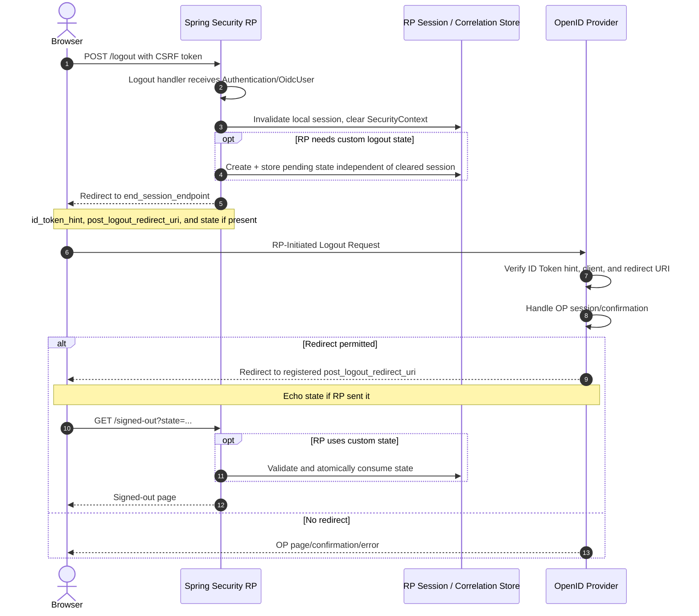

# 24.5. ID Token Hint, post_logout_redirect_uri, and Logout State

## 1. Three Key Parameters of RP-Initiated Logout

In **Spring Security OAuth 2.0/OIDC Client**, users typically log into an application through an **OpenID Provider (OP)**. After logging in, the browser may simultaneously hold two sessions:

- **Session at the Relying Party (RP):** the Spring application's session/`SecurityContext`.
- **SSO session at the OP:** a cookie or login state managed by the identity provider.

When a user clicks **Log Out**, deleting only the internal session does not mean the OP terminated its SSO session. The browser can continue using the SSO session to log right back in without entering a password. The **OpenID Connect RP-Initiated Logout 1.0** specification lets the RP ask the OP to log out by directing the browser to the **Logout Endpoint**.

Three especially important parameters:

| Parameter | Role | Spec Requirement |
| --- | --- | --- |
| `id_token_hint` | ID Token issued to the RP; hints which user/OP session to log out | **RECOMMENDED** |
| `post_logout_redirect_uri` | Registered URI for the browser to return to the RP after OP logout | **OPTIONAL**, but must be pre-registered |
| `state` | Opaque value created by the RP to correlate the logout request and callback | **OPTIONAL** |

Example structure:

```text
GET https://login.example.com/oidc/logout
  ?id_token_hint=FAKE_ID_TOKEN
  &post_logout_redirect_uri=https%3A%2F%2Fportal.example.com%2Fsigned-out
  &state=RANDOM_OPAQUE_LOGOUT_STATE
```

In real requests, parameters must be properly URL-encoded. The Logout Endpoint path must come from trusted OP metadata/documentation, **never guessed**.

**Key message:** `id_token_hint` helps the OP identify the session; `post_logout_redirect_uri` specifies the return location; `state` helps the RP recognize which logout attempt a callback belongs to. They have distinct responsibilities—**they do not replace CSRF tokens, access tokens, or session cookies**.

### 1.1. Learning Objectives

After this lesson, the reader should be able to:

1. Distinguish local logout, RP-Initiated Logout, token revocation, and OIDC Back-Channel Logout.
2. Explain where the ID Token hint comes from and what the OP validates.
3. Distinguish post-logout redirects from the login authorization code callback.
4. Design `state` with entropy, TTL, browser binding, and one-time consumption.
5. Recognize that the local session is usually already deleted before the callback arrives.
6. Configure Spring Security Servlet and WebFlux with the OIDC logout success handler.
7. Distinguish what the Spring Security handler does **by default** versus what requires customization.
8. Diagnose `end_session_endpoint`, URI registration, proxy, cookie, and login loop issues.
9. Write tests verifying exact HTTP contracts and security boundaries without logging raw ID Tokens.
10. Design safe UX when the OP does not redirect back to the RP.

### 1.2. Four Components Not to Confuse

| Component | Purpose |
| --- | --- |
| **OIDC ID Token** | Token issued by the OP to the RP conveying details about user authentication |
| **OAuth2 access token** | Credential sent to a Resource Server to call APIs |
| **OAuth2 refresh token** | Credential sent to the Token Endpoint to obtain a new access token |
| **RP session cookie** | Used by the browser to associate with the application's login session |

`id_token_hint` is an **ID Token**, not an access token and not a refresh token. Browser-based RP-Initiated Logout is **not** an OAuth2 refresh/revocation grant.

## 2. Full Logout Flow Diagram



Key points:

- **Local logout** may already complete **before** the browser reaches the OP.
- In Spring Security, `Authentication` is still passed to the logout success handler so the handler can extract the ID Token hint, even while the internal `SecurityContext`/session is cleaned up.
- If the OP does not redirect (tab closed, user did not confirm, wrong URI), local logout can still have completed.
- The callback to `/signed-out` is **not** a callback receiving an authorization code.
- `state`, if implemented, only proves request/callback correlation per your correlation design; it is **not proof** that all other applications have logged out.

## 3. `end_session_endpoint`: URL Receiving Logout Requests

An OP supporting RP-Initiated Logout and Discovery may publish:

```json
{
  "issuer": "https://login.example.com/realms/corporate",
  "authorization_endpoint": "https://login.example.com/realms/corporate/oauth2/authorize",
  "token_endpoint": "https://login.example.com/realms/corporate/oauth2/token",
  "end_session_endpoint": "https://login.example.com/realms/corporate/oidc/logout"
}
```

This is **example metadata**, not a fixed endpoint across all providers.

Distinguish:

- `authorization_endpoint`: sends authorization requests during login.
- `token_endpoint`: exchanges authorization codes, refresh tokens, and certain OAuth2 grants.
- `end_session_endpoint`: asks the OP to process RP-Initiated Logout.

In practice, providers may use different paths, support logout to varying degrees, or require proprietary parameters. If `end_session_endpoint` is absent, verify the OP's capabilities; never substitute the Token Endpoint.

Per the specification, an OP accepts logout requests via **HTTP GET or POST**, corresponding to query-string or form serialization. The standard Spring Security Servlet handler defaults to redirecting the browser via GET; some versions can be configured for POST via `FormPostRedirectStrategy` if the OP supports it.

## 4. `id_token_hint`: Meaning and Data Source

### 4.1. Obtaining the ID Token from `OidcUser`

In OIDC Login, the principal typically implements:

```java
org.springframework.security.oauth2.core.oidc.user.OidcUser
```

Usage example:

```java
if (authentication != null
        && authentication.getPrincipal() instanceof OidcUser oidcUser) {

    String idTokenHint =
        oidcUser.getIdToken().getTokenValue();

    // Only send hint to the matching OP's end_session_endpoint.
    // Do not log raw idTokenHint.
}
```

`OidcUser.getIdToken().getTokenValue()` is the proper source for RP-Initiated Logout when the user logged in via OIDC. The ID Token may contain `iss`, `sub`, `aud`, `exp`, and `sid` depending on the OP.

**Do not grab** `OAuth2AuthorizedClient.getAccessToken().getTokenValue()` to put into `id_token_hint`: an access token has a different purpose and audience.

### 4.2. What Does the OP Check When Receiving the Hint?

Under RP-Initiated Logout:

- The OP **must verify** that it is the issuer of the submitted ID Token.
- The OP may use `aud` and/or `sid` to identify the relevant client/session.
- If `client_id` is also present, the OP **must verify** that the client ID matches the ID Token.
- The OP is recommended to accept an ID Token belonging to the current or a recent session in appropriate cases **even if `exp` has passed**; this is not a license to use arbitrary expired tokens.
- If the ID Token hint does not belong to a current/recent OP session, the OP may treat the request as suspicious and reject it or prompt for confirmation.

`id_token_hint` is a **verifiable hint**, not a command the RP can use to force the OP to revoke unrelated tokens or sessions.

### 4.3. Scenarios With and Without the Hint

| Scenario | Behavior to Note |
| --- | --- |
| Valid ID Token, matching issuer/client | OP has grounds to link the request to a session |
| Expired ID Token, belonging to a recent session | OP may accept per spec recommendation |
| Forged token, wrong issuer/signature | OP must validate and reject as an invalid hint |
| ID Token intended for a different client | Never mix up client registrations |
| No ID Token hint | OP may prompt user confirmation or apply other rules |
| User already logged out at OP | RP logout request is idempotent; OP applies its policy |
| OP does not support RP-Initiated Logout | Need appropriate local logout/fallback |

If custom code destroys `Authentication` before generating the logout URL, the handler may lose the ID Token; this is a common cause of the OP lacking enough information to redirect back to the RP.

### 4.4. Is the ID Token Hint in a Query URL Sensitive?

Yes. ID Tokens usually contain identity claims. When the RP uses a GET HTTP redirect, the hint is sent in the **query string**:

```text
https://login.example.com/logout?id_token_hint=eyJ...&...
```

This value can be recorded in:

- Browser history, proxy/WAF logs, APM spans.
- HTTP access logs and error reports.
- Screenshots, copied URLs, or support tickets.
- Analytics and request-tracking tools.
- Certain referrer flows without proper policies.

Mitigations:

1. Use HTTPS with proper hostnames and certificates.
2. Redact `id_token_hint`, `state`, client credentials, and tokens from logs/traces.
3. Never paste full logout URLs or ID Tokens into chat/tickets.
4. Restrict third-party content on pages handling sensitive data and apply `Referrer-Policy`.
5. Consider POST form mode if the framework, OP, and operational policy permit it.
6. Never send the raw hint to Resource Server APIs.
7. Never store the hint in `localStorage` or frontend cookies solely to perform logout.

## 5. `post_logout_redirect_uri`: Post-Logout Callback

Suppose the RP wants the user returned to:

```text
https://portal.example.com/signed-out
```

The request RP sends to OP:

```text
post_logout_redirect_uri=https%3A%2F%2Fportal.example.com%2Fsigned-out
```

This is the **return URI after OP logout**, not the authorization code callback.

### 5.1. Must Be Pre-Registered at the OP

The spec requires this URI to belong to the set of **registered post-logout redirect URIs** for the RP at the OP. The OP must validate it; if it does not match, the OP **must not perform the post-logout redirect** per spec.

Examples:

| Registered URI | Requested URI | What to Check |
| --- | --- | --- |
| `https://portal.example.com/signed-out` | Exact same URI | May redirect if other conditions pass |
| `https://portal.example.com/signed-out` | `http://portal.example.com/signed-out` | Different scheme, mismatch |
| `https://portal.example.com/signed-out` | `https://portal.example.com/signed-out/` | Different trailing slash |
| `https://portal.example.com/signed-out` | `https://evil.example/collect` | Outside allowlist, rejected |
| `https://portal.example.com/signed-out` | `https://portal.example.com/signed-out?next=evil` | Different query, check exact registration |
| `https://portal.example.com/app/signed-out` | `https://portal.example.com/signed-out` | Different context path |

Registering logout redirect URIs is **separate** from registering Authorization Code redirect URIs.

### 5.2. Comparing Login Callback and Logout Callback

| Characteristic | Login `redirect_uri` | Logout `post_logout_redirect_uri` |
| --- | --- | --- |
| Purpose | Browser carries authorization code back to RP | Browser returns to RP after OP logout |
| Example value | `/login/oauth2/code/corporate` | `/signed-out` |
| Has authorization code? | Yes | No |
| Has OAuth2 login `state`? | Yes, in authorization response | No; may have separate **logout state** |
| Session at RP | Being created/maintained | Usually already deleted |
| Primary protection | Code/PKCE/state/nonce per flow | Registered URI and logout correlation if used |
| Does callback need authentication? | Handled by security login filter | Should be a public landing page |

Do not set the logout landing route to an authorization code callback, and do not make `/signed-out` automatically require login.

### 5.3. Redirect When `id_token_hint` Is Absent?

The spec recommends supplying the hint when requesting a post-logout redirect. If there is **no** ID Token hint, the OP **must not redirect** unless it has another way to validate the target.

`client_id` can help the OP identify the client registration. However, `client_id` is not a secret and **does not by itself prove** authorization to redirect. The OP may require user confirmation or apply another policy.

Never send `client_secret` via the browser Logout Endpoint; it is not an RP-Initiated Logout parameter.

## 6. What Is Logout `state` Used For?

`state` in RP-Initiated Logout is an **opaque**, optional value used to link:

```text
RP creates and stores pending logout:
    state = abc123random

RP -> OP Logout Endpoint:
    ...&state=abc123random

OP -> RP post_logout_redirect_uri:
    https://portal.example.com/signed-out?state=abc123random

RP:
    Verify expected state + browser binding + TTL
    Consume once, render landing page
```

If the RP sends `state`, the OP per spec must return that state in the callback redirect. However, **a matching state does not prove the OP logged out all SSO sessions**.

### 6.1. Logout State, Login State, and CSRF Token

| Component | Where Used? | Purpose |
| --- | --- | --- |
| OAuth2 **login `state`** | Authorization request and callback | Binds code response to authorization request |
| **Logout `state`** | RP-Initiated Logout request and post-logout redirect | Correlates a logout attempt with its return |
| **CSRF token** | RP POST logout/form/API | Protects against cross-site requests using session cookies |
| **Session ID** | Browser cookie sent to RP | Identifies stored session |
| **OIDC `nonce`** | OIDC authorization request/ID Token | Binds ID Token to authentication request |

Never reuse the same state for login and logout. Never use logout state in place of a CSRF token for `POST /logout`. Never use logout state to validate an OIDC ID Token.

### 6.2. What `state` Does Not Prove

A callback with a valid `state` **does not mean**:

- The OP terminated all of the user's SSO sessions.
- Other RPs logged out.
- Access/refresh tokens were revoked.
- A signed OP Logout Token was validated.
- The user should be logged back in.
- The caller has permission to act on another account.

In particular, logout state does not replace an **OIDC Back-Channel Logout Token**: Back-Channel Logout is a separate protocol with a signed token and specific `iss`, `aud`, `sid`/`sub` validation rules.

## 7. Designing Safe Logout State

If the product only needs a public `/signed-out` page, you **do not necessarily** have to build logout state yourself. If the app needs correlation to drive UX/auditing or non-sensitive steps, design it properly.

### 7.1. Criteria

- Random with sufficient entropy, unpredictable.
- Contains no user ID, email, client secret, raw token, or arbitrary return URL.
- Unique per logout flow, never reused.
- Short **TTL** with cleanup.
- **One-time atomic consume** to prevent replay.
- Bound to the initiating browser (when the threat model requires it).
- Bound to registration/issuer/expected callback URI.
- Does not recreate `SecurityContext` upon successful verification.
- Never grants access to an endpoint with side effects based on state.
- Avoid logging raw state unnecessarily.

### 7.2. Generating State with CSPRNG

```java
import java.security.SecureRandom;
import java.util.Base64;

public final class LogoutStateGenerator {

    private static final SecureRandom RANDOM = new SecureRandom();

    private LogoutStateGenerator() {
    }

    public static String newState() {
        byte[] random = new byte[32];
        RANDOM.nextBytes(random);

        return Base64.getUrlEncoder()
            .withoutPadding()
            .encodeToString(random);
    }
}
```

This produces an opaque handle with 256 bits of random data. Never generate state from email, a standalone timestamp, session ID, or a predictable counter.

### 7.3. Correlation Storage Record

An illustrative DTO, **not a Spring Security built-in API**:

```java
record PendingLogout(
    String stateHash,
    String browserBindingHash,
    String registrationId,
    String expectedIssuer,
    URI expectedReturnUri,
    Instant createdAt,
    Instant expiresAt
) {}
```

The store can be Redis/a database, or an in-memory store for single-instance environments. With multiple pods, a shared store is required if the callback can land on another instance.

When the callback arrives, state must be validated against the exact record, browser binding, TTL, and **atomically deleted**. If the callback repeats, only the first attempt may consume it successfully.

### 7.4. The Old Session Is Usually Already Destroyed!

A very common mistake:

```text
POST /logout
  -> Store expected logout state in HttpSession
  -> Logout handler invalidates HttpSession
  -> Redirect to OP

GET /signed-out?state=...
  -> Previous HttpSession is gone
  -> No expected state left to compare
```

A design using correlation needs storage independent of the logged-out session:

```text
1. Generate random logout state.
2. Save record in short-lived correlation store.
3. Bind browser to record via a dedicated correlation cookie.
4. Perform local logout and redirect to OP with state.
5. Callback GET /signed-out reads state + correlation cookie.
6. Validate binding/issuer/registration/expiry, consume once.
7. Delete correlation cookie and render public page.
```

The dedicated correlation cookie should have `Secure`, `HttpOnly`, narrow path/domain, short TTL, and suitable `SameSite` (e.g., `Lax` for top-level GET navigation). Never store raw ID Tokens in the correlation cookie.

### 7.5. Correlation Service Skeleton

```java
interface LogoutCorrelationService {

    PendingLogoutIssued issue(
        String registrationId,
        String expectedIssuer,
        URI expectedReturnUri,
        String browserBinding);

    boolean validateAndConsume(
        String returnedState,
        String browserBinding,
        URI actualCallbackUri);
}

record PendingLogoutIssued(
    String state,
    Instant expiresAt) {}
```

This is an **application-defined interface**. A production implementation needs:

- Secure random/hashed stored tokens per policy.
- Constant-time comparison where appropriate.
- TTL and atomic consumption.
- Browser binding, issuer/registration/return URI checks.
- Attempt rate limiting without leaking user details.
- Protection against malformed callbacks.

Do not simply check `state != null` and treat the callback as valid.

## 8. Spring Security Servlet: Built-in Handler

Spring Security Servlet provides:

```java
org.springframework.security.oauth2.client.oidc.web.logout
    .OidcClientInitiatedLogoutSuccessHandler
```

The handler is a `LogoutSuccessHandler` accepting `ClientRegistrationRepository` and creating a redirect to the OP Logout Endpoint when matching OIDC authentication/metadata is present.

### 8.1. Dependencies

Gradle example:

```gradle
dependencies {
    implementation 'org.springframework.boot:spring-boot-starter-web'
    implementation 'org.springframework.boot:spring-boot-starter-security'
    implementation 'org.springframework.boot:spring-boot-starter-oauth2-client'
}
```

### 8.2. OIDC Registration

```yaml
spring:
  security:
    oauth2:
      client:
        registration:
          corporate:
            provider: company
            client-id: ${CORPORATE_CLIENT_ID}
            client-secret: ${CORPORATE_CLIENT_SECRET}
            authorization-grant-type: authorization_code
            client-authentication-method: client_secret_basic
            redirect-uri: "{baseUrl}/login/oauth2/code/{registrationId}"
            scope:
              - openid
              - profile
              - email
        provider:
          company:
            issuer-uri: https://login.example.com/realms/corporate
```

`issuer-uri` allows reading provider metadata when discovery is supported, which may include `end_session_endpoint`. However, YAML **does not replace** registering `https://portal.example.com/signed-out` in the client's post-logout URI list at the OP.

### 8.3. SecurityFilterChain

```java
@Configuration
class SecurityConfiguration {

    @Bean
    SecurityFilterChain securityFilterChain(
            HttpSecurity http,
            ClientRegistrationRepository registrations)
            throws Exception {

        var oidcLogout =
            new OidcClientInitiatedLogoutSuccessHandler(
                registrations);

        oidcLogout.setPostLogoutRedirectUri(
            "{baseUrl}/signed-out");

        http
            .authorizeHttpRequests(auth -> auth
                .requestMatchers(
                    "/", "/signed-out", "/assets/**")
                    .permitAll()
                .anyRequest().authenticated())
            .oauth2Login(Customizer.withDefaults())
            .logout(logout ->
                logout.logoutSuccessHandler(oidcLogout));

        return http.build();
    }
}
```

`import` statements are omitted to focus on the configuration.

Key points to understand:

1. The handler is invoked in Spring Security's logout pipeline.
2. The handler can retrieve the ID Token hint from `OidcUser` in `Authentication`.
3. The OP endpoint is resolved via `ClientRegistration.getProviderDetails().getConfigurationMetadata()`.
4. `setPostLogoutRedirectUri(...)` only configures the **requested value sent to the OP**; it does not update OP configuration.
5. `/signed-out` must have an actual route/view and be `permitAll`.
6. Local `SecurityContext`/session cleanup is performed by the logout infrastructure per configuration.
7. If metadata/Authentication is ineligible, the handler falls back to the local logout target per implementation; never assume the OP logged out.

### 8.4. Landing Page Without Authentication

Spring MVC example:

```java
@Controller
class SignedOutController {

    @GetMapping("/signed-out")
    String signedOut() {
        return "signed-out";
    }
}
```

`"signed-out"` is a view name defined by the application. The page should not automatically call protected APIs or require authentication, as the browser could be **pushed straight back into OIDC Login right after logout**.

### 8.5. POST `/logout` and CSRF

For applications using browser session cookies, trigger Spring Security logout via **POST with a CSRF token**:

```html
<form method="post" action="/logout">
  <input type="hidden" name="_csrf" value="SERVER_RENDERED_CSRF_TOKEN">
  <button type="submit">Log out</button>
</form>
```

`SERVER_RENDERED_CSRF_TOKEN` is only a placeholder; the template must render the real CSRF token.

**Never disable CSRF globally or allow arbitrary GET logout** just to trigger OIDC logout. POST to the RP and GET/POST to the OP are two independent requests.

## 9. Spring Security WebFlux: Reactive Handler

WebFlux uses:

```java
org.springframework.security.oauth2.client.oidc.web.server.logout
    .OidcClientInitiatedServerLogoutSuccessHandler
```

and `ReactiveClientRegistrationRepository`.

### 9.1. Configuration

```java
@Configuration
@EnableWebFluxSecurity
class ReactiveSecurityConfiguration {

    @Bean
    SecurityWebFilterChain securityWebFilterChain(
            ServerHttpSecurity http,
            ReactiveClientRegistrationRepository registrations) {

        var oidcLogout =
            new OidcClientInitiatedServerLogoutSuccessHandler(
                registrations);

        oidcLogout.setPostLogoutRedirectUri(
            "{baseUrl}/signed-out");

        return http
            .authorizeExchange(exchanges -> exchanges
                .pathMatchers(
                    "/", "/signed-out", "/assets/**")
                    .permitAll()
                .anyExchange().authenticated())
            .oauth2Login(Customizer.withDefaults())
            .logout(logout ->
                logout.logoutSuccessHandler(oidcLogout))
            .build();
    }
}
```

The example uses `SecurityWebFilterChain`; do not confuse it with Servlet `SecurityFilterChain`.

| Servlet | WebFlux |
| --- | --- |
| `HttpSecurity` | `ServerHttpSecurity` |
| `ClientRegistrationRepository` | `ReactiveClientRegistrationRepository` |
| `OidcClientInitiatedLogoutSuccessHandler` | `OidcClientInitiatedServerLogoutSuccessHandler` |
| `LogoutSuccessHandler` | `ServerLogoutSuccessHandler` |
| `HttpSession` | `WebSession` |
| `SecurityContextHolder` | `ReactiveSecurityContextHolder` |

When writing a custom handler, **never `.block()`** on the Reactor event loop. Use `Mono<Void>`, `flatMap`, and appropriate reactive storage.

### 9.2. URI Templates

The handler supports variables such as:

```text
{baseUrl}
{baseScheme}
{baseHost}
{basePort}
{basePath}
```

Example:

```java
oidcLogout.setPostLogoutRedirectUri("{baseUrl}/signed-out");
```

With public URL `https://portal.example.com`, the expected URI is:

```text
https://portal.example.com/signed-out
```

If the app runs behind an ingress, trusted forwarded headers are required so `{baseUrl}` expands accurately.

## 10. Does Spring Security Auto-Generate and Verify Logout `state`?

**Do not assume it does.**

The RP-Initiated Logout spec **allows** the `state` parameter, but the standard `OidcClientInitiatedLogoutSuccessHandler` / `OidcClientInitiatedServerLogoutSuccessHandler` focus on building the redirect from **`id_token_hint`** and **`post_logout_redirect_uri`**. In the widely published Servlet implementation, the URL is built with those two parameters; there is no public option like `setLogoutState(...)` that enables full state correlation out of the box.

Therefore:

- **Public signed-out page:** the built-in handler is usually sufficient.
- **Correlation required:** build a custom logout success handler/redirect builder and callback validator, or use an official extension point if your specific version supports it.
- Simply appending `&state=random` to the redirect URL **without storing the expected value** provides no protection.
- Reading query `state` and accepting any value is wrong.
- Verify the API/behavior of your exact Spring Security version when customizing.

### 10.1. Designing a Custom Handler by Responsibility

```text
Custom logout success handler
    |
    +-- Authentication passed in by Spring Security
    +-- Identify client registration of OIDC login
    +-- Retrieve ID Token hint and trusted OP logout endpoint
    +-- Pick post_logout_redirect_uri from fixed allowlist
    +-- Generate, store logout state and browser binding (if needed)
    +-- Build URI with encoded query parameters
    +-- Redirect browser to the right OP
```

Public callback:

```text
GET /signed-out?state=...
    |
    +-- Load pending state from store independent of cleared session
    +-- Verify browser binding, TTL, registration, URI
    +-- Atomic consume
    +-- Delete correlation cookie
    +-- Render appropriate status, without restoring login
```

**Never take the OP URL, return URI, issuer, or client ID from untrusted user input**. Never build queries containing tokens via string concatenation. Use a URI builder and host/scheme validation.

### 10.2. `state` Does Not Prove the OP Logged Out

An attacker knowing/capturing state or a browser reaching a valid callback does not equate to a signed confirmation from the OP. If the business requires synchronous proof/termination of the SSO session, look into OP session APIs or **OIDC Back-Channel Logout**—do not turn a query parameter into proof.

## 11. `client_id` and `logout_hint`

Two other parameters may also appear:

### 11.1. `client_id`

`client_id` is the OAuth2 client identifier, useful if:

- The RP lacks `id_token_hint` yet still wants to use `post_logout_redirect_uri`.
- The OP needs to identify the client when the ID Token is encrypted in a certain way.

If **both `client_id` and `id_token_hint`** appear, the OP must verify they belong to the same client. Client ID is **not a secret** and cannot authenticate a request on its own.

### 11.2. `logout_hint`

`logout_hint` is an OP-specific hint about the user, such as an email, username, session identifier, or provider-specific value. Do not send PII or OP session IDs unnecessarily. Do not assume every OP interprets `logout_hint` the same way.

These two parameters **do not replace** `post_logout_redirect_uri` registration and OP security policies.

## 12. Reverse Proxy and Accuracy of the Post-Logout URI

Typical deployment:

```text
Browser:
    https://portal.example.com

Ingress:
    https://portal.example.com -> http://app-internal:8080

Spring app:
    http://app-internal:8080
```

If `{baseUrl}` is derived from the internal request without accurate forwarded headers, the RP may send:

```text
http://app-internal:8080/signed-out
```

while the OP only has registered:

```text
https://portal.example.com/signed-out
```

As a result, the provider rejects the redirect or the browser cannot reach the internal host.

You can use the appropriate Spring Boot setting:

```yaml
server:
  forward-headers-strategy: framework
```

However, **only trust `Forwarded`/`X-Forwarded-*` headers supplied by a trusted proxy**. The ingress must strip/overwrite headers from direct clients to prevent host/scheme spoofing or open redirects.

Check:

- Scheme `https` vs `http`.
- Public vs internal hostname.
- Whether a port is included.
- Context path.
- Trailing slash.
- Query parameters.
- Does the final URI match the exact registration at the OP?
- Cookie path/domain/SameSite if using a logout correlation cookie.

In multi-tenant deployments with multiple external hosts, bind allowed redirect URIs to verified client registrations/tenants rather than relying on untrusted `Host` headers.

## 13. Logout and Cookie/Browser State

A browser may hold:

| Cookie | Owner | Purpose |
| --- | --- | --- |
| `JSESSIONID` or RP `SESSION` | RP application | Holds local authenticated session |
| OP SSO cookie | OP domain | Holds SSO session |
| Custom logout correlation cookie | RP application | Binds callback to logout-initiating browser |
| CSRF cookie (if used) | RP application | Prevents forged requests |

Local logout **cannot directly delete cookies belonging to the OP's domain**. The browser is redirected to the OP so the OP handles its own session.

If custom state uses a cookie for a top-level GET callback:

- `SameSite=Lax` is usually suitable.
- `SameSite=Strict` may stop the cookie from traveling with cross-site navigation.
- `SameSite=None` requires `Secure` and expands cross-site exposure.
- `HttpOnly` should be enabled for correlation cookies that JavaScript does not need to read.
- Short TTL; delete after callback/expiry.
- Never store ID Tokens/access tokens in the correlation cookie.

Do not store state solely inside `HttpSession`, invalidate that exact session, and expect the callback to read the old value.

## 14. Local Logout, OP Logout, and Token Revocation Are Distinct Lifecycles

| Mechanism | Purpose | Does Not Automatically Guarantee |
| --- | --- | --- |
| **Spring Security local logout** | Clears SecurityContext, invalidates session, cleans cookies per policy | OP session has ended |
| **RP-Initiated Logout** | RP asks OP to log out via browser | Access/refresh tokens are all revoked |
| **OAuth2 token revocation (RFC 7009)** | Asks AS to revoke a specific token | Browser sessions at RP/OP end automatically |
| **Remove authorized client** | Deletes access/refresh token from local store | Token was revoked at AS |
| **OIDC Front-Channel Logout** | OP notifies RPs of logout via browser | Browser reliably loads every RP |
| **OIDC Back-Channel Logout** | OP sends Logout Token server-to-server to RP | Automatic revocation of all API tokens without policy |

A system requiring **complete logout** must determine:

1. Which RP sessions must be invalidated?
2. Which OP sessions must end?
3. Must the user's authorized-client records be deleted?
4. Must access/refresh tokens be revoked?
5. Do other RPs support Front-/Back-Channel Logout?
6. How long does the Resource Server accept previously issued tokens?
7. Is there multi-tab/multi-device behavior to communicate to users?

A `302` after logout **is not proof** that all of these steps finished.

## 15. When the OP Does Not Redirect Back to the RP

Several reasons:

- RP did not send `post_logout_redirect_uri`.
- URI is unregistered or not an exact match.
- No ID Token hint and OP lacks a basis to verify the redirect target.
- OP asks the user to confirm logout.
- Browser/tab closed before OP finished.
- OP encountered a policy/metadata/session error.
- Proxy/network/cookie issue broke navigation.
- OP does not support RP-Initiated Logout.

**Local logout should complete independently of the callback.** Never wait for the browser to return before clearing `SecurityContext`; if the callback never arrives, the RP session must not stay alive just because the UX initiated logout.

The signed-out page should be public, contain no sensitive data, and not depend on the just-deleted user session.

## 16. Multi-Provider / Multi-Registration

An application supporting multiple OIDC providers:

```yaml
spring:
  security:
    oauth2:
      client:
        registration:
          corporate:
            provider: corporate-idp
            client-id: ${CORPORATE_ID}
            client-secret: ${CORPORATE_SECRET}
            authorization-grant-type: authorization_code
            scope: openid, profile

          partner:
            provider: partner-idp
            client-id: ${PARTNER_ID}
            client-secret: ${PARTNER_SECRET}
            authorization-grant-type: authorization_code
            scope: openid, profile

        provider:
          corporate-idp:
            issuer-uri: https://login.corp.example/realms/staff
          partner-idp:
            issuer-uri: https://login.partner.example/realms/partner
```

Each registration has:

- Different issuer and ID Token.
- Different `end_session_endpoint`.
- Different list of post-logout redirect URIs.
- Different ID Token hint/confirmation rules.

**Never send Partner OP's ID Token to Corporate OP**; it can leak the token and will certainly fail issuer validation. Handlers/custom code must determine the registration from the active OIDC authentication, look up the **matching OP's** metadata, and bind the logout URL/return URI to that client.

If implementing custom logout state, store `registrationId` and `issuer` in the pending record so callbacks never mix flows.

## 17. Test Matrix

| ID | Test Case | What to Verify |
| --- | --- | --- |
| T01 | OIDC user, metadata has end-session endpoint | Redirects to the exact OP Logout Endpoint |
| T02 | OIDC ID Token present | Logout request carries `id_token_hint` |
| T03 | Hint from another issuer | OP rejects mismatched trust |
| T04 | `client_id` mismatches ID Token | OP rejects |
| T05 | Registered URI | OP can redirect |
| T06 | Unregistered URI | OP does not redirect |
| T07 | Wrong scheme/path/trailing slash on URI | Not automatically accepted |
| T08 | No ID Token hint, yet URI present | OP requires target verification mechanism |
| T09 | Logout state present | OP echoes matching state |
| T10 | Valid callback state | RP consumes once |
| T11 | Tampered callback state | Not treated as correlated success |
| T12 | Callback missing state | Does not trigger privileged action |
| T13 | Expired callback state | Reject correlation |
| T14 | Replayed same state | Only first attempt consumes successfully |
| T15 | Callback from another browser | Browser binding mismatch |
| T16 | RP session already invalidated | Pending state still verifiable independently |
| T17 | OP does not redirect | Local session is still logged out |
| T18 | Signed-out route public | Does not redirect back to login |
| T19 | HTTPS reverse proxy | Callback URL has right public host/scheme |
| T20 | User logged in via Partner OP | Hint never sent to Corporate OP |
| T21 | App has no OIDC Authentication | Proper local logout/fallback |
| T22 | POST logout missing CSRF | Blocked per security policy |
| T23 | POST logout with valid CSRF | Local cleanup and OIDC redirect |
| T24 | Multiple pods receive callback | Shared state store/affinity works |
| T25 | Inspect logs | No ID Token hint, state, or cookie leaked |
| T26 | OP confirmation incomplete | Do not treat redirect as signed proof |
| T27 | Access token unexpired after logout | Do not assume automatic revocation |

### 17.1. MockMvc for Spring Servlet

You can use `spring-security-test` with `oidcLogin()` and CSRF mock post-processors to build requests:

```java
mockMvc.perform(
        post("/logout")
            .with(csrf())
            .with(oidcLogin()))
    .andExpect(status().is3xxRedirection())
    .andExpect(header().string(
        HttpHeaders.LOCATION,
        startsWith("https://login.example.com/oidc/logout")));
```

This is a **skeleton**: the test needs a `ClientRegistrationRepository` fixture with the OIDC login's `registrationId` and a test `end_session_endpoint`. Then parse the `Location` URI and assert:

- Right OP host/path.
- `id_token_hint` from a **fake OIDC ID Token**.
- `post_logout_redirect_uri` matches the expected registered URI.
- Session was invalidated per policy.
- Do not assert `state` unless a custom correlation implementation is present.
- Logs contain no raw fake tokens/cookies during the test.

Do not try to test actual browser OP sessions with MockMvc; cover that with integration tests against an OP sandbox.

### 17.2. WebFlux Tests

For Reactive, use `WebTestClient` with Spring Security test config/`mockOidcLogin` matching your version:

```text
POST /logout + valid CSRF
    -> Response 3xx
    -> Location = trusted end_session_endpoint
    -> valid id_token_hint + post_logout_redirect_uri
    -> WebSession/SecurityContext cleaned up
```

Do not use mock `HttpServletRequest` in WebFlux; reactive controllers/handlers return `Mono` and never `.block()` on the event loop.

### 17.3. Testing Against an OP Sandbox

Mock app tests only prove **the RP builds the right request**. Against a provider test instance, verify:

- Valid `id_token_hint` / wrong issuer / wrong client.
- URIs inside vs outside the post-logout allowlist.
- Missing hint with `client_id`/redirect.
- `state` echoed when OP redirects.
- OP user confirmation and session behavior.
- No redirect when validation fails.
- Never log real tokens or test on production users.

## 18. Troubleshooting

| Symptom | Possible Cause | What to Check |
| --- | --- | --- |
| Logout only goes to `/login?logout` | OIDC handler not wired, missing metadata/Authentication | `SecurityFilterChain` and `LogoutSuccessHandler` |
| Missing `id_token_hint` | Principal is not `OidcUser`, lost Authentication | OIDC login scopes and logout ordering |
| Missing `end_session_endpoint` | OP does not support/publish metadata | Discovery response |
| OP reports invalid redirect URI | Unregistered URI or scheme/path mismatch | Exact post-logout URI and `{baseUrl}` |
| OP does not redirect despite valid URI | Missing hint/client confirmation or OP policy | Provider logs/docs |
| Browser immediately returns to login page | `/signed-out` still requires auth | `permitAll("/signed-out")` |
| Logout succeeds, re-login is instant | OP SSO session has not ended | Distinguish RP logout from OP logout |
| Callback state mismatch | Lost store, wrong binding, expired TTL | Correlation store/cookie |
| Callback fails on another pod | Pending state/session in first pod's RAM | Shared store/affinity |
| State always missing | Built-in handler does not auto-generate state | Check custom implementation |
| Hint sent to wrong provider in multi-tenant | Registration/issuer mix-up | OIDC Authentication registration ID |
| `http://internal-host` in redirect | Wrong reverse proxy headers | External base URL/forwarded headers |
| URI too long / blocked by WAF | ID Token in GET query | POST mode if OP/framework supports |
| POST `/logout` returns 403 | Missing/invalid CSRF token | CSRF repo/header/form |
| API token still works after OP logout | Logout does not auto-revoke tokens | Token revocation/Resource Server policy |
| Browser lacks correlation cookie | SameSite/Secure/Path/browser policy | DevTools cookies and `Set-Cookie` |
| One tab still displays stale data | UI cached, tab not reloaded | API auth responses/cache headers |
| Signed-out state valid yet session remains | Missing local logout handler or custom bypass | Local session invalidation |

### 18.1. Diagnosing Safely with Logs

Observable fields to record:

```text
logoutFlow=RP_INITIATED
registrationId=corporate
issuerHost=login.example.com
idTokenHintPresent=true
postLogoutRedirectUriId=signed-out
logoutStateCreated=true
localSessionInvalidated=true
redirectOutcome=sent
```

If there is a callback:

```text
callbackPath=/signed-out
statePresent=true
stateValidation=accepted
correlationConsumed=true
```

**Never log**:

```text
id_token_hint=<raw-token>
Authorization: Bearer <token>
state=<raw-random-value>
Cookie: JSESSIONID=<session-id>
client_secret=<secret>
```

Use an internal correlation ID or outcome label instead of verbatim tokens/queries.

## 19. Real-World Scenarios

### Scenario A — Local Logout While SSO Persists

A user clicks Logout and Spring Security invalidates the session. Next, the user clicks Login and the OP logs them right back in.

**Explanation:** RP logout does not equal OP logout. RP-Initiated Logout is needed to request terminating SSO, and OP policy remains decisive.

### Scenario B — Wrong Logout Redirect URI Behind Ingress

The OP only registered `https://portal.example.com/signed-out`, while the handler sends `http://service:8080/signed-out`.

**Solution:** Configure trusted public base URL/forwarded headers; never disable OP exact redirect validation.

### Scenario C — Cannot Read State After Logout

The app stored the expected state inside the session it just invalidated, so the callback cannot find it.

**Solution:** Use a transient state store independent of the login session and a short-lived browser-bound cookie.

### Scenario D — OP Rejects Post-Logout Redirect Without Hint

The user has no `OidcUser` because plain OAuth2 Login was used, yet custom code still sends `post_logout_redirect_uri`.

**Solution:** Verify which logout mechanism the OP supports. Never turn an access token into an ID Token; if the OP allows `client_id`/confirmation, follow that exact contract.

### Scenario E — State Replayed

A state value remains in browser history and the callback hits twice.

**Solution:** Atomic one-time consumption; the second callback simply shows the public page with no side effects.

### Scenario F — OP Logged Out, Yet Resource Server Still Accepts Access Token

**Explanation:** RP-Initiated Logout does not guarantee token revocation. Add revocation, short expiry, and API token validation when policy requires.

### Scenario G — Two OIDC Providers

A user logs in via Partner, yet a custom logout handler always redirects to Corporate OP.

**Solution:** Pick the right registration from OIDC Authentication, matching issuer/ID Token and trusted end-session endpoint.

### Scenario H — `/signed-out` Requires Auth

The browser returns to the RP after logout and is immediately redirected back into the OP authorization flow.

**Solution:** `permitAll` on the landing page and avoid auto-starting login on that page.

### Scenario I — Browser Tab Closed at OP

Local logout already completed; the callback never arrives.

**Solution:** Pending correlation TTL cleans up; UX does not treat this as a local logout failure.

### Scenario J — App Wants Arbitrary Post-Logout Destination

A user passes `returnTo=https://evil.example` and the app uses it directly as the post-logout URI.

**Solution:** Use a fixed registered post-logout URI; if optional internal targets are needed, map through an allowlist **after** callback handling, never trusting raw external URLs.

## 20. Review Questions

**1. What is `id_token_hint` used for?**  
Hints the OP about the user/OIDC session associated with the RP that received the ID Token.

**2. Is `id_token_hint` an access token?**  
No. It is the ID Token issued by the OP to the RP.

**3. Is `id_token_hint` mandatory?**  
It is **RECOMMENDED**, not MUST, in the general specification.

**4. Why should the ID Token hint not be sent to business APIs?**  
Resource Server APIs expect access tokens scoped to their audience, not ID Tokens intended for the RP.

**5. What is `post_logout_redirect_uri`?**  
The URI to which the OP redirects the browser after logout if validation checks pass.

**6. Must this URI be pre-registered with the OP?**  
Yes; the OP must verify it belongs to the registered list.

**7. Should logout and login redirect URIs share the same endpoint?**  
No. The login callback processes authorization codes, whereas the logout landing page only displays post-logout status.

**8. Is `state` mandatory in RP-Initiated Logout?**  
No, it is an optional correlation parameter.

**9. If the RP sends state, what does the OP do on redirect?**  
The OP returns that same state to the RP in the post-logout redirect.

**10. Does a matching state prove the OP revoked refresh tokens?**  
No; state is a correlation handle, not a signed proof or revocation.

**11. Why not store expected logout state solely in HttpSession?**  
Local logout usually invalidates the session before the callback returns.

**12. How should logout state be generated?**  
With a CSPRNG having sufficient entropy, plus TTL and one-time consumption.

**13. Should state contain email, tokens, or redirect targets?**  
No. Use an opaque handle pointing to a server-side record.

**14. Which Servlet handler supports RP-Initiated Logout?**  
`OidcClientInitiatedLogoutSuccessHandler`.

**15. What is the WebFlux equivalent?**  
`OidcClientInitiatedServerLogoutSuccessHandler`.

**16. Does the built-in handler automatically perform state correlation?**  
No. Check your version; if state is required, explicitly configure/customize both outbound and inbound handling.

**17. Why is `setPostLogoutRedirectUri(...)` alone insufficient?**  
Because the OP must also have that URI in the client registration and accept validation.

**18. When can `{baseUrl}` be wrong?**  
When a reverse proxy/TLS termination or forwarded headers cause the app to see an internal scheme/host.

**19. When is `client_id` useful?**  
When the OP needs to identify the client, especially if `id_token_hint` is absent while a post-logout redirect is requested.

**20. Does `client_id` replace client secret?**  
No; client ID is neither a secret nor a credential.

**21. Should GET `/logout` be used for browser apps?**  
Not as a habit; prefer POST combined with CSRF protection.

**22. Why should the signed-out page be public?**  
Because the RP session has logged out and the browser no longer holds authentication.

**23. Does RP-Initiated Logout always delete the OP SSO session?**  
Not guaranteed in every case; it depends on OP confirmation and policy.

**24. Does local logout automatically revoke all access tokens?**  
No.

**25. If the OP does not redirect back to the RP, can local logout still be complete?**  
Yes.

**26. Why test exact URIs?**  
To prevent open redirects and satisfy OP validation.

**27. With multiple providers, how is the ID Token hint chosen?**  
From the verified client registration/issuer of the OIDC Authentication logging out.

**28. What data must logs redact?**  
ID Token hints, state, session cookies, access/refresh tokens, and client secrets.

## 21. References

- [OpenID Connect RP-Initiated Logout 1.0 — Final](https://openid.net/specs/openid-connect-rpinitiated-1_0-final.html)
- [OpenID Connect Core 1.0](https://openid.net/specs/openid-connect-core-1_0.html)
- [OpenID Connect Discovery 1.0](https://openid.net/specs/openid-connect-discovery-1_0.html)
- [OpenID Connect Front-Channel Logout 1.0](https://openid.net/specs/openid-connect-frontchannel-1_0.html)
- [OpenID Connect Back-Channel Logout 1.0](https://openid.net/specs/openid-connect-backchannel-1_0.html)
- [RFC 7009 — OAuth 2.0 Token Revocation](https://www.rfc-editor.org/rfc/rfc7009)
- [RFC 9700 — OAuth 2.0 Security Best Current Practice](https://www.rfc-editor.org/rfc/rfc9700)
- [Spring Security Reference — OIDC Logout (Servlet)](https://docs.spring.io/spring-security/reference/servlet/oauth2/login/logout.html)
- [Spring Security Reference — OIDC Logout (Reactive)](https://docs.spring.io/spring-security/reference/reactive/oauth2/login/logout.html)
- [Spring Security API — OidcClientInitiatedLogoutSuccessHandler](https://docs.spring.io/spring-security/site/docs/current/api/org/springframework/security/oauth2/client/oidc/web/logout/OidcClientInitiatedLogoutSuccessHandler.html)
- [Spring Security API — OidcClientInitiatedServerLogoutSuccessHandler](https://docs.spring.io/spring-security/site/docs/current/api/org/springframework/security/oauth2/client/oidc/web/server/logout/OidcClientInitiatedServerLogoutSuccessHandler.html)
- [Spring Security API — OidcUser](https://docs.spring.io/spring-security/site/docs/current/api/org/springframework/security/oauth2/core/oidc/user/OidcUser.html)
- [Spring Security Reference — CSRF (Servlet)](https://docs.spring.io/spring-security/reference/servlet/exploits/csrf.html)
- [Spring Security Reference — CSRF (Reactive)](https://docs.spring.io/spring-security/reference/reactive/exploits/csrf.html)

**Remember:** In OIDC RP-Initiated Logout, `id_token_hint` helps the OP identify the relevant session, `post_logout_redirect_uri` is the **registered return point**, and `state` is an **optional opaque value** for callback correlation. Spring Security provides OIDC logout success handlers for Servlet and WebFlux, but do not assume state is automatically generated or verified. If state correlation is needed, protect it with a TTL, one-time consumption, browser binding, and a store independent of the invalidated session. Never confuse local logout, OP logout, token revocation, and Back-Channel Logout; and always protect ID Token hints, exact redirect URIs, HTTPS/proxy handling, and CSRF on `POST /logout`.
