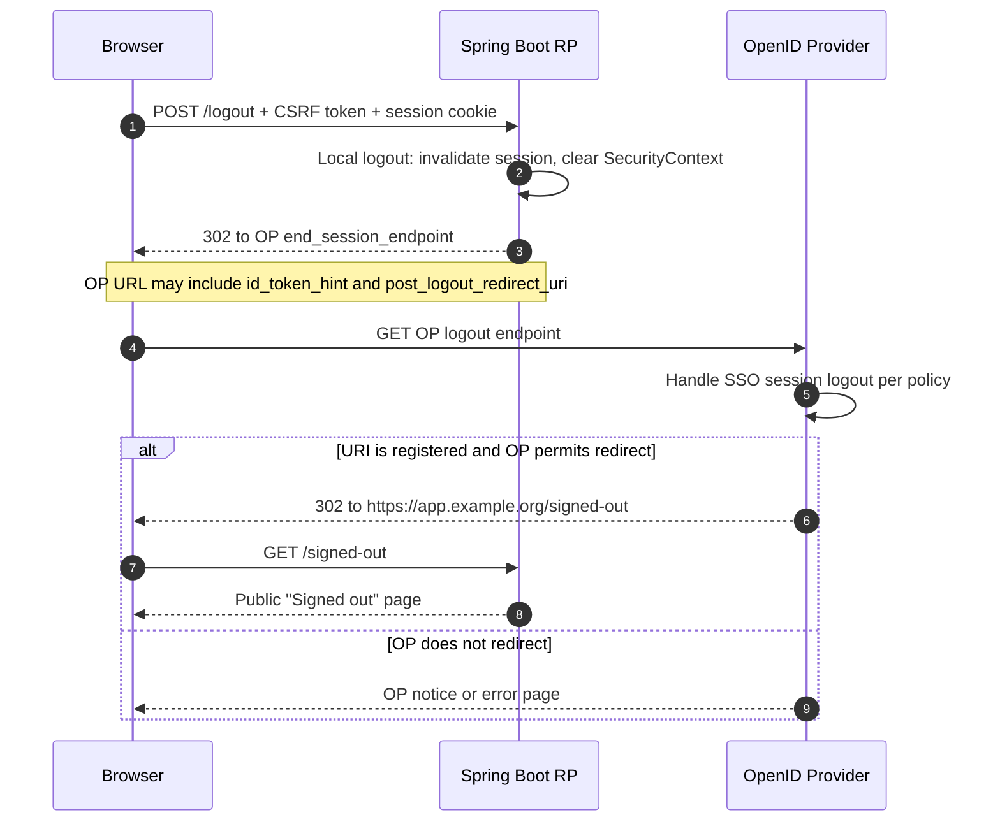
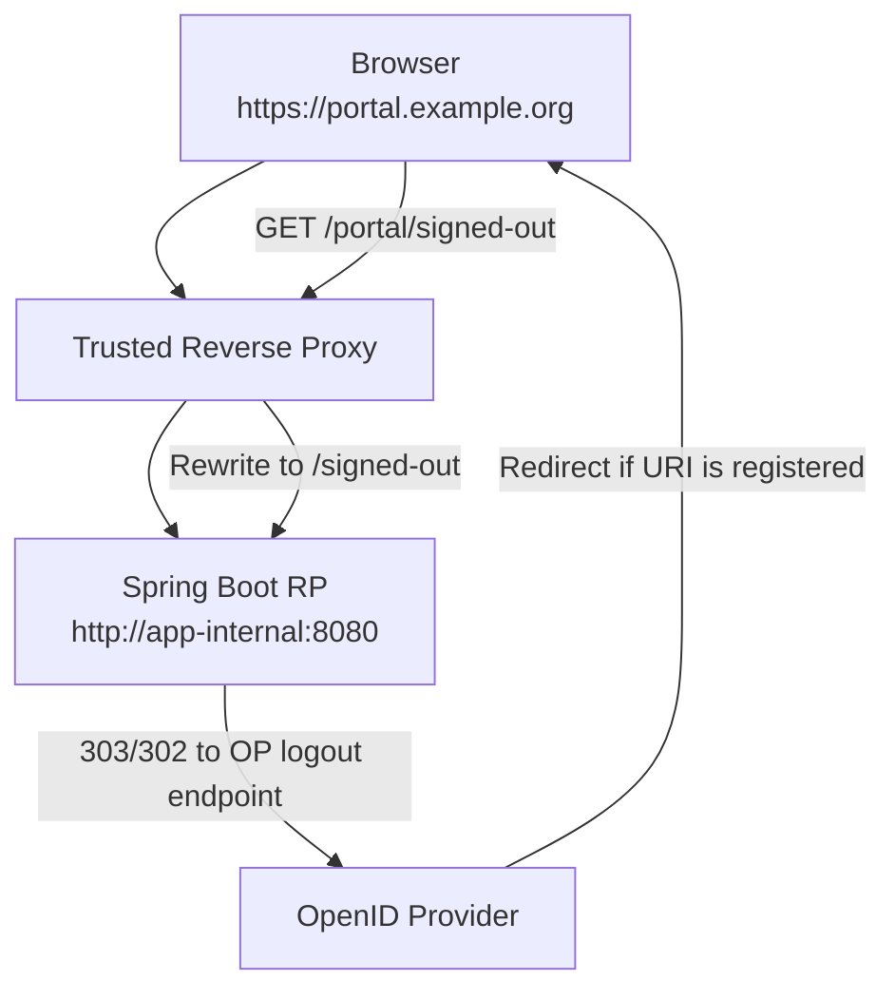
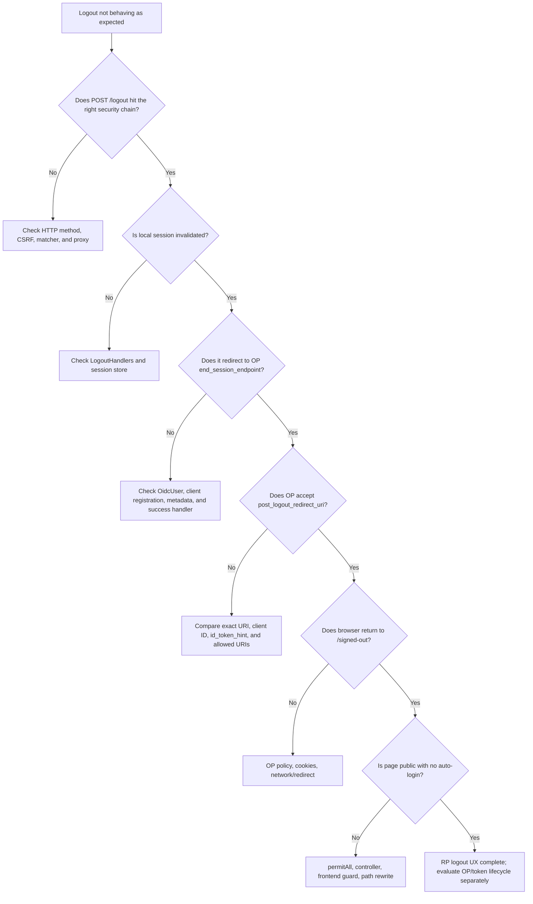

# 24.6. Registering and Controlling the Post-Logout Redirect URI

In **Spring Security OAuth 2.0 / OpenID Connect (OIDC) Client**, logout is a process that can involve **two independent sessions**:

- **Session at the application** (*Relying Party — RP*): for example, a Spring Boot session storing the user's `SecurityContext` in `HttpSession` or `WebSession`.
- **Login session at the OpenID Provider (OP)**: for example, the Single Sign-On (SSO) session that the OP uses to recognize the browser on subsequent logins.

When a user clicks **Log Out**, the application can clear the local session. Yet to complete the SSO experience, the RP often also wants to **send the browser to the OP to end the OP session**, and then return to a public page of the application, such as:

```text
https://app.example.org/signed-out
```

This return URL is called the **Post-Logout Redirect URI** and is passed via the OIDC **`post_logout_redirect_uri`** parameter in *RP-Initiated Logout* when supported by the OP.

This is not a free-form URL that the browser may specify arbitrarily. The OP must know which URIs are registered for the client; the application must construct the URI from trusted configuration; the proxy must expose the exact public scheme/host; and the landing page **must not treat the redirect as proof that the user was logged out of every system**.

This lesson covers how to **register, configure, validate, and control the Post-Logout Redirect URI** in Spring Security OIDC Client, including Spring Boot Servlet and WebFlux examples, flow diagrams, multiple environments/tenants, reverse proxies, open-redirect controls, session/token lifecycles, error handling, and production diagnostics.

> **Core principle:** `post_logout_redirect_uri` is solely the **navigation target after the OP processes logout**. It is **not** the login callback, does not replace local session deletion, and is not a mechanism that automatically revokes Access Tokens/Refresh Tokens.

## 1. Context: One Logout Button, Multiple States to Handle

Suppose there are four components:

| Component | Role |
|---|---|
| **Browser** | Holds the application's session cookie and the OP's SSO cookie per browser policy. |
| **Spring Boot `orders-web`** | OIDC Client / Relying Party, managing local authentication and sessions. |
| **`company-idp`** | OpenID Provider, issuing ID Tokens and managing SSO sessions. |
| **`orders-api`** | Resource Server accepting OAuth2 Access Tokens for business APIs. |

If the user only deletes `orders-web`'s `HttpSession` while the OP SSO cookie remains valid, clicking Log In again lets the OP authenticate immediately without asking for a password. This may match system expectations, or if the UX expects **SSO logout too**, an appropriate OP logout flow must be added.

A common flow:



Specific OP behavior may vary: the OP may show a confirmation screen, terminate the session per policy, or reject redirecting if parameters are invalid. **The RP must not assume the OP will definitely redirect** simply because `post_logout_redirect_uri` was supplied.

### 1.1. Non-Equivalent States

| Action | Primary Result | What Must Not Be Inferred |
|---|---|---|
| Clear `SecurityContext`/invalidate local session | Browser no longer has valid local authentication for that session. | OP SSO session was destroyed. |
| Send browser to OP end-session endpoint | Asks OP to process logout. | OP terminated all sessions across all devices. |
| OP sends browser to `post_logout_redirect_uri` | Browser returns to an allowed URL. | Access Token or Refresh Token was revoked. |
| Remove `OAuth2AuthorizedClient` | App no longer holds token record in that local store. | Token was invalidated at Resource Server. |
| Call token revocation endpoint | Asks Authorization Server to revoke token per capability/provider policy. | All other app sessions were destroyed. |

Therefore, **logout + redirect + token revocation** are related yet distinct responsibilities.

## 2. Distinguishing Three Easily Confused URIs

In an OIDC application, at least three URIs commonly appear:

| URI | Receiving Party | Purpose |
|---|---|---|
| **Authorization redirect URI / `redirect_uri`** | **RP application** | OP returns browser during **login** with `code`/`state`. |
| **OP end-session endpoint / `end_session_endpoint`** | **OpenID Provider** | RP sends browser here to **request OP logout**. |
| **Post-Logout Redirect URI / `post_logout_redirect_uri`** | **RP application** | OP returns browser **after the logout step** if URI is accepted. |

Clear example:

```text
1) Login:
   RP -> OP authorization_endpoint
   OP -> https://app.example.org/login/oauth2/code/company

2) Logout:
   RP -> https://id.example.org/realms/company/protocol/openid-connect/logout
   OP -> https://app.example.org/signed-out
```

**`/login/oauth2/code/company`** is the callback receiving the authorization code, typically handled by Spring Security's OAuth2 Login Filter.

**`/signed-out`** is an ordinary post-logout page. It **does not need** to receive an authorization code, must not be used as an OAuth2 login callback, and must be accessible when the browser no longer has authentication.

### 2.1. `redirect_uri` and `post_logout_redirect_uri` Use Different Registration Fields

In Spring Boot config:

```yaml
spring:
  security:
    oauth2:
      client:
        registration:
          company:
            redirect-uri: "{baseUrl}/login/oauth2/code/{registrationId}"
```

`redirect-uri` is the property for the **Authorization Code login callback**.

In Spring Security, the Post-Logout Redirect URI is typically configured on the **OIDC logout success handler**:

```java
logoutSuccessHandler.setPostLogoutRedirectUri("{baseUrl}/signed-out");
```

These are two different configuration locations. **Changing the `redirect-uri` property in the client registration does not automatically change the post-logout return URL**.

### 2.2. Do Not Confuse with the Application's `/logout`

`POST /logout` on the RP (default when CSRF is enabled in a Servlet app) is the endpoint where the browser asks the **application** to log out.

`end_session_endpoint` on the OP is the endpoint for the **OP** to process SSO logout.

`/signed-out` is the result page **after** logout.

All three paths can exist simultaneously and are handled at three different stages.

## 3. What Is OIDC RP-Initiated Logout?

**OpenID Connect RP-Initiated Logout 1.0** describes how a Relying Party sends the browser to the **OpenID Provider's Logout Endpoint** to initiate logout.

A logout request may include standard parameters such as:

- `id_token_hint`: previously issued ID Token from the OP, hinting which OP session/context to terminate.
- `post_logout_redirect_uri`: RP URI where the OP can send the browser after processing logout.
- `state`: optional RP-supplied value to correlate the logout request with the returning response at the RP.
- `client_id`: may be required in cases such as identifying the RP when `id_token_hint` is absent, per spec/provider rules.
- `logout_hint` or `ui_locales` if supported by the OP and needed by the application.

Not all providers require or support every parameter identically. Rely on OIDC logout documentation and the contract of the **specific OP**.

Illustrative example:

```http
HTTP/1.1 302 Found
Location: https://id.example.org/oidc/logout?id_token_hint=<redacted-id-token>&post_logout_redirect_uri=https%3A%2F%2Fapp.example.org%2Fsigned-out
```

The response `Location` may contain the **ID Token inside `id_token_hint`**, so **never write the raw `Location` header or full logout URL into application logs, access logs, APM traces, or support tickets**.

### 3.1. Why Is `id_token_hint` Needed?

The OP can use the ID Token to identify the relevant RP or login session and validate the logout request. In particular, the OP may need that context to decide whether to permit `post_logout_redirect_uri`.

However:

- `id_token_hint` is **not** an Access Token sent to a Resource Server.
- The ID Token must be protected because it may contain identity claims.
- Some OPs may perform extra confirmation or require `client_id`/other conditions.
- If the local session is already gone and no OIDC authentication remains, the Spring handler may not obtain an ID Token to build the desired request.
- Whether the OP accepts the URI still depends on **registration and validation on the OP side**.

Do not fix a missing ID Token by having the frontend send a raw ID Token in the query string of an unprotected controller.

### 3.2. Logout `state` Differs from Login `state`

In the Authorization Code Flow, `state` binds the authorization request and callback, defending against response injection/login CSRF attacks.

In RP-Initiated Logout, optional `state` can help the app confirm the browser returned from an initiated logout flow. If used, generate an unpredictable value, store correlation safely, verify upon return, and discard. **Do not assume every Spring logout success handler automatically creates and validates logout state in every version**.

The `/signed-out` page must never treat an arbitrary `state` query parameter as proof that the OP completed all token revocations or session deletions.

## 4. Why Must the OP Register the Post-Logout Redirect URI?

An RP may be allowed to redirect the browser to a URL after logout. If the OP accepted any URL from the query string:

```text
post_logout_redirect_uri=https://attacker.example/phishing
```

then the OP's logout endpoint could be abused as an **open redirect** to phishing sites. Third parties could exploit the trusted login domain's reputation to steer users through a redirect chain to malicious pages.

Therefore, the OP must bind return URIs to registered RPs/clients.

A client registration might conceptually contain:

```text
Client ID: orders-web
Allowed Login Redirect URIs:
  https://app.example.org/login/oauth2/code/company

Allowed Post-Logout Redirect URIs:
  https://app.example.org/signed-out
```

Field names in each OP's admin UI vary—for example, "Post logout redirect URIs," "Logout redirect URLs," "Sign-out callback URLs," or vendor-specific names. Those entries are usually **separate** from allowed login redirect URIs.

### 4.1. Registering the Exact Public URI

Suppose the app uses:

```text
https://app.example.org/signed-out
```

This is the URI the OP must allow. The following variants **may be rejected** if unregistered or if the OP performs strict matching:

```text
http://app.example.org/signed-out
https://app.example.org/signed-out/
https://www.app.example.org/signed-out
https://app.example.org:8443/signed-out
https://app.example.org/app/signed-out
```

Differences can lie in **scheme, hostname, port, path, trailing slash, context path, encoding, or query**. Exact comparison rules belong to the OP, so the safe practice is to **register the exact expected URI** rather than relying on broad wildcards.

### 4.2. Do Not Use Wildcards Arbitrarily

An overly broad config:

```text
https://*.example.org/*
```

can allow more destinations than intended, especially if the organization hosts user, partner, or test subdomains.

Use wildcards only when the provider/threat model genuinely demands them and strict controls exist; for a specific logout page, an **exact allowlist** is simpler and safer.

Never use:

```text
*
http://*
https://*
```

to "fix" a redirect mismatch error. That widens the trust boundary instead of fixing the root cause.

### 4.3. HTTPS for Production

The Post-Logout Redirect URI in production should be an **HTTPS** URL belonging to the app's trusted origin. This reduces the risk of hijacking navigation over an interceptable connection.

`http://localhost:8080/signed-out` may be useful in development if the OP permits it, but development rules should never be reused in production.

### 4.4. Register Per Client, Not Per Arbitrary User

An app with multiple client registrations may need multiple distinct logout redirect URIs. The OP determines allowed URIs **for the relevant client registration**, not simply from a browser-supplied query parameter.

Never allow users to submit an arbitrary URL and ask the OP to add it to allowed redirect URIs at runtime.

## 5. Choosing the Return Destination: Which Page Is Appropriate?

A good post-logout page is typically:

```text
/signed-out
```

or:

```text
/logout-complete
```

It should:

- **Be accessible while unauthenticated**.
- **Not automatically trigger OAuth2 Login** immediately.
- Not display personal user data from the prior session.
- Not require an Access Token/Refresh Token.
- Not trust unverified query parameters.
- Not automatically redirect to arbitrary hosts.
- Display a clear message: the local session has ended, and the user may log in again.
- Set appropriate `Cache-Control` if content touches user state and avoid caching private data.
- Be safe when visited directly without **going through OP logout**.

Example page:

```html
<!doctype html>
<html lang="en">
<head>
    <meta charset="utf-8">
    <title>Signed Out</title>
</head>
<body>
    <h1>You have signed out of the application</h1>
    <p>You may close this tab or log in again.</p>
    <a href="/login">Log in</a>
</body>
</html>
```

Messaging must match reality: without proof that the OP ended its SSO session, **never claim the user was logged out of all devices or all systems**.

### 5.1. Do Not Pick a Page Requiring Authentication

Suppose `/dashboard` is protected by `authenticated()`. If you configure:

```text
post_logout_redirect_uri=https://app.example.org/dashboard
```

then after the OP redirects, Spring Security sees the browser lacks a local session and **immediately redirects to login**. If the OP still has an SSO session or auto-login is active, users hit a "logged out then logged right back in" loop.

The return target must be a **genuinely public page**.

### 5.2. Do Not Redirect Directly to Login Unless Intentional

If the OP redirects to:

```text
https://app.example.org/oauth2/authorization/company
```

the browser immediately starts OIDC login right after logout. This usually contradicts what a "Log out" button is expected to do.

If the product needs account switching, design an explicit **switch account** flow with appropriate prompt/SSO policies; never use logout followed by silent auto-login as the sole mechanism.

## 6. How Does Spring Security Support RP-Initiated Logout?

For **Servlet** apps using `oauth2Login()`, Spring Security provides:

```java
org.springframework.security.oauth2.client.oidc.web.logout
    .OidcClientInitiatedLogoutSuccessHandler
```

This handler runs after the user requests local logout. When sufficient context exists—**`OidcUser`/ID Token**, client registration, and **`end_session_endpoint`** from the OP—it can build a redirect to the OP and append the configured Post-Logout Redirect URI.

Key configuration:

```java
OidcClientInitiatedLogoutSuccessHandler handler =
    new OidcClientInitiatedLogoutSuccessHandler(clientRegistrations);

handler.setPostLogoutRedirectUri("{baseUrl}/signed-out");
```

Here:

- `clientRegistrations` is the `ClientRegistrationRepository` used for login clients.
- `{baseUrl}` is expanded by Spring Security from the request/application's public base URL per config and proxy context.
- `/signed-out` is the **post-OP-logout destination**, not the authorization code callback.
- The handler uses OIDC context to locate the OP logout endpoint when metadata and principal qualify.

**This is not an API meant to revoke all tokens.** Token revocation, authorized client cleanup, and session invalidation must be evaluated separately per system policy.

### 6.1. Does Discovery Metadata Have `end_session_endpoint`?

An OP supporting RP-Initiated Logout may publish metadata:

```json
{
  "issuer": "https://id.example.org/realms/company",
  "authorization_endpoint": "https://id.example.org/realms/company/protocol/openid-connect/auth",
  "token_endpoint": "https://id.example.org/realms/company/protocol/openid-connect/token",
  "end_session_endpoint": "https://id.example.org/realms/company/protocol/openid-connect/logout"
}
```

This is **illustrative JSON**, not every provider's endpoint.

Spring Security's OIDC logout handler typically looks for `end_session_endpoint` in provider metadata, such as `ClientRegistration.getProviderDetails().getConfigurationMetadata()`. If the provider does not publish this field or the app registers the client without the required metadata, the handler may **not produce a redirect to the OP** as expected.

Therefore, before tuning `post_logout_redirect_uri`, confirm the OP **supports RP-Initiated Logout** and provides a **valid logout endpoint**.

### 6.2. Do Not Assume All OPs Share the Same Logout URL

Paths like:

```text
/realms/company/protocol/openid-connect/logout
/connect/endsession
/oauth2/v2.0/logout
```

are merely examples of endpoint styles from different systems. Never hardcode Provider A's path for Provider B.

Use discovery metadata or controlled provider-specific configuration verified against OP documentation. Never guess `end_session_endpoint` from `token-uri` or `authorization-uri`.

## 7. Complete Spring Boot Servlet Configuration

### 7.1. Dependencies

Gradle example:

```gradle
dependencies {
    implementation("org.springframework.boot:spring-boot-starter-web")
    implementation("org.springframework.boot:spring-boot-starter-security")
    implementation("org.springframework.boot:spring-boot-starter-oauth2-client")
}
```

This configuration is for a **Spring MVC/Servlet application**, not a WebFlux server.

### 7.2. `application.yml`

```yaml
spring:
  security:
    oauth2:
      client:
        registration:
          company:
            provider: company-oidc
            client-id: ${OIDC_CLIENT_ID}
            client-secret: ${OIDC_CLIENT_SECRET}
            client-authentication-method: client_secret_basic
            authorization-grant-type: authorization_code
            redirect-uri: "{baseUrl}/login/oauth2/code/{registrationId}"
            scope:
              - openid
              - profile
              - email
        provider:
          company-oidc:
            issuer-uri: https://id.example.org/realms/company
```

In this file, `redirect-uri` is **only the login callback**. Do not change it to `/signed-out`.

Example configuration entries at the OP:

```text
Client ID: ${OIDC_CLIENT_ID}

Valid login redirect URI:
  https://app.example.org/login/oauth2/code/company

Valid post-logout redirect URI:
  https://app.example.org/signed-out
```

Both URIs should be registered separately in their corresponding OP settings.

### 7.3. Configuring `SecurityFilterChain` and Handler

```java
import org.springframework.context.annotation.Bean;
import org.springframework.context.annotation.Configuration;
import org.springframework.security.config.Customizer;
import org.springframework.security.config.annotation.web.builders.HttpSecurity;
import org.springframework.security.oauth2.client.oidc.web.logout.OidcClientInitiatedLogoutSuccessHandler;
import org.springframework.security.oauth2.client.registration.ClientRegistrationRepository;
import org.springframework.security.web.SecurityFilterChain;

@Configuration
public class OidcLogoutSecurityConfiguration {

    @Bean
    SecurityFilterChain securityFilterChain(
            HttpSecurity http,
            ClientRegistrationRepository registrations) throws Exception {

        OidcClientInitiatedLogoutSuccessHandler oidcLogout =
            new OidcClientInitiatedLogoutSuccessHandler(registrations);

        oidcLogout.setPostLogoutRedirectUri("{baseUrl}/signed-out");

        http
            .authorizeHttpRequests(auth -> auth
                .requestMatchers("/", "/signed-out", "/assets/**").permitAll()
                .anyRequest().authenticated()
            )
            .oauth2Login(Customizer.withDefaults())
            .logout(logout -> logout
                .logoutUrl("/logout")
                .logoutSuccessHandler(oidcLogout)
            );

        return http.build();
    }
}
```

Meaning:

1. The browser logs in via OIDC through `oauth2Login()`.
2. A valid `POST /logout` passes through Spring Security's Logout Filter.
3. Default logout handlers clean up local authentication/session per configuration.
4. `OidcClientInitiatedLogoutSuccessHandler` receives the original authentication in logout context and builds a redirect to the OP when eligible.
5. `post_logout_redirect_uri` takes the form `{baseUrl}/signed-out`.
6. `/signed-out` is accessible without authentication.

The example assumes the OP publishes `end_session_endpoint` and the client registration and logout principal qualify. Otherwise, fallback/behavior depends on Spring Security version and configuration.

### 7.4. Controller Serving the Return Page

```java
import org.springframework.stereotype.Controller;
import org.springframework.web.bind.annotation.GetMapping;

@Controller
public class SignedOutPageController {

    @GetMapping("/signed-out")
    public String signedOut() {
        return "signed-out";
    }
}
```

This example assumes a template engine and `signed-out` view. If the application is REST-only, you can use `@RestController` returning a message/public HTML per design, or serve static HTML.

Key point: this page **needs no Access Token/Refresh Token**, receives no authorization code, does not re-authenticate the user, and does not redirect to a protected page.

## 8. Initiating Logout via POST and CSRF Protection

In a Servlet app with CSRF protection, logout by default is initiated via **POST**. This matters because logout mutates session state and must not be triggered arbitrarily via an image or link from another site.

Thymeleaf form example:

```html
<form method="post" th:action="@{/logout}">
    <input type="hidden"
           th:name="${_csrf.parameterName}"
           th:value="${_csrf.token}" />
    <button type="submit">Log out</button>
</form>
```

In standard Thymeleaf, the exact expression syntax uses `${...}` as shown in the source example above; in actual templates write the attributes as:

```html
<form method="post" th:action="@{/logout}">
    <input type="hidden"
           th:name="\${_csrf.parameterName}"
           th:value="\${_csrf.token}" />
    <button type="submit">Log out</button>
</form>
```

The `\${...}` above merely escapes the template syntax in documentation; in real HTML files, omit the backslash before `$`. Some Thymeleaf/Spring Security integrations automatically inject the CSRF hidden input when using `th:action` on a POST form, so verify behavior in your running app rather than blindly assuming it is present.

**Never disable CSRF protection app-wide just to turn `GET /logout` into a clickable link.** If an SPA/BFF needs a logout API, design a POST endpoint with a CSRF token or an equivalent mechanism suited to the threat model.

### 8.1. Why Is GET Logout Risky?

A link:

```html
<a href="/logout">Log out</a>
```

can be triggered by browsers, crawlers, prefetchers, or external websites if configuration allows GET to perform logout. Forced unexpected logout is a form of **logout CSRF** that can cause disruption or aid certain attack chains.

POST with CSRF protection mitigates this risk in cookie-session applications.

### 8.2. RP Logout Request vs OP Logout Request

First step:

```http
POST /logout HTTP/1.1
Host: app.example.org
Cookie: JSESSIONID=<session-id>
Content-Type: application/x-www-form-urlencoded

_csrf=<csrf-token>
```

Next, Spring Security may respond:

```http
HTTP/1.1 302 Found
Location: https://id.example.org/oidc/logout?id_token_hint=<redacted>&post_logout_redirect_uri=https%3A%2F%2Fapp.example.org%2Fsigned-out
```

The browser's **GET** to the OP logout endpoint is part of protocol navigation; it does not mean the application should expose a **GET endpoint that mutates local sessions without CSRF checks**.

## 9. Where Must the Post-Logout Redirect URI Match?

With `{baseUrl}/signed-out`, at least **three configuration sources** must stay consistent:

| Location | Expected Value | Role |
|---|---|---|
| Spring Security logout success handler | `{baseUrl}/signed-out` | Builds `post_logout_redirect_uri` sent to OP. |
| OP allowed post-logout redirect URI list | `https://app.example.org/signed-out` | Defines allowed destinations for returning the browser. |
| Actual route in application | Public `GET /signed-out` | Serves the response after browser returns. |

In addition, the **public base URL** that Spring Security expands from `{baseUrl}` must be `https://app.example.org`, not an internal host/port.

### 9.1. What Can a Mismatch Error Look Like?

OP registered:

```text
https://app.example.org/signed-out
```

yet the Spring handler generates:

```text
http://app:8080/signed-out
```

because the backend sits behind a reverse proxy without understanding forwarded headers. The OP may reject the redirect or show an error page. **Do not "fix" this by registering internal wildcards**; fix how the public URL is resolved.

### 9.2. Trailing Slash

These two strings:

```text
https://app.example.org/signed-out
https://app.example.org/signed-out/
```

are not necessarily treated as identical by the OP. If an app route redirects from one to the other, it can also introduce unwanted extra redirects.

Pick one canonical form and use it consistently across:

- Handler.
- OP registration list.
- Gateway route rewrites.
- Controller/static page.
- Integration documentation.

### 9.3. Query Parameters

If the URI contains a query string:

```text
https://app.example.org/signed-out?source=oidc
```

verify whether the provider allows it and how it must be registered. Never include tokens, emails, or secret state in queries.

In many situations, a fixed URL **without query parameters** is the least error-prone choice. To show post-logout context, the backend can rely on controlled internal status codes rather than stuffing sensitive data into redirect URIs.

## 10. How Is `{baseUrl}` Constructed?

Spring Security supports URI template variables in several OAuth2 configurations; `OidcClientInitiatedLogoutSuccessHandler#setPostLogoutRedirectUri` commonly uses:

```java
oidcLogout.setPostLogoutRedirectUri("{baseUrl}/signed-out");
```

`{baseUrl}` is derived from the URL observed on the request or from proxy context per config. If the browser visits:

```text
https://app.example.org/orders
```

the expected result is:

```text
https://app.example.org/signed-out
```

Yet when the backend receives an internal request:

```text
http://orders-web:8080/orders
```

without proper forwarded-header handling, it can emit a URL that mismatches the OP's public URI list.

### 10.1. Reverse Proxy / Load Balancer

Diagram:

```text
Browser
  |
  | https://app.example.org/logout
  v
Trusted Reverse Proxy / Load Balancer
  |
  | http://orders-web:8080/logout
  | Forwarded: proto=https;host=app.example.org
  v
Spring Boot RP
  |
  | post_logout_redirect_uri must be:
  | https://app.example.org/signed-out
  v
OpenID Provider
```

Spring Boot can use:

```yaml
server:
  forward-headers-strategy: framework
```

so web components honor forwarded headers via the framework when appropriate. Exact behavior depends on infrastructure and web stack.

**Important:** trust forwarded headers **only from a trusted reverse proxy**. The proxy must strip or overwrite `Forwarded`/`X-Forwarded-Host`/`X-Forwarded-Proto` sent by external Internet clients. Otherwise, an attacker can influence `{baseUrl}` generation and forge redirects to wrong hosts (**host-header poisoning**).

### 10.2. Prefixes/Paths Rewritten by a Gateway

Suppose the public URL is:

```text
https://app.example.org/portal/signed-out
```

while the internal backend route is:

```text
/signed-out
```

because the gateway strips `/portal`. Ensure:

- The OP allows the **public URL** containing `/portal`.
- The Spring handler builds the exact **public redirect URI**.
- The gateway rewrites the returning request to the real backend route.
- Session cookie `Path`, forwarded prefix, and context path align.
- The post-logout page is accessible without an authenticated session.

Do not mechanically add `/portal` to backend matchers when the gateway already strips the prefix.

### 10.3. When to Use a Fixed URL Instead of `{baseUrl}`?

If a deployment has **one fixed public origin**, you may consider:

```java
oidcLogout.setPostLogoutRedirectUri(
    "https://app.example.org/signed-out"
);
```

The advantage is avoiding exposure to unstable request host/proxy header setups.

Drawbacks:

- Requires per-environment configuration.
- Hardcoding a production URL into dev/staging easily causes wrong redirects.
- May not fit multi-tenant/multi-host setups without a trusted mapping strategy.

Place the URL in **trusted deployment configuration** and validate it, rather than reading a user-controlled request parameter.

## 11. Multiple Environments: Local, Staging, and Production

An application often has distinct OP clients or redirect URIs per environment:

| Environment | RP Public Base URL | Post-Logout Redirect URI |
|---|---|---|
| Development | `http://localhost:8080` | `http://localhost:8080/signed-out` |
| Staging | `https://staging.app.example.org` | `https://staging.app.example.org/signed-out` |
| Production | `https://app.example.org` | `https://app.example.org/signed-out` |

These are examples only; the OP must allow the corresponding URI.

### 11.1. Separating Client Registrations by Environment

Consider separate `client_id`/credentials across dev, staging, and production. Benefits:

- Avoids putting production secrets into test environments.
- Manages separate redirect allowlists.
- Reduces risk of staging becoming an untrusted redirect target.
- Allows revoking one environment without impacting the whole system.
- Simplifies auditing and credential rotation.

An OP may allow registering multiple post-logout URIs on one client, yet **separating identities/credentials per environment** is usually cleaner for governance.

### 11.2. Never Use Production Paths in Dev

If a dev config points to:

```text
post_logout_redirect_uri=https://app.example.org/signed-out
```

a browser running on localhost could be sent to production after OP logout. This is a UX bug and can introduce context/cookie confusion or mislead users into thinking they logged out of another environment.

Verify each deployment's configuration and use its corresponding allowed URI.

### 11.3. OPs with URI Count Limits

Some providers cap the number of allowed redirect URIs, restrict URI syntax, or enforce exact matching. As deployments grow, establish a strategy for managing client registrations rather than continually adding wildcards.

Never let users submit `post_logout_redirect_uri` to bypass pre-registration.

## 12. Controlling Open Redirects on the RP Application Side

Not only must the OP maintain an allowlist; **the RP application must also control how the Post-Logout Redirect URI is produced**.

Example of a dangerous endpoint:

```text
POST /logout?returnUrl=https://attacker.example/phishing
```

if the app takes `returnUrl` and feeds it straight into `post_logout_redirect_uri`, it loses navigation control or causes OP rejection failures.

### 12.1. Anti-Pattern: Request Parameter Dictates URI

Unsafe illustrative example:

```java
// WRONG: never accept arbitrary URLs from the browser.
String postLogoutUrl = request.getParameter("returnUrl");
oidcLogout.setPostLogoutRedirectUri(postLogoutUrl);
```

Besides open-redirect risk, `setPostLogoutRedirectUri` is normally configured on **one shared handler instance**. Mutating a singleton handler per request creates a **race condition across users**: User A changes the URL, User B logs out right after and gets User A's URL.

Never mutate shared configuration state from per-request input.

### 12.2. Use a Fixed URI or Allowlist

If there is only one post-logout page:

```java
oidcLogout.setPostLogoutRedirectUri("{baseUrl}/signed-out");
```

is sufficient, with `{baseUrl}` derived from a trusted host/proxy.

If multiple internal choices exist, such as:

```text
/signed-out
/account-switch-complete
/session-ended
```

design a **server-side mapping from a validated enum/route key** to an **allowlisted URI**, rather than taking a full URL from query parameters.

Example:

```java
enum LogoutDestination {
    SIGNED_OUT,
    ACCOUNT_SWITCH
}
```

Do not assume the handler's setter is a per-request API. When the destination must vary per request/client, write a **custom logout success handler** built for concurrency and validation, or define separate flows/logout endpoints with clear separation.

### 12.3. Check Origin, Not Just String Prefix

A dangerous check:

```java
// WRONG: this string can also match an attacker-controlled host.
url.startsWith("https://app.example.org")
```

because a URL like:

```text
https://app.example.org.attacker.example/phishing
```

starts with the exact same character sequence.

If dynamic URI validation is truly required, parse with `URI`, compare **scheme, host, port**, and path against an exact allowlist, normalize encoding/canonicalization, and reject unexpected userinfo/fragments/relative URLs per policy. Better yet, **avoid accepting arbitrary URIs altogether**.

### 12.4. OP Allowlists Do Not Replace Server-Side Validation

Even when the OP enforces an allowed URI list, the RP must still constrain its inputs. Reasons:

- Another URI might be registered for a different use case yet be inappropriate for this logout flow.
- Legacy configuration might contain overly broad wildcards.
- Users could be steered to an internal path causing unintended actions.
- Not all OPs enforce allowlists identically across all versions/policies.

**Defense in depth** means controlling targets on both the RP and the OP.

## 13. The Post-Logout Page Is Not Proof That Logout Completed

Anyone can navigate directly to:

```text
https://app.example.org/signed-out
```

without ever logging out.

Consequently, that page **must never perform sensitive security actions simply because the browser arrived from the OP** or carries an arbitrary `state` query string.

What not to do:

- Revoke a user's tokens solely based on `?sub=...` from the browser.
- Treat `/signed-out` as proof that the OP cleared sessions across all devices.
- Disable an account because the callback contains `logout=true`.
- Emit an audit event saying "user definitely logged out of OP" without a proper verification source.
- Accept a URL from the callback and redirect onward unchecked.

If the application needs reliable notification of an OP logout event, evaluate **Front-Channel Logout** or **Back-Channel Logout** per supported profile/provider; Post-Logout Redirect URI is **strictly a browser navigation flow**.

### 13.1. `state` Helps, Yet Is No Magic Bullet

If the application implements `state` in RP-Initiated Logout:

1. Generate an unpredictable random state.
2. Bind it to the logout flow/session before clearing needed data.
3. Use an appropriate short-lived cookie or store to correlate upon callback.
4. Validate query `state` at the return target if present.
5. Enforce short lifetime and one-time consumption.
6. Avoid logging state or keeping it around longer than needed.

Still, a valid `state` **does not by itself prove** that all user sessions/tokens across all systems were revoked. It only verifies request/response correlation within protocol limits.

## 14. Registering URIs with Multiple OIDC Providers

An application may let users log in via:

```text
company -> Corporate OP
partner -> Partner OP
```

Spring Boot config:

```yaml
spring:
  security:
    oauth2:
      client:
        registration:
          company:
            provider: company-oidc
            client-id: ${COMPANY_CLIENT_ID}
            client-secret: ${COMPANY_CLIENT_SECRET}
            authorization-grant-type: authorization_code
            scope: [openid, profile]
          partner:
            provider: partner-oidc
            client-id: ${PARTNER_CLIENT_ID}
            client-secret: ${PARTNER_CLIENT_SECRET}
            authorization-grant-type: authorization_code
            scope: [openid, profile]
        provider:
          company-oidc:
            issuer-uri: https://id.company.example/realms/work
          partner-oidc:
            issuer-uri: https://login.partner.example/tenant/main
```

You can share **the same public page**:

```text
https://app.example.org/signed-out
```

if **both OPs** permit that URI on their respective client registrations.

### 14.1. Not Every OP Supports RP-Initiated Logout

The corporate OP may publish `end_session_endpoint`, while the partner OP may lack support or require a proprietary extension.

When a user logs out:

- Local logout must still run.
- Only invoke the OP logout endpoint when valid capability exists.
- Provide a safe fallback UX for unsupported providers.
- Never guess a provider's logout URL from its issuer.
- Never treat the absence of an RP redirect as proof that local app logout failed.

### 14.2. Multi-Provider Does Not Mean Picking URIs by Email Domain

Never determine the OP or post-logout destination from a user-supplied email domain after the session is cleared. Obtain the registration/issuer from the **framework-verified Authentication before logout**.

If context must survive across logout, store verified internal data with proper lifetime controls. Never let request query strings choose which OP is called during logout.

### 14.3. One Handler, Multiple Registrations

`OidcClientInitiatedLogoutSuccessHandler` uses `ClientRegistrationRepository` to look up registration details for the current OIDC authentication. When all clients share the same Post-Logout Redirect URI, a common `{baseUrl}/signed-out` setup usually works well.

If OPs require **different return URIs per registration**, do not mutate a shared setter per request. Build a custom handler/strategy with an allowlist mapping registration → registered URI, ensuring request isolation and preventing token/URI leakage across registrations.

## 15. Multiple Tenants and Multiple Public Hosts

In SaaS, tenants may use domains such as:

```text
https://alpha.example.org
https://beta.example.org
```

Configuring:

```java
oidcLogout.setPostLogoutRedirectUri("{baseUrl}/signed-out");
```

depends on the **request base URL** observed by Spring Security. This can be convenient yet risky if `Host`/`Forwarded` headers are untrusted or if the OP only registers a single host.

### 15.1. Key Rules

- Define which public origins belong to which tenant in a **server-side allowlist**.
- Register allowed Post-Logout Redirect URIs on each OP/client.
- Trust proxy headers only from controlled infrastructure.
- Never redirect a tenant-alpha user to beta's domain based on unvalidated input.
- Never store multiple tenants' authorized clients/tokens under shared keys lacking tenant isolation.
- Use HTTPS and host-appropriate session cookie Domain/Path settings.
- Never embed raw tenant tokens or session IDs into redirect URIs.

### 15.2. Example Controlled Mapping

An architecture might map:

```text
tenant alpha + registration alpha-oidc
    -> https://alpha.example.org/signed-out

tenant beta + registration beta-oidc
    -> https://beta.example.org/signed-out
```

These mappings live in **trusted configuration**, rather than being taken unverified from `?tenant=alpha`.

If a provider disallows wildcards or requires pre-registering per-tenant URIs, you can use **one central RP logout return endpoint** and then route to the tenant page via server-side state/allowlist—never redirecting to a full browser-supplied URL.

## 16. WebFlux Reactive: Configuring the Post-Logout Redirect URI

Alongside Servlet, Spring Security provides a WebFlux OIDC logout handler:

```java
org.springframework.security.oauth2.client.oidc.web.server.logout
    .OidcClientInitiatedServerLogoutSuccessHandler
```

It works with **`ReactiveClientRegistrationRepository`** and `ServerHttpSecurity` in a reactive security chain.

Example:

```java
import org.springframework.context.annotation.Bean;
import org.springframework.context.annotation.Configuration;
import org.springframework.security.config.Customizer;
import org.springframework.security.config.annotation.web.reactive.EnableWebFluxSecurity;
import org.springframework.security.config.web.server.ServerHttpSecurity;
import org.springframework.security.oauth2.client.oidc.web.server.logout.OidcClientInitiatedServerLogoutSuccessHandler;
import org.springframework.security.oauth2.client.registration.ReactiveClientRegistrationRepository;
import org.springframework.security.web.server.SecurityWebFilterChain;

@Configuration
@EnableWebFluxSecurity
public class ReactiveOidcLogoutConfiguration {

    @Bean
    SecurityWebFilterChain securityWebFilterChain(
            ServerHttpSecurity http,
            ReactiveClientRegistrationRepository registrations) {

        OidcClientInitiatedServerLogoutSuccessHandler oidcLogout =
            new OidcClientInitiatedServerLogoutSuccessHandler(registrations);

        oidcLogout.setPostLogoutRedirectUri("{baseUrl}/signed-out");

        return http
            .authorizeExchange(exchanges -> exchanges
                .pathMatchers("/", "/signed-out", "/assets/**").permitAll()
                .anyExchange().authenticated()
            )
            .oauth2Login(Customizer.withDefaults())
            .logout(logout -> logout
                .logoutSuccessHandler(oidcLogout)
            )
            .build();
    }
}
```

This example illustrates WebFlux OAuth2 Login + OIDC RP-Initiated Logout. It cannot drop directly into a Servlet configuration because classes, repositories, and security DSLs differ.

### 16.1. Servlet vs WebFlux Comparison

| Aspect | Servlet/MVC | Reactive/WebFlux |
|---|---|---|
| Security DSL | `HttpSecurity` | `ServerHttpSecurity` |
| Chain | `SecurityFilterChain` | `SecurityWebFilterChain` |
| Client registration | `ClientRegistrationRepository` | `ReactiveClientRegistrationRepository` |
| OIDC logout success handler | `OidcClientInitiatedLogoutSuccessHandler` | `OidcClientInitiatedServerLogoutSuccessHandler` |
| Session | `HttpSession` | `WebSession` |
| Request context | `HttpServletRequest` | `ServerWebExchange` |
| Post-logout configuration | `setPostLogoutRedirectUri(...)` | `setPostLogoutRedirectUri(...)` |

Both require the **OP to allow the return URI** and a public `/signed-out` route. Do not pick the WebFlux handler merely because the app uses `WebClient`; the HTTP server stack determines Servlet vs reactive.

### 16.2. WebFlux Session and Browser Callback

WebFlux can also hold OIDC Authentication in `WebSession`. After local logout, session/security context is cleared per handler/policy; the browser goes to the OP and returns to `/signed-out`.

Do not assume `WebSession` cookies and session fixation/CSRF behavior match Servlet identically. Behind a gateway, verify exact cookies, `SameSite`, forwarded headers, and the WebFlux security chain.

## 17. Local Logout: Do Not Misunderstand Execution Order

A Spring Security logout flow may pass through:

```text
POST /logout
  |
  v
LogoutFilter (Servlet)
  |
  +-> SecurityContextLogoutHandler
  |      - clear SecurityContext
  |      - invalidate HttpSession per config
  |
  +-> Other custom LogoutHandlers if present
  |
  v
LogoutSuccessHandler
  |
  +-> OidcClientInitiatedLogoutSuccessHandler
       - uses Authentication in logout context
       - resolves ClientRegistration and OP end_session_endpoint
       - builds redirect to OP
```

The handler is invoked within a **logout turn that receives Authentication directly**, rather than looking up the user from the session after deletion. Therefore, in custom code, **do not rely on reading `SecurityContextHolder` after local logout** to find the ID Token/registration.

### 17.1. Adding Authorized Client Cleanup

Depending on requirements, you may need to remove `OAuth2AuthorizedClient` from the repository/service on logout:

- If tokens are only used within a browser session, cleanup should usually be considered.
- If the user granted offline access for a standalone integration, policy may allow the token to persist per consent and retention rules.
- If the account is disabled or consent is withdrawn, stop using tokens and revoke when required.

Never delete tokens for **all users** simply because one user clicked logout.

With a custom `LogoutHandler`, ensure you have sufficient principal/registration/context to remove the exact entry and **do not let cleanup errors block local session logout from completing** per policy. Likewise, deleting a local record **does not revoke tokens at the Authorization Server**.

### 17.2. Token Revocation Is a Separate Operation

When tokens must be revoked at the OP/Authorization Server, look into endpoints like **OAuth 2.0 Token Revocation (RFC 7009)** and provider support.

A full flow might combine:

```text
Local session logout
  + optional local authorized client cleanup
  + optional remote token revocation
  + OP RP-Initiated Logout redirect
  + post_logout_redirect_uri back to RP
```

Order and side effects must align with UX, latency, and security requirements. Never assume Spring's OIDC logout success handler revokes Access/Refresh Tokens when creating the browser redirect.

### 17.3. If the Browser Closes Mid-Flow

After local logout completes, the browser might close before loading the OP end-session URL. In that case, the local session is destroyed, yet the **OP SSO session may still exist**.

Post-Logout Redirect URI is not a reliable mechanism to guarantee a browser completes every network hop. Stronger security guarantees require token/session revocation policies or other supported OIDC logout mechanisms.

## 18. The OP May Not Redirect Even When the URI Is Valid

Sending:

```text
post_logout_redirect_uri=https://app.example.org/signed-out
```

does not guarantee the OP always returns the browser immediately.

Possible situations:

1. OP prompts the user to confirm logout.
2. OP cannot find a matching SSO session.
3. OP requires `id_token_hint` or `client_id` per policy.
4. OP rejects the URI because it is unregistered or mismatched.
5. Browser blocks OP cookies or restricts third-party cookies.
6. Logout endpoint is unsupported in that provider version.
7. Proxy/TLS/network breaks the redirect.
8. OP enforces a different logout policy per realm/tenant.

The app should display clear UX and **not rely solely on the browser returning** to conclude local logout worked properly.

### 18.1. User Stays on the OP Page

If the OP displays "You have been signed out" without redirecting, that may simply be OP policy rather than a local session bug.

To investigate, check:

- Does the OP support `post_logout_redirect_uri`?
- Is the URI registered accurately?
- Did the handler send that parameter?
- Were valid `id_token_hint`/client identity present?
- What HTTP status or confirmation screen did the OP return?

Never write raw logout URLs containing ID Tokens to public logs.

### 18.2. Provider-Specific Logout Must Not Break Local Logout

If an OP does not support standard RP-Initiated Logout, the RP must still clear the local session when the user requests logout. Fall back to `/signed-out` and state SSO logout limitations clearly.

Never build a custom redirect to an unverified endpoint merely because the OP lacks `end_session_endpoint`.

## 19. Differences Among RP-Initiated, Front-Channel, and Back-Channel Logout

OIDC defines multiple logout mechanisms with distinct roles:

| Mechanism | Initiator | Path | Purpose |
|---|---|---|---|
| **RP-Initiated Logout** | RP app when user clicks logout | Browser redirects to OP logout endpoint; may return to `post_logout_redirect_uri` | Ask OP to end session and navigate back. |
| **Front-Channel Logout** | OP upon SSO logout | Browser/iframe calls RPs' logout URIs | Notify RPs of a logout event via the browser. |
| **Back-Channel Logout** | OP upon SSO logout | Server-to-server posts logout token to RPs | Notify logout without relying directly on browser navigation. |

**Post-Logout Redirect URI belongs to RP-Initiated Logout**—it is not the URI receiving front-channel logout or the back-channel logout token endpoint.

### 19.1. Do Not Use `/signed-out` as a Back-Channel Endpoint

Back-channel logout typically requires receiving and verifying a **logout token** per OIDC profile, correlating to sessions/users, and updating the session store. A public `GET /signed-out` page cannot do that.

If the requirement is "when OP logs out, all applications also log out," evaluate front/back-channel logout support on the OP and in Spring Security/application architecture. Registering a Post-Logout Redirect URI alone does not provide full Single Logout.

### 19.2. Returning from the OP Does Not Mean All Other Sessions Were Destroyed

A user may be signed into multiple applications, browsers, or devices. SSO logout semantics depend on the OP and RPs. Never show an absolute message like "logged out everywhere" unless the system genuinely enforces it.

## 20. Logout and Multi-Tab/Browser Behavior

A user may open multiple tabs sharing one local session:

```text
Tab A: /orders
Tab B: /account
Tab C: /reports
```

When Tab A POSTs `/logout`:

- The local session is invalidated.
- Other tabs become unauthenticated on their next request.
- OP logout may proceed via Tab A.
- Tabs B/C may keep displaying stale DOM data until reloaded.
- Never treat redirecting to `/signed-out` as wiping all browser memory/tabs.

For sensitive data, the app can use client-side events/`BroadcastChannel` by design to sync UI across tabs and set appropriate cache headers. Still, the foundation remains **server-side session invalidation and authorization checks**.

### 20.1. Browser Back Button After Logout

After logout, the browser may redisplay a previously rendered page when the user clicks Back. That does not necessarily mean the session is still valid; it can be browser history/back-forward cache.

You should:

- Avoid caching sensitive data inappropriately.
- Validate sessions/tokens/authorization on every new API request.
- Set `Cache-Control` on sensitive pages per policy.
- Never rely solely on JavaScript hiding menus after logout to protect data.

### 20.2. The Redirect Page Must Not Depend on the Old Session

`/signed-out` should work with no authentication. If a controller tries to read `@AuthenticationPrincipal OidcUser` without handling null, it can crash right during logout.

Design the completion page independently of user sessions.

## 21. How Do Cookies, SameSite, and HTTPS Affect Logout?

A browser may hold two groups of cookies:

- RP app cookies, such as `JSESSIONID` or `SESSION`.
- OP cookies, scoped to the OP's domain with their own `SameSite`/`Secure` policies.

During RP logout, the RP session cookie is invalidated per policy. When the browser reaches the OP end-session endpoint, the OP handles its own SSO cookies. The two cookie sets are not managed by the same application.

### 21.1. `SameSite` and Cross-Site Redirects

A logout flow redirects between RP and OP. Cookie behavior depends on:

- Top-level navigation.
- GET/POST method.
- `SameSite` Lax/Strict/None.
- `Secure` flag.
- Browser third-party cookie policies.
- Domain/Path.
- Reverse proxy TLS termination.

For many top-level GET redirect flows, `SameSite=Lax` fits well, though each provider/browser can differ. If a cookie is withheld, the OP may fail to identify the session to log out.

**Never disable CSRF, `SameSite`, or `Secure` arbitrarily** just to make a flow run.

### 21.2. Deleting a Cookie Is Not Enough While the Session Store Still Holds Data

A cookie only references a session; local logout must delete or invalidate the server-side session. Setting `Max-Age=0` on a cookie without invalidating server-side session state leaves the session ID valid if previously stolen.

With a distributed session store, session invalidation must propagate consistently across all instances.

## 22. Logging and Tracing Controls for Logout Redirects

The logout endpoint may handle:

```text
id_token_hint=<ID Token>
post_logout_redirect_uri=<URL>
state=<opaque-state>
```

Here `id_token_hint` is sensitive; `state` can be used for correlation and must be protected accordingly.

Never log:

- Full `Location` header when it contains an ID Token.
- Full OP logout URL with query string.
- ID Tokens/Access Tokens/Refresh Tokens.
- `JSESSIONID`/`SESSION` cookies.
- Raw `state`/nonce without an approved security need.
- Unnecessary user profile data or token claims.
- Client secrets/authorization codes if middleware logs general OAuth2 traffic.

Log safe metadata instead:

| Metadata | Example |
|---|---|
| Logout stage | `local-logout`, `rp-initiated-request`, `return-page` |
| Registration alias | `company` |
| Provider alias | `company-oidc` |
| End-session endpoint present? | `true` |
| Post-logout URI configured? | `true` |
| Redirect host alias | `app-production` |
| Local session invalidated? | `true/false` (when verifiable) |
| Outcome | `redirect-issued` or normalized error |
| Diagnostic ID | Internal ID with no credentials |
| Latency | Processing time, without logging raw Location |

### 22.1. Reverse Proxy Access Logs

Even if the Java application never logs raw URLs, reverse proxy/load balancer/OP access logs might record query strings of logout requests. Configure proper redaction and restrict retention/access permissions.

`post_logout_redirect_uri` itself is usually non-secret, yet the combined URL with `id_token_hint` and `state` in the same query creates risk if logged verbatim.

### 22.2. Referrer Policy

When the browser leaves the OP logout page for the RP, referrer headers may follow browser/referrer policies. Avoid loading unnecessary third-party assets on the return page and prevent sensitive queries from leaking outward.

Keep `/signed-out` simple, free of tokens in the URL, and served with appropriate security headers.

## 23. Controlling `post_logout_redirect_uri` Behind a Gateway

A multi-layered deployment may look like:



Errors to classify:

| Layer | Common Error | Interpretation |
|---|---|---|
| RP | Handler lacks Post-Logout Redirect URI. | Request to OP has no return target. |
| OP | URI is not in allowlist. | OP refuses redirect per policy. |
| Proxy inbound | Fails to forward proto/host accurately. | `{baseUrl}` becomes internal HTTP URL. |
| Proxy rewrite | Public `/portal/signed-out` does not map to backend. | Browser returns but gets 404. |
| Security chain | `/signed-out` is protected. | Browser returns and gets redirected to login. |
| Session store | Local session not invalidated. | User returns still authenticated. |
| OP session | OP did not log out or requires confirmation. | User logs back in immediately. |

Never "fix" all of these by opening a wildcard allowlist at the OP.

## 24. When Logout Succeeds Yet Clicking Login Enters Immediately

Symptom:

```text
User clicks Log Out
  -> sees /signed-out page
  -> clicks Log In
  -> immediately enters Dashboard without password
```

Possible causes:

1. RP only performed local logout and never sent the browser to OP.
2. OP does not support or did not accept the end-session request.
3. OP retains another SSO session.
4. OP policy does not require re-entering a password.
5. Browser retains an SSO cookie/device login via another mechanism.
6. Redirect happened before OP completed logout.
7. Application or frontend automatically triggers login again.

**Returning to `/signed-out` does not prove the OP cleared all SSO capabilities.** Inspect the network flow and OP docs without logging tokens to pinpoint the cause.

### 24.1. Do Not Blindly Add `prompt=login`

An Authorization Request with `prompt=login` can ask the OP to re-authenticate, but behavior depends on the OP and does not replace true SSO logout.

If the product has a **Switch Account** feature, configure an appropriate post-logout login policy. Never use `prompt` to mask an un-invalidated local session or unsupported OP logout.

## 25. Invalid `post_logout_redirect_uri` Errors

Some OPs return errors like:

```text
Invalid post_logout_redirect_uri
post_logout_redirect_uri mismatch
Redirect URI is not registered
```

Exact error names/codes depend on the provider.

Investigate in order:

1. Read the `setPostLogoutRedirectUri(...)` configuration.
2. Confirm the handler is actually wired into `logoutSuccessHandler` on the active chain.
3. Determine the **URI sent to the OP** with safe diagnostic tools without storing raw `id_token_hint`.
4. Compare scheme/host/port/path/trailing slash/query against the OP's allowed post-logout URIs.
5. Check reverse proxy/forwarded headers and context path.
6. Verify whether the active login registration is `company` or another registration.
7. Check whether the OP requires `id_token_hint`/`client_id` or another logout policy.
8. Verify the URI is in the **post-logout list**, not only the login list.
9. Confirm `/signed-out` works without requiring login.
10. Never use broad wildcards as a substitute for finding the root cause.

### 25.1. Mismatch Checklist Table

| RP Sends | OP Registered | Issue |
|---|---|---|
| `https://app.example.org/signed-out` | Same URI | URI config matches; still check other OP requirements. |
| `http://app.example.org/signed-out` | `https://app.example.org/signed-out` | Wrong scheme. |
| `https://app.example.org/signed-out/` | `https://app.example.org/signed-out` | Trailing slash. |
| `https://app.example.org/logout-complete` | `https://app.example.org/signed-out` | Wrong path. |
| `https://app.example.org:8443/signed-out` | `https://app.example.org/signed-out` | Wrong port. |
| `https://staging.app.example.org/signed-out` | Production URI | Wrong environment. |
| `https://internal-app:8080/signed-out` | Public HTTPS URI | Proxy/`baseUrl` misconfigured. |
| `https://app.example.org/portal/signed-out` | Without `/portal` prefix | Gateway/context path mismatch. |

### 25.2. Do Not Confuse with Login `redirect_uri_mismatch`

If the error occurs at the **Authorization Endpoint** when starting login, inspect `ClientRegistration.redirectUri` and allowed **login** redirect URIs.

If the error occurs when the browser visits the **OP end-session endpoint**, inspect `post_logout_redirect_uri` and allowed **post-logout** redirect URIs.

They are two separate lists. Fixing one does not resolve errors in the other.

## 26. Handler Does Not Redirect Browser to OP

Symptom: user clicks Log Out, the app clears the session and returns to a local page, yet **no navigation to the OP occurs**.

Possible reasons:

- `OidcClientInitiatedLogoutSuccessHandler` is not attached to the active security chain.
- User lacks OIDC Authentication or the local session already expired.
- App used form login/JWT authentication without an `OidcUser` on the logout request.
- `ClientRegistrationRepository` is missing that registration.
- Provider metadata lacks `end_session_endpoint`.
- OP does not support RP-Initiated Logout.
- Another custom logout handler interfered with the flow.
- `/logout` did not route through the expected filter chain.
- Client sent GET instead of POST, failing to invoke logout as expected.

### 26.1. When Local Authentication Is Already Lost

If the browser session expired, the handler may no longer retrieve the ID Token from the earlier OIDC login. Sending an OP logout request then needs a different strategy or policy-based fallback.

Never expose a public endpoint allowing callers to pass arbitrary `id_token_hint` or client registrations to redirect to the OP, as that enables abuse, token leakage, and open redirects.

### 26.2. When the OP Lacks `end_session_endpoint`

Check discovery metadata and vendor documentation. An OP may offer a proprietary logout API outside OIDC RP-Initiated Logout, or not support the flow.

The solution should be a **controlled provider-specific integration**, never guessing an endpoint from token/authorization paths or hardcoding another provider's logout URL.

## 27. Logout Returns and Redirects Right Back to Login

Symptom:

```text
POST /logout
  -> OP logout
  -> GET /signed-out
  -> 302 /oauth2/authorization/company
  -> OP login...
```

Common causes:

- `/signed-out` lacks `permitAll`.
- App has a global authentication entry point redirecting every anonymous request to OIDC login.
- Post-logout controller redirects to a protected route.
- Frontend router/guard automatically triggers re-login.
- Gateway rewrite sends the request to a protected path instead.
- A frontend boot script calls a protected API and initiates login automatically.

Resolution:

- Permit the **public page** `/signed-out`.
- Prevent auto-login on the logout-complete route.
- Separate login intent (user clicking Log In) from logout completion.
- Trace each redirect hop in browser network tools.
- Verify the local session is invalidated and cookies no longer authenticate.
- Do not treat adding an OP redirect as the fix for frontend auto-login.

## 28. Security Considerations for Intermediate Redirect Pages

Some architectures require an intermediate landing page:

```text
OP -> https://auth.example.org/logout/return
   -> https://tenant-a.example.org/signed-out
```

An intermediate hop can reduce the number of URIs registered at the OP, provided you enforce:

1. Tenant destination resolved from a **trusted server-side mapping**.
2. Never take a full destination URL from browser-controlled query parameters.
3. Never forward ID Tokens/logout state to other domains unnecessarily.
4. Redirect only to HTTPS origins on an allowlist.
5. Validate `state` correlation, lifetime, and one-time consumption if used.
6. Never trust `Referer` as proof of completed logout.
7. Never let the intermediate URL act as an open redirect.
8. Maintain proper session/tenant isolation.

### 28.1. Bad Example with `next`

```text
https://auth.example.org/logout/return?next=https://attacker.example
```

If the endpoint returns 302 based on an unchecked `next`, the OP indirectly steers the browser to an attacker. The OP registered a valid intermediate URI, yet the RP created an open redirect on that exact URI, defeating the allowlist.

### 28.2. A Simpler Design

With only a few tenants or environments, it is usually safer to register the **exact Post-Logout Redirect URI per client/tenant** rather than adding an open-ended redirect service.

Use an intermediate redirect only when technical needs are clear and backed by a trusted server-side allowlist/tokenized context.

## 29. Testing the Flow Stage by Stage

Observe outcomes at every stage:

| Step | Expected Behavior |
|---|---|
| **1. User authenticated** | RP holds valid OIDC Authentication. |
| **2. POST /logout** | Spring logout filter accepts valid request with CSRF per policy. |
| **3. Local logout handlers** | Session/`SecurityContext` handled per configuration. |
| **4. OIDC logout success handler** | Handler resolves OP logout endpoint and configures return URI. |
| **5. Browser navigation** | Browser is redirected to the right OP end-session URL. |
| **6. OP validation** | OP receives client/session hint and accepts registered URI. |
| **7. OP logout policy** | OP handles SSO session per policy, possibly prompting confirmation. |
| **8. Post-logout redirect** | Browser lands on public `/signed-out` if OP redirects. |
| **9. Public result page** | Page renders unauthenticated without auto-login. |
| **10. New request** | Protected endpoints still require fresh authentication. |

This lesson explains the scenarios to understand. Running integration tests, browser automation, or Content QA takes place in the project's testing workflow, not during documentation authoring.

### 29.1. Do Not Judge the Flow Solely by Status 302

A 302 response from the RP only shows the app **issued a redirect**; it does not guarantee:

- The browser followed the redirect.
- The OP accepted the logout request.
- The OP deleted the SSO session.
- The OP returned to `/signed-out`.
- Access/Refresh Tokens were revoked.

Distinguish **redirect issued** from **logout completion**.

### 29.2. Do Not Judge the Flow Solely by Seeing `/signed-out`

Users can type that URL directly. A logout-complete page is a UX response, not a security assertion.

## 30. Common Issues and Classification

| Symptom | Likely Cause | Resolution |
|---|---|---|
| OP reports invalid Post-Logout Redirect URI. | URI unregistered or scheme/host/path/port/trailing slash mismatch. | Compare exact URI against OP allowlist. |
| Logout URL contains `http://internal:8080`. | Wrong public base URL behind proxy. | Configure trusted forwarded headers or fixed public URI. |
| Browser does not return to RP. | OP does not support redirect, missing hint, confirmation needed, URI rejected. | Inspect OP metadata/policy and redacted request. |
| Returns to RP with 404. | `/signed-out` route missing or gateway rewrite wrong. | Add public route and fix mapping. |
| Returns to RP and immediately logs back in. | Return page protected or frontend auto-login. | `permitAll` and disable auto-login on this route. |
| Local session remains active. | `POST /logout` missed chain, wrong handler/logout endpoint. | Inspect logout filter/CSRF/session invalidation. |
| OP still holds SSO session. | Local logout only, OP request not sent, OP policy/cookie. | Distinguish local vs OP logout; verify support. |
| Logging out User A drops User B's tokens. | Custom cleanup overly broad, ignoring principal. | Scope deletion by user/registration/tenant. |
| User logs out yet Refresh Token remains in DB. | Offline authorization or cleanup undesigned. | Define retention/revocation per policy. |
| GET `/logout` does not log out. | CSRF enabled requires POST. | Use POST form + CSRF token. |
| Handler cannot find OP logout endpoint. | Metadata lacks `end_session_endpoint` or provider unsupported. | Check discovery/provider docs. |
| Staging redirects to production. | Hardcoded post-logout URL or wrong env config. | Separate configs and registered URIs. |
| URI contains attacker host. | Untrusted forwarded headers or input-driven redirect. | Block host poisoning; allowlist origins. |
| Tenants redirect into one another. | Using user input to choose host/registration. | Trusted tenant mapping; separate clients when needed. |
| ID Token appears in logs. | Logging raw `Location`/query of OP logout URL. | Redact and handle exposure per policy. |
| Cannot log out after session expiration. | Handler lacks OIDC Authentication/ID Token. | Safe local fallback; provider-specific design if needed. |
| Browser Back shows old page. | Cache/back-forward cache or stale UI state. | Cache controls and server-side authentication checks. |

### 30.1. Credential-Safe Investigation Flow



This diagram prevents fixing the wrong layer: tightening cookie `SameSite` will not fix an unregistered URI; registering wildcards will not fix poisoned proxy headers; seeing the return page does not prove token revocation.

## 31. Anti-Patterns to Avoid

### 31.1. Updating Only Login `redirect-uri`

```yaml
redirect-uri: "{baseUrl}/signed-out"
```

sends Authorization Code callbacks to the wrong endpoint. Login and logout use **two different redirect URI types**.

### 31.2. Registering Wildcards at the OP to Bypass Mismatch

```text
https://*.example.org/*
```

widens targets unnecessarily. Use exact allowed Post-Logout Redirect URIs.

### 31.3. Passing Arbitrary `returnUrl` from the Browser

```text
POST /logout?returnUrl=https://attacker.example
```

used directly by the RP in `post_logout_redirect_uri` is a risky design. Use server-side routes/allowlists.

### 31.4. Calling `setPostLogoutRedirectUri` on a Singleton Per Request

The setter mutates shared handler state and introduces races across users. For per-tenant/per-request destinations, design an immutable policy-driven handler or safe request-scoped strategy rather than mutating a singleton.

### 31.5. Redirecting to an Authenticated Page

Protected `/dashboard` causes post-logout auto-login. Use public `/signed-out`.

### 31.6. Putting ID Token/Access Token in Post-Logout Redirect URI

`post_logout_redirect_uri=https://app.example.org/signed-out?id_token=...` crosses data boundaries wrongly. The RP may send `id_token_hint` to the OP logout endpoint when appropriate, yet the **return URI to the RP** must never embed tokens.

### 31.7. Treating a GET Page as Proof of OP Logout

Any caller can open `/signed-out`; never rely on it to revoke permissions or assert Single Logout completion.

### 31.8. Deleting Only the Cookie Without Invalidating the Session

A valid server-side session can still be reused if its session ID was stolen. Local logout must clean up the server-side session/security context.

### 31.9. Disabling CSRF to Allow Link Logout

Never disable CSRF app-wide merely to allow `GET /logout` for convenience. Use POST with an appropriate CSRF policy.

### 31.10. Logging Full OP Logout `Location` Headers

`Location` may contain `id_token_hint` and `state`. Logs can become an OIDC data-leak vector.

### 31.11. Assuming Post-Logout Redirect URI Revokes All Tokens

Clearing a session and redirecting does not revoke Access/Refresh Tokens. Use a separate token lifecycle strategy when policy requires it.

### 31.12. Treating the Logout Callback Like the Authorization Code Callback

`/signed-out` is not `/login/oauth2/code/{registrationId}`. Never process login `code`/`state` on the post-logout page.

## 32. Reference Architecture

```text
                         Browser
                            |
                POST /logout + CSRF
                            |
                            v
                Spring Security RP
                 (Servlet/WebFlux)
                            |
       +--------------------+--------------------+
       |                                         |
       v                                         v
Local logout handlers               OIDC logout success handler
  - invalidate session              - OIDC Authentication
  - clear SecurityContext           - ClientRegistration
  - optional client cleanup         - OP end_session_endpoint
       |                             - fixed/allowed URI
       |                                         |
       +--------------------+--------------------+
                            |
                      HTTP 302 / 303
                            |
                            v
                OpenID Provider Logout Endpoint
                   id_token_hint (when available)
                   post_logout_redirect_uri
                            |
          +-----------------+-------------------+
          |                                     |
          v                                     v
OP logout policy/session                 OP URI validation
          |                                     |
          +-----------------+-------------------+
                            |
                  Redirect if permitted
                            |
                            v
                 https://app.example.org/signed-out
                            |
                      Public RP page
                            |
                No Access/Refresh Token
                Does not auto-start OIDC Login

Outside navigation flow:
  - Authorized Client Store / Refresh Token cleanup per policy
  - Token Revocation at Authorization Server if needed
  - Redacted Audit/Logging
  - Session/SSO logout semantics across multiple devices
```

A secure design preserves clear boundaries:

- **RP** owns the local session and post-logout destination policy.
- **OP** owns the SSO session, end-session endpoint, and allowed redirect URI validation.
- **Resource Server** owns Access Token validation/authorization for APIs.
- **Browser** executes navigation yet must never choose arbitrary URLs as the OP logout target.
- **Logout Success Handler** builds requests from trusted OIDC Authentication/`ClientRegistration`, not unverified user input.

## 33. Recommended Implementation Sequence

When adding OIDC logout and Post-Logout Redirect URI support to Spring Boot:

1. **Confirm whether OIDC `oauth2Login()` is actually used**, rather than form login or OAuth2 Client Credentials.
2. **Verify OP support for RP-Initiated Logout**, especially `end_session_endpoint`/provider policy.
3. **Pick a public return page**, such as `/signed-out`, without auto-login.
4. **Register the exact Post-Logout Redirect URI at the OP** for the active client registration.
5. **Keep login `redirect-uri` separate** for the Authorization Code Flow.
6. **Instantiate `OidcClientInitiatedLogoutSuccessHandler`** (Servlet) or `OidcClientInitiatedServerLogoutSuccessHandler` (WebFlux).
7. **Set `setPostLogoutRedirectUri(...)` from trusted config**, never arbitrary query input.
8. **Attach the handler in the logout DSL** of the right Security Filter Chain.
9. **Keep CSRF protection on the logout endpoint** and ensure clients send proper POST requests.
10. **Control public base URL/reverse proxy handling**; never trust `Host`/`Forwarded` headers from the Internet.
11. **Design policies for multiple environments/tenants/providers** and store mappings in trusted config.
12. **Ensure local sessions are invalidated**, handling token cleanup/revocation when policy requires.
13. **Diagnose each redirect step**, distinguishing local logout, OP logout, and browser return.
14. **Redact ID Tokens in `id_token_hint`**, cookies, state, and full logout URLs from observability.
15. **Never promise Single Logout across all apps** unless OP/RP mechanisms enforce and verify it.

## 34. References

- [OpenID Connect RP-Initiated Logout 1.0](https://openid.net/specs/openid-connect-rpinitiated-1_0.html)
- [OpenID Connect Discovery 1.0](https://openid.net/specs/openid-connect-discovery-1_0.html)
- [OpenID Connect Front-Channel Logout 1.0](https://openid.net/specs/openid-connect-frontchannel-1_0.html)
- [OpenID Connect Back-Channel Logout 1.0](https://openid.net/specs/openid-connect-backchannel-1_0.html)
- [Spring Security Reference — OIDC Logout (Servlet)](https://docs.spring.io/spring-security/reference/servlet/oauth2/login/logout.html)
- [Spring Security Reference — OIDC Logout (Reactive)](https://docs.spring.io/spring-security/reference/reactive/oauth2/login/logout.html)
- [Spring Security API — OidcClientInitiatedLogoutSuccessHandler](https://docs.spring.io/spring-security/reference/api/java/org/springframework/security/oauth2/client/oidc/web/logout/OidcClientInitiatedLogoutSuccessHandler.html)
- [Spring Security API — OidcClientInitiatedServerLogoutSuccessHandler](https://docs.spring.io/spring-security/reference/api/java/org/springframework/security/oauth2/client/oidc/web/server/logout/OidcClientInitiatedServerLogoutSuccessHandler.html)
- [Spring Security Reference — Logout (Servlet)](https://docs.spring.io/spring-security/reference/servlet/authentication/logout.html)
- [Spring Security Reference — CSRF Protection](https://docs.spring.io/spring-security/reference/servlet/exploits/csrf.html)
- [Spring Boot Reference — Forwarded Headers](https://docs.spring.io/spring-boot/reference/how-to/webserver.html)
- [OAuth 2.0 Token Revocation — RFC 7009](https://www.rfc-editor.org/rfc/rfc7009)
- [OAuth 2.0 Security Best Current Practice — RFC 9700](https://www.rfc-editor.org/rfc/rfc9700)
- [OWASP Cheat Sheet — Unvalidated Redirects and Forwards](https://cheatsheetseries.owasp.org/cheatsheets/Unvalidated_Redirects_and_Forwards_Cheat_Sheet.html)
- [OWASP Cheat Sheet — Session Management](https://cheatsheetseries.owasp.org/cheatsheets/Session_Management_Cheat_Sheet.html)

**Conclusion:** `post_logout_redirect_uri` is the **public address permitted by the OP for returning the browser to the RP after an OIDC RP-Initiated Logout request**. In Spring Security, configure it on the OIDC logout success handler, **not** on login's `ClientRegistration.redirectUri`; simultaneously register the exact URI at the OP and expose a public `/signed-out` route. Never read destinations from arbitrary input, never use broad wildcards, never trust forwarded hosts unverified by a proxy, and never log `id_token_hint`. Finally, keep **local session logout, OP SSO logout, browser return, and token revocation** as distinct responsibilities: a proper redirect is one part of the logout experience, **not proof that all sessions and all tokens have been revoked**.
